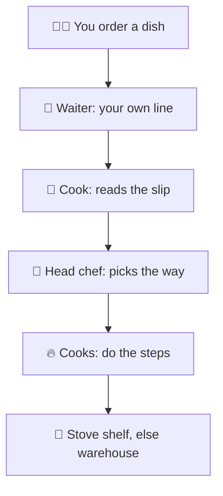
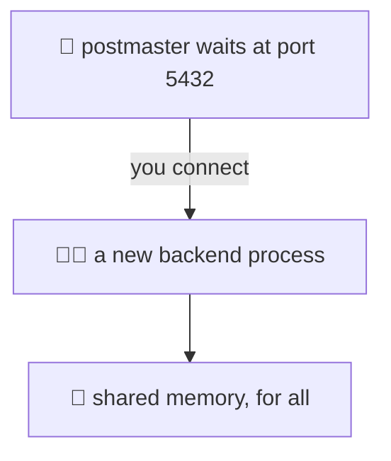
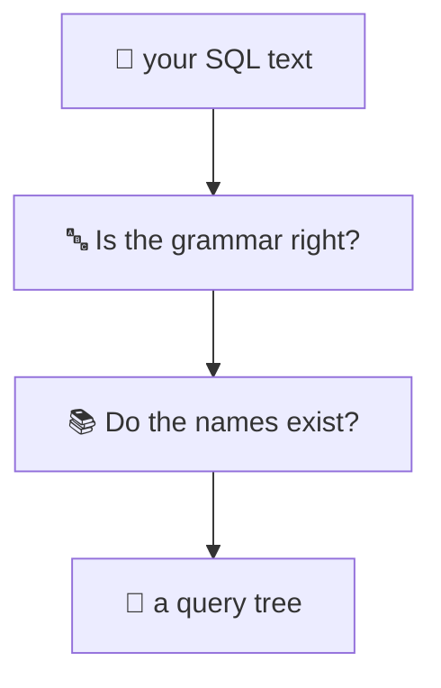
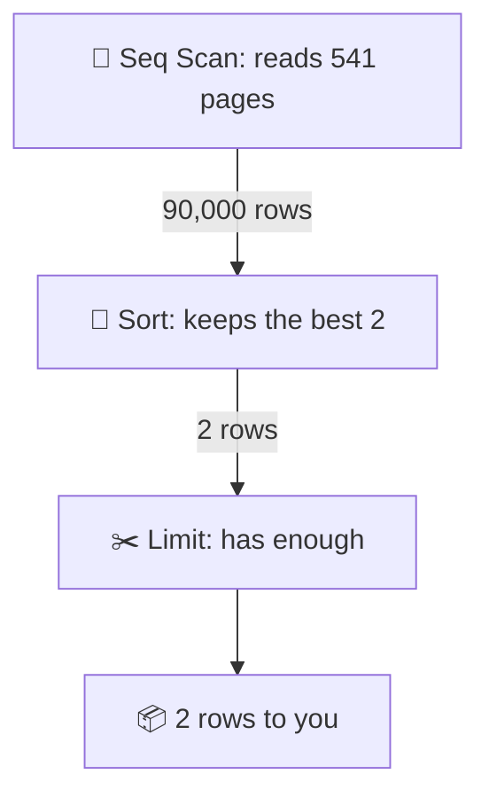
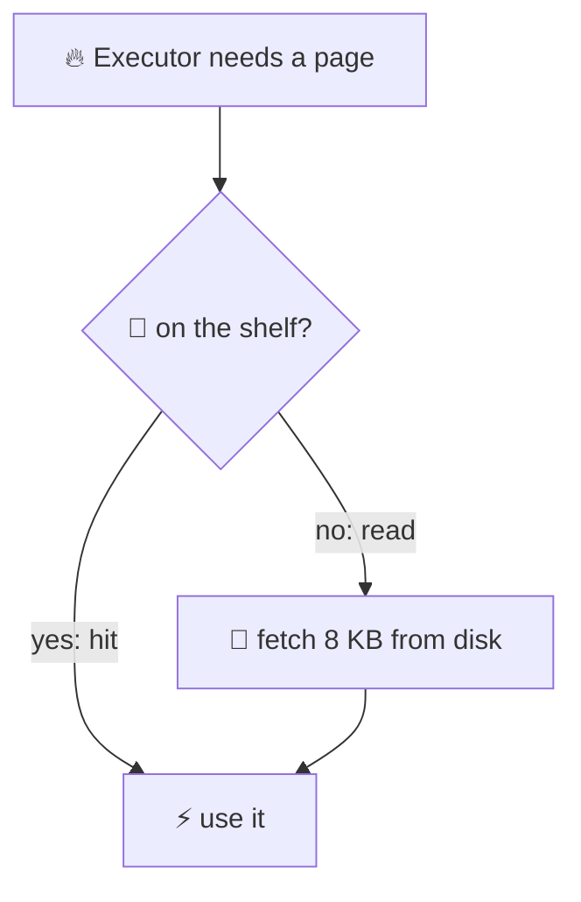
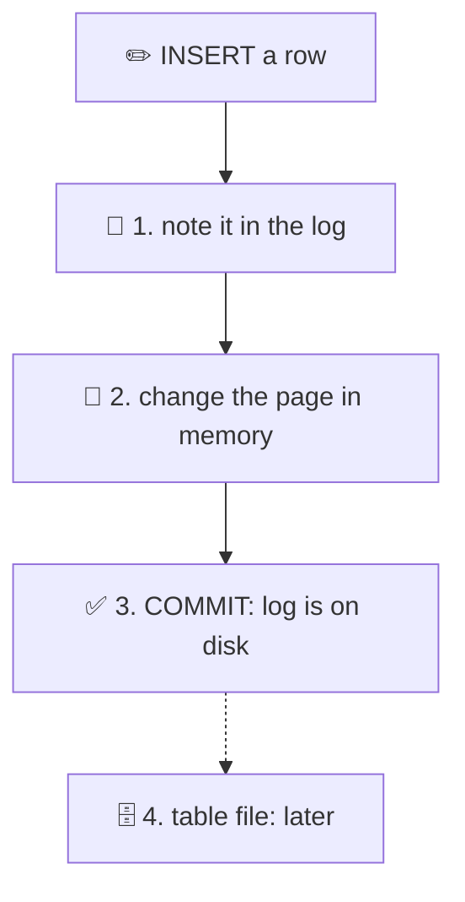
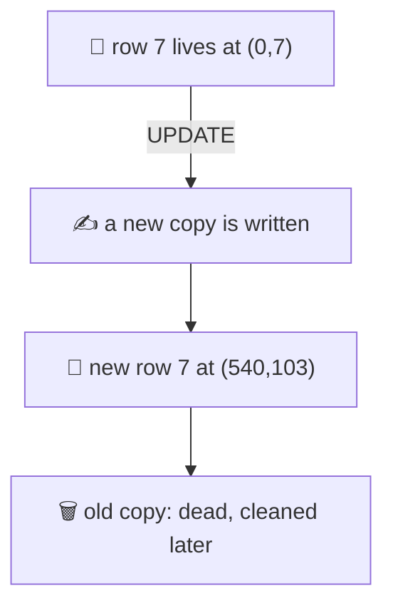

# 24. One query, from start to finish

> **Subject:** Database · **Lesson:** 24 · **Made:** 2026-10-27 · **Status:** ready
>
> **You will be able to:** say what Postgres does from the moment you press Enter until the rows come back (connect, parse, plan, run, memory, disk), say what a write adds (the log goes first), and tell which stop a problem comes from.
>
> **Before this:** [SQL basics and the order a query runs](01-sql-basics-and-query-order.md). [Reading EXPLAIN](11-reading-explain.md) helps, but you can read this first. · **Next:** [An index, built and searched](25-an-index-built-and-searched.md)
>
> **How to read it:** one card is one idea. Look at the picture, guess, then press the orange bar to check. Every number was run on PostgreSQL 17.5 (the newest release is 18). About 25 minutes.

## 1. The idea: a restaurant kitchen

You order a dish. Behind the counter, six things happen.



Postgres has the same six stops: **connect, parse, plan, run, memory, disk.** Each stop is one card below. Each one can go wrong in its own way.

Notice: the head chef never tastes anything. She decides from notes about the kitchen. If the notes are wrong, the plan is wrong (card 5).

<details class="guess"><summary>🤔 Guess: which stop actually reads the rows of your table? Press to check.</summary>

The cooks. In Postgres this is the **executor**.

The cook who reads the slip (the parser) and the head chef (the planner) never touch a row. They only get ready.

</details>

> **Remember:** six stops: connect, parse, plan, run, memory, disk. Only "run" reads rows.

## 2. Stop 1: you get your own process

A host waits at the door. When you connect, the host starts one new helper just for you.



The host is called the **postmaster**. Your helper is a **backend process**. Ten connections are ten processes. The official docs call this a "process per user" model.

<details class="guess"><summary>🤔 Guess: your app opens 500 connections. How many server processes does Postgres run for them? Press to check.</summary>

500 backend processes, plus a few helpers of its own.

Each one uses memory, and the computer must switch between them. So people keep connections few and put a **pool** in front (PgBouncer, lesson 20, not written yet).

</details>

> **Remember:** one connection is one process. Keep connections few. Use a pool.

## 3. Stop 2: the parser reads your words

From here on, every example uses one table, `l24_orders`: 100,000 orders with `id`, `status` and `total_cents`.



The parser turns text into a tree. Then Postgres checks each name in its catalog. (A small third step, the rewriter, swaps a view name for the query behind it.)

Four statements. Each one fails.

```sql
SELCT id FROM l24_orders;
SELECT idd FROM l24_orders;
SELECT id FROM l24_orders
WHERE status = 'PAID' AND;
SELECT 1 / 0;
```

<details class="guess"><summary>🤔 Guess: which stop stops each one? Press to check.</summary>

- 1: the **parser**. `syntax error at or near "SELCT"`
- 2: the **name check**. `column "idd" does not exist`
- 3: the **parser**. `syntax error at end of input`
- 4: the **executor**. `division by zero`. The words are fine. The math only fails when it runs.

Statement 2 is the same kind of error as lesson 1, card 3. The name check happens here, before one row is read.

</details>

> **Remember:** typos and unknown names fail early, before any row is read. Bad math fails late.

## 4. Stop 3: the planner picks the cheapest way

There is an index on `total_cents`. So this query has two ways to run.

```sql
SELECT * FROM l24_orders
WHERE total_cents = 12345;
```

| Way | Cost |
|---|---|
| Read every page | 1791.00 |
| Use the index | 22.95 |

The planner adds up a score for each way. The lowest score wins. Here it uses the index.

<details class="guess"><summary>🤔 Guess: the Seq Scan costs 1791.00. The table has 541 pages and 100,000 rows. Where does 1791 come from? Press to check.</summary>

Three small prices added together:

- 541 pages × 1.00 (read a page in order) = 541
- 100,000 rows × 0.01 (handle a row) = 1,000
- 100,000 rows × 0.0025 (test the WHERE) = 250

541 + 1,000 + 250 = **1,791**.

Cost is **not** milliseconds. It is a made-up score. These prices are settings you can change (`seq_page_cost`, `cpu_tuple_cost`, `cpu_operator_cost`).

</details>

> **Remember:** the planner scores each way and picks the lowest. The score is a guess, not a time.

## 5. The planner's notes

How does the planner know the table has 100,000 rows, and that 10% are PENDING? It keeps **notes** (statistics). It does not count the rows each time.

```sql
EXPLAIN SELECT * FROM l24_orders
WHERE status = 'PENDING';
```

Nobody has run `ANALYZE` on this new table yet. The real answer is 10,000 rows.

<details class="guess"><summary>🤔 Guess: how many rows does the planner expect? About 10,000, about 3,000, or about 300? Press to check.</summary>

About **300**. It printed `rows=325`.

Then I ran `ANALYZE l24_orders;` and asked again. Now it said `rows=9807`. Close to the truth.

`ANALYZE` reads a random sample, so the number moves a little each time (it said 10,030 on an earlier run).

In a real database, **autovacuum** runs ANALYZE for you after about 10% of the rows change. The test tables turn autovacuum off so the numbers stay still.

</details>

> **Remember:** wrong notes make a wrong plan. After a big load, run `ANALYZE`.

## 6. Stop 4: the executor runs the plan

This is the query from lesson 1.

```sql
SELECT id, total_cents
FROM l24_orders
WHERE status = 'PAID'
ORDER BY total_cents DESC
LIMIT 2;
```

The plan is a **tree**. The executor starts at the bottom. Rows flow up, one box at a time.



Notice: the Sort says `top-N heapsort, Memory: 17kB`. It did not sort 90,000 rows. It only kept the 2 best.

<details class="guess"><summary>🤔 Guess: <code>SELECT * FROM l24_orders LIMIT 1</code> on this 541-page table. How many pages does Postgres read? Press to check.</summary>

Only **2**. `EXPLAIN (ANALYZE, BUFFERS)` says `Buffers: shared hit=2`.

Rows are pulled up one at a time. When Limit has enough, it stops asking, and the scan below stops too. That is why LIMIT without a WHERE is fast.

</details>

> **Remember:** the executor pulls rows up the tree. A box that has enough stops asking.

## 7. Memory first, disk second

The stove shelf is fast. The warehouse is slow. Postgres keeps recent pages on the shelf.



Postgres never reads one row from disk. It reads a whole **page** of 8 KB. Pages wait in a memory area called **shared buffers** (128 MB by default).

`EXPLAIN (ANALYZE, BUFFERS)` shows it. `hit` means the page was in memory. `read` means it was not.

<details class="guess"><summary>🤔 Guess: you run a query right after building its index. The first run says <code>shared hit=5 read=2</code>. What does the second run say? Press to check.</summary>

```
Buffers: shared hit=7
```

The same 7 pages. The 2 that were `read` are now in memory. A warm cache is why the second run is faster.

One catch: `read` does not always mean the physical disk. The operating system keeps its own cache, so a `read` can still be quick.

</details>

> **Remember:** `hit` is memory, `read` is not. A page is always 8 KB.

## 8. A write: the log goes first

Before the cook moves anything in the pantry, she writes it in the logbook. If the lights go out, she reads the book and finishes the job.



The logbook is the **WAL** (write-ahead log). One small INSERT into this table (it has 2 indexes) wrote about 240 to 300 bytes of log in my test.

(In the code, the log note and the page change happen together. The rule that counts: the log reaches the disk before the page does.)

<details class="guess"><summary>🤔 Guess: the moment COMMIT finishes, what is already safe on disk: the table page, or the log? Press to check.</summary>

The **log**.

The table page may still be only in memory. It gets written later, in the background. If Postgres crashes, it replays the log and rebuilds the page.

So COMMIT waits for the log to reach the disk, not for the table. That wait is the price of being safe.

</details>

> **Remember:** log first, table later. COMMIT waits for the log.

## 9. An UPDATE writes a new row

You do not erase a paper form. You write a new one and stamp the old one "old".



Every row has an address: **(page, slot)**. It is called the `ctid`.

```sql
SELECT ctid, id, status
FROM l24_orders WHERE id = 7;
```

Then `UPDATE l24_orders SET status = 'CANCELLED' WHERE id = 7;` and ask again.

<details class="guess"><summary>🤔 Guess: after the UPDATE, is row 7 still at (0,7)? Press to check.</summary>

No. It is now at `(540,103)`, near the end of the table. (Yours may be a few slots different.)

The old copy stays, marked dead, until **VACUUM** cleans it. Other transactions that started earlier may still need to see it (lesson 16, not written yet).

Two costs follow. The table grows until VACUUM runs. And every index must learn the new address (lessons 25 and 26).

</details>

> **Remember:** an UPDATE is a new row plus a dead old row. The row moves.

## 10. Watch it run, step by step

Now watch the trip. **[Open the query journey stepper](visuals/24-one-query-start-to-finish.html).** One query goes through the six stops, and you press Next to move it. Guess first.

<details><summary>Or read the steps as a table</summary>

The query from card 6:

| Step | Stop | What happens |
|---|---|---|
| 1 | connect | the postmaster starts a backend process for you |
| 2 | parse | the text becomes a tree (a typo fails here) |
| 3 | names | `l24_orders` and its columns are found (a wrong name fails here) |
| 4 | plan | scores are compared. Seq Scan, Sort, Limit wins |
| 5 | run | Seq Scan reads 541 pages and passes up 90,000 rows |
| 6 | memory | the pages come from shared buffers, or from disk |
| 7 | run | Sort keeps the best 2, Limit stops, 2 rows go back to you |

A write adds one stop between 5 and 6: the change is described in the log first.

</details>

## 11. Why it matters and what it costs

Interview words: *query lifecycle*, *cost-based optimizer*, *statistics*, *shared buffers*, *write-ahead log (WAL)*.

- **With the map,** a problem has an address. You ask "which stop?" before you guess.
- **Without it,** every slow query is a mystery.

| You see | Look at |
|---|---|
| syntax error | parser |
| does not exist | names |
| bad row guess | the notes |
| slow, then fast | memory |
| slow COMMIT | the log |
| too many clients | processes |

(A bad row guess is fixed with `ANALYZE`. Slow then fast means the cache was cold.)

**The costs:**

- The planner is a guess. Old notes give a bad plan.
- Each connection is a whole process.
- Each COMMIT waits for the log.
- Each UPDATE leaves a dead row behind.

## 12. Watch and play

Links checked on 2026-10-27. Each page was opened. For each video, the title and channel were confirmed through YouTube's oEmbed data. The video lengths were not checked.

- **Play with it:** [The query journey stepper](visuals/24-one-query-start-to-finish.html) in this folder. Guess first, then press Next.
- **Play with it:** [Dalibo explain](https://explain.dalibo.com/). Paste a plan from `EXPLAIN` and see it as a tree. Try the plan from card 6.
- **Video:** [Rafia Sabih: PostgreSQL Executor, executing your execution plan](https://www.youtube.com/watch?v=jFlVjmlicy4) (PGConf.EU 2024, from PostgreSQL Europe). A conference talk on how the executor runs a plan. It matches card 6. Watch it after the cards.
- **Video:** [Deeper Understanding of PostgreSQL Execution Plan: At Plan Time and Run Time](https://www.youtube.com/watch?v=Ls-uE1V31lE) from Postgres Conference. What happens at plan time and at run time (cards 4 to 6).
- **Read:** [The Path of a Query](https://www.postgresql.org/docs/current/query-path.html) in the PostgreSQL docs. One page. It is the official version of cards 2 to 6.
- **Read:** [InterDB chapter 3: Query Processing](https://www.interdb.jp/pg/pgsql03.html) by Hironobu Suzuki. A free book with drawings. Chapters [8 (buffer manager)](https://www.interdb.jp/pg/pgsql08.html) and [9 (WAL)](https://www.interdb.jp/pg/pgsql09.html) match cards 7 and 8.
- **Read:** [Using EXPLAIN](https://www.postgresql.org/docs/current/using-explain.html). The cost numbers of card 4 are explained here.

<details><summary>More links (optional)</summary>

- **Read:** [Write-Ahead Logging](https://www.postgresql.org/docs/current/wal-intro.html) in the docs. The official version of card 8.
- **Read:** [PostgreSQL 18 released](https://www.postgresql.org/about/news/postgresql-18-released-3142/). The part about asynchronous I/O is used in card 13.
- **Read (revision, dense):** [How Postgres works inside](postgres-internals-visual.md) in this folder. A long guide. It covers the same ground and more.

</details>

## 13. Practice

**A. Predict the plan.** Before you run it: `EXPLAIN SELECT * FROM l24_orders WHERE id = 5;`. Does it read every page? About how many rows?

<details class="guess"><summary>🤔 Press to see the answer</summary>

```
Index Scan using l24_orders_pkey
  (cost=0.29..8.31 rows=1)
  Index Cond: (id = 5)
```

(Shortened.) No. It uses the primary key index and expects 1 row. The cost is 8.31, against 1791 for reading every page.

</details>

**B. Name the stop.** Where does each problem come from?

1. `ERROR: relation "orderz" does not exist`
2. A query takes 80 ms the first time and 2 ms the second time.
3. `EXPLAIN` says `rows=1`, but 50,000 rows come back.
4. COMMIT is slow on a busy server.
5. `FATAL: sorry, too many clients already`

<details class="guess"><summary>🤔 Press to see the answers</summary>

1. The **name check** (card 3).
2. **Memory against disk** (card 7). The first run read pages from disk. The second found them in memory.
3. The **planner's notes** (card 5). Run `ANALYZE`.
4. The **log flush** (card 8).
5. **Connect** (card 2). Every connection is a process, and the limit (`max_connections`, 100 by default) is full.

</details>

**C. Write it yourself**

Open [`practice/24-one-query-start-to-finish.sql`](practice/24-one-query-start-to-finish.sql). It makes the `l24_orders` table and gives seven tasks with the exact expected results: which stop fails, the planner's guess before and after `ANALYZE`, the plan as a tree, the cost of two ways, the pages in memory, the bytes of log for one INSERT, and where a row goes after an UPDATE. Run the file once in psql, then write each query under its TODO.

<details><summary>One possible answer</summary>

```sql
-- Task 1: say which stop fails.
SELCT id FROM l24_orders;
SELECT idd FROM l24_orders;
SELECT 1 / 0;

-- Task 2
EXPLAIN SELECT * FROM l24_orders
WHERE status = 'PENDING';
ANALYZE l24_orders;
EXPLAIN SELECT * FROM l24_orders
WHERE status = 'PENDING';

-- Task 3
EXPLAIN (ANALYZE, BUFFERS, COSTS OFF,
         TIMING OFF, SUMMARY OFF)
SELECT id, total_cents FROM l24_orders
WHERE status = 'PAID'
ORDER BY total_cents DESC LIMIT 2;

-- Task 4
CREATE INDEX l24_orders_total
  ON l24_orders (total_cents);
ANALYZE l24_orders;
EXPLAIN SELECT * FROM l24_orders
WHERE total_cents = 12345;
SET enable_indexscan = off;
SET enable_bitmapscan = off;
EXPLAIN SELECT * FROM l24_orders
WHERE total_cents = 12345;
RESET enable_indexscan;
RESET enable_bitmapscan;

-- Task 5
SELECT count(*) AS pages_in_memory
FROM pg_buffercache
WHERE relfilenode =
        pg_relation_filenode('l24_orders')
  AND relforknumber = 0;

-- Task 6
SELECT pg_current_wal_lsn() AS before \gset
INSERT INTO l24_orders
VALUES (100001, 'PAID', 5000);
SELECT pg_wal_lsn_diff(
  pg_current_wal_lsn(), :'before'
) AS wal_bytes;

-- Task 7
SELECT ctid, id, status
FROM l24_orders WHERE id = 7;
UPDATE l24_orders
SET status = 'CANCELLED' WHERE id = 7;
SELECT ctid, id, status
FROM l24_orders WHERE id = 7;
```

Task 4 turns off the two index ways so the planner has to show the cost of the Seq Scan. It is a tool for looking, never for fixing a real query.

</details>

## 14. Interview question

**Q:** "What happens inside Postgres when I run a SELECT? And what is different for an UPDATE?"

<details><summary>A strong answer, in four parts</summary>

1. **Problem:** a query is slow or wrong, and you must know where to look. If you see the database as one black box, you can only guess.
2. **How it works:** the client connects, and the postmaster starts one backend process for it. The parser checks the grammar and builds a tree. The names are checked in the catalog. The planner gives each possible way a cost score from its statistics, and picks the lowest. The executor runs the plan as a tree, pulling rows up. It reads 8 KB pages from shared buffers, and from disk when a page is missing. An UPDATE adds two things. The change is written to the write-ahead log first, and COMMIT waits for that log to reach the disk. And the row is not changed in place: a new row version is written, and the old one is cleaned later by VACUUM.
3. **Tradeoff:** the planner works from a guess. Old statistics give a bad plan, and you fix it with `ANALYZE`. A process per connection is simple and safe, but it does not scale to thousands of connections, so you use a pool. Waiting for the log makes COMMIT safe, and it costs time on each commit.
4. **My example:** *This is an idea, not a fact. Replace it with a real story from DBO, Unloan, ZWS or Skyworx.* A page is slow. I run `EXPLAIN (ANALYZE, BUFFERS)` and look at the stops. If the estimate is far from the actual rows, I run `ANALYZE`. If the first run is slow and the second is fast, the cache was cold. If many serverless functions each open a connection, I put a pooler in front.

</details>

## 15. Explain it back

Close this file. Press the **Record my explanation** button under this heading and explain what happens when a query runs, like to a new junior, in 4 parts: problem, how it works, tradeoff, my example. Name the stops in order, and say what a write adds. Then save the transcript into `my-learning/recordings/`, or write your best version below. Run `/explain-check postgres query journey` or ask `coach my explanation`.

### My explanation

<write here>

### Coach feedback

<the explain-coach agent writes here>

## 16. Review questions (day 1, 3, 7, 21)

1. Name the stops of a query in order. Which stop reads the rows?
2. Which stop gives `syntax error`? Which gives `column does not exist`? Which gives `division by zero`?
3. What does `cost=1791.00` mean? Is it milliseconds? How did Postgres get it for a 541-page table with 100,000 rows?
4. What is `ANALYZE` for? What happens to the plan if nobody runs it after a big load?
5. What do `shared hit` and `shared read` mean in `EXPLAIN (ANALYZE, BUFFERS)`?
6. At COMMIT, what is already on disk: the table page or the log? Why?
7. After an UPDATE, where is the row, and what happens to the old copy?

<details><summary>Answers</summary>

1. Connect, parse, plan, run, memory, disk. (The name check sits just after parse.) The executor, at the "run" stop, reads the rows.
2. The parser. The name check. The executor.
3. It is a made-up score, not time. The planner adds 541 pages × 1.00, 100,000 rows × 0.01 and 100,000 rows × 0.0025: 541 + 1,000 + 250 = 1,791.
4. It updates the planner's notes (row counts, common values). Without it the planner guesses (`rows=325` instead of about 10,000), and it can choose a bad plan.
5. `hit`: the page was in shared buffers (memory). `read`: it was not, so Postgres asked the OS (disk, or the OS cache).
6. The log. The log is flushed at COMMIT. The table page is written later. After a crash, Postgres replays the log.
7. It moved to a new address (a new page and slot). The old copy stays as a dead row until VACUUM cleans it.

</details>

## 17. Go deeper (optional)

None of this is needed for the cards above.

<details><summary>The helper processes</summary>

Besides one backend per connection, Postgres runs a few helpers of its own. The docs list them as `backend_type` values in `pg_stat_activity`:

- **checkpointer:** at set times it writes the changed pages in memory out to the table files.
- **background writer:** writes some changed pages out early, in small steps.
- **walwriter:** flushes the log to disk in the background.
- **autovacuum launcher and worker:** run VACUUM and ANALYZE for you.

</details>

<details><summary>Prepared statements and plan reuse</summary>

A prepared statement has a parameter, like `$1`. Postgres can make a plan for each value (a *custom plan*), or one plan for every value (a *generic plan*). The docs say the first five executions use custom plans. After that Postgres may switch to a generic one if it looks as cheap.

You can force it and see the difference:

```sql
PREPARE p(int) AS
  SELECT * FROM l24_orders
  WHERE id = $1;
EXPLAIN (COSTS OFF) EXECUTE p(5);
-- Index Cond: (id = 5)

SET plan_cache_mode =
  force_generic_plan;
EXPLAIN (COSTS OFF) EXECUTE p(5);
-- Index Cond: (id = $1)
```

Why it matters: a generic plan does not know the value. For a lopsided column (90% PAID, 10% PENDING) one plan may fit one value and not the other. Many ORMs use prepared statements, and so do poolers in some modes.

</details>

<details><summary>Parallel query</summary>

For a big table, the planner can start extra worker processes (a `Gather` node with `Parallel Seq Scan`). The 100,000-row table here is too small for that. In lessons 25 and 26 the tables have 1 million rows, so the practice files turn parallel workers off (`SET max_parallel_workers_per_gather = 0`) to keep the plans simple.

</details>

<details><summary>Postgres 18: asynchronous I/O</summary>

Until Postgres 17 a scan asks for one page, waits, then asks for the next. The Postgres 18 release notes (2025-09-25) describe a new asynchronous I/O system that can ask for several pages at once. They say it covers sequential scans, bitmap heap scans and VACUUM, with gains of up to 3x in some cases. The `io_method` setting chooses how. I could not run this here, because my test database is 17.5.

</details>

<details><summary>The first change to a page after a checkpoint</summary>

The setting `full_page_writes` is on by default. The first time a page changes after a checkpoint, Postgres writes the whole 8 KB page into the log, not only the small change. This protects against a half-written page after a crash. If your INSERT in task 6 writes about 8,000 bytes of log and not 300, that is why.

</details>

## Connected lessons

- [01. SQL basics and the order a query runs](01-sql-basics-and-query-order.md): the logical order. This lesson is the physical journey.
- [09. Indexes and B-trees](09-indexes-and-b-trees.md) and [11. Reading EXPLAIN](11-reading-explain.md): the long versions of cards 4 to 6.
- [25. An index, built and searched](25-an-index-built-and-searched.md): the next lesson. What the index in card 4 really is.
- [How Postgres works inside](postgres-internals-visual.md): the long guide with the same map.
