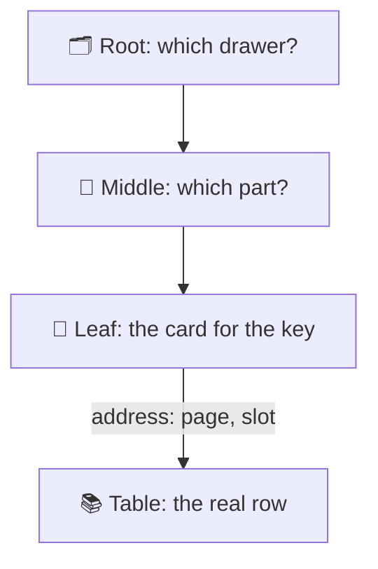
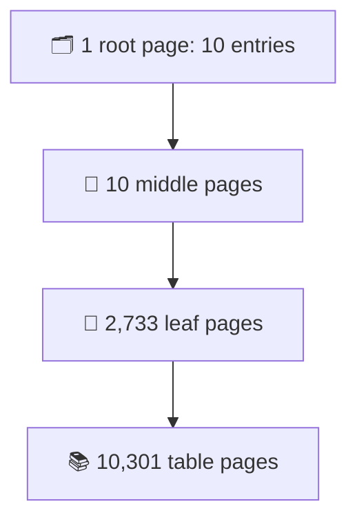
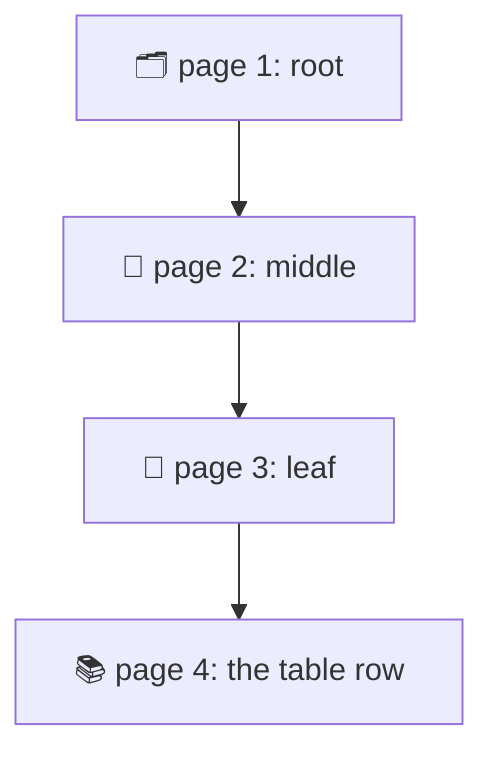
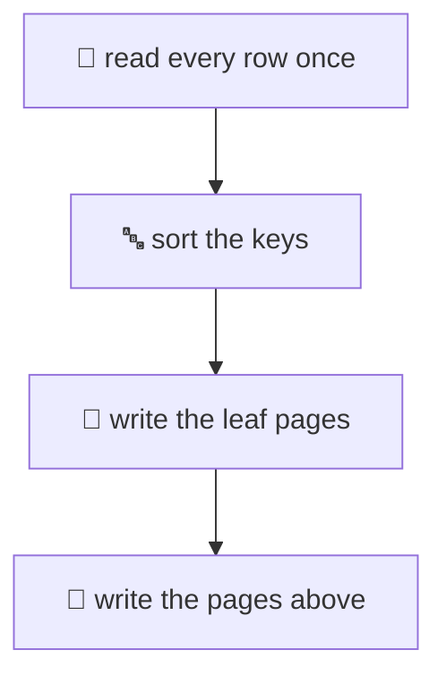

# 25. An index, built and searched

> **Subject:** Database · **Lesson:** 25 · **Made:** 2026-10-27 · **Status:** ready
>
> **You will be able to:** draw a B-tree index from the table up (page, leaf, tree), say how it is built, walk one lookup page by page, and explain why a lookup reads 4 pages and not 10,301.
>
> **Before this:** [Indexes and B-trees](09-indexes-and-b-trees.md) is the gentle start. [One query, from start to finish](24-one-query-start-to-finish.md) gives the map. · **Next:** [What an index costs, and when Postgres ignores it](26-what-an-index-costs.md)
>
> **How to read it:** one card is one idea. Look at the picture, guess, then press the orange bar to check. Every number was run on PostgreSQL 17.5 (the newest release is 18). About 25 minutes.

## 1. The idea: a card catalog

A big library has a card catalog. You never walk every shelf. You open a drawer, then a part of the drawer, then find the card. The card says: **shelf 3, slot 7**.



That is an index. We will use a table `l25_big` with 1 million rows (80 MB, 10,301 pages of 8 KB) and an index on its `id`.

Notice: the index is a second thing, next to the table. It holds the keys in order, and an address for each row.

<details class="guess"><summary>🤔 Guess: find the row with id = 777777. How many 8 KB pages does Postgres read: 4, 400, or 10,301? Press to check.</summary>

**4.** Three index pages (root, middle, leaf) and one table page. `EXPLAIN (ANALYZE, BUFFERS)` says `Buffers: shared hit=4`.

Card 5 shows what happens with no index.

</details>

> **Remember:** an index is a second, sorted copy of one column, with the address of each row.

The catalog is only an analogy. A person sorts the cards once. Postgres must keep the index sorted on every write, and that costs (lesson 26).

## 2. First, the table: pages and addresses

A table is a pile of **pages**, 8 KB each. A row lives in one page, in one **slot**. Its address is `(page, slot)`. Postgres calls it the `ctid`.

A tiny table, `l25_people`. All 6 rows fit in page 0.

| ctid | id | name | city |
|---|---|---|---|
| (0,1) | 1 | Ayu | Medan |
| (0,2) | 2 | Budi | Bali |
| (0,3) | 3 | Citra | Medan |
| (0,4) | 4 | Dewi | Jakarta |
| (0,5) | 5 | Eko | Bali |
| (0,6) | 6 | Fajar | Medan |

```sql
SELECT ctid, id, name
FROM l25_people
WHERE city = 'Medan';
```

<details class="guess"><summary>🤔 Guess: which three addresses come back? Press to check.</summary>

```
 ctid  | id | name
-------+----+--------
 (0,1) |  1 | Ayu
 (0,3) |  3 | Citra
 (0,6) |  6 | Fajar
```

With no index, Postgres reads page 0 and looks at every slot. Fine for 6 rows. For 10,301 pages it would read every one.

</details>

> **Remember:** a row's address is (page, slot). Postgres always reads whole pages.

## 3. The leaf: sorted keys with addresses

The primary key made an index on `id`. We can look at its only leaf page with the `pageinspect` tool.

```sql
SELECT itemoffset,
       ctid AS points_to
FROM bt_page_items(
       'l25_people_pkey', 1)
ORDER BY itemoffset;
```

| key (id) | points to |
|---|---|
| 1 | (0,1) |
| 2 | (0,2) |
| 3 | (0,3) |
| 4 | (0,4) |
| 5 | (0,5) |
| 6 | (0,6) |

<details class="guess"><summary>🤔 Guess: for id = 3, what does the index store: the whole row, or only the key and an address? Press to check.</summary>

Only the **key and the address** `(0,3)`. The row itself stays in the table.

The items are in sorted order. That is the whole trick. A sorted list can be searched by halving it, so you do not read every item.

</details>

> **Remember:** a leaf item is a key plus the address of its row. Items are sorted.

## 4. Many leaves become a tree

A leaf page holds about 400 integer keys. One million keys need **2,733 leaf pages**. How do you know which leaf to open? Add pages above that say "keys 1 to 3,000 are on these leaves". Then add one more page above those.



That is the **B-tree**: a root, middle pages, and leaves. The index is 2,745 pages (21 MB), against 10,301 for the table (80 MB).

```sql
SELECT level
FROM bt_metap('l25_big_pkey');
```

<details class="guess"><summary>🤔 Guess: how many levels does this tree have: 3, 10 or 20? Press to check.</summary>

**3.** Root, middle, leaf. (`bt_metap` says `level = 2`, because it counts up from the leaves, which are level 0.)

Each page holds a few hundred entries. So each new level multiplies the room by a few hundred. Three levels hold tens of millions of rows. The tree stays short and wide.

</details>

> **Remember:** short and wide. 1 million rows is only 3 levels.

## 5. A lookup: walk down, then one jump

For id = 777777, Postgres opens the root, picks a middle page, picks a leaf, finds the key, and reads its address. Then it opens that one table page.



```text
Index Scan using l25_big_pkey
  Index Cond: (id = 777777)
  Buffers: shared hit=4
```

Now the same table, but look for an email. There is no index on `email` yet.

```sql
SELECT * FROM l25_big
WHERE email =
  'user777777@example.com';
```

<details class="guess"><summary>🤔 Guess: how many pages does this one read? Press to check.</summary>

All of them: **10,301.**

```text
Seq Scan on l25_big
  Filter: (email = ...)
  Rows Removed by Filter: 999999
  Buffers: shared hit=10301
```

It read 1 million rows to keep 1. That is 4 pages against 10,301.

Two more things come free with a sorted leaf chain. The leaf pages are linked left to right, so `id BETWEEN 1000 AND 2000` finds 1000 and walks right. And `ORDER BY id LIMIT 3` needs no Sort box: it reads the first 3 entries.

</details>

> **Remember:** with an index, about 4 pages. Without one, every page.

## 6. Index-only scan: skip the table

Sometimes the answer is already in the leaf. `SELECT id ... WHERE id BETWEEN 1000 AND 2000` only needs ids, and the leaf has them. So why visit the table?

One catch. The index does not know if a row is visible to you (other transactions may have changed it). So Postgres keeps a **visibility map**: one bit per table page, "every row here is visible to everyone". If the bit is set, skip the table. **VACUUM** sets the bits.

| Mark | Postgres |
|---|---|
| ✅ set | index only |
| ❌ not set | visits the table |

I loaded the table and ran that query. The plan says `Index Only Scan`.

<details class="guess"><summary>🤔 Guess: the plan also says <code>Heap Fetches: 1001</code>. Why did it go to the table 1,001 times? Press to check.</summary>

The table was just loaded. No page was marked all-visible yet, so for each of the 1,001 rows Postgres had to check the table.

Then I ran `VACUUM l25_big;` and asked again:

```text
Index Only Scan
  Heap Fetches: 0
  Buffers: shared hit=7
```

(Shortened.) 0 table visits, and 7 pages instead of 16. If you ask for a column that is not in the index (like `note`), it is a normal Index Scan again, with 16 pages.

</details>

> **Remember:** an index-only scan needs two things: every column in the index, and VACUUMed pages.

## 7. Building the index

`CREATE INDEX` reads the whole table once, sorts the keys, writes the leaf pages left to right, then writes the pages above them.



An index on `email` for the 1 million rows took **39 MB**. The table is 80 MB. An index is never free.

A plain `CREATE INDEX` locks the table against writes until it ends. Reads still work. `CREATE INDEX CONCURRENTLY` does not block writes. It scans the table twice and waits for old transactions, so it is slower. It cannot run inside a transaction block.

<details class="guess"><summary>🤔 Guess: you add an index to a busy production table with a plain CREATE INDEX. What do your users feel? Press to check.</summary>

Reads work. Every **INSERT, UPDATE and DELETE waits** until the build ends. On a big table that can be minutes, and orders hang.

Next time:

```sql
CREATE INDEX CONCURRENTLY
  l25_big_email
  ON l25_big (email);
```

If a concurrent build fails, it leaves an **INVALID** index. It is ignored by queries, but it still slows every write. Look for it:

```sql
SELECT indexrelid::regclass
FROM pg_index
WHERE NOT indisvalid;
```

Drop it and try again.

</details>

> **Remember:** on a live table, use CREATE INDEX CONCURRENTLY. Then check for INVALID.

## 8. Watch it run, step by step

Now watch a lookup walk the tree. **[Open the index lookup stepper](visuals/25-an-index-built-and-searched.html).** You press Next, and a key goes from the root down to the table row. Guess the next page first.

<details><summary>Or read the steps as a table</summary>

The lookup `WHERE id = 777777` on 1 million rows:

| Step | Page | What happens |
|---|---|---|
| 1 | root | which of the 10 middle pages? Page 2 |
| 2 | middle | which of its leaves? Leaf 3 |
| 3 | leaf | finds key 777777 and its address (page, slot) |
| 4 | table | reads that one table page and returns the row |

Total: 4 pages. Without the index: 10,301.

</details>

## 9. Why it matters and what it costs

Interview words: *B-tree (B+tree)*, *leaf page*, *TID*, *index scan*, *index-only scan*, *visibility map*.

- **With it,** a lookup reads about 4 pages on a million rows. The number grows very slowly as the table grows.
- **Without it,** every query on that column reads the whole table.

**The costs:**

- **Space:** the email index is 39 MB next to an 80 MB table.
- **Build time:** the table is read once, and sorted.
- **Maintenance:** VACUUM must run for index-only scans to work.
- **Writes:** every INSERT and UPDATE must keep the tree sorted. That is lesson 26.

## 10. Watch and play

Links checked on 2026-10-27. Each page was opened. For each video, the title and channel were confirmed through YouTube's oEmbed data. The video lengths were not checked.

- **Play with it:** [The index lookup stepper](visuals/25-an-index-built-and-searched.html) in this folder. Guess first, then press Next.
- **Play with it:** [B+ tree visualization](https://www.cs.usfca.edu/~galles/visualization/BPlusTree.html) by David Galles. Insert numbers and watch pages split. Insert 1 to 10 in order, then try a random order.
- **Video:** [The critical data structure for databases (B-trees)](https://www.youtube.com/watch?v=5jC2nebEvas) by Ben Dicken. How B-trees work and why databases use them. Watch it after card 4.
- **Video:** [Lesson #6 - Index Types (B-Tree), Deep Dive Into PostgreSQL Indexes](https://www.youtube.com/watch?v=AIOxQ3aXiWk) from Percona. A longer course lesson on Postgres B-trees.
- **Read:** [Anatomy of an SQL Index](https://use-the-index-luke.com/sql/anatomy) by Markus Winand. Pictures of the leaf chain and the tree. Read the next page, "The Balanced Search Tree", too.
- **Read:** [B-Tree Indexes](https://www.postgresql.org/docs/current/btree.html) in the PostgreSQL docs. Page types, the linked leaves, and deduplication.
- **Read:** [Index-Only Scans and Covering Indexes](https://www.postgresql.org/docs/current/indexes-index-only-scans.html). The official version of card 6.

<details><summary>More links (optional)</summary>

- **Read:** [CREATE INDEX](https://www.postgresql.org/docs/current/sql-createindex.html). The exact rules for CONCURRENTLY, in the section with that name.
- **Read:** [pageinspect](https://www.postgresql.org/docs/current/pageinspect.html). The tool used in cards 3 and 4.
- **Read (revision, dense):** [How Postgres works inside](postgres-internals-visual.md), Part 2 "The B-tree Index, Physically".

</details>

## 11. Practice

**A. Predict.** Before you run it: `SELECT id FROM l25_big ORDER BY id LIMIT 3;`. Does the plan have a Sort box?

<details class="guess"><summary>🤔 Press to see the answer</summary>

```text
Limit
  -> Index Only Scan
```

(Shortened.) No Sort. The leaf is already in order, so Postgres reads the first 3 entries and stops.

</details>

**B. What went wrong?** A teammate says: "Last night I added an index on `email` with a plain `CREATE INDEX` on the live table. At the same time, users said orders hung for 4 minutes." Explain, and say what to do next time.

<details class="guess"><summary>🤔 Press to see the answer</summary>

A plain CREATE INDEX blocks every write to the table until the build ends (card 7). Orders are inserts, so they waited.

Next time use `CREATE INDEX CONCURRENTLY`. It is slower, but writes keep working. Afterwards, check `pg_index` for `NOT indisvalid`.

</details>

**C. Write it yourself**

Open [`practice/25-an-index-built-and-searched.sql`](practice/25-an-index-built-and-searched.sql). It makes the tiny table and the 1 million row table, and gives six tasks with the exact expected results: the addresses, the leaf items, the tree depth, the page count of two lookups, the index-only scan before and after VACUUM, and the index build. Run the file once in psql, then write each query under its TODO.

<details><summary>One possible answer</summary>

```sql
-- Task 1
SELECT ctid, id, name FROM l25_people
ORDER BY id;

-- Task 2
SELECT itemoffset, ctid AS points_to
FROM bt_page_items('l25_people_pkey', 1)
ORDER BY itemoffset;

-- Task 3
SELECT level FROM bt_metap('l25_big_pkey');
SELECT relname, relpages FROM pg_class
WHERE relname IN ('l25_big','l25_big_pkey')
ORDER BY relname;

-- Task 4
EXPLAIN (ANALYZE, BUFFERS, COSTS OFF,
         TIMING OFF, SUMMARY OFF)
SELECT * FROM l25_big WHERE id = 777777;
EXPLAIN (ANALYZE, BUFFERS, COSTS OFF,
         TIMING OFF, SUMMARY OFF)
SELECT * FROM l25_big
WHERE email = 'user777777@example.com';

-- Task 5
EXPLAIN (ANALYZE, BUFFERS, COSTS OFF,
         TIMING OFF, SUMMARY OFF)
SELECT id FROM l25_big
WHERE id BETWEEN 1000 AND 2000;
VACUUM l25_big;
-- run the same EXPLAIN again

-- Task 6
CREATE INDEX CONCURRENTLY l25_big_email
  ON l25_big (email);
SELECT pg_size_pretty(
  pg_relation_size('l25_big_email'));
SELECT indexrelid::regclass
FROM pg_index WHERE NOT indisvalid;
```

</details>

## 12. Interview question

**Q:** "How does a B-tree index find a row? Why is it fast on a table with a million rows? What does it cost?"

<details><summary>A strong answer, in four parts</summary>

1. **Problem:** without an index, Postgres must read every page of the table to find one row. On a million rows that is thousands of pages for one answer.
2. **How it works:** the index is a tree of 8 KB pages. The leaf pages hold the keys in sorted order, each with the address (page, slot) of its row, and the leaves are linked left to right. Pages above the leaves say which leaf to open. Each page holds hundreds of entries, so the tree is short: 3 levels for a million rows. A lookup reads the root, a middle page, a leaf, and then one table page: about 4 pages. A range or an ORDER BY walks along the leaves. If the query needs only indexed columns, and VACUUM has marked the table pages all-visible, an index-only scan skips the table.
3. **Tradeoff:** the index takes space (39 MB for an 80 MB table in my test) and must be kept sorted on every write, so it slows INSERT and UPDATE. On a live table you build it with CONCURRENTLY, which is slower but does not block writes, and you check for an INVALID index afterwards.
4. **My example:** *This is an idea, not a fact. Replace it with a real story from DBO, Unloan, ZWS or Skyworx.* A screen looks up an order by a customer email. Without an index the query reads the whole `orders` table. I add an index on `email` with CONCURRENTLY, and check with `EXPLAIN (ANALYZE, BUFFERS)` that the pages dropped from thousands to about 4.

</details>

## 13. Explain it back

Close this file. Press the **Record my explanation** button under this heading and explain how a B-tree index finds a row, like to a new junior, in 4 parts: problem, how it works, tradeoff, my example. Use the numbers: 3 levels, about 4 pages, against every page. Then save the transcript into `my-learning/recordings/`, or write your best version below. Run `/explain-check postgres index` or ask `coach my explanation`.

### My explanation

<write here>

### Coach feedback

<the explain-coach agent writes here>

## 14. Review questions (day 1, 3, 7, 21)

1. What is a `ctid`? What does `(0,3)` mean?
2. What does one leaf item hold? Does the index hold the whole row?
3. How many levels does an index on 1 million integers have, and why so few?
4. How many pages does a lookup by an indexed id read on 1 million rows? And by an email with no index?
5. Why can an Index Only Scan still say `Heap Fetches: 1001`? What fixes it?
6. What does a plain CREATE INDEX do to users on a live table? What do you use instead, and what do you check after?
7. Draw the picture from card 4 from memory: root, middle pages, leaves, table, with the counts.

<details><summary>Answers</summary>

1. The address of a row: page number and slot number. `(0,3)` is the third slot of page 0.
2. A key and the address of its row. The row stays in the table.
3. Three levels. A page holds a few hundred entries, so each level multiplies the room by a few hundred.
4. 4 pages (3 index and 1 table). With no index, all 10,301 pages.
5. The table pages are not marked all-visible yet, so Postgres checks the table for each row. VACUUM sets the marks.
6. It blocks writes until it ends (reads work). Use CREATE INDEX CONCURRENTLY, then look for `NOT indisvalid` in `pg_index`.
7. 1 root page (10 entries), 10 middle pages, 2,733 leaf pages, and 10,301 table pages. The leaves point to the table.

</details>

## 15. Go deeper (optional)

None of this is needed for the cards above.

<details><summary>Look inside a page yourself</summary>

The `pageinspect` extension lets you read the raw pages. It needs a superuser, so use it on a test database only.

```sql
CREATE EXTENSION IF NOT EXISTS pageinspect;

-- The map page: root and levels
SELECT root, level FROM bt_metap('l25_big_pkey');

-- One page: root (r), internal (i) or leaf (l)
SELECT type, live_items, btpo_prev, btpo_next
FROM bt_page_stats('l25_big_pkey', 1);

-- The items in one page
SELECT itemoffset, ctid
FROM bt_page_items('l25_big_pkey', 1)
LIMIT 5;
```

`btpo_prev` and `btpo_next` are the links to the left and right leaf. Count the page types in the whole index: 1 root, 10 internal, 2,733 leaf (plus page 0, the map).

</details>

<details><summary>Why leaf pages are 90% full</summary>

A B-tree index is built with a fillfactor of 90 by default. After `CREATE INDEX`, a leaf page had 367 items and about 10% free space (808 of 8,192 bytes). The free space leaves room for new keys, so the first inserts do not split the page. Lesson 26 shows the split.

</details>

<details><summary>Wide keys make a taller index</summary>

The email index (39 MB) is almost twice the size of the id index (21 MB) for the same million rows. A wider key means fewer entries per page, so more leaf pages, and sometimes one more level. A narrow key (an integer) is cheaper than a long text key.

</details>

<details><summary>What the docs say about B-trees</summary>

The PostgreSQL docs say each level of the tree is a doubly linked list of pages, that a metapage sits at the start of the index file, and that over 99% of the pages are leaf pages. Since Postgres 13 a B-tree can store a repeated key once, followed by a list of addresses (deduplication). This is on by default.

</details>

## Connected lessons

- [24. One query, from start to finish](24-one-query-start-to-finish.md): where an index scan fits in the run stop.
- [09. Indexes and B-trees](09-indexes-and-b-trees.md) and [10. Composite, partial and covering indexes](10-composite-partial-and-covering-indexes.md): the long versions.
- [26. What an index costs, and when Postgres ignores it](26-what-an-index-costs.md): the next lesson. Splits, writes, HOT updates and the planner.
- [How Postgres works inside](postgres-internals-visual.md): the long guide, Part 2.
