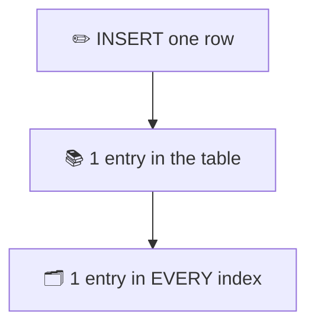
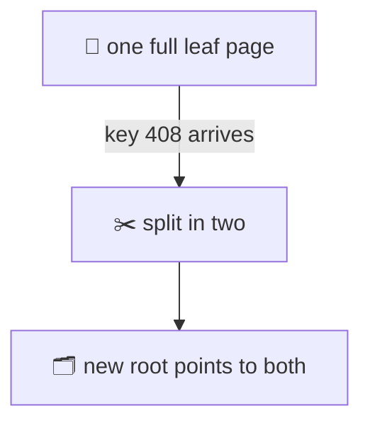

# 26. What an index costs, and when Postgres ignores it

> **Subject:** Database · **Lesson:** 26 · **Made:** 2026-10-27 · **Status:** ready
>
> **You will be able to:** say what an INSERT and an UPDATE do to every index (including the page split and the HOT shortcut), say why the planner sometimes ignores an index, and pick a better index type for a huge table.
>
> **Before this:** [An index, built and searched](25-an-index-built-and-searched.md). · **Next:** none yet. Transactions come later (lessons 13 to 16, not written yet).
>
> **How to read it:** one card is one idea. Look at the picture, guess, then press the orange bar to check. The blue bars (📖 More detail) hold the longer explanation with the why and a real example. Skip them on the first read, and open them when you want more. Every number was run on PostgreSQL 17.5 (the newest release is 18). About 25 minutes for the cards.

## 1. The idea: every catalog needs a new card

A shop has a main shelf, plus three card catalogs: by title, by author, by year. A new book arrives. You put it on the shelf. Then you must also write a card for each catalog, in the right sorted spot.



Reads got fast in lesson 25. This lesson is the bill for it.

<details class="guess"><summary>🤔 Guess: a table has 5 indexes (the primary key and 4 more). You INSERT one row. How many places does Postgres write an entry: 1, 2, or 6? Press to check.</summary>

**6.** One table row, and one entry in each of the 5 indexes.

(A *partial* index, lesson 10, skips rows that do not match its WHERE, so it counts only when the row matches.)

</details>

> **Remember:** every index is written on every INSERT. More indexes, slower writes.

<details class="more"><summary>📖 More detail: write amplification, measured</summary>

**Write amplification** means: one small change you make causes many bigger writes inside the database. For an INSERT, each index adds a page to change and a record to log.

I measured the log (WAL) for a single-row INSERT into tables with 0, 1, 3 and 5 indexes. 5,000 inserts each:

| Indexes | Log bytes per row |
|---|---|
| 0 | 120 |
| 1 | 193 |
| 3 | 344 |
| 5 | 495 |

Each index adds about 75 bytes of log to every INSERT. On top of that come the page changes in memory, and later the page writes to disk. Your numbers will differ a little by version, but the pattern holds: **more indexes, more log per write**. This is why a table that is written a lot should keep only the indexes it needs.

</details>

## 2. A full page splits

Leaf pages are 8 KB and sorted. When a new key arrives and its page is full, Postgres **splits** the page into two.

I made an empty table with an integer primary key. I inserted ids 1, 2, 3 and so on.

```sql
INSERT INTO l26_split
SELECT g
FROM generate_series(1, 407) g;
-- index now: 2 pages

INSERT INTO l26_split
VALUES (408);
```



<details class="guess"><summary>🤔 Guess: one leaf holds about 400 keys. What happens to key number 408? Press to check.</summary>

Key 408 did not fit. The page **split**. Before: 2 index pages (the map page and 1 leaf) and `level = 0`. After: 4 pages (map, 2 leaves, and a new root) and `level = 1`.

The left page kept about 90% of its space used. The new right page took the rest.

A split writes three pages (old leaf, new leaf, and the parent), not one. It is rare for any single insert. But when keys arrive in random order, splits happen all over the tree. When keys grow in order (a serial id), they happen only at the right edge.

</details>

> **Remember:** a full page splits in two. Keys in order split only on the right edge.

<details class="more"><summary>📖 More detail: what a split does</summary>

A split has three steps:

1. Postgres allocates a new page.
2. It moves the upper part of the items to the new page. The left page keeps the lower part, and gets a **high key** and a **right link** to the new page.
3. It adds an entry for the new page in the parent. If the parent is full, the parent splits too, and so on up to the root. A root split adds one level. The docs say so.

A search that arrives in the middle of a split follows the right link and still finds its key. This is the Lehman and Yao design from the source README.

Now measure which keys split more. I inserted 200,000 integers into an index that already existed:

- In order: leaf pages 10.0% empty, 547 leaf pages.
- In random order: leaf pages 24.6% empty, 654 leaf pages.

The random order made about 20% more leaf pages for the same data. More pages to cache and to write. `REINDEX` makes it tidy again. This is the cost of a random key, like a random UUID. When keys arrive in order, only the last page splits, and the other pages stay 90% full.

</details>

## 3. An UPDATE that is not HOT writes into every index

An UPDATE writes a new row version (lesson 24, card 9). The new version has a **new address**. Every index finds rows by address. So every index needs a new entry, not only the index on the column you changed.

I made a table of 100,000 rows with a primary key on `id` and an index on `email`. Then I changed only the email:

```sql
UPDATE l26_hot100
SET email = 'x' || email;
```

| | Before | After |
|---|---|---|
| Table | 5,888 kB | 11 MB |
| id index | 2,208 kB | 4,408 kB |
| email index | 6,928 kB | 13 MB |

<details class="guess"><summary>🤔 Guess: the UPDATE changed only <code>email</code>. Did the primary key index (on <code>id</code>) grow? Press to check.</summary>

Yes. It **doubled**: 2,208 kB to 4,408 kB.

The `id` did not change, but the row moved to a new address. So the primary key index needs a new entry that points to it. The table and the email index doubled too.

The old entries and old rows stay, dead, until VACUUM cleans them. VACUUM makes the space reusable. It does not shrink the file. `REINDEX` rebuilds an index small again.

(If the email stays the same, the email index barely grows: 6,928 kB to 7,168 kB in my test. B-tree deduplication stores a repeated key once, with a list of addresses. The primary key index still doubled.)

</details>

> **Remember:** an UPDATE that is not HOT adds an entry to every index, even for columns you did not change.

<details class="more"><summary>📖 More detail: the log cost of an UPDATE</summary>

I measured the log for single-row UPDATEs on a table with 3 indexes. 3,000 updates each:

- HOT update (a plain column, room on the page): **442 bytes** per update.
- Not HOT (an indexed column changes): **890 bytes** per update.

About twice as much log, because every index also needs a new entry.

Then there is the clean-up. VACUUM must remove every dead row version, and every dead entry from every index. Postgres helps in two ways. When a leaf page is about to split because of old versions from updates, it first tries to delete dead entries from that page (*bottom-up deletion*). And when one key appears many times, it can store the key once with a list of addresses (*deduplication*, on by default). Both are in the source README. Both help only when keys repeat, or when the update does not change the key.

An index that is much bigger than it needs to be is called **bloated**. `REINDEX INDEX CONCURRENTLY` rebuilds it without blocking writes.

</details>

## 4. HOT: the shortcut

Card 3 was the expensive case. What if you change a column that has **no index**, like `note`? The new row version can stay on the same page, and the indexes keep pointing at the old spot. A small forward link finishes the job. This is a **HOT update** (heap-only tuple). It needs no new index entry at all.

Two conditions, from the docs:

1. No indexed column changes.
2. There is room for the new version on the same page.

Test: 100,000 rows, and `UPDATE ... SET note = 'v2'` on all of them. The email column has an index, `note` does not.

<details class="guess"><summary>🤔 Guess: pages are 100% full by default. How many of the 100,000 updates are HOT? Press to check.</summary>

**0.** There was no room on any page.

I made a second table with `fillfactor = 70`, so 30% of each page stays empty. Same update: **43,173** of 100,000 were HOT.

| Table | Updates | HOT |
|---|---|---|
| l26_hot100b | 100,000 | 0 |
| l26_hot70 | 100,000 | 43,173 |

Updating every row in one statement is the worst case. In a live system, old versions are cleaned between updates, so more of them are HOT. The rule is the same: no room on the page, no HOT.

</details>

> **Remember:** HOT needs no indexed column changed and room on the page. A lower fillfactor leaves room.

<details class="more"><summary>📖 More detail: HOT on the page, and how often it works</summary>

With `pageinspect` you can see a HOT chain. I made a table with `fillfactor = 70`, inserted 3 rows, and updated a plain column of row 2:

| Slot | ctid | Flag |
|---|---|---|
| 2 | (0,4) | HEAP_HOT_UPDATED |
| 4 | (0,4) | HEAP_ONLY_TUPLE |

Slot 2 is the old version. It points to slot 4 and is marked "HOT updated". Slot 4 is the new version, marked "heap only": **no index points to it**. The indexes still point to slot 2. A lookup finds slot 2, sees the mark, and follows the chain to slot 4.

Old versions in a HOT chain are cleaned inside the page, without VACUUM. This is called *pruning*. It happens when a page is nearly full, even during a SELECT. The docs say so.

The test in card 4 updated every row in one statement. That is the worst case. In a second test I updated 3,000 different rows, one statement each, with `fillfactor = 100`. **2,627 of them (88%) were HOT**, because pruning freed room between the updates.

Two notes from the docs. A `fillfactor` set with `ALTER TABLE` only affects pages written afterwards. And a BRIN index does not stop a HOT update.

</details>

## 5. The planner ignores your index: too many rows

There is an index on `status`. The table has 1 million rows: 900,000 `PAID` and 100,000 `PENDING`.

To find all red books when 9 of 10 books are red, you do not use the catalog. You walk the shelves.

```sql
SELECT * FROM l26_orders
WHERE status = 'PAID';
```

<details class="guess"><summary>🤔 Guess: does Postgres use the index on <code>status</code> for PAID? And for PENDING? Press to check.</summary>

For **PAID** (90%): no. It reads the whole table.

```text
Seq Scan on l26_orders
  Filter: (status = 'PAID'...)
```

For **PENDING** (10%): yes.

```text
Bitmap Heap Scan on l26_orders
  -> Bitmap Index Scan
       on l26_orders_status
```

(Shortened.)

Why: using the index means jumping to table pages in a scattered order, 900,000 times. Reading the table once, in order, is cheaper. The planner works this out from its notes (lesson 24, card 5).

</details>

> **Remember:** an index helps when few rows match. When most rows match, reading the table is cheaper.

<details class="more"><summary>📖 More detail: the numbers behind the choice</summary>

For PAID (900,000 rows) I looked at both plans:

- Seq Scan: cost **22,801**.
- Bitmap Heap Scan (forced with `SET enable_seqscan = off`): cost **31,589**.

For PENDING (100,000 rows) the bitmap plan costs **12,664**. That is less than the 22,801 of the Seq Scan, so the index wins.

A **bitmap scan** first collects the addresses from the index, sorts them by table page, and then reads each table page once, in order. It is the middle way between one-by-one index jumps and reading everything.

The break-even is not a fixed percent. It also depends on **correlation**: how well the column order matches the row order in the table (lesson 24, card 5, More detail). `id` has correlation 1, so an index scan reads the table pages in order, which is cheap. For `WHERE id < X` on 1 million rows:

| Rows matched | Plan |
|---|---|
| 0.1% | Index Scan |
| 5% | Index Scan |
| 20% | Index Scan |
| 50% | Index Scan |
| 90% | Seq Scan |

Do not learn a percent. Ask EXPLAIN.

</details>

## 6. The planner ignores your index: you hid the column

There is an index on `email` (and the primary key on `id`). Four queries.

```sql
-- 1
WHERE email =
  'user777777@example.com'
-- 2
WHERE lower(email) =
  'user777777@example.com'
-- 3
WHERE email LIKE
  '%777777@example.com'
-- 4
WHERE id::text = '777777'
```

<details class="guess"><summary>🤔 Guess: which of the four can use an index? Press to check.</summary>

Only **1**. The other three are a `Seq Scan`.

- 2: the index holds `email`, not `lower(email)`.
- 3: the index is sorted by the start of the text. A `%` at the start gives it nothing to search by.
- 4: the index holds numbers. The cast turns the column into text first.

Fixes:

```sql
-- 2: index the expression
CREATE INDEX
  l26_orders_email_lower
  ON l26_orders (lower(email));
-- 4: compare number to number
WHERE id = 777777
```

After the first fix, query 2 uses `Bitmap Index Scan on l26_orders_email_lower`.

</details>

> **Remember:** do not wrap the indexed column in a function or a cast. If you must, index the expression.

<details class="more"><summary>📖 More detail: why the index cannot help</summary>

An index on `email` is sorted by `email`. The values of `lower(email)` are another list, in another order. The index knows nothing about them. The same is true for `id::text`.

**Dates are the most common case.** There is a B-tree index on the timestamp `at` (1 million rows):

- `at::date = '2026-01-05'`: Seq Scan.
- `at >= '2026-01-05' AND at < '2026-01-06'`: Index Only Scan.

The rule: leave the column alone, and change the other side. Turn "this day" into a range.

**LIKE.** `LIKE 'abc%'` has a fixed start, so a B-tree can help. `LIKE '%abc'` has none. In a database that does not use the C locale, the index also needs `text_pattern_ops` before `LIKE` can use it (the docs say so). My test database uses the C locale, so I did not test that.

An **expression index** stores the result for every row, for example `lower(email)`. The query must use the same expression. And the expression is worked out again on every INSERT and UPDATE.

</details>

## 7. Other kinds of index

B-tree is the default. Postgres has more.

| Type | Good for |
|---|---|
| B-tree | `=`, `<`, `>`, sorting |
| Hash | `=` only |
| GIN | arrays, JSONB, text |
| GiST | shapes, ranges |
| BRIN | huge ordered tables |

GIN finds rows by the values inside a column (an array, a JSONB document, a text). GiST handles shapes, ranges and nearest-neighbor search. In my test a hash index was used for `=` and ignored for `>`.

A table has 1 million events, one per second, stored in time order. A B-tree on the time column is 21 MB. The table is 42 MB.

<details class="guess"><summary>🤔 Guess: how big is a BRIN index on the same time column: 21 MB, 2 MB, or 24 kB? Press to check.</summary>

**24 kB.**

BRIN does not store one entry per row. It stores a small min and max for each block of pages. That works only because the rows are stored in time order. The docs say BRIN is most effective for columns that match the physical order of the table.

For the exact row it is less precise than a B-tree, so it reads a few extra pages. For a huge, append-only log, that is a great trade.

</details>

> **Remember:** default to B-tree. Think BRIN for huge tables that grow in the order of one column.

<details class="more"><summary>📖 More detail: BRIN ranges, and the hash index</summary>

A BRIN index keeps a small summary for each **block range**: 128 table pages by default (`pages_per_range`). For the column `at` it keeps the smallest and the largest time in the range. With `brin_page_items` I read the first three ranges of the events index:

| Table pages | Smallest | Largest |
|---|---|---|
| 0 to 127 | 07:00:01 | 13:34:40 |
| 128 to 255 | 13:34:41 | 20:09:20 |
| 256 to 383 | 20:09:21 | 02:44:00 |

(The times are in the +07 time zone of my test. The third range ends on the next day.) The table has 5,406 pages, so there are 43 ranges. The whole index is 24 kB, which is 3 pages.

A query for one day checks the ranges and skips every range that cannot contain it. It reads the others and checks each row again. BRIN is *lossy*, the docs say.

It works only because new rows have later times, so each range covers its own slice of time. If the rows were in random time order, every range would cover nearly the whole span, and nothing could be skipped.

**Hash.** A hash index stores only a 4-byte **hash** of each key, so its size does not depend on how long the key is. It answers `=` only, and it is lossy too. On 1 million `note` texts: hash 32 MB, B-tree 39 MB. The docs say it is fully crash recoverable.

</details>

## 8. Cleaning up: indexes nobody uses

An index nobody uses still costs space and slows every write. Postgres counts how often each index is used.

```sql
SELECT indexrelname, idx_scan
FROM pg_stat_user_indexes
WHERE relname = 'l26_orders'
ORDER BY idx_scan;
```

I ran three real queries first (an id lookup, an email lookup, and a count of PENDING).

<details class="guess"><summary>🤔 Guess: one of the four indexes shows <code>idx_scan = 0</code>. Which one, and how big is it? Press to check.</summary>

(Names shortened. Each starts with `l26_orders_`.)

| Index | idx_scan |
|---|---|
| email_lower | 0 |
| email | 1 |
| pkey | 1 |
| status | 1 |

`l26_orders_email_lower`, **39 MB**. Nobody queried `lower(email)` in my test.

Careful before you drop one. `idx_scan = 0` only means "not used since the counters started". Check how long that is. Never drop an index that backs a PRIMARY KEY or a UNIQUE rule. And a failed `CREATE INDEX CONCURRENTLY` leaves an INVALID index (lesson 25) that you should drop.

</details>

> **Remember:** unused indexes still cost on every write. Check `idx_scan`, then drop with care.

<details class="more"><summary>📖 More detail: reading the counters safely</summary>

`pg_stat_user_indexes` has two useful columns: `idx_scan` (how many scans) and `last_idx_scan` (the time of the last scan). In my test, the two used indexes had a time, and the two unused ones had none. "Not used for 3 months" is a stronger sign than "0 scans".

Where the counters can fool you:

- They start at the last **reset**. After a clean restart they are kept. After a crash or an immediate shutdown, **all counters are reset**. The docs say so. Look at `stats_reset` in `pg_stat_database`.
- Each server keeps its own counters. A read replica counts its own scans, not the primary's. Check both.
- A monthly or yearly report may use an index that looks unused today.

Do not drop an index only because its count is 0 if it:

- backs a PRIMARY KEY, UNIQUE or EXCLUDE rule, or
- is on the columns of a **foreign key**. The docs say it is often a good idea to index the referencing columns, because deleting a row from the referenced table must look for the rows that refer to it.

Also look for two indexes on the same columns. One of them is waste.

</details>

## 9. Watch it run, step by step

Now watch a write change the indexes. **[Open the index cost stepper](visuals/26-what-an-index-costs.html).** It has three tabs: a HOT update, an update that is not HOT, and an insert that splits a page. Guess first, then press Next.

<details><summary>Or read the write path as a table</summary>

One UPDATE, `UPDATE l26_orders SET note = 'v2' WHERE id = 5`:

| Step | What happens |
|---|---|
| 1 | the change is described in the log (WAL) |
| 2 | a new row version is written. On the same page if there is room |
| 3 | the indexes: nothing is added if it is HOT. Otherwise one new entry in each index |
| 4 | the old version stays, dead, until VACUUM |
| 5 | COMMIT waits for the log to reach the disk |

Compare with a `SET email = ...` update, or any update with no room on the page: step 3 adds a new entry in every index, and may split a page.

</details>

## 10. Why it matters and what it costs

Interview words: *write amplification*, *page split*, *HOT update*, *fillfactor*, *selectivity*, *BRIN*, *covering/partial index*.

|  | Reads | Writes |
|---|---|---|
| Add an index | faster | slower |
| Drop an index | slower | faster |

(Dropping an index also frees its space.)

- **With the map,** you can explain a slow INSERT ("how many indexes does it write?") and a slow query ("why did it skip my index?").
- **Without it,** the answer to every slow page is "add an index", and the table slowly becomes slow to write.

**The costs:**

- Space: the email index was 39 MB on an 80 MB table.
- Writes: one more entry per index on every INSERT, and on every UPDATE that is not HOT.
- Care: unused and INVALID indexes still pay on every write.

## 11. Watch and play

Links checked on 2026-10-27. Each page was opened. For each video, the title and channel were confirmed through YouTube's oEmbed data. The video lengths were not checked.

- **Play with it:** [The index cost stepper](visuals/26-what-an-index-costs.html) in this folder. Guess first, then press Next.
- **Play with it:** [B+ tree visualization](https://www.cs.usfca.edu/~galles/visualization/BPlusTree.html) by David Galles. Insert numbers 1 to 20 in order, then try a random order, and watch the pages split.
- **Video:** [Understanding Page Splits in Databases: Simple Explanation](https://www.youtube.com/watch?v=hSAqybW8Dyw) from the channel Distributed Systems. Card 2.
- **Video:** [Postgres Index types and where to find them](https://www.youtube.com/watch?v=ncwqtsjlSBE) by Louise Grandjonc (DjangoCon US 2019). Card 7, with more types.
- **Read:** [Heap-Only Tuples (HOT)](https://www.postgresql.org/docs/current/storage-hot.html) in the PostgreSQL docs. A short page. It is the official version of card 4.
- **Read:** [Index Types](https://www.postgresql.org/docs/current/indexes-types.html) and [BRIN Indexes](https://www.postgresql.org/docs/current/brin.html). Card 7.
- **Read:** [Indexes on Expressions](https://www.postgresql.org/docs/current/indexes-expressional.html). The fix in card 6.
- **Read:** [Function Based Indexes](https://use-the-index-luke.com/sql/where-clause/functions) and [Case-Insensitive Search](https://use-the-index-luke.com/sql/where-clause/functions/case-insensitive-search) on Use The Index, Luke. Card 6 explained again.

<details><summary>More links (optional)</summary>

- **Read:** [REINDEX](https://www.postgresql.org/docs/current/sql-reindex.html). Rebuild a big index without blocking writes (`REINDEX ... CONCURRENTLY`).
- **Read:** [The Cumulative Statistics System](https://www.postgresql.org/docs/current/monitoring-stats.html). Where `idx_scan` and `n_tup_hot_upd` come from.
- **Read:** [Routine Vacuuming](https://www.postgresql.org/docs/current/routine-vacuuming.html). Why dead rows and dead index entries need cleaning.
- **Read (revision, dense):** [How Postgres works inside](postgres-internals-visual.md), Part 2 and Part 5.

</details>

## 12. Practice

**A. Predict.** A table has an index on `email` and a primary key on `id`. There is room on the pages. Which of these UPDATEs can be HOT?

- (a) `UPDATE t SET note = 'x' WHERE id = 1`
- (b) `UPDATE t SET email = 'y' WHERE id = 1`
- (c) `UPDATE t SET id = 99 WHERE id = 1`

<details class="guess"><summary>🤔 Press to see the answer</summary>

Only **(a)**. `note` has no index. (b) changes an indexed column, and (c) changes the primary key, which is indexed.

</details>

**B. What would you check?** A teammate says: "The index on `status` is never useful, drop it." The column is 90% `PAID` and 10% `PENDING`.

<details class="guess"><summary>🤔 Press to see the answer</summary>

First check `idx_scan` for it, and for how long the counters have been running. Then check whether any query asks for the rare value (`PENDING`). That query does use the index (card 5). If only PENDING queries matter, a small *partial* index on `WHERE status = 'PENDING'` would do the same job with much less space (lesson 10).

Dropping it blind may make the PENDING page slow.

</details>

**C. Write it yourself**

Open [`practice/26-what-an-index-costs.sql`](practice/26-what-an-index-costs.sql). It makes the 1 million row table and some smaller ones, and gives six tasks with the exact expected results: the plan for PAID and PENDING, the fix for `lower(email)`, the growth of the indexes after an UPDATE, the HOT counts for two fillfactors, BRIN against B-tree, and the never-used index. Run the file once in psql, then write each query under its TODO.

<details><summary>One possible answer</summary>

```sql
-- Task 1
EXPLAIN (COSTS OFF)
SELECT * FROM l26_orders
WHERE status = 'PAID';
EXPLAIN (COSTS OFF)
SELECT * FROM l26_orders
WHERE status = 'PENDING';

-- Task 2
EXPLAIN (COSTS OFF)
SELECT id FROM l26_orders
WHERE lower(email) = 'user777777@example.com';
CREATE INDEX l26_orders_email_lower
  ON l26_orders (lower(email));
-- run the same EXPLAIN again

-- Task 3
SELECT pg_size_pretty(
         pg_relation_size('l26_hot100'))
         AS table_size,
       pg_size_pretty(
         pg_relation_size('l26_hot100_pkey'))
         AS pkey_index,
       pg_size_pretty(
         pg_relation_size('l26_hot100_email'))
         AS email_index;
UPDATE l26_hot100
SET email = 'x' || email;
-- run the same SELECT again

-- Task 4
UPDATE l26_hot100b SET note = 'v2';
UPDATE l26_hot70 SET note = 'v2';
SELECT pg_stat_force_next_flush();
SELECT relname, n_tup_upd, n_tup_hot_upd
FROM pg_stat_user_tables
WHERE relname IN ('l26_hot100b','l26_hot70')
ORDER BY relname;

-- Task 5
SELECT pg_size_pretty(pg_relation_size(
         'l26_events_btree')) AS btree,
       pg_size_pretty(pg_relation_size(
         'l26_events_brin')) AS brin;

-- Task 6: first the three queries
SELECT id FROM l26_orders WHERE id = 5;
SELECT id FROM l26_orders
WHERE email = 'user5@example.com';
SELECT count(*) FROM l26_orders
WHERE status = 'PENDING';
SELECT pg_stat_force_next_flush();
SELECT indexrelname, idx_scan
FROM pg_stat_user_indexes
WHERE relname = 'l26_orders'
ORDER BY idx_scan, indexrelname;
```

</details>

## 13. Interview question

**Q:** "What does an index cost? Why might Postgres not use an index you made? What is a HOT update?"

<details><summary>A strong answer, in four parts</summary>

1. **Problem:** "add an index" is the first answer to a slow query. But every index makes writes slower and takes space, and sometimes the planner will not even use it.
2. **How it works:** every INSERT writes an entry in every index. A full leaf page splits into two, which writes three pages. An UPDATE writes a new row version with a new address, so every index gets a new entry, even for columns you did not change. The exception is a HOT update: no indexed column changed and the new version fits on the same page, so no index gets an entry. A lower `fillfactor` leaves room for HOT. The planner skips an index when the query matches most of the table (a sequential read is cheaper), when the column is wrapped in a function or a cast (fix it with an expression index), or when its statistics are old.
3. **Tradeoff:** more indexes give faster reads and slower writes, and more space. For a huge append-only table in time order, BRIN gives a tiny index (24 kB against 21 MB in my test) at the price of less precision. Unused indexes should be found through `pg_stat_user_indexes` and dropped with care.
4. **My example:** *This is an idea, not a fact. Replace it with a real story from DBO, Unloan, ZWS or Skyworx.* An `orders` table has a status column. A teammate adds an index on `status` for a report on PAID orders, and nothing gets faster, because 90% of rows are PAID. I show the Seq Scan in `EXPLAIN`, and suggest a partial index on the rare value, or a different report query.

</details>

## 14. Explain it back

Close this file. Press the **Record my explanation** button under this heading and explain what an index costs and why the planner may ignore it, like to a new junior, in 4 parts: problem, how it works, tradeoff, my example. Use these numbers: 6 writes for 5 indexes, 43,173 HOT updates against 0, 90% of rows. Then save the transcript into `my-learning/recordings/`, or write your best version below. Run `/explain-check postgres index cost` or ask `coach my explanation`.

### My explanation

<write here>

### Coach feedback

<the explain-coach agent writes here>

## 15. Review questions (day 1, 3, 7, 21)

1. A table has 5 indexes. How many entries does one INSERT write?
2. What happens when a leaf page is full and a new key arrives? What changes in the index?
3. When does an UPDATE add an entry to an index? Which indexes? What is a HOT update, and what two conditions does it need?
4. Why does Postgres read the whole table for `WHERE status = 'PAID'` even with an index on `status`?
5. Name two ways to hide an indexed column from the planner. Give the fix for each.
6. When is BRIN a good idea? What do you give up?
7. How do you find an unused index? Name two cases where you must not drop it.

<details><summary>Answers</summary>

1. Six: one table row and five index entries (fewer if some are partial indexes that do not match).
2. The page splits into two, a new entry goes in the parent, and sometimes the tree grows a level (key 408 in my test). It writes three pages.
3. Whenever it is not HOT, it adds an entry to every index, even the ones on columns you did not change (the row has a new address). A HOT update changes no indexed column and fits on the same page. It adds no index entries.
4. Most rows match (90%). Jumping to the table 900,000 times in scattered order costs more than reading the table once in order.
5. `lower(email)` or another function: index the expression. A cast like `id::text = '...'`: compare number to number. (A leading `%` in LIKE also hides it.)
6. For a huge table stored in the order of the column, like an append-only log in time order. You give up precision: it reads some extra pages.
7. Look at `idx_scan` in `pg_stat_user_indexes`. Do not drop one that backs a PRIMARY KEY or UNIQUE rule, or one used only now and then (for example a monthly report) when the counters are young.

</details>

## 16. Go deeper (optional)

None of this is needed for the cards above.

<details><summary>Random keys against ordered keys</summary>

I put the same 200,000 integers into an empty indexed table twice: once in order, once in random order. The ordered index was 4,408 kB. The random one was 4,976 kB, about 13% bigger. After `REINDEX` the random one was 4,408 kB too.

The size gap is small here. The bigger cost of random keys, like a random UUID (version 4), is that every insert lands on a different leaf page, so the pages it needs are spread over the whole index. Ordered keys (a serial number, or a time-ordered UUID) always land on the right edge, which stays in memory. I did not measure that part. It is the usual explanation.

</details>

<details><summary>Cleaning inside the index</summary>

Two features from the docs make the cost smaller:

- **Deduplication** (on by default): a key that appears many times is stored once, with a sorted list of row addresses.
- **Bottom-up deletion** (Postgres 14 and later): when a leaf page is about to split because of old row versions from updates, Postgres first tries to delete dead entries from that page.

Both help when the same key is repeated or an update does not change the key. They do not help in card 3, where every email became a new value.

</details>

<details><summary>Postgres 18: skip scan</summary>

Suppose you have an index on `(a, b)` and you filter only on `b`. Before Postgres 18 that index was little help. The Postgres 18 release notes (2025-09-25) say it adds "skip scan" lookups on multicolumn B-tree indexes, for queries that leave out an `=` condition on the first columns. I could not run this here, because my test database is 17.5. Lesson 10 explains the leftmost column rule.

</details>

<details><summary>Rebuild a bloated index</summary>

`REINDEX INDEX CONCURRENTLY name;` builds a fresh copy and swaps it in, without blocking writes. Use it when an index has grown far past its useful size (after a huge delete or update). It needs extra disk space for the second copy while it works.

</details>

<details><summary>Make the tables yourself</summary>

The practice file builds every table. The sizes in this lesson (80 MB table, 39 MB email index) come from 1 million rows with that file. Your numbers can differ by a few percent.

The file starts with `SET max_parallel_workers_per_gather = 0;`. With it off, the big plans match the lesson. Without it, a table this big can show `Parallel Seq Scan` and `Gather` (lesson 24, Go deeper).

</details>

## Connected lessons

- [25. An index, built and searched](25-an-index-built-and-searched.md): the structure this lesson prices.
- [24. One query, from start to finish](24-one-query-start-to-finish.md): the planner's notes and the log.
- [10. Composite, partial and covering indexes](10-composite-partial-and-covering-indexes.md): partial indexes and the leftmost column rule.
- [11. Reading EXPLAIN](11-reading-explain.md): how to see the Seq Scan and the Bitmap scan.
- [How Postgres works inside](postgres-internals-visual.md): the long guide.
