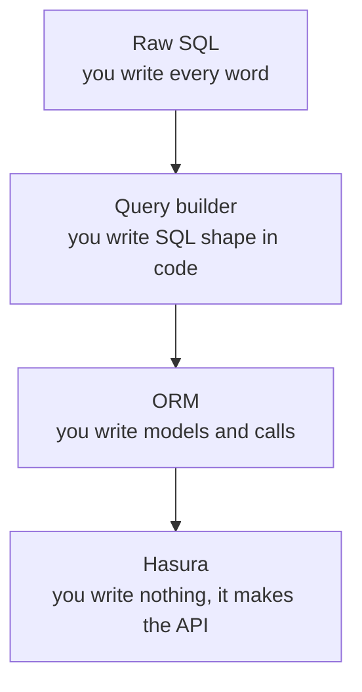

# 27. ORMs and query tools compared

> **Subject:** Database · **Lesson:** 27 · **Made:** 2026-11-17 · **Status:** ready
>
> **You will be able to:** compare raw SQL, a query builder (Kysely), Drizzle, Prisma and Hasura in one table, say what each hides and what it costs, show why a typo is caught at compile time in some and at run time in others, and pick one and defend it.
>
> **Before this:** [N+1 queries and ORMs](12-n-plus-1-queries-and-orms.md) · **Also read:** [Hasura: when and when not](../backend-api/14-hasura-when-and-when-not.md)
>
> **How to read it:** one card is one idea. Look at the picture, guess, then press the orange bar to check. The blue bars (📖 More detail) hold the longer explanation. Skip them on the first read, and open them when you want more. About 15 minutes for the cards.

## 1. The idea: how far from the SQL do you want to stand?

Every tool here does the same job: it gets rows out of PostgreSQL. They differ in **how much SQL you write yourself**, and **how much the tool guesses for you**. Picture a line. On the left you write every word of the SQL. On the right the tool writes the API, too.



Notice: moving down the picture hides more SQL. It saves typing and costs control.

<details class="guess"><summary>🤔 Guess: a monthly report with window functions and three joins. Which end of the line fits it best? Press to check.</summary>

The **top**: raw SQL, or a query builder. A report needs exact control of every word, and you will read its `EXPLAIN`. An ORM call for this is awkward, and many ORMs end up sending raw SQL for it anyway.

</details>

> **Remember:** the more the tool hides, the less you type, and the less you see. Pick how far you want to stand from the SQL.

<details class="more"><summary>📖 More detail: four new words, and where this fits</summary>

**New words.**

- **Query builder:** a library that lets you write SQL's shape in code (`select`, `where`, `orderBy`), with type checks. Kysely is one.
- **ORM:** a library with models, relations and often migrations, that writes the SQL for you (the interview words are *object relational mapper*). Prisma and Drizzle are ORMs.
- **Type safe:** the editor and the compiler know your tables and columns, and tell you about a typo before you run the code.
- **Migration:** a file that changes the database structure (lesson 19).

You already know **N+1** from lesson 12. This lesson is the map around it.

</details>

## 2. The five side by side

This is the table to keep. Read each row left to right. The versions were read on 2026-11-17.

| | What you write | Types come from | Schema changes | How much SQL you see | Pick it when |
|---|---|---|---|---|---|
| **Raw SQL** (`pg`) | SQL text | nowhere, you write the types | your own SQL files or a tool | all of it | a heavy report, or you want full control |
| **Kysely** (query builder) | SQL shape in TypeScript | types you give it, or generate | a built-in `Migrator` (up and down files) | almost all of it | you know SQL and want type checks |
| **Drizzle** (ORM) | tables in TypeScript, queries that look like SQL | your table code | `drizzle-kit` commands | a lot, it is "SQL-like" | you want types and SQL feel, in a light package |
| **Prisma** (ORM) | a `schema.prisma` file, then method calls | a generated Client | Prisma Migrate | little, you read the log | one tool for models, queries and migrations |
| **Hasura** | nothing, you track tables | the GraphQL schema it makes | its own metadata and migrations | none, you send GraphQL | a quick API with row rules and no resolvers |

<details class="guess"><summary>🤔 Guess: which of the five can you NOT use for a plain REST route that you write in Express? Press to check.</summary>

**Hasura.** It is not a library inside your code. It is a server that sits in front of Postgres and gives you a GraphQL API. The other four are libraries that your Express code calls. (Hasura can still call your code, through Actions. Lesson 14.)

</details>

> **Remember:** read the "how much SQL you see" column first. It tells you how much you can tune, and how much you must trust the tool.

<details class="more"><summary>📖 More detail: what the sources say, and the version picture</summary>

All checked on 2026-11-17.

- **Kysely:** its site calls it a "Type-safe SQL query builder" and says it is not an ORM. It lists PostgreSQL, MySQL, MS SQL Server, SQLite and PGlite out of the box, and zero runtime dependencies. Its docs have a built-in `Migrator`: migration files export `up` and `down` functions, run in name order, and Kysely tracks them in a `kysely_migration` table. npm's `latest` was 0.29.9.
- **Drizzle:** its docs call it a "headless TypeScript ORM" that you use as a library. The page says "If you know SQL, you know Drizzle", and that its relational Queries API "always outputs exactly 1 SQL query". It claims zero dependencies, and says it is serverless-ready. It supports PostgreSQL, MySQL, SQLite, SingleStore, MSSQL and CockroachDB. npm's `latest` was 0.45.4, and a `1.0.0-rc.5` was on the `rc` tag, so a 1.0 was still a release candidate.
- **Prisma:** the docs list Prisma Client ("auto-generated and type-safe query builder"), Prisma Migrate and Prisma Studio, all started from the Prisma schema. Prisma ORM 7 made the Rust-free client the default and made driver adapters required. Prisma ORM 8 is a **release candidate** with a new API: the Prisma release status page says it is installable, and npm's `latest` was `8.0.0-rc.34`. The same page says Prisma 7 keeps getting fixes for 18 months after Prisma 8 is generally available. Check the release status page before you start a new project.
- **Hasura:** open-source software that connects to your data and exposes it as a secured GraphQL API, with role-based authorization (the docs home page).
- **Raw SQL:** `pg` (node-postgres) sends your query text and your values separately to PostgreSQL (card 5). npm's `latest` was 8.23.1.

**Step through it yourself:** this lesson has no stepper, because nothing runs inside a machine to watch. The practice file builds a small query builder, which is the best way to see how these tools work.

</details>

## 3. The same query, five ways

"Paid orders of store 1, newest first, 10 rows." Here is how each tool says it. I ran the raw SQL, Kysely and Drizzle on the same small table. Prisma and Hasura are shown from their docs, and I did not run them for this lesson.

```sql
-- raw SQL with pg: the text, and the values apart
SELECT id, total_cents FROM orders
WHERE store_id = $1 AND status = 'paid'
ORDER BY id DESC LIMIT 10
```

```js
// Kysely
db.selectFrom("orders")
  .select(["id", "total_cents"])
  .where("store_id", "=", 1)
  .where("status", "=", "paid")
  .orderBy("id", "desc").limit(10)

// Drizzle
db.select({ id: orders.id, totalCents: orders.totalCents })
  .from(orders)
  .where(and(eq(orders.storeId, 1), eq(orders.status, "paid")))
  .orderBy(desc(orders.id)).limit(10)

// Prisma 7 (from the docs, not run)
prisma.order.findMany({
  where: { storeId: 1, status: "paid" },
  select: { id: true, totalCents: true },
  orderBy: { id: "desc" }, take: 10,
})
```

```graphql
# Hasura (from the docs, not run)
query {
  orders(where: { store_id: { _eq: 1 }, status: { _eq: "paid" } },
         order_by: { id: desc }, limit: 10) { id total_cents }
}
```

<details class="guess"><summary>🤔 Guess: Kysely and Drizzle both turn their code into SQL text. What do you think the status value, `"paid"`, becomes in that text? Press to check.</summary>

**A parameter**, `$2`. The values are not pasted into the text. Here is what I got from the real run:

```
kysely  select "id", "total_cents" from "orders" where "store_id" = $1 and "status" = $2 order by "id" desc limit $3   [1,"paid",10]
drizzle select "id", "total_cents" from "orders" where ("orders"."store_id" = $1 and "orders"."status" = $2) order by "orders"."id" desc limit $3   [1,"paid",10]
```

The two outputs are the same query. Even the `limit` became a parameter.

</details>

> **Remember:** under every one of these, there is SQL and a list of values. The tool is only a way to write them.

<details class="more"><summary>📖 More detail: the real output, and what each tool is good at here</summary>

**Run for real** (PGlite 0.4.1, which is PostgreSQL 17.5, with `kysely` 0.29.9 and `drizzle-orm` 0.45.4, on 2026-11-17). The table had 5 orders. The raw SQL, and Drizzle on the same database, both returned the same 3 paid orders of store 1: ids 5, 4 and 1, with totals 300, 1200 and 500. Drizzle named the column `totalCents`, from my table code. Kysely only compiled the query without a connection, so I printed its SQL.

**What to notice.**

- Kysely reads like SQL. If you know SQL, you can guess the code.
- Drizzle needs a table definition first (`pgTable(...)`), and gives you `eq` and `and` helpers.
- Prisma hides the SQL most. You read it in the query log (lesson 12).
- Hasura is a different kind of thing: the client sends GraphQL, and Hasura adds the permission filter and builds the SQL.

</details>

## 4. Type safety: when do you hear about a typo?

You write `total_cent` and not `total_cents`. When do you find out?

```js
// raw SQL: the text is just text
await pg.query("SELECT id, total_cent FROM orders");

// Kysely and Drizzle: the editor knows the columns
kdb.selectFrom("orders").select(["id", "total_cent"]);
ddb.select({ t: orders.totalCent }).from(orders);
```

<details class="guess"><summary>🤔 Guess: which one tells you before you run the program? Press to check.</summary>

**Kysely and Drizzle.** Real results from the run:

```
raw SQL, at run time:   column "total_cent" does not exist
Kysely, at compile:     error TS2769: No overload matches this call.
Drizzle, at compile:    error TS2551: Property 'totalCent' does not exist on type 'PgTableWithColumns<...>'
```

The raw SQL string is only checked when PostgreSQL runs it, maybe in production, in a rarely used route.

</details>

> **Remember:** a type safe tool moves "wrong column" errors from production to your editor.

<details class="more"><summary>📖 More detail: how the types get there, and what they do not catch</summary>

- **Kysely:** you describe your tables in an interface (`Kysely<DB>`), or generate it. The compiler checks the column names, and the value types in `where`.
- **Drizzle:** the table code (`pgTable`) is both the schema and the types.
- **Prisma:** the types come from the `schema.prisma` file, through the generated Client.
- **Raw SQL:** none. Some teams add a generator that reads the real database, or a test that runs every query.

**What types do not catch.** A slow query, a missing index, a wrong `JOIN` condition, or a table that changed in production while your types are old. Types check your code against your description of the database. They do not check the database. Lesson 11 (`EXPLAIN`) still matters.

</details>

## 5. Values go apart from the SQL text

All five keep values out of the SQL text. That is what stops **SQL injection**. A name is different: a table or a column cannot be a `$1` value, so the tool must check it.

```js
// wrong (a sketch)
await pg.query("SELECT * FROM orders WHERE status = '" + status + "'");
// right
await pg.query("SELECT * FROM orders WHERE status = $1", [status]);
```

<details class="guess"><summary>🤔 Guess: `status` is the text `paid'; DROP TABLE orders; --`. What does the first line do? Press to check.</summary>

It builds text that closes the quote early and adds a second command: the attacker's text becomes **SQL**. The second line sends the text as a **value**. PostgreSQL treats it as plain text to compare, so nothing runs. The node-postgres docs describe this: it sends your query text unaltered, and the parameters separately.

</details>

> **Remember:** values go in `$1`. Names (tables, columns, sort direction) cannot, so check them against a list.

<details class="more"><summary>📖 More detail: names, sort order, and the practice file</summary>

`$1` binds a **value**. It cannot stand for a column name or `asc` and `desc`. If a user can choose the sort column, check it against an allow list before it goes into the text. This is what a builder does for you, and it is Task 1 in the practice file (`quoteIdent`). Task 2 builds the Kysely query above, and refuses a typo, a bad direction and a bad limit.

I did not find a page in the node-postgres docs that talks about identifiers, so the rule "names need an allow list" comes from how `$n` parameters work in PostgreSQL, not from that page.

</details>

## 6. Mistake 1: the ORM hides the N+1

```js
// a sketch
const stores = await db.query.stores.findMany();
for (const store of stores) {
  store.orders = await db.query.orders.findMany({ where: eq(orders.storeId, store.id) });
}
```

<details class="guess"><summary>🤔 Guess: 100 stores. How many queries, and is the type checker upset? Press to check.</summary>

**101 queries**, and the type checker is happy. Types do not see query counts. Load the relation in one call (`include` in Prisma, the relational Queries API in Drizzle, a JOIN in Kysely), and look at the query log. Lesson 12 has the full fix list.

</details>

> **Remember:** an ORM hides SQL. That includes the 101 queries. Read the log.

<details class="more"><summary>📖 More detail: what each tool says about it</summary>

- **Drizzle:** its docs say the relational Queries API "always outputs exactly 1 SQL query".
- **Prisma:** `include` loads a relation for all parents. See lesson 12 for the `query` and `join` strategies, and the Prisma 8 note.
- **Kysely and raw SQL:** you write the JOIN or the `= ANY($1)` batch yourself.
- **Hasura:** compiles a GraphQL query into one SQL query (lesson 12). Remote schemas and Actions are outside it.

</details>

## 7. Mistake 2: "the ORM means I do not need SQL"

<details class="guess"><summary>🤔 Guess: a page is slow. The ORM code looks fine. What do you do? Press to check.</summary>

You need the **SQL it sends**, and `EXPLAIN` on it (lesson 11). Then you fix the index, or the query. If you never learned SQL, you can see neither. In an interview, "I use Prisma" is a start, and "here is the SQL it sent, and here is why it was slow" is the answer.

</details>

> **Remember:** every tool here ends in SQL. Learn SQL first, then pick how to write it.

<details class="more"><summary>📖 More detail: raw SQL inside an ORM</summary>

All the big ORMs have a way to send raw SQL for the hard queries. Use it for reports and window functions. That is normal, not a failure. The risk is in mixing: raw SQL has no types unless you add them, and string-built text brings back the injection risk of card 5. Keep the values in parameters.

</details>

## 8. Mistake 3: copying an old tutorial

Tools in this table changed fast. Prisma 7 changed how the client is built and made driver adapters required. Prisma 8 is a release candidate with a different API. Drizzle's 1.0 is a release candidate.

<details class="guess"><summary>🤔 Guess: a tutorial from two years ago shows a Prisma setup. What do you check before you copy it? Press to check.</summary>

The **version** of the tool in the tutorial, and the **release status page** of the tool today. Setup steps, config files and even the query API can differ between major versions. Open the current docs, and run a small test of your own.

</details>

> **Remember:** check the date and the version. Then check what is current today.

<details class="more"><summary>📖 More detail: what changed in Prisma 7, as of the release notes</summary>

From the Prisma changelog for 7.0.0 (dated 2025-11-19) and the upgrade guide, as summarised by a search on 2026-11-17: the Rust-free client is the default (set `provider = "prisma-client"` in the generator), driver adapters are required, the connection URL moved to `prisma.config.ts`, and Prisma 7 does not load `.env` files by itself. I did not run a Prisma 7 or 8 project for this lesson, so check the upgrade guide before you rely on these details.

</details>

## 9. Picking one, and what it costs

| Situation | Use | Why |
|---|---|---|
| A heavy report, window functions, many joins | raw SQL (or Kysely) | full control of every word |
| You know SQL and want type checks, no magic | Kysely | reads like SQL, nothing hidden |
| TypeScript tables and SQL-like queries, light package | Drizzle | types from table code, close to SQL |
| One tool for models, queries and migrations, and a team new to SQL | Prisma | one schema file, a generated Client |
| A quick CRUD API with row rules and no resolver code | Hasura | it makes the API and adds the filters |
| Most real apps | **a mix** | an ORM for everyday CRUD, raw SQL for reports, Hasura or your API in front |

- **Without it:** you pick the tool your last job used, and you meet its limit in a report, in a migration, or in a 101-query page.
- **With it:** you pick by how much SQL you want to see, how much you want typed, and who writes the API.
- **The cost:** a higher-level tool hides SQL and adds its own rules and its own upgrades. A lower-level tool means you write more, and you own more.

<details class="more"><summary>📖 More detail: where my own projects fit</summary>

Your profile lists **Prisma, Hasura, GraphQL and PostgreSQL**. So you have used two rows of this table, the ORM row and the generated API row. Lesson 19 covers Prisma migrate in production, and lesson 12 covers N+1 in Prisma and Hasura.

*Idea, not a fact:* "I would use Kysely or raw SQL for a heavy report, and an ORM for everyday CRUD" is a sensible answer. Your notes do not say you used Kysely or Drizzle. Say what you really used, and why.

</details>

## 10. Watch and play

Links checked on 2026-11-17. I opened every page. For videos I checked only the title and the channel, not the length or the content.

- **Video:** [Drizzle vs Prisma: Which ORM Scales?](https://www.youtube.com/watch?v=p3h5mwbjDMg) by Bryan Software. The title matches the Prisma and Drizzle rows. I did not watch it, so check its date before you trust the claims.
- **Video:** [Kysely first impressions - Typescript SQL query builder and migrations](https://www.youtube.com/watch?v=vnSnor_C2rA) by Marius Espejo. The title matches the Kysely row.
- **Read:** [Kysely](https://kysely.dev/). A short page, and it says plainly that it is not an ORM.
- **Read:** [Drizzle ORM, overview](https://orm.drizzle.team/docs/overview). Find "If you know SQL, you know Drizzle".
- **Read:** [What is Prisma ORM](https://www.prisma.io/docs/orm/overview/introduction/what-is-prisma). The three parts: Client, Migrate and Studio.
- **Read:** [Prisma ORM release status](https://www.prisma.io/docs/orm/release-status). Where Prisma 7 and Prisma 8 stand today.

<details><summary>More links (optional)</summary>

- **Read:** [Kysely migrations](https://kysely.dev/docs/migrations). The `Migrator`, and the `up` and `down` functions.
- **Read:** [Hasura docs home](https://hasura.io/docs/2.0/index/). What Hasura GraphQL Engine is.
- **Read:** [Lesson 12, N+1 queries and ORMs](12-n-plus-1-queries-and-orms.md). The Prisma, GraphQL and Hasura fixes in detail.

</details>

## 11. Practice

**A. Predict the output** (write your answer before opening)

```js
function quoteIdent(name, allowed) {
  if (!allowed.includes(name)) throw new Error("unknown name: " + name);
  return '"' + name + '"';
}
const cols = ["id", "total_cents"];
console.log(quoteIdent("id", cols));
try {
  quoteIdent("total_cent", cols);
} catch (e) {
  console.log(e.message);
}
```

<details><summary>Answer</summary>

```
"id"
unknown name: total_cent
```

The known name gets double quotes. The typo is caught by the allow list, before any SQL is made. This is the same job that a builder does for you.

</details>

**B. Fix the bug**

```js
function findOrders(status) {
  return pg.query("SELECT id FROM orders WHERE status = '" + status + "'");
}
```

<details><summary>Answer</summary>

The value is pasted into the SQL text, so a `status` such as `paid'; DROP TABLE orders; --` becomes SQL (SQL injection). Send it as a parameter:

```js
function findOrders(status) {
  return pg.query("SELECT id FROM orders WHERE status = $1", [status]);
}
```

</details>

**C. Write it yourself**

Open `practice/27-orms-and-query-tools-compared.js`. There are three small tasks: `quoteIdent` (allow list for names), `buildSelect` (a tiny query builder that makes the same SQL that Kysely printed), and `choices` (pick the right tool for four situations).

```
node --test learn/database/practice/27-orms-and-query-tools-compared.test.js
```

At the start, all 9 tests fail. Each test starts with a plain "yes" case before it checks the "no" cases, so an empty function cannot pass by accident. No database is needed.

<details><summary>One possible answer</summary>

```js
function quoteIdent(name, allowed) {
  if (typeof name !== "string" || !Array.isArray(allowed) || !allowed.includes(name)) {
    throw new Error("unknown name: " + String(name));
  }
  return '"' + name + '"';
}

function buildSelect(spec, schema) {
  const table = quoteIdent(spec.table, Object.keys(schema));
  const columnsOfTable = schema[spec.table];
  const params = [];
  const columns = spec.columns.map((c) => quoteIdent(c, columnsOfTable)).join(", ");
  let sql = "select " + columns + " from " + table;

  if (spec.where) {
    const parts = Object.entries(spec.where).map(([column, value]) => {
      params.push(value);
      return quoteIdent(column, columnsOfTable) + " = $" + params.length;
    });
    if (parts.length > 0) sql += " where " + parts.join(" and ");
  }
  if (spec.orderBy) {
    const { column, direction } = spec.orderBy;
    if (direction !== "asc" && direction !== "desc") throw new Error("bad direction");
    sql += " order by " + quoteIdent(column, columnsOfTable) + " " + direction;
  }
  if (spec.limit !== undefined) {
    if (!Number.isInteger(spec.limit) || spec.limit <= 0) throw new Error("bad limit");
    params.push(spec.limit);
    sql += " limit $" + params.length;
  }
  return { sql, params };
}

const choices = {
  oneHeavyReportWithWindowFunctions: "raw-sql",
  typedQueriesThatStillReadLikeSql: "query-builder",
  modelsRelationsAndMigrationsFromOneSchemaFile: "orm",
  quickCrudApiWithRowRulesAndNoResolverCode: "hasura",
};
```

Notice what the builder never does: it never puts a value into the text, and it never puts an unchecked name into the text. Only values go to `params`, and only allowed names go in quotes. The `choices` are a rule of thumb, not a law.

</details>

## 12. Interview question

**Q:** "Prisma, Drizzle, Kysely or raw SQL: how do you choose a way to talk to Postgres from a TypeScript API?"

<details><summary>A strong answer, in four parts</summary>

1. **Problem:** all of them end in SQL and a list of values, so the real question is how far from the SQL I want to stand. Too close, and I type a lot and get no type checks. Too far, and I cannot see the 101 queries or the missing index.
2. **How it works:** raw SQL with `pg` sends the text and the values apart, and gives full control. A query builder such as Kysely keeps the SQL shape but adds type checks, so a wrong column is a compile error. An ORM such as Drizzle or Prisma adds models, relations and migrations, and writes most of the SQL. Hasura is different: a server that makes a GraphQL API from the tables and adds row rules. For every tool I keep values as parameters, check names against a list, and read the SQL it sends, with `EXPLAIN`.
3. **Tradeoff:** more hiding means less typing and less control. An ORM is quick for everyday CRUD, and can hide an N+1. A builder keeps control and costs more typing. Raw SQL is best for a heavy report, with no types. Fast-moving tools need version checks: Prisma 8 and Drizzle 1.0 were release candidates when I checked, so I pick the line that is stable for my project and read its release status.
4. **My example:** your profile lists Prisma, Hasura, GraphQL and PostgreSQL. *Idea, not a fact:* use an ORM for everyday CRUD, raw SQL for a heavy report, and look at the query log for N+1 (lesson 12). Your notes do not say you used Kysely or Drizzle. Say what you really used.

</details>

## 13. Explain it back

Close this file. Press the **Record my explanation** button under this heading and explain it out loud, like to a new junior, in 4 parts: problem, how it works, tradeoff, my example. Use the words "query builder", "ORM", "parameter" and "type safe". Then save the transcript into `my-learning/recordings/`, or write your best version below. Run `/explain-check orms and query tools` or ask the `explain-coach` agent to review it.

### My explanation

<write here>

### Coach feedback

<the explain-coach agent writes here>

## 14. Review questions (day 1, 3, 7, 21)

1. What is the difference between a query builder and an ORM? Give an example of each.
2. A typo in a column name: when do you find out with raw SQL, and when with Kysely or Drizzle?
3. Why do values go in `$1` and not in the SQL text? What cannot go in `$1`?
4. Name one risk of an ORM, and how you would see it.

<details><summary>Answers</summary>

1. A query builder (Kysely) lets you write the SQL shape in code with type checks. It is not an ORM. An ORM (Prisma, Drizzle) also has models, relations and often migrations, and writes most of the SQL for you.
2. Raw SQL: at run time, when PostgreSQL runs it (`column "total_cent" does not exist`). Kysely and Drizzle: at compile time, as a TypeScript error in the editor.
3. A value pasted into the text can become SQL (SQL injection). A parameter is sent apart, and PostgreSQL treats it as a value. A table name, a column name and `asc` or `desc` cannot be `$1`. Check them against an allow list.
4. It hides SQL, so it can hide an N+1 (101 queries for 100 stores) or a missing index. Look at the query log and run `EXPLAIN` on the SQL it sends (lessons 11 and 12).

</details>

## 15. Go deeper (optional)

Open these when you are ready. None of them is needed for the cards above.

<details><summary>Prisma 7 and 8, Drizzle 1.0, and generating types from the database</summary>

**Prisma.** Prisma ORM 7 made the Rust-free client the default and made driver adapters required. Prisma ORM 8 is, on the release status page, a release candidate with a new API, and npm's `latest` points to it. The same page says Prisma 7 gets fixes for 18 months after Prisma 8 is generally available. Lesson 12 has more on `relationLoadStrategy` and the Prisma 8 `.include("posts")` API.

**Drizzle.** `drizzle-orm`'s `latest` on npm was 0.45.4, and a `1.0.0-rc.5` was on the `rc` tag. It is "headless": a library inside your code, with no server and no generated Client. Its relational Queries API makes one SQL query per call.

**Types from the real database.** Some teams generate Kysely types, or Drizzle tables, from the live database (introspection). This keeps the types in step with production. Check the tool's docs for the current command, because these change.

**Other tools.** There are more, for example TypeORM, MikroORM and Sequelize. I did not research them for this lesson. The same four questions apply: what do I write, where do the types come from, how do schema changes work, and how much SQL can I see.

</details>

## Connected lessons

- [N+1 queries and ORMs](12-n-plus-1-queries-and-orms.md): the hidden 101 queries, and the fixes in Prisma, GraphQL and Hasura.
- [Reading EXPLAIN](11-reading-explain.md): what to do after you find the SQL the tool sent.
- [Zero-downtime migrations](19-zero-downtime-migrations.md): Prisma migrate in production, and why a migration tool is not enough on its own.
- [Hasura: when and when not](../backend-api/14-hasura-when-and-when-not.md): the generated API row, and where it stops.
- [Authorization](../backend-api/08-authorization.md): row rules in your code, in Hasura or in Postgres.
- [Constraints and data types](08-constraints-and-data-types.md): the schema that all these tools read.
