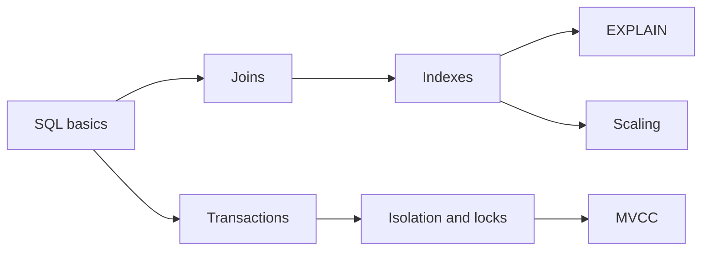

# Database

SQL and PostgreSQL: queries, indexes, transactions, and how the database works inside.

**Why it matters in interviews:** This is where you fail most theory questions. Interviewers ask how an index works, what isolation levels do, and how you would fix a slow query.

## The map

How the lessons connect. Learn left to right.

## Lessons, one concept per file

Each lesson is one small file made from [the lesson template](../../templates/lesson-template.md): picture first, a code trace, practice, links to watch and play, and an explain it back section.

Status: `planned` (not written yet), `ready` (written, not studied), `learning`, `can explain` (passed explain-check).

### Basics

| # | Lesson | You will understand | Status |
|---|---|---|---|
| 01 | SQL basics `01-sql-basics.md` | SELECT, WHERE, GROUP BY, HAVING, ORDER BY, and the order they run | planned |
| 02 | Joins `02-joins.md` | inner, left, right, full, drawn as pictures | planned |
| 03 | Normalization `03-normalization.md` | why we split tables, and when to denormalize | planned |

### How it works inside

| # | Lesson | You will understand | Status |
|---|---|---|---|
| 04 | Indexes and B-trees `04-indexes-and-b-trees.md` | how an index finds a row without reading every row | planned |
| 05 | Reading EXPLAIN `05-reading-explain.md` | seq scan vs index scan, cost, rows | planned |
| 06 | Transactions and ACID `06-transactions-and-acid.md` | what each letter protects you from | planned |
| 07 | Isolation levels `07-isolation-levels.md` | dirty read, non-repeatable read, phantom read, and which level stops which | planned |
| 08 | Locks and deadlocks `08-locks-and-deadlocks.md` | row locks, how deadlocks happen, how to avoid them | planned |
| 09 | MVCC `09-mvcc.md` | how Postgres lets readers and writers not block each other | planned |

### Senior level

| # | Lesson | You will understand | Status |
|---|---|---|---|
| 10 | Pagination `10-pagination.md` | OFFSET vs keyset pagination | planned |
| 11 | Connection pooling `11-connection-pooling.md` | why connections are expensive, PgBouncer | planned |
| 12 | Replication and read replicas `12-replication-and-read-replicas.md` | scaling reads, replication lag | planned |
| 13 | Partitioning and sharding `13-partitioning-and-sharding.md` | splitting big tables and databases | planned |
| 14 | SQL vs NoSQL and Redis `14-sql-vs-nosql-and-redis.md` | when each fits | planned |

**To make the next lesson:** in a chat with this folder open, say `/learn database 01` to learn it live with Claude, or ask "make lesson database 01" and the `research-material` agent writes the file. When a lesson file exists, its row becomes a link and the status changes to `ready`.

## Guides already here

Longer guides that cover many concepts at once. Good for revision after the lessons.

- [PostgreSQL queries and indexing guide](postgresql-queries-interview-guide.md)
- [Database design: how to model it, and why](database-design-and-why.md) - six design steps, normalization in pictures, keys, constraints, the ledger pattern, multi-tenancy, zero downtime changes. Start here.
- [Advanced SQL workbook: 19 queries](advanced-sql-workbook.md) - window functions, gaps and islands, dedupe, pivot, cohorts, recursion, upsert, SKIP LOCKED, keyset. Solve them yourself in the practice database.
- [How Postgres works inside](postgres-internals-visual.md) - pages, the B+tree, MVCC, WAL, the planner, join algorithms, locks. Answers the gaps from the 2026-09-18 advanced round.
- [Scaling a database and keeping data correct](database-scaling-and-correctness.md) - races and locking tools, the outbox, the scaling ladder, backups and failover.
- [Senior database interview questions](senior-database-interview-questions.md) - 47 questions in four parts: problem, how it works, tradeoff, my example.

## Visual cheatsheets

Open in the browser. Everything visible on one page.

- [PostgreSQL visual cheatsheet](postgresql-queries-interview-guide-cheatsheet.html)
- [Database design cheatsheet](database-design-and-why-cheatsheet.html)
- [SQL patterns cheatsheet](advanced-sql-workbook-cheatsheet.html) - 16 patterns with before and after tables, plus a pattern spotter quiz
- [Postgres internals cheatsheet](postgres-internals-visual-cheatsheet.html)
- [Scaling and correctness cheatsheet](database-scaling-and-correctness-cheatsheet.html)
- [Database interview drill](senior-database-interview-questions-cheatsheet.html) - flashcards for the 47 questions with got it / not yet

## Examples to run

- [examples/postgres-practice/](examples/postgres-practice/) - Postgres in Docker with seed data and exercises
- [examples/sql-workbook/](examples/sql-workbook/) - small DBO-style database, answers for the 19 workbook exercises, and a 1,000,000 row EXPLAIN demo

## Watch and play

Trusted places to see the ideas, not only read them. Each lesson adds its own checked video and visualizer links.

- [Use The Index, Luke](https://use-the-index-luke.com/) - indexes explained with pictures, free
- [explain.dalibo.com](https://explain.dalibo.com/) - paste EXPLAIN output and see the plan as a diagram
- [SQLBolt](https://sqlbolt.com/) - interactive SQL lessons in the browser
- [PostgreSQL docs](https://www.postgresql.org/docs/) - the official reference
- [Study Route: Database, senior level](../../study.html#track-db) - the same notes with a step checklist and review dates
