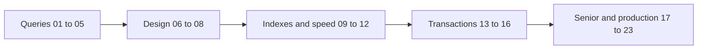

# Database

SQL and PostgreSQL: queries, indexes, transactions, and how the database works inside.

**Why it matters in interviews:** This is where you fail most theory questions. Interviewers ask how an index works, what isolation levels do, and how you would fix a slow query.

## The map

How the lessons connect. Learn left to right. Each group builds on the one before.

## Lessons, one concept per file

Each lesson is one small file made from [the lesson template](../../templates/lesson-template.md): picture first, a query trace, practice, links to watch and play, and an explain it back section. The examples use the same tables as the [practice database](examples/postgres-practice/): stores, orders, point_transactions and jobs, shaped like DBO.

Status: `planned` (not written yet), `ready` (written, not studied), `learning`, `can explain` (passed explain-check).

### Queries

| # | Lesson | You will understand | Status |
|---|---|---|---|
| 01 | [SQL basics and the order a query runs](01-sql-basics-and-query-order.md) | SELECT, WHERE, ORDER BY, LIMIT, and why the database runs FROM first and SELECT almost last | ready |
| 02 | [Joins](02-joins.md) | inner, left, right and full joins as pictures, and the LEFT JOIN plus WHERE trap | ready |
| 03 | [Grouping and aggregation](03-grouping-and-aggregation.md) | GROUP BY as buckets, HAVING against WHERE, COUNT traps, FILTER | ready |
| 04 | [Subqueries, CTEs and EXISTS](04-subqueries-ctes-and-exists.md) | queries inside queries, WITH, and "has one" or "has none" with EXISTS and NOT EXISTS | ready |
| 05 | [Window functions](05-window-functions.md) | ROW_NUMBER, RANK, running totals and "top N per group" without losing rows | ready |

### Design: why the tables look this way

| # | Lesson | You will understand | Status |
|---|---|---|---|
| 06 | Keys and relationships `06-keys-and-relationships.md` | primary and foreign keys, one to many, many to many, and id choices like serial against UUID | planned |
| 07 | Normalization `07-normalization.md` | why we split tables, the problems duplicates cause, and when to copy data on purpose | planned |
| 08 | Constraints and data types `08-constraints-and-data-types.md` | NOT NULL, UNIQUE, CHECK, money as cents, timestamptz, and JSONB against normal columns | planned |

### Indexes and speed

| # | Lesson | You will understand | Status |
|---|---|---|---|
| 09 | [Indexes and B-trees](09-indexes-and-b-trees.md) | how an index finds a row without reading every row, and what it costs on writes | ready |
| 10 | Composite, partial and covering indexes `10-composite-partial-and-covering-indexes.md` | the leftmost column rule, indexing only a hot slice, and when an index is NOT used | planned |
| 11 | [Reading EXPLAIN](11-reading-explain.md) | seq scan against index scan, estimated against actual rows, and a slow-query workflow | ready |
| 12 | N+1 queries and ORMs `12-n-plus-1-queries-and-orms.md` | why one page can run 101 queries, and fixes in Prisma, GraphQL DataLoader and Hasura | planned |

### Transactions: many users at once

| # | Lesson | You will understand | Status |
|---|---|---|---|
| 13 | Transactions and ACID `13-transactions-and-acid.md` | what each letter protects you from, with a money transfer | planned |
| 14 | Isolation levels `14-isolation-levels.md` | dirty read, non-repeatable read, phantom read, and which level stops which | planned |
| 15 | Locks and deadlocks `15-locks-and-deadlocks.md` | row locks, SELECT FOR UPDATE, how deadlocks happen, how to avoid them | planned |
| 16 | MVCC and VACUUM `16-mvcc-and-vacuum.md` | how Postgres lets readers and writers not block each other, and why old rows must be cleaned | planned |

### Senior and production

| # | Lesson | You will understand | Status |
|---|---|---|---|
| 17 | Pagination `17-pagination.md` | OFFSET against keyset pagination, and why page 5000 is slow | planned |
| 18 | Upsert, idempotency and job queues `18-upsert-idempotency-and-job-queues.md` | ON CONFLICT, handling a webhook twice safely, and a queue with SKIP LOCKED | planned |
| 19 | Zero-downtime migrations `19-zero-downtime-migrations.md` | changing a live table without locking it, expand and contract, Prisma migrate in production | planned |
| 20 | Connection pooling `20-connection-pooling.md` | why connections are expensive, PgBouncer, and serverless with Postgres | planned |
| 21 | Replication and read replicas `21-replication-and-read-replicas.md` | scaling reads, replication lag, and reading your own writes | planned |
| 22 | Partitioning and sharding `22-partitioning-and-sharding.md` | splitting big tables and databases, and why sharding is the last step | planned |
| 23 | SQL vs NoSQL and Redis `23-sql-vs-nosql-and-redis.md` | when each fits, and caching with Redis | planned |

**To make the next lesson:** in a chat with this folder open, say `/learn database 04` to learn it live with Claude, or ask "make lesson database 04" and the `research-material` agent writes the file. When a lesson file exists, its row becomes a link and the status changes to `ready`.

Each ready lesson has a runnable practice file in [practice/](practice/) and a step by step page in [visuals/](visuals/) where you press Next and watch the query run.

## Guides already here

Longer guides that cover many concepts at once. Good for revision after the lessons.

- [PostgreSQL queries and indexing guide](postgresql-queries-interview-guide.md)
- [Database design: how to model it, and why](database-design-and-why.md) - six design steps, normalization in pictures, keys, constraints, the ledger pattern, multi-tenancy, zero downtime changes. Start here.
- [Advanced SQL workbook: 19 queries](advanced-sql-workbook.md) - window functions, gaps and islands, dedupe, pivot, cohorts, recursion, upsert, SKIP LOCKED, keyset. Solve them yourself in the practice database.
- [How Postgres works inside](postgres-internals-visual.md) - pages, the B+tree, MVCC, WAL, the planner, join algorithms, locks. Answers the gaps from the 2026-09-18 advanced round.
- [Scaling a database and keeping data correct](database-scaling-and-correctness.md) - races and locking tools, the outbox, the scaling ladder, backups and failover.
- [Senior database interview questions](senior-database-interview-questions.md) - 47 questions in four parts: problem, how it works, tradeoff, my example.

## Visual cheatsheets

Open in the browser. Everything visible on one page.

- [PostgreSQL visual cheatsheet](postgresql-queries-interview-guide-cheatsheet.html)
- [Database design cheatsheet](database-design-and-why-cheatsheet.html)
- [SQL patterns cheatsheet](advanced-sql-workbook-cheatsheet.html) - 16 patterns with before and after tables, plus a pattern spotter quiz
- [Postgres internals cheatsheet](postgres-internals-visual-cheatsheet.html)
- [Scaling and correctness cheatsheet](database-scaling-and-correctness-cheatsheet.html)
- [Database interview drill](senior-database-interview-questions-cheatsheet.html) - flashcards for the 47 questions with got it / not yet

## Examples to run

- [examples/postgres-practice/](examples/postgres-practice/) - Postgres in Docker with seed data and exercises
- [examples/sql-workbook/](examples/sql-workbook/) - small DBO-style database, answers for the 19 workbook exercises, and a 1,000,000 row EXPLAIN demo

## Watch and play

Trusted places to see the ideas, not only read them. Each lesson adds its own checked video and visualizer links.

- [Use The Index, Luke](https://use-the-index-luke.com/) - indexes explained with pictures, free
- [explain.dalibo.com](https://explain.dalibo.com/) - paste EXPLAIN output and see the plan as a diagram
- [SQLBolt](https://sqlbolt.com/) - interactive SQL lessons in the browser
- [PostgreSQL docs](https://www.postgresql.org/docs/) - the official reference
- [Study Route: Database, senior level](../../study.html#track-db) - the same notes with a step checklist and review dates
