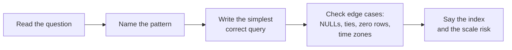
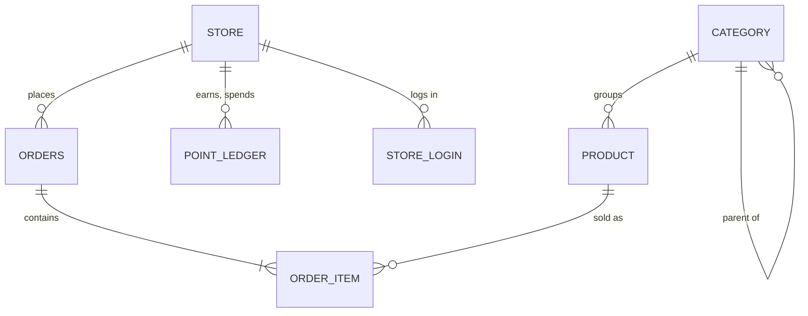
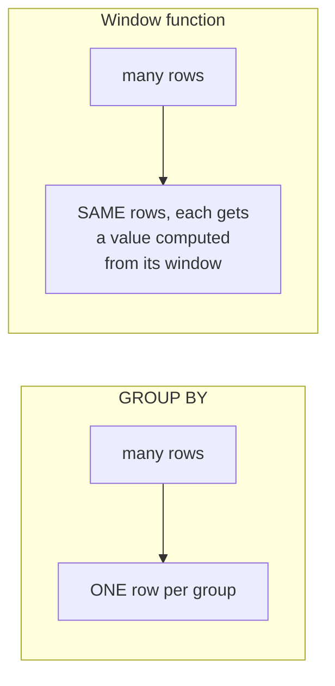
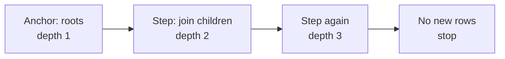
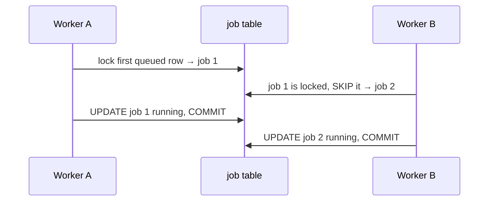

# Advanced SQL Workbook: 19 Queries Interviewers Actually Ask

- **Written:** 2026-10-16
- **Level:** Core to Senior
- **How to use it:** Load the small DBO-style database below, then solve each exercise **yourself first**. Open the hint only when stuck for 5 minutes. Open the answer only after you have a query that runs. Every answer and every result table here was run on a real PostgreSQL 16 database, so your output should match exactly.
- **Read with:** [PostgreSQL queries and indexing](postgresql-queries-interview-guide.md) for the theory of each pattern.

## TL;DR

- Most "advanced SQL" questions are the same **eight patterns** in different clothes: anti-join, top-N per group, running total, compare with previous row, gaps and islands, pivot, dedupe, and recursion.
- Learn to **name the pattern** in the first 30 seconds. "This is top-N per group, so a window function with PARTITION BY" is already half the answer.
- Then always add the senior part: **which index makes this fast** and **what breaks at scale**.



## The Patterns at a Glance

| Pattern | Sounds like | Tool | Exercise |
|---|---|---|---|
| Keep rows with no match | "including stores with zero orders" | `LEFT JOIN`, filter in `ON`, `COALESCE` | 1 |
| Anti-join | "never", "without any" | `NOT EXISTS` | 2 |
| Latest or top-N per group | "latest order per store", "top 2 per category" | `DISTINCT ON`, `ROW_NUMBER`, `DENSE_RANK` | 3, 4 |
| Running total | "balance after each change" | `SUM() OVER (ORDER BY ...)` | 5 |
| Compare with previous row | "month over month", "change since last" | `LAG`, `LEAD` | 6 |
| Share of a group | "percent of the store's total" | `SUM() OVER (PARTITION BY ...)` | 7 |
| Gaps and islands | "longest streak", "consecutive days" | date minus `ROW_NUMBER` | 8 |
| Dedupe | "find and remove duplicates" | `ROW_NUMBER` + `DELETE USING` | 9 |
| Pivot | "one column per status" | `COUNT(*) FILTER (WHERE ...)` | 10 |
| Cohort / retention | "of the stores that joined in January..." | cohort CTE + month offset | 11 |
| Tree | "full category path" | `WITH RECURSIVE` | 12 |
| Percentiles | "median", "p90" | `percentile_cont` | 13 |
| Moving average over a calendar | "7-day average, including empty days" | `generate_series` + window frame | 14 |
| JSON fields | "from the webhook payload" | `->>`, `@>`, GIN | 15 |
| Upsert | "insert or update" | `ON CONFLICT DO UPDATE` | 16 |
| Job queue | "many workers, no double work" | `FOR UPDATE SKIP LOCKED` | 17 |
| Idempotent write | "the same event must count once" | `UNIQUE` + `ON CONFLICT DO NOTHING` | 18 |
| Deep pagination | "page 5000 is slow" | keyset `(created_at, id) <` | 19 |

## Set Up the Practice Database (5 minutes)

Run Postgres in Docker, then open `psql`:

```bash
docker run --name pg-workbook -e POSTGRES_PASSWORD=pw -p 5432:5432 -d postgres:18
docker exec -it pg-workbook psql -U postgres
```

Paste the whole script below, or run the file [examples/sql-workbook/seed.sql](https://github.com/starjustice/research-material/blob/main/learn/database/examples/sql-workbook/seed.sql). The answers are also in [answers.sql](https://github.com/starjustice/research-material/blob/main/learn/database/examples/sql-workbook/answers.sql) and the 1,000,000 row plans in [explain-demo.sql](https://github.com/starjustice/research-material/blob/main/learn/database/examples/sql-workbook/explain-demo.sql). It creates a schema called `wb` with a tiny version of your DBO data: 5 stores, 5 products in a category tree, 11 orders, a points ledger, logins, TADA webhook events (with duplicates on purpose) and a job table.

**Important:** at the start of every session run `SET search_path = wb; SET timezone = 'Asia/Jakarta';` so dates group the same way as in the answers.

```sql
DROP SCHEMA IF EXISTS wb CASCADE;
CREATE SCHEMA wb;
SET search_path = wb;
SET timezone = 'Asia/Jakarta';

CREATE TABLE category (
  id        int PRIMARY KEY,
  name      text NOT NULL,
  parent_id int REFERENCES category(id)
);
CREATE TABLE store (
  id         int PRIMARY KEY,
  name       text NOT NULL,
  city       text NOT NULL,
  joined_at  date NOT NULL
);
CREATE TABLE product (
  id           int PRIMARY KEY,
  name         text NOT NULL,
  category_id  int NOT NULL REFERENCES category(id),
  price        numeric(12,2) NOT NULL
);
CREATE TABLE orders (
  id          int PRIMARY KEY,
  store_id    int NOT NULL REFERENCES store(id),
  status      text NOT NULL CHECK (status IN ('PENDING','PAID','SHIPPED','CANCELLED')),
  total       numeric(12,2) NOT NULL,
  created_at  timestamptz NOT NULL
);
CREATE TABLE order_item (
  order_id    int NOT NULL REFERENCES orders(id),
  product_id  int NOT NULL REFERENCES product(id),
  qty         int NOT NULL CHECK (qty > 0),
  unit_price  numeric(12,2) NOT NULL,
  PRIMARY KEY (order_id, product_id)
);
CREATE TABLE point_ledger (
  id          int PRIMARY KEY,
  store_id    int NOT NULL REFERENCES store(id),
  delta       int NOT NULL,
  reason      text NOT NULL,
  source_id   text NOT NULL,
  created_at  timestamptz NOT NULL
);
CREATE TABLE store_login (
  store_id    int NOT NULL REFERENCES store(id),
  login_date  date NOT NULL,
  PRIMARY KEY (store_id, login_date)
);
CREATE TABLE webhook_event (
  id          int PRIMARY KEY,
  provider    text NOT NULL,
  event_id    text NOT NULL,
  payload     jsonb NOT NULL,
  received_at timestamptz NOT NULL
);
CREATE TABLE job (
  id          int PRIMARY KEY,
  kind        text NOT NULL,
  status      text NOT NULL DEFAULT 'queued',
  locked_by   text,
  run_at      timestamptz NOT NULL
);
CREATE TABLE daily_store_stats (
  store_id    int NOT NULL,
  day         date NOT NULL,
  order_count int NOT NULL,
  revenue     numeric(12,2) NOT NULL,
  PRIMARY KEY (store_id, day)
);

INSERT INTO category VALUES
 (1,'Building materials',NULL),(2,'Cement',1),(3,'Paint',1),(4,'Exterior paint',3);
INSERT INTO store VALUES
 (1,'Toko Maju','Jakarta','2026-01-05'),
 (2,'Toko Jaya','Bandung','2026-01-20'),
 (3,'Toko Sentosa','Jakarta','2026-02-03'),
 (4,'Toko Baru','Surabaya','2026-02-14'),
 (5,'Toko Diam','Medan','2026-03-01');
INSERT INTO product VALUES
 (1,'Semen 50kg',2,65000),(2,'Semen Putih',2,90000),
 (3,'Cat Tembok 5L',3,150000),(4,'Cat Kayu 1L',3,60000),
 (5,'Cat Luar 5L',4,210000);
INSERT INTO orders VALUES
 (1,1,'PAID',     650000,'2026-01-10 09:00+07'),
 (2,1,'SHIPPED',  450000,'2026-02-02 10:00+07'),
 (3,1,'PAID',     300000,'2026-03-15 11:00+07'),
 (4,2,'PAID',     900000,'2026-01-25 08:30+07'),
 (5,2,'CANCELLED',150000,'2026-02-10 14:00+07'),
 (6,2,'SHIPPED',  420000,'2026-03-03 16:00+07'),
 (7,3,'PENDING',  210000,'2026-02-05 09:15+07'),
 (8,3,'PAID',     630000,'2026-02-20 13:00+07'),
 (9,3,'PAID',     195000,'2026-04-02 10:00+07'),
 (10,4,'PAID',   1050000,'2026-02-15 15:00+07'),
 (11,1,'PAID',    120000,'2026-03-15 18:00+07');
INSERT INTO order_item VALUES
 (1,1,10,65000),
 (2,3,3,150000),
 (3,3,2,150000),
 (4,2,10,90000),
 (5,3,1,150000),
 (6,5,2,210000),
 (7,5,1,210000),
 (8,1,6,65000),(8,4,4,60000),
 (9,1,3,65000),
 (10,5,5,210000),
 (11,4,2,60000);
INSERT INTO point_ledger VALUES
 (1,1, 650,'EARN','order:1','2026-01-10 09:05+07'),
 (2,1, 450,'EARN','order:2','2026-02-02 10:05+07'),
 (3,1,-500,'REDEEM','reward:9','2026-02-20 12:00+07'),
 (4,1, 300,'EARN','order:3','2026-03-15 11:05+07'),
 (5,2, 900,'EARN','order:4','2026-01-25 08:35+07'),
 (6,2,-800,'REDEEM','reward:3','2026-02-01 09:00+07'),
 (7,2, 800,'REFUND','tada:evt_77','2026-02-01 12:00+07'),
 (8,3, 630,'EARN','order:8','2026-02-20 13:05+07');
INSERT INTO store_login VALUES
 (1,'2026-03-01'),(1,'2026-03-02'),(1,'2026-03-03'),(1,'2026-03-05'),(1,'2026-03-06'),
 (2,'2026-03-01'),(2,'2026-03-03'),(2,'2026-03-04'),(2,'2026-03-05'),(2,'2026-03-06'),
 (3,'2026-03-02');
INSERT INTO webhook_event VALUES
 (1,'tada','evt_75','{"type":"redeem_ok","store_id":1,"amount":500}','2026-02-20 12:00:01+07'),
 (2,'tada','evt_76','{"type":"redeem_failed","store_id":2,"amount":800}','2026-02-01 11:59:00+07'),
 (3,'tada','evt_77','{"type":"refund","store_id":2,"amount":800}','2026-02-01 12:00:00+07'),
 (4,'tada','evt_77','{"type":"refund","store_id":2,"amount":800}','2026-02-01 12:00:00.4+07'),
 (5,'tada','evt_78','{"type":"refund","store_id":3,"amount":200}','2026-03-01 10:00:00+07'),
 (6,'tada','evt_78','{"type":"refund","store_id":3,"amount":200}','2026-03-01 10:00:02+07'),
 (7,'tada','evt_78','{"type":"refund","store_id":3,"amount":200}','2026-03-01 10:00:05+07');
INSERT INTO job VALUES
 (1,'send_email','queued',NULL,'2026-03-01 09:00+07'),
 (2,'sync_points','queued',NULL,'2026-03-01 09:01+07'),
 (3,'send_email','queued',NULL,'2026-03-01 09:02+07'),
 (4,'send_email','done',NULL,'2026-02-28 09:00+07');
```

What the data looks like:



---

## Level 1: Joins You Must Never Get Wrong

### Exercise 1: Revenue per store, including stores with no sales

**Question:** For every store, show total revenue from `PAID` and `SHIPPED` orders and how many such orders. Stores with no sales must appear with 0. Sort by revenue, highest first.

<details>
<summary>Hint</summary>

Start from `store` and `LEFT JOIN` orders. Where you put the status filter decides whether stores with no sales survive.

</details>

<details>
<summary>Answer</summary>

```sql
SELECT s.name, COALESCE(SUM(o.total), 0) AS revenue, COUNT(o.id) AS orders
FROM store s
LEFT JOIN orders o ON o.store_id = s.id AND o.status IN ('PAID','SHIPPED')
GROUP BY s.id, s.name
ORDER BY revenue DESC;
```

```text
     name     |  revenue   | orders
--------------+------------+--------
 Toko Maju    | 1520000.00 |      4
 Toko Jaya    | 1320000.00 |      2
 Toko Baru    | 1050000.00 |      1
 Toko Sentosa |  825000.00 |      2
 Toko Diam    |          0 |      0
```

**The trap:** put the status filter in `WHERE` instead of `ON` and Toko Diam disappears. `WHERE o.status IN (...)` is false for the NULL row the LEFT JOIN created, so the LEFT JOIN quietly becomes an INNER JOIN.

**Also notice:** `COUNT(o.id)` counts 0 for Toko Diam. `COUNT(*)` would count 1, because the row exists, with NULLs in it.

</details>

### Exercise 2: Stores that never ordered

**Question:** List stores that have never placed any order.

<details>
<summary>Answer</summary>

```sql
SELECT s.name FROM store s
WHERE NOT EXISTS (SELECT 1 FROM orders o WHERE o.store_id = s.id);
```

```text
   name
-----------
 Toko Diam
```

**Why `NOT EXISTS` and not `NOT IN`:** if the subquery ever returns a NULL, `NOT IN` returns no rows at all, silently. `NOT EXISTS` is NULL-safe and stops at the first match. Index needed: `orders (store_id)`.

</details>

---

## Level 2: Window Functions



> A window function looks at neighbouring rows **without collapsing them**. `PARTITION BY` = which rows are neighbours. `ORDER BY` inside `OVER` = in what order.

### Exercise 3: Latest order per store

**Question:** For each store, show its most recent order (id, status, time). Two ways.

<details>
<summary>Answer</summary>

Postgres way, `DISTINCT ON` (keeps the first row per group after sorting):

```sql
SELECT DISTINCT ON (store_id) store_id, id AS order_id, status, created_at
FROM orders
ORDER BY store_id, created_at DESC, id DESC;
```

Portable way, `ROW_NUMBER`:

```sql
SELECT store_id, order_id, status, created_at FROM (
  SELECT store_id, id AS order_id, status, created_at,
         ROW_NUMBER() OVER (PARTITION BY store_id ORDER BY created_at DESC, id DESC) AS rn
  FROM orders) t
WHERE rn = 1 ORDER BY store_id;
```

```text
 store_id | order_id | status  |       created_at
----------+----------+---------+------------------------
        1 |       11 | PAID    | 2026-03-15 18:00:00+07
        2 |        6 | SHIPPED | 2026-03-03 16:00:00+07
        3 |        9 | PAID    | 2026-04-02 10:00:00+07
        4 |       10 | PAID    | 2026-02-15 15:00:00+07
```

**Why `id DESC` at the end:** two orders can share a timestamp. Without a tiebreaker the result can change between runs.

**Index and proof.** I ran "latest 20 orders for one store" on a 1,000,000-row copy of this table:

| | Plan | Pages read | Time |
|---|---|---|---|
| No index | Parallel Seq Scan, `Rows Removed by Filter: 333267` per worker, then Sort | 8,242 | 37.2 ms |
| `CREATE INDEX ON orders (store_id, created_at DESC)` | Index Scan, no Sort node | 23 | 0.087 ms |

About **400 times faster** and **350 times fewer pages**. The Sort node disappears because the index already returns rows in the right order.

</details>

### Exercise 4: Top 2 products by revenue in each category

**Question:** Using `PAID` and `SHIPPED` orders only, rank products by revenue (`qty * unit_price`) inside each category. Show the top 2 per category. If two products tie, both should share the rank.

<details>
<summary>Hint</summary>

First a CTE with revenue per product. Then `DENSE_RANK() OVER (PARTITION BY category_id ORDER BY revenue DESC)`. You cannot filter on a window function in the same `WHERE`, so wrap it.

</details>

<details>
<summary>Answer</summary>

```sql
WITH product_revenue AS (
  SELECT p.category_id, p.name, SUM(oi.qty * oi.unit_price) AS revenue
  FROM order_item oi
  JOIN orders o  ON o.id = oi.order_id AND o.status IN ('PAID','SHIPPED')
  JOIN product p ON p.id = oi.product_id
  GROUP BY p.category_id, p.id, p.name
), ranked AS (
  SELECT *, DENSE_RANK() OVER (PARTITION BY category_id ORDER BY revenue DESC) AS rnk
  FROM product_revenue
)
SELECT c.name AS category, r.name AS product, r.revenue, r.rnk
FROM ranked r JOIN category c ON c.id = r.category_id
WHERE r.rnk <= 2
ORDER BY c.name, r.rnk;
```

```text
    category    |    product    |  revenue   | rnk
----------------+---------------+------------+-----
 Cement         | Semen 50kg    | 1235000.00 |   1
 Cement         | Semen Putih   |  900000.00 |   2
 Exterior paint | Cat Luar 5L   | 1470000.00 |   1
 Paint          | Cat Tembok 5L |  750000.00 |   1
 Paint          | Cat Kayu 1L   |  360000.00 |   2
```

**Which ranking function?** `ROW_NUMBER` 1,2,3 (never ties, exactly N rows). `RANK` 1,1,3 (ties share, then a gap). `DENSE_RANK` 1,1,2 (ties share, no gap). The question said ties share the rank, so `RANK` or `DENSE_RANK`. Say why you chose.

**Why revenue uses `unit_price` and not `product.price`:** the price at order time is the truth for revenue. See the design note.

</details>

### Exercise 5: Running points balance

**Question:** For each ledger row, show the store's balance right after that row.

<details>
<summary>Answer</summary>

```sql
SELECT store_id, created_at::date AS day, reason, delta,
       SUM(delta) OVER (PARTITION BY store_id ORDER BY created_at, id) AS balance
FROM point_ledger
ORDER BY store_id, created_at, id;
```

```text
 store_id |    day     | reason | delta | balance
----------+------------+--------+-------+---------
        1 | 2026-01-10 | EARN   |   650 |     650
        1 | 2026-02-02 | EARN   |   450 |    1100
        1 | 2026-02-20 | REDEEM |  -500 |     600
        1 | 2026-03-15 | EARN   |   300 |     900
        2 | 2026-01-25 | EARN   |   900 |     900
        2 | 2026-02-01 | REDEEM |  -800 |     100
        2 | 2026-02-01 | REFUND |   800 |     900
        3 | 2026-02-20 | EARN   |   630 |     630
```

**The subtle part:** with `ORDER BY` inside `OVER`, the default frame is "from the start up to this row **and every row with the same sort value**." If two rows had the same `created_at`, both would show the same, final balance. Adding `id` to the ORDER BY makes every row unique, or you can write the frame explicitly: `ROWS BETWEEN UNBOUNDED PRECEDING AND CURRENT ROW`.

**Senior note:** this is the "ledger is the truth" query. The cached `store.points_balance` should always equal the last balance here. A nightly check that compares them catches bugs early.

</details>

### Exercise 6: Month over month revenue change

**Question:** Revenue per month (PAID and SHIPPED), the previous month's revenue, and the percent change.

<details>
<summary>Answer</summary>

```sql
WITH monthly AS (
  SELECT date_trunc('month', created_at)::date AS month, SUM(total) AS revenue
  FROM orders WHERE status IN ('PAID','SHIPPED')
  GROUP BY 1
)
SELECT month, revenue,
       LAG(revenue) OVER (ORDER BY month) AS prev_revenue,
       ROUND(100.0 * (revenue - LAG(revenue) OVER (ORDER BY month))
             / NULLIF(LAG(revenue) OVER (ORDER BY month), 0), 1) AS pct_change
FROM monthly ORDER BY month;
```

```text
   month    |  revenue   | prev_revenue | pct_change
------------+------------+--------------+------------
 2026-01-01 | 1550000.00 |              |
 2026-02-01 | 2130000.00 |   1550000.00 |       37.4
 2026-03-01 |  840000.00 |   2130000.00 |      -60.6
 2026-04-01 |  195000.00 |    840000.00 |      -76.8
```

**Edge cases to say out loud:** `NULLIF(..., 0)` avoids division by zero. A month with no sales at all is **missing**, not zero, so `LAG` would compare with two months ago. Fix with a calendar from `generate_series` (exercise 14). And `date_trunc` uses the session time zone, which is why the setup sets `Asia/Jakarta`.

</details>

### Exercise 7: Each order's share of its store's revenue

<details>
<summary>Answer</summary>

```sql
SELECT store_id, id AS order_id, total,
       ROUND(100.0 * total / SUM(total) OVER (PARTITION BY store_id), 1) AS pct_of_store
FROM orders WHERE status IN ('PAID','SHIPPED')
ORDER BY store_id, id;
```

```text
 store_id | order_id |   total    | pct_of_store
----------+----------+------------+--------------
        1 |        1 |  650000.00 |         42.8
        1 |        2 |  450000.00 |         29.6
        1 |        3 |  300000.00 |         19.7
        1 |       11 |  120000.00 |          7.9
        2 |        4 |  900000.00 |         68.2
        2 |        6 |  420000.00 |         31.8
        3 |        8 |  630000.00 |         76.4
        3 |        9 |  195000.00 |         23.6
        4 |       10 | 1050000.00 |        100.0
```

`SUM() OVER (PARTITION BY store_id)` with **no** ORDER BY means "the whole partition," so every row of store 1 sees 1,520,000.

</details>

---

## Level 3: The Classic Puzzles

### Exercise 8: Longest login streak (gaps and islands)

**Question:** For each store, find its longest run of consecutive login days: start, end, length.

<details>
<summary>Hint</summary>

Number each store's login days 1, 2, 3... in date order. Subtract that number from the date. Consecutive days give the **same** result. A gap changes it.

</details>

<details>
<summary>Answer</summary>

The trick, shown for store 1:

```text
 login_date | rn | login_date - rn
------------+----+-----------------
 2026-03-01 |  1 | 2026-02-28   ┐
 2026-03-02 |  2 | 2026-02-28   │ island A (3 days)
 2026-03-03 |  3 | 2026-02-28   ┘
 2026-03-05 |  4 | 2026-03-01   ┐ island B (2 days)
 2026-03-06 |  5 | 2026-03-01   ┘
```

```sql
WITH grouped AS (
  SELECT store_id, login_date,
         login_date - (ROW_NUMBER() OVER (PARTITION BY store_id ORDER BY login_date))::int AS grp
  FROM store_login
), streaks AS (
  SELECT store_id, MIN(login_date) AS start_day, MAX(login_date) AS end_day, COUNT(*) AS days
  FROM grouped GROUP BY store_id, grp
)
SELECT DISTINCT ON (store_id) store_id, start_day, end_day, days
FROM streaks
ORDER BY store_id, days DESC, start_day;
```

```text
 store_id | start_day  |  end_day   | days
----------+------------+------------+------
        1 | 2026-03-01 | 2026-03-03 |    3
        2 | 2026-03-03 | 2026-03-06 |    4
        3 | 2026-03-02 | 2026-03-02 |    1
```

The same trick finds consecutive months a store ordered, uninterrupted uptime periods, or sequences of failed payments.

</details>

### Exercise 9: Find and remove duplicate webhook events

**Question:** TADA delivered some events more than once. (a) List each duplicated `(provider, event_id)` with how many copies. (b) Delete the extra copies, keeping the earliest received.

<details>
<summary>Answer</summary>

(a) Find:

```sql
SELECT provider, event_id, COUNT(*) AS copies, array_agg(id ORDER BY id) AS ids
FROM webhook_event GROUP BY provider, event_id HAVING COUNT(*) > 1;
```

```text
 provider | event_id | copies |   ids
----------+----------+--------+---------
 tada     | evt_77   |      2 | {3,4}
 tada     | evt_78   |      3 | {5,6,7}
```

(b) Delete all but the first. Run inside `BEGIN; ... ROLLBACK;` the first time so you can look before you commit:

```sql
DELETE FROM webhook_event w
USING (
  SELECT id, ROW_NUMBER() OVER (PARTITION BY provider, event_id ORDER BY received_at, id) AS rn
  FROM webhook_event
) d
WHERE w.id = d.id AND d.rn > 1
RETURNING w.id, w.event_id;
```

```text
 id | event_id
----+----------
  4 | evt_77
  6 | evt_78
  7 | evt_78
```

**The senior follow-up:** cleaning is not the fix. After cleaning, add `UNIQUE (provider, event_id)` so the database rejects the next duplicate, and write with `ON CONFLICT DO NOTHING` (exercise 18). This is your TADA double-refund story in SQL.

</details>

### Exercise 10: Pivot order statuses into columns

**Question:** One row per store, one column per status with the order count, plus a total.

<details>
<summary>Answer</summary>

```sql
SELECT s.name,
       COUNT(*) FILTER (WHERE o.status = 'PENDING')   AS pending,
       COUNT(*) FILTER (WHERE o.status = 'PAID')      AS paid,
       COUNT(*) FILTER (WHERE o.status = 'SHIPPED')   AS shipped,
       COUNT(*) FILTER (WHERE o.status = 'CANCELLED') AS cancelled,
       COUNT(o.id)                                    AS all_orders
FROM store s LEFT JOIN orders o ON o.store_id = s.id
GROUP BY s.id, s.name ORDER BY s.id;
```

```text
     name     | pending | paid | shipped | cancelled | all_orders
--------------+---------+------+---------+-----------+------------
 Toko Maju    |       0 |    3 |       1 |         0 |          4
 Toko Jaya    |       0 |    1 |       1 |         1 |          3
 Toko Sentosa |       1 |    2 |       0 |         0 |          3
 Toko Baru    |       0 |    1 |       0 |         0 |          1
 Toko Diam    |       0 |    0 |       0 |         0 |          0
```

`FILTER (WHERE ...)` is the clean Postgres version of `SUM(CASE WHEN ... THEN 1 ELSE 0 END)`. Mention both: CASE is portable, FILTER is readable.

</details>

### Exercise 11: Cohort retention

**Question:** Group stores by the month they joined. For each cohort, how many stores placed a non-cancelled order in their join month (m0), the next month (m1), and the month after (m2)?

<details>
<summary>Hint</summary>

Step 1: each store's cohort month. Step 2: for each order, how many months after the cohort month it happened. Step 3: count distinct stores per month offset with `FILTER`.

</details>

<details>
<summary>Answer</summary>

```sql
WITH cohort AS (
  SELECT id AS store_id, date_trunc('month', joined_at)::date AS cohort_month FROM store
), activity AS (
  SELECT DISTINCT o.store_id,
         (EXTRACT(YEAR FROM age(date_trunc('month', o.created_at), c.cohort_month)) * 12
        + EXTRACT(MONTH FROM age(date_trunc('month', o.created_at), c.cohort_month)))::int AS month_n
  FROM orders o JOIN cohort c ON c.store_id = o.store_id
  WHERE o.status <> 'CANCELLED'
)
SELECT c.cohort_month,
       COUNT(DISTINCT c.store_id) AS stores,
       COUNT(DISTINCT a.store_id) FILTER (WHERE a.month_n = 0) AS m0,
       COUNT(DISTINCT a.store_id) FILTER (WHERE a.month_n = 1) AS m1,
       COUNT(DISTINCT a.store_id) FILTER (WHERE a.month_n = 2) AS m2
FROM cohort c LEFT JOIN activity a ON a.store_id = c.store_id
GROUP BY c.cohort_month ORDER BY c.cohort_month;
```

```text
 cohort_month | stores | m0 | m1 | m2
--------------+--------+----+----+----
 2026-01-01   |      2 |  2 |  1 |  2
 2026-02-01   |      2 |  2 |  0 |  1
 2026-03-01   |      1 |  0 |  0 |  0
```

Read it like this: "Of the 2 stores that joined in January, both ordered in January, 1 came back in February, and 2 ordered in March." Product managers love this query. At scale, run it on a read replica or a reporting table, never on the primary during peak.

</details>

### Exercise 12: Category tree with full path

**Question:** Show every category with its full path from the root, like `Building materials > Paint > Exterior paint`.

<details>
<summary>Answer</summary>

```sql
WITH RECURSIVE tree AS (
  SELECT id, name, parent_id, name::text AS path, 1 AS depth
  FROM category WHERE parent_id IS NULL                 -- start: the roots
  UNION ALL
  SELECT c.id, c.name, c.parent_id, t.path || ' > ' || c.name, t.depth + 1
  FROM category c JOIN tree t ON c.parent_id = t.id     -- step: children of what we have
  WHERE t.depth < 10                                    -- guard against cycles
)
SELECT id, path, depth FROM tree ORDER BY path;
```

```text
 id |                    path                     | depth
----+---------------------------------------------+-------
  1 | Building materials                          |     1
  2 | Building materials > Cement                 |     2
  3 | Building materials > Paint                  |     2
  4 | Building materials > Paint > Exterior paint |     3
```



</details>

### Exercise 13: Median and p90 order value

<details>
<summary>Answer</summary>

```sql
SELECT percentile_cont(0.5) WITHIN GROUP (ORDER BY total) AS median,
       percentile_cont(0.9) WITHIN GROUP (ORDER BY total) AS p90,
       ROUND(AVG(total), 2) AS mean
FROM orders WHERE status IN ('PAID','SHIPPED');
```

```text
 median |  p90   |   mean
--------+--------+-----------
 450000 | 930000 | 523888.89
```

**Why ask for the median:** the mean is pulled up by a few big orders. Same reason you report p95 and p99 latency, not the average. `percentile_cont` interpolates between values; `percentile_disc` returns a real value from the data.

</details>

### Exercise 14: 7-day moving average, including days with no sales

**Question:** For each day from 1 to 21 February, show revenue and the average of that day plus the 6 days before. Days with no orders count as 0.

<details>
<summary>Answer</summary>

```sql
WITH days AS (
  SELECT d::date AS day
  FROM generate_series('2026-02-01'::date, '2026-02-21'::date, interval '1 day') d
), daily AS (
  SELECT d.day, COALESCE(SUM(o.total), 0) AS revenue
  FROM days d
  LEFT JOIN orders o ON o.created_at::date = d.day AND o.status IN ('PAID','SHIPPED')
  GROUP BY d.day
)
SELECT day, revenue,
       ROUND(AVG(revenue) OVER (ORDER BY day ROWS BETWEEN 6 PRECEDING AND CURRENT ROW), 0) AS avg_7d
FROM daily ORDER BY day;
```

First rows of the result:

```text
    day     |  revenue   | avg_7d
------------+------------+--------
 2026-02-01 |          0 |      0
 2026-02-02 |  450000.00 | 225000
 2026-02-03 |          0 | 150000
 ...
 2026-02-15 | 1050000.00 | 150000
 2026-02-20 |  630000.00 | 240000
```

**Two traps:** without the calendar, empty days are missing and "7 rows back" covers more than 7 days. And the first 6 days average fewer than 7 values; say so, or start the output from day 7. On a big table, `created_at::date = d.day` cannot use a plain index on `created_at`; join on a range instead: `o.created_at >= d.day AND o.created_at < d.day + 1`.

</details>

### Exercise 15: Sum refunds from the JSON payload

**Question:** From `webhook_event`, count events and sum `amount` per `type`, counting each `(provider, event_id)` only once.

<details>
<summary>Answer</summary>

```sql
SELECT payload->>'type' AS type, COUNT(*) AS events, SUM((payload->>'amount')::int) AS amount
FROM (SELECT DISTINCT ON (provider, event_id) *
      FROM webhook_event ORDER BY provider, event_id, received_at) e
GROUP BY 1 ORDER BY 1;
```

```text
     type      | events | amount
---------------+--------+--------
 redeem_failed |      1 |    800
 redeem_ok     |      1 |    500
 refund        |      2 |   1000
```

`->` returns `jsonb`, `->>` returns `text`, so cast before summing. Without the dedupe, refunds would show 5 events. For "find all refund events" on a big table: `WHERE payload @> '{"type":"refund"}'` with `CREATE INDEX ON webhook_event USING gin (payload jsonb_path_ops);`. If you query `type` all the time, promote it to a real column.

</details>

---

## Level 4: Write Patterns for Real Systems

### Exercise 16: Upsert daily stats (safe to re-run)

**Question:** Write the daily stats for 15 March into `daily_store_stats`. Running the job twice must not create duplicates or fail.

<details>
<summary>Answer</summary>

```sql
INSERT INTO daily_store_stats (store_id, day, order_count, revenue)
SELECT store_id, created_at::date, COUNT(*), SUM(total)
FROM orders
WHERE status IN ('PAID','SHIPPED') AND created_at::date = '2026-03-15'
GROUP BY store_id, created_at::date
ON CONFLICT (store_id, day) DO UPDATE
SET order_count = EXCLUDED.order_count,
    revenue     = EXCLUDED.revenue;
```

After running it twice:

```text
 store_id |    day     | order_count |  revenue
----------+------------+-------------+-----------
        1 | 2026-03-15 |           2 | 420000.00
```

`EXCLUDED` is the row you tried to insert. Setting the value (not adding to it) makes the job **idempotent**: re-running gives the same result. `SET revenue = daily_store_stats.revenue + EXCLUDED.revenue` would double count on a retry. This is why the BullMQ cron jobs in DBO should be written this way.

</details>

### Exercise 17: A job queue where workers never take the same job

**Question:** Several workers poll `job`. Write the query a worker uses to claim up to 2 due jobs, so that two workers running at the same moment never claim the same job and never wait for each other.

<details>
<summary>Answer</summary>

```sql
WITH next_jobs AS (
  SELECT id FROM job
  WHERE status = 'queued' AND run_at <= now()
  ORDER BY run_at
  LIMIT 2
  FOR UPDATE SKIP LOCKED
)
UPDATE job j SET status = 'running', locked_by = 'worker-1'
FROM next_jobs n WHERE j.id = n.id
RETURNING j.id, j.kind;
```

I tested two workers at the same moment, each claiming 1 job and holding its transaction for 2 seconds. Worker A got job 1, worker B got job 2 instantly, no waiting:

```text
  1 | A
  2 | B
```



Without `SKIP LOCKED`, B would wait for A. Without `FOR UPDATE`, both would take job 1. Index: `(run_at) WHERE status = 'queued'`.

</details>

### Exercise 18: Count a refund event exactly once

**Question:** The `REFUND` for TADA event `evt_78` must be written to `point_ledger` once, even if the handler runs three times at the same moment.

<details>
<summary>Answer</summary>

```sql
ALTER TABLE point_ledger ADD CONSTRAINT point_ledger_source_uniq UNIQUE (reason, source_id);

INSERT INTO point_ledger (id, store_id, delta, reason, source_id, created_at)
VALUES (9, 3, 200, 'REFUND', 'tada:evt_78', now())
ON CONFLICT (reason, source_id) DO NOTHING
RETURNING id;
```

First run returns `id = 9`. Second run returns **zero rows**: that is your signal to stop and not give points again.

**Why this beats "SELECT first, then INSERT":** two handlers can both SELECT, both see nothing, both INSERT. That was the TADA bug. The unique index makes the check and the write one atomic step inside the database.

</details>

### Exercise 19: Keyset pagination

**Question:** Show orders newest first, 4 per page. Write page 1, then page 2 using the last row of page 1 as a bookmark.

<details>
<summary>Answer</summary>

```sql
-- page 1
SELECT id, store_id, created_at FROM orders
ORDER BY created_at DESC, id DESC LIMIT 4;
-- last row: created_at = 2026-03-03 16:00+07, id = 6

-- page 2
SELECT id, store_id, created_at FROM orders
WHERE (created_at, id) < ('2026-03-03 16:00+07', 6)
ORDER BY created_at DESC, id DESC LIMIT 4;
```

```text
page 1: 9, 11, 3, 6
page 2: 8, 10, 5, 7
```

**Proof at scale**, measured on the 1,000,000-row table:

| | Rows the database touched | Time |
|---|---|---|
| `ORDER BY id LIMIT 20 OFFSET 900000` | 900,020 (then threw away 900,000) | 109.9 ms |
| `WHERE id > 900000 ORDER BY id LIMIT 20` | 20 | 0.047 ms |

The row comparison `(created_at, id) < (...)` handles ties correctly and matches an index on `(created_at DESC, id DESC)`.

</details>

---

## Bonus: The Guarded Update

Two admins click "Ship" on order 3 at the same time:

```sql
UPDATE orders SET status = 'SHIPPED' WHERE id = 3 AND status = 'PAID' RETURNING id;
```

The first returns `id = 3`. The second returns 0 rows, because the row is no longer `PAID`. No lock code in the app, no double shipment email. Check the row count in your code.

## Self-Check Before You Tick This Topic

Without opening the answers, can you:

1. Name the pattern for each of the 19 questions from the table at the top?
2. Explain why the LEFT JOIN trap happens?
3. Say the difference between `ROW_NUMBER`, `RANK`, `DENSE_RANK` with an example of ties?
4. Do the gaps and islands trick on paper for 5 dates?
5. Explain why `ON CONFLICT DO NOTHING` fixes the double refund and "SELECT then INSERT" does not?
6. Say the index for exercises 3, 17 and 19?

Then run `/live-coding sql window functions` for timed practice.

## Sources

- [PostgreSQL docs: Window functions tutorial](https://www.postgresql.org/docs/current/tutorial-window.html)
- [PostgreSQL docs: Window function calls and frames](https://www.postgresql.org/docs/current/sql-expressions.html#SYNTAX-WINDOW-FUNCTIONS)
- [PostgreSQL docs: Aggregate functions, including percentile_cont and FILTER](https://www.postgresql.org/docs/current/functions-aggregate.html)
- [PostgreSQL docs: WITH queries and WITH RECURSIVE](https://www.postgresql.org/docs/current/queries-with.html)
- [PostgreSQL docs: INSERT ... ON CONFLICT](https://www.postgresql.org/docs/current/sql-insert.html)
- [PostgreSQL docs: SELECT ... FOR UPDATE SKIP LOCKED](https://www.postgresql.org/docs/current/sql-select.html#SQL-FOR-UPDATE-SHARE)
- [PostgreSQL docs: JSON functions and operators](https://www.postgresql.org/docs/current/functions-json.html)
