# Database Design: How to Model It, and How to Explain Why

- **Written:** 2026-10-16
- **Level:** Core to Senior
- **Why this note exists:** Knowing SQL is not the same as designing a schema. Senior interviews ask "design the tables for X" and then "why did you choose that?" This note gives you a repeatable process, the patterns that come up again and again, and the reason behind each choice.
- **Read with:** [PostgreSQL queries and indexing](postgresql-queries-interview-guide.md) for the query side, [How Postgres works inside](postgres-internals-visual.md) for the engine.

## TL;DR

- Design in this order: **things → relationships → keys → rules (constraints) → how it is read (indexes) → how it will change**.
- **Normalize first** so each fact lives in one place. Denormalize later, on purpose, for a measured read problem.
- **Put rules in the database** (NOT NULL, UNIQUE, CHECK, foreign keys). The app has bugs and races. The database is the last guard.
- **Money is never a float. Time is always `timestamptz`.** Two sentences that save real incidents.
- For anything that moves value (points, balance, stock), keep an **append-only ledger**. The balance is a sum, or a cache of the sum.
- Every choice has a cost. Saying the cost out loud is what makes an answer sound senior.

## The Design Process in Six Steps

Use the same steps every time, in interviews and at work. When you are nervous, the steps carry you.

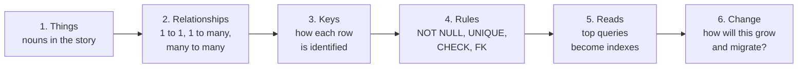

**1. Things.** Read the feature out loud and circle the nouns. "A **store owner** places an **order** for **products**, earns **points**, and redeems points for **rewards**." Each important noun is a candidate table.

**2. Relationships.** For each pair, ask: "one X has how many Y, and one Y belongs to how many X?"

**3. Keys.** Each table gets a primary key. Decide natural key or surrogate key (see below).

**4. Rules.** Which columns can never be empty? What must be unique? What values are allowed? What must exist first?

**5. Reads.** List the 3 to 5 most frequent queries. Each one shapes an index. The index follows the query.

**6. Change.** What gets big? What will the product ask for next year? How will you change the schema without downtime?

## Step 2 in Pictures: the Three Relationships

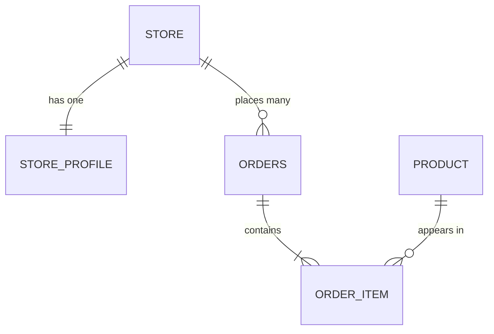

| Relationship | Example | How to store it |
|---|---|---|
| One to one | store and its KTP verification profile | Put the FK on the "child" with a UNIQUE constraint: `store_profile.store_id UNIQUE`. Or keep it in one table if they are always read together. |
| One to many | one store, many orders | FK on the "many" side: `orders.store_id REFERENCES store(id)`. |
| Many to many | orders and products | A **junction table** in the middle: `order_item(order_id, product_id, qty, unit_price)`. The junction often carries its own facts (qty, price). |

> **Picture to remember:** the foreign key always lives on the "many" side. A mother does not keep a list of children in one cell. Each child writes down who the mother is.

## Normalization in Pictures

Normalization means **each fact is stored once**. If a fact is stored twice, one day the two copies disagree.

### Start with one bad table

| order_id | store_name | store_phone | products | total |
|---|---|---|---|---|
| 1 | Toko Maju | 0812... | Semen x10, Cat x2 | 900000 |
| 2 | Toko Maju | 0812... | Semen x5 | 400000 |

What goes wrong:

- **Update problem:** Toko Maju changes phone. You must update every order row. Miss one, and now the store has two phones.
- **Insert problem:** a new store with no order yet cannot be saved. There is no row to put it in.
- **Delete problem:** delete order 2, and if it was the last order, the store's phone is gone too.
- **List in one cell:** "Semen x10, Cat x2" cannot be indexed, joined or summed.

### Fix it step by step

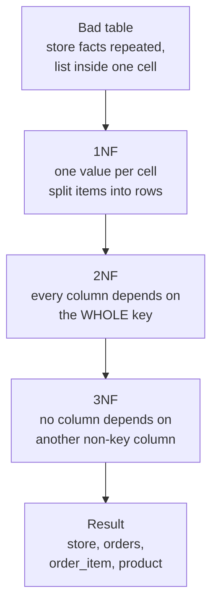

| Form | Plain rule | The question to ask | In our example |
|---|---|---|---|
| **1NF** | One value per cell. No lists, no repeating columns like `product1, product2`. | "Is anything in this cell really a list?" | `products` becomes rows in `order_item`. |
| **2NF** | In a table with a composite key, every column needs the whole key. | "Does this column only need half the key?" | In `order_item(order_id, product_id)`, `product_name` only needs `product_id`. Move it to `product`. |
| **3NF** | No column depends on another non-key column. | "If I know column X, do I already know column Y?" | Knowing `store_id` tells you `store_phone`. So the phone lives in `store`, not in `orders`. |
| **BCNF** | A stricter 3NF. Every "decider" column must be a key. | Rarely asked. Say: "3NF is the practical target; BCNF fixes a rare edge case with overlapping keys." | |

> **One sentence for interviews:** "Every non-key column depends on the key, the whole key, and nothing but the key."

### The trap: history is not duplication

`order_item.unit_price` looks like a copy of `product.price`. **It is not a copy.** It is a different fact: *the price at the moment of the order*. If the product price changes next month, old orders must not change. Same for the shipping address on an order.

> Say: "I store the price on the order line because it is a historical fact, not a duplicate. The product price is the current price. They answer different questions."

This sentence shows you understand *why* normalization exists, not only the rules.

## When to Denormalize (on Purpose)

Denormalize means: store a fact twice, on purpose, to make reads faster. You pay with extra work on every write and a risk that copies drift.

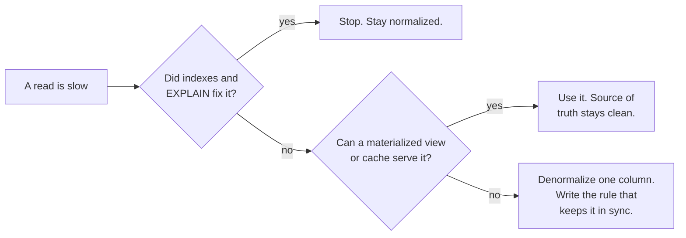

Good reasons:

- **Counters read on every page.** `store.order_count` instead of `COUNT(*)` on each request. Keep it in sync in the same transaction, or with a trigger.
- **Read models.** A flat `order_list_view` table for the CMS list, rebuilt by a worker.
- **Current balance.** `store.points_balance` as a cache of the ledger sum. See the ledger pattern below.

Bad reason: "joins are slow." A join on indexed keys is cheap. Prove it is slow with `EXPLAIN ANALYZE` first.

## Keys: Which Primary Key and Why

### Natural key or surrogate key?

| | Natural key | Surrogate key |
|---|---|---|
| What | A real-world value: email, KTP number, SKU | A meaningless number or UUID |
| Good | No extra column, readable | Never changes, small, same type everywhere |
| Bad | Real-world values change (people change email, SKUs get renamed) and may be private (KTP) | Duplicates can sneak in unless you also add UNIQUE on the natural value |

**Default answer:** surrogate primary key **plus** a UNIQUE constraint on the natural key. You get a stable ID and you still block duplicates.

```sql
CREATE TABLE store (
  id          bigint GENERATED ALWAYS AS IDENTITY PRIMARY KEY,
  phone       text NOT NULL UNIQUE,          -- natural key, still protected
  name        text NOT NULL,
  created_at  timestamptz NOT NULL DEFAULT now()
);
```

### bigint, UUIDv4 or UUIDv7?

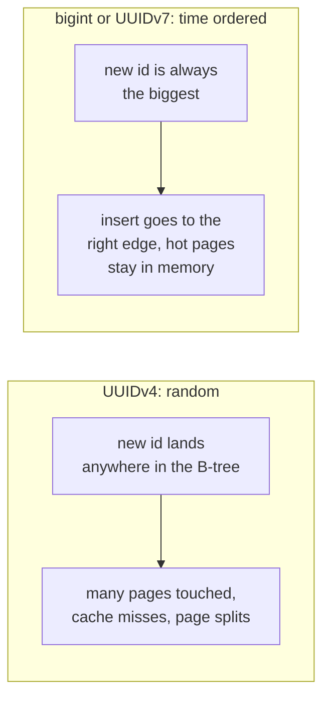

| Choice | Size | Good | Cost |
|---|---|---|---|
| `bigint identity` | 8 bytes | Smallest, fastest, ordered | Guessable (`/orders/1001`), must be made by the DB, hard to merge across databases |
| `uuid` v4 (random) | 16 bytes | Made anywhere, not guessable | Random inserts spread over the whole index: more I/O, more WAL, bigger index |
| `uuid` v7 (time ordered) | 16 bytes | Made anywhere, not guessable, inserts at the right edge like bigint | Leaks the creation time, still twice the size of bigint |

PostgreSQL 18 (released September 2025) has a built-in `uuidv7()` function. Before that you generate v7 in the app.

> Say: "Internal tables get `bigint` identity. IDs that leave the system, like in URLs or across services, get UUIDv7: not guessable, and still friendly to the B-tree because they are time ordered. I avoid random UUIDv4 as a primary key on big tables because every insert hits a random index page."

## Rules: Put Them in the Database

Your app checks things. But two requests can run at the same time (the TADA double refund was exactly this), a script can skip the app, and a new developer can forget. Constraints run **inside** the database, on every write, with no race.

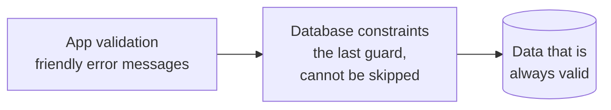

| Constraint | What it guarantees | DBO example |
|---|---|---|
| `NOT NULL` | The value is always there | `orders.store_id NOT NULL` |
| `UNIQUE` | No duplicates, safe even under races | `webhook_event(provider, event_id) UNIQUE` stops double processing |
| `CHECK` | Values are in range | `CHECK (qty > 0)`, `CHECK (points_delta <> 0)` |
| `FOREIGN KEY` | The parent row exists | `order_item.order_id REFERENCES orders(id)` |
| `EXCLUDE` | No overlap between rows | No two bookings for the same slot: `EXCLUDE USING gist (room WITH =, during WITH &&)` |

**Foreign key details that get asked:**

- **`ON DELETE`**: `RESTRICT` (default style, blocks delete), `CASCADE` (delete children too, careful), `SET NULL`. For money-related rows, never cascade. Block the delete.
- **Index the FK column.** Postgres indexes the primary key automatically but **not** the referencing column. Without an index on `order_item.order_id`, deleting an order scans all of `order_item`, and joins get slow.

> Say: "The app gives nice error messages. The database gives guarantees. I want both."

## Data Types That Prevent Incidents

| Data | Use | Never | Why |
|---|---|---|---|
| Money | `numeric(14,2)` or integer in the smallest unit (`bigint` rupiah or cents) | `float`, `real`, `double` | Floats cannot store 0.1 exactly. Sums drift by fractions, then reports do not match. |
| Time of an event | `timestamptz` | `timestamp` without zone | `timestamptz` stores an exact moment (UTC inside). Plain `timestamp` is a wall-clock reading with no zone, so servers in different zones disagree. |
| A date only (birthday) | `date` | text | Validated, sortable, date math works. |
| Short text | `text` + `CHECK (length(x) <= n)` if needed | `char(n)` | In Postgres `text` and `varchar` perform the same. `char(n)` pads with spaces. |
| Fixed set of values | `CHECK (status IN (...))` or a lookup table | free text | A typo like `'PIAD'` becomes impossible. |
| Yes or no | `boolean` | `'Y'/'N'` text | |
| Flexible extra data | `jsonb` | `json` (no index, keeps duplicates) | See JSONB below. |

**Enum: CHECK, native ENUM type, or lookup table?**

- `CHECK (status IN ('PENDING','PAID','SHIPPED'))`: simple, easy to change in a migration. Good default.
- Native `CREATE TYPE ... AS ENUM`: compact, but removing or renaming a value is painful.
- Lookup table `order_status(code PRIMARY KEY, label)`: when admins manage the list, or values have extra data (label, color, sort order).

## Patterns That Come Up Again and Again

### 1. The ledger: never just overwrite a balance

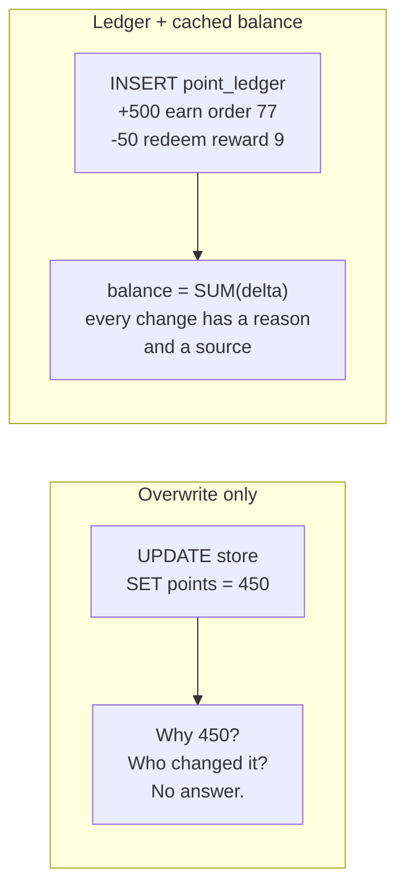

```sql
CREATE TABLE point_ledger (
  id            bigint GENERATED ALWAYS AS IDENTITY PRIMARY KEY,
  store_id      bigint NOT NULL REFERENCES store(id),
  delta         integer NOT NULL CHECK (delta <> 0),
  reason        text NOT NULL CHECK (reason IN ('EARN','REDEEM','REFUND','YEARLY_RESET','ADJUST')),
  source_type   text NOT NULL,             -- 'order', 'tada_event', 'admin'
  source_id     text NOT NULL,             -- the order id or the TADA event id
  created_at    timestamptz NOT NULL DEFAULT now(),
  UNIQUE (reason, source_type, source_id)  -- the same event can never post twice
);
CREATE INDEX ON point_ledger (store_id, created_at DESC);
```

- The ledger is **append-only**. Mistakes are fixed by a new correcting row (`ADJUST`), never by UPDATE or DELETE. This is how banks work.
- `store.points_balance` can be a cached column, updated **in the same transaction** as the ledger insert. If they ever disagree, the ledger wins and you can rebuild the balance.
- The `UNIQUE (reason, source_type, source_id)` is the database-level fix for the TADA double refund. A second copy of the same event fails on insert.

> This is your strongest design story. You lived the bug, and the ledger plus the unique key is the design that makes it impossible.

### 2. Soft delete

```sql
ALTER TABLE product ADD COLUMN deleted_at timestamptz;
-- unique only among rows that are not deleted:
CREATE UNIQUE INDEX product_sku_live ON product (sku) WHERE deleted_at IS NULL;
```

- **Good:** undo, audit, foreign keys from old orders stay valid.
- **Cost:** every query must remember `WHERE deleted_at IS NULL`. Forget once, and deleted products appear. Unique constraints need the partial index above.
- **Alternative:** move deleted rows to an archive table. Cleaner queries, harder undo.
- Personal data (KTP photos, phone numbers) may need a **real** delete for privacy law. Soft delete is not deletion.

### 3. Status as a state machine

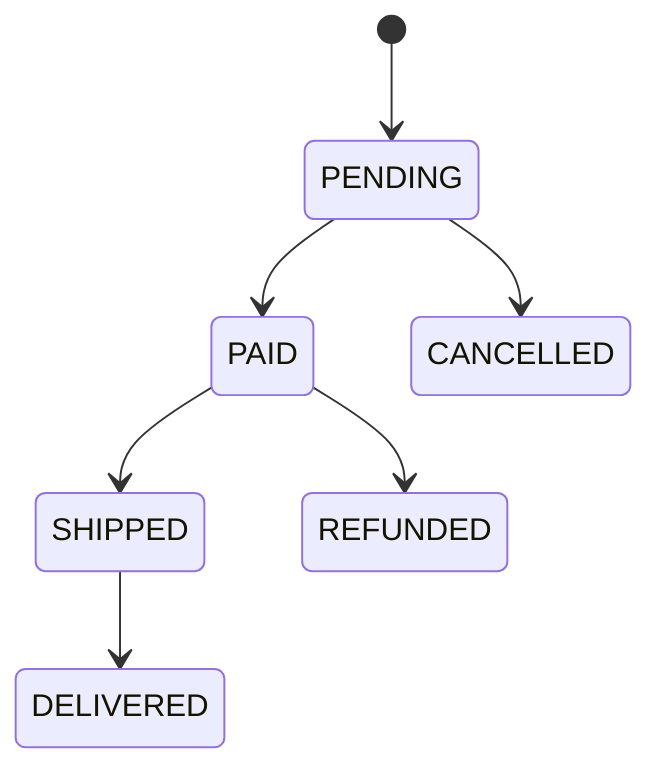

- Store `status` with a CHECK of allowed values.
- Move it with a **guarded update**, so two workers cannot both move it:

```sql
UPDATE orders SET status = 'SHIPPED', shipped_at = now()
WHERE id = $1 AND status = 'PAID'      -- only from the allowed previous state
RETURNING id;                          -- 0 rows back = someone else already moved it
```

- Keep an `order_status_history` table (order_id, from, to, at, by) if support needs to see "who changed what and when."

### 4. Audit trail

Three levels, pick by need:

1. `created_at`, `updated_at`, `created_by` columns. Cheap. Answers "when", not "what changed."
2. A history table written by the app, or by a trigger, with old and new values as `jsonb`.
3. Event log or change data capture (CDC) that streams every change out of the WAL (Debezium). For analytics and other services.

### 5. Multi-tenancy (one app, many companies)

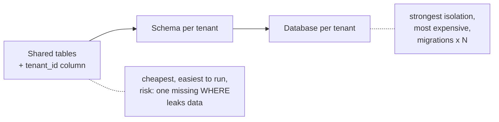

- **Default:** shared tables with `tenant_id` on every row, `tenant_id` first in composite indexes, and **Row Level Security** so the database itself filters by tenant:

```sql
ALTER TABLE orders ENABLE ROW LEVEL SECURITY;
CREATE POLICY tenant_isolation ON orders
  USING (tenant_id = current_setting('app.tenant_id')::bigint);
```

- Move a big customer to its own database only when they need it (size, compliance, noisy neighbor). Notion and Figma later sharded by workspace or tenant ID for the same reason.

### 6. Polymorphic links: avoid the "any table" column

Bad: `comment(target_type text, target_id bigint)`. No foreign key is possible, so orphans appear.

Better: one nullable FK per target and a CHECK that exactly one is set:

```sql
CREATE TABLE comment (
  id         bigint GENERATED ALWAYS AS IDENTITY PRIMARY KEY,
  order_id   bigint REFERENCES orders(id),
  product_id bigint REFERENCES product(id),
  body       text NOT NULL,
  CHECK (num_nonnulls(order_id, product_id) = 1)
);
```

### 7. Trees (categories, referral chains)

| Way | How | Good for |
|---|---|---|
| Adjacency list | `parent_id` column + recursive CTE | Default. Easy writes. |
| Materialized path | `path = '1/4/9'` or the `ltree` extension | Fast "all under this node" reads |
| Closure table | A table of every (ancestor, descendant, depth) pair | Heavy tree reads, rare moves |

### 8. Idempotency keys

For any request that can be retried (payments, webhooks, "place order" with bad network), store the key:

```sql
CREATE TABLE idempotency_key (
  key         text PRIMARY KEY,
  response    jsonb,
  created_at  timestamptz NOT NULL DEFAULT now()
);
-- INSERT ... ON CONFLICT (key) DO NOTHING RETURNING key;
-- nothing returned = already handled, send the saved response
```

## JSONB: Columns for What You Query, JSONB for What You Store

| Put in real columns | Put in `jsonb` |
|---|---|
| Anything you filter, join, sort, sum or validate | Raw third-party payloads (the TADA webhook body) |
| Anything with a business rule | Settings and rarely read metadata |
| | Shapes you do not control and that change often |

- A GIN index makes `payload @> '{"type":"refund"}'` fast.
- If one JSON key becomes hot in queries, **promote it** to a column (or a generated column) and index it. Cheap migration.

## Designing From Access Patterns

Write the top queries **before** you finish the tables. Each query names its index.

| Screen or job | Query shape | Index |
|---|---|---|
| App: my order history | `WHERE store_id = ? ORDER BY created_at DESC LIMIT 20` | `(store_id, created_at DESC)` |
| App: my points history | `WHERE store_id = ? ORDER BY created_at DESC` | `(store_id, created_at DESC)` on `point_ledger` |
| CMS: pending verifications | `WHERE status = 'PENDING' ORDER BY created_at` | partial: `(created_at) WHERE status = 'PENDING'` |
| Worker: webhook dedupe | `INSERT ... ON CONFLICT (provider, event_id)` | the UNIQUE constraint itself |
| Login by phone | `WHERE phone = ?` | the UNIQUE constraint itself |

> Say: "I design tables from the nouns, and indexes from the screens. Then I check the hottest queries with EXPLAIN ANALYZE on realistic data."

## SQL or NoSQL? The Honest Answer

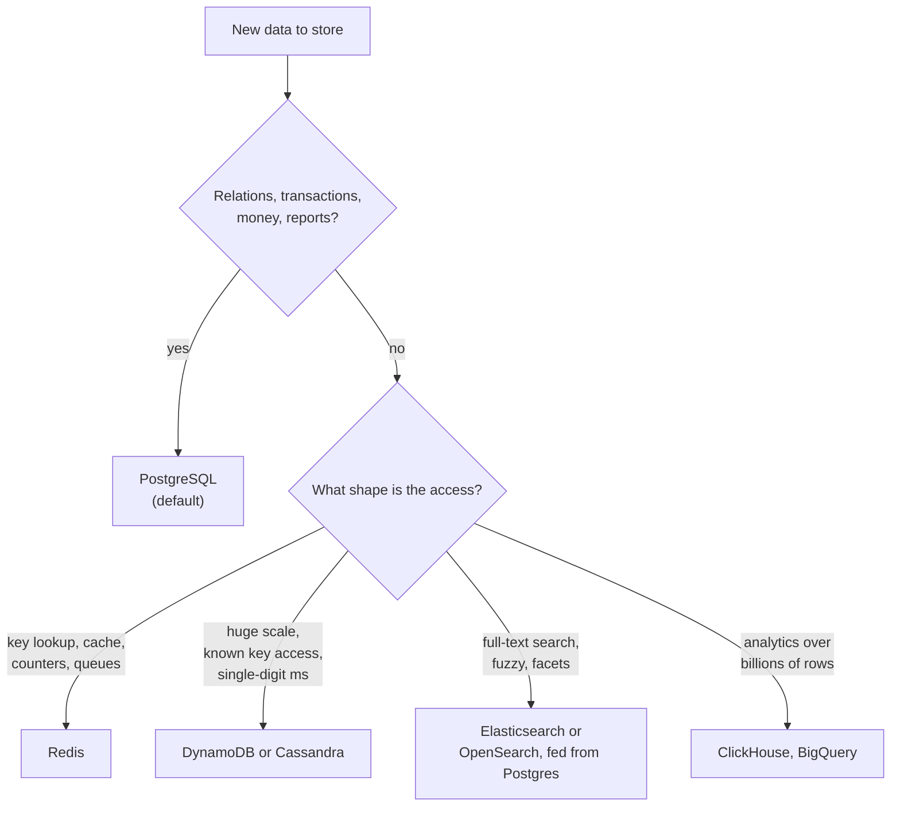

| Myth | Reality |
|---|---|
| "NoSQL scales, SQL does not." | Postgres serves very large products (Notion, Figma, Instagram's early years). You scale with replicas, partitioning and sharding before you need a different engine. |
| "MongoDB has no schema, so it is faster to build." | The schema still exists, it just lives in your code. Changes become harder to see and enforce. |
| "Use one database for everything." | Common and good: Postgres for truth, Redis for cache and queues, a search engine for search. Each one has a clear owner role. |

> Say: "Postgres is my default because most business data is relational and needs transactions. I add a specialized store when an access pattern clearly needs it, like Redis for BullMQ in my DBO project, and I keep Postgres as the source of truth."

## Changing the Schema Without Downtime (Expand and Contract)

Renaming `store.phone` to `store.phone_e164` in one migration breaks the old app version that is still running during the deploy. Do it in steps:

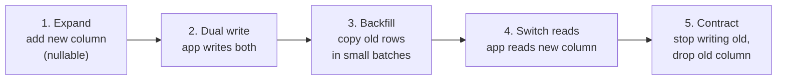

Rules of thumb:

- Adding a column with a default is fast in Postgres 11+. Adding `NOT NULL` to a big existing column scans the table: add a `CHECK (col IS NOT NULL) NOT VALID`, then `VALIDATE CONSTRAINT` later.
- Build indexes with `CREATE INDEX CONCURRENTLY` on live tables.
- Backfill in batches of a few thousand rows so you do not hold long locks or create huge WAL bursts.
- Set `lock_timeout` in migrations so a blocked migration fails fast instead of freezing the whole table queue.

More in [Scaling a database and keeping data correct](database-scaling-and-correctness.md).

## Worked Example: Design It From a Blank Page

**Prompt:** "Design the tables for store owners ordering products and earning points. Points can be redeemed for rewards through a third party."

**Say the steps out loud, then write:**

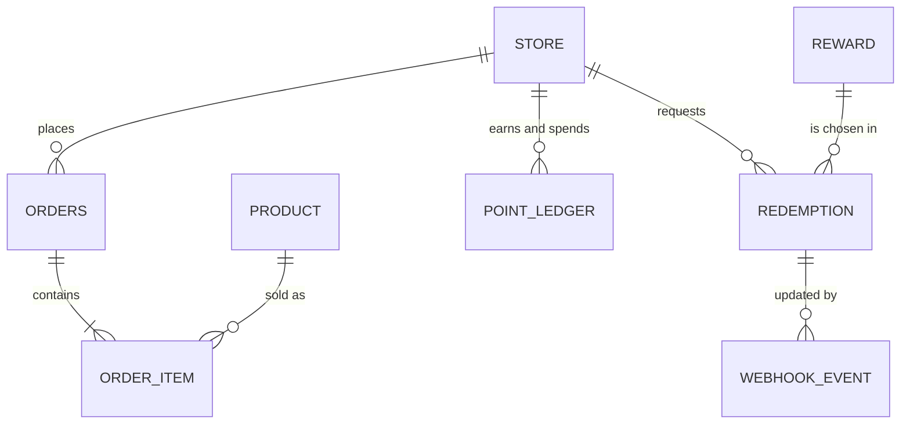

```sql
CREATE TABLE product (
  id          bigint GENERATED ALWAYS AS IDENTITY PRIMARY KEY,
  sku         text NOT NULL,
  name        text NOT NULL,
  price       numeric(14,2) NOT NULL CHECK (price >= 0),
  deleted_at  timestamptz
);
CREATE UNIQUE INDEX product_sku_live ON product (sku) WHERE deleted_at IS NULL;

CREATE TABLE orders (
  id          bigint GENERATED ALWAYS AS IDENTITY PRIMARY KEY,
  public_id   uuid NOT NULL UNIQUE DEFAULT uuidv7(),   -- PG18; generate in app before 18
  store_id    bigint NOT NULL REFERENCES store(id),
  status      text NOT NULL DEFAULT 'PENDING'
              CHECK (status IN ('PENDING','PAID','SHIPPED','DELIVERED','CANCELLED','REFUNDED')),
  total       numeric(14,2) NOT NULL CHECK (total >= 0),
  created_at  timestamptz NOT NULL DEFAULT now()
);
CREATE INDEX orders_store_recent ON orders (store_id, created_at DESC);

CREATE TABLE order_item (
  order_id    bigint NOT NULL REFERENCES orders(id) ON DELETE CASCADE,  -- items live and die with their order; orders themselves are never hard-deleted
  product_id  bigint NOT NULL REFERENCES product(id),
  qty         integer NOT NULL CHECK (qty > 0),
  unit_price  numeric(14,2) NOT NULL,          -- price at order time: history, not duplication
  PRIMARY KEY (order_id, product_id)
);
CREATE INDEX ON order_item (product_id);         -- FK side needs its own index

CREATE TABLE redemption (
  id           bigint GENERATED ALWAYS AS IDENTITY PRIMARY KEY,
  store_id     bigint NOT NULL REFERENCES store(id),
  reward_id    bigint NOT NULL REFERENCES reward(id),
  points       integer NOT NULL CHECK (points > 0),
  status       text NOT NULL DEFAULT 'REQUESTED'
               CHECK (status IN ('REQUESTED','CONFIRMED','FAILED','REFUNDED')),
  external_ref text UNIQUE,                     -- TADA's id
  created_at   timestamptz NOT NULL DEFAULT now()
);

CREATE TABLE webhook_event (
  provider     text NOT NULL,
  event_id     text NOT NULL,
  payload      jsonb NOT NULL,
  received_at  timestamptz NOT NULL DEFAULT now(),
  processed_at timestamptz,
  PRIMARY KEY (provider, event_id)              -- a duplicate delivery cannot insert twice
);
-- plus point_ledger from the ledger pattern above
```

**Then defend three choices without being asked:**

1. "`unit_price` on the order line is the historical price, so old orders never change when prices change."
2. "Points live in an append-only ledger with a unique source key, so a duplicate webhook can never post twice. That fixed a real double-refund bug in my project."
3. "The webhook table stores the raw payload as `jsonb` because we do not control its shape, but the fields we act on are real columns with constraints."

## Likely Interview Questions

### Q: Normalize or denormalize?

- **Problem:** duplicated facts drift apart. But some reads are too slow when every page joins many tables.
- **How:** normalize to 3NF by default. Denormalize one specific field when a measured read problem remains after indexes.
- **Tradeoff:** denormalized data costs extra writes and a sync rule. If the sync fails, you show wrong data.
- **My example:** in DBO the points balance can be a cached column, but the ledger is the truth and can rebuild it.

### Q: UUID or auto-increment for the primary key?

- **Problem:** IDs must be unique, fast to index, and sometimes not guessable or creatable outside the DB.
- **How:** bigint identity for internal rows. UUIDv7 for IDs exposed in URLs or created by other services.
- **Tradeoff:** UUIDs are 16 bytes and random v4 UUIDs scatter inserts over the index. v7 fixes the scatter, not the size.
- **Follow-up:** "Why are random UUIDs slow?" Each insert goes to a random leaf page of the B-tree, so more pages are read into memory and more pages split.

### Q: Why put constraints in the database if the app already validates?

- Races (two requests pass the app check at once), other writers (scripts, admin tools, a second service), and future developers. A UNIQUE constraint holds even under concurrency. My TADA double refund is the proof.

### Q: How do you store money?

- `numeric` with fixed scale or integer minor units. Never float, because 0.1 + 0.2 is not 0.3 in binary floating point. Store the currency next to the amount if there can be more than one.

### Q: How do you design for multi-tenancy?

- Shared schema with `tenant_id` everywhere, leading in indexes, plus Row Level Security as a safety net. Bigger isolation (schema or database per tenant) only for customers who need it. The cost of the default is the risk of a missing filter, which RLS covers.

### Q: How do you delete data?

- Soft delete for business data that must stay referable (products in old orders). Hard delete or anonymize for personal data that must be removed. Archive tables for very old rows to keep hot tables small.

### Q: How would you evolve a column without downtime?

- Expand and contract: add, dual write, backfill in batches, switch reads, drop. Concurrent index builds, `NOT VALID` then `VALIDATE` for constraints, and `lock_timeout` on every migration.

## Draw It From Memory

Close this note and draw:

1. The six design steps as boxes.
2. The bad orders table and the three problems it causes, then the fixed four tables.
3. The ledger: rows with + and -, and the balance as their sum.
4. The expand and contract arrow.
5. The SQL or NoSQL decision tree with at least four leaves.

Then answer out loud: "Design the tables for orders and points, and tell me why."

## Sources

- [PostgreSQL docs: Constraints](https://www.postgresql.org/docs/current/ddl-constraints.html)
- [PostgreSQL docs: UUID functions, including uuidv7() in PostgreSQL 18](https://www.postgresql.org/docs/current/functions-uuid.html)
- [PostgreSQL docs: Row Security Policies](https://www.postgresql.org/docs/current/ddl-rowsecurity.html)
- [PostgreSQL docs: Date and time types](https://www.postgresql.org/docs/current/datatype-datetime.html)
- [PostgreSQL wiki: Don't Do This (money, timestamp, char(n) and more)](https://wiki.postgresql.org/wiki/Don't_Do_This)
- [PostgreSQL 18 release announcement (2025-09-25)](https://www.postgresql.org/about/news/postgresql-18-released-3142/)
