# Scaling a Database and Keeping Data Correct

- **Written:** 2026-10-16
- **Level:** Senior
- **Why this note exists:** Senior interviews always reach two questions: "two requests arrive at the same moment, what happens?" and "traffic grows 10x, what do you do?" This note answers both with pictures, in the order you would really do things.
- **Read with:** [How Postgres works inside](postgres-internals-visual.md), [DBO B2B platform](../../interview/my-projects/dbo-b2b-platform-system-design-case-study.md), [System design basics](../system-design/system-design-basics-senior-fullstack-interview.md).

## TL;DR

- **Correctness first.** Most data bugs are races: two requests read the same value, both decide, both write. Fix them **inside the database**: atomic updates, unique constraints, row locks, or a version check.
- **Never hold a transaction open while calling another service.** Use the outbox pattern to send events reliably after commit.
- **Scale in a ladder, cheapest step first:** measure → fix queries and indexes → connection pooling → cache → read replicas → bigger machine → partition → shard. Most companies never need the last step.
- **Every scaling step trades something:** replicas trade freshness, caches trade freshness and add invalidation, sharding trades joins and transactions across shards.
- **Backups are only real if you have tested a restore.** Know your RPO (how much data you can lose) and RTO (how long you can be down).

---

## Part A: Correctness Under Concurrency

### The four races you must recognise

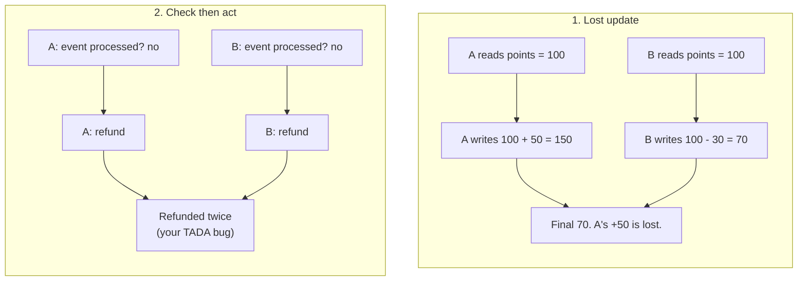

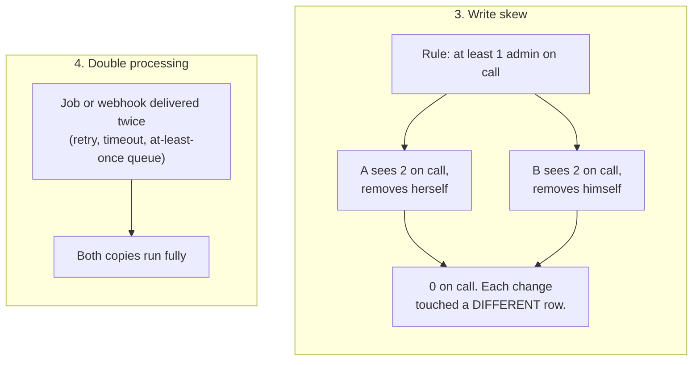

### What each isolation level prevents in Postgres

| Problem | READ COMMITTED (default) | REPEATABLE READ | SERIALIZABLE |
|---|---|---|---|
| Dirty read (see uncommitted data) | prevented | prevented | prevented |
| Non-repeatable read (same row, new value inside one transaction) | **possible** | prevented | prevented |
| Phantom (new rows appear in a repeated query) | **possible** | prevented in Postgres | prevented |
| Lost update via read-modify-write in the app | **possible** | detected, one transaction gets error `40001` | detected |
| Write skew | **possible** | **possible** | detected, error `40001` |

Two things to say:

1. "Postgres REPEATABLE READ is stronger than the SQL standard requires: it also blocks phantoms, because it is snapshot isolation."
2. "Higher levels do not wait, they **fail**. Any code using REPEATABLE READ or SERIALIZABLE must catch `40001` and retry the whole transaction."

### The toolbox, from simplest to heaviest

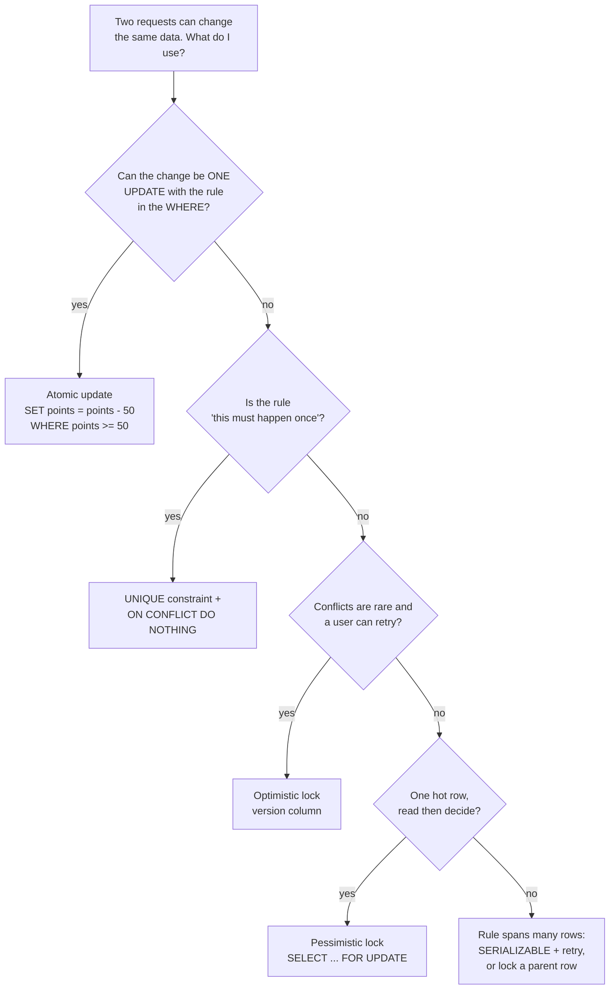

**1. Atomic update.** Let the database do read and write in one step. No race is possible.

```sql
UPDATE store SET points_balance = points_balance - 50
WHERE id = $1 AND points_balance >= 50
RETURNING points_balance;            -- 0 rows = not enough points
```

**2. Unique constraint.** For "only once" rules: one refund per event, one account per phone. See the workbook, exercise 18.

**3. Optimistic locking (version column).** Read the version, and update only if nobody changed it since.

```sql
-- read
SELECT id, name, price, version FROM product WHERE id = 7;      -- version = 3
-- write
UPDATE product SET price = 70000, version = version + 1
WHERE id = 7 AND version = 3;                                   -- 0 rows = someone else saved first
```

Good for forms where two admins edit the same product in the CMS: the second one sees "this was changed, reload." No locks held while a human thinks. Prisma does not do this automatically; you add the `version` column and the `where`.

**4. Pessimistic locking.** Lock the row first, then decide.

```sql
BEGIN;
SELECT * FROM redemption WHERE id = $1 FOR UPDATE;   -- others wait here
-- check status, decide, write
UPDATE redemption SET status = 'REFUNDED' WHERE id = $1;
INSERT INTO point_ledger (...) VALUES (...);
COMMIT;
```

This is what fixed your TADA double refund: the second handler waited, then saw `REFUNDED` and stopped. Keep the transaction short and lock rows in a consistent order to avoid deadlocks.

**5. SERIALIZABLE.** When the rule spans many rows (write skew, "at least one admin on call", "total booked seats ≤ capacity"), let Postgres detect conflicts. Cost: retries and some overhead. Alternative: lock a parent row (`SELECT ... FROM event WHERE id = $1 FOR UPDATE`) so all changes to that group go one at a time.

| Tool | Waits? | Fails? | Best for |
|---|---|---|---|
| Atomic update | briefly on the row | no, returns 0 rows | counters, balances, stock |
| Unique constraint | no | conflict, handled with ON CONFLICT | exactly-once events |
| Optimistic version | no | 0 rows, user retries | human edits, low conflict |
| FOR UPDATE | yes | no (deadlock possible) | hot row, read-then-decide |
| SERIALIZABLE | no | yes, `40001`, retry | rules across many rows |

### Never call another service inside a transaction

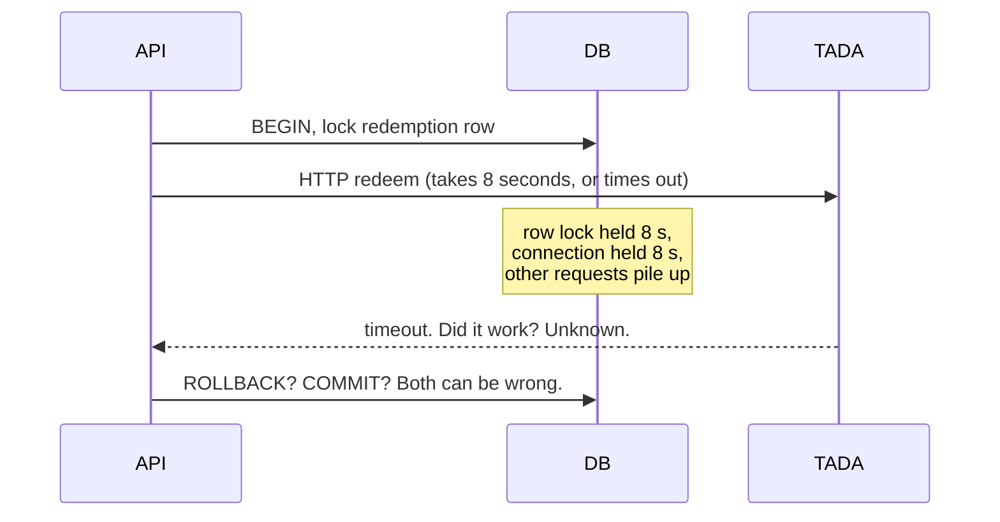

Problems: locks and connections are held during a slow network call, and the database and the other service can disagree (you rolled back but TADA did redeem).

**The fix: transactional outbox.**

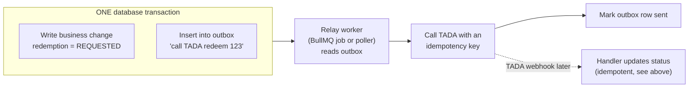

- The change and the "message to send" commit together or not at all. Nothing is lost if the app crashes after commit.
- The relay may send twice (crash after sending, before marking), so the receiver must be idempotent. That is why you send an **idempotency key**.
- When a flow spans several services and needs undo steps (redeem, then if shipping fails, refund), that is a **saga**: a chain of local transactions with compensating actions. See the load balancers and microservices note.

---

## Part B: The Scaling Ladder

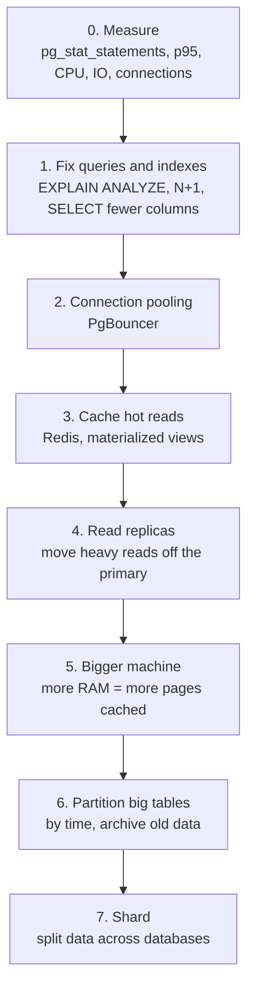

> Say: "I climb this ladder one step at a time and measure after each. Step 1 often gives 10x or more. Sharding is the last step because it costs the most: cross-shard joins and transactions become your problem."

### Step 2: Connection pooling

Every Postgres connection is a whole process (see internals). Apps open far more connections than the database likes.

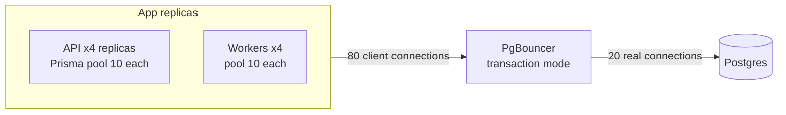

| PgBouncer mode | A real connection is given back... | Use |
|---|---|---|
| Session | when the client disconnects | Almost no gain. Only for apps needing session features. |
| **Transaction** | when each transaction ends | The usual choice. Many clients share few connections. |
| Statement | after each statement | Rare. No multi-statement transactions. |

Transaction mode caveat: anything tied to a session breaks: `SET` without `LOCAL`, session advisory locks, `LISTEN`, temp tables. Prepared statements needed special handling in old setups (Prisma's `pgbouncer=true` flag); PgBouncer 1.21 and later can track protocol-level prepared statements with `max_prepared_statements`.

**The math to say out loud:** "4 API replicas × Prisma pool of 10 + 4 workers × 10 = 80 connections. Scale the API to 12 replicas during a promo and it is 160, which exhausts a default `max_connections = 100`. PgBouncer keeps the database side at about 20 to 50, roughly a few per CPU core."

### Step 3: Caching

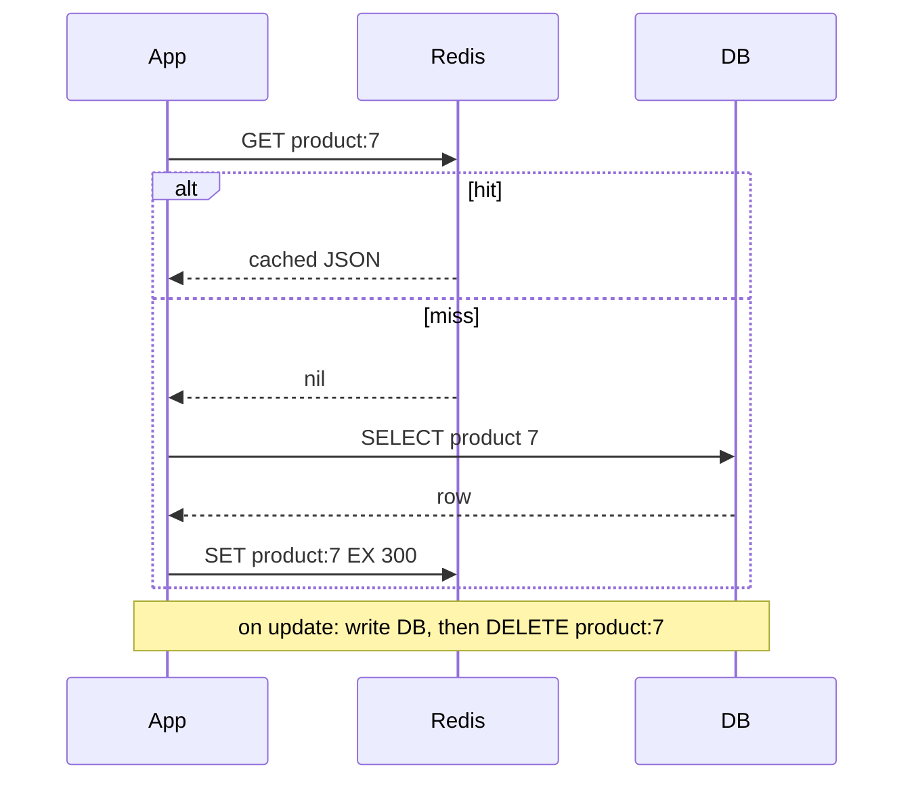

| Pattern | How | Good | Risk |
|---|---|---|---|
| **Cache-aside** (above) | App reads cache, falls back to DB, fills cache | Simple, cache can die safely | Stale until TTL or delete |
| Write-through | App writes DB and cache together | Reads always warm | Writes slower; cache holds data nobody reads |
| Materialized view | Postgres stores a query result, refresh on schedule | No new system, SQL | Stale between refreshes |

The three cache problems interviewers ask about:

1. **Invalidation.** On update, **delete** the key (do not set it), after the DB commit. Setting it can race with another reader putting back old data.
2. **Stampede.** A hot key expires; 1,000 requests miss at once and all hit the database. Fix: one request rebuilds while others wait or get the stale value (single flight / lock), add random jitter to TTLs, or refresh before expiry.
3. **What not to cache:** points balance at the moment of redeem, stock at checkout. Read those from the database, inside the transaction.

### Step 4: Read replicas

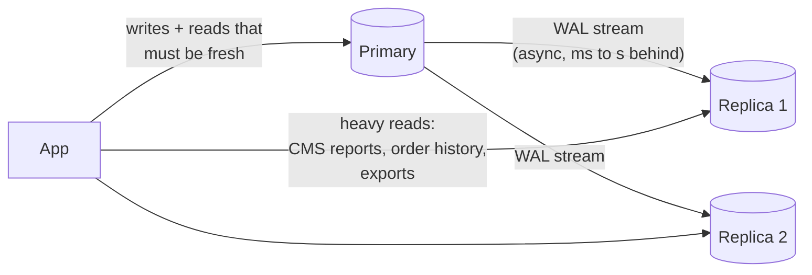

- Replicas replay the primary's WAL. Usually milliseconds behind, but seconds or more under heavy write load or a long query on the replica.
- **Read-your-own-writes problem:** a store owner places an order, the next screen reads from a replica that has not received it yet, and the order "disappears." Fixes: read from the primary for a few seconds after that user writes; route "my own data right after a change" to the primary; or wait until the replica has replayed up to the primary's WAL position.
- Replicas scale **reads** only. Writes still go to one primary.
- Synchronous replication (`synchronous_commit = remote_apply`, or `on` with a synchronous standby) means no data loss on failover, but every commit waits for the replica.

### Step 6: Partitioning (one database, split tables)

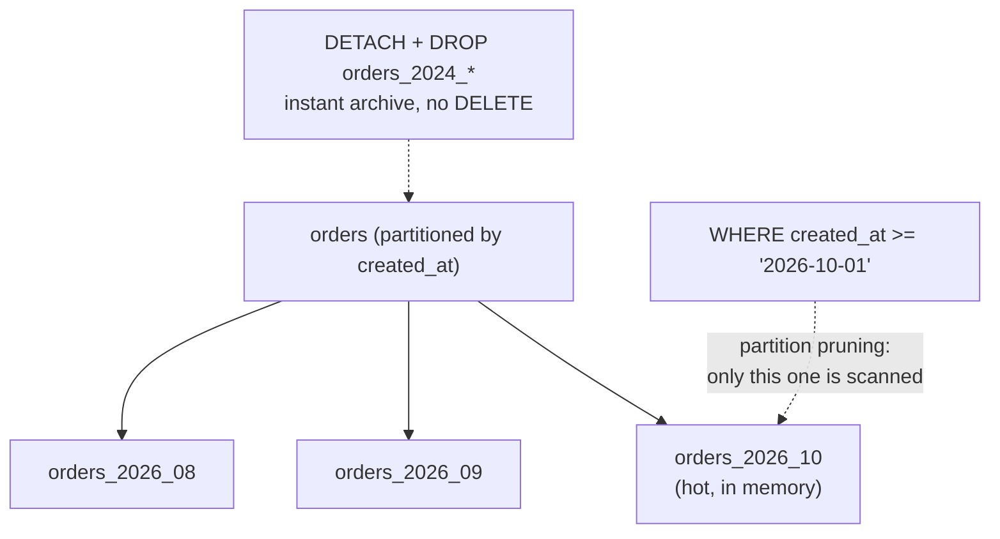

| Type | Split by | Example |
|---|---|---|
| Range | value ranges | `created_at` by month for orders, ledger, webhook events |
| List | specific values | `region IN ('JAWA')`, `('SUMATERA')` |
| Hash | hash of a key | spread `store_id` evenly over 16 partitions |

- **Wins:** queries that filter on the partition key touch fewer pages; indexes per partition are smaller; dropping old data is instant instead of a huge DELETE plus VACUUM.
- **Costs:** the partition key must be part of every primary key and unique constraint; queries that do not filter on it scan every partition; you must create future partitions (pg_partman).
- **When:** tables in the hundreds of millions of rows, or when you regularly delete old data. Not for a 5 GB table.

### Step 7: Sharding (many databases)

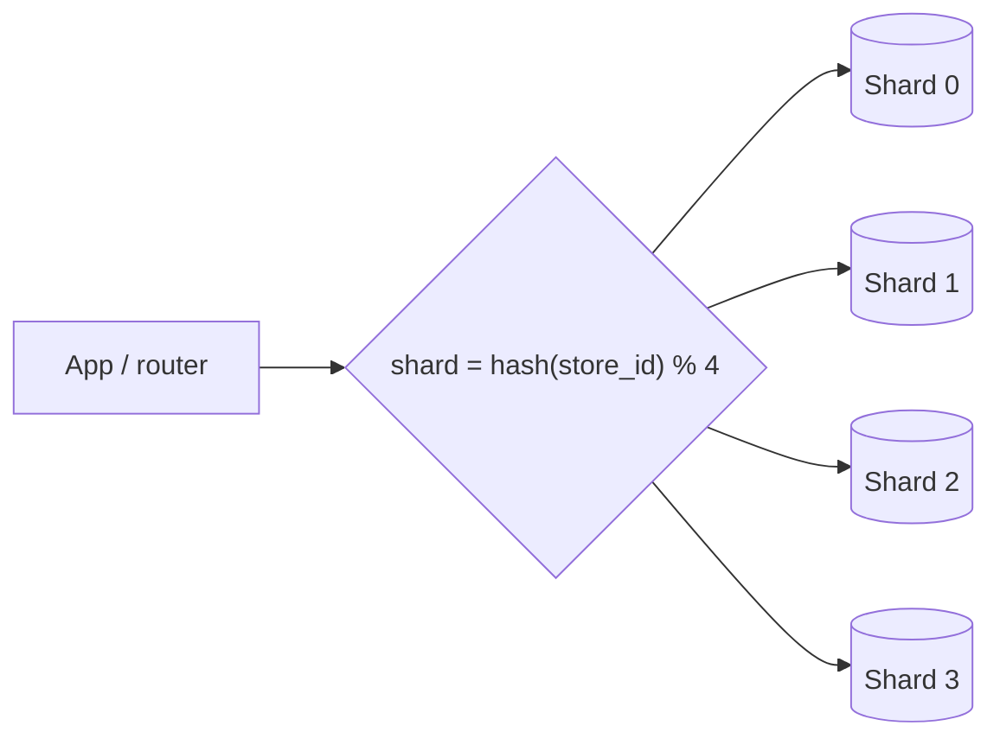

- **Choosing the shard key is the whole game.** Pick the key most queries already filter by, and that keeps related data together: `tenant_id`, `workspace_id`, `store_id`. Everything for one store lives on one shard, so its queries and transactions stay local.
- **Bad key → hot shard.** Sharding by `created_at` sends all new writes to one shard. Sharding by `country` gives Indonesia one giant shard.
- **What you lose:** joins across shards, transactions across shards, global unique constraints, simple reporting (use a separate analytics store).
- **Resharding:** use many logical shards on few physical machines (Notion used 480 logical shards on 32 databases), so you move whole logical shards instead of re-hashing rows.
- **Tools:** Citus (a Postgres extension that shards for you), or application-level routing. Figma built its own sharding in place on Postgres rather than moving to NoSQL.

### Consistency words, in simple language

- **Strong consistency:** every read sees the latest committed write. A single Postgres primary gives you this.
- **Eventual consistency:** reads may be behind for a while, but will catch up. Replicas, caches, search indexes.
- **CAP:** when the network splits, a distributed system must choose between staying available (answer, maybe stale) and staying consistent (refuse to answer). **PACELC** adds: even without a split, you trade latency against consistency (synchronous replication is consistent but slower).

> Say: "Inside one Postgres I get strong consistency. The moment I add replicas, caches or a search index, those parts are eventually consistent, so I decide per screen which reads must be fresh: checkout and points must read the primary; a product list can be a few seconds old."

---

## Part C: Not Losing Data

### RPO and RTO

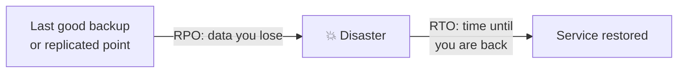

- **RPO** (recovery point objective): how many minutes of data can we lose? Payments and points: near zero.
- **RTO** (recovery time objective): how long can we be down? Business decides, engineers make it true.

### Backup types

| Type | What | RPO | Notes |
|---|---|---|---|
| `pg_dump` (logical) | SQL or archive of the data | time since last dump (hours) | Easy, portable across versions. Slow to restore big databases. |
| Base backup + **WAL archiving** | Copy of the data files + every WAL file since | seconds to minutes | Enables **point-in-time recovery**: "restore to 14:03:59, just before someone ran DELETE without WHERE." Tools: pgBackRest, WAL-G, or managed (RDS, Cloud SQL). |
| Streaming replica | Live copy | near zero | **Not a backup.** A `DELETE` replicates instantly. |

### High availability

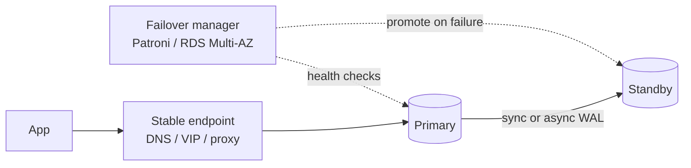

- A standby plus automatic failover gives an RTO of tens of seconds to a few minutes.
- **Split brain** (two primaries after a network split) is the danger. Managers like Patroni use a consensus store (etcd) to make sure only one primary exists.
- Apps must **reconnect and retry** after failover; in-flight transactions are lost and must be retried idempotently.

> Say: "A replica protects against a dead machine. A backup with WAL archiving protects against a dead table, like a bad migration or a DELETE without WHERE. You need both, and you only trust a backup you have restored in a drill."

### What to monitor on any Postgres

| Signal | Why |
|---|---|
| Top queries by total time (`pg_stat_statements`) | Where the time actually goes |
| p95 / p99 query latency | Averages hide pain |
| Active vs max connections, waiting clients in PgBouncer | First cliff in your stack |
| Replication lag (bytes and seconds) | Stale reads, failover data loss |
| Long-running and idle-in-transaction sessions | Block VACUUM, hold locks |
| Dead tuples and last autovacuum per table | Bloat |
| `age(datfrozenxid)` | Wraparound risk |
| Cache hit ratio, disk IO, CPU | Need more RAM or better queries |
| Lock waits and deadlocks | Contention, bad migrations |
| Disk space, WAL directory size | A full disk stops the database |

---

## Applying It to DBO

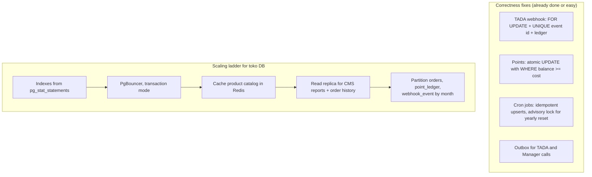

Sharding is not on the list. Say why: "One store's data is small, total data fits comfortably on one primary for years, and the team is small. If it ever were needed, `store_id` is the natural shard key because almost every query filters on it."

## Likely Interview Questions

### Q: Two requests redeem points at the same time and the balance goes negative. Fix it.
- **Problem:** read-modify-write race (lost update or check-then-act).
- **How:** one atomic `UPDATE ... SET balance = balance - cost WHERE id = ? AND balance >= cost RETURNING`, plus a `CHECK (balance >= 0)` as a final guard, plus the ledger insert in the same transaction.
- **Tradeoff:** simple and fast; for more complex decisions use `FOR UPDATE`.
- **My example:** the TADA refund race in DBO.

### Q: Optimistic or pessimistic locking?
- Optimistic when conflicts are rare and a retry is cheap (CMS edits). Pessimistic when conflicts are common on a hot row and a retry is expensive (redeem, stock). Optimistic holds no locks; pessimistic can deadlock if you lock in different orders.

### Q: What is write skew and how do you prevent it?
- Two transactions read the same set, each changes a **different** row, together they break a rule. REPEATABLE READ does not catch it. Use SERIALIZABLE with retry, or lock a shared parent row, or turn the rule into a constraint.

### Q: Your database CPU is at 90%. What do you do?
- Measure first: `pg_stat_statements` sorted by total time. Usually a few queries dominate. Fix them (index, rewrite, N+1). Then pooling if connections are high, cache for repeated reads, replicas for heavy reads. Bigger machine is fine as a fast stopgap while fixing the cause.

### Q: How do you handle replication lag?
- Decide which reads must be fresh. Route those to the primary (or to the primary for N seconds after a user writes). Monitor lag and take a replica out of rotation if it falls too far behind.

### Q: Partitioning vs sharding?
- Partitioning splits a table inside one database; transactions and joins still work. Sharding splits data across databases; you lose cross-shard joins and transactions. Partition first; shard only when one primary cannot handle the writes or the data size.

### Q: How do you choose a shard key?
- The key most queries filter by, with enough distinct values to spread load and no single huge value. Usually the tenant. Avoid time (all writes hit one shard) and low-cardinality keys.

### Q: What is your backup and DR strategy?
- Continuous WAL archiving plus regular base backups for point-in-time recovery, a streaming standby with automatic failover for machine failure, backups stored in another region, and a restore drill on a schedule. State the RPO and RTO and tie them to the business.

### Q: How do you make sure an event is processed exactly once?
- You cannot guarantee exactly-once delivery across a network. You get at-least-once delivery plus an idempotent consumer: unique event id, `ON CONFLICT DO NOTHING`, guarded state transitions. "Exactly-once processing = at-least-once delivery + idempotency."

## Draw It From Memory

1. The four races as tiny two-lane pictures.
2. The toolbox decision tree (atomic → unique → optimistic → FOR UPDATE → serializable).
3. The outbox: one transaction with two writes, then a relay.
4. The scaling ladder with 8 steps.
5. PgBouncer: 80 connections in, 20 out.
6. Cache-aside with the delete on update.
7. Primary, two replicas, and the read-your-writes problem.
8. RPO and RTO on a timeline.

Then run `/mock-interview database scaling` and `/explain-check optimistic vs pessimistic locking`.

## Sources

- [PostgreSQL docs: Transaction isolation](https://www.postgresql.org/docs/current/transaction-iso.html)
- [PostgreSQL docs: Explicit locking and row-level locks](https://www.postgresql.org/docs/current/explicit-locking.html)
- [PostgreSQL docs: Table partitioning](https://www.postgresql.org/docs/current/ddl-partitioning.html)
- [PostgreSQL docs: Log-shipping standby servers and streaming replication](https://www.postgresql.org/docs/current/warm-standby.html)
- [PostgreSQL docs: Continuous archiving and point-in-time recovery](https://www.postgresql.org/docs/current/continuous-archiving.html)
- [PgBouncer: configuration and pool modes](https://www.pgbouncer.org/config.html)
- [PgBouncer 1.21.0 changelog: prepared statement support (2023)](https://www.pgbouncer.org/changelog.html)
- [Notion: Herding elephants, sharding Postgres (2021)](https://www.notion.com/blog/sharding-postgres-at-notion)
- [Figma: How Figma's databases team lived to tell the scale (2024)](https://www.figma.com/blog/how-figmas-databases-team-lived-to-tell-the-scale/)
- [Patroni documentation](https://patroni.readthedocs.io/)
