# How Postgres Works Inside: A Visual Guide

- **Written:** 2026-10-16
- **Level:** Senior
- **Why this note exists:** In the advanced round on 2026-09-18 every internals question stopped at layer 1: B-tree structure, MVCC, WAL, why the planner ignores an index, why OFFSET is slow. This note gives you the **picture** behind each one, so you can reason out loud instead of skipping.
- **Read with:** [Advanced round report](../../interview/practice-reports/advanced-interview-database-2026-09-18.md), [PostgreSQL queries and indexing](postgresql-queries-interview-guide.md).

## TL;DR

- Postgres stores everything in **8 KB pages**. Reading data means reading pages. Almost every performance answer is "how many pages did it touch, and were they in memory?"
- A **B-tree index** is a separate, short, wide tree of pages. Leaves hold `(value, TID)` and the TID points to the row's page and slot in the table.
- **MVCC:** an UPDATE never changes a row in place. It writes a **new version**. Each transaction sees the versions that were committed when its snapshot was taken. That is why readers and writers do not block each other. VACUUM cleans up old versions.
- **WAL:** every change is written to a log first, and COMMIT waits only for the log to reach disk. Table pages are written later. After a crash, Postgres replays the log. Durability lives in the log.
- The **planner** guesses row counts from statistics and picks the cheapest plan. Wrong guesses cause bad plans. `EXPLAIN (ANALYZE, BUFFERS)` shows guess against reality.
- **Joins** run as nested loop, hash join or merge join. Each wins in a different situation.
- **Every connection is a whole OS process.** That is why connection pooling matters.

## The Journey of One Query

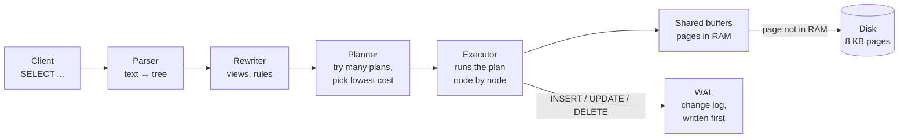

Keep this picture. Every topic below lives in one of these boxes:

| Box | Topic in this note |
|---|---|
| Disk and shared buffers | Pages, heap, TID, TOAST |
| Index pages | B-tree, other index types |
| Rows and versions | MVCC, VACUUM, freezing |
| WAL | Durability, checkpoints, replication |
| Planner | Statistics, cost, why an index is ignored |
| Executor | Scan types, join algorithms, sorts, work_mem |
| Between transactions | Locks and deadlocks |

## Part 1: Pages, the Heap and the TID

A table is called the **heap**. It is a file split into **8 KB pages**. Rows are stored wherever there is free space, in no particular order.

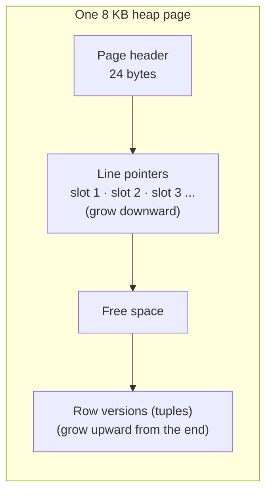

- Each row is found by its **TID** (tuple id): `(page number, slot number)`, for example `(42, 3)` means page 42, slot 3. You can see it: `SELECT ctid, * FROM orders LIMIT 3;`
- Each row version has a header of about 23 bytes with `xmin`, `xmax` and flags. This matters for MVCC below.
- Values bigger than about 2 KB (long text, big JSONB) are compressed and moved to a side table called **TOAST**. The row keeps a pointer. That is why `SELECT *` on a table with big JSON columns is slow: it fetches all the TOAST chunks too.

> **Why pages matter:** disk and memory are read in pages, not rows. Reading one row costs one whole page. Reading 100 rows that sit on 100 different pages costs 100 pages. Reading 100 rows on the same page costs 1.

## Part 2: The B-tree Index, Physically

### The shape

```mermaid
flowchart TB
    ROOT["Root page<br/>| 1000 | 2000 | 3000 |"]
    I1["Internal page<br/>| 100 | 200 | ... |"]
    I2["Internal page<br/>| 2100 | 2200 | ... |"]
    L1["Leaf page<br/>(101, TID 7,2)<br/>(102, TID 3,9)<br/>(103, TID 7,5)"]
    L2["Leaf page<br/>(104, TID 12,1)<br/>(105, TID 4,4)"]
    L3["Leaf page<br/>(2150, TID 90,3)"]
    HEAP[("Heap pages<br/>the real rows")]
    ROOT --> I1
    ROOT --> I2
    I1 --> L1
    I1 --> L2
    I2 --> L3
    L1 <-->|"sibling link"| L2
    L1 -.->|"TID points to"| HEAP
```

- **Root and internal pages** hold routing keys only: "values below 1000 go left."
- **Leaf pages** hold every indexed value, sorted, each with a **TID** pointing to the row in the heap.
- **Leaves are linked** left and right, so a range query (`BETWEEN`, `ORDER BY ... LIMIT`) finds the start once and then walks sideways.
- Postgres's B-tree is technically a **B+tree** (Lehman and Yao variant): all values live in the leaves.

### Why a wide, short tree (the layer 3 answer)

An 8 KB page holds roughly **300 to 400** entries for a `bigint` key (about 16 bytes per entry plus a 4-byte pointer). So each level multiplies the reach by about 400:

| Levels | Rows reachable (about) |
|---|---|
| 1 (root is a leaf) | 400 |
| 2 | 160,000 |
| 3 | 64 million |
| 4 | 25 billion |

A lookup in a 64-million-row table reads **3 or 4 index pages + 1 heap page**. The root and upper levels are almost always in memory, so in practice it is 1 or 2 real reads.

Compare:

| Structure | Lookup in 100M rows | Range query? | Why not used |
|---|---|---|---|
| Binary tree | about 27 levels, so 27 page reads | yes | Each node is tiny, but you pay a whole page read per node |
| Hash index | 1 to 2 pages | **no**, only `=` | No order, so no ranges, no ORDER BY |
| **B+tree** | 3 to 4 pages | yes, leaves are sorted and linked | The default: good at `=`, ranges and sorting |

> **Say this:** "A B+tree is designed around the page. Storage is read in pages, so the tree makes each node one page wide and packs hundreds of keys into it. That fanout makes it only 3 or 4 levels deep even at tens of millions of rows. Leaves are sorted and linked, so it serves equality, ranges and ORDER BY. A hash index only does equality, and a binary tree would be about 27 levels deep."

### What an index scan really costs

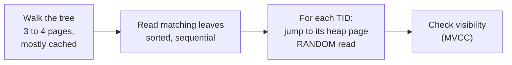

The expensive part is step 3. Each matching row can be on a different heap page. If the query matches 30% of a big table, the index would cause random jumps to almost every page, which is slower than reading the table straight through. **That is why the planner sometimes ignores your index.**

Ways to avoid the heap jump:

- **Index-only scan:** if every column the query needs is in the index (use `INCLUDE`), Postgres can skip the heap. It still checks the **visibility map** (a bit per page: "all rows here are visible to everyone"). Pages set by VACUUM need no heap visit. A table that is never vacuumed gets few real index-only scans.
- **Bitmap scan:** for a medium number of matches, collect all TIDs first, sort them by page, then read each heap page once in order.

### Writes and page splits

- Inserting into a full leaf **splits** it into two half-full pages and adds a key to the parent. Random keys (UUIDv4) cause splits all over the tree. Increasing keys (bigint, UUIDv7) only split the rightmost leaf.
- Every index on a table must be updated on every INSERT, and on UPDATE when an indexed column changes. Ten indexes means about ten extra writes per row. Unused indexes are pure cost. Find them with `pg_stat_user_indexes` where `idx_scan = 0`.

### Building an index

- `CREATE INDEX` reads the whole table, **sorts** all values (spilling to disk if needed), then builds the tree bottom up. It blocks writes to the table while it runs.
- `CREATE INDEX CONCURRENTLY` allows writes during the build. It scans the table twice and takes longer. If it fails, it leaves an `INVALID` index you must drop. Use it on any live table.

### The other index types

| Type | Shape | Use for | DBO example |
|---|---|---|---|
| B-tree | sorted tree | `=`, `<`, `>`, `BETWEEN`, `ORDER BY`, prefix `LIKE 'abc%'` | almost everything |
| Hash | hash buckets | only `=` | rarely worth it over B-tree |
| GIN | inverted index: each key/element → list of rows | `jsonb @>`, arrays, full-text search, `pg_trgm` for `LIKE '%abc%'` | search TADA payloads, product name search |
| GiST | balanced tree of bounding boxes | geometry, ranges, nearest neighbor, EXCLUDE constraints | store location near me, booking overlap |
| BRIN | tiny summary (min, max) per block of pages | huge tables where values follow physical order (time series, logs) | `webhook_event.received_at` on a giant append-only table |
| SP-GiST | partitioned space trees | IP ranges, phone prefixes | rarely asked |

## Part 3: MVCC, Row Versions and Snapshots

### The core idea

Postgres never changes a row in place. Every row version carries two transaction ids:

- `xmin`: the transaction that **created** this version
- `xmax`: the transaction that **deleted or replaced** it (empty if still alive)

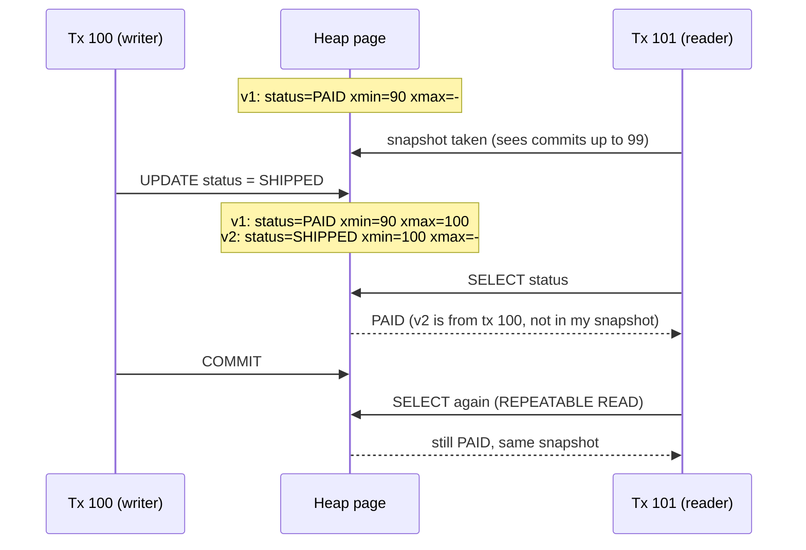

**The visibility rule, in one line:** a version is visible to me if its creator (`xmin`) had committed when my snapshot was taken, and its deleter (`xmax`) had not.

- **Readers never block writers, writers never block readers.** They are looking at different versions.
- **Two writers on the same row do block.** The second waits until the first commits or rolls back. Then, in READ COMMITTED, it re-checks the new version and continues.
- **Isolation levels are snapshot rules:** READ COMMITTED takes a new snapshot per statement. REPEATABLE READ keeps one snapshot for the whole transaction. SERIALIZABLE adds conflict tracking and aborts one transaction with error `40001` if the result could not happen in some serial order.

### The cost: dead rows and VACUUM

Old versions that no running transaction can see anymore are **dead tuples**. They take space until VACUUM removes them.

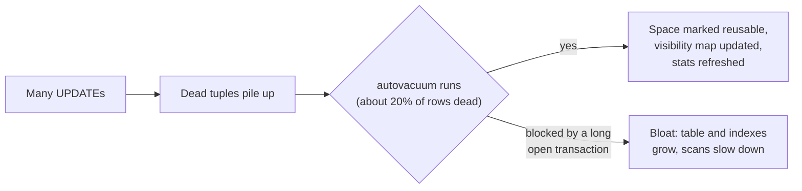

- **The classic killer:** a transaction left open for hours (a stuck script, `idle in transaction` from a crashed client). VACUUM cannot remove any version that transaction might still need, so bloat grows everywhere. Find them in `pg_stat_activity` with old `xact_start`. Set `idle_in_transaction_session_timeout`.
- **HOT update (heap-only tuple):** if no indexed column changes and the new version fits on the same page, Postgres skips updating the indexes. Leaving free space in pages (`fillfactor = 90`) on very hot update tables helps HOT happen.
- `VACUUM` marks space reusable inside the file. It does not shrink the file. `VACUUM FULL` rewrites the table smaller but takes an exclusive lock. Tools like `pg_repack` do it online.

### Transaction id wraparound

Transaction ids are 32-bit counters (about 4 billion). Postgres compares them in a circle, so a row version must be **frozen** (marked "visible to everyone, forever") before about 2 billion newer transactions pass. Autovacuum does this freezing. If freezing falls far behind, Postgres eventually refuses new writes to protect data. Mailchimp's Mandrill and Sentry both had public outages from this. Lesson: never turn off autovacuum, and watch `age(datfrozenxid)`.

## Part 4: WAL and Durability

### What happens on COMMIT

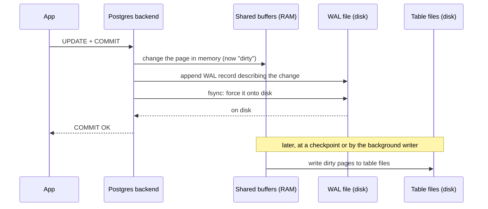

- **Write-ahead:** the log record reaches disk **before** the data page does. COMMIT only waits for the log.
- **Why this is fast:** the WAL is written sequentially, at the end of a file. Table pages are scattered. One sequential fsync is far cheaper than many random writes.
- **Crash:** dirty pages in RAM are lost. On restart Postgres starts from the last **checkpoint** and **replays** WAL records forward. Every committed change is rebuilt. Uncommitted ones are simply never marked committed, so MVCC treats them as invisible.
- **Checkpoint:** a moment when all dirty pages are flushed, so replay can start from there. Longer intervals mean less write work but longer crash recovery.
- **Full page writes:** the first change to a page after a checkpoint logs the whole page, so a half-written page after a power cut can be repaired.

### The same log does three more jobs

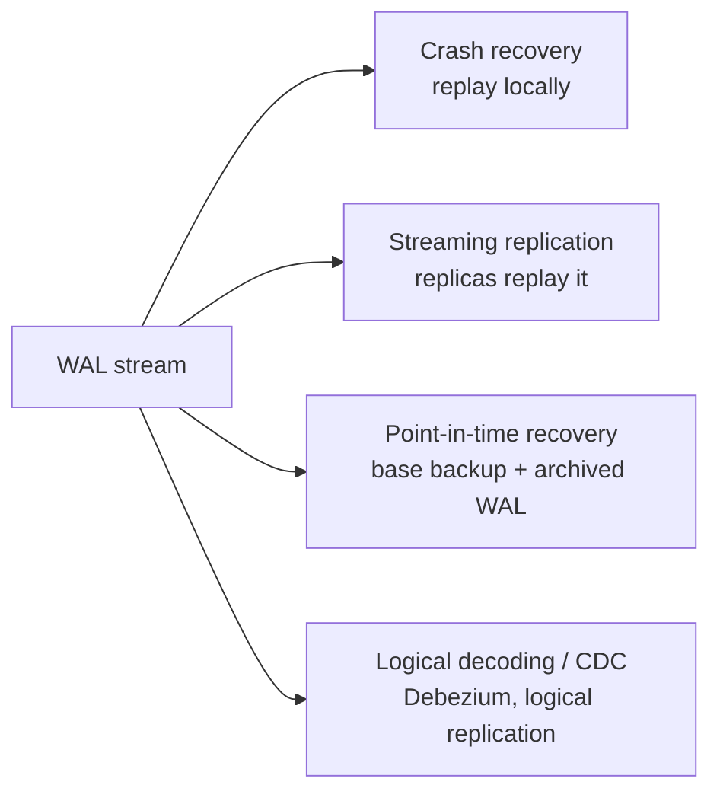

**Tradeoff knob:** `synchronous_commit = off` lets COMMIT return before the fsync. Much faster for bulk writes, but a crash can lose the last fraction of a second of commits. The database stays consistent, it just loses the newest work. Fine for analytics events, never for payments or points.

> **Say this:** "Durability lives in the WAL, not in the table file. COMMIT returns once the WAL record is fsynced. Data pages are flushed lazily at checkpoints, and after a crash Postgres replays the WAL from the last checkpoint. The same log stream feeds replicas and point-in-time recovery."

## Part 5: The Planner and Statistics

### How it chooses

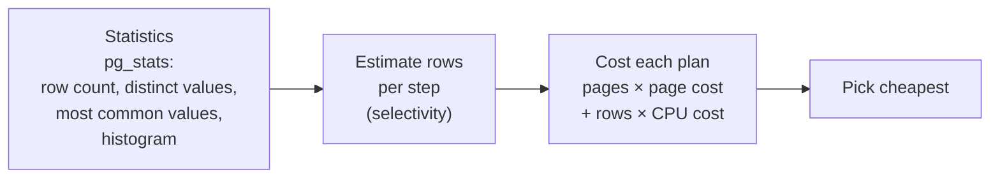

- `ANALYZE` samples the table (about 30,000 rows by default) and stores, per column: fraction of NULLs, number of distinct values, the most common values with their frequency, and a histogram.
- Costs are in made-up units. Default `seq_page_cost = 1`, `random_page_cost = 4`. On SSDs many teams lower `random_page_cost` to about 1.1, which makes index scans look cheaper.
- A plan is only as good as its **row estimates**. A join planned for 10 rows that really gets 1,000,000 picks the wrong algorithm.

### Why the planner ignores your index (the four reasons)

| Reason | Example | Fix |
|---|---|---|
| **Low selectivity:** too many rows match | `WHERE status = 'DELIVERED'` matches 80% of orders | That is correct behaviour. A partial index on the rare values helps queries for the rare ones. |
| **Stale statistics** | Table grew from 1k to 10M rows since the last ANALYZE | `ANALYZE orders;` check autovacuum is running |
| **Column is wrapped** | `WHERE lower(email) = ...`, `WHERE created_at::date = ...`, type mismatch from the ORM | Expression index, or rewrite as a range: `created_at >= '2026-10-01' AND created_at < '2026-10-02'` |
| **Index cannot serve the operator** | `LIKE '%semen'` (no prefix), `b = ?` on index `(a, b)` | `pg_trgm` GIN index, or a different column order. PG18 skip scan helps some leading-column cases |

Also worth knowing:

- **Correlated columns:** the planner assumes columns are independent. `city = 'Jakarta' AND province = 'DKI'` gets estimated far too low. Fix: `CREATE STATISTICS ... (dependencies) ON city, province FROM store;`
- **Prepared statements** (Prisma and most drivers use them): after five runs Postgres may switch to a **generic plan** that ignores the actual parameter value. For skewed data (one huge store and many tiny ones) this can pick a bad plan. Setting `plan_cache_mode = force_custom_plan` is the escape hatch.

### Reading the proof

```sql
EXPLAIN (ANALYZE, BUFFERS)
SELECT * FROM orders WHERE store_id = 42 ORDER BY created_at DESC LIMIT 20;
```

Look for, in this order:

1. **Estimated vs actual rows** on each node (`rows=20` vs `actual ... rows=20`). Off by 10x or more → statistics problem.
2. **Seq Scan with `Rows Removed by Filter` in the millions** → missing or unusable index.
3. **Sort node** with `Sort Method: external merge Disk` → sort spilled to disk, needs an index for the order or more `work_mem`.
4. **Buffers: shared hit vs read** → hit is memory, read came from disk or OS cache.

## Part 6: Join Algorithms

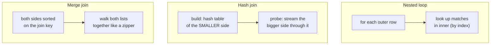

| Algorithm | Cost shape | Wins when | Watch out |
|---|---|---|---|
| **Nested loop** | outer rows × one index lookup | Outer side is small (say under a few thousand rows) and the inner side has an index on the join key | Disaster when the outer side is huge but was estimated small |
| **Hash join** | read both once + build hash | Big equality joins, no useful order, no index | Hash table must fit in `work_mem` (times `hash_mem_multiplier`), or it spills to disk in batches. Only `=` joins |
| **Merge join** | sort both (if not sorted) + one pass | Both inputs already sorted (from indexes) or very large inputs, also works for range joins | Sorting both sides is expensive if no index provides order |

> **Say this:** "Nested loop is great when one side is small and the other is indexed, like one store and its orders. Hash join is the workhorse for big equality joins: hash the smaller side, stream the bigger. Merge join wins when both sides already come sorted. The planner picks by row estimates, so a bad estimate usually shows up as a nested loop over a million rows."

### Why OFFSET gets slower with depth

The executor has no "jump to row 100,000." `LIMIT 20 OFFSET 100000` produces 100,020 rows (walking the index or sorting) and throws the first 100,000 away. Cost grows with the page number. Keyset pagination starts at the bookmark in the index instead, so every page costs the same. See the queries note.

## Part 7: Locks and Deadlocks

### Two kinds of locks

**Row locks** (from UPDATE, DELETE, `SELECT ... FOR UPDATE`) are stored in the row's header, so locking millions of rows costs no memory. Only writers on the **same row** wait for each other.

**Table locks** are taken by every statement, mostly weak ones that do not conflict:

| Lock | Taken by | Blocks |
|---|---|---|
| ACCESS SHARE | `SELECT` | only ACCESS EXCLUSIVE |
| ROW EXCLUSIVE | `INSERT`, `UPDATE`, `DELETE` | DDL that rewrites or locks the table |
| SHARE | `CREATE INDEX` (not concurrently) | all writes |
| SHARE UPDATE EXCLUSIVE | `VACUUM`, `CREATE INDEX CONCURRENTLY`, `ANALYZE` | other maintenance, not reads or writes |
| ACCESS EXCLUSIVE | `ALTER TABLE` (most forms), `DROP`, `VACUUM FULL`, `TRUNCATE` | **everything, including SELECT** |

### The migration lock queue (a real outage pattern)

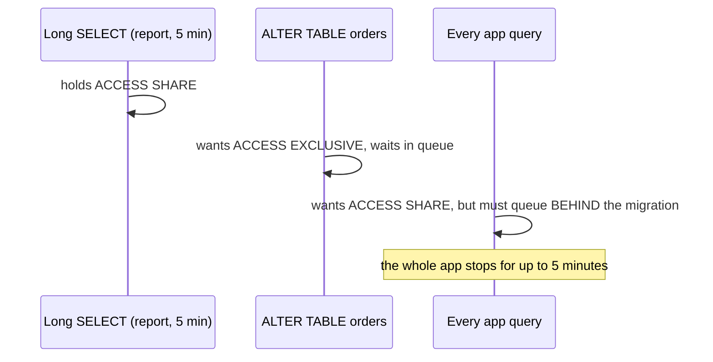

A tiny `ALTER TABLE ... ADD COLUMN` can freeze the app because it waits behind a long query, and every new query waits behind it. **Fix:** `SET lock_timeout = '3s';` in every migration and retry, so it gives up instead of blocking everyone.

### Deadlock

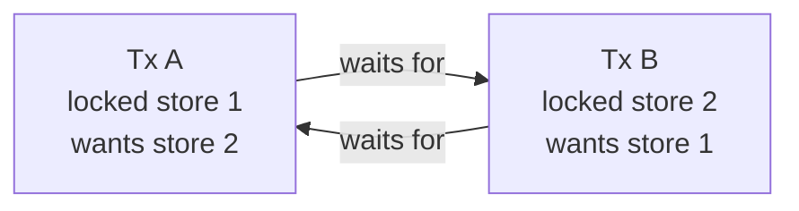

- Postgres checks for cycles after `deadlock_timeout` (1 second by default) and aborts one transaction with a deadlock error. The app must retry it.
- **Prevent:** always lock rows in the same order (for example, sort the ids first: transfer points from store 7 to store 3 → lock 3, then 7), keep transactions short, do not call external APIs while holding locks.

### Advisory locks

`pg_advisory_xact_lock(key)` is a lock on a number you choose, not on a row. Useful for "only one worker runs the yearly point reset at a time" without a separate lock service.

## Part 8: Processes, Memory and the Numbers to Know

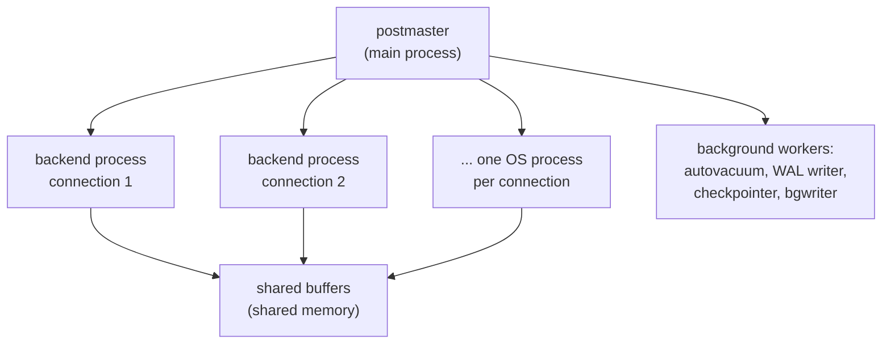

- **One process per connection.** Each one costs memory (several MB, more with big queries) and the OS must schedule them. Hundreds of active connections perform worse than a few dozen. **This is why PgBouncer exists**, and why Prisma × many replicas breaks first in your DBO system.

| Setting or fact | Typical value | Why it matters |
|---|---|---|
| Page size | 8 KB | The unit of every read and write |
| B-tree fanout (bigint key) | about 300 to 400 | 3 to 4 levels for tens of millions of rows |
| `shared_buffers` | about 25% of RAM (default only 128 MB) | Postgres's own page cache; the OS cache holds more |
| `work_mem` | default 4 MB, per sort or hash **node**, per connection | Too low → sorts spill to disk. Too high × many connections → out of memory |
| `random_page_cost` | 4 default, about 1.1 on SSD | Makes index scans look cheaper or dearer to the planner |
| autovacuum trigger | 50 rows + 20% of the table dead | Big tables wait too long. Lower the scale factor per table |
| `deadlock_timeout` | 1 s | When deadlock detection runs |
| Transaction ids | 32-bit, freeze before about 2 billion | Wraparound protection |
| `max_connections` | 100 default | Raise carefully. Pool instead |

## The Six Questions From Your Advanced Round, Answered at Layer 3

Practice saying these in about 60 seconds each. Each one follows: problem, mechanism, tradeoff, my example.

**1. What does `CREATE INDEX` build?**
A separate B+tree of 8 KB pages. Internal pages route, leaf pages hold sorted `(value, TID)` pairs linked to their neighbours. Fanout of a few hundred keeps it 3 to 4 levels deep. Building it sorts the whole column and blocks writes, so on live tables I use `CONCURRENTLY`. In DBO, the order history index `(store_id, created_at DESC)` makes "my last 20 orders" a short walk down plus a sideways read.

**2. Why don't readers and writers block each other?**
MVCC. UPDATE writes a new row version with `xmin` set to its transaction and marks the old one's `xmax`. A reader's snapshot decides which version it sees, so the writer never touches what the reader is reading. Only two writers on the same row wait. The cost is dead versions that VACUUM must clean, and long open transactions block that cleanup.

**3. What makes COMMIT durable after a crash?**
The WAL. The change record is appended and fsynced before COMMIT returns. Table pages stay dirty in memory and are written at checkpoints. After a crash Postgres replays WAL from the last checkpoint. Sequential log writes are why this is fast. `synchronous_commit = off` trades the last few hundred milliseconds of commits for speed, never for points data.

**4. Why would the planner ignore an index?**
Too many matching rows (random heap jumps cost more than a straight scan), stale statistics, a function or cast on the column, or an operator the index cannot serve like a leading-wildcard `LIKE`. I prove it with `EXPLAIN (ANALYZE, BUFFERS)` by comparing estimated and actual rows.

**5. Why is deep OFFSET slow?**
There is no jump-to-row. The executor produces and discards every skipped row, so cost grows linearly with depth. Keyset pagination starts from the last seen `(created_at, id)` in the index, so every page costs the same. The tradeoff is no jumping to page 500.

**6. A slow ORM query: how do you find why?**
Find it with `pg_stat_statements` or Prisma's query log. Run `EXPLAIN (ANALYZE, BUFFERS)` on the generated SQL with real parameters. Check estimate vs actual, sequential scans with many removed rows, spilled sorts, and nested loops over large inputs. Fix the index, statistics, or query shape (N+1 → one join or `IN`, select fewer columns), then run EXPLAIN again to confirm.

**Re-test item: join algorithms.** See Part 6. Practice the 3-sentence "say this."

## Likely Interview Questions

### Q: What is a TID and why does it matter?
The physical address `(page, slot)` of a row version in the heap. Index leaves store TIDs, so an index lookup ends with a jump to that page. Random jumps are the hidden cost of index scans on many rows.

### Q: What is HOT and why should I care?
Heap-only tuple update: when no indexed column changes and the page has room, the new version stays on the same page and no index entries are added. Fewer index writes and less bloat. Over-indexing a frequently updated column kills HOT.

### Q: Why can a table be huge but have few live rows?
Bloat. Dead versions from updates and deletes were not vacuumed (often blocked by a long transaction) or the space was freed but the file never shrank. Fix the cause, then `pg_repack` or `VACUUM FULL` in a maintenance window.

### Q: What is the difference between a checkpoint and a commit?
A commit makes one transaction durable by fsyncing its WAL. A checkpoint writes all dirty data pages to the table files so recovery does not have to replay as far back. Commits happen constantly; checkpoints every few minutes.

### Q: When does Postgres use a hash join instead of a nested loop?
When both sides are large and joined by equality with no small driving side. Hash the smaller input, stream the larger. Nested loop wins when the outer side is small and the inner side is indexed.

### Q: How do you make an ALTER TABLE safe on a busy table?
Use a lock timeout and retry, prefer operations that do not rewrite the table (adding a nullable column or one with a constant default is instant), build indexes concurrently, add constraints `NOT VALID` then validate, and run during low traffic.

## Draw It From Memory

1. The query journey: parser → planner → executor → buffers → disk, with WAL on the side.
2. A heap page: header, line pointers, free space, tuples.
3. A B+tree with root, internal, linked leaves holding `(value, TID)`, and an arrow to the heap. Write the fanout math next to it.
4. Two row versions with `xmin` and `xmax`, and which snapshot sees which.
5. The COMMIT sequence: buffer → WAL → fsync → OK, then checkpoint later.
6. Three join algorithms as three small pictures.
7. The migration lock queue.

Then run `/explain-check postgres internals` and `/advanced-interview postgres` to re-test.

## Sources

- [PostgreSQL docs: Database page layout](https://www.postgresql.org/docs/current/storage-page-layout.html)
- [PostgreSQL docs: B-tree indexes and implementation](https://www.postgresql.org/docs/current/btree.html)
- [PostgreSQL docs: Index types](https://www.postgresql.org/docs/current/indexes-types.html)
- [PostgreSQL docs: Concurrency control (MVCC)](https://www.postgresql.org/docs/current/mvcc.html)
- [PostgreSQL docs: Routine vacuuming and transaction id wraparound](https://www.postgresql.org/docs/current/routine-vacuuming.html)
- [PostgreSQL docs: Write-Ahead Logging](https://www.postgresql.org/docs/current/wal-intro.html)
- [PostgreSQL docs: Statistics used by the planner](https://www.postgresql.org/docs/current/planner-stats.html)
- [PostgreSQL docs: Using EXPLAIN](https://www.postgresql.org/docs/current/using-explain.html)
- [PostgreSQL docs: Explicit locking](https://www.postgresql.org/docs/current/explicit-locking.html)
- [PostgreSQL docs: Heap-only tuples (HOT)](https://www.postgresql.org/docs/current/storage-hot.html)
- [Sentry: Transaction ID wraparound in Postgres (2015)](https://blog.sentry.io/transaction-id-wraparound-in-postgres/)
- [PostgreSQL 18 release announcement (skip scan, uuidv7, async I/O)](https://www.postgresql.org/about/news/postgresql-18-released-3142/)
