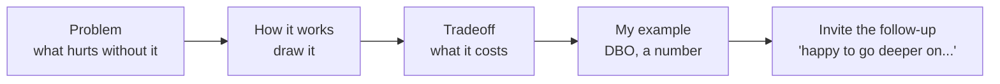
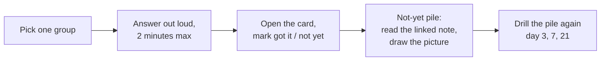

# Senior Database Interview Questions: The Answer Bank

- **Written:** 2026-10-16
- **Size:** 47 questions in 7 groups, each answered in your four parts: problem, how it works, tradeoff, my example. Plus the follow-up they will ask and the weak answer to avoid.
- **How to use it:** Do not read this like a book. Open the **flashcard drill** (the visual cheatsheet button above), say your answer out loud, then open the card. Mark "not yet" honestly and drill that pile again on day 3, 7 and 21.
- **Read with:** [Database design](database-design-and-why.md), [How Postgres works inside](postgres-internals-visual.md), [Advanced SQL workbook](advanced-sql-workbook.md), [Scaling and correctness](database-scaling-and-correctness.md).

## TL;DR

- Every senior database answer has the same skeleton. Learn the skeleton once, fill it per topic:

- **Numbers make you sound senior.** "3 to 4 page reads", "37 ms to 0.09 ms", "80 connections down to 20". Use at least one per answer.
- **When you do not know:** say what you do know, reason out loud to a best guess, and say how you would check. Never a bare "skip". This was gap 3 in your advanced round.

## What Senior Database Rounds Test

| Group | What they are really checking | Where to study |
|---|---|---|
| Indexing | You know why an index helps, what it costs, and how to prove it. | [Queries and indexing](postgresql-queries-interview-guide.md), [Internals part 2](postgres-internals-visual.md) |
| Queries and performance | You measure before fixing and can read a plan. | [Advanced SQL workbook](advanced-sql-workbook.md) |
| Transactions and concurrency | You see races before they ship and pick the lightest fix. | [Scaling and correctness part A](database-scaling-and-correctness.md) |
| Internals | You have a mental model of the engine, not just the API. | [How Postgres works inside](postgres-internals-visual.md) |
| Design | You model data so bugs are impossible, and can defend each choice. | [Database design](database-design-and-why.md) |
| Scaling and operations | You scale in the right order and do not lose data. | [Scaling and correctness part B and C](database-scaling-and-correctness.md) |
| Your stories | You have real experience and can tell it with method and lessons. | [DBO case study](../../interview/my-projects/dbo-b2b-platform-system-design-case-study.md) |

## Indexing

### 1. What is a database index and why does it make reads faster?

- **Problem:** Without an index, finding rows means reading every page of the table (a sequential scan). Cost grows with table size.
- **How it works:** A B-tree index is a separate sorted structure of pages. The database walks from the root to a leaf in 3 to 4 page reads, finds the value and its TID, then jumps to that row's page.
- **Tradeoff:** Every insert and every update of an indexed column must also update the index, and it uses disk and memory. Unused indexes are pure cost.
- **My example:** In DBO, order history filters by store and sorts by date, so the index is (store_id, created_at DESC). On a 1M row test that went from 37 ms to 0.09 ms.
- **Follow-up they will ask:** How many page reads does a lookup take in a 50 million row table, and why?
- **Weak answer to avoid:** "It makes queries faster" with no mechanism and no cost.

### 2. Why is the B-tree (B+tree) the default index structure and not a hash or a binary tree?

- **Problem:** Storage is read in fixed pages (8 KB in Postgres). The structure must find values with as few page reads as possible and also support ranges and sorting.
- **How it works:** Each node is one page holding hundreds of keys, so fanout is about 300 to 400. Three levels reach about 64 million rows. Leaves are sorted and linked, so range scans walk sideways.
- **Tradeoff:** A hash index is O(1) for equality but cannot do ranges or ORDER BY. A binary tree would be about 27 levels deep for 100 million rows, one page read per level.
- **My example:** Ranges like 'orders from the last 30 days' and 'latest 20 orders' are everywhere in DBO, which is exactly what sorted, linked leaves serve.
- **Follow-up they will ask:** What happens to the tree when you insert into a full leaf page?
- **Weak answer to avoid:** "Because it is balanced" without connecting it to pages and fanout.

### 3. Explain the leftmost prefix rule for composite indexes.

- **Problem:** Queries filter and sort on several columns. One index should serve as many of those shapes as possible.
- **How it works:** An index on (a, b) is sorted by a, then by b inside each a, like a phone book sorted by last name then first name. It serves a, a + b, and a = ? ORDER BY b. It does not serve b alone well.
- **Tradeoff:** Column order matters: equality columns first, then the range or sort column. Each extra composite index costs writes.
- **My example:** (store_id, created_at DESC) serves 'orders of store 42, newest first' with no sort step. An index on (created_at, store_id) would not.
- **Follow-up they will ask:** Can two single-column indexes on a and b serve ORDER BY a, b? Why not?
- **Weak answer to avoid:** Listing columns in any order, or saying the planner will combine indexes for sorting.

### 4. Why would the planner ignore an index you created?

- **Problem:** An index that is not used costs writes and gives nothing. You need to know why.
- **How it works:** Four usual reasons: too many matching rows (random heap jumps cost more than a seq scan), stale statistics, a function or cast on the column (lower(email), created_at::date, ORM type mismatch), or an operator the index cannot serve (LIKE '%x', non-leading column).
- **Tradeoff:** Forcing the index is usually wrong; if many rows match, the seq scan really is cheaper. Fix the cause instead: ANALYZE, expression index, rewrite as a range, trigram index.
- **My example:** A date filter written as created_at::date = '2026-10-01' cannot use an index on created_at. Rewriting it as a half-open range can.
- **Follow-up they will ask:** How do you prove which reason it is?
- **Weak answer to avoid:** "Postgres is buggy" or immediately reaching for a hint or a bigger server.

### 5. When would you use a partial index, an expression index, and a covering index?

- **Problem:** A plain index is not always the cheapest or fastest option for a specific hot query.
- **How it works:** Partial: index only the rows a hot query touches (WHERE status = 'PENDING'). Expression: index the result of a function (lower(email)). Covering: INCLUDE extra columns so the query never visits the table (index-only scan).
- **Tradeoff:** Partial indexes only help queries that repeat the same WHERE. Covering indexes are bigger and need a well-vacuumed table to skip the heap.
- **My example:** Where it fits in DBO: a partial index for the CMS 'pending verifications' queue, which is a tiny slice of all stores.
- **Follow-up they will ask:** Why does an index-only scan still sometimes read the table?
- **Weak answer to avoid:** Knowing the names but not when each pays off.

### 6. How do you decide which indexes to drop?

- **Problem:** Indexes slow every write, take memory, and slow VACUUM. Teams add them and never remove them (index sprawl).
- **How it works:** Check pg_stat_user_indexes for idx_scan = 0 over a long enough window (including month-end jobs), look for duplicates and prefixes of other indexes (an index on (a) when (a, b) exists), and check size.
- **Tradeoff:** Stats reset on restart or failover, and replicas have their own usage, so check everywhere before dropping. Drop with DROP INDEX CONCURRENTLY.
- **My example:** Where it fits in DBO: Prisma schemas often accumulate @@index lines from experiments; a quarterly review keeps the toko DB lean.
- **Follow-up they will ask:** What is the write cost of an index, concretely?
- **Weak answer to avoid:** "More indexes is always safer."

### 7. Which index type would you use for JSONB, full-text search, geolocation, and a huge log table?

- **Problem:** B-tree only works for scalar, ordered values. Other data needs other structures.
- **How it works:** JSONB containment and arrays: GIN (inverted index). Full-text and LIKE '%abc%': GIN with tsvector or pg_trgm. Geolocation and ranges: GiST. Huge append-only table filtered by time: BRIN (min/max per block range, tiny).
- **Tradeoff:** GIN is slower to update and larger. BRIN only works well when values follow physical order. GiST is lossy and rechecks rows.
- **My example:** Where it fits in DBO: a GIN index on the TADA webhook payload to search by event type; BRIN on received_at if the webhook table grows to hundreds of millions of rows.
- **Follow-up they will ask:** Why is a BRIN index so small?
- **Weak answer to avoid:** Using B-tree for everything, or adding GIN on every JSON column.

### 8. How do you add an index to a large table in production without downtime?

- **Problem:** A plain CREATE INDEX blocks writes on the table for the whole build, which can be minutes or hours.
- **How it works:** CREATE INDEX CONCURRENTLY builds while writes continue, scanning the table twice. Run it outside a transaction block, with a statement timeout that fits, and check for an INVALID index if it fails.
- **Tradeoff:** It takes longer and uses more resources. A failed concurrent build leaves an invalid index you must drop and retry.
- **My example:** In a Prisma migration, generated SQL uses plain CREATE INDEX, so for big tables you edit the migration to use CONCURRENTLY (and mark it to run outside a transaction).
- **Follow-up they will ask:** What else can block the app during a migration even if the statement is fast?
- **Weak answer to avoid:** Running plain CREATE INDEX at peak time.

## Queries and performance

### 9. A query is slow in production. Walk me through how you find and fix it.

- **Problem:** Guessing wastes time and can make things worse. You need evidence.
- **How it works:** Find it: pg_stat_statements sorted by total time, or the APM trace. Reproduce with real parameters. Run EXPLAIN (ANALYZE, BUFFERS). Look at estimated vs actual rows, seq scans with many removed rows, spilled sorts, nested loops on big inputs. Fix one thing (index, ANALYZE, rewrite). Run EXPLAIN again to prove it.
- **Tradeoff:** An index fixes the read but costs writes. Rewrites can change results; test them. Caching hides the problem instead of fixing it.
- **My example:** In DBO the real causes were N+1 from GraphQL resolvers, over-joining, and unbounded selects. Prisma query logging shows the SQL; EXPLAIN ANALYZE shows why it is slow.
- **Follow-up they will ask:** The estimate says 10 rows, actual is 2 million. What do you do?
- **Weak answer to avoid:** Jumping straight to 'add Redis' or 'add an index' without measuring.

### 10. What is the N+1 query problem and how do you fix it?

- **Problem:** Loading a list, then running one more query per item, turns 1 query into 101. Each is fast, together they are slow and flood the connection pool.
- **How it works:** Fix by loading related data in one query: a JOIN, WHERE id IN (...), or a batching layer like DataLoader in GraphQL resolvers. Prisma include also batches into IN queries.
- **Tradeoff:** Big joins can return duplicated parent data; IN lists can get huge. Choose by shape.
- **My example:** In DBO's GraphQL API, resolving store for each order is the classic N+1; DataLoader per request batches them into one query.
- **Follow-up they will ask:** How would you detect N+1 in production?
- **Weak answer to avoid:** "Use a faster database."

### 11. Why is OFFSET pagination slow on deep pages, and what do you use instead?

- **Problem:** Feeds and APIs page deep. Page 5,000 should not cost 5,000 times page 1.
- **How it works:** OFFSET n has no jump-to-row: the database produces n rows and throws them away. Keyset pagination remembers the last row's sort values and asks WHERE (created_at, id) < (last values) ORDER BY ... LIMIT 20, which is an index seek every time.
- **Tradeoff:** Keyset cannot jump to an arbitrary page number and needs a unique tiebreaker. OFFSET is fine for shallow admin tables.
- **My example:** Measured on 1M rows: OFFSET 900000 took 110 ms touching 900,020 rows; keyset took 0.05 ms touching 20. Store order history and points history should use keyset (Prisma cursor).
- **Follow-up they will ask:** Why do you need the id in the keyset condition?
- **Weak answer to avoid:** "Add caching" or "select fewer columns" without naming the discard cost.

### 12. LEFT JOIN with a WHERE on the right table: what goes wrong?

- **Problem:** You want all stores, including those with no paid orders, but some stores vanish.
- **How it works:** WHERE right.col = x is false for the NULL rows the LEFT JOIN created, so they are filtered out and the join acts like an INNER JOIN. Put the right-table filter in the ON clause.
- **Tradeoff:** None, it is simply a correctness bug; but it is common and silent.
- **My example:** Workbook exercise 1: revenue per store including zero-sale stores. Filter in WHERE drops Toko Diam.
- **Follow-up they will ask:** What about NOT IN with a subquery that returns NULL?
- **Weak answer to avoid:** Not noticing the missing rows at all.

### 13. ROW_NUMBER, RANK and DENSE_RANK: when do you use each?

- **Problem:** Top-N per group and ranking questions are the most common 'advanced SQL' questions.
- **How it works:** All number rows inside OVER (PARTITION BY ... ORDER BY ...). Ties: ROW_NUMBER 1,2,3 (always unique), RANK 1,1,3 (gaps), DENSE_RANK 1,1,2 (no gaps). In Postgres DISTINCT ON is a short way to get one row per group.
- **Tradeoff:** ROW_NUMBER picks an arbitrary winner among ties unless you add a tiebreaker. RANK can return more than N rows.
- **My example:** Latest order per store: DISTINCT ON (store_id) ... ORDER BY store_id, created_at DESC, id DESC.
- **Follow-up they will ask:** How do you filter on a window function result?
- **Weak answer to avoid:** Not knowing how ties behave.

### 14. How do you keep a dashboard query fast when it aggregates millions of rows?

- **Problem:** Aggregating the whole history on every page view burns CPU and IO on the primary.
- **How it works:** Options in order: index-friendly query; pre-aggregate into a summary table updated by a job (upsert per day); materialized view refreshed on a schedule (CONCURRENTLY with a unique index); run on a read replica; move analytics to a columnar store if it grows.
- **Tradeoff:** Pre-aggregation is stale between refreshes and adds a job to maintain. Replicas lag.
- **My example:** Where it fits in DBO: a daily_store_stats table filled by a BullMQ repeatable job with ON CONFLICT DO UPDATE, safe to re-run.
- **Follow-up they will ask:** How do you make the refresh job safe to run twice?
- **Weak answer to avoid:** Running heavy reports directly on the primary at peak time.

### 15. What is the difference between EXPLAIN and EXPLAIN ANALYZE, and what do you look for?

- **Problem:** You need to see what the database actually did, not guess.
- **How it works:** EXPLAIN shows the planned tree with estimates. EXPLAIN ANALYZE runs the query and adds actual rows and time per node; BUFFERS adds pages from cache (hit) vs disk (read). Look for big estimate vs actual gaps, Seq Scan with many Rows Removed by Filter, Sort spilling to disk, nested loops over large row counts.
- **Tradeoff:** ANALYZE really executes the query, so wrap writes in BEGIN ... ROLLBACK.
- **My example:** Before/after on the order history index: 8,242 pages and a Sort node, then 23 pages and no Sort.
- **Follow-up they will ask:** What does 'loops=1000' on a node mean for the time shown?
- **Weak answer to avoid:** Reading only the top-level cost number.

## Transactions and concurrency

### 16. What does ACID mean, in practice?

- **Problem:** Business operations change several rows that must stay consistent even with crashes and concurrent users.
- **How it works:** Atomicity: all or nothing (rollback). Consistency: constraints hold after every transaction. Isolation: concurrent transactions do not see each other's half-done work (to a chosen level). Durability: once COMMIT returns, it survives a crash (WAL fsync).
- **Tradeoff:** Stronger isolation costs waiting or retries. Durability costs an fsync per commit.
- **My example:** Redeeming points in DBO: deduct balance, insert ledger row, create redemption, all in one transaction.
- **Follow-up they will ask:** Which part of ACID does the WAL provide?
- **Weak answer to avoid:** Reciting the four words without an example.

### 17. Explain the isolation levels in Postgres and when you would raise them.

- **Problem:** Concurrent transactions can see each other's changes in surprising ways (non-repeatable reads, lost updates, write skew).
- **How it works:** READ COMMITTED (default): new snapshot per statement. REPEATABLE READ: one snapshot per transaction; Postgres also prevents phantoms; concurrent updates to the same row raise 40001. SERIALIZABLE: like running one at a time; conflicting transactions get 40001.
- **Tradeoff:** Higher levels fail instead of waiting, so you must retry the whole transaction. Default plus targeted locks is often simpler.
- **My example:** For the TADA refund, READ COMMITTED + SELECT FOR UPDATE on the redemption row was enough. A consistent monthly report could use REPEATABLE READ.
- **Follow-up they will ask:** What is write skew and which level stops it?
- **Weak answer to avoid:** "I always use SERIALIZABLE to be safe" with no retry logic.

### 18. Two requests try to redeem points at the same moment and the balance goes negative. How do you prevent it?

- **Problem:** Read-modify-write in the app lets both requests see enough points.
- **How it works:** Make it one atomic statement: UPDATE store SET balance = balance - cost WHERE id = ? AND balance >= cost RETURNING balance. Zero rows means not enough points. Add CHECK (balance >= 0) as a final guard and write the ledger row in the same transaction.
- **Tradeoff:** Atomic updates are simple and fast. For multi-step decisions use SELECT FOR UPDATE.
- **My example:** This is the same family of bug as the TADA double refund in DBO.
- **Follow-up they will ask:** What if the decision needs data from three tables?
- **Weak answer to avoid:** "Check the balance in the app first, then update."

### 19. Optimistic vs pessimistic locking: explain and choose.

- **Problem:** Two users or processes change the same row; one must not overwrite the other silently.
- **How it works:** Optimistic: a version column, UPDATE ... WHERE id = ? AND version = ?; zero rows means someone saved first. Pessimistic: SELECT ... FOR UPDATE locks the row until commit; others wait.
- **Tradeoff:** Optimistic holds no locks, but users may need to retry. Pessimistic is predictable but blocks and can deadlock.
- **My example:** CMS product edits by two admins: optimistic. TADA webhook handling on one redemption: pessimistic, as was done in DBO.
- **Follow-up they will ask:** How do you avoid deadlocks with pessimistic locks?
- **Weak answer to avoid:** Not knowing that Prisma does neither automatically.

### 20. What is a deadlock and how do you prevent one?

- **Problem:** Two transactions each hold a lock the other needs, so both wait forever.
- **How it works:** Postgres checks for cycles after deadlock_timeout (1 s) and aborts one with an error. Prevent by locking rows in a consistent order (sort ids), keeping transactions short, and not doing slow work or API calls while holding locks.
- **Tradeoff:** Detection costs a failed transaction; the app must retry.
- **My example:** Where it fits in DBO: transferring points between two stores must lock the lower store id first.
- **Follow-up they will ask:** Where do you see deadlocks reported?
- **Weak answer to avoid:** "Add a bigger timeout."

### 21. How do you guarantee a webhook or job is processed exactly once?

- **Problem:** Webhooks and queues deliver at least once: retries, timeouts and duplicates are normal.
- **How it works:** Exactly-once processing = at-least-once delivery + an idempotent consumer. Store the event id with a UNIQUE constraint, insert with ON CONFLICT DO NOTHING RETURNING, and only act if a row came back. Use guarded state transitions (WHERE status = 'REQUESTED').
- **Tradeoff:** You need a dedupe table and to decide how long to keep keys.
- **My example:** The TADA double refund in DBO: duplicate deliveries passed a check-then-act. Fixed with FOR UPDATE, then layered with a unique event id and an append-only ledger.
- **Follow-up they will ask:** What if the side effect is an external API call, not a database write?
- **Weak answer to avoid:** "Our queue guarantees exactly once."

### 22. Why should you not call an external API inside a database transaction? What do you do instead?

- **Problem:** Slow or failing network calls hold locks and connections, and the two systems can disagree after a timeout.
- **How it works:** Commit the business change together with an outbox row in one transaction. A relay worker reads the outbox and calls the API with an idempotency key, then marks it sent. Incoming results update state idempotently.
- **Tradeoff:** More moving parts and eventual consistency: the call happens a moment after the commit.
- **My example:** In DBO, calling TADA's redeem API from a BullMQ job fed by an outbox row instead of inside the GraphQL mutation's transaction.
- **Follow-up they will ask:** What if the relay crashes after calling the API but before marking the row sent?
- **Weak answer to avoid:** Holding a transaction open during an HTTP call.

## Internals

### 23. How does MVCC let readers and writers avoid blocking each other?

- **Problem:** With simple locking, a long report would block all writes, or writes would block reads.
- **How it works:** Postgres never updates in place. UPDATE writes a new row version (xmin = its transaction) and stamps the old one's xmax. Each transaction reads with a snapshot of what was committed, so it sees the version valid for it. Only two writers on the same row wait.
- **Tradeoff:** Old versions become dead tuples that VACUUM must clean. Long open transactions prevent cleanup and cause bloat.
- **My example:** A CMS report and store owners placing orders can run at the same time on the toko DB without blocking each other.
- **Follow-up they will ask:** What happens if a transaction stays open for 6 hours?
- **Weak answer to avoid:** "We do not lock the API."

### 24. What is the WAL, and what makes COMMIT durable after a crash?

- **Problem:** Writing every changed table page to disk on each commit would be slow and random.
- **How it works:** Every change is appended to the write-ahead log first. COMMIT returns after the WAL record is fsynced. Data pages stay dirty in memory and are written at checkpoints. After a crash Postgres replays WAL from the last checkpoint.
- **Tradeoff:** fsync per commit costs latency; synchronous_commit = off trades the last fraction of a second of commits for speed.
- **My example:** The same WAL feeds replicas and point-in-time recovery, which is how you would restore DBO's toko DB to just before a bad migration.
- **Follow-up they will ask:** What is a checkpoint and what is the tradeoff of its interval?
- **Weak answer to avoid:** "It saves the data."

### 25. What is VACUUM and what happens if it falls behind?

- **Problem:** MVCC leaves dead row versions behind after updates and deletes.
- **How it works:** VACUUM marks dead space reusable, updates the visibility map (for index-only scans) and freezes old transaction ids. Autovacuum runs it when about 20% of a table is dead.
- **Tradeoff:** If it falls behind: bloat, slower scans, fewer index-only scans, and in the extreme transaction id wraparound, where Postgres stops accepting writes.
- **My example:** Big append-heavy tables like a points ledger or webhook log may need a lower per-table autovacuum scale factor.
- **Follow-up they will ask:** Why can a single idle-in-transaction session cause bloat everywhere?
- **Weak answer to avoid:** "We disable autovacuum for performance."

### 26. How does the planner choose between nested loop, hash join and merge join?

- **Problem:** The same join can be thousands of times faster or slower depending on the algorithm.
- **How it works:** From row estimates and costs. Nested loop: small outer side and an index on the inner side. Hash join: big equality joins; hash the smaller side, stream the bigger. Merge join: both inputs already sorted on the key.
- **Tradeoff:** Bad estimates pick the wrong one; a nested loop over a million rows is the classic disaster. Hash joins need work_mem or spill to disk.
- **My example:** One store and its orders: nested loop with the store_id index. All orders joined to all stores for a report: hash join.
- **Follow-up they will ask:** How do you spot a wrong join choice in EXPLAIN ANALYZE?
- **Weak answer to avoid:** Not knowing join algorithms exist.

### 27. Why is each Postgres connection expensive, and what do you do about it?

- **Problem:** Apps with many replicas and ORM pools open hundreds of connections.
- **How it works:** Postgres runs one OS process per connection, each with its own memory. Hundreds of active processes compete for CPU and memory and throughput drops. A pooler like PgBouncer in transaction mode lets many app connections share a few real ones.
- **Tradeoff:** Transaction mode breaks session-level features (SET, LISTEN, session advisory locks); prepared statements need newer PgBouncer or driver settings.
- **My example:** In DBO, Prisma pools times API and worker replicas is the first thing that breaks at 10x; PgBouncer is step one.
- **Follow-up they will ask:** How would you size the real pool?
- **Weak answer to avoid:** "Raise max_connections to 2000."

### 28. What is a HOT update and why does it matter for indexing decisions?

- **Problem:** Updates normally add a new entry to every index on the table.
- **How it works:** If no indexed column changes and the new row version fits on the same page, Postgres makes a heap-only tuple: no index writes at all. Leaving free space with fillfactor helps.
- **Tradeoff:** Indexing a frequently updated column (like updated_at or a status that changes often) disables HOT for those updates and multiplies write cost.
- **My example:** Where it fits in DBO: avoid indexing columns like last_seen_at on the store table if they change on every request.
- **Follow-up they will ask:** How would you measure HOT updates?
- **Weak answer to avoid:** Indexing every column 'just in case'.

## Design

### 29. Normalize or denormalize? How do you decide?

- **Problem:** Duplicated facts drift apart; but very normalized schemas can need many joins for hot reads.
- **How it works:** Normalize to 3NF by default so each fact lives once. Denormalize a specific field only when a measured hot read stays slow after indexes, and write down how it stays in sync (same transaction, trigger, or job).
- **Tradeoff:** Denormalized data costs extra writes and risks drift. Materialized views or caches can give the read speed while keeping the source clean.
- **My example:** In DBO a cached points balance is fine because the ledger is the truth and can rebuild it.
- **Follow-up they will ask:** Is storing unit_price on the order line denormalization?
- **Weak answer to avoid:** "Joins are slow, so I denormalize."

### 30. Design the tables for orders and loyalty points. Talk me through it.

- **Problem:** Orders and points move value; mistakes cost money and trust.
- **How it works:** Six steps: things (store, product, order, order_item, ledger, redemption, webhook_event), relationships, keys (bigint inside, UUIDv7 outside), rules (NOT NULL, CHECK, FK, UNIQUE event ids), reads (store + created_at indexes), change (partition big logs by month later).
- **Tradeoff:** A ledger is more rows and a sum to compute; a cached balance needs a sync rule.
- **My example:** This is the DBO toko DB, and the unique event id plus append-only ledger is what makes the TADA double refund impossible.
- **Follow-up they will ask:** Why is the price stored on the order line?
- **Weak answer to avoid:** Jumping into columns without saying the process or the reasons.

### 31. UUID or auto-increment for primary keys?

- **Problem:** Ids must be unique and fast to index; some must be safe to expose or created outside the database.
- **How it works:** bigint identity: 8 bytes, ordered, fastest. Random UUIDv4: created anywhere, not guessable, but scatters inserts across the B-tree. UUIDv7: time ordered, so inserts stay at the right edge; Postgres 18 has uuidv7().
- **Tradeoff:** UUIDs are twice the size, and v7 leaks creation time.
- **My example:** bigint for internal tables, a UUIDv7 public_id for anything in URLs or shared with TADA or Manager.
- **Follow-up they will ask:** Why exactly are random UUIDs slower to insert?
- **Weak answer to avoid:** "UUIDs are always better because they are unique."

### 32. How do you store money and timestamps?

- **Problem:** Floats cannot represent most decimals exactly; timestamps without zone are ambiguous across servers.
- **How it works:** Money: numeric with fixed scale, or integer minor units; store currency if more than one. Time: timestamptz, which stores an exact moment in UTC and converts on display.
- **Tradeoff:** numeric is slower than integer math but exact; integer cents need care with division.
- **My example:** Order totals in DBO should be numeric; event times timestamptz, displayed in Asia/Jakarta.
- **Follow-up they will ask:** What goes wrong with timestamp without time zone when servers move regions?
- **Weak answer to avoid:** Using float for prices.

### 33. Why enforce rules with database constraints if the app already validates?

- **Problem:** App checks race each other, scripts and other services skip the app, and future developers forget.
- **How it works:** NOT NULL, CHECK, FOREIGN KEY, UNIQUE and EXCLUDE run inside the database for every write, atomically, even under concurrency.
- **Tradeoff:** Constraint errors need handling in the app, and some constraints cost a lookup on write. Worth it.
- **My example:** A UNIQUE (provider, event_id) on webhook events would have stopped the TADA duplicate at the database.
- **Follow-up they will ask:** Does Postgres index foreign key columns automatically?
- **Weak answer to avoid:** "Validation belongs in the app only."

### 34. How do you design multi-tenancy?

- **Problem:** Many customers share one product; their data must never leak between them.
- **How it works:** Default: shared tables with tenant_id on every row, tenant_id leading in indexes, and Row Level Security as a safety net. Escalate to schema-per-tenant or database-per-tenant for customers needing isolation or scale.
- **Tradeoff:** Shared tables risk a missing filter (RLS covers it). Separate databases multiply migrations and cost.
- **My example:** If DBO served several brands, each brand would be a tenant with brand_id and RLS policies.
- **Follow-up they will ask:** How does sharding relate to this choice later?
- **Weak answer to avoid:** Database per tenant by default for thousands of small tenants.

### 35. How do you change a column on a busy table with zero downtime?

- **Problem:** During a deploy, old and new app versions run at the same time; one-step breaking changes break one of them.
- **How it works:** Expand and contract: add the new column, dual write, backfill in batches, switch reads, stop old writes, drop the old column. Build indexes concurrently, add constraints NOT VALID then VALIDATE, set lock_timeout.
- **Tradeoff:** More deploys and temporary code; worth it for anything live.
- **My example:** Renaming a column in a Prisma schema generates a drop and add; for live tables you write the multi-step migration by hand.
- **Follow-up they will ask:** What can block the whole app even when the ALTER is instant?
- **Weak answer to avoid:** "We run migrations at night and hope."

### 36. SQL or NoSQL for a new feature?

- **Problem:** Each store is built for different access patterns; picking by hype causes pain later.
- **How it works:** Default to Postgres for relational data, transactions, money and unknown future queries. Choose Redis for cache, queues and counters; a document or wide-column store for one clear key-based access pattern at huge scale; a search engine for full-text; a columnar store for analytics. Keep Postgres as source of truth.
- **Tradeoff:** Each extra store is more operations, backups and consistency work.
- **My example:** DBO uses Postgres for truth and Redis for BullMQ: a clear role for each.
- **Follow-up they will ask:** When would you pick DynamoDB over Postgres?
- **Weak answer to avoid:** "NoSQL scales, SQL does not."

## Scaling and operations

### 37. Traffic grows 10x. What breaks first in the database and what do you do, in order?

- **Problem:** Growth exposes the weakest part first; fixing the wrong layer wastes time.
- **How it works:** Measure first. Usual order: connections (add PgBouncer), slow queries (indexes, N+1), read load (cache, read replicas), machine size (more RAM), huge tables (partition, archive), and only then sharding.
- **Tradeoff:** Each step adds staleness or complexity; sharding removes cross-shard joins and transactions.
- **My example:** For DBO: PgBouncer, then indexes from pg_stat_statements, then a replica for CMS reports and order history, then monthly partitions for orders, ledger and webhook events.
- **Follow-up they will ask:** How do you know a step worked?
- **Weak answer to avoid:** "Shard it" or "move to microservices" as the first answer.

### 38. How do read replicas work and what problems do they bring?

- **Problem:** One primary can only serve so many reads.
- **How it works:** Replicas stream and replay the primary's WAL and serve read-only queries. Route heavy or tolerant reads there.
- **Tradeoff:** Replication lag means stale reads, including a user not seeing what they just wrote. Writes still go to one primary.
- **My example:** Route CMS reports and order history to a replica; checkout and redeem read the primary; after a user writes, read their data from the primary for a few seconds.
- **Follow-up they will ask:** How do you monitor and handle lag?
- **Weak answer to avoid:** Not mentioning lag at all.

### 39. Partitioning vs sharding: what is the difference and when do you use each?

- **Problem:** Very large tables and very high write volume need different fixes.
- **How it works:** Partitioning splits one table into child tables inside one database (range, list, hash); queries prune to relevant partitions; old partitions drop instantly. Sharding splits data across separate databases by a shard key.
- **Tradeoff:** Partitioning keeps joins and transactions but the key must be in every PK. Sharding scales writes but loses cross-shard joins, transactions and global uniqueness.
- **My example:** Partition DBO's orders, point_ledger and webhook_event by month when they reach hundreds of millions of rows. Shard only if one primary cannot handle the writes, by store_id.
- **Follow-up they will ask:** How would you pick a shard key?
- **Weak answer to avoid:** Using the words interchangeably.

### 40. How do you design caching in front of a database, and what goes wrong?

- **Problem:** Repeated reads of the same data load the database for no reason.
- **How it works:** Cache-aside: read cache, on miss read the DB and fill the cache with a TTL; on update, write the DB then delete the key. Use materialized views for heavy aggregates.
- **Tradeoff:** Stale data, invalidation bugs, cache stampede when a hot key expires. Never cache values used for decisions like balance at redeem time.
- **My example:** Product catalog in Redis for the DBO app; points balance always from Postgres.
- **Follow-up they will ask:** How do you prevent a cache stampede?
- **Weak answer to avoid:** "Cache everything for an hour."

### 41. What is your backup and disaster recovery strategy for Postgres?

- **Problem:** Machines die, regions fail, and people run DELETE without WHERE.
- **How it works:** Continuous WAL archiving plus base backups for point-in-time recovery; a standby with automatic failover (Patroni or managed Multi-AZ) for machine failure; copies in another region; scheduled restore drills. State RPO and RTO.
- **Tradeoff:** Synchronous standbys add commit latency; more copies cost money. A replica alone is not a backup.
- **My example:** For DBO's toko DB: managed PITR with a 7 to 30 day window, and a quarterly restore test into a staging database.
- **Follow-up they will ask:** What are RPO and RTO for your system?
- **Weak answer to avoid:** "We have a replica, so we are backed up."

### 42. How do you run database migrations safely in CI/CD?

- **Problem:** Migrations can lock tables, break running app versions, or fail halfway.
- **How it works:** Backward-compatible steps only (expand and contract), lock_timeout and statement_timeout set, indexes built concurrently, large backfills as batched background jobs, migrations reviewed with their lock level in mind, and a tested rollback or forward-fix plan.
- **Tradeoff:** Slower releases for schema changes; much safer.
- **My example:** Prisma migrate generates SQL; for big tables the team reviews and edits it before it runs in the deploy pipeline.
- **Follow-up they will ask:** Which ALTER TABLE operations rewrite the whole table?
- **Weak answer to avoid:** "Prisma handles it."

### 43. What do you monitor on a production Postgres?

- **Problem:** Problems should be found by alerts, not by users.
- **How it works:** Top queries by total time, p95/p99 latency, connections and pool waits, replication lag, long and idle-in-transaction sessions, dead tuples and autovacuum activity, transaction id age, locks and deadlocks, cache hit ratio, disk and WAL size.
- **Tradeoff:** Too many alerts get ignored; alert on symptoms, dashboard the causes.
- **My example:** For DBO: alert on connection saturation, replication lag and disk; dashboard pg_stat_statements weekly.
- **Follow-up they will ask:** Which single metric would you look at first during an incident?
- **Weak answer to avoid:** Only CPU.

## Your stories

### 44. Tell me about a data bug you fixed in production.

- **Problem:** Interviewers want your debugging method and what you changed so it cannot happen again.
- **How it works:** Use STAR: situation (duplicate TADA webhooks caused double point refunds), task, action (traced it to a check-then-act race between the two copies, fixed with SELECT FOR UPDATE), result, prevention (unique event id, ON CONFLICT DO NOTHING, ledger), one-line lesson.
- **Tradeoff:** Mention the tradeoff you accepted, for example locks on a hot row, and why it was fine.
- **My example:** This is your strongest real story. Practise it in 2 minutes and in 5 minutes with a diagram.
- **Follow-up they will ask:** How did you prove the fix worked?
- **Weak answer to avoid:** Blaming the third party only.

### 45. Tell me about a time you chose a database or data store. Why that one?

- **Problem:** They want reasoning and tradeoffs, not brand names.
- **How it works:** Describe the access patterns, the consistency needs, team skills and operations cost, the options you compared, and what you gave up.
- **Tradeoff:** Every choice has a cost; say it before they ask.
- **My example:** DBO: Postgres for relational data and transactions, Redis for BullMQ jobs; three databases split by ownership (auth, queue, toko). Say only what is true for your project.
- **Follow-up they will ask:** What would make you change that choice today?
- **Weak answer to avoid:** "It was already chosen." Even then, say whether you agree and why.

### 46. Tell me about a slow query or performance problem you solved.

- **Problem:** Shows whether you measure before fixing.
- **How it works:** Situation, how you found it (logs, Prisma query log, pg_stat_statements), proof (EXPLAIN ANALYZE), the fix (index, N+1 batching, smaller selects), the number before and after.
- **Tradeoff:** Did the fix cost writes or complexity?
- **My example:** From DBO: N+1 from GraphQL resolvers and unbounded selects. If you do not have exact numbers, say what you would measure next time.
- **Follow-up they will ask:** What would you do if the index did not help?
- **Weak answer to avoid:** A story with no numbers and no proof.

### 47. How do you review a pull request that changes the schema?

- **Problem:** Schema changes are the riskiest code changes: hard to undo and can lock production.
- **How it works:** Check: backward compatible with the running version, lock level of each statement on large tables, concurrent index builds, NOT VALID constraints, batched backfills, nullability and defaults, indexes for new foreign keys and new queries, data types (money, time), and a rollback or forward-fix plan.
- **Tradeoff:** Slower reviews; fewer incidents.
- **My example:** Apply it to Prisma migration files in DBO before they reach the deploy pipeline.
- **Follow-up they will ask:** What is the most dangerous migration you have seen?
- **Weak answer to avoid:** "I check the syntax."

## How to Drill This

1. One group per day, about 20 minutes. Record yourself once a week and listen: did you say a tradeoff and a number?
2. Every Friday, run `/mock-interview database` and let it pick questions from here.
3. Add any question you meet in a real interview to this list with your best answer.

## Sources

- Answers are drawn from the four database notes in this track; their source lists cite the PostgreSQL documentation for every mechanism.
- [Startup.jobs: Senior database engineer interview questions](https://startup.jobs/interview-questions/senior-database-engineer), used to check coverage of HA/DR, zero-downtime migrations and index sprawl.
