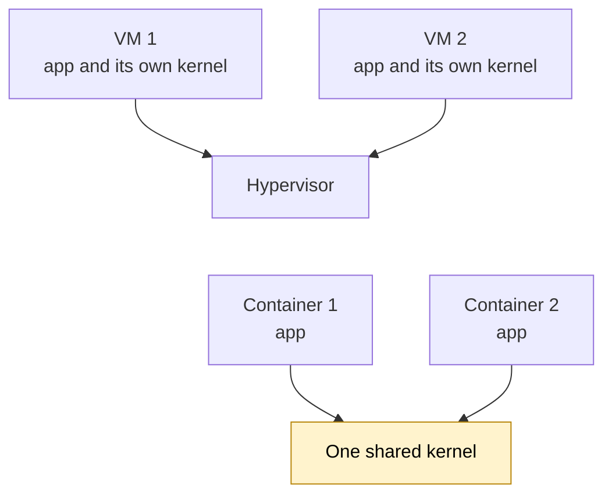
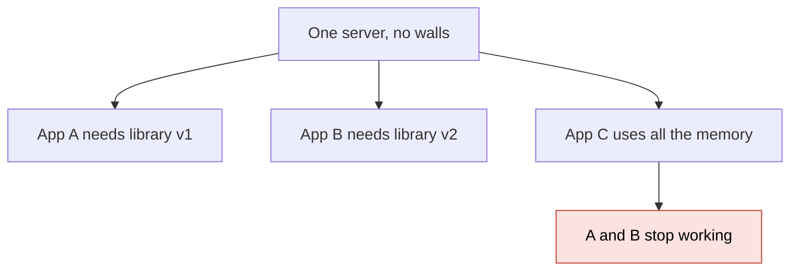
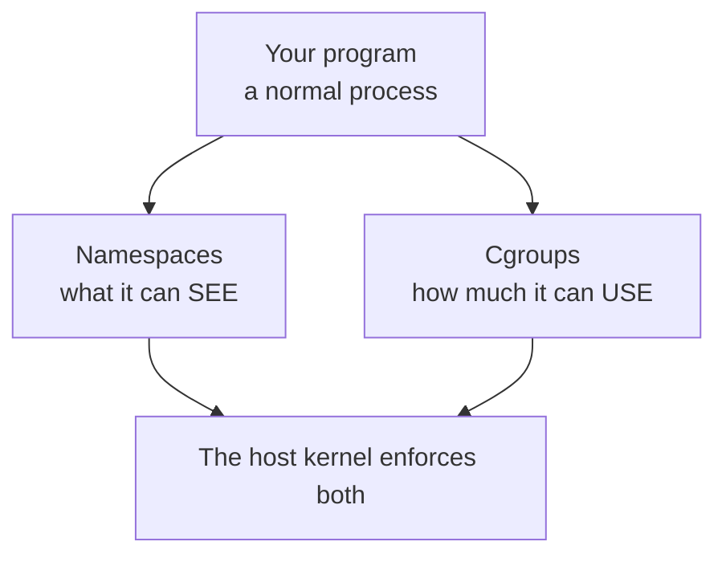
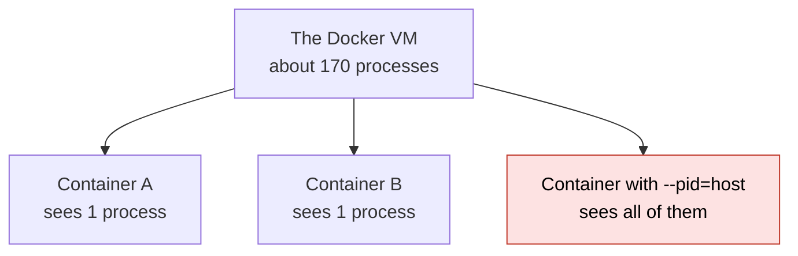
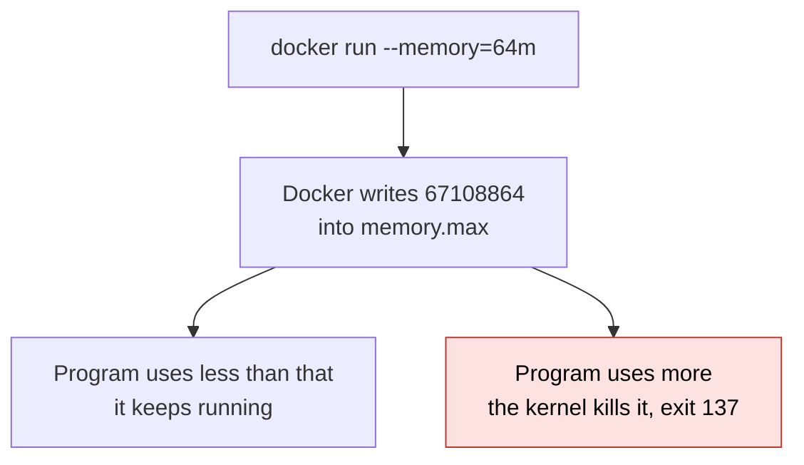
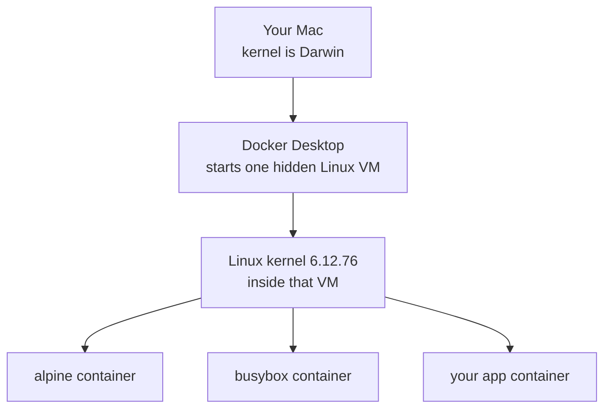
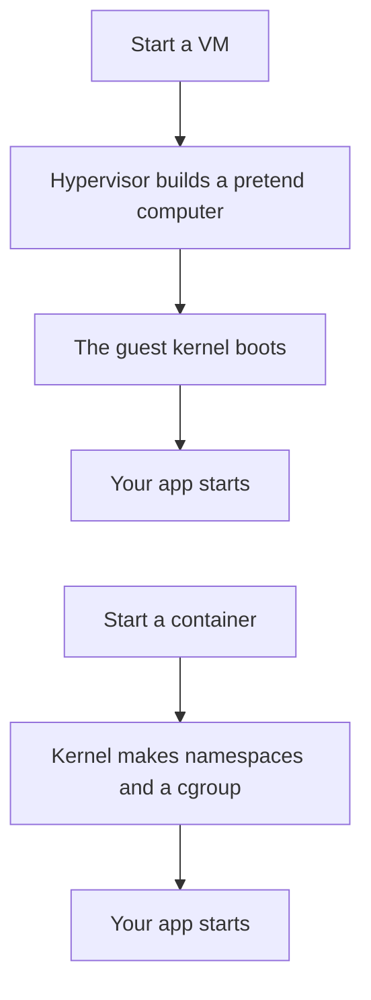
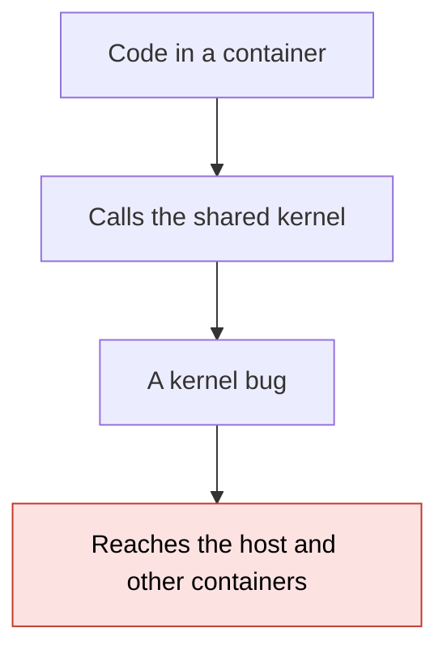

# 01. Containers vs virtual machines

> **Subject:** DevOps and Cloud · **Lesson:** 01 · **Made:** 2026-11-13 · **Status:** ready
>
> **You will be able to:** say what a container really is (a normal program with limits on what it sees and uses), show it with real commands, say why it starts fast, say why the wall is weaker than a VM's, and pick a container, a VM or a microVM for a job.
>
> **Before this:** none, this is the start of the subject. For the big map first, read [Containers: Docker, CapRover to Kubernetes](container-orchestration-guide.md) · **Next:** [Docker images and layers](02-docker-images-and-layers.md)
>
> **How to read it:** one card is one idea. Look at the picture, guess, then press the orange bar to check. The blue bars (📖 More detail) hold the longer explanation. Skip them on the first read, and open them when you want more. About 15 minutes for the cards. Every command output below was run for real on a Mac with Docker Desktop (the dates and versions are in the blue bars).

## 1. The idea: a pretend computer, or a program in a box

One server runs many apps, and they get in each other's way. One eats all the memory. Two need different versions of one library. The old fix is one pretend computer per app, a **virtual machine** (VM). Each VM boots its own **kernel**, the core of an operating system, which controls memory, disk and network. A **hypervisor** is the program that runs the VMs. A **container** is the lighter fix: a normal running program (a process) that the host's kernel puts in a box. Many containers share one kernel.



Notice: each VM brings a kernel, and the containers share one. A VM is a house with its own pipes. A container is a flat in a building that shares the pipes. The analogy stops here: a flat has real locks, but a container's walls are only kernel settings.

<details class="guess"><summary>🤔 Guess: which is closer to a container: a tiny VM, or a normal program with limits? Press to check.</summary>

**A normal program with limits.** You can check it on your own laptop in card 2. There is no second computer inside.

</details>

> **Remember:** a VM has its own kernel. A container is a process that shares the host's kernel.

<details class="more"><summary>📖 More detail: the four new words, the problem drawn, and a side by side table</summary>

New words (four):

- **Kernel:** the core of the operating system. It owns the memory, the disk and the network, and it decides what each program may do.
- **Hypervisor:** a program that shares one machine between several VMs. Each VM thinks it has its own computer.
- **Namespace:** a box that decides **what a program can see** (card 3).
- **Cgroup** (short for control group): a limit that decides **how much a program can use** (card 4).

The problem, drawn. Notice that all apps on one plain server share everything.



The two fixes, side by side:

| | VM | Container |
|---|---|---|
| What runs | A whole operating system with its own kernel | A process on the host's kernel |
| What shares the hardware | A hypervisor | The one kernel |
| Start | Boots a kernel first | Starts a process (card 6) |
| Size | A whole operating system | Your app and its files |
| Wall between two of them | Strong: a separate kernel | Weaker: one shared kernel (card 7) |

Docker's own page says the same: a VM has "its own kernel, hardware drivers, programs, and applications", and a container is "an isolated process with all of the files it needs to run" ([What is a container?](https://docs.docker.com/get-started/docker-concepts/the-basics/what-is-a-container/), opened 2026-11-13). The same page says teams often run containers inside VMs. The two are not enemies.

</details>

## 2. A container is a process with two limits

Docker asks the kernel to start your program with two limits. **Namespaces** limit what it **sees**: its own process list, its own network, its own files. **Cgroups** limit what it **uses**: memory, CPU. That is all. There is no second operating system inside. Each process has a number, its **PID**, and the first one in a box is PID 1. The program starts from an **image**, a set of files (lesson 02).



Here is a real run. Notice that `ps` thinks it is the only program on the machine.

```
docker run --rm alpine:3.22 ps
```

```
PID   USER     TIME  COMMAND
    1 root      0:00 ps
```

<details class="guess"><summary>🤔 Guess: inside the container, `sleep 300` (a program that waits 300 seconds) shows as PID 1. What number does the Docker VM give the same process? Press to check.</summary>

**A normal, large number.** In my run it was **1532**. It is one process with two numbers, one for each view. `docker inspect` printed `1532` too. Card 3 shows how to look.

</details>

> **Remember:** a container is a normal process. Namespaces decide what it sees. Cgroups decide how much it uses.

<details class="more"><summary>📖 More detail: step by step, what happens when you run it</summary>

The command is `docker run --rm --memory=64m alpine:3.22 ps`. Notice that nothing boots.

| Step | What happens | State after |
|---|---|---|
| 1 | You press Enter. The `docker` command sends the request to Docker's engine. | Nothing runs yet |
| 2 | The engine finds the Alpine files (the image, lesson 02) and asks the kernel to start `ps` with settings. | Request: files, limit 64m, command `ps` |
| 3 | The kernel makes six new namespaces: mnt, pid, net, uts, ipc and cgroup. The user and time namespaces stay the VM's own. | `ls -l /proc/self/ns` inside shows six new ids |
| 4 | The kernel makes a cgroup. Docker writes the limit into it. | `memory.max` holds `67108864` |
| 5 | The kernel starts `ps` as a normal process inside those boxes. | Inside: PID 1. Outside: an ordinary number |
| 6 | `ps` lists the processes in its own PID box. | It prints one line, itself |
| 7 | `ps` ends. The kernel removes the namespaces and the cgroup. `--rm` removes the container record. | Nothing is left. About 230 ms in all (card 6) |

**Step through it yourself:** [the stepper for this lesson](visuals/01-containers-vs-virtual-machines.html), tab 1.

**Who does what.** The chain is the `docker` command, then Docker's engine, then `containerd`, then `runc`, and `runc` asks the kernel. It is drawn in the [Docker and CapRover internals guide](docker-caprover-internals.md), Part 3. The kernel does the real work in steps 3 and 4.

</details>

## 3. Namespaces: what the program can see

A **namespace** gives a program its own copy of one part of the system. Docker gives each container six of them. So the container has its own process list, its own network, its own hostname and its own file tree. These are not Docker's inventions. They are kernel features (man page [namespaces(7)](https://man7.org/linux/man-pages/man7/namespaces.7.html)). They are also only settings. You can switch one off.



<details class="guess"><summary>🤔 Guess: you run `docker run --pid=host alpine ps`. How many processes do you see? Press to check.</summary>

**About 170 lines**, the whole Docker VM, starting with `1 root /initd` and kernel helpers. In my runs it was 169 and 171 lines. The flag `--pid=host` switches the PID box off, so the container shares the host's process list. A container's walls are settings.

</details>

> **Remember:** each namespace hides one part of the machine. A flag such as `--pid=host` switches one box off.

<details class="more"><summary>📖 More detail: the six boxes, the real ids, and how to look from outside</summary>

The kernel gives every namespace a number. Two programs in the same box show the same number. I read them from `/proc/self/ns` inside a container, and from `/proc/1/ns` in the VM (a container started with `--pid=host --privileged`).

| Namespace | What the program gets | Inside the container | The VM itself |
|---|---|---|---|
| mnt | Its own set of mounted files | 4026532544 | 4026531841 |
| pid | Its own process numbers | 4026532547 | 4026531836 |
| net | Its own network, ports and addresses | 4026532549 | 4026531840 |
| uts | Its own hostname | 4026532545 | 4026531838 |
| ipc | Its own shared memory and message queues | 4026532546 | 4026531839 |
| cgroup | Its own view of the cgroup tree | 4026532548 | 4026531835 |
| user | Its own user numbers (not used by default) | 4026531837 | 4026531837 |
| time | Its own clock readings (not used by default) | 4026531834 | 4026531834 |

Notice the last two rows: same number, so the container shares them. The descriptions come from the [namespaces(7) man page](https://man7.org/linux/man-pages/man7/namespaces.7.html) (opened 2026-11-13).

**Look at one process from both sides.** I started `docker run -d --memory=64m alpine:3.22 sleep 300`.

```
# inside the container
docker exec demo-sleep ps
PID   USER     TIME  COMMAND
    1 root      0:00 sleep 300
    7 root      0:00 ps

# from the VM, with --pid=host
ps -o pid,comm,args | grep "sleep 300"
 1532 sleep            sleep 300
```

The pid namespace of PID 1532, read from outside, was `4026532547`. That is the same box the container showed. One process, two names.

**Why the hostname is a container id.** The uts box gives the container its own hostname. In my run `docker run --rm alpine hostname` printed `d5f8f4cdcd12`. Docker uses the start of the container id.

**The practice code for this card:**

```js
namespacesSeen(["--pid=host"]);
```

```
{ mnt: 'own', pid: 'host', net: 'own',
  uts: 'own', ipc: 'own' }
```

**Step through it yourself:** the stepper, tab 2.

</details>

## 4. Cgroups: how much the program can use

A **cgroup** is a limit the kernel keeps for a group of programs. When you write `--memory=64m`, Docker writes a number into a file, and the kernel enforces it. Inside the container you can read the file yourself.



```
docker run --rm --memory=64m alpine:3.22 cat /sys/fs/cgroup/memory.max
67108864
```

Notice that 67108864 is 64 times 1024 times 1024. With no limit the same file says `max`.

<details class="guess"><summary>🤔 Guess: the limit is 64m. Inside the container, `free -m` prints the total memory. What number? Press to check.</summary>

**7837 MB.** That is the whole Docker VM. `free` reads the machine's size, not the cgroup file. The real limit is in `memory.max`. The same trap exists for CPU: with `--cpus=0.5`, `/proc/cpuinfo` still showed 8 processors. Programs that size themselves from the machine, such as worker pools, can be wrong inside a container.

</details>

> **Remember:** a cgroup limit is a number in a file. Over the memory limit, the kernel kills the program (exit 137). Over the CPU limit, it only slows the program down.

<details class="more"><summary>📖 More detail: the code, the real kill, the CPU slowdown, and the trace</summary>

**The smallest code that shows it** (from the practice answer):

```js
console.log(memoryLimitBytes("64m"));
console.log(runResult({ limit: "64m", usedMiB: 30 }));
console.log(runResult({ limit: "64m", usedMiB: 100 }));
```

```
67108864
{ killed: false, exitCode: 0 }
{ killed: true, exitCode: 137 }
```

**The real kill.** `tail /dev/zero` keeps reading and never ends, so it grows until something stops it. I ran it with a 64 MB limit and with swap (disk used as extra memory) switched off (`--memory-swap=64m`), so the result is the same every time.

```
docker run --name oom-demo --memory=64m --memory-swap=64m alpine:3.22 tail /dev/zero
echo $?
137
docker inspect -f 'OOMKilled={{.State.OOMKilled}} ExitCode={{.State.ExitCode}}' oom-demo
OOMKilled=true ExitCode=137
```

There was no error message and no stack trace. The kernel ended the program. 137 is 128 plus 9, and 9 is the signal SIGKILL. An idle container (`sleep`) with the same limit showed `528KiB / 64MiB` in `docker stats`.

**The CPU limit slows, it does not kill.** `--cpus=0.5` wrote `50000 100000` into `cpu.max`: the group may run 50,000 microseconds in every 100,000. I started three endless loops for 2 seconds. Together they used about 1.07 CPU seconds, not 6. The kernel held them back in 21 of 23 time slices (`nr_throttled 21`, `nr_periods 23` in `cpu.stat`). The programs did not fail. They got slow. This is why a CPU limit shows up as slow answers, and a memory limit shows up as a dead container.

**Which kernel feature gives which limit** (from [cgroups(7)](https://man7.org/linux/man-pages/man7/cgroups.7.html), opened 2026-11-13): the `memory` controller limits memory, the `cpu` controller limits CPU time, and the `pids` controller limits how many processes can start. `docker run --pids-limit=20` wrote `20` into `pids.max`.

**Step by step: the memory kill** (the stepper, tab 3)

| Step | What happens | State after |
|---|---|---|
| 1 | Docker writes the limit | `memory.max` = 67108864 |
| 2 | `tail` starts and reads | Uses about half a megabyte |
| 3 | It keeps reading and grows | 30 MiB, then 60 MiB, under the limit |
| 4 | It asks for more than 64 MiB | The kernel cannot give it more |
| 5 | The kernel kills the process | Exit 137, `OOMKilled=true` |

**For Node programs.** The container limit and the limit of the JavaScript heap are two different numbers. Part 6 of the [Docker and CapRover internals guide](docker-caprover-internals.md) shows how to set the heap below the container limit, so you get an error you can read and not a silent kill.

</details>

## 5. One shared kernel, and the Mac

Every container on a host uses the same kernel. An image is only files. It does not carry a kernel. You can prove it. On my Mac, `uname -sr` prints `Darwin 25.2.0`. Alpine and busybox are two different small Linux systems. Both printed the same kernel.



```
docker run --rm alpine:3.22 uname -sr
Linux 6.12.76-linuxkit
docker run --rm busybox:1.37 uname -sr
Linux 6.12.76-linuxkit
```

<details class="guess"><summary>🤔 Guess: the Mac kernel is Darwin. What does `docker run --rm alpine uname -sr` print? Press to check.</summary>

**`Linux 6.12.76-linuxkit`.** A Linux container needs a Linux kernel, and a Mac does not have one. So Docker Desktop runs one hidden Linux VM, and every container on the Mac is a process inside that VM. On a Mac you have both things at once: containers, inside one VM.

</details>

> **Remember:** all containers on one host share one kernel. On a Mac or Windows laptop, that kernel belongs to Docker's hidden Linux VM.

<details class="more"><summary>📖 More detail: the proof, what it means for your servers, and the limits it puts on you</summary>

**What I read from Docker:** `docker info` said `KernelVersion=6.12.76-linuxkit`, `OperatingSystem=Docker Desktop`, and the Linux cgroup version 2. The VM had 8 processors and 7.65 GiB of memory, and every container shares those. The Docker Desktop page on [Virtual Machine Manager](https://docs.docker.com/desktop/features/vmm/) says "Docker Desktop supports multiple Virtual Machine Managers (VMMs) to power the Linux VM that runs containers" (opened 2026-11-13). Docker's [2021 blog post](https://www.docker.com/blog/the-magic-behind-the-scenes-of-docker-desktop/) says the same in other words: a "lightweight LinuxKit VM that Docker manages for you". That post is old and some of its details are out of date, but this core idea has not changed.

**On a real Linux server there is no VM in between.** The containers share the kernel of the server itself. So a kernel update on that server touches every app on it.

**What the shared kernel means for you:**

- A Linux container needs a Linux kernel under it. A Windows program needs a Windows kernel, so it needs a VM (card 7).
- The image does not choose the kernel. The host does. Your image says "Alpine" but the kernel is whatever the host runs.
- On a Mac, your laptop test runs on the Docker VM's kernel, and your server may run another version. Most apps do not notice. Programs that need special kernel features can.

**Where this is true for you.** I use Docker and CapRover. CapRover runs each app as a Docker Swarm service (Swarm is Docker's tool for running containers on one or more servers), so each app is a container, and the containers on one CapRover server share that server's kernel ([Docker and CapRover internals](docker-caprover-internals.md), Part 7). My DBO case study describes four Node and TypeScript services on Docker Swarm via CapRover.

</details>

## 6. Why a container starts so fast

A container start only makes a process. A VM start has to boot a whole kernel first. That is why a container takes a fraction of a second.



Real numbers from my Mac. I ran `docker run --rm alpine:3.22 true` ten times: **217 to 333 ms**, middle value **233 ms**. That includes the `docker` command, making the container and removing it. An idle container used **528 KiB** of memory. The Alpine image is **13.4 MB**.

<details class="guess"><summary>🤔 Guess: how long does `docker run --rm alpine true` take: 2 ms, 230 ms, or 30 seconds? Press to check.</summary>

**About 230 ms** in my ten runs. Not 2 ms, because the `docker` command talks to an engine and creates and removes a container. And not seconds, because no kernel boots.

</details>

> **Remember:** a container starts a process, it does not boot a kernel. That is why it starts fast and uses little memory.

<details class="more"><summary>📖 More detail: the measurements, a fair comparison, and the cost</summary>

**What I measured** (Docker Desktop 29.3.1, Alpine 3.22, my Mac, 2026-11-13):

| Test | Result |
|---|---|
| `docker run --rm alpine:3.22 true`, 10 times | 217, 218, 221, 226, 233, 234, 236, 270, 273, 333 ms |
| 20 containers started with `docker run -d`, all at once | 864 ms for all 20 |
| Memory of an idle `sleep` container (`docker stats`) | 528 KiB, 520 KiB, 516 KiB |
| Size of the Alpine image (`docker images`) | 13.4 MB |

**What I did not measure.** I did not start a VM, so I have no VM number of my own. A fair test would need the same laptop and the same VM tool, and I will not guess one.

**What the VM side says.** The Firecracker project is a tiny VM maker for cloud services. Its page claims "Boot in <125ms" and "<5 MiB overhead per VM" ([firecracker-microvm.github.io](https://firecracker-microvm.github.io/), opened 2026-11-13). Those are the project's own claims. They are for a very small VM with a trimmed kernel, and they do not include any command line tool. Do not divide my 230 ms by their 125 ms. The two numbers measure different things. The honest picture is: a full VM with a normal operating system takes much longer than a container, and a tiny VM built for speed closes most of the gap.

**The model in code.** For made up numbers (container 230 ms and 0.5 MiB, a full VM 30,000 ms and 1,024 MiB, ten of each), the practice function `compareCosts` gives:

```
{
  totalStartMs: { container: 2300, vm: 300000 },
  totalMemoryMiB: { container: 5, vm: 10240 },
  startRatio: 130.4,
  memoryRatio: 2048
}
```

The VM numbers here are examples to show the sum, not measurements.

**What it costs.** You gave up the second kernel. Speed and size are the gain, and the weaker wall (card 7) is the price.

</details>

## 7. The cost: a weaker wall, and when a VM is the right pick

Code in a container still calls the shared kernel. If the kernel has a bug, code in one container may reach the host and the other containers. A VM adds a second wall, the hypervisor. So the choice follows who writes the code that runs inside.



| The job | Pick |
|---|---|
| Your own trusted app, on Linux | **Container** |
| An app that needs Windows or another kernel | **VM** |
| Code from strangers, many short jobs | **MicroVM** (a tiny VM that boots fast, such as Firecracker) |
| Code from strangers, a long running job | **VM** |

<details class="guess"><summary>🤔 Guess: your site lets customers upload code and runs it. Is a plain Docker container enough? Press to check.</summary>

**Not on its own.** Docker's security page says the default settings "may provide incomplete isolation, either independently, or when used in combination with kernel vulnerabilities". For strangers' code, add a second wall: a VM, a microVM, or a sandbox such as gVisor.

</details>

> **Remember:** the kernel is shared, so the wall is weaker. Use a VM or a microVM for another kernel or for strangers' code.

<details class="more"><summary>📖 More detail: the middle paths, the other side, and where this meets your stack</summary>

**The fair other side.** The same Docker page says containers are "by default, quite secure" and tells you to harden them more with tools such as AppArmor or SELinux ([Docker Engine security](https://docs.docker.com/engine/security/), opened 2026-11-13). For your own services, a container is the normal choice. The risk grows when the code inside is not yours.

**Three middle paths.**

- **Harden the container.** Run as a normal user, drop powers you do not need, and filter the calls to the kernel (these tools are named in the Docker page). The kernel is still shared.
- **A sandbox kernel.** gVisor puts its own small kernel between your program and the real one. It is not perfect. In a 2020 post about one real bug, the team wrote that for one part "the host kernel surface exposed is larger than we would like it to be" ([Containing a Real Vulnerability](https://gvisor.dev/blog/2020/09/18/containing-a-real-vulnerability/), opened 2026-11-13).
- **A microVM.** Firecracker describes itself as "purpose-built for creating and managing secure, multi-tenant container and function-based services", with "KVM-based isolation" and a second program, the jailer, as "a second line of defense" (its page, opened 2026-11-13). You get a separate kernel with a start time close to a container's.

**Why a VM is the right pick for a different kernel.** The image brings files, never a kernel. A container cannot run a Windows program on a Linux host, because it has no Windows kernel to call. A VM brings its own.

**In real life they mix.** Docker's page says teams often run containers inside VMs, for example on cloud VMs. You pick a wall for each job, and you can stack them.

**Where this meets my stack.**

- **Fact:** I use Docker and CapRover. CapRover runs each app as a Docker Swarm service, so the apps on one CapRover server share that server's one kernel.
- **Fact:** my DBO case study describes four Node and TypeScript services on Docker Swarm via CapRover. It suggests pinning CPU and memory limits so one service cannot starve the node. That is a suggestion in the case study, and I did not check what DBO sets today.
- **Idea, not a fact:** on a shared CapRover server, I would set a memory limit for each service, so one bad service is killed alone and does not slow the others. I would also run code that is not mine in a separate VM.

</details>

## 8. Five mistakes, and what to say if you freeze

- **Wrong:** "A container is a small VM." **Right:** a process that shares the host kernel.
- **Wrong:** "I set `--memory=64m`, so `free` will show 64." **Right:** read `memory.max`. `free` shows the machine.
- **Wrong:** "A container is as strong a wall as a VM." **Right:** the kernel is shared. For strangers' code, add a VM, a microVM or a sandbox.
- **Wrong:** "On my Mac, containers use the Mac kernel." **Right:** they use the kernel of Docker's hidden Linux VM.
- **Wrong:** "Over the CPU limit, the program is killed." **Right:** it is slowed. Over the memory limit it is killed.

<details class="guess"><summary>🤔 Guess: a container uses more than its limit. Which limit kills it, memory or CPU? Press to check.</summary>

**Memory.** The kernel kills the program (exit 137, no error message). Over the CPU limit the kernel only makes it wait, and you see slow answers.

</details>

> **Remember:** if you freeze, say "A container is a process with namespaces and cgroups on a shared kernel. A VM has its own kernel."

<details class="more"><summary>📖 More detail: the five mistakes in full, and the freeze plan</summary>

**Wrong:**

```
"A container is a lightweight VM."
```

**Right:**

```
"A container is a normal process. The kernel
 gives it namespaces for what it sees and
 cgroups for what it uses. It has no kernel
 of its own."
```

**Why:** the wrong version hides the one fact that explains speed, size and security.

**Wrong:**

```
docker run --memory=64m app
# then: "free says 7837, so the limit failed"
```

**Right:**

```
cat /sys/fs/cgroup/memory.max
67108864
```

**Why:** `free` reads the machine. The limit is in the cgroup file.

**Wrong:** "Docker is secure enough to run any customer's code." **Right:** add a second wall (card 7).

**Wrong:** "My Mac runs Linux containers directly." **Right:** Docker Desktop runs a Linux VM, and your containers are inside it. `uname -sr` in a container prints `Linux 6.12.76-linuxkit` on a Mac that says `Darwin 25.2.0`.

**Wrong:** "My service got slow, so it must have crashed." **Right:** a CPU limit slows, a memory limit kills. Check `cpu.stat` (look at `nr_throttled`) and the exit code (137 is a kill).

**If you freeze:**

1. Say "A VM has its own kernel on a hypervisor. A container is a process on the host's kernel."
2. Say "Namespaces limit what it sees. Cgroups limit what it uses."
3. Say "So a container starts fast and is light, but the wall is weaker, because the kernel is shared."

</details>

## 9. Watch and play

Links were checked on 2026-11-13. For the video I read the title, the channel and the length from YouTube. I did not watch it. For the articles I opened each page and read the parts named below. If a link is broken, tell me and I will replace it.

- **Video (9 minutes):** [Virtual Machine (VM) vs Docker](https://www.youtube.com/watch?v=a1M_thDTqmU) - IBM Technology, 8 minutes 51 seconds. Compare it with cards 1 and 6.
- **Play with it:** [the stepper in this folder](visuals/01-containers-vs-virtual-machines.html) - guess first, then press Next. Four tabs: start a container, two views of one process, the memory limit, container or VM.
- **Play with it (your own terminal):** run the commands from cards 2 to 5. They need only Docker and the small `alpine` image (about 13 MB).
- **Play with it (online):** [Containers are processes](https://labs.iximiuz.com/tutorials/containers-are-processes-d17b1df8) - iximiuz Labs. Reading is free. Running the playground needs a free account. It finds a container with `ps` and looks inside it through `/proc`.
- **Read (diagrams):** [What Are Namespaces and cgroups, and How Do They Work?](https://blog.nginx.org/blog/what-are-namespaces-cgroups-how-do-they-work) - NGINX blog, 2021. It has a drawing of PID namespaces and one of a cgroup limit.
- **Read:** [What even is a container: namespaces and cgroups](https://jvns.ca/blog/2016/10/10/what-even-is-a-container/) - Julia Evans, 2016. Short and plain. Try her `unshare` command on a Linux machine.
- **Read:** [What is a container?](https://docs.docker.com/get-started/docker-concepts/the-basics/what-is-a-container/) - Docker docs. The container against VM paragraph.

<details><summary>Go deeper (optional)</summary>

**A longer talk.** [Containers From Scratch](https://www.youtube.com/watch?v=8fi7uSYlOdc) - Liz Rice, GOTO 2018, 42 minutes 53 seconds. She builds a container in a few lines of Go. Her code is in [lizrice/containers-from-scratch](https://github.com/lizrice/containers-from-scratch). It shows that namespaces and cgroups are the whole trick.

**Docker's own talk.** [Cgroups, namespaces, and beyond: what are containers made from?](https://www.youtube.com/watch?v=sK5i-N34im8) - Docker's channel, 54 minutes 24 seconds. Longer and deeper. I checked only the title and channel.

**The man pages.** [namespaces(7)](https://man7.org/linux/man-pages/man7/namespaces.7.html) lists the eight kinds. [cgroups(7)](https://man7.org/linux/man-pages/man7/cgroups.7.html) describes the memory, cpu and pids controllers.

**One more comparison page.** [Containers versus virtual machines (VMs): What's the difference?](https://www.ibm.com/think/topics/containers-vs-vms) - IBM. It says containers "leverage features of the host operating system to isolate processes" and that VMs use a hypervisor to separate each VM. It does not compare the strength of the wall.

**Why `lsns` is not in my output.** The Alpine image uses BusyBox, which has no `lsns`. I read `/proc/<pid>/ns` instead. On a normal Linux server, `lsns` lists the same boxes.

**The setup of my checks.** Docker Desktop 29.3.1 (engine 29.3.1) on a Mac with Apple silicon, Linux kernel 6.12.76-linuxkit in Docker's VM, cgroup version 2, `alpine:3.22` and `busybox:1.37`, Node 26.12.1 for the practice code. Run on 2026-11-13.

**What comes next.** An image is the set of files a container starts from. Lesson 02 shows how it is built in layers, and why that makes builds fast or slow.

</details>

## 10. Practice

**A. Predict the output** (write your answer before opening)

```js
console.log(runResult({ limit: "64m", usedMiB: 64 }));
console.log(runResult({ limit: "1g", usedMiB: 100 }));
console.log(namespacesSeen(["--network=host"]));
```

Then answer: which kernel feature is `net`, a namespace or a cgroup?

<details><summary>Answer</summary>

```
{ killed: false, exitCode: 0 }
{ killed: false, exitCode: 0 }
{ mnt: 'own', pid: 'own', net: 'host', uts: 'own', ipc: 'own' }
```

The first line: exactly the limit is not **more** than the limit, so the program lives. The second: 100 MiB is far below 1 gigabyte. The third: `--network=host` switches only the network box off, so `net` becomes `host`. `net` is a **namespace**: it decides what the program sees. (Checked on 2026-11-13 with Node 26.12.1.)

</details>

**B. Fix the bug**

This function should turn a Docker memory flag into bytes, but it treats `m` as 1000 times 1000. What does it print for `"64m"`, and what should it print? Then fix it.

```js
function memoryLimitBytes(text) {
  const n = parseInt(text);
  if (text.endsWith("m")) return n * 1000 * 1000;
  if (text.endsWith("g")) return n * 1000 * 1000 * 1000;
  return n;
}
console.log(memoryLimitBytes("64m"));
```

<details><summary>Answer</summary>

It prints `64000000`. The kernel file has `67108864`, which is 64 times 1024 times 1024. Docker sizes use 1024, not 1000. A limit of 64000000 bytes is a little smaller than the one you asked for.

Fix: use 1024 for each step, and throw for text that is not a size.

```js
function memoryLimitBytes(text) {
  const m = /^(\d+)([kmg]?)b?$/i.exec(String(text).trim());
  if (!m) throw new Error("not a memory size: " + text);
  const unit = { "": 1, k: 1024, m: 1024 ** 2, g: 1024 ** 3 }[m[2].toLowerCase()];
  return Number(m[1]) * unit;
}
```

This prints `67108864`. (Checked on 2026-11-13 with Node 26.12.1.)

</details>

**C. Write it yourself**

Open `learn/devops-cloud/practice/01-containers-vs-virtual-machines.js`. It has six empty pieces: `memoryLimitBytes`, `runResult`, `namespacesSeen`, `whichFeature`, `compareCosts` and `chooseIsolation`. The comments above them say what each one must do. Write them, then run this from the repo root and make all the tests pass:

```
node --test learn/devops-cloud/practice/01-containers-vs-virtual-machines.test.js
```

<details><summary>One possible answer</summary>

```js
function memoryLimitBytes(text) {
  const m = /^(\d+)([kmg]?)b?$/i.exec(String(text).trim());
  if (!m) throw new Error("not a memory size: " + text);          // "abc", "" and "12x" end here
  const unit = { "": 1, k: 1024, m: 1024 ** 2, g: 1024 ** 3 }[m[2].toLowerCase()];
  return Number(m[1]) * unit;                                       // "64m" is 64 * 1024 * 1024
}

function runResult({ limit, usedMiB }) {
  const killed = usedMiB * 1024 * 1024 > memoryLimitBytes(limit);   // only MORE than the limit is killed
  return { killed, exitCode: killed ? 137 : 0 };                    // 137 is 128 plus signal 9, SIGKILL
}

function namespacesSeen(flags) {
  const seen = { mnt: "own", pid: "own", net: "own", uts: "own", ipc: "own" };
  const SHARE = {
    "--pid=host": "pid",
    "--network=host": "net",
    "--net=host": "net",
    "--uts=host": "uts",
    "--ipc=host": "ipc",
  };
  for (const flag of flags) if (SHARE[flag]) seen[SHARE[flag]] = "host";   // turning one box off
  return seen;
}

const FEATURES = {
  "own process numbers": { kind: "namespace", name: "pid" },
  "own hostname": { kind: "namespace", name: "uts" },
  "own network ports": { kind: "namespace", name: "net" },
  "own filesystem view": { kind: "namespace", name: "mnt" },
  "memory limit": { kind: "cgroup", name: "memory" },
  "cpu limit": { kind: "cgroup", name: "cpu" },
  "process count limit": { kind: "cgroup", name: "pids" },
};

function whichFeature(want) {
  if (!Object.hasOwn(FEATURES, want)) throw new Error("unknown need: " + want);
  return { ...FEATURES[want] };
}

function compareCosts(container, vm, count) {
  const round1 = n => Math.round(n * 10) / 10;
  return {
    totalStartMs: { container: container.startMs * count, vm: vm.startMs * count },
    totalMemoryMiB: { container: container.memoryMiB * count, vm: vm.memoryMiB * count },
    startRatio: round1(vm.startMs / container.startMs),
    memoryRatio: round1(vm.memoryMiB / container.memoryMiB),
  };
}

function chooseIsolation({ needsOtherKernel, runsUntrustedCode, startsOften }) {
  if (needsOtherKernel) return "vm";                                // a container cannot bring its own kernel
  if (runsUntrustedCode) return startsOften ? "microvm" : "vm";     // strangers' code needs a wall made of hardware
  return "container";
}

module.exports = { memoryLimitBytes, runResult, namespacesSeen, whichFeature, compareCosts, chooseIsolation };
```

Checked on 2026-11-13 with Node 26.12.1: the 21 tests fail on the empty stub and all 21 pass with this answer.

</details>

## 11. Interview question

**Q:** "What is the difference between a container and a virtual machine? Is a container a security boundary?"

A common follow-up: "Why does a container start so fast?" Cards 2 and 6 are the answer.

<details><summary>A strong answer, in four parts</summary>

1. **Problem:** Many apps on one server disturb each other: one uses all the memory, or two need different library versions. A VM per app fixes it, but each VM boots a whole operating system.
2. **How it works:** A container is a normal Linux process. The kernel gives it namespaces for what it sees (its own process list, network, hostname and files) and cgroups for what it uses (memory, CPU, process count). There is no second kernel and no hypervisor. A VM runs its own kernel on a hypervisor. So a container starts in a fraction of a second and uses little memory: it starts a process and does not boot a kernel. In my test `docker run --rm alpine true` took about 230 ms including the Docker command, and an idle container used about half a megabyte.
3. **Tradeoff:** The kernel is shared, so a kernel bug can cross the wall. Containers are fine for my own trusted services. For strangers' code, or for an app that needs another kernel, I would use a VM, or a microVM such as Firecracker, or a sandbox such as gVisor. Also, on a Mac, Docker runs containers inside a hidden Linux VM, and a memory limit kills the program (exit 137) while a CPU limit only slows it.
4. **My example:**
   - **Fact:** I use Docker and CapRover. CapRover runs each app as a Docker Swarm service, which is a container.
   - **Fact:** my DBO case study describes four Node and TypeScript services on Docker Swarm via CapRover. It suggests pinning CPU and memory limits, as a suggestion, and I did not check what DBO sets today.
   - **Idea, not a fact:** on a shared CapRover server I would give each service a memory limit, so a service that leaks is killed alone. I should not say DBO already does this.

</details>

## 12. Explain it back

Close this file. Explain containers against virtual machines out loud like to a new junior, in 4 parts (problem, how, tradeoff, my example). Use the real story: on a Mac, `uname` inside a container says `Linux 6.12.76-linuxkit`, `ps` shows PID 1, `free -m` shows 7837 even with a 64 MB limit, and going over the memory limit ends in exit 137. Then write your best version below and run `/explain-check containers vs virtual machines` or ask the `explain-coach` agent to review it.

### My explanation

<write here>

### Coach feedback

<the explain-coach agent writes here>

## 13. Review questions (day 1, 3, 7, 21)

1. A container and a VM both give an app its own space. What is the one big difference inside, and what two things follow from it?
2. What do namespaces do, and what do cgroups do? Give one real command or file for each.
3. You set `--memory=64m`. Name two ways it shows up: one for going over the limit, and one that is a trap when you read the machine size.
4. Draw the picture from card 1 from memory.

<details><summary>Answers</summary>

1. A VM has its own kernel on a hypervisor. A container shares the host's kernel. Two things follow: a container starts fast and is small, because no kernel boots. And the wall is weaker, because a kernel bug can cross it.
2. Namespaces decide what a program sees. For example `docker run --pid=host alpine ps` shows the host's processes, and `ls -l /proc/self/ns` shows the box numbers. Cgroups decide how much it uses. For example `cat /sys/fs/cgroup/memory.max` prints `67108864`.
3. Over the limit, the kernel kills the program and you see exit 137 with no message. The trap: `free -m` and `/proc/cpuinfo` still show the whole machine (7837 MB and 8 processors in my test), so a program that sizes itself from them can pick numbers that are too big.
4. Two VMs, each with its own kernel, on one hypervisor. Two containers on one shared kernel. A quick check: the kernel is drawn once for the containers and twice for the VMs.

</details>

## Connected lessons

- [Docker images and layers](02-docker-images-and-layers.md) - the next lesson. A container starts from an image, a set of files in layers.
- [Docker and CapRover internals](docker-caprover-internals.md) - the deeper guide: the `docker run` chain, the PID 1 problem and the Node memory trap.
- [Containers: Docker, CapRover to Kubernetes](container-orchestration-guide.md) - the big map from one container to Kubernetes.
- [Scaling up vs out](../system-design/02-scaling-up-vs-out.md) - containers are what makes it easy to add many copies of one app.
- [Safe deploys](../system-design/27-safe-deploys.md) - a rolling update starts new containers and stops old ones. That is cheap only because a container starts fast.
- [Security in a design](../system-design/29-security-in-a-design.md) - the shared kernel is one reason for the layers of defense drawn there.
