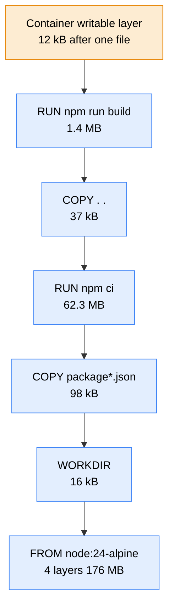
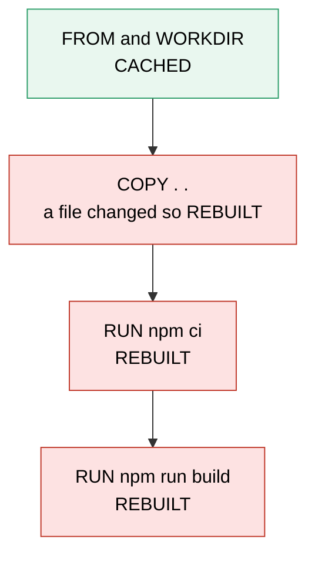
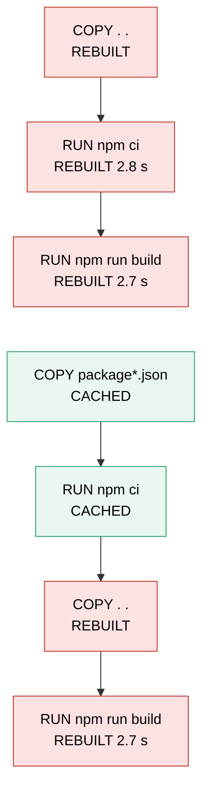
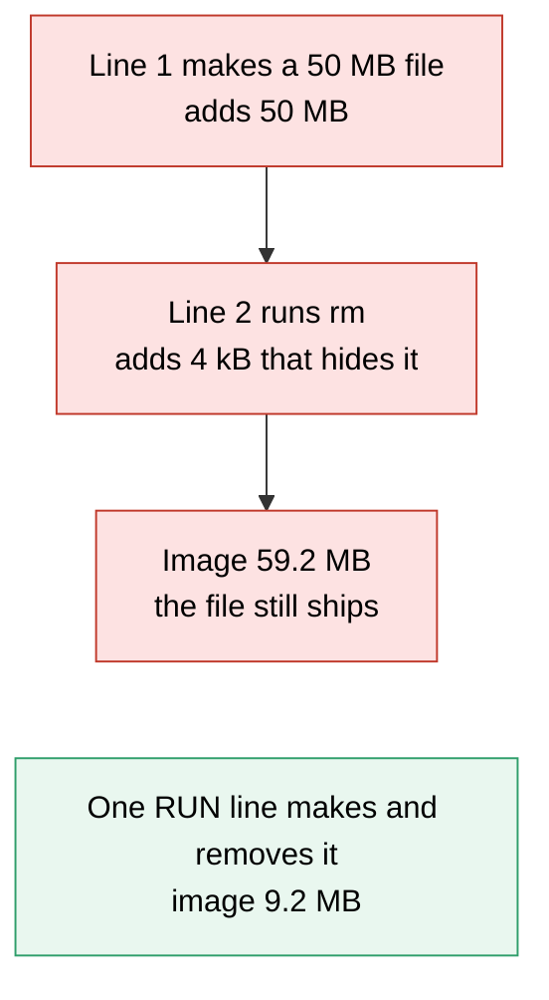
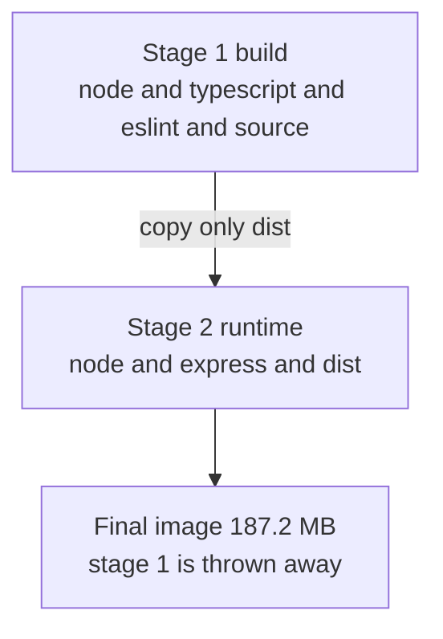
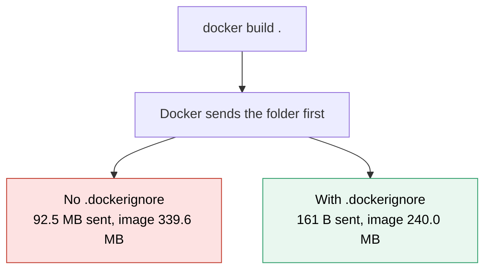

# 02. Docker images and layers

> **Subject:** DevOps and Cloud · **Lesson:** 02 · **Made:** 2026-11-13 · **Status:** ready
>
> **You will be able to:** say what an image and a container are made of, predict which Dockerfile lines Docker reuses and which it runs again, and shrink an image with a better line order, a multi-stage build, a `.dockerignore` file and a small base.
>
> **Before this:** [Containers vs virtual machines](01-containers-vs-virtual-machines.md) · **Next:** [Docker Compose](03-docker-compose.md)
>
> **How to read it:** one card is one idea. Look at the picture, guess, then press the orange bar to check. The blue bars (📖 More detail) hold the longer explanation. Skip them on the first read, and open them when you want more. About 15 minutes for the cards.

## 1. An image is a stack of layers. A container adds one thin layer

A **Dockerfile** is the recipe: a list of lines. An **image** is what the recipe builds. Think of a pile of clear plastic sheets. Each sheet is a **layer**: the files that one line added. You cannot change a sheet in the pile. You can only add one on top. A container is the pile plus one new empty sheet. It writes only on that sheet, and the sheet is thrown away when the container is removed.



Notice: each box sits on the one below it. Only the orange box can change.

<details class="guess"><summary>🤔 Guess: you start 2 containers from one 240 MB image. About how much new disk do the 2 containers use? Press to check.</summary>

**A few kilobytes.** Both containers share the same read-only layers. Each adds only its own thin layer. In my test the thin layer was 4.1 kB at the start and 12.3 kB after one file was written.

</details>

> **Remember:** an image is a stack of read-only layers. A container is that stack plus one thin writable layer, and that layer dies with the container.

<details class="more"><summary>📖 More detail: the four new words, real layer sizes, and the container test</summary>

New words (four): **layer** (this card), **build cache** (card 2), **multi-stage build** (card 5), **digest** (card 7).

**The layers of the image in the picture**, from `docker history` (Docker Desktop 29.3.1, checked 2026-11-13). One line of the Dockerfile makes one layer. `CMD` only changes the config card, so it adds 0 bytes.

| Dockerfile line | Layer size |
|---|---|
| `FROM node:24-alpine` | 4 layers, 176.1 MB together |
| `WORKDIR /usr/src/app` | 16.4 kB |
| `COPY package*.json ./` | 98.3 kB |
| `RUN npm ci` | 62.3 MB |
| `COPY . .` | 36.9 kB |
| `RUN npm run build` | 1.42 MB |
| `CMD ["node", "dist/server.js"]` | 0 B |
| **Sum of the layers** | **240.0 MB** |

The image is the layers plus a small config card (start command, folder, user, environment).

**The container test.** I started two containers from this image:

```
docker run -d --name a image        A before write: size=4.1kB (virtual 240MB)
docker exec a sh -c 'echo hi > /tmp/note.txt'
docker diff a                       C /tmp
                                    A /tmp/note.txt
docker ps -s                        A after write:  size=12.3kB (virtual 240MB)
docker run -d --name b image        B: size=4.1kB, cat note.txt: No such file
docker rm -f a                      B keeps running, A's note.txt is gone
```

**Layers are shared by their ids.** `docker image inspect` lists the layer ids (the `RootFS.Layers` field). Two images built from the same base show the same first ids, and Docker stores those layers once. That is why a pull of a second image that uses the same base is fast.

**Where the analogy stops.** Real layers are not full copies of the files. A layer stores only what its line added or changed, and a layer can hide a file from a lower layer (card 4).

**Link to the earlier guide.** [Docker and CapRover internals](docker-caprover-internals.md) says a container is a normal Linux process with its own view of the system. The pile of layers is the files that view shows. A database must keep its data in a volume, a folder outside the container, because the thin layer is deleted with the container.

</details>

## 2. The layer cache: Docker reuses layers until the first line that changed

Building is slow, and most builds change very little. So Docker keeps the result of every line. This is the **build cache**. On the next build Docker checks each line from the top. It asks: same line, same files, and a cached line above? If yes, it reuses the layer and prints `CACHED`. At the first line where the answer is no, it runs the line again, and **every line after it** too.



Notice: the cache breaks at one line and stays broken to the bottom.

<details class="guess"><summary>🤔 Guess: a Dockerfile has COPY . . and then RUN npm ci. You change one letter in src/server.ts. Does npm ci run again? Press to check.</summary>

**Yes.** `COPY . .` copies every file, so one edited file makes a new layer. Every line after it runs again, even though `package.json` did not change. In my test this cost 2.8 s for the install on a tiny app. On a real app it is a minute or more.

</details>

> **Remember:** Docker checks the lines from the top. The first changed line, and every line after it, runs again.

<details class="more"><summary>📖 More detail: what counts as changed, and what the Docker docs say</summary>

**What Docker compares for each kind of line:**

| Line | Docker asks | Changed when |
|---|---|---|
| `FROM` | Is the base image here? | You pull a different image for that tag |
| `RUN` | Is the text of the line the same? | You edit the line (or a line above changed) |
| `COPY` and `ADD` | Are the copied files the same? | The content of a file it copies changed |
| `CMD`, `ENV`, `USER` | Is the text the same? | You edit it. It costs 0 seconds, but lines after it still rerun |

Docker compares the **text** of a `RUN` line, not what the command would download. A `RUN npm install` line can stay `CACHED` while new package versions exist. Use `docker build --no-cache` when you want everything fresh. (This is how the cache rules work. I did not test a changed download.)

**A file you do not care about can break the cache.** I added a `debug.log` file to the project folder and edited it. On the next build `COPY . .` and `RUN npm run build` ran again (2.5 s), because the log was a file that `COPY . .` copies. Card 6 shows how to keep such files out.

**The Docker docs say it in one sentence** ([Docker build cache](https://docs.docker.com/build/cache/), opened 2026-11-13): "If a layer changes, all other layers that come after it are also affected." Even lines that would build the same way "still need to re-run".

**Why the cascade exists.** Each layer is the result of the layers below it. A new layer below could change what a later line does, so Docker cannot trust the old result.

</details>

## 3. The fix: put the slow, rarely changing lines first

Order the lines from "changes rarely" to "changes often". Copy only `package*.json` (the list of libraries) first. Run `npm ci`. Only then copy your source code. You edit source many times a day, so only the last lines run again. The library list changes rarely, so the install stays `CACHED`. In my test, one edit to one file rebuilt in **7.9 s** with the slow order and **3.2 s** with the fast order.

```
# Slow order               # Fast order
FROM node:24-alpine        FROM node:24-alpine
WORKDIR /usr/src/app       WORKDIR /usr/src/app
COPY . .                   COPY package*.json ./
RUN npm ci                 RUN npm ci
RUN npm run build          COPY . .
                           RUN npm run build
```



Notice: the top flow reruns the install. The bottom flow keeps it.

<details class="guess"><summary>🤔 Guess: the same fast Dockerfile. This time you add a library, so package.json changes. What reruns? Press to check.</summary>

**Everything from `COPY package*.json` down.** The library list is new, so the install must run. The fast order only helps while the list stays the same. That is what you want: the install runs when the libraries change, and not when your code changes.

</details>

> **Remember:** put the lines that change least at the top, and copy the library list before the source code.

<details class="more"><summary>📖 More detail: the step by step trace, the real build output, and which layers were shared</summary>

**Watch it run.** The page [Docker layers and cache: step by step](visuals/02-docker-images-and-layers.html) lets you press Next on both orders. Tabs 2 and 3 are this card.

**The step by step trace** of the fast order, after changing `hello v1` to `hello v2` in `src/server.ts`:

| Step | Docker looks at | Docker decides | State after |
|---|---|---|---|
| 1 | `FROM node:24-alpine` | The base image is already on this machine | CACHED, 4 layers |
| 2 | `WORKDIR /usr/src/app` | Same line, cached line above | CACHED |
| 3 | `COPY package*.json ./` | Same line, the same file contents | CACHED |
| 4 | `RUN npm ci` | Same line, cached line above | CACHED, the 62.3 MB layer is reused, 0 s |
| 5 | `COPY . .` | `src/server.ts` has new contents | REBUILT, a new 37 kB layer. **The cache is broken from here** |
| 6 | `RUN npm run build` | The layer above is new | REBUILT, 2.7 s |
| 7 | `CMD [...]` | Config only | New config card, no files |
| 8 | Save the image | 2 new layers | Done, 3.2 s in total |

**The real output** (BuildKit, `--progress=plain`, Docker Desktop 29.3.1, node:24-alpine, checked 2026-11-13). The fast order:

```
#6 [2/6] WORKDIR /usr/src/app          #6 CACHED
#7 [3/6] COPY package*.json ./         #7 CACHED
#8 [4/6] RUN npm ci                    #8 CACHED
#9 [5/6] COPY . .                      #9 DONE 0.0s
#10 [6/6] RUN npm run build            #10 DONE 2.7s
```

The slow order, same edit:

```
#6 [2/5] WORKDIR /usr/src/app          #6 CACHED
#7 [3/5] COPY . .                      #7 DONE 0.0s
#8 [4/5] RUN npm ci                    #8 DONE 2.8s
#9 [5/5] RUN npm run build             #9 DONE 2.7s
```

| Build | First build | Rebuild after one edit |
|---|---|---|
| Slow order | 8.0 s | 7.9 s |
| Fast order | 8.4 s | 3.2 s |

The first build costs the same. The cache pays on the second build. The 2.7 s left in the fast order is `npm run build`. It depends on your code, so it must run.

**The layer ids agree** (`docker image inspect`, first 6 letters of each id):

| Image | Layers | Shared with its first build |
|---|---|---|
| Fast order, after the edit | 9 | 7 of 9 (the two newest are new) |
| Slow order, after the edit | 8 | 5 of 8 (the three newest are new) |

**Why `npm ci` and not `npm install`.** `npm ci` installs exactly what the lock file says, so two builds of the same lock file give the same libraries.

**The numbers are small because the app is small.** It has 69 packages. The same cut on a big app saves minutes.

</details>

## 4. A layer only adds. Deleting in a later line does not shrink the image

A later line cannot remove bytes from a layer below it. It can only add a new layer on top. A line that deletes a file adds a tiny layer that says "hide this file". The file is still in the layer below, so you still build it, ship it and pull it. The fix: create the file and delete it in **one** `RUN` line, so it never reaches a layer.



Notice: the file is hidden in both images, but only the bottom one is small.

<details class="guess"><summary>🤔 Guess: line 1 makes a 50 MB file and line 2 deletes it. About how big are the layers these two lines add? Press to check.</summary>

**About 50 MB.** Line 2 hides the file but does not remove it from line 1's layer. Real test on `alpine:3.22`: two lines gave an image of 59.2 MB (download size 54.1 MB). The same work in one line gave 9.2 MB (download size 4.1 MB).

</details>

> **Remember:** deleting in a later line hides the file but keeps the bytes. Create and delete in the same `RUN` line.

<details class="more"><summary>📖 More detail: the real history, the usual pattern, and secrets</summary>

**The real `docker history`** of the two-line image:

```
RUN /bin/sh -c rm /big.bin # buildkit        4.1kB
RUN /bin/sh -c head -c 50000000 ... # buildkit   50MB
```

The hiding layer is called a **whiteout** (you may hear this word). Layers are never changed after they are made, so there is no way to "edit" the 50 MB layer. This is the same rule as the clear sheets in card 1.

**The usual pattern for system packages** (not run here):

```
RUN apt-get update \
 && apt-get install -y --no-install-recommends build-essential \
 && rm -rf /var/lib/apt/lists/*
```

One line, so the package lists never stay in a layer. The same idea works for any temporary file.

**Secrets are bytes too.** If you `COPY .env` and delete it later, the file is still in a lower layer, and anyone who pulls the image can read it. Docker says build arguments and environment variables "are inappropriate for passing secrets to your build". It offers secret mounts: `RUN --mount=type=secret` makes a secret "temporarily available" during one line only ([Build secrets](https://docs.docker.com/build/building/secrets/), opened 2026-11-13).

**A later `npm prune` does not shrink either.** Practice B shows it with real numbers.

</details>

## 5. Multi-stage build: build in a big stage, ship a small one

The build needs `typescript` and `eslint`, but the running app does not. A one stage Dockerfile ships them anyway. A **multi-stage build** has two or more `FROM` lines. The first stage is a workshop: it installs everything and builds `dist`. The last stage starts clean and copies in only the result with `COPY --from`. Only the last stage becomes the image. My app went from **240.0 MB to 187.2 MB**.

```
FROM node:24-alpine AS build
WORKDIR /usr/src/app
COPY package*.json ./
RUN npm ci
COPY . .
RUN npm run build

FROM node:24-alpine
WORKDIR /usr/src/app
COPY package*.json ./
RUN npm ci --omit=dev
COPY --from=build /usr/src/app/dist ./dist
USER node
CMD ["node", "dist/server.js"]
```



Notice: stage 1 never reaches the final image.

<details class="guess"><summary>🤔 Guess: stage 1 installs typescript. Is typescript inside the final image? Press to check.</summary>

**No.** Only the last stage is the image. It contains what it installed itself (`npm ci --omit=dev`, 11.0 MB instead of 62.3 MB) and what `COPY --from` copied (the 25 kB `dist` folder).

</details>

> **Remember:** build in a big stage and ship a small one. Only the last stage becomes the image, so copy in only what runs.

<details class="more"><summary>📖 More detail: the size table, small bases, and what BuildKit does</summary>

**The sizes I measured** (Docker Desktop 29.3.1, arm64, 2026-11-13). "Unpacked" is the sum of the layers from `docker history`. "Download" is what a pull moves, from `docker image inspect`.

| Image | Unpacked | Download |
|---|---|---|
| `node:24-alpine` (base only) | 176.1 MB | 62.3 MB |
| `node:24-slim` (base only) | 268.4 MB | 81.0 MB |
| `node:24` (full base) | not pulled | 401.1 MB (from the registry data) |
| My app, one stage, alpine | 240.0 MB | 79.7 MB |
| My app, multi-stage, alpine | 187.2 MB | 64.6 MB |
| My app, multi-stage, slim | 279.5 MB | 83.2 MB |

The base is most of what is left (176.1 of 187.2 MB). The full Node image is about 6 times the download of the alpine one.

**Alpine or slim?** The Node image README says Alpine images use the C library "musl libc, not the GNU C library glibc used by Debian", and that the alpine image is about 25 percent smaller than slim ([docker-node README](https://github.com/nodejs/docker-node/blob/main/README.md), opened 2026-11-13). Some native packages expect glibc. If a package fails to install on alpine, use `slim`.

**What BuildKit does** (the default builder; see the Go deeper box). In my multi-stage build, the line `npm ci --omit=dev` of stage 2 ran at the same time as `npm run build` of stage 1, because stage 2 does not need stage 1 until `COPY --from`. The Docker docs also say "BuildKit only builds the stages that the target stage depends on" ([Multi-stage builds](https://docs.docker.com/build/building/multi-stage/), opened 2026-11-13).

**The cost.** More lines in the Dockerfile, and two stages to keep in your head. To debug stage 1 alone, build it with `--target build`.

</details>

## 6. `.dockerignore`: keep junk out of the build

When you run `docker build .`, Docker first sends the whole folder to the builder. This folder is the **build context**. Your `node_modules` and `.git` go too. Then `COPY . .` puts them in the image, and your Mac's `node_modules` overwrites the clean one that `npm ci` just made. A `.dockerignore` file lists what to leave out. In my test the folder had `node_modules` (43 MB) and `.git` (50 MB).



Notice: the same folder, but the second build sends almost nothing.

<details class="guess"><summary>🤔 Guess: your folder holds node_modules (43 MB) and .git (50 MB). How much does Docker send before step 1 of the build? Press to check.</summary>

**About 92.5 MB.** BuildKit printed `transferring context: 92.53MB 1.1s done`. With the `.dockerignore` file below it printed `transferring context: 161B`.

</details>

> **Remember:** write a `.dockerignore` on day one: `node_modules`, `.git`, `dist`, logs and `.env` files.

<details class="more"><summary>📖 More detail: the file, the real numbers, and the CapRover link</summary>

**The file I used:**

```
node_modules
.git
dist
Dockerfile*
.dockerignore
```

Add `.env*` and `*.log` too in a real project.

| | Sent to Docker | Image (unpacked) | Download |
|---|---|---|---|
| No `.dockerignore` | 92.53 MB | 339.6 MB | 140.2 MB |
| With `.dockerignore` | 161 B | 240.0 MB | 79.7 MB |

Inside the big image I found `/usr/src/app/.git` (50.0 MB) and `/usr/src/app/node_modules` (45.0 MB, the Mac copy that replaced the clean one). A Mac copy of `node_modules` can also hold packages built for the wrong system. I did not test a package with native code.

**Three reasons, not one.** The folder is sent on every build, the junk lands in the image, and a changing junk file breaks the cache (card 2, the `debug.log` test).

**BuildKit sends less on a repeat build.** The Docker docs say it tracks "only the updates made to these files between repeated build invocations" ([BuildKit](https://docs.docker.com/build/buildkit/), opened 2026-11-13). Still write the file: the junk would land in the image on the first build.

**CapRover.** The CapRover docs say "the uploaded project root remains the Docker build context" ([Captain Definition](https://caprover.com/docs/deployments/captain-definition), opened 2026-11-13). So the folder you upload is what Docker gets. Idea, not a fact: check that each of your projects has a `.dockerignore` file in that folder. I did not test how CapRover treats the file.

</details>

## 7. Run as non-root and pin the base image

Two small safety lines in the final image. **`USER node`**: a container runs as root by default. In my test, the image without `USER` printed `uid=0(root)` (the user number is 0), and the image with `USER node` printed `uid=1000(node)`. If someone breaks into your app, a normal user can do less. **A pinned base:** `FROM node:24-alpine` uses a tag, a name the publisher can move to new bytes. A **digest** (`sha256:...`) names exact bytes, so the same Dockerfile gives the same base next month.

| | Name | What it points to |
|---|---|---|
| Tag | `node:24-alpine` | Whatever the publisher set today |
| Digest | `node:24-alpine@sha256:116b800c...` | These exact bytes, always |

<details class="guess"><summary>🤔 Guess: a production Dockerfile starts with FROM node:latest. It built fine in June. In November it fails, and nothing in your repo changed. Why? Press to check.</summary>

**The tag moved.** `latest` now points to a newer Node version. The Docker docs say "Image tags are mutable, meaning a publisher can update a tag to point to a new image." A digest cannot move.

</details>

> **Remember:** use `USER node` so the app is not root, and pin the base by digest when you need the same bytes every time.

<details class="more"><summary>📖 More detail: the real output, file owners, and the cost of pinning</summary>

**Who runs the app** (`docker run --rm --entrypoint id image`):

```
one stage image, no USER:   uid=0(root) gid=0(root) ...
multi-stage image, USER node: uid=1000(node) gid=1000(node)
```

**Files copied by `COPY` belong to root.** In the multi-stage image `ls -ld` showed `root root` for `/usr/src/app`, `dist` and `package.json`. If your app must write files there, use `COPY --chown=node:node . .`. Most apps only read their code, so they do not need this.

**Pinning, in practice.** `docker buildx imagetools inspect node:24-alpine` prints the digest. I built with `FROM node:24-alpine@sha256:116b800c3754b440ee0aa3ed2f20f5bf3d99a554bfd9adeea09ea8017f6e85f5`. It worked, and every step printed `CACHED` because the bytes were the same. The image I pulled had a "created" date of 2026-11-11, two days before this check, which shows how often these tags are rebuilt.

**The cost.** A pinned base stops getting fixes on its own. Someone must update the digest on purpose. The Docker best practices page suggests a tool such as Dependabot for that ([Building best practices](https://docs.docker.com/build/building/best-practices/), opened 2026-11-13). The same page says "If a service can run without privileges, use `USER` to change to a non-root user."

**Pin the tag too.** `node:24-alpine@sha256:...` keeps the readable tag next to the digest, so a person sees which Node it is.

</details>

## 8. Mistakes, and what to say if you freeze

| Wrong | Right |
|---|---|
| `COPY . .` before `RUN npm ci` | Copy `package*.json`, install, then copy the source |
| `RUN rm` in a later line to save space | Create and delete in one `RUN` line |
| One stage that ships typescript and eslint | A multi-stage build |
| No `.dockerignore` | `node_modules`, `.git`, `dist`, `.env*` |
| `FROM node:latest` in production | A pinned tag, or a digest |
| The app runs as root | `USER node` |

<details class="guess"><summary>🤔 Guess: a teammate says "I COPY the .env file and delete it in the last line, so it is safe". Is it? Press to check.</summary>

**No.** The file stays in the layer made by the `COPY` line, and anyone who pulls the image can read it. Keep `.env` out of the build with `.dockerignore`, and pass secrets when the container starts or use a build secret mount.

</details>

> **Remember:** if you freeze, say "Layers only add. The cache breaks at the first changed line. Slow stable lines go first. Ship only what runs."

<details class="more"><summary>📖 More detail: the mistakes in full, and the freeze plan</summary>

**Wrong:**

```
COPY . .
RUN npm ci
```

**Right:**

```
COPY package*.json ./
RUN npm ci
COPY . .
```

**Why:** the install reruns on every code edit (7.9 s against 3.2 s on a tiny app).

**Wrong:**

```
RUN npm ci
RUN npm run build
RUN npm prune --omit=dev
```

**Right:** a multi-stage build, with `npm ci --omit=dev` in the last stage.

**Why:** `npm prune` hides the packages but the install layer stays. Image 240.2 MB, not smaller.

**Wrong:** no `.dockerignore`. **Right:** the five lines in card 6. **Why:** 92.5 MB sent and a 339.6 MB image.

**Wrong:** `FROM node:latest`. **Right:** `FROM node:24-alpine@sha256:...`. **Why:** the tag moves.

**Wrong:** no `USER` line. **Right:** `USER node`. **Why:** root inside the container is the default and the larger risk.

**If you freeze:**

1. Say "An image is a stack of read-only layers. A container adds one thin writable layer."
2. Say "Docker reuses cached layers until the first line that changed, then rebuilds the rest. So I put the library install before the source copy."
3. Say "I keep the image small with a multi-stage build, a small base and a .dockerignore, and I run as a non-root user."

</details>

## 9. Watch and play

Links were checked on 2026-11-13. For the videos I read the title and channel from the YouTube oEmbed data. I did not watch them, and I did not check how long they are. For the pages I opened them and read the parts named below. If a link is broken, tell me and I will replace it.

- **Video:** [Docker concepts - Understanding image layers](https://www.youtube.com/watch?v=wJwqtAkmtQA) - Docker (the official channel). Compare it with cards 1 and 4.
- **Video:** [Docker concepts - Using the build cache](https://www.youtube.com/watch?v=Ri6jMknjprY) - Docker. Compare it with cards 2 and 3.
- **Play with it:** [the stepper in this folder](visuals/02-docker-images-and-layers.html) - guess first, then press Next. Four tabs: image and container, the slow order, the fast order, multi-stage.
- **Diagrams:** [Docker docs: Understanding the image layers](https://docs.docker.com/get-started/docker-concepts/building-images/understanding-image-layers/) - two pictures of layers and of layers shared between images.
- **Read:** [Docker docs: Optimize cache usage in builds](https://docs.docker.com/build/cache/optimize/) - "Steps that change often should appear near the end of the Dockerfile."
- **Read with pictures:** [Depot: What are Docker layers anyway?](https://depot.dev/blog/what-are-docker-layers) - a 3D picture of the stack and a screenshot of the tool dive on a Node image.
- **Tool:** [dive on GitHub](https://github.com/wagoodman/dive) - opens an image and shows each layer and what it added. I opened the page. I did not run dive.

<details><summary>Go deeper (optional)</summary>

**What BuildKit does now.** BuildKit is the builder behind `docker build`. The Docker docs say "BuildKit is the default builder for Docker Desktop and Docker Engine users", with Windows container builds as the exception ([BuildKit](https://docs.docker.com/build/buildkit/), opened 2026-11-13). It runs independent stages at the same time, skips stages the target does not need, and sends only changed files of the folder on repeat builds. On my machine `docker buildx ls` showed BuildKit v0.28.1, and that is why the output has lines like `#6 [2/5]` and the word `CACHED`. The `--progress=plain` flag prints them as plain text.

**Why `docker images` can show a bigger size than the layers.** On this Docker Desktop, the images are stored by containerd (the `docker info` storage driver line said `overlayfs`, driver type `io.containerd.snapshotter.v1`). The `DISK USAGE` column then showed 320 MB for the image whose layers sum to 240.0 MB. The difference was 79.7 MB, the same as its `CONTENT SIZE` (download size). My reading: the column adds the unpacked size and the download size. I checked the 240 MB with `docker history` and with `du` inside a container (229 MiB). On your machine the numbers may be laid out differently.

**Cache mounts.** The Docker docs describe a cache mount as "a persistent cache location to be used during builds". With one, `npm ci` can reuse downloaded packages even when the install layer must run again. I did not test it ([Optimize cache usage](https://docs.docker.com/build/cache/optimize/), opened 2026-11-13).

**Other pages I opened.** [Docker build cache](https://docs.docker.com/build/cache/), [Multi-stage builds](https://docs.docker.com/build/building/multi-stage/), [Building best practices](https://docs.docker.com/build/building/best-practices/), [How image layers and the build cache work](https://docs.docker.com/learn/content/how-image-layers-and-the-build-cache-work/) (the Docker Learn guide that holds both videos above).

**CapRover.** A `captain-definition` file at the project root tells CapRover how to build. It has `schemaVersion: 2` and one of `dockerfilePath`, `dockerfileLines`, `templateId` or `imageName` ([Captain Definition](https://caprover.com/docs/deployments/captain-definition), opened 2026-11-13). So with `dockerfilePath`, everything in this lesson applies to your CapRover builds: the same cache rules, the same image size rules.

**What I did not test.** Alpine against slim for a package with native code. A cache mount. `COPY --chown` with a running app. CapRover's handling of `.dockerignore`.

</details>

## 10. Practice

**A. Predict the output** (write your answer before opening)

```js
const lines = ["FROM node:24-alpine", "WORKDIR /usr/src/app", "COPY package*.json ./",
  "RUN npm ci", "COPY . .", "RUN npm run build"];
console.log(buildPlan(lines, lines, ["src/server.ts"]).map(p => p.status).join(" "));
console.log(buildPlan(lines, lines, ["package.json"]).map(p => p.status).join(" "));
```

Then answer: which line is the first one rebuilt in each case, and why?

<details><summary>Answer</summary>

```
CACHED CACHED CACHED CACHED REBUILT REBUILT
CACHED CACHED REBUILT REBUILT REBUILT REBUILT
```

First case: `src/server.ts` is only copied by `COPY . .`, so that is the first changed line. The install stays cached. Second case: `package.json` is copied by `COPY package*.json ./`, so the cache breaks there, and the install and everything after it run again. (Checked on 2026-11-13 with Node 26.12.1.)

</details>

**B. Fix the bug**

This Dockerfile rebuilds slowly after every code edit, and the image is still 240.2 MB even though it prunes the dev packages. Find the two problems and fix them.

```
FROM node:24-alpine
WORKDIR /usr/src/app
COPY . .
RUN npm ci
RUN npm run build
RUN npm prune --omit=dev
CMD ["node", "dist/server.js"]
```

<details><summary>Answer</summary>

Problem 1: `COPY . .` comes before `RUN npm ci`, so every code edit reinstalls the libraries. Problem 2: `npm prune` is a later line. It hides the dev packages, but the 62.3 MB install layer is still in the image. In my test the image was 240.2 MB, against 240.0 MB for the same Dockerfile without the prune line. The size did not drop.

Fix: the multi-stage Dockerfile from card 5. The library list is copied before the source in both stages, and the last stage runs `npm ci --omit=dev`. That image was 187.2 MB. Add a `.dockerignore` too. (Real builds, 2026-11-13.)

</details>

**C. Write it yourself**

Open `learn/devops-cloud/practice/02-docker-images-and-layers.js`. It has four empty pieces: `buildPlan`, `rebuildSeconds`, `imageSize` and `suggestOrder`. Write them, then run this from the repo root and make all the tests pass:

```
node --test learn/devops-cloud/practice/02-docker-images-and-layers.test.js
```

`buildPlan` marks each Dockerfile line `CACHED` or `REBUILT`. `suggestOrder` turns the slow order of card 3 into the fast one.

<details><summary>One possible answer</summary>

```js
function copySources(line) {
  const words = line.split(/\s+/).slice(1).filter(w => !w.startsWith("--"));
  return words.slice(0, -1);                              // the last word is the destination
}

function matches(source, file) {
  if (source === "." || source === "./") return true;     // "COPY . ." copies everything
  const clean = source.replace(/^\.\//, "").replace(/\/$/, "");
  const escaped = clean.replace(/[.+?^${}()|[\]\\]/g, "\\$&").replace(/\*/g, "[^/]*");
  return new RegExp("^" + escaped + "(/.*)?$").test(file); // a name, or a folder with files inside
}

function copyChanged(line, changedFiles) {
  if (!/^(COPY|ADD)\s/.test(line)) return false;           // only COPY and ADD look at files
  return copySources(line).some(src => changedFiles.some(f => matches(src, f)));
}

function buildPlan(oldLines, newLines, changedFiles) {
  let broken = false;
  return newLines.map((line, i) => {
    if (line !== oldLines[i] || copyChanged(line, changedFiles)) broken = true;   // the first change breaks the cache
    return { line, status: broken ? "REBUILT" : "CACHED" };                        // and it stays broken to the end
  });
}

function rebuildSeconds(plan, seconds) {
  const total = plan.filter(p => p.status === "REBUILT").reduce((sum, p) => sum + (seconds[p.line] || 0), 0);
  return Math.round(total * 10) / 10;
}

function imageSize(layers) {
  return Math.round(layers.reduce((sum, l) => sum + l.mb, 0) * 10) / 10;
}

function suggestOrder(lines) {
  const copyAll = lines.indexOf("COPY . .");
  const install = lines.findIndex((l, i) => i > copyAll && /^RUN npm (ci|install)/.test(l));
  if (copyAll === -1 || install === -1) return [...lines];                         // nothing to fix
  return [
    ...lines.slice(0, copyAll),
    "COPY package*.json ./",                                                       // the list of libraries first
    lines[install],                                                                // then the install
    "COPY . .",                                                                    // the source code last
    ...lines.slice(copyAll + 1, install),
    ...lines.slice(install + 1),
  ];
}

module.exports = { buildPlan, rebuildSeconds, imageSize, suggestOrder };
```

Checked on 2026-11-13 with Node 26.12.1: the 25 tests fail on the empty stub and all 25 pass with this answer.

</details>

## 11. Interview question

**Q:** "A Docker build is slow and the image is huge. How would you fix it?"

A common follow-up: "Why does the order of lines in a Dockerfile matter?" Cards 2 and 3 are the answer.

<details><summary>A strong answer, in four parts</summary>

1. **Problem:** An image is a stack of read-only layers, and Docker reuses a layer only when its line, its files and every line above it are unchanged. If `COPY . .` comes first, every code edit reruns the install. Also, the image ships build tools, junk from the project folder, a big base, and runs as root.
2. **How it works:** I copy `package*.json`, run `npm ci`, then copy the source, so the install is cached until the libraries change. I add a `.dockerignore`. I use a multi-stage build, so the final image holds only what runs. I pick a small base (slim or alpine), pin it, and set `USER node`. I never delete files in a later line to save space, because a layer only adds.
3. **Tradeoff:** Alpine is smaller but uses musl, so some native packages need slim. A pinned digest stops base updates, so someone must update it on purpose. Multi-stage means more lines. The cache can keep an old `RUN` result, so I rebuild without it now and then to get fresh fixes.
4. **My example:**
   - **Fact:** I deploy with Docker and CapRover. My DBO case study says the backend is four Node and TypeScript services on Docker Swarm via CapRover.
   - **Fact:** CapRover builds from a `captain-definition` file at the project root. It can point to a Dockerfile (CapRover docs, 2026-11-13).
   - **Idea, not a fact:** I would check each service's Dockerfile for the library copy before the source copy, a `.dockerignore`, a multi-stage build and `USER node`. I should not say DBO already does these.

</details>

## 12. Explain it back

Close this file. Explain Docker images and layers out loud like to a new junior, in 4 parts (problem, how, tradeoff, my example). Use the story of the edit to one file: the slow order rebuilt in 7.9 s and the fast order in 3.2 s, because Docker reuses layers until the first changed line. Then write your best version below and run `/explain-check docker images and layers` or ask the `explain-coach` agent to review it.

### My explanation

<write here>

### Coach feedback

<the explain-coach agent writes here>

## 13. Review questions (day 1, 3, 7, 21)

1. What is an image made of, and what does a container add on top of it?
2. A Dockerfile has `COPY . .` then `RUN npm ci`. Why does a one letter edit reinstall the libraries, and how do you fix it?
3. Why does a `RUN rm` in a later line not make the image smaller, and what do you do instead?
4. Draw the multi-stage picture from memory: two stages, what moves between them, and what is thrown away.

<details><summary>Answers</summary>

1. An image is a stack of read-only layers (one per line that changes files) plus a small config card. A container adds one thin writable layer on top, and that layer is deleted with the container.
2. `COPY . .` makes a new layer when any file changes. Docker rebuilds the first changed line and every line after it, so the install runs again. Copy only `package*.json` first, run the install, then copy the source.
3. A layer is never changed. A later `rm` adds a layer that hides the file, but the bytes stay in the layer below and still ship. Create and delete in the same `RUN` line.
4. Stage 1 (build) installs everything and builds `dist`. Only `dist` moves, with `COPY --from=build`, into stage 2 (runtime), which installs just the libraries the app needs. Stage 1 is thrown away. Only stage 2 is the image (187.2 MB against 240.0 MB).

</details>

## Connected lessons

- [Containers vs virtual machines](01-containers-vs-virtual-machines.md) - the lesson before. A container is a process, and its files come from the image pile in this lesson.
- [Docker Compose](03-docker-compose.md) - the next lesson. Compose builds and runs several images together, and uses the same Dockerfiles.
- [Docker and CapRover internals](docker-caprover-internals.md) - the guide with the layer, cache and CapRover deploy steps in one place.
- [Containers: Docker, CapRover to Kubernetes](container-orchestration-guide.md) - where images go next: Swarm, CapRover and Kubernetes.
- [Safe deploys](../system-design/27-safe-deploys.md) - a pinned image tag or digest is what makes a rollback go back to the same bytes.
