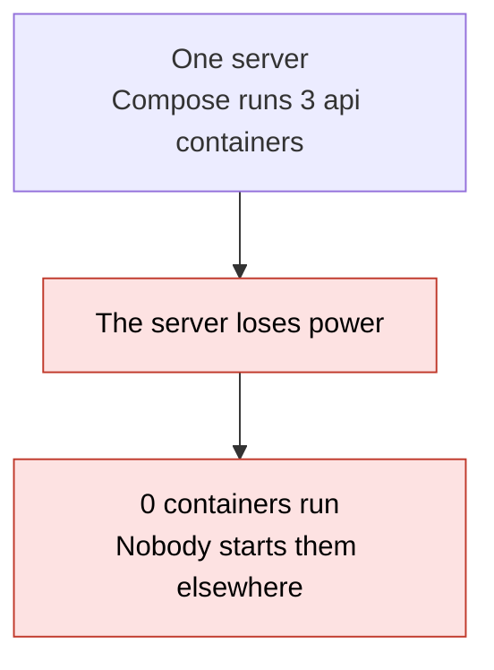
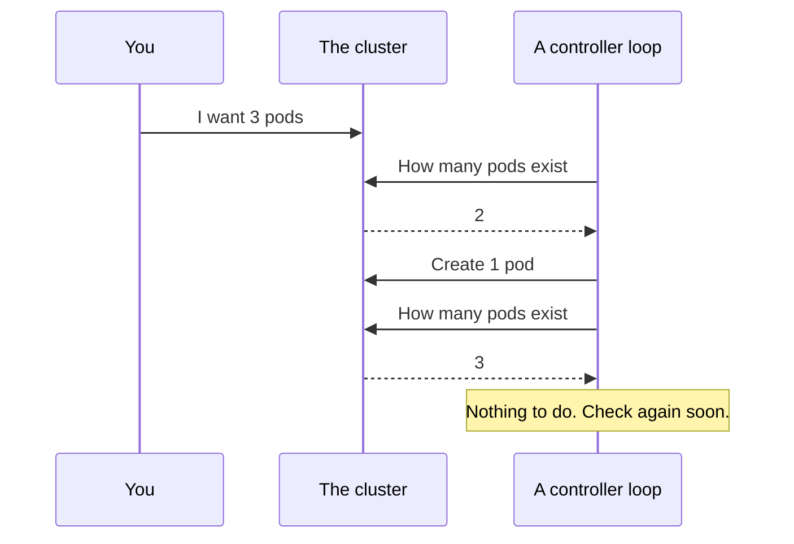
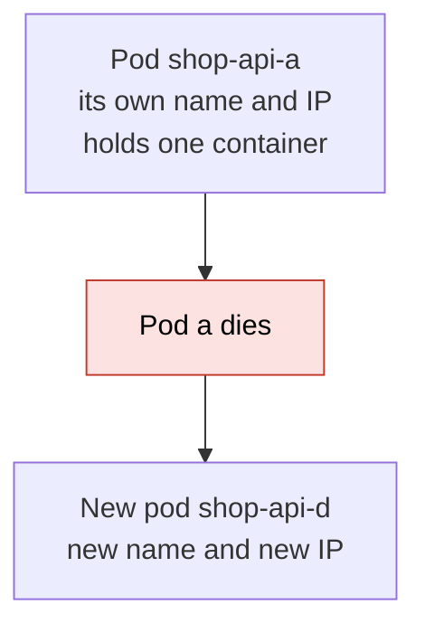
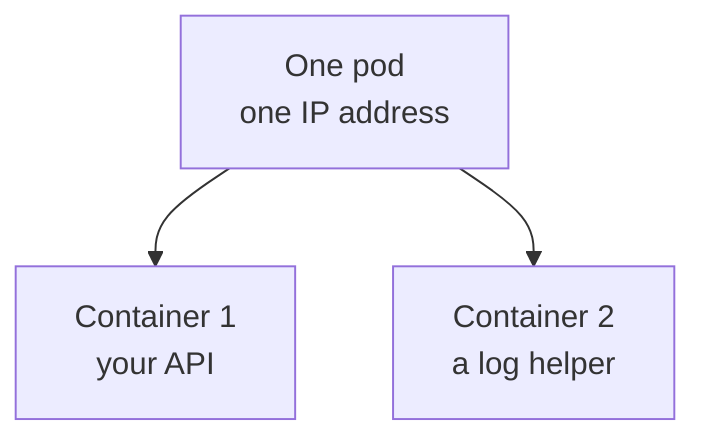
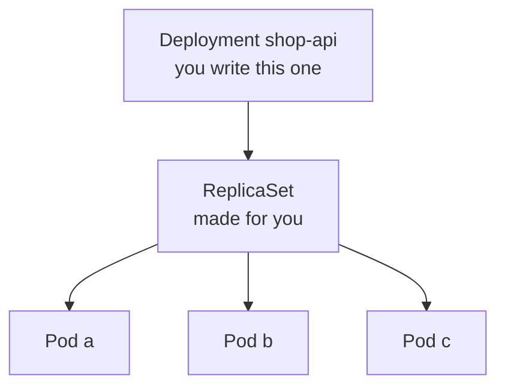
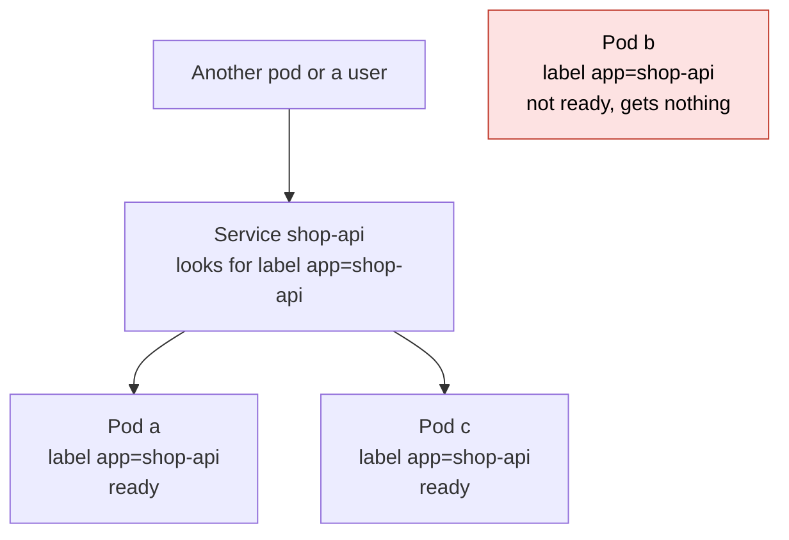
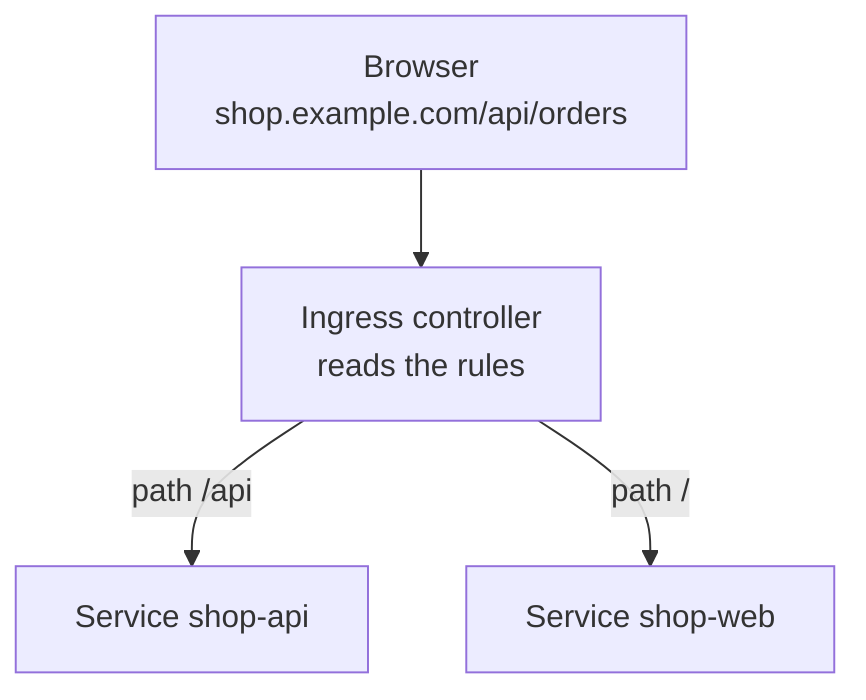

# 04. Kubernetes objects

> **Subject:** DevOps and Cloud · **Lesson:** 04 · **Made:** 2026-11-13 · **Status:** ready
>
> **You will be able to:** say why Docker Compose is not enough for many machines, explain the loop that keeps your pods alive, say what a Pod, a Deployment, a Service and an Ingress each do, and follow one web request from the browser to your app.
>
> **Before this:** [Docker Compose](03-docker-compose.md) · **Next:** [CI/CD pipelines](05-ci-cd-pipelines.md)
>
> **How to read it:** one card is one idea. Look at the picture, guess, then press the orange bar to check. The blue bars (📖 More detail) hold the longer explanation. Skip them on the first read, and open them when you want more. Kubernetes facts come from the official docs, checked on 2026-11-13. The newest Kubernetes release on that date was 1.37. There was no cluster on the machine that made this lesson, so anything that needs a running cluster is marked "from the docs, not run here". About 20 minutes for the cards.

## 1. The problem: Compose stops at one machine

In lesson 03 you ran your app with Compose. Compose looks after containers on **one machine**. That is fine until the machine dies, or one machine is too small, or you must deploy a new version without a gap.



Notice: Compose has no idea that a second machine exists. Kubernetes (also called K8s) treats many machines as one group, and moves the work when one dies.

<details class="guess"><summary>🤔 Guess: Compose runs 3 copies of your API on one server, and the server loses power. How many copies still run? Press to check.</summary>

**0.** Compose only manages the machine it runs on. It cannot start the containers on another machine. Kubernetes can, because it watches all the machines at once.

</details>

> **Remember:** Compose manages one machine. Kubernetes manages many, and moves work when one fails.

<details class="more"><summary>📖 More detail: the four words, the ladder, and what you already run</summary>

**Four new words.** Each one gets a picture in a card below.

- **Pod:** the smallest thing Kubernetes runs. It wraps one container (card 3).
- **Deployment:** a note that says "keep 3 copies of this pod running" (card 4).
- **Service:** one stable address in front of pods that come and go (card 5).
- **Ingress:** rules that send web requests from the outside to the right Service (card 6).

**The ladder you are on.** Each step solves what the step below could not.

| Tool | Machines | What it adds |
|---|---|---|
| `docker run` | One | Starts one container |
| Compose | One | Several containers from one file |
| Docker Swarm | Many | Many machines as one pool. CapRover is a web dashboard on top of Swarm |
| Kubernetes | Many | The same, with finer control and a very large set of tools |

So you already run an orchestrator (a program that runs containers on a group of machines for you). The DBO case study describes four Node and TypeScript services on Docker Swarm through CapRover (API, Auth, Queue and Cron). The case study itself says the move to something bigger should be "managed containers (ECS/Cloud Run) when multi-node orchestration or team size demands it, not Kubernetes by default". I did not check what DBO runs today.

**No Kubernetes in production is stated in your profile.** Your profile lists a little Docker, CapRover and AWS. So in an interview, say what you know and where it ends. The guide [container-orchestration-guide.md](container-orchestration-guide.md) has a 30 second script for this, and [docker-caprover-internals.md](docker-caprover-internals.md) shows what CapRover does under the hood.

**Words you will hear:** cluster means the group of machines. A node is one machine in it.

</details>

## 2. The idea: you write what you want, and loops make it true

With `docker run` you give an order. It happens once, and nothing remembers it. With Kubernetes you write down **what you want** ("3 pods of my API"). Small programs called **controllers** then compare what you want with what exists, again and again, and fix any gap. A thermostat works the same way: you set 21 degrees, and it keeps checking the room.



Notice: nobody tells the loop to fix anything. It sees 2 and wants 3.

<details class="guess"><summary>🤔 Guess: 3 pods are wanted and 3 run. Someone deletes one pod by hand. What happens next, and does anyone type a command? Press to check.</summary>

**A new pod with a new name appears, and nobody types a command.** The loop counts 2, wants 3, and creates one. (From the Kubernetes docs and the local lab step 5a, not run here.)

</details>

> **Remember:** you write what you want, and loops keep reality equal to it, for as long as the object exists.

<details class="more"><summary>📖 More detail: the loop as real code, the real output, and the interview words</summary>

**The smallest code that shows it.** `reconcile` is the whole idea. It compares two numbers and returns the actions. This short version only creates pods. The practice at the end also deletes extra pods, and has `applyActions` to do the actions.

```js
function reconcile(want, pods) {
  const missing = want - pods.length;
  const actions = [];
  for (let i = 0; i < missing; i++) {
    actions.push("create");
  }
  return actions;
}
let pods = ["a", "b", "c"];
console.log(reconcile(3, pods));
// pod b dies
pods = ["a", "c"];
console.log(reconcile(3, pods));
```

**Output:**

```
[]
[ 'create' ]
```

Checked on 2026-11-13 with Node 26.12.1. With the full practice code, the same story ends with `applyActions` giving the pods `[ 'a', 'c', 'd' ]`, and then `reconcile(3, ...)` gives `[]` again. The pod `b` is not repaired. A new pod `d` takes its place.

**The interview words.** What you want is the **desired state** (it sits in the `spec` of an object). What exists is the **current state** (the `status`). The loop is a **control loop** or **reconciliation loop**. The docs say: "In Kubernetes, controllers are control loops that watch the state of your cluster, then make or request changes where needed. Each controller tries to move the current cluster state closer to the desired state." (Kubernetes docs, Controllers, checked 2026-11-13.) The docs also say an object is "a record of intent".

**Where the thermostat stops being true.** A thermostat has one job. Kubernetes has many loops, one for each kind of object, and they work together. Also, a thermostat only turns heat on or off. A Kubernetes loop creates and deletes whole pods.

**Watch it move:** open [the stepper](visuals/04-kubernetes-objects.html) and press Next on tab 2, "A pod dies".

</details>

## 3. Pod: the smallest thing, and it is disposable

A **Pod** is a small box around one container. It has its own name and its own IP address. Think of a lunchbox: you throw it away when it breaks, you do not repair it. If a pod dies, Kubernetes makes a **new** pod with a new name. So you never call a pod's address, and you almost never create a pod by hand.



Notice: the new pod is not the old pod brought back.

<details class="guess"><summary>🤔 Guess: a pod dies and a new one takes its place. Does the new pod keep the old pod's IP address? Press to check.</summary>

**No.** The new pod has its own name and its own IP address. That is why other parts of your system call a Service (card 5), not a pod. (From the Kubernetes docs: pods are "relatively ephemeral, disposable entities". Not run here.)

</details>

> **Remember:** a pod is disposable. Do not repair it, do not call its address, and do not create it by hand.

<details class="more"><summary>📖 More detail: what the docs say, two containers in one pod, and two kinds of restart</summary>

**What the docs say** (Kubernetes docs, Pods, checked 2026-11-13):

- "A Pod ... is a group of one or more containers, with shared storage and network resources, and a specification for how to run the containers."
- "The 'one-container-per-Pod' model is the most common Kubernetes use case."
- "You'll rarely create individual Pods directly in Kubernetes." You create them through a workload object such as a Deployment.

**Two containers in one pod** is the exception. They share one IP address, so they reach each other on `localhost`. A helper that ships logs next to your app is the usual example (a "sidecar").



**Two different restarts.** Be able to say the difference.

| What broke | Who fixes it | The result |
|---|---|---|
| The **process** inside the container crashed | The kubelet, the helper on that machine | The same pod, a restarted container |
| The **pod** is gone (deleted, or its machine failed) | The loop from card 2 | A new pod with a new name |

The local lab shows both: step 5a deletes a pod, step 5b kills the process (see [the lab](examples/kubernetes-local-demo/README.md)). Both are from the lab and the docs, not run here.

**Analogy check.** A lunchbox is thrown away whole. A pod with a crashed process is not thrown away: only its container restarts.

</details>

## 4. Deployment: keep 3 copies alive, and update them safely

You almost never write a pod. You write a **Deployment**: the image, and how many copies. Kubernetes makes a helper object called a ReplicaSet (it counts pods), and the ReplicaSet makes the pods. You write one object, and you get five.



Notice: the loop from card 2 lives in the ReplicaSet. When you change the image tag, the Deployment makes a **new** ReplicaSet and moves pods over a few at a time (a rolling update, lesson [27](../system-design/27-safe-deploys.md) card 2).

<details class="guess"><summary>🤔 Guess: you write one Deployment with replicas: 3. How many objects does Kubernetes end up with? Press to check.</summary>

**Five.** One Deployment, one ReplicaSet and three pods. The docs say the Deployment "creates a ReplicaSet that creates three replicated Pods". (From the docs and the local lab step 2, not run here.)

</details>

> **Remember:** you write a Deployment, not pods. A change to the pod blueprint starts a rolling update, and the old ReplicaSet makes a rollback possible.

<details class="more"><summary>📖 More detail: the YAML, the step by step trace, the numbers, and rollback</summary>

**The YAML.** Every field is needed. The comments say why. I made this with `kubectl create deployment shop-api --image=shop-api:1.4.0 --replicas=3 --port=3000 --dry-run=client -o yaml` (kubectl v1.34.1, which works with no cluster) and removed the empty fields. It matches that output. Run the same command to see it yourself.

```yaml
apiVersion: apps/v1
kind: Deployment
metadata:
  name: shop-api
spec:
  replicas: 3                  # what you want: 3 pods
  selector:
    matchLabels:
      app: shop-api            # the Deployment owns pods with this label
  template:                    # the blueprint for each pod
    metadata:
      labels:
        app: shop-api          # must match the selector above
    spec:
      containers:
        - name: shop-api
          image: shop-api:1.4.0
          ports:
            - containerPort: 3000
```

**The step by step trace** of `kubectl apply -f deployment.yaml`. Notice that after step 2 you have not started a single container. Steps 1 to 6 are from the docs and the local lab (not run here). The loop in steps 3 and 7 is the model run in card 2.

| # | What happens | State after |
|---|---|---|
| 1 | `kubectl` sends the file to the API server (the one door into the cluster). It stores the Deployment | Deployment `shop-api`, replicas 3. Pods: 0 |
| 2 | The Deployment controller sees a Deployment with no ReplicaSet and makes one | ReplicaSet `shop-api-<hash>`, replicas 3. Pods: 0 |
| 3 | The ReplicaSet compares: want 3, have 0 | Actions: create, create, create |
| 4 | Three pods are created. The scheduler picks a machine for each ("assigns each Pod to a suitable node", docs) | 3 pods, each on a machine, not ready |
| 5 | The kubelet on each machine starts the container | Containers starting |
| 6 | Each pod passes its readiness check (can it serve right now?) | 3 pods ready |
| 7 | The loop compares again: want 3, have 3 | Actions: none. It keeps checking |

Real pod names look like `shop-api-<hash>-<random letters>`. The middle part names the ReplicaSet (from the local lab, step 2).

**Watch it move:** [the stepper](visuals/04-kubernetes-objects.html), tab 1 "Apply a Deployment".

**The numbers** (Deployment docs, checked 2026-11-13):

| Setting | Default | Meaning |
|---|---|---|
| `maxUnavailable` | 25% | At least 75% of the wanted pods stay up during an update |
| `maxSurge` | 25% | At most 125% of the wanted pods run during an update |
| `progressDeadlineSeconds` | 600 | Seconds before the update is reported as stuck. Kubernetes only reports it. It does not roll back |

**What starts a rollout.** The docs: "Declare the new state of the Pods by updating the PodTemplateSpec of the Deployment. A new ReplicaSet is created, and the Deployment gradually scales it up while scaling down the old ReplicaSet." Changing only `replicas` does not start one.

**Rollback.** `kubectl rollout undo deployment/shop-api` goes back to the previous revision (docs). The old ReplicaSet is kept, which is why it is fast. I did not run it. The local lab step 7 runs a bad release and an undo on a real cluster.

**You never write the ReplicaSet.** The docs: "we recommend using Deployments instead of directly using ReplicaSets".

</details>

## 5. Service: one stable address in front of pods that come and go

Pods get new names and new IP addresses all the time. Nothing can call them directly. A **Service** gives you one name and one IP address that stay. It sends traffic to the pods that have the **label** it looks for **and** are ready.



Notice: pod b has the right label, and still gets no traffic, because it is not ready.

<details class="guess"><summary>🤔 Guess: pod b has the right label, but it fails its readiness check. Does the Service send it traffic? Press to check.</summary>

**No.** A pod needs both: the label matches, and it is ready. When it is ready again, it joins the list without anyone doing anything. (The docs say a pod's endpoint is ready when it is "serving and not terminating". Not run here.)

</details>

> **Remember:** a Service picks pods by label, and only ready ones. A label that matches nothing means no traffic.

<details class="more"><summary>📖 More detail: the YAML, the code and its output, the three types, and the DNS name</summary>

**The YAML.** Made with `kubectl create service clusterip shop-api --tcp=80:3000 --dry-run=client -o yaml`, then simplified (it matches the output, apart from the default type, a port name and the protocol, which Kubernetes fills in itself).

```yaml
apiVersion: v1
kind: Service
metadata:
  name: shop-api
spec:
  selector:
    app: shop-api              # send traffic to ready pods with this label
  ports:
    - port: 80                 # the Service listens on 80
      targetPort: 3000         # and sends to port 3000 in the pod
```

I parsed the Deployment, the Service and the Ingress together and checked three links: the Service selector is the pod label, `targetPort` is the `containerPort`, and the Ingress backend names a real Service and port.

**The code from the practice.** A selector matches when every key is in the labels with the same value. The pod may have more labels.

```js
const svc = { selector: { app: "shop-api" } };
const api = { app: "shop-api" };
const web = { app: "shop-web" };
const pods = [
  { name: "a", labels: api, ready: true },
  { name: "b", labels: api, ready: false },
  { name: "c", labels: web, ready: true },
];
console.log(serviceEndpoints(svc, pods));
```

**Output:**

```
[ 'a' ]
```

Checked on 2026-11-13 with Node 26.12.1. Pod b is out because it is not ready. Pod c is out because its label is `shop-web`.

**The three types** (Service docs, checked 2026-11-13). The default is ClusterIP.

| Type | Who can reach it | Use it for |
|---|---|---|
| **ClusterIP** (default) | Only things inside the cluster | Your API called by your web pods |
| **NodePort** | Anyone who can reach a machine, on one port (30000 to 32767 by default) | Demos and the local lab |
| **LoadBalancer** | The internet, through a load balancer from the cloud provider | A public entrance on a cloud cluster |

The docs on LoadBalancer: "Kubernetes does not directly offer a load balancing component; you must provide one, or you can integrate your Kubernetes cluster with a cloud provider." A fourth type, ExternalName, only gives a DNS alias.

**The DNS name.** A Service called `my-service` in the namespace `my-ns` gets the DNS name `my-service.my-ns`. Pods in the same namespace can use just `my-service` (docs). So your web pods can call `http://shop-api`.

**Labels use AND.** The docs: with several requirements "all must be satisfied", and there is "no logical OR". Practice B is this bug.

**The Service's list is called EndpointSlices.** "The controller for that Service continuously scans for Pods that match its selector, and then makes any necessary updates to the set of EndpointSlices" (docs). It is another loop.

**Watch it move:** [the stepper](visuals/04-kubernetes-objects.html), tab 3 "A Service picks pods".

</details>

## 6. Ingress: one front door that sends each request to a Service

A LoadBalancer Service for every app costs money and is clumsy. An **Ingress** is a list of rules for web (HTTP) traffic: "host `shop.example.com`, path `/api`, send to Service `shop-api`". But an Ingress is only the rules. You also need an **ingress controller**, the program that reads the rules and sends the requests on. Kubernetes does not install one for you.



Notice: the request goes to a Service, and the Service picks a ready pod (card 5).

<details class="guess"><summary>🤔 Guess: you apply an Ingress to a cluster that has no ingress controller. What happens? Press to check.</summary>

**Nothing.** The docs: "Only creating an Ingress resource has no effect." The rules wait until a controller reads them.

</details>

> **Remember:** an Ingress is only rules. You also need an ingress controller. For new work, look at Gateway API, the newer direction.

<details class="more"><summary>📖 More detail: the YAML, the routing code, Prefix and longest match, and Gateway API</summary>

**The YAML.** Made with `kubectl create ingress shop --class=nginx-example --rule="shop.example.com/api*=shop-api:80" --rule="shop.example.com/*=shop-web:80" --dry-run=client -o yaml`. The class name `nginx-example` is the one used in the Kubernetes docs example. Put the name of your own controller's class there.

```yaml
apiVersion: networking.k8s.io/v1
kind: Ingress
metadata:
  name: shop
spec:
  ingressClassName: nginx-example
  rules:
    - host: shop.example.com
      http:
        paths:
          - path: /api
            pathType: Prefix
            backend:
              service:
                name: shop-api
                port:
                  number: 80
          - path: /
            pathType: Prefix
            backend:
              service:
                name: shop-web
                port:
                  number: 80
```

**The routing, as code.** I parsed this YAML and gave its rules to the `ingressRoute` function from the practice:

```js
const host = "shop.example.com";
console.log(ingressRoute(rules, host, "/api/orders"));
console.log(ingressRoute(rules, host, "/apis"));
console.log(ingressRoute(rules, host, "/about"));
console.log(ingressRoute(rules, "other.com", "/api"));
```

**Output:**

```
shop-api
shop-web
shop-web
null
```

Checked on 2026-11-13 with Node 26.12.1. A real controller is much bigger. This model only shows the matching rules from the docs.

**The matching rules** (Ingress docs, checked 2026-11-13):

| Rule | What the docs say |
|---|---|
| Prefix | "Matches based on a URL path prefix split by `/`", piece by piece. `/foo/bar` matches `/foo/bar/baz`, but not `/foo/barbaz` |
| Exact | "Matches the URL path exactly and with case sensitivity" |
| Several match | "precedence will be given first to the longest matching path". On a tie, Exact beats Prefix |
| No rule matches | The request goes to the default backend. The controller provides it |

That is why `/apis` does not go to `/api`, and why `/` catches everything else.

**Gateway API, the newer direction.** The Kubernetes docs say: "The Kubernetes project recommends using Gateway instead of Ingress. The Ingress API has been frozen." It still works and is not going to be removed, but it gets no new features. Gateway API splits the job into kinds: GatewayClass, Gateway and HTTPRoute (the docs list GRPCRoute too). It is an add-on with its own controller. The same shop rules, from the shape of the docs example (I could not check them with `kubectl`, because they need Gateway API installed in a cluster):

```yaml
apiVersion: gateway.networking.k8s.io/v1
kind: HTTPRoute
metadata:
  name: shop
spec:
  parentRefs:
    - name: shop-gateway
  hostnames:
    - "shop.example.com"
  rules:
    - matches:
        - path:
            type: PathPrefix
            value: /api
      backendRefs:
        - name: shop-api
          port: 80
    - backendRefs:
        - name: shop-web
          port: 80
```

**The ingress-nginx news.** The Kubernetes blog (2025-11-11) announced that the popular controller `ingress-nginx` would be retired in March 2026: there will be "no further releases, no bugfixes", and no security fixes. Existing installs keep running ("Existing deployments of Ingress NGINX will continue to function"). A tutorial that tells you to install it is out of date. The [orchestration guide](container-orchestration-guide.md) has the later news. The idea of this card, rules that pick a Service by host and path, is the same in Gateway API.

**Watch it move:** [the stepper](visuals/04-kubernetes-objects.html), tab 4 "Ingress routes".

</details>

## 7. Your map: CapRover and Swarm names, in Kubernetes

You already do most of this in CapRover. The names change, and some jobs split in two. This table is the picture for this card.

| In CapRover or Swarm | In Kubernetes | What changes |
|---|---|---|
| A CapRover app (a Swarm service) | A **Deployment** and a **Service** | "What runs" and "how it is reached" are two objects |
| Instance count | `replicas` | It lives in the file |
| The app's name inside the network | A **Service** name | A label picks the pods |
| nginx sends a domain to your app | An **Ingress** (rules) and an ingress controller (the program) | The rules and the program that does the work are two things |
| Environment variables | A ConfigMap for plain settings and a Secret for passwords | Two objects. Lesson 09 |
| Revert to the previous version | `kubectl rollout undo` | The old ReplicaSet is kept |

<details class="guess"><summary>🤔 Guess: in CapRover, one nginx sends shop.example.com to your app. In Kubernetes, how many parts do the same job? Press to check.</summary>

**Two:** the Ingress (the rules) and the ingress controller (the program). The rules alone do nothing (card 6).

</details>

> **Remember:** CapRover app is roughly Deployment plus Service. nginx routing is Ingress plus an ingress controller. Environment variables become ConfigMaps and Secrets.

<details class="more"><summary>📖 More detail: settings, secrets, namespaces, and an idea for DBO</summary>

**ConfigMap and Secret** keep settings out of the image. A **ConfigMap** holds plain settings. A **Secret** holds passwords and keys. The details are in [lesson 09, config and secrets](09-config-and-secrets.md). One thing you can see now. This is what `kubectl create secret generic shop-secrets --from-literal=DATABASE_URL=postgres://user:pass@db/shop --dry-run=client -o yaml` printed for the value:

```
data:
  DATABASE_URL: cG9zdGdyZXM6Ly91c2VyOnBhc3NAZGIvc2hvcA==
```

I decoded it, and it gives back the plain text `postgres://user:pass@db/shop`. The value is only base64. That is a way to write text, not a lock. A Secret needs more protection (lesson 09).

**Namespace.** A namespace is a named room inside the cluster. The docs: "Names of resources need to be unique within a namespace, but not across namespaces." Teams and environments (`staging`, `production`) often get one each. The docs say not to use the `default` one in a production cluster. A namespace alone does not keep people apart. That needs extra rules (the guide has more).

**The rest of the map** is in [the orchestration guide](container-orchestration-guide.md) (translation table in Part 6) and [the CapRover note](docker-caprover-internals.md) (table at the end of Part 7).

**An idea, not a fact:** for the DBO services, the API service would become a Deployment and a Service, and the Cron service would become a CronJob (a Kubernetes object that runs a job on a schedule). I did not check that DBO needs this. The case study itself does not recommend Kubernetes by default.

</details>

## 8. Four mistakes, and what to say if you freeze

- **Wrong:** the Service selector says `app: shop-apii` and the pods say `app: shop-api`. **Right:** compare the selector with the pod labels first.
- **Wrong:** you apply an Ingress and nothing else. **Right:** run an ingress controller too.
- **Wrong:** your code calls a pod's IP address. **Right:** call the Service name.
- **Wrong:** you start the app as a bare pod. **Right:** use a Deployment, so a loop replaces it when it dies.

<details class="guess"><summary>🤔 Guess: a Service exists, every pod is ready, and the Service has no endpoints at all. What do you check first? Press to check.</summary>

**The labels.** Compare the Service selector with the labels on the pods. A typo, or a different key, means nothing matches. With a real cluster, `kubectl get pods --show-labels` and `kubectl describe service shop-api` show both sides. (Commands from the kubectl docs, not run here.)

</details>

> **Remember:** if you freeze, say "I write what I want. A Deployment keeps the pods. A Service gives them one address by label. An Ingress sends web requests to Services."

<details class="more"><summary>📖 More detail: the four mistakes in full, and the freeze plan</summary>

**Wrong:**

```yaml
# Service
selector:
  app: shop-apii          # one letter too many
```

**Right:**

```yaml
selector:
  app: shop-api           # the same text as in the pod template labels
```

**Why:** the Service looks for pods with the label `app=shop-apii`. None has it, so the list of pods is empty, and nobody gets traffic. In the stepper, tab 3, the last pictures show this. In the model it gives `serviceEndpoints(...)` of `[]`.

**Wrong:** one `kubectl apply -f ingress.yaml` on a new cluster, and then waiting. **Right:** install an ingress controller first (or a Gateway API controller if you use Gateway API). **Why:** "Only creating an Ingress resource has no effect."

**Wrong:** `http://10.1.4.7:3000` in your config. **Right:** `http://shop-api`. **Why:** a pod is replaced with a new IP address, and the Service name stays.

**Wrong:** `kubectl run shop-api --image=shop-api:1.4.0` as your production setup. **Right:** a Deployment. **Why:** a bare pod has no loop above it, so nothing makes a new one when it dies. The docs: "You'll rarely create individual Pods directly".

**If you freeze:**

1. Say "Kubernetes keeps what I wrote true. I do not start containers, I write what I want."
2. Say "A Deployment keeps N pods and handles updates. Pods are disposable."
3. Say "A Service gives them one stable address by label, and only to ready pods. An Ingress sends web requests to the right Service, and it needs a controller."

</details>

## 9. Watch and play

Links were checked on 2026-11-13. I opened every page. For the video I read the title and channel from the oEmbed data. I did not watch it. If a link is broken, tell me and I will replace it.

- **Video:** [Kubernetes Pods, ReplicaSets, and Deployments in 5 Minutes](https://www.youtube.com/watch?v=iC-WxZGhFqs) - Containers from the Couch. Compare it with cards 3 and 4.
- **Play with it:** [the stepper in this folder](visuals/04-kubernetes-objects.html) - guess first, then press Next. Four tabs: apply a Deployment, a pod dies, a Service picks pods, Ingress routes.
- **Run it for real:** [the local lab](examples/kubernetes-local-demo/README.md) - a free cluster on your laptop with kind. Step 5 deletes a pod, step 6 does a rolling update. This lesson did not run it.
- **Official tutorial:** [Learn Kubernetes Basics](https://kubernetes.io/docs/tutorials/kubernetes-basics/) - six modules, from deploying an app to updating it. Text and commands, with no terminal in the page, so you need a cluster (the lab above).
- **A diagram:** [Kubernetes components](https://kubernetes.io/docs/concepts/overview/components/) - the one picture of the control plane and the machines. Find the scheduler and the kubelet from card 4.
- **Read:** [Ingress](https://kubernetes.io/docs/concepts/services-networking/ingress/) - the "frozen" note at the top, and the path types.
- **Read:** [Gateway API](https://kubernetes.io/docs/concepts/services-networking/gateway/) - the four stable kinds, and the HTTPRoute example.

<details><summary>Go deeper (optional)</summary>

**What was run, and what was not.** Run here: the code and outputs in this lesson (Node 26.12.1) and the 32 practice tests. The YAML was made by `kubectl` v1.34.1 with `--dry-run=client -o yaml`, which works with no cluster, and then parsed with Ruby's YAML reader. The parse checked that the Deployment, Service, Ingress, ConfigMap and Secret equal what `kubectl` made, and that the labels, ports and names line up. Not run here: anything that needs a live cluster. `kubectl apply --dry-run=client` and `kubectl explain` both failed here with "connection refused", because they ask the cluster what it supports. Rollouts, self-healing, Service routing and Ingress routing are from the docs and the local lab, not run here. The Gateway API YAML needs Gateway API installed, so `kubectl` could not check it.

**Kubernetes versions** (Kubernetes releases page, checked 2026-11-13). The newest minor release is 1.37 (patch 1.37.1, 2026-09-15). The page lists 1.37, 1.36 and 1.35 as the supported ones. Version 1.34 reached end of life on 2026-10-27. The `kubectl` on the machine that made this lesson is v1.34.1. Each version has an end of life date on that page (1.35 on 2027-02-28, 1.36 on 2027-06-28, 1.37 on 2027-10-28), so a cluster that nobody upgrades falls out of support.

**ReplicaSet in one line.** The docs: "A ReplicaSet's purpose is to maintain a stable set of replica Pods running at any given time." The Deployment makes and manages them, and the `pod-template-hash` label tells them apart. Do not change that label.

**Other workload objects, one line each.** StatefulSet: pods with a steady name and their own disk. DaemonSet: one pod on every machine. Job and CronJob: run to the end, once or on a schedule. They get their own lesson later. The [orchestration guide](container-orchestration-guide.md) has a paragraph on each.

**Why Ingress is separate from Service.** A Service does not read the HTTP request. Ingress works at the HTTP level (layer 7) and picks by host and path. Compare the system design lesson on [load balancers](../system-design/03-load-balancers.md).

**More.**

- [Kubernetes Explained in 9 Minutes - Pods, Nodes, Services & More](https://www.youtube.com/watch?v=sKv601iCwjY) - Learn with Manoj. A second video, a bit wider. Title and channel from oEmbed, not watched.
- [Kubernetes docs: Deployments](https://kubernetes.io/docs/concepts/workloads/controllers/deployment/), [Services](https://kubernetes.io/docs/concepts/services-networking/service/), [Pods](https://kubernetes.io/docs/concepts/workloads/pods/), [Controllers](https://kubernetes.io/docs/concepts/architecture/controller/) and [Labels](https://kubernetes.io/docs/concepts/overview/working-with-objects/labels/). The pages behind the quotes in this lesson.
- [Ingress NGINX Retirement: What You Need to Know](https://kubernetes.io/blog/2025/11/11/ingress-nginx-retirement/) - the Kubernetes blog post on the retirement.
- [Kubernetes releases](https://kubernetes.io/releases/) - the supported versions.

</details>

## 10. Practice

**A. Predict the output** (write your answer before opening)

```js
const service = { name: "shop-api", selector: { app: "shop-api" } };
const pods = [
  { name: "a", labels: { app: "shop-api" }, ready: true },
  { name: "b", labels: { app: "shop-api" }, ready: false },
  { name: "c", labels: { app: "shop-web" }, ready: true },
];
console.log(serviceEndpoints(service, pods));
pods[1].ready = true;
console.log(serviceEndpoints(service, pods));
```

Then answer: will pod `c` ever get traffic from this Service?

<details><summary>Answer</summary>

```
[ 'a' ]
[ 'a', 'b' ]
```

At first b is not ready, and c has the label `shop-web`, so only a gets traffic. When b becomes ready it joins. Pod c never gets traffic from this Service, because its label does not match the selector, however ready it is. (Checked on 2026-11-13 with Node 26.12.1.)

</details>

**B. Fix the bug**

A selector has two labels: `app` and `tier`. The pod has the right `app` but the wrong `tier`. What does this print, and should it?

```js
const selector = { app: "shop-api", tier: "backend" };
const labels = { app: "shop-api", tier: "frontend" };
function selectorMatches(selector, labels) {
  const keys = Object.keys(selector);
  return keys.some((k) => labels[k] === selector[k]);
}
console.log(selectorMatches(selector, labels));
```

<details><summary>Answer</summary>

It prints `true`, and it should print `false`. `some` says yes when one label matches. Kubernetes label selectors use AND: every requirement must match (docs: "there is no logical OR").

Fix: use `every`.

```js
function selectorMatches(selector, labels) {
  const keys = Object.keys(selector);
  // no selector: this Service picks no pods by itself
  if (keys.length === 0) return false;
  return keys.every((k) => labels[k] === selector[k]);
}
```

This prints `false` for the wrong tier, and `true` for a pod with the right labels plus extras like `version: "v2"`. (Checked on 2026-11-13 with Node 26.12.1.)

</details>

**C. Write it yourself**

Open `learn/devops-cloud/practice/04-kubernetes-objects.js`. It has five empty pieces: `reconcile`, `applyActions`, `selectorMatches`, `serviceEndpoints` and `ingressRoute`. The comments above them say exactly what each one must do. Write them, then run this from the repo root and make all the tests pass:

```
node --test learn/devops-cloud/practice/04-kubernetes-objects.test.js
```

<details><summary>One possible answer</summary>

```js
function reconcile(desiredReplicas, pods) {
  const missing = desiredReplicas - pods.length;
  const actions = [];
  for (let i = 0; i < missing; i++) actions.push("create");               // too few pods: make more
  for (let i = 0; i < -missing; i++) {
    actions.push("delete " + pods[pods.length - 1 - i].name);             // too many pods: remove from the end
  }
  return actions;                                                          // an empty list means "nothing to do"
}

function applyActions(pods, actions, makePod) {
  let next = pods.slice();                                                 // a copy, so the old list stays the same
  for (const action of actions) {
    if (action === "create") next.push(makePod());
    else if (action.startsWith("delete ")) {
      const name = action.slice("delete ".length);
      next = next.filter((p) => p.name !== name);
    }
  }
  return next;
}

function selectorMatches(selector, labels) {
  const keys = Object.keys(selector);
  if (keys.length === 0) return false;                                     // no selector: this Service picks no pods by itself
  return keys.every((key) => labels[key] === selector[key]);               // every key must match
}

function serviceEndpoints(service, pods) {
  return pods
    .filter((pod) => pod.ready && selectorMatches(service.selector, pod.labels))   // label AND ready
    .map((pod) => pod.name);
}

const parts = (path) => path.split("/").filter(Boolean);                  // "/api/users" becomes ["api", "users"]

function pathMatches(rule, path) {
  if (rule.pathType === "Exact") return path === rule.path;
  const wanted = parts(rule.path);                                         // Prefix: compare piece by piece
  const got = parts(path);
  return wanted.every((piece, i) => got[i] === piece);
}

function ingressRoute(rules, host, path) {
  let best = null;
  for (const rule of rules) {
    if (rule.host !== host || !pathMatches(rule, path)) continue;
    const size = parts(rule.path).length;                                  // more pieces means a longer path
    const better =
      best === null ||
      size > best.size ||
      (size === best.size && rule.pathType === "Exact" && best.rule.pathType !== "Exact");   // on a tie, Exact wins
    if (better) best = { rule, size };
  }
  return best === null ? null : best.rule.service;
}

module.exports = { reconcile, applyActions, selectorMatches, serviceEndpoints, ingressRoute };
```

Checked on 2026-11-13 with Node 26.12.1: the 32 tests fail on the empty stub and all 32 pass with this answer.

</details>

## 11. Interview question

**Q:** "What happens when you run `kubectl apply` on a Deployment, and how does a request from the internet reach one of its pods?"

A common follow-up: "Why do you need a Service when you already have a Deployment?" Cards 4 and 5 are the answer.

<details><summary>A strong answer, in four parts</summary>

1. **Problem:** One container on one machine is fine until the machine dies, or you need more copies, or you need to deploy without a gap. Compose and `docker run` cannot move work to another machine. Pods also get new IP addresses when they are replaced, so nothing can call them directly.
2. **How it works:** I write what I want in a Deployment: the image and the number of replicas. `kubectl apply` stores it. The Deployment controller makes a ReplicaSet. The ReplicaSet compares the pods that exist with the number I want, and creates the missing ones. The scheduler picks a machine for each pod, and the kubelet starts the containers. The loop never stops, so a dead pod is replaced by a new one. A Service gives the pods one stable name and IP. It sends traffic to pods that match its label and are ready. For a request from outside: the browser reaches a load balancer, then an ingress controller, which reads the Ingress rules (host and path) and sends the request to a Service, which picks a ready pod. For new setups I would look at Gateway API, because the Ingress API is frozen.
3. **Tradeoff:** Kubernetes gives self-healing, rolling updates and one standard set of objects across machines. The cost is many moving parts, YAML, and work to run it. For a small team with a few services, a platform like CapRover on Docker Swarm is simpler and often the right choice. Kubernetes starts to pay off with many teams, many services, or rules that must be the same everywhere.
4. **My example:**
   - **Fact:** my DBO case study describes four Node and TypeScript services (API, Auth, Queue, Cron) on Docker Swarm through CapRover, and my profile lists a little Docker, CapRover and AWS. No Kubernetes production experience is stated, so I should say that.
   - **Fact:** the case study itself says the next step for DBO is managed containers when needed, "not Kubernetes by default".
   - **Idea, not a fact:** if DBO grew to many teams, the API service would map to a Deployment plus a Service, the nginx routing to an Ingress or a Gateway API route, and the Cron service to a CronJob. I would say "this is how I would map it", not "this is what we did".

</details>

## 12. Explain it back

Close this file. Explain Kubernetes objects out loud like to a new junior, in 4 parts (problem, how, tradeoff, my example). Use the story of three pods: one dies, the loop sees 2 and wants 3, and it creates a new pod with a new name. Then say how a Service and an Ingress get a request to a ready pod. Write your best version below and run `/explain-check kubernetes objects` or ask the `explain-coach` agent to review it.

### My explanation

<write here>

### Coach feedback

<the explain-coach agent writes here>

## 13. Review questions (day 1, 3, 7, 21)

1. A Deployment says replicas: 3, and one pod is deleted by hand. Say step by step what happens, and who typed a command.
2. A Service exists and every pod is ready, but nobody gets traffic. What do you check first, and why can a ready pod still get nothing?
3. You applied an Ingress and requests still fail. What is missing, and what does the Kubernetes project now recommend instead of Ingress?
4. Draw from memory: browser, ingress controller, Service, Deployment, ReplicaSet, pods. Mark where the labels are used.

<details><summary>Answers</summary>

1. The loop in the ReplicaSet counts the pods and finds 2 where 3 are wanted. It creates one pod, with a new name and a new IP address. The scheduler picks a machine and the kubelet starts the container. When the pod is ready it counts again and finds 3. Nobody typed a command. The ReplicaSet does this on its own, for as long as the Deployment exists.
2. Check the labels: compare the Service selector with the labels on the pods. A selector only matches pods whose labels include every key and value of the selector. A ready pod with a different label is ignored, and a typo in the selector gives an empty list.
3. An ingress controller. An Ingress is only rules, and "only creating an Ingress resource has no effect". The Kubernetes project recommends Gateway API instead of Ingress. The Ingress API is frozen.
4. Browser, then the ingress controller, which reads the Ingress rules (host and path). The controller sends the request to a Service. The Service picks a ready pod by label. The Deployment owns a ReplicaSet, and the ReplicaSet owns the pods. Labels are used in two places: the Deployment selector must match the pod template labels, and the Service selector must match the pod labels.

</details>

## Connected lessons

- [Docker Compose](03-docker-compose.md) - the lesson before. Compose runs several containers on one machine, which is where this lesson starts.
- [CI/CD pipelines](05-ci-cd-pipelines.md) - the next lesson. A pipeline builds the image and then updates the Deployment.
- [Reverse proxy and Nginx](08-reverse-proxy-and-nginx.md) - what an ingress controller does, in its older and simpler form.
- [Config and secrets](09-config-and-secrets.md) - ConfigMap and Secret in full.
- [Safe deploys](../system-design/27-safe-deploys.md) - the rolling update numbers, canary and blue green on top of Deployments.
- [Load balancers](../system-design/03-load-balancers.md) - the traffic split that a Service and an ingress controller do.
- [Container orchestration guide](container-orchestration-guide.md) - the long guide: probes, autoscaling, Helm, when not to use Kubernetes.
- [Docker and CapRover internals](docker-caprover-internals.md) - what CapRover does under the hood.
- [Local Kubernetes lab](examples/kubernetes-local-demo/README.md) - run all of this on your laptop.
