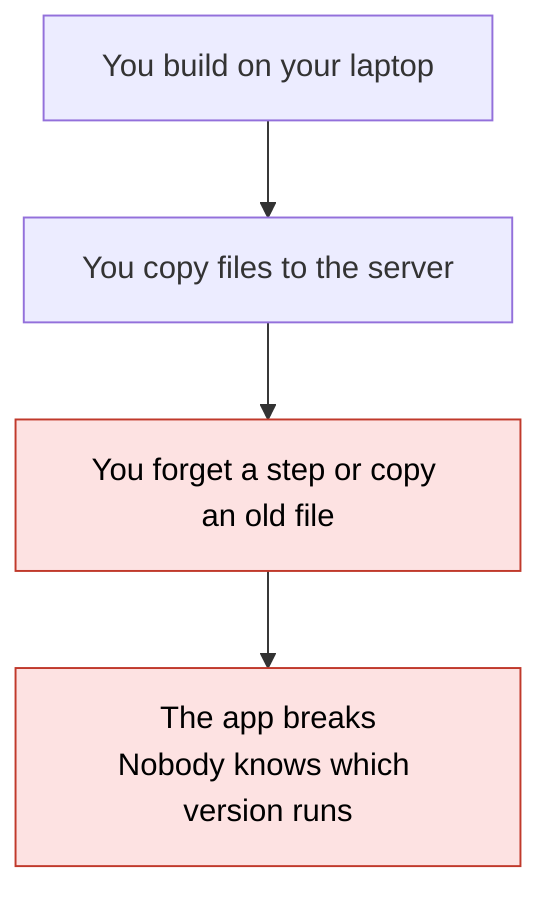
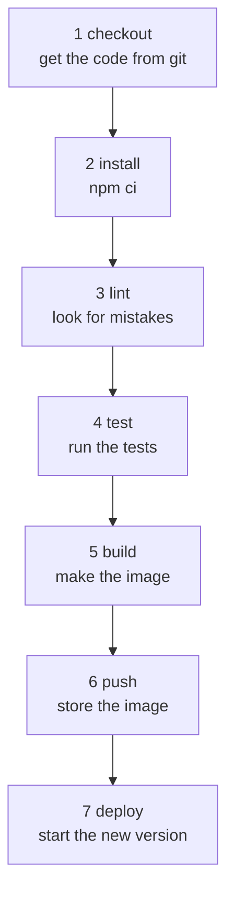
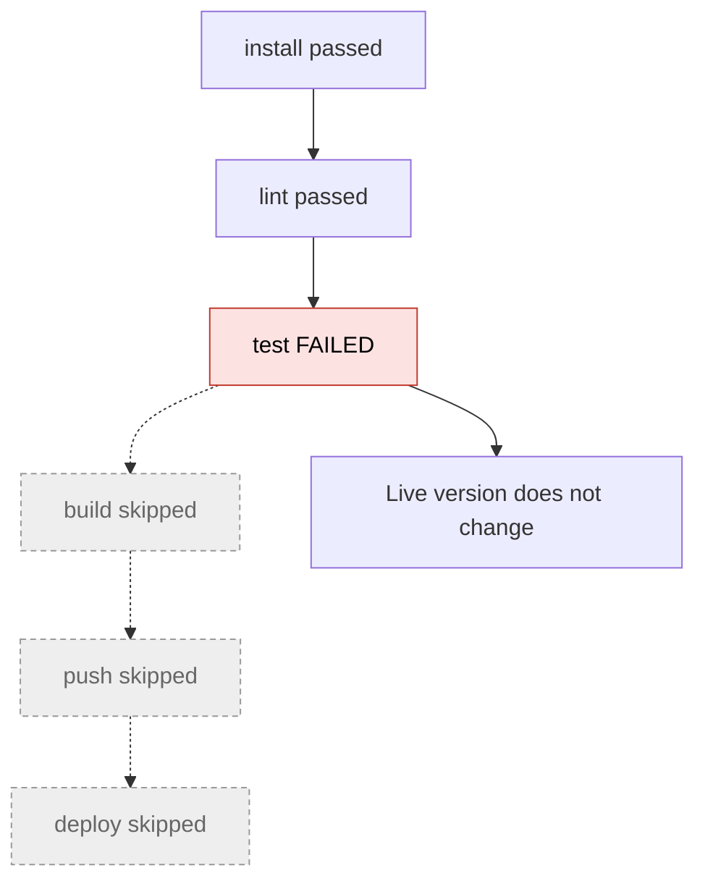
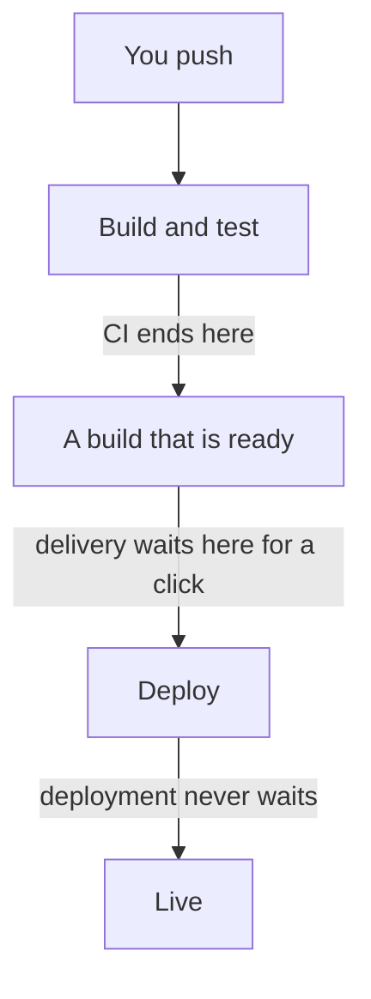
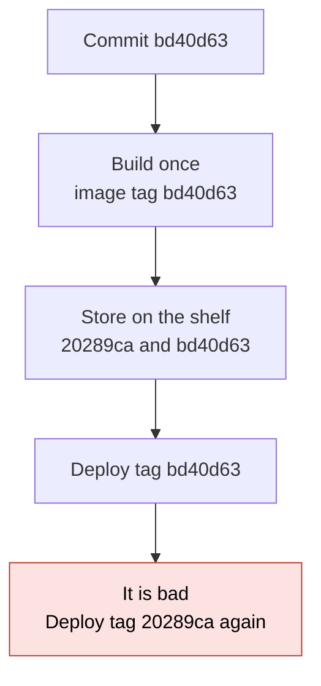
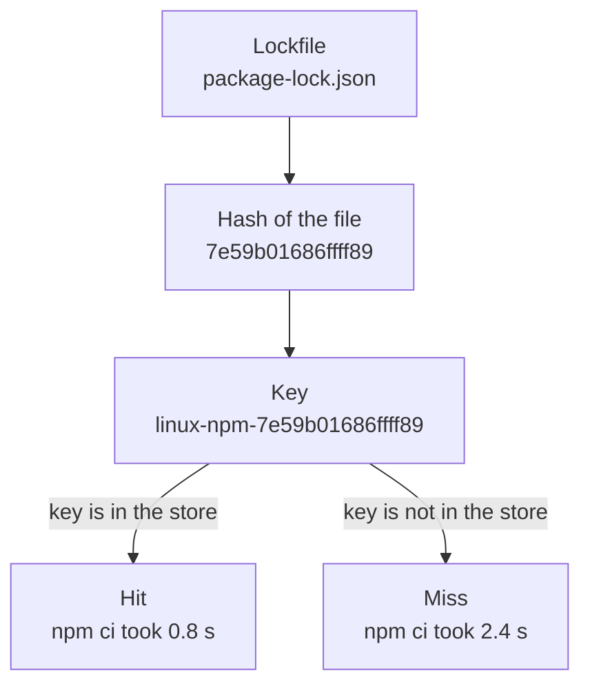
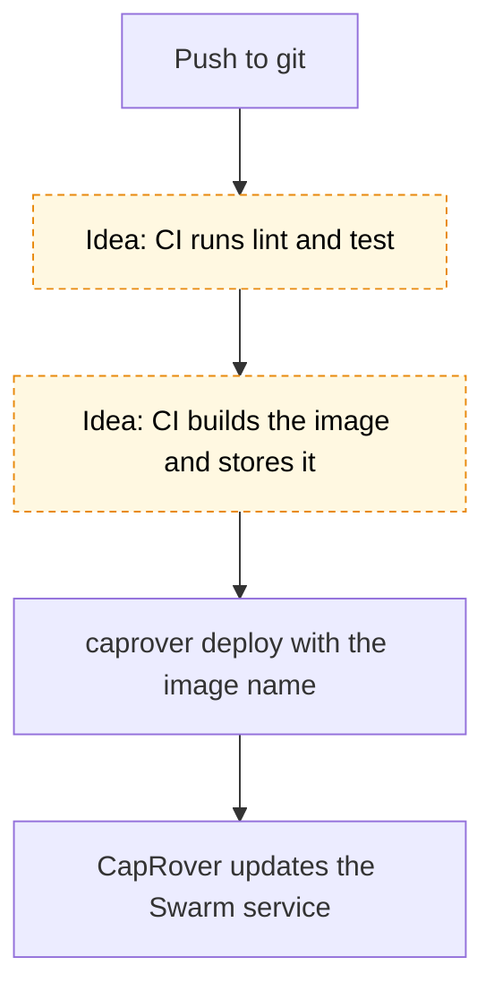

# 05. CI/CD pipelines

> **Subject:** DevOps and Cloud · **Lesson:** 05 · **Made:** 2026-11-13 · **Status:** ready
>
> **You will be able to:** say what a pipeline does after every push, explain why a failed stage stops the line, tell continuous integration, continuous delivery and continuous deployment apart, say why you build once and keep old builds, and explain how a cache key is made.
>
> **Before this:** [Kubernetes objects](04-kubernetes-objects.md) · **Next:** [Cloud models](06-cloud-models.md)
>
> **How to read it:** one card is one idea. Look at the picture, guess, then press the orange bar to check. The blue bars (📖 More detail) hold the longer explanation. Skip them on the first read, and open them when you want more. The pipeline in this lesson is a small script that was run for real on a laptop with Docker. What GitHub does on its own machines, and what CapRover does, comes from their docs (checked 2026-11-13) and is marked "from the docs, not run here". About 20 minutes for the cards.

## 1. The problem: deploys by hand, and a main branch nobody checks

Without a pipeline, a person does every step. You build on your laptop, copy the result to the server, and hope. Three things go wrong. You forget a step. It works on your laptop and nowhere else ("works on my machine"). And a bad push sits on `main` while nobody knows.



Notice: every arrow needs a person to remember something.

<details class="guess"><summary>🤔 Guess: three developers push to main on one day, and nothing checks the pushes. When do you learn that main is broken? Press to check.</summary>

**Late.** You learn it when a teammate pulls the code and it fails, or when it is deployed and users see the error. A check after every push moves that moment to a few minutes after the push.

</details>

> **Remember:** by hand, every deploy depends on a person remembering. A pipeline does the same steps, in the same order, after every push.

<details class="more"><summary>📖 More detail: "works on my machine" run for real, and what CI means</summary>

**"Works on my machine", run for real.** I made a file `src/rates.js` that git never saw (it was in `.git/info/exclude`). A new file used it. Then I ran the same code in two places.

```
--- on my laptop
vat is 0.2
--- on a clean checkout (what CI sees)
Error: Cannot find module './rates'
```

The laptop had a file that was not in git. A clean machine has only what git has, so it finds the mistake at once. (Run on 2026-11-13 with Node 26.12.1.)

**The first word: CI.** Continuous integration is a habit: everybody merges small changes into the main branch often, and every merge is checked by an automatic build with tests. Martin Fowler's article says each person merges at least daily, and that an automatic build with tests checks every merge. He quotes Kent Beck: "nobody has a higher priority task than fixing the build" (Fowler, Continuous Integration, version of 18 January 2024, checked 2026-11-13). The usual fix for a broken build is to undo the faulty commit, so the others can keep working.

**The three problems, and what answers them.**

| Problem | What a pipeline does about it |
|---|---|
| A step is forgotten | The steps are written down once and run the same way every time |
| Works only on my machine | Every run starts on a clean machine with only what git has |
| A bad push sits on main | The checks run after every push, so you hear about it in minutes |

</details>

## 2. The idea: the same stages on a clean machine, after every push

A **pipeline** is a list of **stages** that run one after the other when you push code. They run on a clean machine (GitHub calls it a *runner*), which is thrown away afterwards. The first stage gets the code, then the pipeline installs the libraries, checks the code, runs the tests, builds the Docker image (lesson [02](02-docker-images-and-layers.md)), stores it, and deploys it.



Notice: the first four stages only check. Nothing is shipped until stage 5.

<details class="guess"><summary>🤔 Guess: which files are on the runner when the install stage starts? Press to check.</summary>

**Only the files git has.** There is no `node_modules` and no file that only lives on your laptop. That is the point of a clean machine.

</details>

> **Remember:** a pipeline is the same list of stages on a clean machine for every push. Only what is in git reaches it.

<details class="more"><summary>📖 More detail: one real run, step by step, and the same idea in GitHub Actions</summary>

**The step by step trace.** I wrote a small shell script, `pipeline.sh`, with these 7 stages for a tiny Express app (one library, one dev tool, 2 tests). I ran it on commit `20289ca`. Seconds are what the script printed. There is no registry on this machine, so the "push" stage saves the image to a file with `docker save`. A real pipeline runs `docker push` there.

| # | Stage and command | State after | Seconds |
|---|---|---|---|
| 1 | **checkout**: `git clone`, then check out the commit | The runner has the source only. No `node_modules` | 0.1 |
| 2 | **install**: `npm ci` | `node_modules` exists (17 MB, from `du`) | 1.9 |
| 3 | **lint**: `npm run lint` (ESLint) | No complaints | 0.8 |
| 4 | **test**: `npm test` (`node --test`) | 2 tests, 2 pass | 0.3 |
| 5 | **build**: `docker build -t lesson05-app:20289ca .` | An image tagged with the commit id (250 MB unpacked) | 2.8 |
| 6 | **push**: `docker save` into a `.tar.gz` file | The artifact: a 64.0 MB file (63,967,466 bytes) | 1.8 |
| 7 | **deploy**: `docker load`, replace the container, ask `/health` | A container runs the image. `/health` says `{"ok":true,"version":"20289ca"}` | 2.0 |

What the script printed:

```
[1/7] checkout  ok    0.1 s
[2/7] install   ok    1.9 s
[3/7] lint      ok    0.8 s
[4/7] test      ok    0.3 s
[5/7] build     ok    2.8 s
[6/7] push      ok    1.8 s
[7/7] deploy    ok    2.0 s
pipeline PASSED for 20289ca
```

That is 9.7 s in total. The numbers are from one laptop with Docker Desktop 29.3.1, Node 26.12.1 on the host and `node:24-alpine` in the image (2026-11-13). Your times will differ. **Watch it move:** open [the stepper](visuals/05-ci-cd-pipelines.html), tab 1 "A green run".

**The same idea in GitHub Actions.** GitHub's words: a *workflow* is "a configurable automated process that will run one or more jobs". A *job* is "a set of steps in a workflow that is executed on the same runner". A *runner* is "a server that runs your workflows when they're triggered". Each workflow run executes "in a fresh, newly-provisioned virtual machine" (GitHub docs, Understanding GitHub Actions, checked 2026-11-13). Here is a small workflow for the same app. I parsed it with Ruby's YAML reader (the syntax is valid), but I did **not** run it on GitHub. From the docs, not run here.

```yaml
name: ci
on:
  push:
    branches: [main]
  pull_request:
jobs:
  test:
    runs-on: ubuntu-latest
    steps:
      - uses: actions/checkout@v7
      - uses: actions/setup-node@v7
        with:
          node-version: 24
          cache: npm
      - run: npm ci
      - run: npm run lint
      - run: npm test
  build:
    needs: test
    runs-on: ubuntu-latest
    steps:
      - uses: actions/checkout@v7
      - run: docker build -t shop-api:${{ github.sha }} .
```

The version numbers `v7` come from the README of each action (checked 2026-11-13). `needs: test` means the build job waits for the test job. Lesson 12 (planned) goes through GitHub Actions in full. **Your profile does not say which CI tool you use**, so this lesson teaches the idea, and shows GitHub Actions only as one example. Paste the YAML into the [actionlint playground](https://rhysd.github.io/actionlint/) to see how a checker reads it.

</details>

## 3. Stop the line: a failed stage ends the run

When a stage fails, the stages after it do not run. Nothing new is built or deployed, and the **old version stays live**. The interview word is *fail fast*: stop at the first problem. Put cheap checks first. In the run above, lint took under a second and the build took 2.8 s, so a typo is found before the slow stage.



Notice: the red box is the only stage that ran and failed. The grey boxes never started.

<details class="guess"><summary>🤔 Guess: the test stage fails. Does the build stage run, and which version is live afterwards? Press to check.</summary>

**The build is skipped, and the old version stays live.** The pipeline ends with exit code 1 and prints "Nothing was deployed".

</details>

> **Remember:** a failed stage stops the line. Cheap checks go first, so a mistake costs seconds, not a whole build.

<details class="more"><summary>📖 More detail: the real failing run, the model, and what GitHub does</summary>

**The real run.** Commit `aa832ce` changes the discount rule from `sum >= 10000` to `sum >= 100000`, a one character typo. A 120 euro order now gets no discount. I ran the same script on it:

```
[1/7] checkout  ok    0.1 s
[2/7] install   ok    2.6 s
[3/7] lint      ok    0.7 s
[4/7] test      FAILED    0.3 s
      last log lines:
            code: 'ERR_ASSERTION',
            actual: 12000,
            expected: 10800,
            operator: 'strictEqual',
            diff: 'simple'
          }
      skipped: build push deploy
pipeline FAILED at stage test (exit 1). Nothing was deployed.
```

Lint passed, because the line is valid JavaScript. Only the test knew the price was wrong. I asked the live container afterwards: it still answered `{"ok":true,"version":"20289ca"}`, the old version.

**How the script stops.** It starts with `set -euo pipefail`. The `-e` part means: the first command that fails ends the whole script. Without it, a shell script would carry on to the next line. (Run on 2026-11-13 with bash 3.2 on macOS.)

**The model, as code.** This is `runPipeline` from the practice at the end. Each stage lists the stages it needs. A stage is skipped if a stage it needs did not pass, or, with `failFast`, if anything before it failed.

```js
const stages = [
  { name: "install", needs: [] },
  { name: "lint", needs: ["install"] },
  { name: "test", needs: ["install"] },
  { name: "build", needs: ["lint", "test"] },
];
console.log(runPipeline(stages, { lint: "fail" }));
console.log(runPipeline(stages, { lint: "fail" }, { failFast: false }));
```

**Output:**

```
{
  install: 'passed',
  lint: 'failed',
  test: 'skipped',
  build: 'skipped'
}
{ install: 'passed', lint: 'failed', test: 'passed', build: 'skipped' }
```

Checked on 2026-11-13 with Node 26.12.1. With `failFast` on, the line stops at once, like `set -e`. With it off, `test` still runs because it does not need `lint`, and only `build` is skipped. Tab 2 of [the stepper](visuals/05-ci-cd-pipelines.html) shows both.

**What GitHub does** (docs, not run here). Jobs "run in parallel by default". "If a job fails or is skipped, all jobs that need it are skipped unless the jobs use a conditional expression", and `always()` lets a job run anyway. A step that fails stops the later steps of its job by default, because every step has an implicit `success()` check ("A default status check of `success()` is applied unless you include one of these functions"). `continue-on-error` on a step "Prevents a job from failing when a step fails". In a matrix, `fail-fast` "defaults to `true`": GitHub cancels the other jobs of the matrix when one fails (workflow syntax and expressions pages, checked 2026-11-13).

</details>

## 4. Three words for one pipeline: CI, delivery, deployment

All three use the same pipeline. They differ in **where the robot stops**. **Continuous integration** (CI): every push is built and tested. **Continuous delivery**: there is also always a build that is ready to release, and a person clicks to deploy it. **Continuous deployment**: no click. Every change that passes goes live alone. People write "CI/CD" for the whole set.



Notice: the pipeline is one line. Only the stopping point moves.

<details class="guess"><summary>🤔 Guess: a pipeline goes green, then waits until a person clicks "Deploy". Which of the three words is it? Press to check.</summary>

**Continuous delivery.** The robot did everything up to production, and a person decides when.

</details>

> **Remember:** CI tests every push. Delivery stops before production and waits for a person. Deployment goes all the way by itself.

<details class="more"><summary>📖 More detail: what the sources say, a tiny model, and what deployment needs</summary>

**What the sources say** (checked 2026-11-13).

| Source | What it says |
|---|---|
| AWS, Continuous delivery | The difference is "the presence of a manual approval to update to production" |
| Martin Fowler, Continuous Delivery (2013, updated 2014) | With continuous deployment, every change goes through the pipeline into production. With delivery, frequent deployments are possible, but a team may choose not to deploy, "usually due to businesses preferring a slower rate of deployment". Deployment needs delivery first |

**The model.** `afterGreen(mode, approved)` says what happens after the build and the tests pass.

```js
console.log(afterGreen("integration", false));
console.log(afterGreen("delivery", false));
console.log(afterGreen("delivery", true));
console.log(afterGreen("deployment", false));
```

**Output:**

```
done
wait for approval
deploy
deploy
```

Checked on 2026-11-13 with Node 26.12.1.

**Why many teams stay on delivery.** A person in the loop gives a second look and a paper trail for rules and audits. Continuous deployment removes that person, so the tests and the safety nets must carry the weight: a check that the new version is healthy, a small first group of users (canary), a switch that can turn a feature off (flag), and a fast way back. Those are in the system design lesson on [safe deploys](../system-design/27-safe-deploys.md), so this lesson does not repeat them.

</details>

## 5. Build once, tag it, keep it: the artifact and the way back

The build stage makes an **artifact**: the thing you will ship, here a Docker image. Build it **once**, tag it with the commit id, and deploy that same thing everywhere. If you rebuild at deploy time, you could ship something different from what you tested. Keep the last few artifacts, and a rollback becomes simple: deploy an older tag.



Notice: the way back is a deploy, not a build. It does not wait for tests or for a build.

<details class="guess"><summary>🤔 Guess: a release passed every check and went live, and now it is bad. What is the quickest safe way back? Press to check.</summary>

**Deploy the previous artifact again.** Do not rebuild it. In the run below, the way back took 1.7 s.

</details>

> **Remember:** build once, tag with the commit id, keep the last few. A rollback is a deploy of an older tag.

<details class="more"><summary>📖 More detail: a green release that was bad, rollbackTarget, and what a rollback cannot undo</summary>

**A bad release that passed every stage.** Commit `bd40d63` added a `/total` route that crashes. Nobody wrote a test for the route, so lint and the 2 tests passed and the pipeline deployed it. Then:

```
{"ok":true,"version":"bd40d63"}
HTTP/1.1 500 Internal Server Error
```

`/health` said fine, while `/total` returned an error. A green pipeline only proves that the checks you wrote passed. (Run on 2026-11-13.)

**The way back.** The deploy stage had saved the artifact file of each release. I loaded the old file, replaced the container, and asked `/health`. It took 1.7 s, from a file on the same machine, and `/total` gave `{"cents":10800}` again. A real registry adds the time to download the image. Both images were still on the machine, each with its own name:

```
lesson05-app:bd40d63 250MB
lesson05-app:20289ca 250MB
```

**Choosing the target, as code.** `rollbackTarget` gives the newest release before the current one that was good.

```js
const releases = [
  { tag: "20289ca", good: true },
  { tag: "bd40d63", good: false },
];
console.log(rollbackTarget(releases));
```

**Output:**

```
20289ca
```

Checked on 2026-11-13 with Node 26.12.1. Tab 4 of [the stepper](visuals/05-ci-cd-pipelines.html) shows the whole story.

**Artifact and cache are not the same thing.** GitHub's docs: "An artifact is a file or collection of files produced during a workflow run." Caches are for files that rarely change, such as downloaded libraries, and a job should still work if the cache is missing. Artifacts are for files you want to keep or pass to another job. The two "cannot be used interchangeably" (GitHub docs, Workflow artifacts, checked 2026-11-13).

**Why not `latest`.** A tag can point to different images over time, and `latest` in production makes a deploy hard to repeat (see the tags note in [Docker and CapRover internals](docker-caprover-internals.md), Part 2). A tag with the commit id always names one build.

**What a rollback cannot undo.** It changes the code. It does not undo a change that already ran on the database. The safe way to change a table is in small steps that old and new code both survive (system design lesson [27](../system-design/27-safe-deploys.md), card 6).

</details>

## 6. The cache: a key made from the lockfile

Installing libraries on every run is slow, and the runner is thrown away each time. A **cache** keeps the downloaded files between runs, in a store outside the runner. The pipeline finds them with a **key**. The key is made from the operating system and a **hash** (a short fingerprint) of the lockfile. Same lockfile, same key. A new library changes the lockfile, so it changes the key.



Notice: the key knows nothing about your source code. Only the lockfile counts.

<details class="guess"><summary>🤔 Guess: you change one line in src/server.js and nothing else. Does the cache key change? Press to check.</summary>

**No.** The key comes from the lockfile only, so the cache is reused. If you add a library, the lockfile changes and the key changes.

</details>

> **Remember:** the key is the system plus a hash of the lockfile. A cache is only a speed up, so the pipeline must work when it is empty.

<details class="more"><summary>📖 More detail: the code, my timings, and the GitHub rules</summary>

**The code from the practice.** The key is `linux-npm-` plus the first 16 letters of the hash. `cacheLookup` says hit, partial or miss. The `restoreKeys` list is a fallback: if no key matches exactly, take the newest saved key that starts with it.

```js
const lock1 = "express 5.1.0\neslint 9.0.0\n";
const lock2 = lock1 + "cors 2.8.6\n";
const key1 = cacheKey("linux", lock1);
console.log(key1);
const saved = [];
console.log(cacheLookup(saved, key1, ["linux-npm-"]));
saved.push(key1);
console.log(cacheLookup(saved, key1, ["linux-npm-"]));
console.log(cacheLookup(saved, cacheKey("linux", lock2), ["linux-npm-"]));
```

**Output:**

```
linux-npm-7e59b01686ffff89
{ result: 'miss', key: null }
{ result: 'hit', key: 'linux-npm-7e59b01686ffff89' }
{ result: 'partial', key: 'linux-npm-7e59b01686ffff89' }
```

Checked on 2026-11-13 with Node 26.12.1. A partial hit restores the old files, and the install only fetches what is missing. The real lockfile of the test app has the hash starting `4181a6fc83f76208` (`shasum -a 256`). After `npm install cors` it started `bc871a6c5bd4c393`. One new library, a new key.

**My timings** for `npm ci` on the test app, with `--cache` pointing at a folder (2026-11-13, three runs each):

| Case | Seconds | What it means |
|---|---|---|
| Cold, folder empty | 4.9, 2.3, 2.4 | Downloads every package. The first run also warmed the network |
| Warm, same lockfile | 0.7, 0.8, 0.9 | Reads from the folder |
| Old cache, one new library | 0.8, 0.8, 1.1 | Starts from the old files, fetches `cors` only |

The app is tiny, so the gap is a couple of seconds. With more packages, the download part of a cold run grows.

**Docker has a cache too** (lesson [02](02-docker-images-and-layers.md)). The first `docker build` took 2.8 s, and the next one with the same `package*.json` took 0.7 s, because the install layer was reused. A fresh runner starts with no layers, so a pipeline on GitHub-hosted machines must save and restore them or accept a cold build. GitHub's docs say each run is on a fresh machine.

**The GitHub rules** (docs, not run here, checked 2026-11-13). "If there is an exact match to the provided `key`, this is considered a cache hit." Then `restore-keys` are tried in order, and "If there are multiple partial matches for a restore key, the action returns the most recently created cache." Keys have a maximum length of 512 characters. GitHub removes "any cache entries that have not been accessed in over 7 days", and the default limit is 10 GB per repository. `actions/setup-node` with `cache: 'npm'` uses the lockfile hash as part of the key, according to its README. The practice model skips one detail of the real action: it also tries the key itself as a prefix.

**Watch it move:** [the stepper](visuals/05-ci-cd-pipelines.html), tab 3 "The cache".

</details>

## 7. Your map: where Docker and CapRover fit

You use CapRover for the last stages: it updates the Swarm service and routes the domain. A pipeline adds the stages **before** that: checks, a build, and a stored image. CapRover's docs say CI can deploy with an **app token** and `caprover deploy`. If CI builds the image, that "moves the expensive build away from the CapRover server".



Notice: the dashed boxes are an idea, not a fact about your projects.

<details class="guess"><summary>🤔 Guess: you run caprover deploy with an image name. Who built that image? Press to check.</summary>

**Something before CapRover:** your CI or your laptop. CapRover only pulls the image and updates the service.

</details>

> **Remember:** CapRover does the last stages. A pipeline adds the checks and the build before it. The deploy needs a secret token, so keep it out of the code.

<details class="more"><summary>📖 More detail: the facts, the CapRover docs, and an idea for DBO</summary>

**Facts about you.** Your profile lists a little Docker, CapRover and AWS. The DBO case study says the backend is four Node and TypeScript services on Docker Swarm via CapRover. **I do not know how code reaches CapRover in your projects**, and **GitHub is not confirmed as your CI**. The case study suggests health checks so deploys roll (new container first, old one stopped after the health check passes). That is advice in the case study, not a stated fact about what DBO runs.

**What the CapRover docs say** (CapRover docs, Deployments and CI/CD pages, checked 2026-11-13, from the docs, not run here):

- You can package a project with its `captain-definition` file and upload it. Or you can "build and push your image to a registry" and run `caprover deploy --imageName IMAGE`.
- "An app deployment token lets automation deploy one CapRover app without using the dashboard password." The docs also say: "Treat both the token and any Git webhook URL as credentials."
- For GitHub, the docs point to the `caprover/deploy-from-github` action, with the token in its `token` input.
- If CI builds and pushes the image, CapRover only pulls it, which "moves the expensive build away from the CapRover server". If CI sends source code, "the CapRover server performs the build and needs enough memory and disk".

**What goes where.**

| Stage | In a CapRover world |
|---|---|
| checkout, install, lint, test | Your CI (or your laptop, if you have no CI). CapRover does none of these |
| build the image | Your CI, or the CapRover server if you send it source |
| store the image | A registry you choose |
| update the service, route the domain, certificate | CapRover (lesson 21 goes through it) |
| rollback | Deploy an older image tag. I did not check whether CapRover keeps a list of old versions you can switch to |

**An idea, not a fact:** for the DBO API service, a pipeline could run lint and tests, build an image tagged with the commit id, push it to a registry, and call `caprover deploy` with that image name and an app token kept in the CI tool's secret store (lesson 09 (planned)). To go back, it would deploy the previous tag. I did not check that this fits DBO.

</details>

## 8. Four mistakes, and what to say if you freeze

- **Wrong:** `npm test` followed by `|| true`. **Right:** let the test command fail the stage.
- **Wrong:** `npm install` in the pipeline. **Right:** `npm ci`.
- **Wrong:** one fixed cache key for `node_modules`. **Right:** a key with the lockfile hash.
- **Wrong:** deploy `latest`, or rebuild at deploy time. **Right:** tag with the commit id, and deploy that tag.

<details class="guess"><summary>🤔 Guess: npm test fails on the runner, and the pipeline is green. What do you look for first? Press to check.</summary>

**A step that hides the failure**, such as `|| true` after the test command, or `continue-on-error: true` in GitHub Actions. Green with failing tests means the pipeline is not checking anything.

</details>

> **Remember:** if you freeze, say "Every push runs the same stages on a clean machine. A failed stage stops the line. I build once, tag it with the commit id, and roll back by deploying an older tag."

<details class="more"><summary>📖 More detail: each mistake run for real</summary>

**1. `|| true`.** Commit `aa832ce` has a failing test. I ran two scripts with `set -e`. (2026-11-13, bash 3.2.)

```
=== B: || true hides a failing test
tests step done (green)
deploying to production...
=== C: same script without || true
exit: 1
```

With `|| true`, the broken code was "deployed". Without it, the script stopped with exit code 1 before the deploy line.

**2. `npm install` in a pipeline.** I added `cors` to `package.json` and left the lockfile alone. `npm ci` stopped:

```
(shortened)
npm error `npm ci` can only install packages when your package.json and package-lock.json or npm-shrinkwrap.json are in sync. Please update your lock file with `npm install` before continuing.
npm error
npm error Missing: cors@2.8.6 from lock file
```

`npm install` on the same files succeeded (`added 151 packages`, exit 0) and changed `package-lock.json` on the runner. So the pipeline built something that is not what git says. `npm ci` catches the drift.

**3. A fixed cache key.** I installed from the old lockfile into `node_modules`, then added code that needs `cors`. Restoring the old `node_modules` and skipping the install (what a fixed key would give you) gave:

```
Error: Cannot find module 'cors'
```

A real `npm ci` fixed it: `cors loaded function`. A key with the lockfile hash gives a new key when the lockfile changes, so the stale files are not used.

**4. `latest` or a rebuild at deploy.** A tag can point to a different image tomorrow, and a new build can differ from the one you tested. A tag with the commit id always names one build. The rollback in card 5 only worked because each release had its own name.

**If you freeze:**

1. Say "A pipeline runs the same stages on a clean machine after every push."
2. Say "If a stage fails, the next ones are skipped, so nothing broken is built or deployed."
3. Say "I build once, tag with the commit id, and keep the old ones. A rollback is a deploy of an older tag."

</details>

## 9. Watch and play

Links were checked on 2026-11-13. I opened every page. For the video I read the title and channel from the oEmbed data. I did not watch it. If a link is broken, tell me and I will replace it.

- **Video:** [DevOps CI/CD Explained in 100 Seconds](https://www.youtube.com/watch?v=scEDHsr3APg) - Fireship. Under two minutes. Match each stage to card 2.
- **Play with it:** [the stepper in this folder](visuals/05-ci-cd-pipelines.html) - guess first, then press Next. Four tabs: a green run, a failing test, the cache, a bad release and the way back.
- **Play with it:** [actionlint playground](https://rhysd.github.io/actionlint/) - a checker for GitHub Actions files that runs in the page. Paste the YAML from card 2, then break it (change `needs: test` to `needs: tset`) and read the error. I opened the page and saw its Check button. I did not run it.
- **A diagram:** [Understanding GitHub Actions](https://docs.github.com/en/actions/get-started/understand-github-actions) - the picture of an event starting jobs on runners. Find the job and the runner from card 2.
- **Read:** [Continuous Integration](https://martinfowler.com/articles/continuousIntegration.html) - Martin Fowler. Find "Fix Broken Builds Immediately".
- **Read:** [Dependency caching](https://docs.github.com/en/actions/reference/workflows-and-actions/dependency-caching) - GitHub docs. Find the rules for `key` and `restore-keys` from card 6.
- **Read:** [CapRover CI/CD](https://caprover.com/docs/deployments/ci-cd) - the page behind card 7.

<details><summary>Go deeper (optional)</summary>

**What was run, and what was not.** Run here (2026-11-13): the `pipeline.sh` script on a tiny Express app (a git repository with 3 commits), with Node 26.12.1 on the host, npm 11.20.0, Docker Desktop 29.3.1, bash 3.2 and `node:24-alpine` in the image. The `docker build`, the `docker save` and `docker load`, the container and its `/health` check, the failing test, the rollback, the timings, the `|| true`, `npm ci` and `npm install` runs, the stale `node_modules` run, the practice tests (34, with 29 deliberately broken versions to check that the tests catch them), and the stepper checks. Not run: anything on GitHub's machines, `docker push` to a registry (there was none), `caprover deploy`, and the GitHub Actions YAML (only its syntax was parsed). The lint stage is real ESLint (9.39.5) with a small config, and the app uses Express 5.3.0.

**Numbers on this page, and where they come from.** Seconds and sizes: my own runs, listed above. GitHub numbers (7 days, 10 GB, 512 characters, matrix `fail-fast` default `true`): the GitHub docs pages, checked 2026-11-13. Versions `v7` of `actions/checkout` and `actions/setup-node`: their GitHub pages, checked 2026-11-13. They change, so look again before you copy.

**More.**

- [CI/CD Explained | How DevOps Use Pipelines for Automation](https://www.youtube.com/watch?v=M4CXOocovZ4) - Akamai Developers. A longer explainer. Title and channel from oEmbed, not watched.
- [Continuous Delivery](https://martinfowler.com/bliki/ContinuousDelivery.html) - Martin Fowler, the difference between delivery and deployment.
- [Continuous delivery](https://aws.amazon.com/devops/continuous-delivery/) - AWS, the "manual approval" line.
- [Workflow artifacts](https://docs.github.com/en/actions/concepts/workflows-and-actions/workflow-artifacts) - artifacts and caches, side by side.
- [Workflow syntax](https://docs.github.com/en/actions/reference/workflows-and-actions/workflow-syntax) - `needs`, `strategy.fail-fast` and `continue-on-error`.
- [CapRover deployments](https://caprover.com/docs/deployments) - the upload and image methods.
- Lesson 12 goes through GitHub Actions in practice, and lesson 13 covers Git branching and release strategies.

</details>

## 10. Practice

**A. Predict the output** (write your answer before opening)

```js
const stages = [
  { name: "install", needs: [] },
  { name: "lint", needs: ["install"] },
  { name: "test", needs: ["install"] },
  { name: "build", needs: ["lint", "test"] },
];
console.log(runPipeline(stages, { test: "fail" }));
console.log(runPipeline(stages, { test: "fail" }, { failFast: false }));
```

Then answer: both lines look the same. Why does `failFast: false` change nothing here?

<details><summary>Answer</summary>

```
{ install: 'passed', lint: 'passed', test: 'failed', build: 'skipped' }
{ install: 'passed', lint: 'passed', test: 'failed', build: 'skipped' }
```

`lint` is written before `test`, so it already ran and passed when `test` failed. Nothing independent is left to skip. `build` is skipped in both, because it needs `test`. Put `test` before `lint` in the list and the two lines differ: with `failFast` on, `lint` would be skipped. (Checked on 2026-11-13 with Node 26.12.1.)

</details>

**B. Fix the bug**

This cache key is meant to change when the lockfile changes. What does it print, and should it?

```js
function cacheKey(os, lockfileText) {
  return os + "-npm-" + lockfileText.length;
}
console.log(cacheKey("linux", "express 5.1.0"));
console.log(cacheKey("linux", "express 5.1.1"));
```

<details><summary>Answer</summary>

It prints `linux-npm-13` twice, and it should print two different keys. The two lockfiles have the same length (13 characters), so they get the same key, and the pipeline would reuse a cache made from the old libraries. The key must depend on the content. Use a hash:

```js
const crypto = require("node:crypto");
function cacheKey(os, lockfileText) {
  const hash = crypto.createHash("sha256").update(lockfileText).digest("hex");
  return os + "-npm-" + hash.slice(0, 16);
}
```

This prints `linux-npm-d03471cf0407007e` and `linux-npm-a5789910929d5342`. (Checked on 2026-11-13 with Node 26.12.1.)

</details>

**C. Write it yourself**

Open `learn/devops-cloud/practice/05-ci-cd-pipelines.js`. It has five empty pieces: `runPipeline`, `cacheKey`, `cacheLookup`, `afterGreen` and `rollbackTarget`. The comments above them say exactly what each one must do. Write them, then run this from the repo root and make all the tests pass:

```
node --test learn/devops-cloud/practice/05-ci-cd-pipelines.test.js
```

<details><summary>One possible answer</summary>

```js
const crypto = require("node:crypto");

function runPipeline(stages, results = {}, options = {}) {
  const failFast = options.failFast !== false;                      // stop the line unless told otherwise
  const outcome = {};
  let anyFailed = false;
  for (const stage of stages) {
    for (const need of stage.needs || []) {
      if (!(need in outcome)) throw new Error("unknown stage: " + need);   // a need must be written earlier
    }
    const blocked = (stage.needs || []).some((need) => outcome[need] !== "passed");
    if (blocked || (failFast && anyFailed)) {
      outcome[stage.name] = "skipped";                              // never started
    } else if (results[stage.name] === "fail") {
      outcome[stage.name] = "failed";
      anyFailed = true;
    } else {
      outcome[stage.name] = "passed";
    }
  }
  return outcome;
}

function cacheKey(os, lockfileText) {
  const hash = crypto.createHash("sha256").update(lockfileText).digest("hex");
  return os + "-npm-" + hash.slice(0, 16);                          // same lockfile, same key
}

function cacheLookup(saved, key, restoreKeys = []) {
  if (saved.includes(key)) return { result: "hit", key };           // exact match
  for (const prefix of restoreKeys) {
    const matches = saved.filter((k) => k.startsWith(prefix));
    if (matches.length > 0) return { result: "partial", key: matches[matches.length - 1] };   // newest is last
  }
  return { result: "miss", key: null };
}

function afterGreen(mode, approved) {
  if (mode === "integration") return "done";                        // CI stops after build and tests
  if (mode === "delivery") return approved ? "deploy" : "wait for approval";
  if (mode === "deployment") return "deploy";                       // no person in the way
  throw new Error("unknown mode: " + mode);
}

function rollbackTarget(releases) {
  for (let i = releases.length - 2; i >= 0; i--) {                  // skip the last one: it is the bad one
    if (releases[i].good) return releases[i].tag;
  }
  return null;
}

module.exports = { runPipeline, cacheKey, cacheLookup, afterGreen, rollbackTarget };
```

Checked on 2026-11-13 with Node 26.12.1: the 34 tests fail on the empty stub and all 34 pass with this answer. I also made 29 broken copies of the answer (for example, a key that ignores the system, a rollback that picks the current release, a lookup that takes the oldest key). The tests caught every one.

</details>

## 11. Interview question

**Q:** "Walk me through a CI/CD pipeline for a Node app. What happens when a test fails, and how do you roll back a bad release?"

A common follow-up: "What is the difference between continuous delivery and continuous deployment?" Card 4 is the answer.

<details><summary>A strong answer, in four parts</summary>

1. **Problem:** Deploying by hand depends on a person remembering every step. Code that works on one laptop can break on another machine. A bad push to main can sit there for hours. I want the same checks and the same steps after every push, on a clean machine.
2. **How it works:** A push starts a pipeline: checkout, install with `npm ci`, lint, test, build a Docker image, store it in a registry, deploy. Each stage runs after the one before. If a stage fails, the later ones are skipped, so nothing broken is built or deployed and the old version stays live. I put cheap checks first. I build the image once and tag it with the commit id, so the thing I tested is the thing I ship. I cache the dependency downloads with a key made from the lockfile hash, so a source change reuses the cache and a new library does not. For continuous delivery a person approves the last step. For continuous deployment it goes live alone, which needs good tests and a safe deploy (canary or health checks). To roll back I deploy the previous tag, with no build. A rollback does not undo a database change, so those need small, safe steps.
3. **Tradeoff:** More checks make a safer push but a slower pipeline, so I keep the first stages fast and run slow ones later. A manual approval adds safety and a paper trail, and it slows every release. A green pipeline only proves that the checks I wrote passed, so I still need a health check, a way back and monitoring.
4. **My example:**
   - **Fact:** my DBO case study describes four Node and TypeScript services on Docker Swarm via CapRover, and my profile lists a little Docker, CapRover and AWS.
   - **Not known:** how code reaches CapRover in my projects, and which CI tool I used. I should not claim a tool I did not confirm.
   - **Idea, not a fact:** for the DBO API service, a pipeline could run lint and tests, build an image tagged with the commit id, push it to a registry, and call `caprover deploy` with that image name and an app token. A rollback would deploy the previous tag. I would say "this is how I would set it up", not "this is what we did".

</details>

## 12. Explain it back

Close this file. Explain a CI/CD pipeline out loud like to a new junior, in 4 parts (problem, how, tradeoff, my example). Use the story of the two commits: one with a typo that fails the test stage and stops the line, and one that passes every stage but is bad in production, so you deploy the older tag. Say how a cache key is made. Write your best version below and run `/explain-check ci cd pipelines` or ask the `explain-coach` agent to review it.

### My explanation

<write here>

### Coach feedback

<the explain-coach agent writes here>

## 13. Review questions (day 1, 3, 7, 21)

1. A push has a failing test. Say what happens to each later stage, and which version is live. How would the answer change if lint and test did not depend on each other?
2. What is the difference between continuous delivery and continuous deployment? Which one needs stronger tests, and why?
3. Why do you build the image once and tag it with the commit id? What do you do when a release that passed every check turns out to be bad?
4. Draw from memory: the 7 stages of a pipeline, the place where a failure stops the line, and how the cache key is made from the lockfile.

<details><summary>Answers</summary>

1. The stages after the failed one are skipped: build, push and deploy never start. The old version stays live and the pipeline ends with a non-zero exit code. If lint and test were independent jobs (as in GitHub Actions, where jobs run in parallel unless one `needs` another), a failing lint would still let test run, and only the jobs that need lint would be skipped.
2. Both run the same pipeline. Delivery stops before production and waits for a person to approve. Deployment goes live alone. Deployment needs stronger tests, because no person looks before users get the change. It also needs safe deploys: a health check, a canary or flag, and a fast way back.
3. Building once means the thing I tested is the thing I ship. A rebuild at deploy time could give something different. The commit id tag names one build, so I can find it again. For a bad release I deploy the previous tag. That needs no build and no tests, and it took 1.7 s in my run. It does not undo database changes. And I add a test for what the pipeline missed.
4. Seven stages in a vertical chain: checkout, install, lint, test, build, push, deploy. A red box on one stage, with the later stages grey and dashed. The cache: lockfile, then hash, then the key `linux-npm-<hash>`, then a store lookup with a hit branch and a miss branch.

</details>

## Connected lessons

- [Kubernetes objects](04-kubernetes-objects.md) - the lesson before. A pipeline builds the image and then updates the Deployment.
- [Docker images and layers](02-docker-images-and-layers.md) - the build stage and the layer cache from card 6.
- [Cloud models](06-cloud-models.md) - the next lesson. Where the deployed app runs.
- [Config and secrets](09-config-and-secrets.md) - where the deploy token and other secrets are kept.
- GitHub Actions in practice (planned) - the CI tool from card 2, in full.
- Git branching and release strategies (planned) - when a pipeline runs, and what a release is.
- What CapRover does for you (planned) - the stages after the pipeline.
- [Safe deploys](../system-design/27-safe-deploys.md) - rolling updates, canary, blue green, flags and database changes. This lesson does not repeat them.
- [Docker and CapRover internals](docker-caprover-internals.md) - how CapRover deploys, under the hood.
