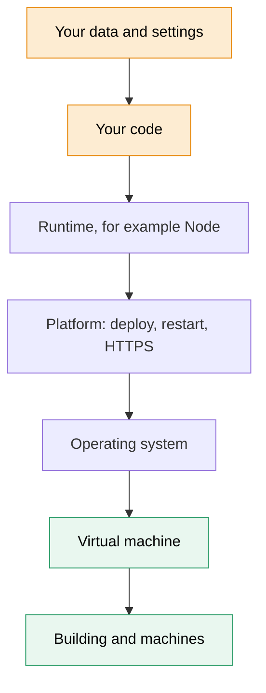
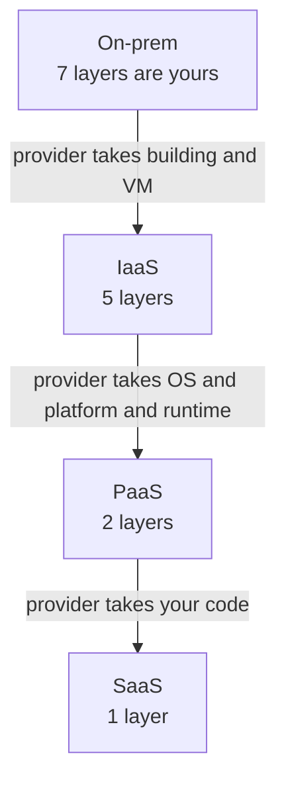
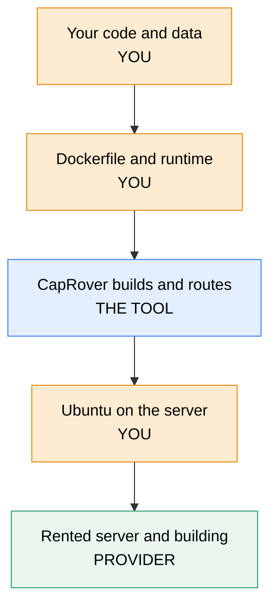
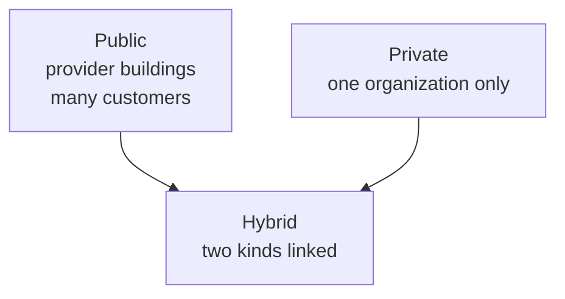
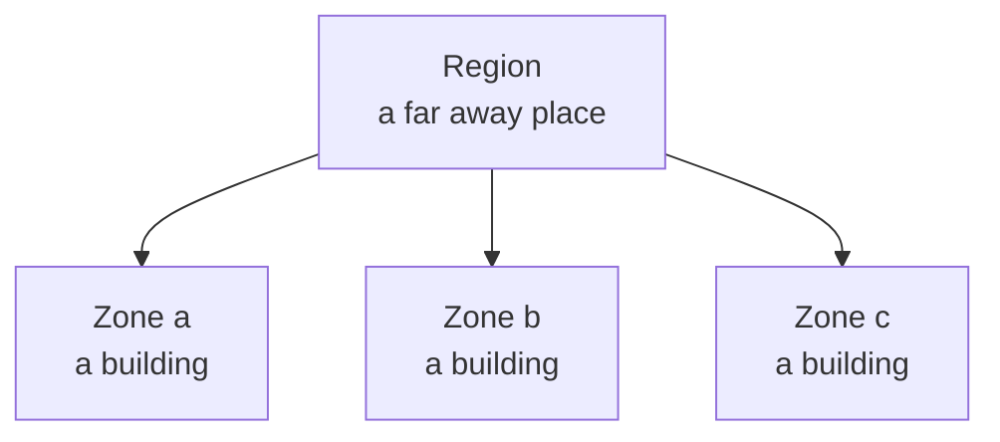
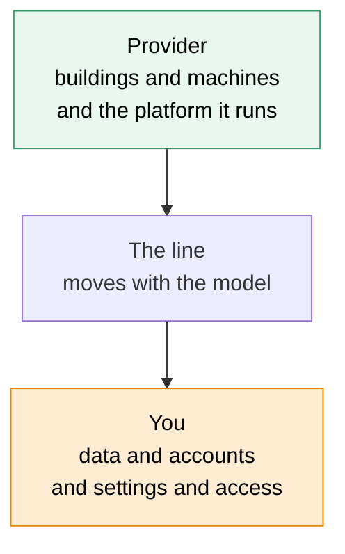
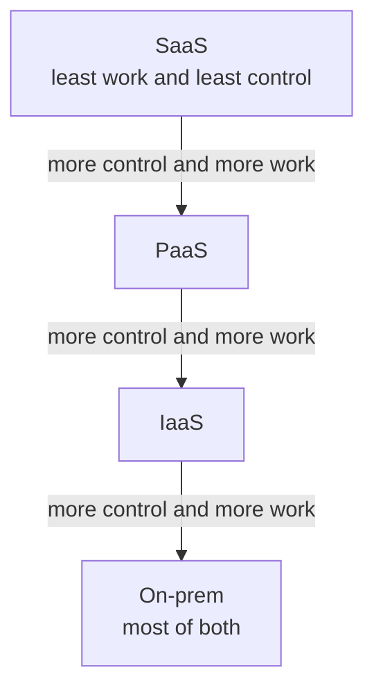

# 06. Cloud models

> **Subject:** DevOps and Cloud · **Lesson:** 06 · **Made:** 2026-11-13 · **Status:** ready
>
> **You will be able to:** say who looks after which layer in on-prem, IaaS, PaaS and SaaS, place CapRover on that ladder, explain regions and zones, say what you must secure in every model, and pick a model from what a team needs.
>
> **Before this:** [CI/CD pipelines](05-ci-cd-pipelines.md) · **Next:** [Serverless](07-serverless.md)
>
> **How to read it:** one card is one idea. Look at the picture, guess, then press the orange bar to check. The blue bars (📖 More detail) hold the longer explanation. Skip them on the first read, and open them when you want more. About 15 minutes for the cards.

## 1. Running an app means looking after seven layers

A web app does not run by itself. Seven layers sit under your users. If nobody looks after one layer, the app breaks. A "cloud model" is only a decision: **which layers do you look after, and which layers does a company look after for you?** The **runtime** is the program that runs your code, such as Node. The **platform** is the part that deploys your code, restarts it and gives it HTTPS.



Notice: your data is at the top and the building is at the bottom. The models differ in where the line is drawn.

<details class="guess"><summary>🤔 Guess: you rent a virtual machine from a cloud company and run your Node API on it. A security fix for the operating system comes out. Who must install it? Press to check.</summary>

**You.** When you rent a bare machine, the company looks after the building and the machine. The operating system is yours. This model has a name: IaaS (card 2).

</details>

> **Remember:** a running app is seven layers. A cloud model only says who looks after which layer.

<details class="more"><summary>📖 More detail: the seven layers, the four new words, and what the standard says</summary>

New words (four): **service model** (card 2: IaaS, PaaS, SaaS), **region** and **zone** (card 5), **shared responsibility** (card 6). Public, private and hybrid are explained in card 4 where they appear.

| Layer | What it is | Example |
|---|---|---|
| Your data and settings | What your users stored, and who may open it | Rows in Postgres, user accounts |
| Your code | The app you wrote | Your Express API |
| Runtime | The program that runs your code | Node 24 |
| Platform | Deploy, restart, route traffic, HTTPS | nginx, a process manager, certificates |
| Operating system | The system under the runtime | Ubuntu |
| Virtual machine | A slice of a big machine that looks like a small one | An EC2 instance, a rented VPS |
| Building and machines | The data center, power, network and servers | Rows of racks |

The number seven is my choice for teaching. Other books draw nine layers. The idea is the same.

**The standard.** The US government standards body wrote the definitions that everyone copies: [NIST SP 800-145](https://csrc.nist.gov/pubs/sp/800/145/final) (September 2011, read 2026-11-14, 7 pages). It says that for IaaS the consumer "does not manage or control the underlying cloud infrastructure but has control over operating systems, storage, and deployed applications". That is card 2 in one sentence.

**Link to the earlier lessons.** The virtual machine layer is the "VM" of [Containers vs virtual machines](01-containers-vs-virtual-machines.md). Your container sits on top of it.

</details>

## 2. The ladder: each model hands more layers to the provider

Four models, four lines. **On-prem**: your own machines in your own building. **IaaS** (infrastructure as a service): you rent a machine and do the rest. **PaaS** (platform as a service): you hand over code and data, and they run it. **SaaS** (software as a service): you use finished software. Think of pizza: cook at home, take and bake, delivery, dining out. The more they cook, the higher the model.

| Layer | On-prem | IaaS | PaaS | SaaS |
|---|---|---|---|---|
| Your data | **YOU** | **YOU** | **YOU** | **YOU** |
| Your code | **YOU** | **YOU** | **YOU** | provider |
| Runtime | **YOU** | **YOU** | provider | provider |
| Platform | **YOU** | **YOU** | provider | provider |
| Operating system | **YOU** | **YOU** | provider | provider |
| Virtual machine | **YOU** | provider | provider | provider |
| Building and machines | **YOU** | provider | provider | provider |
| **Layers that are yours** | **7** | **5** | **2** | **1** |



Notice: your work shrinks on the way down, and the data row never changes.

<details class="guess"><summary>🤔 Guess: you push your code to a PaaS. How many of the seven layers are still yours? Press to check.</summary>

**Two: your code and your data.** The provider looks after the runtime, platform, operating system, virtual machine and building.

</details>

> **Remember:** climbing from on-prem to IaaS, PaaS and SaaS, you look after fewer layers. Your data stays yours in every model.

<details class="more"><summary>📖 More detail: the same API on IaaS and on PaaS, the real code, and where the pizza stops</summary>

**Watch it.** The page [Cloud models: step by step](visuals/06-cloud-models.html) walks through tab 1, one model at a time.

**The step by step trace.** The same Express API goes online. These are the usual steps (general practice, not run here):

| Step | IaaS: you do | PaaS: you do |
|---|---|---|
| 1. A place to run it | Rent a virtual machine | Create an app on the platform |
| 2. Prepare it | Install OS updates and Node | Nothing |
| 3. Put the code there | `git clone` and `npm install` | `git push` |
| 4. Keep it running | Set up a process manager or a Docker container | Nothing |
| 5. A public address and HTTPS | Set up nginx and a certificate | Nothing, the platform gives a URL with HTTPS |
| 6. A month later | Patch the OS again | The provider patches it |
| **State after** | **5 layers are yours** | **2 layers are yours** |

The work you skip on PaaS (steps 2, 4, 5 and 6) is exactly the rows the provider owns.

**The real code.** The practice in this lesson is a small model of the table. Real output, Node 26.12.1, checked 2026-11-14:

```js
const ALL = ["data", "code", "runtime",
  "platform", "os", "vm", "building"];
console.log(whoManages(["os", "vm"], "iaas"));
console.log(yourLayerCount(ALL, "paas"));
```

```
[ { layer: 'os', owner: 'you' }, { layer: 'vm', owner: 'provider' } ]
2
```

**Where the pizza stops.** Pizza has four clean steps. Real products mix models. Microsoft's page says "Many Azure solutions use a combination of service models" ([Shared responsibility in the cloud](https://learn.microsoft.com/en-us/azure/security/fundamentals/shared-responsibility), opened 2026-11-14). A managed database is neither pure IaaS nor pure SaaS, so use the table as a map, not a law.

**One step further.** Serverless gives you even less to look after than PaaS. It is the next lesson: [Serverless](07-serverless.md).

</details>

## 3. Your tools: CapRover is roughly a PaaS that you run yourself

CapRover calls itself a "self-hosted PaaS". It takes the **platform** layer: it builds your image, starts the new version, sets up routing for your domain and gets an HTTPS certificate. But you install it on a server, on Ubuntu, and you choose the runtime in your Dockerfile. So CapRover sits between IaaS (5 layers yours) and a real PaaS (2). Here 4 are yours and 1 belongs to the tool.



Notice: the blue row is the only layer CapRover takes from you.

<details class="guess"><summary>🤔 Guess: CapRover runs on a server you rent. Who updates Ubuntu on that server? Press to check.</summary>

**You.** The CapRover docs say to install it on a fresh Ubuntu 24.04 server. CapRover does not patch the operating system under it.

</details>

> **Remember:** CapRover takes the platform layer. The operating system, the runtime and the server stay yours, so it is more control and more work than a real PaaS.

<details class="more"><summary>📖 More detail: what is a fact, what is an idea, and the limits</summary>

**Facts about your setup.** Your DBO case study says the backend is four Node and TypeScript services on Docker Swarm via CapRover. Your notes say you have used AWS lightly. Your notes do **not** say which machine CapRover runs on. A rented server (a VPS) is the usual case, so the picture above assumes it. Check before you say "VPS" in an interview.

**What CapRover does, from the docs** (opened 2026-11-14):

| Source | What it says |
|---|---|
| [caprover.com](https://caprover.com/) | "Scalable, free, and self-hosted PaaS", "The power of Docker and nginx", and certificates from Let's Encrypt |
| [CapRover get started](https://caprover.com/docs/get-started.html) | "Install CapRover on a fresh Ubuntu 24.04 server", at least 1 GiB of memory, a domain with wildcard DNS |
| [Docker and CapRover internals](docker-caprover-internals.md) | It builds the image, updates the Swarm service, regenerates nginx, and asks Let's Encrypt |

**Why the runtime is yours.** With a Dockerfile, the line `FROM node:24-alpine` picks the runtime, and you update that line. A real PaaS such as Heroku picks and updates the runtime for you.

**The honest limits, from the internals guide.** Most installs are one server, so it is a single point of failure. There is no autoscaling. Backups are your job. Say these first in an interview. It shows you know where your tool stops.

**What the picture trace looks like.** Tab 2 of the [stepper](visuals/06-cloud-models.html) shows the rows getting an owner one at a time: rented server, Ubuntu, CapRover, your Dockerfile and code, then your data.

**About AWS.** AWS uses EC2 as its own IaaS example: "Customers that deploy an Amazon EC2 instance are responsible for management of the guest operating system" ([Shared responsibility model](https://aws.amazon.com/compliance/shared-responsibility-model/), opened 2026-11-14). Idea, not a fact: an EC2 server is the same IaaS row of the table, and you could run CapRover on one.

</details>

## 4. Public, private, hybrid: whose buildings, and who may use them

Cards 1 to 3 asked "who looks after the layers?" This card asks a different question: **where are the machines, and who may use them?** A **public cloud** is the provider's buildings, open to many customers. A **private cloud** is built for one organization only. A **hybrid cloud** links two kinds together, often your own building and a public cloud.



Notice: hybrid is not a third kind of building. It is two kinds joined.

<details class="guess"><summary>🤔 Guess: a company keeps its customer records in its own data center and runs its website on AWS, with a link between them. Which kind is that? Press to check.</summary>

**Hybrid.** Two kinds of cloud, bound together. And the website part could be IaaS or PaaS. The two questions (who looks after the layers, whose buildings) are separate.

</details>

> **Remember:** IaaS, PaaS and SaaS say who looks after the layers. Public, private and hybrid say whose buildings they are. They are two separate questions.

<details class="more"><summary>📖 More detail: the NIST words, and why private is not the same as on-prem</summary>

| Question | Words | What it describes |
|---|---|---|
| Who looks after the layers? | on-prem, IaaS, PaaS, SaaS | The stack |
| Whose buildings, and who may use them? | public, private, hybrid | The machines |

**NIST SP 800-145** (2011, opened 2026-11-14) has four deployment models:

- **Private:** "provisioned for exclusive use by a single organization". It "may be owned, managed, and operated by the organization, a third party, or some combination of them, and it may exist on or off premises".
- **Community:** for one community of organizations with shared concerns, such as the same rules.
- **Public:** "for open use by the general public", and it "exists on the premises of the cloud provider".
- **Hybrid:** "a composition of two or more distinct cloud infrastructures" that stay separate but are bound together.

**Private is not the same as on-prem.** A private cloud can be run by a third party in a building that is not yours. On-prem says where the machines are. Private says who may use them.

**Multi-cloud** is a different word. It means using more than one public provider on purpose, for example AWS for servers and another company for something else.

**Why a team picks private or hybrid.** Usually rules (where data may sit) or old equipment that must keep working. The system design lesson [Disaster recovery](../system-design/28-disaster-recovery.md) shows another reason to want a second place: a copy that survives a disaster.

</details>

## 5. Regions and zones: a region is a place, a zone is a building

A **region** is a far away place, such as one city area. Inside it are several **zones** (AWS says "availability zone", AZ). A zone is one or more data centers with their own power and network. Zones in one region are separate buildings, so one fire should not reach the others. You choose the region for your users. You spread your copies over zones.



Notice: the zones are inside one region and fail separately. A region failing takes all of its zones.

| Region (AWS name) | Time to reach it, measured |
|---|---|
| ap-southeast-1 | 25.6 ms |
| eu-west-1 | 198.6 ms |
| us-east-1 | 293.0 ms |
| ap-southeast-2 | 302.9 ms |

<details class="guess"><summary>🤔 Guess: you run 3 copies of your API, all in zone a. Zone a loses power. How many copies still run? Press to check.</summary>

**None.** Three copies in one building fail together. If you put one copy in each of three zones, one zone failing leaves two copies running.

</details>

> **Remember:** a region is a far away place and a zone is a separate building inside it. Pick the region near your users. Spread copies over zones.

<details class="more"><summary>📖 More detail: the AWS facts, the measured numbers, and the trace of a zone failing</summary>

**Watch it.** Tab 4 of the [stepper](visuals/06-cloud-models.html) runs the zone failures below with the same `survives` function as the practice.

**The step by step trace.** Three copies, one function: `survives(placement, failedZones)`. Real output of two of the rows (Node 26.12.1, 2026-11-14):

```
all in zone a, zone a fails:   { up: false, running: [] }
one per zone, zone a fails:    { up: true, running: [ 'api-2', 'api-3' ] }
```

| Step | Placement | What fails | Result |
|---|---|---|---|
| 1 | api-1, api-2, api-3 all in zone a | zone a | Down: 0 running |
| 2 | one in each of a, b, c | zone b | Up: api-1 and api-3 |
| 3 | one in each of a, b, c | zones a and c | Up, but only api-2 |
| 4 | one in each of a, b, c | a, b and c (the whole region) | Down: 0 running |

Step 3 is up, but one copy may be too slow for all the traffic. Step 4 needs a copy in a second region. The system design lesson [Disaster recovery](../system-design/28-disaster-recovery.md) covers multi AZ against multi region and what each costs. The lesson [Load balancers](../system-design/03-load-balancers.md) covers how traffic reaches the surviving copies.

**What AWS says** (opened 2026-11-14):

- "The AWS Cloud spans 124 Availability Zones within 39 Geographic Regions", and "Each AWS Region consists of a minimum of three, isolated, and physically separate AZs" ([Global infrastructure](https://aws.amazon.com/about-aws/global-infrastructure/regions_az/)).
- Zones in a region are "meaningfully distant from each other, up to 60 miles (about 100 km)", and close enough for fast copies between them ([Fault isolation boundaries](https://docs.aws.amazon.com/whitepapers/latest/aws-fault-isolation-boundaries/availability-zones.html)).
- "if you host all of your EC2 instances in a single Availability Zones and that Availability Zone is affected by a failure, none of your EC2 instances would be available" ([Regions and Availability Zones](https://docs.aws.amazon.com/global-infrastructure/latest/regions/aws-regions-availability-zones.html)).
- You can copy some resources across regions, "but we don't automatically replicate them for you" (the same page).

**The numbers.** I measured the time to open a connection with `curl`, best of 5 tries, on 2026-11-14:

```
curl -s -o /dev/null -w "%{time_connect}\n" https://dynamodb.ap-southeast-1.amazonaws.com/ping
```

The table shows the best of the five for four regions. It is one machine, one network and one afternoon, so your numbers will differ. The shape is the lesson: a region on the other side of the world costs about 300 ms before your app does anything. Try your own on [cloudping.info](https://www.cloudping.info/).

**Why this matters for your users.** Pick the region by where your users are, and by any rule about where data may sit. Spreading over zones costs little more, because it is the same number of machines.

</details>

## 6. Shared responsibility: the provider secures the cloud, you secure what you put in it

The provider looks after the cloud itself: buildings, machines and the software it runs. You look after what you put in it. The line moves with the model: on IaaS you patch the operating system, on PaaS the provider does. But **your data, your accounts and who may open them stay yours in every model**. AWS calls this "security of the cloud" and "security in the cloud". This is the **shared responsibility** model.



Notice: the middle box moves up and down. The bottom box never goes away.

<details class="guess"><summary>🤔 Guess: your company uses a SaaS tool. An employee leaves, and their account stays open. Whose job is it to close it? Press to check.</summary>

**Yours.** The vendor runs the product. But accounts and who has access are your data and your settings.

</details>

> **Remember:** the provider secures the cloud. You secure what you put in it: your data, your accounts and your settings, in every model.

<details class="more"><summary>📖 More detail: the table from the docs, and where to learn the security part</summary>

**Microsoft's table** ([Shared responsibility in the cloud](https://learn.microsoft.com/en-us/azure/security/fundamentals/shared-responsibility), page dated 2026-08-24, opened 2026-11-14). I copied some rows:

| Area | On-prem | IaaS | PaaS | SaaS |
|---|---|---|---|---|
| Customer data | Customer | Customer | Customer | Customer |
| Identities and users | Customer | Customer | Customer | Customer |
| Applications | Customer | Customer | Shared | Shared |
| Operating system | Customer | Customer | Microsoft | Microsoft |
| Physical hosts | Customer | Microsoft | Microsoft | Microsoft |

The page says "For all cloud deployment types, you own your data and identities." My table in card 2 is a simpler version of this. It leaves out client devices and shared rows.

**What AWS says** ([Shared responsibility model](https://aws.amazon.com/compliance/shared-responsibility-model/), opened 2026-11-14): "Customer responsibility will be determined by the AWS Cloud services that a customer selects." For a service like EC2 you manage the guest operating system, including patching, and the firewall settings. For services such as S3, "AWS operates the infrastructure layer, the operating system, and platforms". Patch management is a "shared control": AWS patches its infrastructure, and you patch your own operating systems and applications.

**Where it goes next.** This card only draws the line. The checks inside your app (who may read which row, secrets, roles) are in [Security in a design](../system-design/29-security-in-a-design.md). Who may do what in the cloud console is a later lesson, IAM and least privilege (planned). Backups are yours too: a copy in another zone is not a backup, as [Disaster recovery](../system-design/28-disaster-recovery.md) explains.

**CapRover link.** With a self-hosted PaaS you take on the provider's side too: the Ubuntu patches, the CapRover updates and the backups. The internals guide says backups are "your job".

</details>

## 7. Control, effort and cost: pick by what you need

More layers yours means **more control** and **more work**. Fewer layers yours means less work and less control. The bill follows a similar shape. This is a trade, not a ranking. Pick the lowest rung that gives you what you really need, and check you have a person to do the work.



Notice: control and work go up together. You cannot buy one without the other.

<details class="guess"><summary>🤔 Guess: a team of 3 writes a Node API. Nobody knows servers. They need nothing special from the operating system. IaaS or PaaS, and why? Press to check.</summary>

**PaaS.** IaaS gives control they do not need and asks them to patch the operating system, set up nginx and keep it running. PaaS gives them the same API with those rows handled.

</details>

> **Remember:** more layers yours means more control and more work. Pick by what you need, and check that a person has time to do the work.

<details class="more"><summary>📖 More detail: the table, the chooser, and what I left out</summary>

| Model | Control | Your work | The bill, in words |
|---|---|---|---|
| On-prem | Most | Most | You buy and run the machines |
| IaaS | High | High | You pay for the machine while it is rented, busy or idle |
| PaaS | Medium | Low | A higher price for each unit of work, for less effort |
| SaaS | Low | Least | Often per user or per use |

**I left out prices on purpose.** They change often. Check each provider's price page for the day you decide. Cost is the topic of the later lesson Cloud cost basics (planned).

**The chooser from the practice.** It asks four things in order:

| Step | Question | If yes |
|---|---|---|
| 1 | Must the machines stay in your own building? | on-prem |
| 2 | Do you write code? (if no) | SaaS |
| 3 | Do you need to change the operating system? | IaaS |
| 4 | None of the above | PaaS |

It also gives a **warning** when the answer is IaaS or on-prem and nobody can look after the low layers. Real output (Node 26.12.1, checked 2026-11-14):

```js
console.log(chooseModel({ writesCode: true }));
console.log(chooseModel({ writesCode: true, needsOsControl: true }));
```

```
{
  model: 'paas',
  reason: 'You only bring code and data, and the provider looks after the rest.',
  warning: false
}
{
  model: 'iaas',
  reason: 'You need to change the operating system, so you rent a machine and look after it.',
  warning: true
}
```

**It is a small model.** Real choices also weigh skills, rules, cost and how hard it is to leave a provider later. Tab 3 of the [stepper](visuals/06-cloud-models.html) runs five cases through it.

**Idea, not a fact (about your tools).** Your DBO case study has a suggestion, not a fact: CapRover "serves us well at this size", and managed containers such as ECS or Cloud Run are the next step if the team or the number of servers grows. That is the same trade as this card: you pay in work for control, and you move up the ladder when the work costs more than the control is worth.

</details>

## 8. Mistakes, and what to say if you freeze

| Wrong | Right |
|---|---|
| "It is SaaS, so security is the vendor's job" | The vendor secures the product. Your data, accounts and access are yours |
| "I have 3 copies, so I am safe" (all in one zone) | Spread the copies over zones |
| "The cloud copies my data to another region for me" | AWS does not copy across regions for you. You choose to copy |
| "We are on CapRover, so nobody patches the server" | You patch Ubuntu. CapRover takes the platform layer only |
| "Always pick the top rung" or "always pick the cheapest" | Pick by what you need, and who has time to do the work |

<details class="guess"><summary>🤔 Guess: a teammate says "we are on CapRover, so we never need to update the server". Is that true? Press to check.</summary>

**No.** CapRover is installed on Ubuntu, and the operating system is yours. CapRover takes the platform layer: build, deploy, nginx and certificates. The server and its updates stay with you.

</details>

> **Remember:** if you freeze, say "Seven layers. Each model decides who looks after which. The line moves, but your data and access stay yours. Spread over zones."

<details class="more"><summary>📖 More detail: the mistakes in full, and the freeze plan</summary>

**Wrong:** SaaS means no security work. **Right:** the vendor secures its product, and you secure your accounts, access and data. **Why:** in the Microsoft table, data and identities are the customer's in all four columns.

**Wrong:** 3 copies in one zone. **Right:** one copy per zone. **Why:** a zone is one building. In the practice, `survives` with all copies in zone a and zone a down gives `{ up: false, running: [] }`.

**Wrong:** "the cloud replicates for me". **Right:** you set up copies across regions. **Why:** AWS says it does not replicate resources across regions automatically.

**Wrong:** CapRover patches the server. **Right:** you do. **Why:** it installs on Ubuntu and runs on a server you control.

**Wrong:** picking by fashion. **Right:** ask the four questions from card 7, then check you have a person for the work.

**If you freeze:**

1. Say "A running app has seven layers. IaaS, PaaS and SaaS say who looks after which."
2. Say "On IaaS I patch the operating system. On PaaS I bring code and data. On SaaS I bring data. My data and access are mine in all three."
3. Say "Public and private say whose buildings. Regions are places, zones are buildings, so I spread over zones."

</details>

## 9. Watch and play

Links were checked on 2026-11-14. For the videos I read the title and channel from the YouTube oEmbed data. I did not watch them, and I did not check how long they are. For the pages I opened them and read the parts named below. If a link is broken, tell me and I will replace it.

- **Video:** [AZ-900 Episode 5 | IaaS vs PaaS vs SaaS cloud service models](https://www.youtube.com/watch?v=9CVBohl6w0Q) - Adam Marczak - Azure for Everyone. It uses Azure names, but the layers are the same as cards 1 and 2.
- **Video:** [AWS Compliance - The Shared Responsibility Model](https://www.youtube.com/watch?v=U632-ND7dKQ) - Amazon Web Services (the official channel). Compare it with card 6.
- **Video:** [AWS Global Infrastructure Explained in 3 Minutes: Regions, Availability Zones and Edge Locations](https://www.youtube.com/watch?v=Fi1KaVrWYTE) - Tiny Technical Tutorials. Compare it with card 5.
- **Play with it:** [the stepper in this folder](visuals/06-cloud-models.html) - guess first, then press Next. Four tabs: the ladder, CapRover on a server, the chooser, a zone failing.
- **Play with it:** [cloudping.info](https://www.cloudping.info/) - the page says "Click the HTTP Ping button to measure latency from your browser to various cloud provider datacenters". Try it and compare it with the table in card 5. I read the page. I did not run the button in a browser.
- **Diagrams:** [Microsoft Learn: Shared responsibility in the cloud](https://learn.microsoft.com/en-us/azure/security/fundamentals/shared-responsibility) - a picture of who owns which row in on-prem, IaaS, PaaS and SaaS, with a table.
- **Read:** [AWS Shared responsibility model](https://aws.amazon.com/compliance/shared-responsibility-model/) - one diagram, "of the cloud" against "in the cloud".

<details><summary>Go deeper (optional)</summary>

**The standard.** [NIST SP 800-145](https://csrc.nist.gov/pubs/sp/800/145/final) (September 2011) has five essential traits, three service models and four deployment models. It is 7 pages. The definitions in cards 2 and 4 come from section 2.

**AWS numbers, checked 2026-11-14.** 124 Availability Zones within 39 Regions, at least three zones per region, announced plans for more. These numbers grow, so check the [global infrastructure page](https://aws.amazon.com/about-aws/global-infrastructure/regions_az/) again when you quote them. AWS also has Local Zones, which put resources closer to users, and Wavelength Zones, which serve 5G devices ([Regions and Availability Zones](https://docs.aws.amazon.com/global-infrastructure/latest/regions/aws-regions-availability-zones.html)).

**Regional and zonal resources.** AWS says most services have regional resources, tied to one region, and some have zonal resources, tied to one zone. "It is a best practice to deploy your application in multiple Availability Zones".

**A product that went away.** The older guide in this folder, [Cloud computing models and serverless](cloud-computing-models-serverless-guide.md) (researched 2026-07-08), lists AWS App Runner as a PaaS example. AWS has since closed it: "we decided to close AWS App Runner to new customers", and recommends Amazon ECS Express Mode ([availability change](https://docs.aws.amazon.com/apprunner/latest/dg/apprunner-availability-change.html), opened 2026-11-14). This is a good reminder that product names change, while the ladder in cards 1 and 2 stays the same.

**Where serverless fits.** A function platform gives you even less than PaaS: you upload one function and the provider runs it only when it is called. That is lesson 07. The older guide above also has a short part on it.

**Other forms of the same idea.** CaaS (container as a service), DBaaS (managed database) and BaaS (backend as a service) are the same ladder for one kind of thing. A managed Postgres is the "provider looks after the database layer" row.

**What I did not test.** No cloud console, no prices, no CapRover install, and the cloudping page in a browser. The ping numbers are from one machine on one day. The ladder table is my teaching model, checked against the NIST, AWS and Microsoft pages named above.

</details>

## 10. Practice

**A. Predict the output** (write your answer before opening)

```js
const ALL = ["data", "code", "runtime",
  "platform", "os", "vm", "building"];
console.log(whoManages(["os", "vm"], "iaas"));
console.log(yourLayerCount(ALL, "paas"),
  yourLayerCount(ALL, "self-hosted-paas"));
console.log(chooseModel({ writesCode: true,
  needsOsControl: true }).warning);
```

Then answer: why is the last line `true`?

<details><summary>Answer</summary>

```
[ { layer: 'os', owner: 'you' }, { layer: 'vm', owner: 'provider' } ]
2 4
true
```

On IaaS the operating system is yours and the virtual machine is the provider's. PaaS leaves 2 layers yours (code and data). CapRover leaves 4 yours (data, code, runtime, operating system) and 1 to the tool. The last line is `true` because the chooser says IaaS, and `hasOpsPerson` is missing, so it counts as false. You would look after the low layers with nobody to do it. (Checked on 2026-11-14 with Node 26.12.1.)

</details>

**B. Fix the bug**

This `survives` function should say whether the service is up after some zones fail. It gives the wrong answer in two cases. Find them and fix them.

```js
function survives(placement, failedZones) {
  const running = placement
    .filter(p => p.zone !== failedZones[0])
    .map(p => p.name);
  return { up: true, running };
}
```

<details><summary>Answer</summary>

Bug 1: it only looks at the **first** failed zone, so when zones a and c fail, copies in c still count as running. Real output for three copies in a, b, c with zones a and c down: `{ up: true, running: [ 'api-2', 'api-3' ] }`. It should be only `api-2`. Bug 2: `up` is always `true`. With two copies in zone a and zone a down, it printed `{ up: true, running: [] }`, which says up with nothing running.

Fix:

```js
function survives(placement, failedZones) {
  const running = placement
    .filter(p => !failedZones.includes(p.zone))
    .map(p => p.name);
  return { up: running.length > 0, running };
}
```

The fixed version printed `{ up: true, running: [ 'api-2' ] }` and `{ up: false, running: [] }` for the same two cases. (Real runs, 2026-11-14.)

</details>

**C. Write it yourself**

Open `learn/devops-cloud/practice/06-cloud-models.js`. It has five empty pieces: `whoManages`, `yourLayerCount`, `chooseModel`, `survives` and `nearestRegion`. Write them, then run this from the repo root and make all the tests pass:

```
node --test learn/devops-cloud/practice/06-cloud-models.test.js
```

`whoManages` is the table of card 2 as code. `chooseModel` is the four questions of card 7. `survives` is card 5.

<details><summary>One possible answer</summary>

```js
const OWNERS = {
  "on-prem": { data: "you", code: "you", runtime: "you", platform: "you", os: "you", vm: "you", building: "you" },
  "iaas": { data: "you", code: "you", runtime: "you", platform: "you", os: "you", vm: "provider", building: "provider" },
  "paas": { data: "you", code: "you", runtime: "provider", platform: "provider", os: "provider", vm: "provider", building: "provider" },
  "saas": { data: "you", code: "provider", runtime: "provider", platform: "provider", os: "provider", vm: "provider", building: "provider" },
  "self-hosted-paas": { data: "you", code: "you", runtime: "you", platform: "tool", os: "you", vm: "provider", building: "provider" },
};

function whoManages(layers, model) {
  const table = OWNERS[model];
  if (!table) throw new Error("unknown model: " + model);       // a typo must not give a quiet wrong answer
  return layers.map(layer => {
    if (!(layer in table)) throw new Error("unknown layer: " + layer);
    return { layer, owner: table[layer] };
  });
}

function yourLayerCount(layers, model) {
  return whoManages(layers, model).filter(x => x.owner === "you").length;
}

function chooseModel(needs) {
  const { writesCode = false, needsOsControl = false, mustOwnHardware = false, hasOpsPerson = false } = needs;
  let model, reason;
  if (mustOwnHardware) { model = "on-prem"; reason = "The rules say the machines stay in your own building."; }
  else if (!writesCode) { model = "saas"; reason = "You only need to use finished software, so you write no code."; }
  else if (needsOsControl) { model = "iaas"; reason = "You need to change the operating system, so you rent a machine and look after it."; }
  else { model = "paas"; reason = "You only bring code and data, and the provider looks after the rest."; }
  const warning = (model === "iaas" || model === "on-prem") && !hasOpsPerson;   // you look after the low layers, so you need a person
  return { model, reason, warning };
}

function survives(placement, failedZones) {
  const running = placement.filter(p => !failedZones.includes(p.zone)).map(p => p.name);
  return { up: running.length > 0, running };
}

function nearestRegion(pings) {
  if (pings.length === 0) return null;
  return pings.reduce((best, p) => (p.ms < best.ms ? p : best)).region;   // "<" keeps the first one on a tie
}

module.exports = { whoManages, yourLayerCount, chooseModel, survives, nearestRegion };
```

Checked on 2026-11-14 with Node 26.12.1: the 33 tests fail on the empty stub and all 33 pass with this answer. I also made 25 deliberately wrong versions (a wrong owner, a missing throw, the checks in the wrong order, a warning that is always on or off, `up` always true, a tie that picks the last one, and more). The tests caught every one.

</details>

## 11. Interview question

**Q:** "What is the difference between IaaS, PaaS and SaaS? How would you choose?"

A common follow-up: "What is the shared responsibility model?" Card 6 is the answer.

<details><summary>A strong answer, in four parts</summary>

1. **Problem:** A running app has layers: building, machines, virtual machine, operating system, platform, runtime, code and data. Somebody must look after each one, and the models are different answers to who.
2. **How it works:** With IaaS I rent a machine and look after the operating system and everything above it. With PaaS I bring code and data, and the provider does the rest. With SaaS I only bring my data and settings. The provider secures the cloud itself, and I secure what I put in it, so my data and access are mine in every model. For availability I spread copies over zones, and I pick the region near my users.
3. **Tradeoff:** More layers mine means more control and more work. I pick the lowest rung that gives me what I need, and I check that someone has time to run what I choose. IaaS is wasted on a team with nobody who can patch servers. PaaS can cost more per unit and can limit me when I need the operating system.
4. **My example:**
   - **Fact:** I deploy with Docker and CapRover. My DBO case study says the backend is four Node and TypeScript services on Docker Swarm via CapRover.
   - **Fact:** CapRover calls itself a self-hosted PaaS, and its docs install it on a fresh Ubuntu server (docs, 2026-11-14). So I would call it roughly a PaaS I run myself: it takes the platform layer, but I still patch the operating system and look after backups.
   - **Fact:** I have used AWS lightly. I do not have a note about which machine DBO's CapRover runs on, so I should check before I say "VPS".
   - **Idea, not a fact:** I would say that if the team grew, I would look at a managed container service, which moves one rung up the ladder.

</details>

## 12. Explain it back

Close this file. Explain cloud models out loud like to a new junior, in 4 parts (problem, how, tradeoff, my example). Use the story of the same Node API: on IaaS I patch the operating system and set up nginx, on PaaS I run `git push`, and on CapRover I get the platform layer but keep Ubuntu. Then write your best version below and run `/explain-check cloud models` or ask the `explain-coach` agent to review it.

### My explanation

<write here>

### Coach feedback

<the explain-coach agent writes here>

## 13. Review questions (day 1, 3, 7, 21)

1. Name the seven layers, and say which ones are yours with IaaS and with PaaS.
2. Where does CapRover sit on the ladder, and who updates Ubuntu?
3. What is the difference between "PaaS" and "private cloud"?
4. Draw the region and zones picture from memory. What survives when one zone fails, and when the whole region fails?

<details><summary>Answers</summary>

1. Your data, your code, the runtime, the platform, the operating system, the virtual machine, and the building and machines. IaaS: you look after the top five (data, code, runtime, platform, operating system). PaaS: you look after your code and your data.
2. Between IaaS and a real PaaS. It takes the platform layer (build, deploy, nginx, certificates). You update Ubuntu, you choose the runtime in your Dockerfile, and you look after backups.
3. They answer two different questions. PaaS says who looks after the layers (the provider looks after everything under your code). Private cloud says whose buildings and who may use them (one organization only). You can have a PaaS on a public cloud or on a private one.
4. One region box with three zone boxes inside it. One zone failing: copies in the other two zones keep running, if you put copies in more than one zone. The whole region failing: every zone goes with it, so you need a copy in a second region.

</details>

## Connected lessons

- [CI/CD pipelines](05-ci-cd-pipelines.md) - the lesson before. A pipeline is what delivers your code to whichever model you pick.
- [Serverless](07-serverless.md) - the next lesson. One rung above PaaS: you upload a function and the provider runs it only when it is called.
- [Containers vs virtual machines](01-containers-vs-virtual-machines.md) - the virtual machine layer of card 1, and what runs on top of it.
- [Docker and CapRover internals](docker-caprover-internals.md) - what CapRover does for the platform layer, and the honest limits of one server.
- [Cloud computing models and serverless](cloud-computing-models-serverless-guide.md) - the older long guide, with the full serverless part and interview answers. Its App Runner example is out of date (see Go deeper).
- [Disaster recovery](../system-design/28-disaster-recovery.md) - multi AZ against multi region, and a replica is not a backup.
- [Security in a design](../system-design/29-security-in-a-design.md) - the checks inside your app, the part of shared responsibility that is always yours.
- [Load balancers](../system-design/03-load-balancers.md) - how traffic reaches the copies that survive a zone failing.
- IAM and least privilege (planned) and Cloud cost basics (planned) - later lessons on who may do what in a cloud account, and on the bill.
