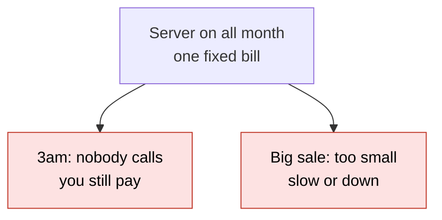
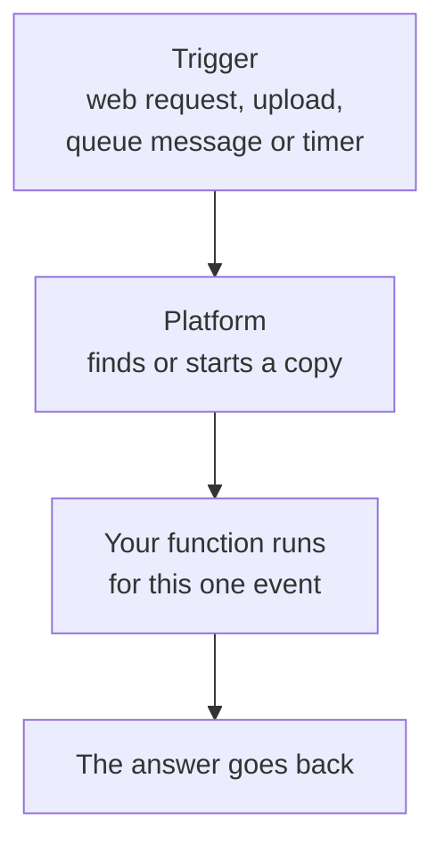
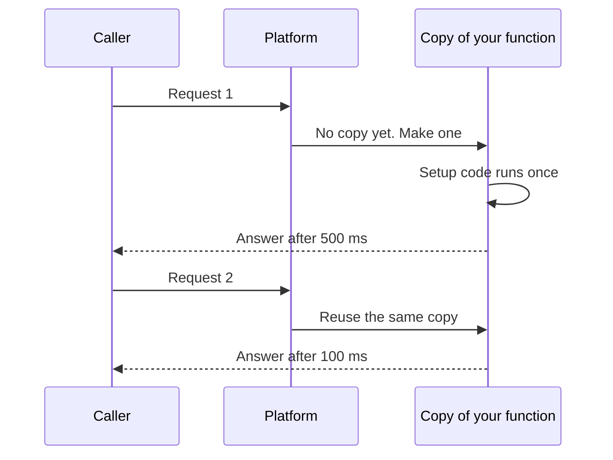
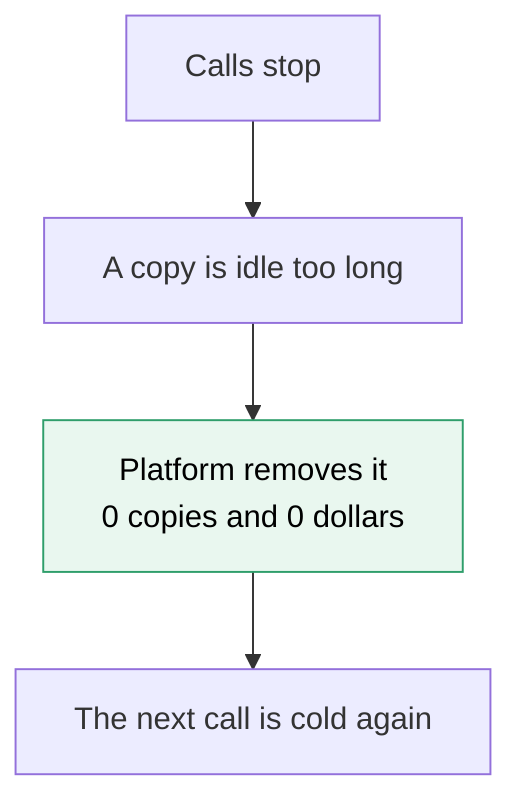
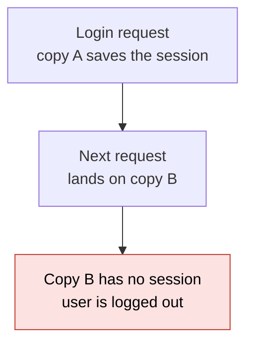
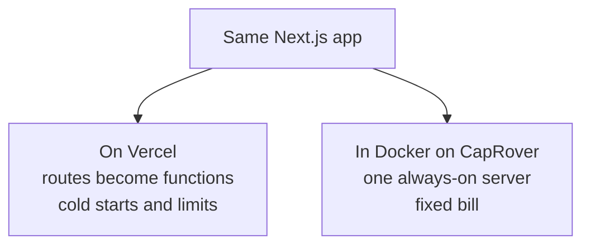

# 07. Serverless

> **Subject:** DevOps and Cloud · **Lesson:** 07 · **Made:** 2026-11-13 · **Status:** ready
>
> **You will be able to:** say what serverless really means, explain a cold start and scale to zero with a picture, name the limits of a function, work out when a fixed server is cheaper, and say when you would pick a container instead.
>
> **Before this:** [Cloud models](06-cloud-models.md) · **Next:** [Reverse proxy and Nginx](08-reverse-proxy-and-nginx.md)
>
> **How to read it:** one card is one idea. Look at the picture, guess, then press the orange bar to check. The blue bars (📖 More detail) hold the longer explanation and the step by step traces. Skip them on the first read. Facts about AWS Lambda, Vercel, Cloudflare and Postgres come from their official docs, checked on 2026-11-13. The model, the Node timings and the Docker timings were run on one Mac, so treat the numbers as examples. About 20 minutes for the cards.

## 1. The problem: you pay for the server, not for the work

A normal server is a machine you rent. It is on all day, and the bill is the same. At 3am nobody calls it, and you still pay. During a big sale it is too small. You must guess the right size, and you must look after it.



Notice: the bill does not follow the work. Serverless tries to make the bill follow the work.

<details class="guess"><summary>🤔 Guess: your API gets 1,000 calls a day, and each call runs your code for 100 ms. How many seconds a day does your code really run? Press to check.</summary>

**100 seconds.** 1,000 calls times 0.1 seconds. A day has 86,400 seconds, so the code runs about 0.12 percent of the day. A server that is always on pays for the other 99.88 percent too.

</details>

> **Remember:** a server bills you for being on. Serverless bills you for the work.

<details class="more"><summary>📖 More detail: the four new words, the hotel picture, and where you are now</summary>

**Four new words.** Each one gets its own card.

- **Serverless:** you do not look after servers. The platform does (card 2).
- **Trigger:** the event that starts your function (card 2).
- **Cold start:** the wait when the platform must start a new copy of your function (card 3).
- **Scale to zero:** when nobody calls, no copy runs and you pay nothing (card 4).

**The picture.** A normal server is a flat you rent: you pay every month, even on holiday. Serverless is a hotel room billed by the minute. You pay while you are in it.

**Where the picture stops being true.** A hotel room is ready when you walk in. A serverless copy is not always ready. The first call after a quiet time waits while the platform gets one ready. That is card 3.

**Where you are now.** In lesson 06 you saw the ladder from IaaS (rent a machine) to PaaS (push code) to FaaS (upload a function). This lesson is the top step of that ladder. Your DBO services run all the time on Docker Swarm through CapRover (the case study says so), which is the "server on all month" side of the picture.

**Words you will hear:** FaaS means function as a service. A "copy" of your function is called an instance. [The longer cloud models guide](cloud-computing-models-serverless-guide.md) has the whole ladder and more.

</details>

## 2. The idea: you upload a function, and an event runs it

With serverless you do not run a server program. You upload one **function**. An **event** starts it. This event is the **trigger**: a web request, a file upload, a message in a queue, or a timer. The platform finds a machine, runs your function, and sends the answer back. Servers still exist. Looking after them is not your job.



Notice: your code is only the middle box. Everything else is the platform.

<details class="guess"><summary>🤔 Guess: "serverless" means there are no servers. True or false? Press to check.</summary>

**False.** The code still runs on a machine. The word means you do not manage that machine: no patching, no sizing, no restarts. The AWS docs say it plainly: "you can run code without provisioning or managing servers".

</details>

> **Remember:** serverless still has servers. You upload a function, a trigger runs it, and the platform does the rest.

<details class="more"><summary>📖 More detail: the smallest function, one request step by step, and the triggers</summary>

**The smallest function.** On AWS Lambda a function is a `handler` that gets the event. Here we play the platform ourselves and send one event.

```js
// the platform calls this once for each event
exports.handler = async (event) => {
  return { statusCode: 200, body: "hello " + event.name };
};
// here we play the platform and send one event
exports.handler({ name: "Ana" }).then(console.log);
```

**Output:**

```
{ statusCode: 200, body: 'hello Ana' }
```

Checked on 2026-11-13 with Node 26.12.1.

**One request, step by step** (the AWS Lambda model, from its docs):

| # | What happens | State after |
|---|---|---|
| 1 | A trigger fires, for example a web request through API Gateway | An event, as JSON, waits for a copy |
| 2 | The platform looks for a copy of your function that is free | Found one, or none (card 3) |
| 3 | It calls your `handler` with the event | The copy is busy. It does one event at a time |
| 4 | Your code returns an object | The answer goes back to the caller |
| 5 | The platform keeps the copy for a while, in case more events come | The copy is idle, and later removed (card 4) |

**The triggers on AWS** (Lambda docs, checked 2026-11-13): an HTTP request through API Gateway, a file upload to S3, a message from an SQS queue, a schedule from EventBridge Scheduler. Other platforms have the same idea: Vercel Functions, Cloudflare Workers, Google Cloud Functions, Azure Functions.

**Interview words:** the trigger is the "event source". Your function should be small and do one job.

</details>

## 3. Cold start: the first call waits, the next ones do not

A request needs a copy of your function. If none is ready, the platform must make one. It finds a machine, loads your code, and runs your **setup code** (the code outside the handler, such as imports and connections). This wait is the **cold start**. The copy then stays for a while. Later calls reuse it, so they skip the wait. They are **warm**.



Notice: the setup code ran once. Request 2 paid nothing for it. The numbers are from the model in this lesson, not from a real platform.

<details class="guess"><summary>🤔 Guess: the same function gets two requests, one second apart. Which one is slower, and why? Press to check.</summary>

**The first one.** It needs a new copy, and the copy runs its setup code before it runs the handler. The second request finds the copy ready.

</details>

> **Remember:** the first call on a new copy is cold, because setup runs first. Later calls on the same copy are warm and skip it.

<details class="more"><summary>📖 More detail: the trace, real timings, and how to make a cold start shorter</summary>

**The trace** of two requests, from the model you build in practice C (cold start 400 ms, each call runs 100 ms). You can step through it in [the stepper](visuals/07-serverless.html), tab 1.

| # | What the platform does | State after |
|---|---|---|
| 1 | Request 1 arrives at 0 s. The pool is empty | No copy is free |
| 2 | It makes copy 1. Setup runs for 400 ms | Copy 1 exists, busy |
| 3 | The handler runs for 100 ms. The caller waited 500 ms | cold 1, billed 500 ms |
| 4 | Request 2 arrives at 1 s. Copy 1 is free | Copy 1 is idle, so it can take the call |
| 5 | The handler runs for 100 ms. The caller waited 100 ms | warm 1, billed 600 ms in all |

**A real measurement.** The code below has setup code (it builds a big list) and a handler. I ran the file 7 times, each time in a new Node process, the way a new copy starts. One run printed:

```js
const t0 = Date.now();
// setup: runs once, when the copy starts
const big = JSON.stringify(Array.from({ length: 200000 }, (_, i) => ({ id: i })));
const table = JSON.parse(big);
console.log("setup took", Date.now() - t0, "ms");
// handler: runs on every call
const handler = (e) => table[e.id].id;
for (let i = 0; i < 3; i++) {
  const t = process.hrtime.bigint();
  handler({ id: i });
  console.log("call", i + 1, Number(process.hrtime.bigint() - t) / 1e6, "ms");
}
```

**Output** (the numbers change from run to run):

```
setup took 38 ms
call 1 0.009333 ms
call 2 0.001333 ms
call 3 0.001125 ms
```

A longer version of this script, run in 7 new processes, gave these medians: the whole process took **104 ms**, the setup part **63 ms**, and a second call **0.002 ms**. The handler here is tiny on purpose. The point is the shape: setup is paid once, and calls are cheap after that. Checked on 2026-11-13 with Node 26.12.1.

**What the AWS docs say about cold starts** (checked 2026-11-13):

- The setup phase does three things: start extensions, start the runtime, and run your setup code.
- "Cold starts typically occur in under 1% of invocations." The wait "varies from under 100 ms to over 1 second".
- The longest part is usually your own setup code. The docs list what makes it longer: the package size (libraries and layers), the amount of setup work, and slow connections to other services.
- Since 2025-08-01 AWS bills the setup phase for on-demand functions in ZIP files with managed runtimes (AWS Compute blog, April 2025). A cold start now costs money as well as time.

**Ways to make it shorter.** Import only what you need. Keep the setup small. Pay to keep copies ready (AWS calls this provisioned concurrency: "pre-initialized execution environments"). Or pick a platform that starts faster: the Cloudflare docs say an isolate "can start around a hundred times faster than a Node process on a container or virtual machine".

**The Docker comparison (only an analogy).** A container is not a function, but the same shape shows up. I timed `docker run --rm node:24-alpine node -e "console.log(1+1)"` (a new container each time) and `docker exec` of the same command in a container that was already running. Each was run 7 times on Docker Desktop 29.3.1. Medians:

| What | Time |
|---|---|
| New container, then the Node process | 251 ms |
| `docker exec` of Node in a running container | 85 ms |
| `docker exec` of `true` (the cost of the docker command itself) | 61 ms |

Starting from nothing cost about 3 times more than reusing a running container. Real cold starts depend on the platform, your code and the size of your package.

</details>

## 4. Copies come and go: scale to zero, and many calls at once

The platform removes a copy that stays idle for a while. With no calls there are 0 copies, and the bill is 0. This is **scale to zero**. The next call is cold again. If many calls arrive together, the platform makes many copies, because one copy does one call at a time. There is a limit on how many copies run at once. Calls above the limit are rejected (the interview word is "throttled").



Notice: scale to zero is why serverless is cheap when quiet, and why the first call after a quiet time is slow.

<details class="guess"><summary>🤔 Guess: nobody calls your function for an hour. What do you pay for that hour, and what is the next call like? Press to check.</summary>

**You pay nothing, and the next call is cold.** The platform removed the idle copy, so the next call needs a new one. This is the trade: no cost while quiet, in return for a slow first call.

</details>

> **Remember:** no calls means no copies and no bill, and the next call is cold. Many calls at once make many copies, up to a limit.

<details class="more"><summary>📖 More detail: two traces from the model, the real limits, and how long a copy lives</summary>

**Trace 1: a quiet time** (model: an idle copy is removed after 10 s; this number is an example). Requests at 0 s, 1 s and 30 s, each running 100 ms. This is the real output of `runPlatform` from the practice answer, with the cold start billed:

```
cold 1 500 500
warm 1 100 100
cold 2 500 500
```

The columns are: kind, copy number, latency in ms, billed ms. The third request is cold on a new copy 2, because copy 1 was removed about 10 s after it finished. [The stepper](visuals/07-serverless.html), tab 2, shows it.

**Trace 2: a burst** (model: limit 3 copies). Five requests at 0 s, each running 500 ms, and a sixth at 5 s:

| Request | Result | Why |
|---|---|---|
| 1, 2, 3 | cold, copies 1, 2, 3 | No copy was free, and the pool was below its limit |
| 4, 5 | throttled | All 3 copies are busy and the limit is 3. Nothing runs, nothing is billed |
| 6 (at 5 s) | warm on copy 1 | The copies finished at 0.9 s and have idled less than 10 s |

**The real limits on AWS Lambda** (Lambda docs, checked 2026-11-13):

- "A total concurrency limit of 1,000 concurrent executions across all Event Functions in an AWS Region" by default. New accounts can start lower.
- For each function, 1,000 new copies can start every 10 seconds.
- Your function is "throttled" (the docs say it starts to "drop requests") if you run out of concurrency.
- The size you need: **Concurrency = requests per second times seconds per request.** At 100 requests per second and 0.5 s each, you need 50 copies at once.

**How long does an idle copy live?** AWS does not say. The docs: "Lambda maintains the execution environment for some time", and it recycles environments "every few hours". Do not build on a number. Google Cloud Run's docs give one: it "might keep instances idle" for up to 15 minutes (docs, checked 2026-11-13).

**Many calls on one copy.** Vercel Functions with Fluid compute (the default for new projects since 2025-04-23) let one copy handle many calls at once. That makes cold starts rarer (Vercel docs, checked 2026-11-13). AWS Lambda event functions do one call per copy.

</details>

## 5. No memory between calls: do not keep anything in the function

You save a login session in a variable. Request 1 lands on copy A, and copy A keeps the session. Request 2 lands on copy B, which has never seen it. The user is logged out. Also, the platform can remove any copy at any time, and the memory goes with it. So a function should keep nothing it needs later in its own memory (the word is **stateless**). Put it in a database, a cache such as Redis, or file storage.



Notice: nothing is broken. This is how serverless works. The fix is in your design.

<details class="guess"><summary>🤔 Guess: a function counts visits in a variable. After a quiet night, what does the counter show, and why? Press to check.</summary>

**Back to 0.** The copy was removed during the quiet night. The next call runs on a new copy, and its variable starts again. Keep the count in a database or in Redis.

</details>

> **Remember:** a function has a time limit, a memory limit, and no memory between calls. Keep anything that must last in a database, a cache or file storage.

<details class="more"><summary>📖 More detail: the limits table, the cache that is allowed, and the fix as code</summary>

**The limits** (official docs, checked 2026-11-13). They change, so read the page before you design.

| | AWS Lambda | Vercel Functions | Cloudflare Workers |
|---|---|---|---|
| Time for one call | 900 s (15 minutes) | 300 s by default. Pro can set up to 800 s (1,800 s in beta). Hobby stays at 300 s | CPU time: Free plan 10 ms. Paid plan default 30 s, up to 5 minutes |
| Memory | 128 MB to 10,240 MB | 2 GB on Hobby, up to 4 GB on Pro | 128 MB per isolate |
| Request or response size | 6 MB (sync) | 4.5 MB | Not checked |
| Local disk | `/tmp`, 512 MB to 10,240 MB | `/tmp` up to 500 MB, the rest read only | Not checked |

Lambda gives CPU in step with memory: "At 1,769 MB, a function has the equivalent of one vCPU." A Cloudflare limit is CPU time, not the clock, so waiting for another service is not counted. The Vercel numbers are for functions with Fluid compute. Sources are in the Go deeper box.

**What you may keep.** A warm copy still has its variables. The AWS docs even say to open database connections in the setup code, so a warm copy reuses them. Use it as a cheap cache. Never rely on it, because the next call may land on another copy.

**The bug and the fix, run for real.** The bug: each copy has its own `Map`.

```js
function makeCopy() {
  const sessions = new Map();
  return {
    login: (id) => sessions.set(id, true),
    isLoggedIn: (id) => sessions.has(id),
  };
}
const copyA = makeCopy();
const copyB = makeCopy();
copyA.login("ana");
console.log(copyA.isLoggedIn("ana"));
console.log(copyB.isLoggedIn("ana"));
```

**Output:**

```
true
false
```

The fix: one store that every copy can reach. Here a `Map` stands in for Redis or a database.

```js
// one store that every copy can reach
const store = new Map();
function makeCopy(store) {
  return {
    login: (id) => store.set(id, true),
    isLoggedIn: (id) => store.has(id),
  };
}
```

With this, both lines print `true`. (Checked on 2026-11-13 with Node 26.12.1.) A signed token such as a JWT is another way: the proof travels with the request, so no copy needs to remember it.

</details>

## 6. The bill: you pay per call, so there is a crossing point

You pay for each call, and for the milliseconds your code runs, times the memory you chose. You pay nothing when no code runs. A small server costs the same all month. So there is a number of calls where the server becomes cheaper.

| Calls a month | Serverless (200 ms, 512 MB) | A $20 server |
|---|---|---|
| 100,000 | $0.19 | $20.00 |
| 1,000,000 | $1.87 | $20.00 |
| 10,000,000 | $18.67 | $20.00 |
| 100,000,000 | $186.67 | $20.00 |

Notice: the serverless price grows with every call. The server price does not move. The two lines cross a little above 10 million calls. The $20 is an example number, not a quote.

<details class="guess"><summary>🤔 Guess: the server costs $20 a month. About how many calls a month until serverless costs the same? Press to check.</summary>

**About 10.7 million calls a month**, or about 356,000 a day, in this model. `breakEvenCalls(20, 1.87)` gives 10,695,188. Below it serverless is cheaper. Above it the server is cheaper.

</details>

> **Remember:** you pay per call and per millisecond. It is cheap when quiet. A fixed server wins when traffic is high and steady.

<details class="more"><summary>📖 More detail: the formula, the prices, the code, and what the model leaves out</summary>

**The formula** (AWS Lambda pricing, x86, US East (N. Virginia), checked 2026-11-13):

- Time price: **$0.0000166667 per GB-second**. A GB-second is 1 GB of memory used for 1 second.
- Request price: **$0.20 per million requests**.
- The free tier is 1 million requests and 400,000 GB-seconds a month. The model leaves it out.
- The time you pay for is rounded up to a whole millisecond. The docs show a `REPORT` line with `Duration: 933.59 ms` and `Billed Duration: 934 ms`.

So 1 million calls at 200 ms and 512 MB use 1,000,000 times 0.2 s times 0.5 GB, which is 100,000 GB-seconds. That costs $1.67. Add $0.20 for the requests and you get $1.87.

```js
const p = { calls: 1000000, avgMs: 200, memoryMb: 512,
  pricePerGbSecond: 0.0000166667, pricePerMillionCalls: 0.2 };
console.log(monthlyCost(p));
console.log(monthlyCost({ ...p, calls: 100000000 }));
console.log(breakEvenCalls(20, monthlyCost(p)));
```

**Output** (the practice answer, run on 2026-11-13 with Node 26.12.1):

```
1.87
186.67
10695188
```

**What the model leaves out**, and each of these moves the real crossing:

- Data transfer, logs, and the API gateway in front are billed too.
- Paying to keep copies ready (provisioned concurrency) costs money while idle.
- A server also costs time: someone patches it, watches it and restarts it. Add that to the server side.
- The old [cloud models guide](cloud-computing-models-serverless-guide.md) quotes "about 50,000 calls a day" from blog posts that include these extras. This model gives 356,000. Both are examples. The lesson is that a crossing exists, not the exact number.

**Vercel bills differently.** With Fluid compute you pay for "active CPU", the CPU time your code uses. Waiting for a database or another API is not counted (Vercel docs, checked 2026-11-13). Read the pricing page for your plan before you compare.

</details>

## 7. Serverless or container? And the database trap

Serverless fits work that is **short**, comes in **bursts** and **starts from an event**. A container (like your CapRover apps) fits work that is **long**, **steady**, or needs a connection that stays open. The trap is the database: many copies means many connections.

| Work | Better fit | Why |
|---|---|---|
| A webhook that comes in bursts | Serverless | Quiet most of the day, so no idle cost |
| A job that runs once a day | Serverless | One run, then nothing runs |
| A WebSocket chat | Container | The connection stays open for minutes |
| A steady 500 calls a second | Container | The fixed price spreads thin |
| A job that runs 2 hours | Container | Over the time limit of a function |
| A worker that waits for queue jobs all day | Container | A worker never sleeps. A function does |

<details class="guess"><summary>🤔 Guess: a burst makes 500 copies, and each one opens its own Postgres connection. Postgres allows about 100 by default. What happens? Press to check.</summary>

**New connections are refused, and calls fail.** The Postgres docs: "The default is typically 100 connections". Put a connection pool between your copies and Postgres. Lesson 20 of the database subject covers it.

</details>

> **Remember:** pick by the shape of the traffic and the work. Put a connection pool between many copies and Postgres.

<details class="more"><summary>📖 More detail: the middle way, the pool, and your DBO services (facts and ideas)</summary>

**The middle way.** Some platforms run a container for you and scale it, so you keep a normal Docker image. Google Cloud Run is one. Its docs say a service with no traffic can scale down to zero, and that it "might keep instances idle" for up to 15 minutes to reduce cold starts (docs, checked 2026-11-13). Cloud Run charges for a minimum number of instances if you ask for it. Another example is AWS Fargate (see the [cloud models guide](cloud-computing-models-serverless-guide.md)). This helps with lock-in too: the artifact is still a container.

**The pool.** A pooler such as PgBouncer holds a few real connections and shares them among many callers. [Lesson 20, connection pooling](../database/20-connection-pooling.md) draws it. The older guide lists the serverless options, such as RDS Proxy and drivers that talk over HTTP.

**Facts about DBO** (from the DBO case study): the services run on Docker Swarm through CapRover. There is a Cron service for scheduled jobs such as the yearly points reset. There are queue workers (BullMQ on Redis) for email, points and webhooks. Third parties (TADA, Manager, Jatis) send webhooks to the API service.

**Ideas, not facts** (I did not check whether DBO would gain from any of these):

- The yearly points reset runs once a year. A scheduled function would cost nothing the rest of the year. A cron service that stays on all year is the "server on all month" picture. The case study says a cron job must run in exactly one place, and it suggests making jobs safe to rerun. A function would need the same rules.
- A webhook receiver comes in bursts, so it fits a function. The case study's webhook flow is: verify it, store it, put it in the queue, answer fast. That is a very short job.
- The BullMQ workers wait for jobs all day. That is the opposite of a function that sleeps, so they stay containers.
- The DBO API talks to Postgres with Prisma. Many function copies would each open a connection. A pool would be needed first.

**Where this lesson meets others.** The [load balancers lesson](../system-design/03-load-balancers.md) and [proxies and API gateways](../system-design/17-proxies-and-api-gateways.md) cover what sits in front of a function. [Safe deploys](../system-design/27-safe-deploys.md) covers rolling out new versions.

</details>

## 8. Your stack: Next.js can run as functions or as a container

Next.js can run as a normal Node server in a container, or as functions on a platform such as Vercel. The code is the same. What changes is where cold starts, limits and cost show up. **An idea, not a fact:** your profile lists Next.js and Docker with CapRover. It does not say you deploy to Vercel or Lambda, so use this card to compare, not to say "I did this".



Notice: nothing here is better in every case. It is a choice of bill and limits.

<details class="guess"><summary>🤔 Guess: a Next.js app is deployed on Vercel. Someone opens an API route. What runs? Press to check.</summary>

**A Vercel Function.** The Vercel docs: Next.js "dynamic code (APIs, server-rendered pages, or dynamic fetch requests) will be bundled into the fewest number of Vercel Functions possible, to help reduce cold starts". So that call can be warm or cold, like card 3.

</details>

> **Remember:** the same Next.js app can run as functions on Vercel or as a Node server in Docker. Where it runs sets the cold starts, the limits and the bill.

<details class="more"><summary>📖 More detail: what the docs say, and what to say in an interview</summary>

**What the docs say** (checked 2026-11-13):

- Next.js "can be deployed as a Node.js server, Docker container, static export, or adapted to run on different platforms". The Node server and Docker choices "support all Next.js features" (Next.js docs, Deploying).
- On Vercel, dynamic code runs as Vercel Functions. Fluid compute is the default for projects created since 2025-04-23. It lets one copy serve many calls and caches compiled code to make cold starts shorter (Vercel docs).
- Vercel functions have limits (card 5): 300 s by default, 4.5 MB for a request or response body, a size limit for the bundle (250 MB unpacked).

**Choosing, in one line each:**

| If | Lean to |
|---|---|
| Traffic is low or bursty, and you want no server to look after | Functions on a platform |
| Traffic is steady, you need long jobs or WebSockets, or you want tight control of database connections | A container (your CapRover setup) |
| You want scale to zero but also a portable Docker image | A container platform that scales to zero (the middle way in card 7) |

**What to say in an interview.** True, from your profile: you run containers with Docker and CapRover. You can explain serverless from how it works and from the docs. Do not say you ran Lambda or Vercel in production, unless you did. A good answer sounds like this: "I run containers on CapRover. I would choose functions for bursty, short, event-driven work, and keep steady or long-running work in containers."

</details>

## 9. Watch and play

Links were checked on 2026-11-13. I opened every page. For the two videos I read the title and the channel from YouTube's oEmbed data. I did not watch them, and I did not check their length. If a link is broken, tell me and I will replace it. I did not find a third party visualizer for this topic that I could confirm, so the stepper is the interactive part.

- **Play with it:** [the stepper in this folder](visuals/07-serverless.html) - guess first, then press Next. Four tabs: cold then warm, scale to zero, a burst and the limit, and the bill.
- **Video:** [Serverless Computing in 100 Seconds](https://www.youtube.com/watch?v=W_VV2Fx32_Y) - Fireship. Compare it with card 2.
- **Video:** [AWS Lambda Function Execution and Cold Start](https://www.youtube.com/watch?v=BhQh9QZdiKQ) - Be A Better Dev. Compare it with card 3.
- **A diagram:** [Lambda execution environment lifecycle](https://docs.aws.amazon.com/lambda/latest/dg/lambda-runtime-environment.html) - the Init, Invoke and Shutdown picture. Find the setup code from card 3.
- **A diagram:** [Lambda concurrency](https://docs.aws.amazon.com/lambda/latest/dg/lambda-concurrency.html) - the table that follows 10 requests across copies A to F. Try to predict each row before you read it.
- **Read:** [What is Compute? (Vercel)](https://vercel.com/docs/fundamentals/what-is-compute) - servers, serverless and Fluid compute side by side, with a comparison table.
- **Run it for real:** [the Cloudflare Worker example](examples/cloudflare-worker-hello/README.md) - a function you run on your own machine with `npx wrangler dev`. This lesson did not run it.

<details><summary>Go deeper (optional)</summary>

**What was run, and what was not.** Run here: every code block and output in this lesson (Node 26.12.1), the 35 practice tests, the stepper (a click-through with jsdom), the Node timings in card 3, and the Docker timings in card 3 (Docker Desktop 29.3.1, image `node:24-alpine`, 7 runs each, medians; the test container was removed afterwards). Not run here: AWS Lambda, Vercel, Cloudflare and Cloud Run themselves. Their limits, prices and statements come from their docs, checked on 2026-11-13. The model uses example numbers (a 400 ms cold start, a 10 s idle limit, a limit of 3 copies, a $20 server), and says so wherever it shows them. Prices and limits change, so read the page again before you decide anything.

**How the 35 tests were checked.** They all fail on the empty stub and all pass on the answer. I then changed the answer on purpose in 33 ways (for example `Math.ceil` to `Math.round`, `<` to `<=`, ignoring `billColdStart`). Every change that alters the behavior was caught. Two changes could not be caught because they do not change what the function returns.

**Lambda Web Functions.** The current Lambda docs list a newer kind of function, "Lambda Web Functions", where your Node.js code listens on a port and "each execution environment serves multiple concurrent requests". I read this on the Lambda overview page and did not check its status or its limits, so I did not build on it.

**Where the limits come from.**

- [AWS Lambda quotas](https://docs.aws.amazon.com/lambda/latest/dg/gettingstarted-limits.html) - timeout, memory, payload, concurrency.
- [AWS Lambda pricing](https://aws.amazon.com/lambda/pricing/) - the request and GB-second prices, and the free tier.
- [AWS Lambda standardizes billing for INIT phase](https://aws.amazon.com/blogs/compute/aws-lambda-standardizes-billing-for-init-phase/) - the AWS Compute blog post (2025-04-29) about billing the setup phase from 2025-08-01.
- [Vercel Functions limits](https://vercel.com/docs/functions/limitations) and [Fluid compute](https://vercel.com/docs/fluid-compute) - duration, memory, payload, and the concurrency idea.
- [Cloudflare Workers limits](https://developers.cloudflare.com/workers/platform/limits/) and [How Workers works](https://developers.cloudflare.com/workers/reference/how-workers-works/) - CPU time, and why isolates start fast.
- [Next.js: Deploying](https://nextjs.org/docs/app/getting-started/deploying) - the Node server, Docker, static and adapter options.
- [Cloud Run instance autoscaling](https://docs.cloud.google.com/run/docs/about-instance-autoscaling) - scale to zero and idle instances.
- [PostgreSQL: connection settings](https://www.postgresql.org/docs/current/runtime-config-connection.html) - the default `max_connections`.

**More.**

- [Demystifying and Mitigating AWS Lambda Cold Starts](https://aws.amazon.com/video/watch/aa2a72042df) - an AWS re:Invent 2023 talk by AJ Stuyvenberg. I opened the page and read the title and description. I did not watch the talk.
- [Creating event-driven architectures with Lambda](https://docs.aws.amazon.com/lambda/latest/dg/concepts-event-driven-architectures.html) - triggers, and the mistakes (functions that call functions, loops through S3).
- [Cloud computing models and serverless guide](cloud-computing-models-serverless-guide.md) - the longer guide from 2026-07-08. It has the Postgres options, vendor lock-in and interview answers. Some of its numbers (such as cold start ranges) come from blog posts, not from this lesson's checks.

</details>

## 10. Practice

**A. Predict the output** (write your answer before opening)

```js
const config = { coldStartMs: 200, idleTimeoutMs: 5000,
  maxInstances: 2, billColdStart: true };
const requests = [
  { at: 0, durationMs: 100 },
  { at: 0, durationMs: 100 },
  { at: 0, durationMs: 100 },
  { at: 1000, durationMs: 100 },
  { at: 20000, durationMs: 100 },
];
for (const r of runPlatform(config, requests)) {
  console.log(r.kind, r.instance, r.latencyMs, r.billedMs);
}
```

Then answer: how many copies were made in all, and why is the last request cold?

<details><summary>Answer</summary>

```
cold 1 300 300
cold 2 300 300
throttled null 0 0
warm 1 100 100
cold 3 300 300
```

Requests 1 and 2 arrive together and each needs its own copy, so both are cold (200 + 100 = 300 ms, and the cold start is billed). Request 3 finds both copies busy and the limit is 2, so it is rejected and costs nothing. Request 4 comes at 1 s. Copy 1 finished at 0.3 s and has idled for 0.7 s, so it is warm. Request 5 comes at 20 s. Copy 1 finished at 1.1 s, so it has idled 18.9 s, more than 5 s, and it was removed. Copy 2 was removed the same way. So the platform makes a third copy, and the call is cold. Three copies were made in all. (Checked on 2026-11-13 with Node 26.12.1.)

</details>

**B. Fix the bug**

The code below is the session bug from card 5. What does it print, and why is it a bug on a serverless platform? Change it so both lines print `true`.

```js
function makeCopy() {
  const sessions = new Map();
  return {
    login: (id) => sessions.set(id, true),
    isLoggedIn: (id) => sessions.has(id),
  };
}
const copyA = makeCopy();
const copyB = makeCopy();
copyA.login("ana");
console.log(copyA.isLoggedIn("ana"));
console.log(copyB.isLoggedIn("ana"));
```

<details><summary>Answer</summary>

It prints `true` and then `false`. Each copy has its own `Map`, and the platform may send the next request to a different copy. The user logs in on copy A and is "logged out" on copy B. A copy can also be removed at any time, and its memory goes with it.

Fix: move the session out of the copy, into one store that all copies reach (a database or Redis). In this small test a shared `Map` stands in for it:

```js
const store = new Map();
function makeCopy(store) {
  return {
    login: (id) => store.set(id, true),
    isLoggedIn: (id) => store.has(id),
  };
}
const copyA = makeCopy(store);
const copyB = makeCopy(store);
```

Both lines now print `true`. (Checked on 2026-11-13 with Node 26.12.1.)

</details>

**C. Write it yourself**

Open `learn/devops-cloud/practice/07-serverless.js`. It has five empty pieces: `billedMs`, `expireIdle`, `runPlatform`, `monthlyCost` and `breakEvenCalls`. The comments above them say exactly what each one must do. Write them, then run this from the repo root and make all the tests pass:

```
node --test learn/devops-cloud/practice/07-serverless.test.js
```

<details><summary>One possible answer</summary>

```js
function billedMs(durationMs) {
  return Math.ceil(durationMs);                          // round up to the next whole millisecond
}

function expireIdle(instances, now, idleTimeoutMs) {
  return instances.filter(
    (i) => i.busyUntil > now || now - i.busyUntil < idleTimeoutMs   // still working, or idle for less than the timeout
  );
}

function runPlatform(config, requests) {
  let pool = [];                                         // instances: { id, busyUntil }
  let created = 0;
  return requests.map((req) => {
    pool = expireIdle(pool, req.at, config.idleTimeoutMs);        // the platform removes instances idle too long
    const free = pool.find((i) => i.busyUntil <= req.at);        // an instance that is not busy now
    if (free) {
      free.busyUntil = req.at + req.durationMs;
      return { kind: "warm", instance: free.id, latencyMs: req.durationMs, billedMs: billedMs(req.durationMs) };
    }
    if (pool.length < config.maxInstances) {
      created += 1;                                      // a new instance: this request pays the cold start
      const latency = config.coldStartMs + req.durationMs;
      pool.push({ id: created, busyUntil: req.at + latency });
      const billed = config.billColdStart ? latency : req.durationMs;
      return { kind: "cold", instance: created, latencyMs: latency, billedMs: billedMs(billed) };
    }
    return { kind: "throttled", instance: null, latencyMs: 0, billedMs: 0 };   // no room: the request is rejected
  });
}

function monthlyCost(p) {
  const gbSeconds = p.calls * (billedMs(p.avgMs) / 1000) * (p.memoryMb / 1024);
  const total = gbSeconds * p.pricePerGbSecond + (p.calls / 1e6) * p.pricePerMillionCalls;
  return Math.round(total * 100) / 100;                  // dollars, rounded to cents
}

function breakEvenCalls(fixedMonthly, costPerMillionCalls) {
  return Math.ceil((fixedMonthly * 1e6) / costPerMillionCalls);   // fewest calls where serverless costs as much
}

module.exports = { billedMs, expireIdle, runPlatform, monthlyCost, breakEvenCalls };
```

Checked on 2026-11-13 with Node 26.12.1: the 35 tests fail on the empty stub and all 35 pass with this answer.

</details>

## 11. Interview question

**Q:** "What is serverless, what is a cold start, and when would you not use it?"

A common follow-up: "Your function opens a database connection. What goes wrong when traffic spikes?" Cards 3, 5 and 7 are the answer.

<details><summary>A strong answer, in four parts</summary>

1. **Problem:** A normal server is on all day, and you pay for it even when nobody calls it. You must guess its size, and you must patch and watch it. Traffic that is low or comes in bursts makes this a poor deal.
2. **How it works:** With serverless (FaaS) I upload a function. A trigger such as a web request, a file upload, a queue message or a timer starts it. The platform makes a copy of the function, runs it, and removes the copy when it has been idle for a while. With no calls there are no copies and no cost, which is scale to zero. The first call on a new copy is a cold start: the platform loads the code and runs my setup code first. Later calls on the same copy are warm. Each copy handles one call at a time, so a burst makes many copies, up to a concurrency limit. Calls above the limit are throttled. A function has a time limit, a memory limit and no memory between calls, so state must live in a database, a cache or storage. Each copy that opens a database connection adds to the total, so I put a pool in front of Postgres.
3. **Tradeoff:** Serverless gives no servers to look after, scaling to zero and a bill that follows the work. In return there are cold starts, limits on time and memory, and a cost that can pass a fixed server at steady high traffic. I would not use it for WebSockets, jobs that run for hours, a steady heavy load, or work that must always answer fast. A container, or a container platform that scales to zero, fits those better.
4. **My example:**
   - **Fact:** my DBO case study describes Node and TypeScript services on Docker Swarm through CapRover, with a Cron service, BullMQ queue workers, and webhooks from three third parties. My profile lists Docker, CapRover and AWS (light). I have not stated any production use of Lambda or Vercel Functions, so I should say that.
   - **Idea, not a fact:** the webhook receiver and the once-a-year points reset are the DBO parts that look most like functions: short, bursty or rare, and started by an event. The queue workers wait for jobs all day, so they would stay containers. With Prisma, many copies would need a connection pool first. I would say "this is how I would reason about it", not "this is what we did".

</details>

## 12. Explain it back

Close this file. Explain serverless out loud like to a new junior, in 4 parts (problem, how, tradeoff, my example). Use the story of one function: the first call is cold, the next calls are warm, a quiet hour removes the copy, and the next call is cold again. Say what happens when 500 calls arrive at once, and when you would pick a container. Write your best version below and run `/explain-check serverless` or ask the `explain-coach` agent to review it.

### My explanation

<write here>

### Coach feedback

<the explain-coach agent writes here>

## 13. Review questions (day 1, 3, 7, 21)

1. Serverless has servers. So what does the word mean, and what are the four things you do not manage?
2. A function gets a call at 0 s, a call at 1 s, and a call after a quiet hour. Which are cold, and why? What do you pay during the quiet hour?
3. A server costs $20 a month. How do you work out when serverless becomes more expensive, and name two costs the simple model leaves out.
4. Draw from memory: a trigger, the platform, a copy of the function, and a database. Mark where a cold start happens, where scale to zero happens, and where the connection problem appears.

<details><summary>Answers</summary>

1. It means you do not manage the servers: the platform does the maintenance, the sizing (capacity), the scaling and the patching. The code still runs on a machine. (From the Lambda docs: Lambda automatically manages the underlying infrastructure, including server maintenance, capacity provisioning, scaling and patching.)
2. The call at 0 s is cold, because there is no copy yet and setup runs first. The call at 1 s is warm, because it reuses the copy. The call after the quiet hour is cold again, because the platform removed the idle copy. During the quiet hour you pay nothing, because no copy runs. That is scale to zero.
3. Work out the price of one million calls: GB-seconds (million calls times seconds per call times memory in GB) times the time price, plus the request price. Then divide the monthly server price by it. At 200 ms and 512 MB that is $1.87 per million, so the crossing is near 10.7 million calls a month. The model leaves out data transfer, logs, the gateway, paying for ready copies, and the time someone spends on a server.
4. The trigger sends an event to the platform. If no copy is free, the platform makes one and runs the setup code: this is the cold start, between the platform and the copy. When the copy has been idle too long the platform removes it: this is scale to zero, also at the platform. The copy talks to the database. Many copies mean many connections: the problem appears between the copies and the database, and a pool sits there.

</details>

## Connected lessons

- [Cloud models](06-cloud-models.md) - the lesson before. It draws the ladder from IaaS to FaaS, and this lesson is the top step.
- [Reverse proxy and Nginx](08-reverse-proxy-and-nginx.md) - the next lesson. A function needs something in front of it that takes web requests, and this is the same job on your own servers.
- [Kubernetes objects](04-kubernetes-objects.md) - the always-on side. A Deployment keeps a fixed number of pods alive, which is the opposite of scale to zero.
- [Docker images and layers](02-docker-images-and-layers.md) - a smaller image starts faster, which matters for any platform that runs containers on demand.
- [Cloud computing models and serverless guide](cloud-computing-models-serverless-guide.md) - the longer guide, with Postgres options and interview answers.
- [Connection pooling](../database/20-connection-pooling.md) - the fix for the database trap in card 7.
- [Load balancers](../system-design/03-load-balancers.md) and [proxies and API gateways](../system-design/17-proxies-and-api-gateways.md) - what sits in front of your functions.
- [Safe deploys](../system-design/27-safe-deploys.md) - releasing a new version of a function without a gap.
