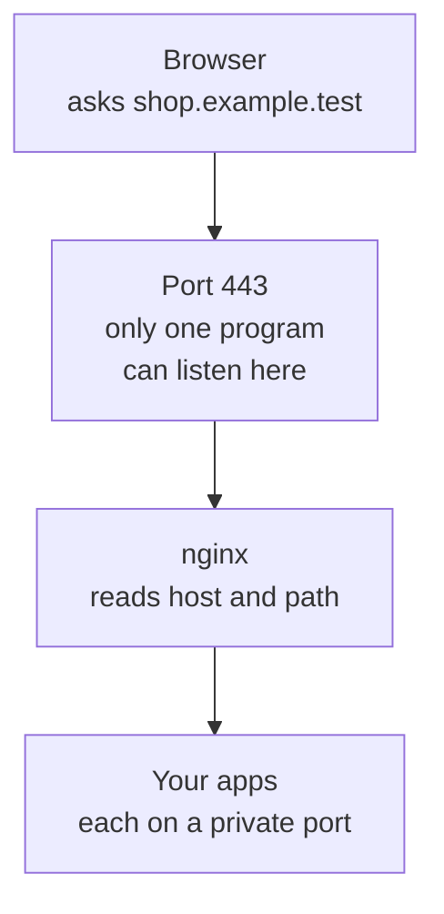
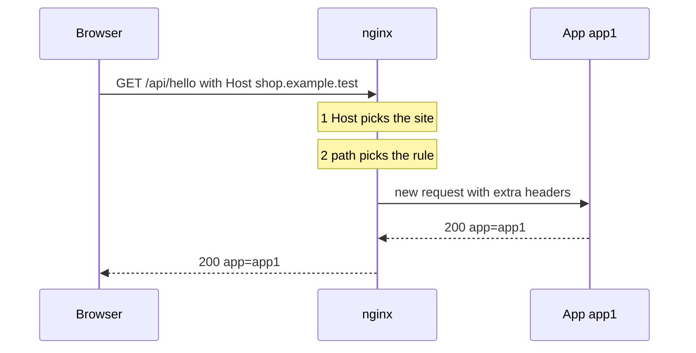
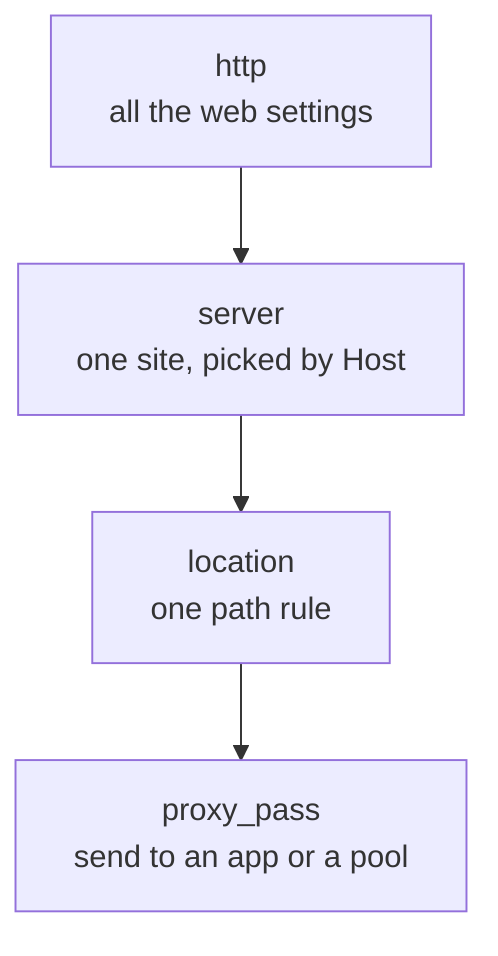
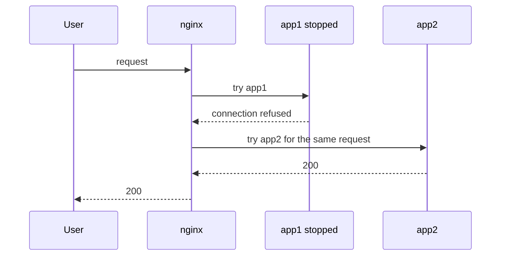
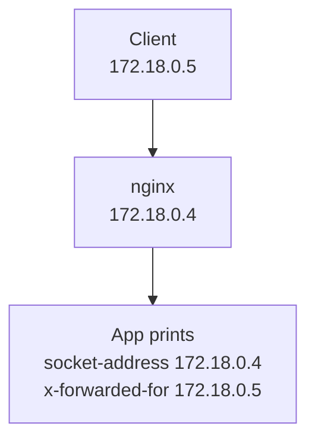
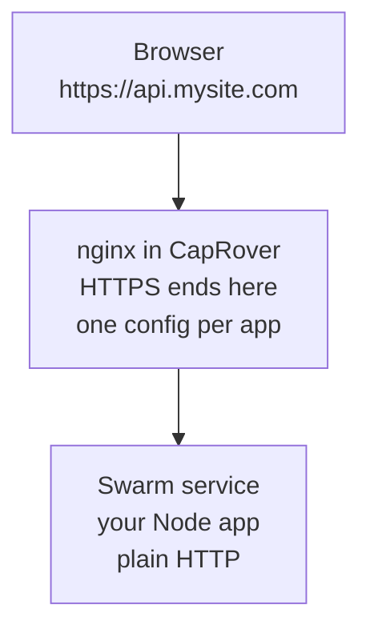

# 08. Reverse proxy and Nginx

> **Subject:** DevOps and Cloud · **Lesson:** 08 · **Made:** 2026-11-13 · **Status:** ready
>
> **You will be able to:** say why one program sits in front of your apps, follow one request through nginx step by step, read a small `nginx.conf` line by line, say what happens when one app or all apps are down (and why a 502 can last 10 seconds), pass the real client address to your app, and say why CapRover has nginx in front.
>
> **Before this:** [Serverless](07-serverless.md) · **Next:** [Config and secrets](09-config-and-secrets.md)
>
> **How to read it:** one card is one idea. Look at the picture, guess, then press the orange bar to check. The blue bars (📖 More detail) hold the longer explanation. Skip them on the first read, and open them when you want more. Every nginx output in this lesson was printed by real nginx 1.30.6 running in Docker, with `curl` from a second container, on 2026-11-13. The small model in the practice was run with Node. The one thing I could not run here (HTTPS) is marked "from the docs, not run here". About 20 minutes for the cards.

## 1. The problem: many apps, one front door

A server has one public web door for HTTPS: port 443. Only one program can use it. But you run several apps. Without help, each app needs its own public port and its own certificate, and the browser has to know them all.

A **reverse proxy** is one program that owns the front door. It reads each request and passes it to the right app behind it. Nginx (say "engine x") is the most common one.



Notice: the browser only knows the first box. Your apps can stay private.

<details class="guess"><summary>🤔 Guess: one server, one HTTPS port, and two apps (a web app and an API). How can both answer on that one port? Press to check.</summary>

**One program owns the port and passes requests on.** It looks at the host name and the path of each request, and picks the app. That program is the reverse proxy.

</details>

> **Remember:** a reverse proxy owns the one public door and passes each request to an app behind it. The browser only knows the proxy.

<details class="more"><summary>📖 More detail: four new words, forward against reverse, and the jobs nginx does</summary>

**Four new words** (each one has a picture in a card below):

- **Reverse proxy:** a middle program that speaks for your servers. Clients talk to it, and never see your apps.
- **Upstream:** the app, or the pool of apps, that nginx passes requests to (card 4).
- **TLS termination:** HTTPS ends at nginx. nginx holds the certificate and talks plain HTTP to your app (card 7).
- **502:** the status code "Bad Gateway". It means nginx works, but nothing behind it answered (card 5).

**Forward against reverse.** Both are "a middle program that passes a request on". The difference is who it speaks for.

| | Forward proxy | Reverse proxy |
|---|---|---|
| Speaks for | The clients | The servers |
| Who knows it is there | The client, who sets it up | Nobody outside. It looks like the server |
| Example | A company web filter | nginx in front of your app |

Lesson [17, proxies and API gateways](../system-design/17-proxies-and-api-gateways.md) covers both, and what an API gateway adds (tickets, limits). Lesson [03, load balancers](../system-design/03-load-balancers.md) covers how to share work between servers. This lesson does not repeat them. It shows nginx itself, running.

**The jobs nginx does,** each one is a card or a bar below:

| Job | Where in this lesson |
|---|---|
| Pick the app by host and path | Cards 2 and 3 |
| Share work between several copies of one app | Card 4 |
| Say clearly when nothing answers (502, 504) | Card 5 |
| Pass the host and the client address on | Card 6 |
| Serve files, compress, and end HTTPS | Card 7 |

**Where the analogy stops.** A building reception only points people the right way. nginx also builds a new request to the app, and the app answers nginx, not the browser (card 6).

</details>

## 2. One request, step by step

Here is what happens to one request. nginx makes two choices, and then it talks to an app for you.



Notice: there are two separate conversations. The app never talks to the browser.

<details class="guess"><summary>🤔 Guess: a request arrives with the host other.test, and no site in the config has that name. What does nginx do? Press to check.</summary>

**It uses the first site in the config** (the "default server" for that port). In the real run, `other.test` got the shop home page. It is not a 404. The nginx docs say the same: the default server is the first one, unless you mark another.

</details>

> **Remember:** the Host header picks the site. The longest matching path prefix picks the rule. Then `proxy_pass` picks an app.

<details class="more"><summary>📖 More detail: the step by step trace, with the real output of four requests</summary>

**The setup.** One nginx container, two app containers, and a second container that runs `curl`, all on one Docker network. `-H 'Host: ...'` makes curl say which site it wants, with no DNS needed. The full file is in card 3.

**The step by step trace** of `curl -H 'Host: shop.example.test' http://lesson08-nginx/api/hello`:

| # | What happens | State after |
|---|---|---|
| 1 | The curl container sends `GET /api/hello` with `Host: shop.example.test` to nginx, port 80 | The request is inside nginx |
| 2 | nginx compares the Host with each `server_name`. The first one matches | Site: `shop.example.test` |
| 3 | In that site, `/api/` and `/` both start the path. The longest prefix wins | Rule: `location /api/` |
| 4 | The rule says `proxy_pass http://api_pool`. nginx takes the next app in the pool | App: `app1` at `172.18.0.2:3000` |
| 5 | nginx opens a **new** request to the app, and sets three headers | The app sees nginx as the sender |
| 6 | The app answers 200. nginx sends the answer back | curl prints the body |

**What curl printed** for four requests (nginx 1.30.6):

```
-- shop /
<h1>shop home</h1>
-- shop /api/hello
app=app1
url=/api/hello
host=shop.example.test
x-forwarded-for=172.18.0.5
x-forwarded-proto=http
socket-address=::ffff:172.18.0.4
-- admin /
admin site
-- unknown host /
<h1>shop home</h1>
```

The first request never reached an app. nginx served a file. The second one reached `app1`. The third matched the other `server_name`. The fourth matched nothing, so it went to the first site.

**Prefix, not exact.** A plain `location` is a prefix: the path must start with it. The nginx docs: "nginx first searches for the most specific prefix location given by literal strings regardless of the listed order." So `/api/` does not catch `/apis`. The stepper checks this with the model, not with real nginx.

**Watch it move:** open [the stepper](visuals/08-reverse-proxy-and-nginx.html) and press Next on tab 1 "One request" and tab 2 "Server and path rules".

</details>

## 3. The config file, line by line

All of nginx is one text file. It is made of **blocks** inside blocks. The request goes down the same chain: site, then rule, then `proxy_pass`.



Notice: the order of the blocks in the file is the order of the decisions.

<details class="guess"><summary>🤔 Guess: which single line decides where the requests for /api/ go? Press to check.</summary>

**`proxy_pass http://api_pool;`**, inside `location /api/ { ... }`. A `location` with `root` instead serves files.

</details>

> **Remember:** the chain is `server_name` (which site), `location` (which path), `proxy_pass` (which app). Test a change with `nginx -t`, and apply it with `nginx -s reload`.

<details class="more"><summary>📖 More detail: the whole file with every line explained, and two surprises</summary>

**The whole file.** This is the file I ran. The comments are mine.

```nginx
events {}

http {
  # compress these types for clients that ask
  gzip on;
  gzip_types text/plain application/json;

  # the pool of apps, one line each
  upstream api_pool {
    server lesson08-app1:3000;
    server lesson08-app2:3000;
  }

  # site 1: picked when Host is shop.example.test
  server {
    listen 80;
    server_name shop.example.test;

    # paths that start with /api/ go to an app
    location /api/ {
      proxy_pass http://api_pool;
      # tell the app the host the browser used
      proxy_set_header Host $host;
      # add the client address to the list
      proxy_set_header X-Forwarded-For $proxy_add_x_forwarded_for;
      # tell the app if it was http or https
      proxy_set_header X-Forwarded-Proto $scheme;
    }

    # everything else is a file from this folder
    location / {
      root /usr/share/nginx/html;
    }
  }

  # site 2: a fixed answer
  server {
    listen 80;
    server_name admin.example.test;
    return 200 "admin site\n";
  }
}
```

| Line | What it does |
|---|---|
| `events {}` | Needed. Empty means default connection settings |
| `http { ... }` | Everything about web traffic lives in here |
| `upstream api_pool { ... }` | Gives a name to a list of apps. The names `lesson08-app1` are Docker container names |
| `listen 80;` | The port this site answers on |
| `server_name ...;` | The host this site is for. Matched against the Host header |
| `location /api/ { ... }` | A path rule. It matches paths that start with `/api/` |
| `proxy_pass http://api_pool;` | Send the request to the pool. No path after the name, so the path is kept |
| `proxy_set_header ...` | Set a header on the new request to the app (card 6) |
| `location / { root ...; }` | The catch-all rule. nginx reads the file from the folder |

**Test and apply.** This is what `nginx -t` printed for this file:

```
nginx: the configuration file /etc/nginx/nginx.conf syntax is ok
nginx: configuration file /etc/nginx/nginx.conf test is successful
```

The nginx beginner's guide: changes "will not be applied until the command to reload configuration is sent to nginx". If the new file is wrong, nginx "rolls back the changes and continues to work with the old configuration". So run `nginx -t`, then `nginx -s reload`.

**Surprise 1: nginx will not start if it cannot find an app name.** With `proxy_pass http://lesson08-app3:3000;` and no such container, the container stopped at once, and printed:

```
[emerg] 1#1: host not found in upstream "lesson08-app3" in /etc/nginx/nginx.conf:7
nginx: [emerg] host not found in upstream "lesson08-app3" in /etc/nginx/nginx.conf:7
```

In Docker, start the apps first, or put them in the same Compose file with `depends_on` (lesson [03](03-docker-compose.md)).

**Surprise 2: a slash after the address changes the path.** The same app, two rules (real output of `url=` that the app printed):

| Config | Request | The app sees |
|---|---|---|
| `location /keep/ { proxy_pass http://lesson08-app3:3000; }` | `/keep/hello` | `url=/keep/hello` |
| `location /strip/ { proxy_pass http://lesson08-app3:3000/; }` | `/strip/hello` | `url=/hello` |

The nginx docs say why: with a path in `proxy_pass`, "the part of a normalized request URI matching the location is replaced by a URI specified in the directive". A lone `/` counts as a path. This is the most common reason for an app that gets `404` only behind nginx.

</details>

## 4. A pool of apps: round robin, and one that dies

`upstream` is a named list of apps. nginx gives each new request to the next app in the list (this is **round robin**, and it is the default). If an app refuses the connection, nginx tries the next app **for the same request**. The user sees nothing.



Notice: the user got a 200. Only the nginx log shows the refused connection.

<details class="guess"><summary>🤔 Guess: app1 is stopped and app2 runs. What status do the users get? Press to check.</summary>

**200 for every request, all from app2.** In the real run, four requests gave `200 200 200 200`, and three more printed `app=app2`. The nginx log showed `connect() failed (111: Connection refused) while connecting to upstream`.

</details>

> **Remember:** one dead app in a pool costs no errors, because nginx tries the next one. The cost is that the others carry all the work.

<details class="more"><summary>📖 More detail: the real alternating run, the failure trace, and the model in code</summary>

**Round robin, real output.** Six requests in a row. Each printed only the first line (`app=...`):

```
app2
app1
app2
app1
app2
app1
```

It alternates. It started at `app2` because one request had already gone to `app1`. The nginx docs: "By default, requests are distributed between the servers using a weighted round-robin balancing method." Other methods (least connections, weights) are in lesson [03](../system-design/03-load-balancers.md).

**The step by step trace** of stopping the apps (real run):

| # | What I did | What users got | State after |
|---|---|---|---|
| 1 | `docker stop lesson08-app1` | Next 4 requests: `200 200 200 200` | Only app2 answers |
| 2 | 3 more requests | `app=app2` three times | The log has `connect() failed (111: Connection refused)` |
| 3 | `docker stop lesson08-app2` | 3 requests: `502 502 502` | Log: `no live upstreams while connecting to upstream` |

**The model in code.** This is the practice model (`createProxy`). It also skips apps that are down, and answers 502 when none is up.

```js
const handle = createProxy(config, health);
const req = { host: "shop.example.test", path: "/api/x", clientIp: "10.0.0.5" };
const say = () => { const r = handle(req); console.log(r.status, r.from); };
say();
say();
health.app1 = false;
say();
health.app2 = false;
say();
```

**Output:**

```
200 app1
200 app2
200 app2
502 undefined
```

Checked on 2026-11-13 with Node 26.12.1. The model is much smaller than real nginx. It shows the rule only.

**Watch it move:** [the stepper](visuals/08-reverse-proxy-and-nginx.html), tab 3 "A pool and 502".

</details>

## 5. When it breaks: 502 and 504

Two codes cover most nginx trouble. **502 Bad Gateway:** nginx is fine, but no app answered. **504 Gateway Timeout:** an app took too long. Both are written in the nginx error log, with the reason.

| Code | What it means | Real log line | Check first |
|---|---|---|---|
| 502 | No app answered | `connect() failed (111: Connection refused)` or `no live upstreams` | Is the app running, and on that port? |
| 504 | The app was too slow | `upstream timed out (110: Operation timed out)` | Why is the app slow? Is the timeout too short? |

<details class="guess"><summary>🤔 Guess: both apps are started again after a crash. Do users get 200 at once? Press to check.</summary>

**No.** In the real run the answers were `502` for about 10 seconds after both apps were back, and then `200`. nginx marks a failed app as down and leaves it alone for a while (`fail_timeout`, 10 seconds by default). "The app is up" and "nginx knows it is up" are two different moments.

</details>

> **Remember:** 502 means nginx is up and the apps did not answer. 504 means too slow. Read the nginx error log first, then check the apps.

<details class="more"><summary>📖 More detail: the real numbers, the stale address, and the fixes</summary>

**The 10 seconds, measured.** I stopped both apps, started them again, and sent one request every second (the clock is seconds after the start):

```
t+0s 502
t+1s 502
t+3s 502
t+4s 502
t+5s 502
t+7s 502
t+8s 502
t+9s 502
t+10s 200
t+12s 200
```

(A few seconds are missing, because each `curl` container takes a moment to start.) The nginx docs for `server` in an upstream: `max_fails` is 1 by default, and "by default, the parameter [`fail_timeout`] is set to 10 seconds". So one failure is enough to rest an app for 10 seconds.

**The stale address.** nginx looks up an app name **once**, when it starts or reloads. If the container comes back with a new IP address, nginx keeps calling the old address. Real run: a container `app3` had `172.18.0.5`. I removed it, started another container that took that address, and started `app3` again. It got `172.18.0.7`.

| Moment | Result |
|---|---|
| nginx before the change | `200` |
| After `app3` came back on a new address | `502`, log: `connect() failed (111: Connection refused) ... upstream: "http://172.18.0.5:3000/"` |
| After `nginx -s reload` | `200` |

The fix is a reload. nginx also has a `resolve` option on an upstream `server` line, which re-checks the name by itself. The docs say it needs a `resolver` line and a shared memory zone, and that before version 1.27.3 it was only in the paid product. I did not run it.

**The 504, measured.** A slow app that waits 5 seconds, and `proxy_read_timeout 1s;` in the location. The result was `504 after 1.005303s`, and the log said `upstream timed out (110: Operation timed out) while reading response header from upstream`. The default is 60 seconds (nginx docs, `proxy_read_timeout`).

**Four mistakes, in the same shape:**

- **Wrong:** you test only in the browser and see "502". **Right:** read `docker logs <nginx>` first. The log line says refused, no live upstreams, or timed out.
- **Wrong:** you recreate an app container and expect nginx to follow. **Right:** reload nginx (or restart it).
- **Wrong:** you raise the timeout to hide a slow app. **Right:** find out why it is slow, and raise the timeout only for a rule that needs it (for example an upload).
- **Wrong:** a new app version is "up" but not ready, and nginx sends traffic. **Right:** a real health check (card 8).

</details>

## 6. Headers: the app only sees nginx

The app talks to nginx, not to the browser. So the app sees **nginx's address** as the sender. If you want the real client address, nginx must put it in a header, **X-Forwarded-For**, and you must read it.



Notice: the real client is only in the header.

<details class="guess"><summary>🤔 Guess: your Express app logs req.ip, and you set nothing else. What does it log behind nginx? Press to check.</summary>

**nginx's address.** The Express docs: by default, the client address "is derived from `req.socket.remoteAddress`". The real run showed the same: `socket-address` was nginx's address. To get the client, set `trust proxy` in Express (see the bar).

</details>

> **Remember:** set three headers: `Host`, `X-Forwarded-For` and `X-Forwarded-Proto`. Each proxy adds one address to the list. Trust only the addresses your own proxies added.

<details class="more"><summary>📖 More detail: what happens with and without the lines, and a client that lies</summary>

**Without any `proxy_set_header` line** (real output). The client sent `X-Forwarded-For: 1.2.3.4`:

```
host=lesson08-app3:3000
x-forwarded-for=1.2.3.4
x-forwarded-proto=undefined
socket-address=::ffff:172.18.0.6
```

Two things are wrong. The `host` is the name in `proxy_pass`, not what the browser asked for. The nginx docs: the default is `proxy_set_header Host $proxy_host;`. And the client's own `1.2.3.4` went through unchanged, and nginx added nothing.

**With the three lines from card 3** (real output, two cases):

```
host=shop.example.test
x-forwarded-for=172.18.0.5
x-forwarded-proto=http
```

and, when the client sends `X-Forwarded-For: 1.2.3.4` itself:

```
x-forwarded-for=1.2.3.4, 172.18.0.5
```

`$proxy_add_x_forwarded_for` adds to the list. It does not replace it. The last address was added by your nginx. The first one was written by the client, so it can be a lie.

**Reading it in Express.** Express docs: "The most common issue is express APIs that expose the client's IP address may instead show an internal IP address of the reverse proxy." The setting is `app.set('trust proxy', ...)`. With addresses, "each address in `X-Forwarded-For` is checked from right to left until the first non-trusted address". With `true`, the docs warn that the last trusted proxy must overwrite these headers, "otherwise it may be possible for the client to provide any value". So never use `true` when a client can reach your app directly.

**Why log the real address?** Rate limits, audit logs and "block this address" all need it. Lesson [17](../system-design/17-proxies-and-api-gateways.md) shows what a gateway does with it.

**Watch it move:** [the stepper](visuals/08-reverse-proxy-and-nginx.html), tab 4 "Headers".

</details>

## 7. The other jobs: files, compression, and HTTPS

nginx is also a web server and the place where HTTPS ends. Each job is one or two lines.

| Job | The lines | What happened (real run) |
|---|---|---|
| Serve files | `location / { root /usr/share/nginx/html; }` | `<h1>shop home</h1>`. A missing file gave `404` |
| Compress | `gzip on;` and `gzip_types text/plain application/json;` | A 110001 byte file arrived as 694 bytes |
| End HTTPS (TLS termination) | `listen 443 ssl;` plus a certificate and a key | From the docs, not run here |

<details class="guess"><summary>🤔 Guess: you write only "gzip on;". Does a 110 KB text/plain file get smaller? Press to check.</summary>

**No.** It stayed at **110001 bytes**. By default only `text/html` is compressed. A `text/html` page of 85001 bytes arrived as 598 bytes with the same single `gzip on;`. You must list other types in `gzip_types`.

</details>

> **Remember:** one nginx can serve files, compress, and end HTTPS, so your app does not have to. Compression only applies to the types you list.

<details class="more"><summary>📖 More detail: the numbers, how to ask for gzip, and TLS termination</summary>

**How the gzip numbers were measured.** The client must ask with `Accept-Encoding: gzip`. `curl -w '%{size_download}'` printed the bytes that came over the network:

```
plain: 110001 bytes
gzip: 694 bytes
HTTP/1.1 200 OK
Content-Encoding: gzip
```

The file repeats one phrase, so it shrinks far more than real pages do. Do not expect 99 percent on your own JSON. The nginx docs list the defaults: `gzip off`, `gzip_types text/html` (and `text/html` is always compressed), and `gzip_min_length 20`. Real result of that last one: my 19 byte `index.html` came back with `Content-Length: 19`, not compressed.

**TLS termination** (from the docs, not run here). I did not run HTTPS, because the images I checked had no `openssl` program. The nginx docs show this shape:

```nginx
server {
    listen              443 ssl;
    server_name         www.example.com;
    ssl_certificate     www.example.com.crt;
    ssl_certificate_key www.example.com.key;
}
```

The docs: "The server certificate is a public entity. It is sent to every client that connects to the server. The private key is a secure entity and should be stored in a file with restricted access". Behind this block you can keep `proxy_pass http://...` with plain HTTP, and set `X-Forwarded-Proto $scheme`, so the app can tell the browser used HTTPS (card 6). How certificates are made and renewed is lesson 19 (planned).

**What nginx should not do alone.** Ticket checks, per user limits and rewriting JSON are API gateway jobs (lesson [17](../system-design/17-proxies-and-api-gateways.md)). Caching static files near the user is a CDN job (lesson [05](../system-design/05-cdn.md)).

</details>

## 8. Your map: why CapRover has nginx in front

You already use a reverse proxy. CapRover is Docker Swarm with a dashboard. In front of every app it runs nginx. nginx holds the HTTPS certificate, picks the app by its domain, and passes plain HTTP to your container.



Notice: this is cards 1, 3 and 7 in one picture.

<details class="guess"><summary>🤔 Guess: in CapRover, a deploy gives users 502 for a few seconds, at every deploy. What is the first thing to check? Press to check.</summary>

**The health check.** Without a real one, Swarm treats "the process started" as "ready". nginx then sends traffic to a container that has not connected to the database yet, and users get 502. A health check that tests the database, and start-first ordering, fix it. (From the CapRover notes in this repo, not run here.)

</details>

> **Remember:** CapRover is Swarm plus nginx plus Let's Encrypt. nginx routes by domain and ends HTTPS. It is the same idea as an Ingress controller in Kubernetes.

<details class="more"><summary>📖 More detail: the CapRover facts, your project, and an idea</summary>

**What CapRover does with nginx** (from [docker-caprover-internals.md](docker-caprover-internals.md), Part 7, researched 2026-09-18, not run in this lesson):

- It makes one nginx reverse proxy config per app: a subdomain or a custom domain to the Swarm service.
- HTTPS ends in nginx, so your Node app speaks plain HTTP behind it.
- After a deploy, it regenerates the nginx config for the app domain, and asks Let's Encrypt for a certificate.
- That is layer 7 routing, "the same concept as a Kubernetes Ingress".

Cards 2 to 7 are what is inside that one box.

| CapRover | The nginx idea | Kubernetes |
|---|---|---|
| The app's domain | `server_name` | Host in an Ingress rule |
| nginx config per app | One `server` block with `proxy_pass` | An Ingress, read by an ingress controller |
| Instance count | Not nginx: Swarm spreads requests over the copies | A Service in front of pods |
| Let's Encrypt | The `ssl_certificate` lines | Lesson 19 |

Lesson [04](04-kubernetes-objects.md) card 6 has the Kubernetes side. An ingress controller is a program like nginx that reads the Ingress rules.

**Facts about your projects** (from your profile and the DBO case study):

- **Fact:** your profile lists CapRover and Docker, and the DBO case study says the backend runs on Docker Swarm via CapRover.
- **Fact:** the case study also says: "Right now 'the gateway' is likely just CapRover's bundled nginx doing routing + TLS". The case study says "likely", so check before you say it as fact in an interview.

**An idea, not a fact:** check which address one of your deployed APIs logs behind CapRover's nginx: nginx's or the client's. I did not check this.

</details>

## 9. Watch and play

Links were checked on 2026-11-13. I opened every page. For the video I read the title and channel from the YouTube oEmbed data. I did not watch it. If a link is broken, tell me and I will replace it.

- **Video:** [NGINX Explained in 100 Seconds](https://www.youtube.com/watch?v=JKxlsvZXG7c) - Fireship. A very short intro to the same tool. Compare it with cards 1 and 3.
- **Play with it:** [the stepper in this folder](visuals/08-reverse-proxy-and-nginx.html) - guess first, then press Next. Four tabs: one request, server and path rules, a pool and 502, headers.
- **Try a config:** [Nginx location match explorer](https://tools.incoherency.co.uk/nginx-location-match-explorer) - paste a few `location` lines, type a path, and see which one wins and why. Try `/api/` and `/` with the path `/api/hello`.
- **Read:** [nginx beginner's guide](https://nginx.org/en/docs/beginners_guide.html) - the file structure, static files, a small proxy, and `nginx -s reload`.
- **Read:** [NGINX Reverse Proxy (docs.nginx.com)](https://docs.nginx.com/nginx/admin-guide/web-server/reverse-proxy/) - `proxy_pass`, passing headers, buffering.
- **Read:** [How nginx processes a request](https://nginx.org/en/docs/http/request_processing.html) - how the server and the location are chosen, including the default server.
- **Run it yourself:** the recipe in the Go deeper box below.

<details><summary>Go deeper (optional)</summary>

**What was run, and what was not.** Run here: every nginx output in this lesson, with `nginx:stable-alpine` (nginx 1.30.6), Node `24-alpine` for the apps, Docker Desktop 29.3.1, a user defined network, and `curl` from a second container. The code outputs and the 27 practice tests were run with Node 26.12.1. Not run here: HTTPS (no certificate tool in the images), the `resolve` option, and CapRover itself. Those are from the nginx docs and the CapRover note, as marked.

**nginx versions** (nginx.org, checked 2026-11-13). Stable: 1.30.6 (2026-10-14). Mainline: 1.31.8 (2026-10-21). My first test run used 1.29.8 and gave the same results as the final run on 1.30.6.

**The recipe to run it yourself** (names must be your own, and remove them after):

```
docker network create demo-net
docker run -d --name app1 --network demo-net -e APP_NAME=app1 -v $PWD/app.js:/app.js:ro node:24-alpine node /app.js
docker run -d --name app2 --network demo-net -e APP_NAME=app2 -v $PWD/app.js:/app.js:ro node:24-alpine node /app.js
docker run -d --name gate --network demo-net -v $PWD/nginx.conf:/etc/nginx/nginx.conf:ro -v $PWD/html:/usr/share/nginx/html:ro nginx:stable-alpine
docker run --rm --network demo-net --entrypoint curl nginx:stable-alpine -s -H 'Host: shop.example.test' http://gate/api/hello
```

`app.js` is a Node file with 12 lines that prints the app name, `req.url` and a few headers. Change the upstream names in `nginx.conf` to `app1` and `app2`. The nginx image already has `curl`, so no other image is needed. Clean up with `docker rm -f app1 app2 gate` and `docker network rm demo-net`.

**Why `localhost` does not work as an upstream.** Inside the nginx container, `localhost` means the nginx container itself. Use the container name on a shared network. (See the networking part of [docker-caprover-internals.md](docker-caprover-internals.md).)

**Other proxies.** Traefik, Caddy and HAProxy do the same jobs. The DBO case study names Traefik as the natural next step on a container platform. nginx stays the one you will meet most.

**The Kubernetes link.** The Kubernetes project announced that the `ingress-nginx` controller would be retired in March 2026. nginx itself is not affected. Lesson [04](04-kubernetes-objects.md) has the details.

**More.**

- [nginx proxy module docs](https://nginx.org/en/docs/http/ngx_http_proxy_module.html) - `proxy_pass`, `proxy_set_header`, the timeouts.
- [nginx upstream module docs](https://nginx.org/en/docs/http/ngx_http_upstream_module.html) - `max_fails`, `fail_timeout`, `resolve`.
- [nginx gzip module docs](https://nginx.org/en/docs/http/ngx_http_gzip_module.html) and [HTTPS servers](https://nginx.org/en/docs/http/configuring_https_servers.html).
- [Express behind proxies](https://expressjs.com/en/guide/behind-proxies.html) - `trust proxy`.

</details>

## 10. Practice

**A. Predict the output** (write your answer before opening)

```js
const handle = createProxy(config, health);
const req = { host: "shop.example.test", path: "/api/x", clientIp: "10.0.0.5" };
const say = () => { const r = handle(req); console.log(r.status, r.from); };
say();
say();
health.app1 = false;
say();
health.app2 = false;
say();
```

The pool is `["app1", "app2"]`, and both apps start as up. What prints? Then answer: which status would real nginx give on the last line, and what do you read first?

<details><summary>Answer</summary>

```
200 app1
200 app2
200 app2
502 undefined
```

The first two go round the pool. After app1 goes down, the next request tries app1, finds it down, and uses app2. The last request has no app to use, so the answer is 502 and `from` is not set. Real nginx gives `502` too, and the error log line says `no live upstreams`. Read that log first. (Checked on 2026-11-13 with Node 26.12.1.)

</details>

**B. Fix the bug**

This function should pick the longest matching prefix. What does it print, and should it?

```js
function pickLocation(server, path) {
  for (const location of server.locations) {
    if (path.startsWith(location.prefix)) return location;
  }
  return null;
}
const server = { locations: [
  { prefix: "/" },
  { prefix: "/api/" } ] };
console.log(pickLocation(server, "/api/hello").prefix);
```

<details><summary>Answer</summary>

It prints `/`, and it should print `/api/`. The function returns the first location that matches, and `/` matches every path. nginx does not use the listed order for plain prefix rules: the longest prefix wins ("regardless of the listed order", nginx docs). Fix: keep the best match, and replace it when a longer prefix matches.

```js
function pickLocation(server, path) {
  let best = null;
  for (const location of server.locations) {
    if (!path.startsWith(location.prefix)) continue;
    // a longer prefix is a better match
    if (best === null || location.prefix.length > best.prefix.length) best = location;
  }
  return best;
}
```

With this version the same call prints `/api/`. (Checked on 2026-11-13 with Node 26.12.1.)

</details>

**C. Write it yourself**

Open `learn/devops-cloud/practice/08-reverse-proxy-and-nginx.js`. It has four empty pieces: `pickServer`, `pickLocation`, `forwardedFor` and `createProxy`. The comments above them say exactly what each one must do. Write them, then run this from the repo root and make all the tests pass:

```
node --test learn/devops-cloud/practice/08-reverse-proxy-and-nginx.test.js
```

<details><summary>One possible answer</summary>

```js
function pickServer(servers, host) {
  if (servers.length === 0) return null;                                   // nothing to pick
  const exact = servers.find((server) => server.name === host);
  return exact || servers[0];                                              // no match: the first server is the default
}

function pickLocation(server, path) {
  let best = null;
  for (const location of server.locations) {
    if (!path.startsWith(location.prefix)) continue;                       // the path must start with the prefix
    if (best === null || location.prefix.length > best.prefix.length) best = location;   // the longest prefix wins
  }
  return best;
}

function forwardedFor(existing, clientIp) {
  return existing ? existing + ", " + clientIp : clientIp;                 // add to the list, never replace it
}

function createProxy(config, health) {
  const next = {};                                                         // one round robin counter for each pool
  return function handle(request) {
    const server = pickServer(config.servers, request.host);
    if (server === null) return { status: 404 };
    const location = pickLocation(server, request.path);
    if (location === null) return { status: 404 };
    if (location.static) return { status: 200, from: "static" };           // nginx answers by itself

    const apps = config.upstreams[location.upstream] || [];
    const start = next[location.upstream] || 0;
    for (let i = 0; i < apps.length; i++) {
      const index = (start + i) % apps.length;                             // go round the list
      const app = apps[index];
      if (health[app] !== true) continue;                                  // skip an app that is down
      next[location.upstream] = index + 1;                                 // the next request starts after this app
      const sent = request.headers && request.headers["x-forwarded-for"];
      return {
        status: 200,
        from: app,
        headers: {
          host: request.host,
          "x-forwarded-for": forwardedFor(sent, request.clientIp),
          "x-forwarded-proto": "http",
        },
      };
    }
    return { status: 502 };                                                // no app is up
  };
}

module.exports = { pickServer, pickLocation, forwardedFor, createProxy };
```

Checked on 2026-11-13 with Node 26.12.1: the 27 tests fail on the empty stub and all 27 pass with this answer.

</details>

## 11. Interview question

**Q:** "What does nginx do in front of your app, and what happens when a request arrives?"

A common follow-up: "Users get 502 errors after a deploy. How do you find the cause?" Card 5 is the answer.

<details><summary>A strong answer, in four parts</summary>

1. **Problem:** a server has one public HTTPS port, and you run several apps. Each app would need its own public port and certificate, and the browser would have to know them. You also want to share work between copies of an app, and keep the apps private.
2. **How it works:** nginx is a reverse proxy. It owns the front port. For each request it picks the site by the Host header, then the rule (`location`) by the longest matching path prefix. A `proxy_pass` rule sends the request to an app, or to a pool (`upstream`). The default is round robin. If one app refuses the connection, nginx tries the next one for the same request. nginx makes a new request to the app, so I set `Host`, `X-Forwarded-For` and `X-Forwarded-Proto`, and the app reads the client address from the header. nginx can also serve files, compress, and end HTTPS (TLS termination), so the app speaks plain HTTP. For 502, I read the nginx error log. "Connection refused" or "no live upstreams" means no app answered. "Timed out" is a 504. Also, nginx rests a failed app for 10 seconds by default, and it looks up app names only when it starts or reloads.
3. **Tradeoff:** one proxy gives one place for HTTPS, routing and logs, and your apps stay private. The cost is one more hop, one more thing that can fail, and config that needs care: a slash after `proxy_pass` changes the path, and `X-Forwarded-For` can be written by a client. At a larger scale you move to a managed load balancer, an API gateway, or an ingress controller.
4. **My example:**
   - **Fact:** my profile lists CapRover, and the DBO case study says the backend runs on Docker Swarm via CapRover. CapRover puts nginx in front of each app, ends HTTPS there, and the app speaks plain HTTP.
   - **Fact (from the case study, with "likely"):** the case study says the gateway is likely CapRover's bundled nginx. I should check that before I say it as fact.
   - **Idea, not a fact:** I would check what address the API logs behind nginx, and whether deploys show 502, which would point to the health check.

</details>

## 12. Explain it back

Close this file. Explain nginx in front of an app out loud like to a new junior, in 4 parts (problem, how, tradeoff, my example). Use one request: the Host picks the site, the path picks the rule, `proxy_pass` picks an app, and nginx adds headers. Then say what a 502 means and why it can last 10 seconds. Write your best version below and run `/explain-check reverse proxy and nginx` or ask the `explain-coach` agent to review it.

### My explanation

<write here>

### Coach feedback

<the explain-coach agent writes here>

## 13. Review questions (day 1, 3, 7, 21)

1. A request arrives with Host: other.test, and no `server_name` matches. Which site answers, and how did the real run show it?
2. One of two apps in a pool stops. What do users get, and what does nginx do for each request? What if both stop?
3. Your app logs nginx's address for every user. Why, and which header and setting fix it?
4. Draw from memory: browser, nginx (site, rule, `proxy_pass`), a pool of two apps. Mark where HTTPS ends, and where the headers are added.

<details><summary>Answers</summary>

1. The first site in the config answers. nginx uses the first `server` for the port as the default. In the real run, `other.test` got the shop home page.
2. Users get 200, all from the app that runs. nginx tries the next app for the same request when a connection is refused. If both stop, nginx answers 502, and the log says "no live upstreams". After the apps return, users can still get 502 for about 10 seconds, because nginx rests a failed app for `fail_timeout` (10 seconds by default).
3. The app talks to nginx, so the sender is nginx. Set `proxy_set_header X-Forwarded-For $proxy_add_x_forwarded_for;` in nginx, and in Express set `trust proxy` so `req.ip` reads the header from the right.
4. The browser connects to nginx. HTTPS ends in nginx (TLS termination). nginx picks the site by Host, then the rule by the longest prefix, then `proxy_pass` picks an app from the pool. The three `proxy_set_header` lines are added to the new request to the app. The app answers nginx, and nginx answers the browser.

</details>

## Connected lessons

- [Serverless](07-serverless.md) - the lesson before. There, a platform runs the front door for you.
- [Config and secrets](09-config-and-secrets.md) - the next lesson. Settings like the upstream address and the certificate must not be baked into the image.
- [Kubernetes objects](04-kubernetes-objects.md) - an ingress controller is nginx's job, written as rules.
- [Docker Compose](03-docker-compose.md) - names on a shared network, and `depends_on` for start order.
- HTTPS and certificates in practice (planned) - where the `ssl_certificate` file comes from.
- What CapRover does for you (planned) - the full CapRover walk through.
- [Proxies and API gateways](../system-design/17-proxies-and-api-gateways.md) - forward against reverse, and gateway jobs.
- [Load balancers](../system-design/03-load-balancers.md) - round robin, least connections and health checks in detail.
- [Docker and CapRover internals](docker-caprover-internals.md) - what CapRover does under the hood.
