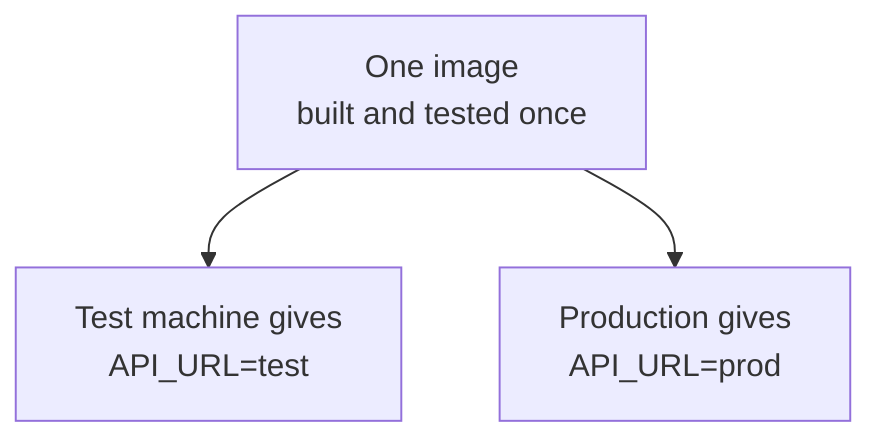
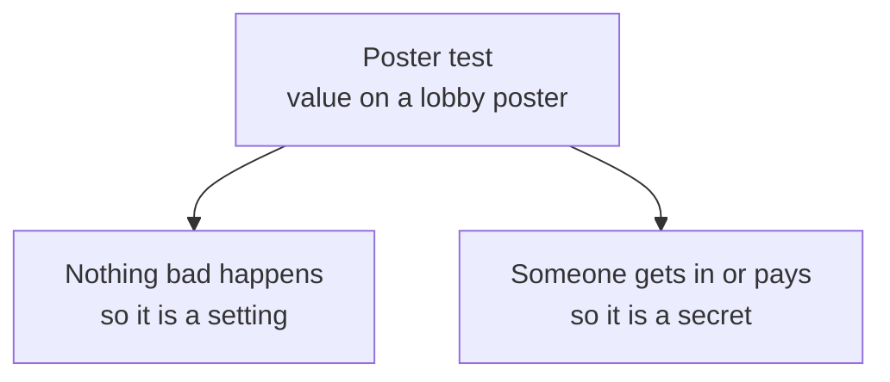
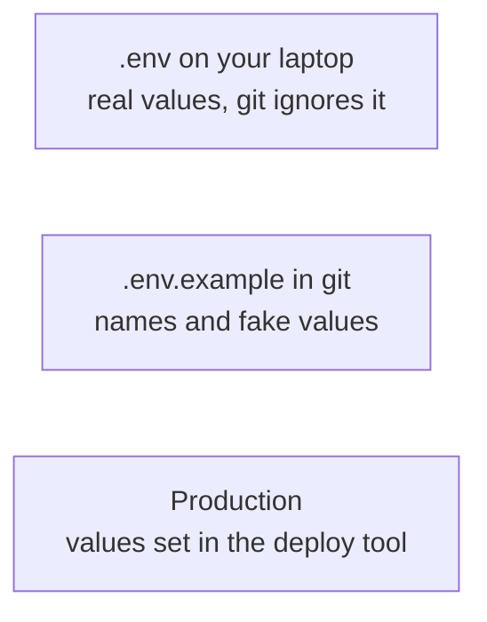
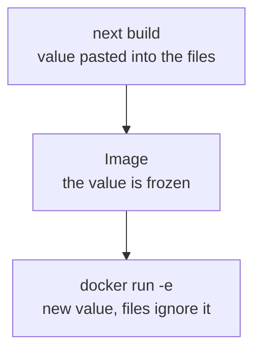
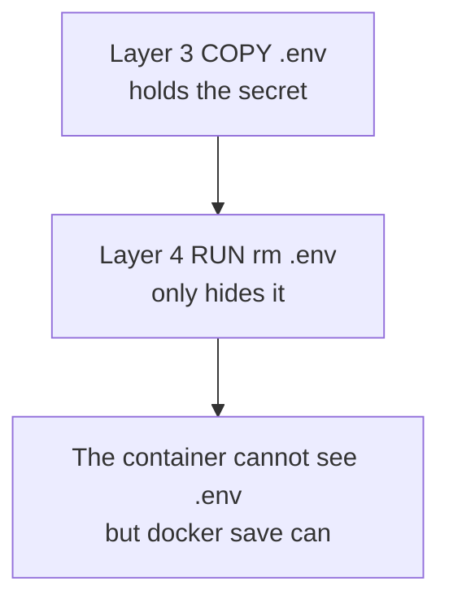
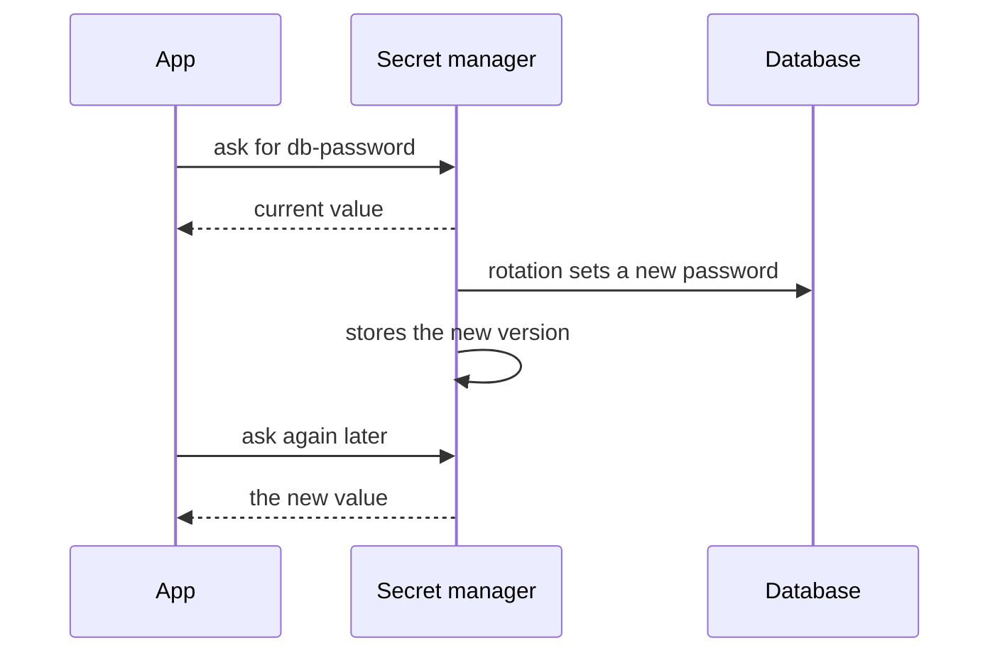
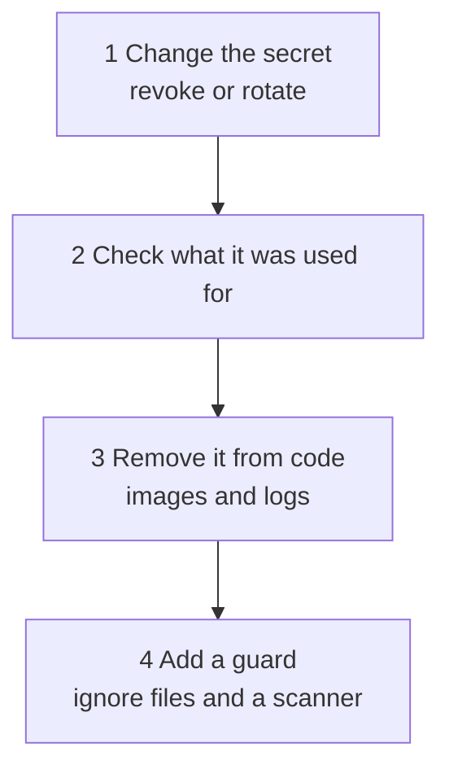

# 09. Config and secrets

> **Subject:** DevOps and Cloud · **Lesson:** 09 · **Made:** 2026-11-13 · **Status:** ready
>
> **You will be able to:** say why settings live outside the code, tell a setting from a secret, explain why a secret in git or in an image layer is still there after you delete it, predict what a `NEXT_PUBLIC_` value does after the build, and say what to do in the first hour after a secret leaks.
>
> **Before this:** [Reverse proxy and Nginx](08-reverse-proxy-and-nginx.md) · **Next:** [Logs and monitoring](10-logs-and-monitoring.md)
>
> **How to read it:** one card is one idea. Look at the picture, guess, then press the orange bar to check. The blue bars (📖 More detail) hold the longer explanation. Skip them on the first read, and open them when you want more. Every secret in this lesson is a made up text like `not-a-real-secret`. About 20 minutes for the cards.

## 1. Settings live outside the code

Your app needs settings: a port, a database address, a log level. They are different on your laptop, on the test server and in production. If you write them in the code, you must edit the code and build again for each place. So you build **one image**. Each machine gives the app its own settings when it starts. These are **environment variables**: named text values that the machine hands to a program.



Notice: the image is the same. Only the settings from outside change.

<details class="guess"><summary>🤔 Guess: your code says const API = "https://test.example.com". How do you ship to production? Press to check.</summary>

**You edit the code and build a new image.** Now production runs a build that nobody tested. With an environment variable, the tested image goes to production as it is, and only the setting changes.

</details>

> **Remember:** build once. Give each place its own settings from outside the code.

<details class="more"><summary>📖 More detail: the twelve-factor rule, text values, and the order of three sources</summary>

**The rule has a name.** The Twelve-Factor App method says an app's config is "everything that is likely to vary between deploys". It also says the test is "whether the codebase could be made open source at any moment, without compromising any credentials" ([12factor.net/config](https://12factor.net/config), opened 2026-11-13).

**Environment variables are always text.** Node gives you strings, even for numbers and for the word false. Real output (Node 26.12.1):

```
PORT=8080 node -e 'console.log(typeof process.env.PORT, process.env.PORT + 1, Number(process.env.PORT) + 1)'
string 80801 8081

DEBUG=false node -e 'console.log(Boolean(process.env.DEBUG), process.env.DEBUG === "true")'
true false
```

`"8080" + 1` glues text, and the text `"false"` counts as true. Turn the text into the type you want in one place, at start.

**Real apps merge three sources.** Defaults in the code, then a config file, then the environment. The last one wins. The stepper (tab 2) runs the same functions as practice C. The trace, with `APP_` as the prefix:

| Step | The code does | State after |
|---|---|---|
| 1 | `envToConfig(env, "APP_")` drops `PATH` and `HOME`, cuts the prefix | `{ logLevel: "debug", databaseUrl: "postgres://..." }` |
| 2 | Start from the defaults | `port 3000, logLevel info, region ap-southeast-2` |
| 3 | The file wins over the defaults | `port 4000, logLevel warn` |
| 4 | The environment wins over the file | `logLevel debug`, plus `databaseUrl` |
| 5 | `missingKeys(config, required)` | `["apiKey"]`, so the app stops at start with a clear message |

**Why stop at start.** If a required value is missing, a crash on the first request at 3 am is worse than a refusal to start at deploy time. This is called failing fast.

**What an environment variable does not give you.** It is easy to change per deploy, but it is only a name and a text. It has no lock (card 6).

</details>

## 2. A setting is not a secret

A **setting** (config) is harmless if someone reads it: a port, a log level, the public address of your site. A **secret** is a value that gives power: a database password, an API key, a key that signs login tokens. Use the poster test. Print the value on a poster in the lobby. If nothing bad happens, it is a setting. If someone could get in or spend your money, it is a secret. Secrets need four extra rules: not in git, not in the image, not in logs, and easy to change.



Notice: the test looks at what the value can do, not at its name.

<details class="guess"><summary>🤔 Guess: is DATABASE_URL=postgres://app:pw@db:5432/shop a setting or a secret? Press to check.</summary>

**A secret.** The name has no word like password, but the value holds the password (the part after `app:`). A good rule checks the value as well as the name.

</details>

> **Remember:** if a value gives power, it is a secret, even when its name does not say so.

<details class="more"><summary>📖 More detail: examples, the public key trap, and the extra rules</summary>

| Value | Setting or secret | Why |
|---|---|---|
| `PORT`, `LOG_LEVEL`, `NODE_ENV` | Setting | Nobody gains power from it |
| The public address of your own site | Setting | Everyone already sees it in the browser |
| `DATABASE_URL` with a password inside | Secret | The password is in the value |
| A payment secret key, an email API key | Secret | Someone can spend money or send mail as you |
| The key that signs login tokens | Secret | Anyone with it can make a token for any user |
| A `NEXT_PUBLIC_` value | Setting, never a secret | It is pasted into files that every visitor downloads (card 4) |

**The four extra rules for a secret.** Keep it out of git (card 3). Keep it out of the image (card 5). Keep it out of logs (card 8). Make it easy to change (card 7). The security lesson has the design view: [Security in a design](../system-design/29-security-in-a-design.md), card 5.

**A mobile app cannot keep a secret.** Anyone can open the app files, so a key inside the app is public. Keep secret keys on your server. That lesson has the full picture, so I do not repeat it here.

</details>

## 3. `.env` files: fine on your laptop, never in git

A `.env` file is a plain text file of `NAME=value` lines. A tool reads it and fills the environment while you work on your laptop. It is handy, but it holds real values. Git remembers every file that was ever committed. So you add `.env` to `.gitignore`, you commit a `.env.example` with fake values that shows the names, and production gets its real values from the deploy tool.



Notice: only the middle file travels in git, and it holds nothing real.

<details class="guess"><summary>🤔 Guess: you committed .env by mistake, then deleted it in the next commit. Is the secret gone? Press to check.</summary>

**No.** The first commit still holds it, and anyone with the repo can read it. In my test `git show HEAD~1:.env` printed `API_TOKEN=not-a-real-secret` after the file was deleted.

</details>

> **Remember:** never commit a real secret. Deleting it in a later commit does not remove it from history.

<details class="more"><summary>📖 More detail: the real git run, the ignore files, and what to do instead</summary>

**The real run** (a scratch repo, git on macOS):

```
git commit -m "first commit"      (.env has API_TOKEN=not-a-real-secret)
git rm --cached .env && rm .env && git commit -m "remove .env"
ls -A (not counting .git)         app.js
git log --oneline --all -S"not-a-real-secret"
  9e95d63 remove .env
  b0ed354 first commit
git show HEAD~1:.env               API_TOKEN=not-a-real-secret
                                   PORT=3000
```

The file is gone from the folder. The text is still in the first commit.

**Ignore files do three jobs.**

| File | Keeps `.env` out of | Real check |
|---|---|---|
| `.gitignore` with `.env` | git commits | `git check-ignore -v .env` printed `.gitignore:1:.env	.env` |
| `.dockerignore` with `.env*` | the image build | see below |
| `.env.example` (committed) | nothing, it is the guide | names with fake values like `change-me` |

A `.gitignore` line does not help a file that git already tracks. Run `git rm --cached .env` first.

**The `.dockerignore` run.** The folder had `.env`, `.env.example` and `app.js`, and the Dockerfile ran `COPY . .`. Without a `.dockerignore`, `ls -A /app` in the container printed `.env .env.example Dockerfile app.js`. With the lines `.env*`, `!.env.example` and `Dockerfile`, it printed `.dockerignore .env.example app.js`. (Lesson 02, card 6, has the rest of the `.dockerignore` story.)

**Compose.** `env_file:` loads a file such as `db.env` into a container. Keep that file out of git too. See [Docker Compose](03-docker-compose.md).

**What if it is already committed?** Card 8.

</details>

## 4. Build time and run time: the `NEXT_PUBLIC_` trap

Your code runs at two different moments. **Build time** is when you make the image. **Run time** is when the container starts. In a Next.js app, any variable that starts with `NEXT_PUBLIC_` is **inlined** at build time: Next.js pastes its value into your code files. After that the value is frozen inside the image. The `docker run -e` value you give later does not change those files. And because every visitor downloads those files, such a value is public.



Notice: the arrow from build to image is the last time the value can change.

<details class="guess"><summary>🤔 Guess: you build with NEXT_PUBLIC_API_URL=value-from-build and run with -e NEXT_PUBLIC_API_URL=value-from-run. What does the browser file say? Press to check.</summary>

**`value-from-build`.** In my real test the built browser file held `["client sees ","value-from-build"]`. A name without the prefix, read in server code, gave `value-from-run`.

</details>

> **Remember:** a `NEXT_PUBLIC_` value is pasted into the code at build time. It is frozen and public. Other names are read when the server runs.

<details class="more"><summary>📖 More detail: the real results, the docs, the trace, and the fixes</summary>

**What the Next.js docs say** (page last updated 2026-08-25, opened 2026-11-13): Next.js can "inline" a value "at build time" into the JavaScript for the client. After the build, "your app will no longer respond to changes to these environment variables". If you "build and deploy a single Docker image to multiple environments, all `NEXT_PUBLIC_` variables will be frozen". For run time values on the server, call `await connection()` first, which opts the page into dynamic rendering ([Environment Variables](https://nextjs.org/docs/app/guides/environment-variables)).

**The real test.** One small app (Next.js 16.4.6, React 19.2.0, `node:24-alpine`), built three times with `--build-arg`, then started with `docker run -e ...=value-from-run`. Each row is a real answer from `wget` inside the container:

| Code that reads the value | The real answer |
|---|---|
| Route handler reads `process.env.NEXT_PUBLIC_API_URL` | `value-from-build` |
| Route handler reads `process.env.API_URL` | `value-from-run` |
| `"use client"` page shows `NEXT_PUBLIC_API_URL` | `value-from-build` (found in one file under `.next/static`, and `value-from-run` in none) |
| Server page with no dynamic marker shows `API_URL` | `value-from-build` (made at build) |
| The same page after `await connection()` | `value-from-run` |
| Reads the name from the request, `process.env[name]` | `value-from-run` |
| `const name = "NEXT_PUBLIC_API_URL"` then `process.env[name]` | `value-from-build` |
| `const env = process.env` then `env.NEXT_PUBLIC_API_URL` | `value-from-build` |

**The docs and my test disagree on the last two rows.** The docs say these two forms are not inlined. In my build (Next.js 16.4.6 with the default Turbopack builder) both were. So do not rely on a trick with a variable. Only a name that the build cannot know (read from the request) stayed a run time lookup.

**The trace** (stepper, tab 3):

| Step | What happens | State after |
|---|---|---|
| 1 | `next build` finds `process.env.NEXT_PUBLIC_API_URL` | Replaced by `"value-from-build"` in the files |
| 2 | The image is saved | The value is frozen in the image |
| 3 | `docker run -e ...=value-from-run` | `process.env` in Node says `value-from-run` |
| 4 | Server code reads `API_URL` | `value-from-run` |
| 5 | Code that names `NEXT_PUBLIC_API_URL` | `value-from-build`, the run value is ignored |
| 6 | The browser reads `API_URL` | `undefined`. Next.js docs: only `NEXT_PUBLIC_` names reach the browser (not run here) |

**Two fixes.** One: build one image for each environment, passing the value with `ARG` (fine, because the value is public anyway). Two: build one image, and let the browser ask your own API for its settings when the page loads. The docs say the same: "you'll have to set up your own API to provide them to the client".

**Never put a secret behind `NEXT_PUBLIC_`.** It lands in a file that every visitor downloads.

</details>

## 5. A secret in an image layer ships with the image

Lesson 02 said a layer only adds. Here is what that means for secrets. A Dockerfile copies `.env` into the image and deletes it on the next line. The container no longer shows the file. But the `COPY` layer still holds it, and anyone who can pull the image can read that layer. A build argument (`ARG`) or an `ENV` line is worse: the value is printed in the image history.



Notice: layer 3 never changes after it is made.

<details class="guess"><summary>🤔 Guess: a Dockerfile uses ARG API_TOKEN and a RUN line that reads it. You build with --build-arg API_TOKEN=not-a-real-secret. Where does the value end up? Press to check.</summary>

**In `docker history`.** The real output had the line `RUN |1 API_TOKEN=not-a-real-secret /bin/sh -c ...`. Anyone who pulls the image sees it.

</details>

> **Remember:** a layer only adds. A secret that reached a layer, an `ARG` or an `ENV` line ships with the image. If it did, change the secret.

<details class="more"><summary>📖 More detail: the real history, the layer scan, the trace, and the fix</summary>

**The test image** had no `.dockerignore` and these lines (`alpine:3.22`, Docker Desktop 29.3.1):

```
WORKDIR /app
COPY .env app.js ./
RUN rm /app/.env
ARG API_TOKEN
RUN echo "token has ${#API_TOKEN} letters"
ENV BAKED_PASSWORD=not-a-real-secret
```

BuildKit warned during the build: `SecretsUsedInArgOrEnv: Do not use ARG or ENV instructions for sensitive data (ARG "API_TOKEN")`, and the same for `ENV "BAKED_PASSWORD"`.

**`docker history --no-trunc`** printed:

```
ENV BAKED_PASSWORD=not-a-real-secret
RUN |1 API_TOKEN=not-a-real-secret /bin/sh -c echo "token has ${#API_TOKEN} letters"
ARG API_TOKEN=not-a-real-secret
RUN /bin/sh -c rm /app/.env # buildkit
COPY .env app.js ./ # buildkit
```

**The container looks clean.** `ls -A /app` printed only `app.js`. But `docker save` and a short script that opened each layer found the text:

| Place | Contains `not-a-real-secret`? |
|---|---|
| Layer 3 (`COPY`), file `app/.env` | **yes** |
| Layer 4 (`rm`), only the hiding mark `app/.wh..env` | no |
| Image config (`ENV` and the history) | **yes** |

**The trace** (stepper, tab 1):

| Step | Docker does | What a reader can find |
|---|---|---|
| 1 | Base layer | nothing |
| 2 | `WORKDIR` | nothing |
| 3 | `COPY .env app.js ./` | layer 3 holds `app/.env` |
| 4 | `RUN rm /app/.env` adds a hiding layer | container sees no `.env`, layer 3 still holds it |
| 5 | `ARG` and `RUN` | the value is also in the history |

**The fix.** A `.dockerignore` with `.env*` keeps the file out of the build. For a secret that a build step needs, use a secret mount (card 6). The same scan on that image found the text in no layer and not in the config.

**The rule if it already happened.** Do not trust the delete. Treat the secret as public and change it (card 8).

</details>

## 6. Hand over a secret the safe way

A secret needs a safe hand over at two moments. At **build**, a step may need a secret, like a token for a private package. Use a **secret mount**: the file is shown to one `RUN` line only and is never written to a layer. At **start**, the app needs its secrets. You can pass an environment variable, or a file in `/run/secrets/`. A file is safer, because environment variables show up in `docker inspect`.

| Moment | Do not | Do |
|---|---|---|
| Build | `ARG`, `ENV`, `COPY .env` | `RUN --mount=type=secret` |
| Start | Bake it into the image | A file in `/run/secrets/` (best), or an env var |
| Many machines | A secret in the repo | Compose, Swarm or Kubernetes secrets, or a secret manager |

Notice: the left column is the leak. The right column writes nothing into the image.

<details class="guess"><summary>🤔 Guess: a container runs with -e API_TOKEN=not-a-real-secret. Who can read the value? Press to check.</summary>

**Anyone who can run `docker inspect` on that machine.** It printed `"API_TOKEN=not-a-real-secret"`. `docker exec ... env` and `/proc/1/environ` showed it too. A file under `/run/secrets/` did not show in `docker inspect`.

</details>

> **Remember:** at build use a secret mount. At start prefer a file in `/run/secrets/` to an environment variable.

<details class="more"><summary>📖 More detail: the real runs, Compose and Swarm secrets, Kubernetes, and the cost</summary>

**Build: the secret mount** (real run, Docker Desktop 29.3.1):

```
RUN --mount=type=secret,id=api_token \
    echo "token has $(wc -c < /run/secrets/api_token) letters"

docker build --secret id=api_token,src=./token.txt .      token has 17 letters
docker build --secret id=api_token,env=API_TOKEN_DEMO .   token has 17 letters
```

The default file is `/run/secrets/<id>`. The Docker docs say build arguments and environment variables "are inappropriate for passing secrets to your build, because they persist in the final image", and offer the secret mount instead ([Build secrets](https://docs.docker.com/build/building/secrets/), opened 2026-11-13). The scan of this image found the text in no layer and not in the config. `docker history` showed no value. In the final container `/run/secrets` did not exist.

If you forget `--secret`, the build still passes: the file is missing, `wc` fails, and `echo` prints `token has  letters`. Add `required=true` to stop it. My run then printed `ERROR: secret api_token: not found`. For a tool that wants its own path, add `target=`. I checked `--mount=type=secret,id=npmrc,target=/root/.npmrc` with a fake `.npmrc`: the step saw 53 bytes, and no layer held the text.

**Start: environment variable or file.** A real run of both:

| Way | `docker inspect` Env | Where the value is |
|---|---|---|
| `docker run -e API_TOKEN=...` | `["API_TOKEN=not-a-real-secret", "PATH=..."]` | In the config, `exec env` and `/proc/1/environ` |
| Compose `secrets:` with `file: ./api_token.txt` | `["PATH=..."]` only | A file `/run/secrets/api_token`, owned by root, mode `-rw-r--r--` |

On plain Compose the file is a **bind mount** from your disk (`docker inspect` showed `bind ./api_token.txt -> /run/secrets/api_token rw=false`). It is hidden from the environment, but it still lives in a file on the host. `docker compose config` printed the file name, not the value.

**The `_FILE` habit.** The Postgres image reads `POSTGRES_PASSWORD_FILE=/run/secrets/db_password`. `docker inspect` showed only the file path. Login over the network with the right password worked, and the wrong one printed `password authentication failed`. (Test it over the network name. Inside the container, `127.0.0.1` is set to trust, so a local login proves nothing.) Your own app can follow the same habit. Real output of this snippet:

```js
const fs = require("node:fs");
function readSecret(name) {
  const file = process.env[name + "_FILE"];
  return file ? fs.readFileSync(file, "utf8").trim() : process.env[name];
}
console.log(readSecret("DB_PASSWORD"));
```

```
DB_PASSWORD_FILE=./db_password.txt node rs.js   not-a-real-secret
DB_PASSWORD=from-env node rs.js                 from-env
node rs.js                                      undefined
```

**Swarm secrets** (from the docs, not run here: Swarm was off on this machine). The docs say a secret is "stored in the Raft log, which is encrypted", is sent only to nodes that run a service that needs it, and appears in "an in-memory filesystem" at `/run/secrets/<name>`, up to "500 kb" ([Swarm secrets](https://docs.docker.com/engine/swarm/secrets/), opened 2026-11-13). Compose grants access "on a per-service basis" ([Compose secrets](https://docs.docker.com/compose/how-tos/use-secrets/)). An idea, not a fact: CapRover runs on Swarm, so look at how CapRover could use Swarm secrets. I did not test this.

**Kubernetes Secret** (lesson 04 showed the YAML). The value is only base64. I decoded `cG9zdGdyZXM6Ly91c2VyOnBhc3NAZGIvc2hvcA==` with Node and got `postgres://user:pass@db/shop`. The docs: Secrets are "by default, stored unencrypted" in etcd, and you should turn on encryption at rest and use RBAC with least privilege ([Kubernetes Secrets](https://kubernetes.io/docs/concepts/configuration/secret/), opened 2026-11-13). Also: anyone who can create a Pod in a namespace can read the Secrets there.

**The cost.** A file needs your app to read it. A secret mount needs BuildKit and a `--secret` flag in every build, including your CI.

</details>

## 7. Secret managers and rotation

Passwords sitting in files and settings are hard to change and hard to track. A **secret manager** is a service that stores your secrets, gives them only to apps that are allowed, and keeps a log of who read what. To **rotate** a secret means to change it on a schedule, in both places: the manager and the thing it protects. Then a stolen copy stops working. The app must pick up the new value.



Notice: the app asks again. If it only kept the old value, its next new connection would fail.

<details class="guess"><summary>🤔 Guess: you change the database password. The app holds the old one in its environment. What happens? Press to check.</summary>

**Open connections keep working. New connections fail.** In my real Postgres run, a running query stayed connected after `ALTER USER ... PASSWORD`. A new login with the old password failed with `password authentication failed`, and the new password worked.

</details>

> **Remember:** rotate means changing the secret in both places, and the app must read the new value without a long outage.

<details class="more"><summary>📖 More detail: the real rotation run, AWS, and the cost</summary>

**The real run** (Postgres 17, a throwaway container, two made up passwords):

| Step | What I ran | Real result |
|---|---|---|
| 1 | Log in over the network with password 1 | `ok with 1` |
| 2 | Start a query that sleeps 25 seconds | It runs |
| 3 | `ALTER USER postgres PASSWORD` to password 2 | `ALTER ROLE` |
| 4 | Count the sleeping session | `1`, it was not dropped |
| 5 | New login with password 1 | `FATAL: password authentication failed` |
| 6 | New login with password 2 | `ok with 2` |

So rotation has a gap. An app that reads its secret once at start, from an environment variable, breaks on its next new connection. Fixes: read the secret again when a connection fails, or keep two valid logins during the change.

**AWS, from the docs, not run here** (opened 2026-11-13):

| | Secrets Manager | Parameter Store (SSM) |
|---|---|---|
| Made for | Credentials, API keys, tokens | Settings; `SecureString` for values that need encryption |
| Rotation | Automatic, by a Lambda function you schedule | None |
| Encryption | KMS | Optional `SecureString`, KMS |
| Cost | "$0.40 / secret / month" and "$0.05/10,000 calls" ([pricing](https://aws.amazon.com/secrets-manager/pricing/)) | "Standard tier free"; advanced tier is billed |

The Parameter Store page says for "database credentials, API keys, or tokens, we recommend AWS Secrets Manager" ([Parameter Store](https://docs.aws.amazon.com/systems-manager/latest/userguide/systems-manager-parameter-store.html)). Pick Parameter Store for plain settings and Secrets Manager for real secrets that need rotation.

**How Secrets Manager rotates** ([Lambda rotation functions](https://docs.aws.amazon.com/secretsmanager/latest/userguide/rotate-secrets_lambda-functions.html)): four steps. `createSecret` stores a new value under the label `AWSPENDING`. `setSecret` changes the password in the database. `testSecret` logs in with the new value. `finishSecret` moves the label `AWSCURRENT` to the new version, and the old one becomes `AWSPREVIOUS`. The alternating users strategy keeps two logins, so "both `user` and `user_clone` credentials are valid" after a rotation ([strategies, with pictures](https://docs.aws.amazon.com/secretsmanager/latest/userguide/rotation-strategy.html)).

**ECS and Parameter Store.** Values are "resolved when a task starts", so a running task needs a new task to see a changed value.

**The cost of a manager.** Money per secret and per call, a new thing to run and to secure, and your app must be allowed to call it (see the IAM lesson). The AWS prices change, so check the page before you plan.

**Not run here:** Secrets Manager, Parameter Store, and a rotation function. There was no AWS account on the machine.

</details>

## 8. When a secret leaks: change it first

Secrets leak: in a commit, in an image, in a log, in a chat screenshot. When it happens, the order matters. **First, change the secret** (revoke or rotate it), so the leaked copy stops working. Then find out what the old one was used for. Then remove it from the places it sits. Then add a guard so it does not happen again. Cleaning git history comes after, never before.



Notice: step 1 is the only step that stops an attacker today.

<details class="guess"><summary>🤔 Guess: an API key sat in a public repo for 10 minutes. You rewrote history and force pushed. Safe? Press to check.</summary>

**No.** The GitHub docs say: "If you only rewrite your history and force push it, the commits with sensitive data may still be accessible elsewhere." A bot may already have copied the key. The key must be revoked or rotated.

</details>

> **Remember:** change the secret first, clean up second. Mask secret values before you log anything.

<details class="more"><summary>📖 More detail: the order, logs, the mistakes, and what to say</summary>

**What the guides say.** GitHub: "as a first step you need to revoke and/or rotate that secret", and rewriting history "may not be warranted" once the secret no longer works ([GitHub docs](https://docs.github.com/en/authentication/keeping-your-account-and-data-secure/removing-sensitive-data-from-a-repository), opened 2026-11-13). OWASP: "Keys that were exposed should undergo immediate revocation", and "a new secret must be able to be quickly created and implemented, preferably via an automated process" ([Secrets Management Cheat Sheet](https://cheatsheetseries.owasp.org/cheatsheets/Secrets_Management_Cheat_Sheet.html), opened 2026-11-13).

**Logs are a common leak.** A log line travels to files, a log service and chat. Two cases a name rule alone misses: a password inside a URL (`postgres://app:pw@db/shop`), and a whole config object printed at start. The practice code has `redactText` for a line and `redact` for an object. The stepper (tab 4) runs both. Real output of the practice answer:

```
redactText("start API_TOKEN=not-a-real-secret DEBUG=1")  ->  start API_TOKEN=*** DEBUG=1
redactText("connecting to postgres://app:pw@db:5432/shop")  ->  connecting to postgres://app:***@db:5432/shop
```

A redactor is a second net. It misses a secret with a harmless name, like `note=not-a-real-secret`. The first rule is still: do not put secrets where they can be logged.

**The mistakes.**

| Wrong | Right |
|---|---|
| `COPY .env` then `rm .env` | `.dockerignore`, and a secret mount for build steps |
| `ARG TOKEN` for a build secret | `RUN --mount=type=secret` |
| A real `.env` in git, "I will delete it later" | `.gitignore` and `.env.example`, from day one |
| A secret in a `NEXT_PUBLIC_` name | Keep it on the server |
| Fixing a leak by rewriting history first | Revoke or rotate first |
| One shared password for every environment | A different secret for each environment |
| Printing the whole config at start | `redact(config)` first |

**What to say in an interview if asked about a leak.** "I revoke or rotate the key first. I check the provider's logs to see if it was used. Then I remove it from the code, history, images and logs, and I add a secret scanner and push protection so it cannot happen again."

**A scanner.** Tools like GitHub secret scanning or `gitleaks` find secrets in commits. I did not run one here.

</details>

## 9. Watch and play

Links were checked on 2026-11-13. For the videos I read the title and channel from the YouTube oEmbed data. I did not watch them, and I did not check how long they are. For the pages I opened them and read the parts named below. If a link is broken, tell me and I will replace it.

- **Play with it:** [the stepper in this folder](visuals/09-config-and-secrets.html) - guess first, then press Next. Four tabs: a secret in an image layer, the config order, build time and run time, and secrets in logs.
- **Video:** [Mount Secure Build-Time Secrets with Docker and Docker Compose](https://www.youtube.com/watch?v=nKkqGia_B1A) - Nick Janetakis. Compare it with cards 5 and 6.
- **Video:** [docker: secrets at build time!](https://www.youtube.com/watch?v=aK6sJDOn2Hc) - anthonywritescode. The title says it shows the wrong way and the BuildKit fix. Compare it with card 5.
- **Read:** [The Twelve-Factor App: Config](https://12factor.net/config) - a one screen page. It is the source of card 1.
- **Read:** [Next.js docs: Environment Variables](https://nextjs.org/docs/app/guides/environment-variables) - look for "Runtime Environment Variables" and the note about Docker images. It is card 4.
- **Pictures:** [AWS: Lambda function rotation strategies](https://docs.aws.amazon.com/secretsmanager/latest/userguide/rotation-strategy.html) - four small pictures of the alternating users rotation. It goes with card 7.
- **Read:** [Docker docs: Build secrets](https://docs.docker.com/build/building/secrets/) - the `--secret` flag and `--mount=type=secret`, with examples. It is card 6.

<details><summary>Go deeper (optional)</summary>

**More videos (title and channel checked).** [What is 12-Factor App?](https://www.youtube.com/watch?v=1OhmRmMsGdQ) by KodeKloud, a general overview of all twelve factors. [AWS Secrets Manager - AWS Parameters and Secrets Lambda Extension](https://www.youtube.com/watch?v=TJxQQZ7UKjk) by Amazon Web Services, which shows a function reading a secret.

**More pages I opened.** [Compose: use secrets](https://docs.docker.com/compose/how-tos/use-secrets/). [Swarm secrets](https://docs.docker.com/engine/swarm/secrets/). [Dockerfile reference](https://docs.docker.com/reference/dockerfile/) for `required` and `target` on a secret mount. [Kubernetes Secrets](https://kubernetes.io/docs/concepts/configuration/secret/). [Secrets Manager pricing](https://aws.amazon.com/secrets-manager/pricing/). [Parameter Store](https://docs.aws.amazon.com/systems-manager/latest/userguide/systems-manager-parameter-store.html). [Removing sensitive data (GitHub)](https://docs.github.com/en/authentication/keeping-your-account-and-data-secure/removing-sensitive-data-from-a-repository). [OWASP Secrets Management Cheat Sheet](https://cheatsheetseries.owasp.org/cheatsheets/Secrets_Management_Cheat_Sheet.html). [Nick Janetakis: the blog post behind the video](https://nickjanetakis.com/blog/mount-secure-build-time-secrets-with-docker-and-docker-compose) (updated May 2024).

**Checked on 2026-11-13** with Docker Desktop 29.3.1 (BuildKit, buildx v0.32.1, Compose v5.1.1), Node 26.12.1, Next.js 16.4.6 and React 19.2.0 (the newest `next` on npm that day), Postgres 17 and `alpine:3.22`.

**What I did not test.** Swarm secrets (Swarm was off). Secrets Manager, Parameter Store and rotation functions (no AWS account). A Kubernetes cluster (the base64 decode is from lesson 04's YAML). A secret scanner. How CapRover stores or shows its environment variables. `npm ci` with a real private registry (I used a fake `.npmrc` and a step that counts its bytes). The Next.js docs rows about `process.env[name]` and `const env = process.env` were run, and they disagree with the docs on Next.js 16.4.6.

**Temporary Docker things** made for this lesson were named with the prefix `lesson09-` and removed when I finished.

</details>

## 10. Practice

**A. Predict the output** (write your answer before opening)

```js
const env = { PATH: "/usr/bin", APP_PORT: "9000", APP_LOG_LEVEL: "debug" };
const merged = mergeConfig({ port: "3000", logLevel: "info" }, { port: "4000" }, envToConfig(env, "APP_"));
console.log(merged);
console.log(redactText("start API_TOKEN=not-a-real-secret DEBUG=1"));
console.log(missingKeys(merged, ["port", "databaseUrl"]));
```

Then answer: why is `port` `"9000"` and not `4000`, and why is it a string?

<details><summary>Answer</summary>

```
{ port: '9000', logLevel: 'debug' }
start API_TOKEN=*** DEBUG=1
[ 'databaseUrl' ]
```

The order is defaults, then file, then environment, and the environment wins, so `APP_PORT` beats the file's `4000`. `envToConfig` keeps the value as text, so it is `"9000"`, not a number. `PATH` is dropped because it has no `APP_` prefix. `DEBUG` is not a secret name, so it stays. `databaseUrl` was never set, so it is missing. (Checked on 2026-11-13 with Node 26.12.1.)

</details>

**B. Fix the bug**

This Dockerfile needs a token for a private package registry. The token is in `.npmrc`. A teammate says "I delete it in the next line, so it is safe". Find the three problems and fix them.

```
FROM node:24-alpine
WORKDIR /app
ARG NPM_TOKEN
COPY .npmrc package*.json ./
RUN npm ci
RUN rm .npmrc
COPY . .
```

<details><summary>Answer</summary>

Problem 1: `COPY .npmrc` puts the file in a layer. The later `rm` only hides it (card 5). Problem 2: `ARG NPM_TOKEN` is printed in `docker history` when a `RUN` line uses it (card 5). Problem 3: there is no `.dockerignore`, so `COPY . .` can copy `.npmrc` and `.env` too.

Fix: a `.dockerignore` with `.npmrc` and `.env*`, no `ARG`, and a secret mount that exists for one line only:

```
RUN --mount=type=secret,id=npmrc,target=/root/.npmrc npm ci
```

```
docker build --secret id=npmrc,src=./.npmrc .
```

I ran the same shape with a fake `.npmrc` and a step that counts its bytes: the step saw 53 bytes, and the scan of every layer and of the config found nothing. I did not run `npm ci` against a real registry. If the token was ever in a layer, change the token.

</details>

**C. Write it yourself**

Open `learn/devops-cloud/practice/09-config-and-secrets.js`. It has nine empty pieces in two parts. Part 1 is the config loader: `envToConfig`, `mergeConfig`, `missingKeys` and `valueSeenBy`. Part 2 is the redactor and the layers: `isSecretKey`, `redactText`, `redact`, `leakedIn` and `visibleFiles`. Write them, then run this from the repo root and make all the tests pass:

```
node --test learn/devops-cloud/practice/09-config-and-secrets.test.js
```

`leakedIn` is the one to think about: a removed file is hidden from the container, but its text is still in the layer that added it.

<details><summary>One possible answer</summary>

```js
const PUBLIC_PREFIX = "NEXT_PUBLIC_";

function camel(name) {
  return name.toLowerCase().split("_").filter(Boolean)
    .map((word, i) => (i === 0 ? word : word[0].toUpperCase() + word.slice(1))).join("");
}

function envToConfig(env, prefix) {
  const config = {};
  for (const [name, value] of Object.entries(env)) {
    if (!name.startsWith(prefix)) continue;                  // not ours: PATH, HOME, ...
    const key = camel(name.slice(prefix.length));            // APP_DB_HOST -> dbHost
    if (key) config[key] = value;                            // a bare "APP_" gives an empty key, skip it
  }
  return config;
}

function mergeConfig(defaults, fileConfig, envConfig) {
  const result = {};
  for (const source of [defaults, fileConfig, envConfig]) {  // lowest first, so a later source wins
    for (const [key, value] of Object.entries(source || {})) {
      if (value !== undefined) result[key] = value;          // undefined means "no opinion"
    }
  }
  return result;
}

function missingKeys(config, required) {
  return required.filter(key => config[key] === undefined || config[key] === null || config[key] === "");
}

function valueSeenBy(where, name, buildEnv, runEnv) {
  if (name.startsWith(PUBLIC_PREFIX)) return buildEnv[name]; // pasted into the code at build time
  if (where === "browser") return undefined;                 // the browser never sees other names
  return runEnv[name];                                       // the server reads them when it starts
}

function isSecretKey(name) {
  return /(password|passwd|secret|token|key|credential)/i.test(name);
}

function maskUrlPassword(text) {
  return text.replace(/(\w[\w+.-]*:\/\/[^\s:@/]+:)[^\s@/]+@/g, "$1***@");
}

function redactText(line) {
  return maskUrlPassword(line).replace(/\b([A-Za-z_][A-Za-z0-9_]*)=(\S+)/g,
    (pair, name) => (isSecretKey(name) ? name + "=***" : pair));
}

function redact(value) {
  if (Array.isArray(value)) return value.map(redact);
  if (value && typeof value === "object") {
    const copy = {};                                         // a new object, the old one stays the same
    for (const [key, inner] of Object.entries(value)) copy[key] = isSecretKey(key) ? "***" : redact(inner);
    return copy;
  }
  return typeof value === "string" ? maskUrlPassword(value) : value;
}

function leakedIn(layers, needle) {
  const found = [];
  layers.forEach((layer, i) => {
    const texts = [layer.cmd || "", ...Object.values(layer.files || {})];
    if (texts.some(text => text.includes(needle))) found.push(i + 1);   // a removed file is still in its layer
  });
  return found;
}

function visibleFiles(layers) {
  const files = new Set();
  for (const layer of layers) {
    for (const path of Object.keys(layer.files || {})) files.add(path);
    for (const path of layer.removes || []) files.delete(path);         // hidden from the container, not erased
  }
  return [...files].sort();
}

module.exports = { envToConfig, mergeConfig, missingKeys, valueSeenBy, isSecretKey, redact, redactText, leakedIn, visibleFiles };
```

Checked on 2026-11-13 with Node 26.12.1: the 49 tests fail on the empty stub and all 49 pass with this answer. I also tried 57 wrong versions of the answer (for example, a merge in the wrong order, a redactor that forgets URLs, a `leakedIn` that skips removed files). The tests caught 55. The other 2 changed nothing that a user can see.

</details>

## 11. Interview question

**Q:** "How do you handle configuration and secrets for an app that runs in containers?"

A common follow-up: "An API key was committed to a repo. What do you do?" Card 8 is the answer.

<details><summary>A strong answer, in four parts</summary>

1. **Problem:** Settings change between test and production, and secrets must stay private. If they live in the code, the image or git, you rebuild for each place, and a secret ships to everyone who can read the repo or pull the image. Deleting a secret later does not help, because git history and image layers keep it.
2. **How it works:** I build one image and give each environment its own settings as environment variables, merged over defaults. I check the required ones at start and stop if one is missing. Real secrets stay out of git (`.gitignore`, `.env.example`) and out of the image (`.dockerignore`, and `RUN --mount=type=secret` for build steps). At run time I pass them as files in `/run/secrets` or from a secret manager, and I rotate them. I mask secrets in logs. Browser values like `NEXT_PUBLIC_` are public and frozen at build time.
3. **Tradeoff:** Environment variables are simple, but they show in `docker inspect`. Files are safer but need code to read them. A secret manager gives rotation and an audit log, but costs money and is one more thing to run and to allow access to. One image per environment avoids the `NEXT_PUBLIC_` trap but means more builds. Rotation needs the app to re-read the secret.
4. **My example:**
   - **Fact:** I deploy with Docker and CapRover. My DBO case study says the backend is four Node and TypeScript services on Docker Swarm via CapRover.
   - **Fact:** My notes say CapRover keeps settings as environment variables, and that they are not encrypted at rest the way a real secret manager would do it ([Docker and CapRover internals](docker-caprover-internals.md)).
   - **Idea, not a fact:** I would list which values in each app's CapRover environment are secrets, check that no real `.env` is in any repo, add `.env.example` files, and plan a rotation for the database passwords. I should not say DBO already does these.

</details>

## 12. Explain it back

Close this file. Explain config and secrets out loud like to a new junior, in 4 parts (problem, how, tradeoff, my example). Use the story of the `.env` file: it was copied into an image layer and deleted on the next line, yet `docker save` still found `not-a-real-secret` in layer 3. Say what you would do about it, and in which order. Then write your best version below and run `/explain-check config and secrets` or ask the `explain-coach` agent to review it.

### My explanation

<write here>

### Coach feedback

<the explain-coach agent writes here>

## 13. Review questions (day 1, 3, 7, 21)

1. Why do you build one image and give each environment its own settings, and how do the settings reach the app?
2. Is `DATABASE_URL=postgres://app:pw@db/shop` a setting or a secret? How do you tell?
3. You build with `NEXT_PUBLIC_API_URL=a` and run with `-e NEXT_PUBLIC_API_URL=b`. What does the browser use, and why must this name never hold a secret?
4. Why does `COPY .env` followed by `RUN rm .env` still leak the file, and what do you use instead?
5. A key was pushed to a public repo. Put the steps in order. Draw the picture from memory: the four steps of card 8.

<details><summary>Answers</summary>

1. The image is built and tested once, so production runs what you tested. The place that runs it gives the app its own values as environment variables when it starts. The app merges them over its defaults and checks that the required ones are there.
2. A secret. The value holds a password. The poster test: if the value on a lobby poster would let someone in, it is a secret, whatever its name says.
3. `a`. Next.js pasted the value into the browser files at build time, so the `-e` value is ignored by those files. Every visitor downloads those files, so the value is public and must never be a secret.
4. A layer only adds. `COPY` puts the file in layer 3. `rm` adds a layer that hides it, but layer 3 still holds the text, and `docker save` finds it. Use a `.dockerignore`, and `RUN --mount=type=secret` for a build step that needs a secret. If it already shipped, change the secret.
5. One: revoke or rotate the key. Two: check what it was used for. Three: remove it from code, history, images and logs. Four: add a guard (ignore files, a scanner, push protection). Rewriting history alone is not safe, because a copy may exist elsewhere.

</details>

## Connected lessons

- [Reverse proxy and Nginx](08-reverse-proxy-and-nginx.md) - the lesson before. The proxy is where HTTPS ends. Its private key is a secret too.
- [Logs and monitoring](10-logs-and-monitoring.md) - the next lesson. Logs are where secrets leak by accident, so the masking in card 8 is the first step there.
- [Docker images and layers](02-docker-images-and-layers.md) - why a layer cannot forget a file (card 4 there).
- [Docker Compose](03-docker-compose.md) - `environment:` and `env_file:`. Compose `secrets:` is in card 6 here.
- [Kubernetes objects](04-kubernetes-objects.md) - ConfigMap and Secret. The base64 point is in card 6 here.
- [Security in a design](../system-design/29-security-in-a-design.md) - the design view: where a secret lives and why a mobile app cannot keep one.
- GitHub Actions in practice (planned) - secrets in a pipeline, and the build time ones from card 6.
- IAM and least privilege (planned) - how the app proves it may read a secret from a manager.
