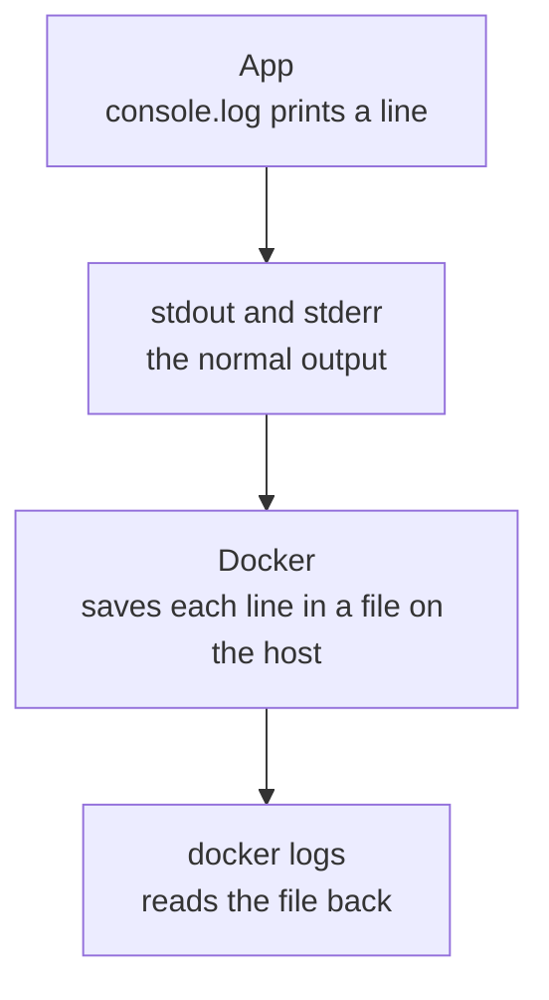
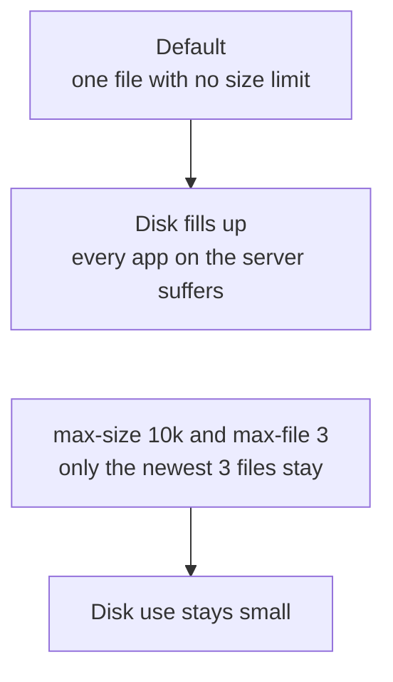
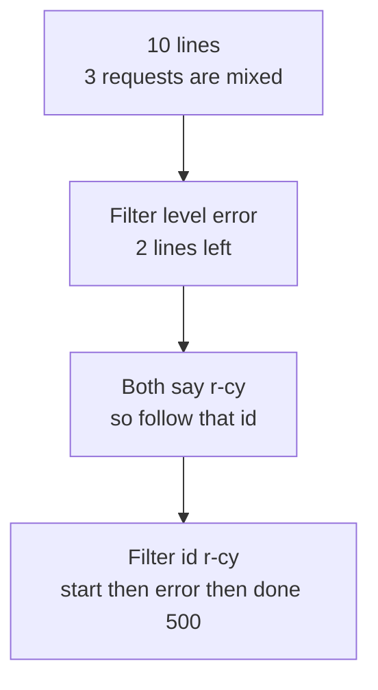
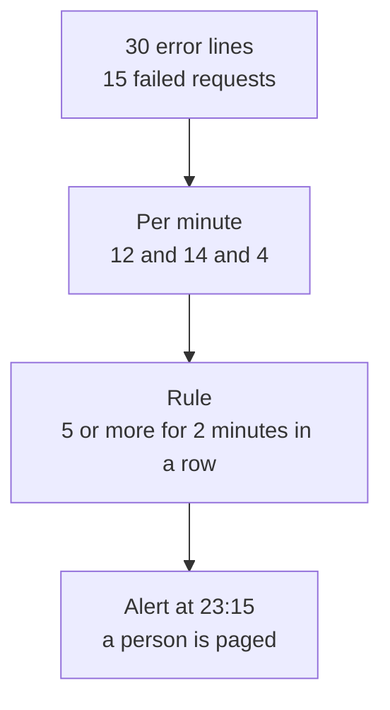
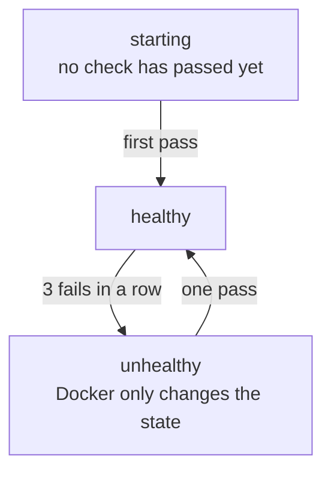
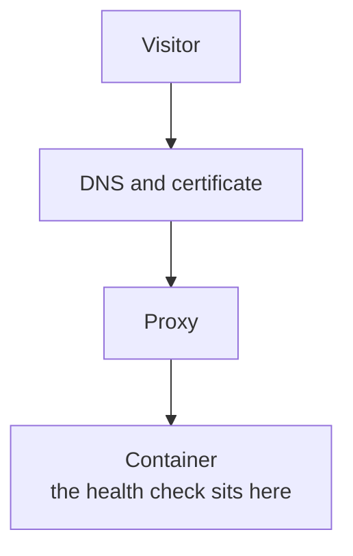
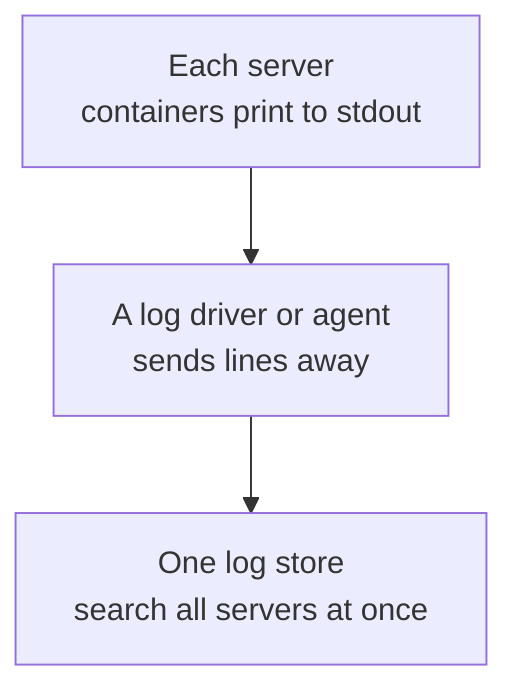

# 10. Logs and monitoring

> **Subject:** DevOps and Cloud · **Lesson:** 10 · **Made:** 2026-11-13 · **Status:** ready
>
> **You will be able to:** say where a container's logs go and how long they live, stop logs from filling the disk, write log lines you can search, turn error lines into an alert that does not cry wolf, explain what a health check does and does not do, and say why you also check the site from outside.
>
> **Before this:** [Config and secrets](09-config-and-secrets.md) · **Next:** [Kubernetes probes, limits and rollouts](11-kubernetes-probes-limits-and-rollouts.md)
>
> **How to read it:** one card is one idea. Look at the picture, guess, then press the orange bar to check. The blue bars (📖 More detail) hold the longer explanation. Skip them on the first read, and open them when you want more. Every log line, number and command output in this lesson came from a real run on Docker Desktop 29.3.1 unless the text says "from the docs, not run here". About 20 minutes for the cards.

<!-- quick-summary:start -->
## Quick summary

> Short on time? Read only this. These are the "Remember" lines from the cards below, so you can read the whole lesson in one minute.

- The app prints to stdout and stderr. Docker keeps the lines. They live as long as the container does.
- The default json-file driver never rotates. Set `max-size` and `max-file`, or one noisy app can fill the disk.
- One JSON line per event. The level answers "how bad?". The request id answers "whose?".
- An alert says "wake me if X for Y minutes". Alert on what users feel, and wait a few minutes so one spike does not page you.
- A health check only reports. Plain Docker does not restart an unhealthy container. Swarm or Kubernetes may.
- A green health check inside does not prove users can reach you. Check the public address from another machine.
- Send logs off the machine to one place. Keep rotation on as well, so a full disk cannot stop the app.
- Never print a secret. Rotate the logs, give every line an id, and page only on what users feel.
<!-- quick-summary:end -->

## 1. The app prints. Docker keeps the lines.

Your app runs in a container. Something goes wrong at night. The only clue is what the app printed. In a container, the app should not write its own log file. It just prints to **stdout** (the normal output of a program, where `console.log` goes) and **stderr** (the same, for errors). Docker catches both and keeps each line in a file on the host machine. You read them with `docker logs`.



Notice: the app never opens a file. Docker does the keeping.

<details class="guess"><summary>🤔 Guess: you stop a container, then remove it with docker rm. Can you still read its logs? Press to check.</summary>

**After stop, yes. After remove, no.** The log file belongs to the container. In my test `docker logs` worked on the stopped container, and after `docker rm` it said `No such container`.

</details>

> **Remember:** the app prints to stdout and stderr. Docker keeps the lines. They live as long as the container does.

<details class="more"><summary>📖 More detail: four new words, the real commands, and why stdout</summary>

**Four new words in this lesson:** stdout (this card), log rotation (card 2), request id (card 3), health check (card 5).

**The rule has a name.** The Twelve-Factor App says: "A twelve-factor app never concerns itself with routing or storage of its output stream." Each process "writes its event stream, unbuffered, to stdout" ([12factor.net/logs](https://12factor.net/logs), opened 2026-11-13). The place that runs the app decides where the lines go. That is why the same image can log to a file on a laptop and to a log service in production.

**The real commands** (the lab app in `examples/logs-and-monitoring-demo`, one JSON line per event):

```
curl -s localhost:38010/order -H 'x-request-id: r-ana'
curl -s localhost:38010/fail  -H 'x-request-id: r-cy'
docker logs lesson10-demo
```

```
{"time":"2026-11-13T23:34:28.155Z","level":"info","msg":"server started","port":3000,"minLevel":"info"}
{"time":"2026-11-13T23:34:30.007Z","level":"info","msg":"request start","requestId":"r-ana","method":"GET","path":"/order"}
{"time":"2026-11-13T23:34:30.017Z","level":"info","msg":"request done","requestId":"r-ana","status":200,"ms":11}
{"time":"2026-11-13T23:34:30.033Z","level":"info","msg":"request start","requestId":"r-cy","method":"GET","path":"/fail"}
{"time":"2026-11-13T23:34:30.033Z","level":"error","msg":"payment provider timed out","requestId":"r-cy"}
{"time":"2026-11-13T23:34:30.034Z","level":"error","msg":"request done","requestId":"r-cy","status":500,"ms":1}
```

**Useful options** (from the docs, [docker logs](https://docs.docker.com/reference/cli/docker/container/logs/), opened 2026-11-13): `-f` keeps streaming new lines, `--tail N` shows the last N lines, `--since` shows lines after a moment, `-t` puts a time in front of each line. I ran `--tail 2` and `-t --tail 1`, and both worked.

**stdout and stderr are two streams.** The lab app prints errors with `console.error`. In a run with 5 normal lines and 2 error lines, `docker logs c 1>/dev/null` showed only the 2 error lines. Most tools show both streams mixed together.

**The default log driver.** On my Docker Desktop, `docker info` said `driver=json-file`. The Docker docs say the same is the built-in default ([Configure logging drivers](https://docs.docker.com/engine/logging/configure/), opened 2026-11-13).

**What "live as long as the container" means.** In my run: 3 lines while it ran, 4 lines after `docker stop` (the app logged `got SIGTERM`), and `No such container` after `docker rm`. So a container that is replaced on every deploy takes its logs with it. Card 7 is the fix.

</details>

## 2. The default keeps every line, forever

Docker's default log keeper (the **json-file** driver) has no size limit. A noisy container writes one file, and the file only grows. **Log rotation** fixes this: when the file reaches `max-size`, Docker starts a new file, and it deletes the oldest files so that only `max-file` files stay. Without it, one chatty container can fill the disk of the whole server.



Notice: the second setup loses the oldest lines on purpose.

<details class="guess"><summary>🤔 Guess: two containers each print 2000 lines. One has the defaults. The other has max-size 10k and max-file 3. How many lines can you still read? Press to check.</summary>

**2003 lines against 133 lines.** The container with the defaults kept 195,236 bytes. The rotated one kept 13,052 bytes, and its first lines (such as `server started`) were gone.

</details>

> **Remember:** the default json-file driver never rotates. Set `max-size` and `max-file`, or one noisy app can fill the disk.

<details class="more"><summary>📖 More detail: the real test, the trace, the docs, and the settings in three places</summary>

**The real test** (`docker run --log-opt max-size=10k --log-opt max-file=3`, then `/spam?n=2000` on both):

```
lesson10-nolimit  195236 bytes  2003 lines
lesson10-rot       13052 bytes   133 lines
HostConfig.LogConfig.Config:  {}      and      {"max-file":"3","max-size":"10k"}
```

The sizes are small on purpose. A real server keeps lines for months, so the real danger is slow. I did not fill a disk.

**The docs** say `max-size` "Defaults to -1 (unlimited)" and `max-file` "Defaults to 1", and `max-file` is "Only effective when `max-size` is also set" ([json-file driver](https://docs.docker.com/engine/logging/drivers/json-file/), opened 2026-11-13). The configure page says "By default, no log-rotation is performed" and recommends the `local` driver, which "performs log-rotation by default". It keeps json-file as the default for backward compatibility.

**The trace** (stepper, tab 1, with tiny sizes: `max-size=30`, `max-file=2`, each line costs 10 bytes):

| Step | The app prints | What Docker does | State after |
|---|---|---|---|
| 1 to 3 | `request 1` to `request 3` | Writes at the end of file 1 | File 1 has 30 of 30 bytes |
| 4 | `request 4` | Does not fit, so it starts file 2 | Files 1 and 2 exist, nothing deleted |
| 5 and 6 | `request 5`, `request 6` | Writes into file 2 | File 2 has 30 of 30 bytes |
| 7 | `request 7` | Does not fit, starts file 3, only 2 files may stay | **File 1 is deleted**, lines 1 to 3 are gone |
| 8 | `request 8` | Writes into file 3 | Lines 4 to 8 are on disk |

The left container, with no limit, still holds all 8 lines.

**Three places to set it.**

| Where | How |
|---|---|
| One container | `docker run --log-opt max-size=10m --log-opt max-file=3 ...` |
| Compose (the lab has this file, and `docker compose config` printed it back) | `logging: driver: json-file, options: max-size: "10m", max-file: "3"` |
| Every new container on the machine | `daemon.json` with `log-opts`, then restart Docker. Docs: it affects only containers made after the change |

I checked the Compose version: `docker inspect` showed `{"Type":"json-file","Config":{"max-file":"3","max-size":"10m"}}`.

**Kubernetes does it for you, in another place** (from the docs, not run here, [Logging architecture](https://kubernetes.io/docs/concepts/cluster-administration/logging/), opened 2026-11-13). The kubelet rotates container logs with `containerLogMaxSize` (default 10Mi) and `containerLogMaxFiles` (default 5). `kubectl logs` shows only the newest file.

**The cost.** Rotation deletes lines. If you need old lines, send them to a log store (card 7) before they rotate away.

</details>

## 3. Log lines you can search: JSON, a level and a request id

A plain sentence like `error happened` is hard to search. Print one **JSON** object per line instead, with the same fields every time. Two fields matter most. The **level** says how bad the line is: debug, info, warn or error. The **request id** is a short random code that you give every request when it arrives, and you put it into every line of that request. Three customers can use your app at the same moment, and their lines mix. The request id sorts them apart again.



Notice: the level found the bad request. The id then gave its whole story.

<details class="guess"><summary>🤔 Guess: a customer says an order was slow, but nothing failed. The level filter finds no error. What finds it? Press to check.</summary>

**The request id.** In my run, `r-ana` had no error line, but its last line said `ms: 306`, while another order took 109. Search by the id of the customer's request. A level filter cannot find a slow request.

</details>

> **Remember:** one JSON line per event. The level answers "how bad?". The request id answers "whose?".

<details class="more"><summary>📖 More detail: text against JSON, the levels, jq, and the trace</summary>

**The same events as plain text** (`LOG_FORMAT=text`, `LOG_LEVEL=debug`):

```
2026-11-13T23:35:35.197Z INFO request start requestId=r-ana method=GET path=/order
2026-11-13T23:35:35.197Z DEBUG query orders table requestId=r-ana
2026-11-13T23:35:35.222Z ERROR payment provider timed out requestId=r-cy
```

Text is easy to read by eye. JSON is easy for a program to read. Most log stores want JSON.

**The four levels.**

| Level | Use it for | In production |
|---|---|---|
| `debug` | Details for the developer, like "query orders table" | Usually off |
| `info` | Normal events, like "request done" | On |
| `warn` | Odd, but the app went on | On |
| `error` | The request or job failed | On, and counted |

With `LOG_LEVEL=info` the lab app printed no debug lines. With `debug` it did.

**Search with jq** (real output):

```
docker logs lesson10-demo 2>&1 | jq -c 'select(.level == "error") | [.msg, .requestId]'
["payment provider timed out","r-cy"]
["request done","r-cy"]

docker logs lesson10-demo 2>&1 | grep r-ana | jq -c '[.level, .msg]'
["info","request start"]
["info","request done"]
```

Try the same filter without installing anything in the [jq playground](https://play.jqlang.org/): paste the six lines above as the input.

**The id travels.** The lab app takes `x-request-id` from the request, or makes one, and sends it back in the response header. If the proxy from [lesson 08](08-reverse-proxy-and-nginx.md) adds the header, the proxy log and the app log share one id. The design view is in [Observability](../system-design/14-observability.md), card 4.

**The trace** (stepper, tab 2, ten real lines, three requests):

| Step | You do | `parseLogLines` and `filterLogs` give | You learn |
|---|---|---|---|
| 1 | Read the lines | 10 entries, 0 skipped | Three requests are mixed |
| 2 | `minLevel: "error"` | 2 lines, both `r-cy` | Which request failed |
| 3 | `requestId: "r-cy"` | start, timed out, done with 500 in 3 ms | The whole story in order |
| 4 | `requestId: "r-ana"` | 3 lines, last one 306 ms | A slow request with no error |
| 5 | Imagine no ids | `request done` gives 3 lines | You cannot match a line to a customer |

**The cost.** More fields mean bigger lines and a bigger log. Do not log a field you will never search. Never log a secret (card 8).

</details>

## 4. Count the errors, then alert

Logs answer "what happened to this request?". To know "is it going wrong now?", count. Take the error lines, group them by minute, and write a rule. An **alert** is a message that wakes a person, and it is a sentence: "wake me if X is true for Y minutes". Pick X from what users feel, like errors. Pick Y so a short spike does not wake you at night.



Notice: the alert fires on the second bad minute, not the first.

<details class="guess"><summary>🤔 Guess: errors per minute at 23:14, 23:15 and 23:16 are 12, 14 and 4. The rule is 5 or more, 2 minutes in a row. When does it fire? Press to check.</summary>

**At 23:15.** 23:14 is bad, but one bad minute is not enough. 23:15 is bad and touches it, so the run is complete. 23:16 has only 4 errors, so it does not matter.

</details>

> **Remember:** an alert says "wake me if X for Y minutes". Alert on what users feel, and wait a few minutes so one spike does not page you.

<details class="more"><summary>📖 More detail: the real data, the trace, the quiet minute, and too many alerts</summary>

**Where the numbers came from.** I called `/fail` 15 times in three bursts (6 + 1 ok, 7, 2). Each failed request wrote 2 error lines (`payment provider timed out` and `request done` with status 500), so 30 error lines. `errorsPerMinute` cut each time at the minute (the first 16 characters) and counted. Real result:

```
{ '2026-11-13T23:14': 12, '2026-11-13T23:15': 14, '2026-11-13T23:16': 4 }
alert 5 in 1 row:  2026-11-13T23:14
alert 5 in 2 rows: 2026-11-13T23:15
```

**The trace** (stepper, tab 3, `findAlert(perMinute, 5, 2)`):

| Step | Minute | Count | The rule does | State after |
|---|---|---|---|---|
| 1 | 23:14 | 12 | Bad, first of a run | Run is 1, no alert |
| 2 | 23:15 | 14 | Bad, touches the minute before | Run is 2, **alert fires** |
| 3 | 23:16 | 4 | Not bad | The alert already fired |
| 4 | What if 23:15 had 3 errors | 3 | Not bad, the run starts again | `findAlert` gives `null` |

**The tradeoff.** The rule "5 errors, 1 minute" would have paged at 23:14, one minute earlier, and also for every short spike. A longer wait means fewer false alarms but a slower page. Google's SRE book says "Every page should be actionable", and "when pages occur too frequently, employees second-guess, skim, or even ignore incoming alerts" ([Monitoring Distributed Systems](https://sre.google/sre-book/monitoring-distributed-systems/), opened 2026-11-13).

**What to watch.** The same page names four signals: latency, traffic, errors and saturation (how "full" your service is). Page on symptoms users feel, and keep cause-based checks as hints for debugging.

**The limit of this card.** Counting log lines is the simple way. A real system keeps numbers in a metrics store and alerts on error rate, not on lines. That is the metrics lesson ([Metrics, dashboards and alerts](20-metrics-dashboards-and-alerts.md)). For how fast to react, see [SLOs and error budgets](../system-design/26-slos-and-error-budgets.md), card 4 (burn rate).

**Not run here:** a real alerting tool, and a message to a phone. The rule above ran as a function on real log lines.

</details>

## 5. A health check reports. It does not fix.

A container can be running and still be broken, for example when the app is stuck. A **health check** is a small command that Docker runs inside the container again and again. Exit code 0 means pass. Exit code 1 means fail. The container starts as `starting`, becomes `healthy` after a pass, and becomes `unhealthy` after enough failures in a row (3 by default).



Notice: nothing in this picture restarts the container.

<details class="guess"><summary>🤔 Guess: a container turns unhealthy. It runs with plain Docker and --restart=always. Does Docker restart it? Press to check.</summary>

**No.** In my test the state was `unhealthy` with a streak of 6, and `RestartCount` stayed 0 with the policy set to `always`. The state is only a report. Something else must act on it.

</details>

> **Remember:** a health check only reports. Plain Docker does not restart an unhealthy container. Swarm or Kubernetes may.

<details class="more"><summary>📖 More detail: the real run, the defaults, who acts, and the trace</summary>

**The check in the lab** (the real defaults are 30 seconds apart, I used 2 so you can watch):

```
HEALTHCHECK --interval=2s --timeout=2s --start-period=3s --retries=3 \
  CMD wget -q -O /dev/null http://127.0.0.1:3000/health || exit 1
```

**The real run.** I called `/break` (the app starts answering 500 on `/health`) and read the state every 2 seconds:

```
healthy streak=1
healthy streak=2
unhealthy streak=3
unhealthy streak=4
...
restarts=0 running=true
docker ps: Up 29 seconds (unhealthy)
```

`docker inspect` kept the last results, such as `ExitCode 1` with the output `wget: server returned error: HTTP/1.1 500 Internal Server Error`. `docker events` printed `health_status: healthy` and then `health_status: unhealthy`. After `/heal`, the next check made it `healthy streak=0`.

**The defaults** (Dockerfile reference, opened 2026-11-13): `--interval` 30s, `--timeout` 30s, `--start-period` 0s, `--retries` 3. Exit code 0 means "the container is healthy and ready for use", and 1 means "the container isn't working correctly". "Only the first 4096 bytes are stored currently" of the output.

**Who acts on it.**

| Platform | What happens when it is unhealthy |
|---|---|
| Plain Docker | Only the state changes (measured above) |
| Docker Swarm | The docs say the scheduler "may reschedule your running service containers at any time if they become unhealthy or unreachable" ([Swarm services](https://docs.docker.com/engine/swarm/services/), opened 2026-11-13). From the docs, not run here |
| Kubernetes | A liveness probe can restart the container. That is the next lesson ([lesson 11](11-kubernetes-probes-limits-and-rollouts.md)) |

An idea, not a fact: CapRover runs on Swarm, so a `HEALTHCHECK` in your Dockerfile may matter there. I did not test CapRover.

**The trace** (stepper, tab 4, `healthStatus`, retries 3):

| Check | Result | Streak | Status after |
|---|---|---|---|
| 1 | pass | 0 | `healthy` |
| 2 | fail | 1 | `healthy`, one bad answer is not enough |
| 3 | fail | 2 | `healthy` |
| 4 | fail | 3 | **`unhealthy`**, restarts still 0 |
| 5 | fail | 4 | `unhealthy`, the streak keeps counting |
| 6 | pass | 0 | `healthy` again |

**What to check.** My `/health` is shallow: it only proves the app answers. A deeper check, like "can I reach the database?", finds more, but a slow database then makes every app container unhealthy at once. I did not test a deep check.

</details>

## 6. Check from outside

The health check runs inside the container. It cannot see a broken proxy, a wrong DNS name or an expired certificate. All of those sit between your visitor and the container. A real visitor goes through all of them. So you also ask the site from **outside**: another machine calls the public address every minute and reports up or down.



Notice: the health check sees only the last box. The outside check sees all four.

<details class="guess"><summary>🤔 Guess: docker ps says healthy, but users see an error page. Where could the fault be? Press to check.</summary>

**Anywhere before the last box.** The certificate has expired, the DNS points at an old server, or the proxy cannot reach the container. The inside check cannot see any of these.

</details>

> **Remember:** a green health check inside does not prove users can reach you. Check the public address from another machine.

<details class="more"><summary>📖 More detail: the small checker, the real answers, and the honest limit</summary>

**The checker in the lab** (`uptime.js`, plain Node, no packages). It asks a URL with a 2 second limit and prints `UP` or `DOWN` and why. Real runs:

```
node uptime.js http://127.0.0.1:38010/health   23:35:00 ... UP
(after /break)                                  23:35:00 ... DOWN, status 500
node uptime.js http://127.0.0.1:38099/health   23:35:00 ... DOWN, ECONNREFUSED
(after docker stop)                             23:35:01 ... DOWN, ECONNREFUSED
```

**The honest limit.** I ran this on the same machine as the container. That proves the code, but it is not really "outside". A real check must run from another place, and it must call the public name, through DNS, HTTPS and the proxy ([Reverse proxy and Nginx](08-reverse-proxy-and-nginx.md)).

**What the answers tell you.** `status 500` means the app answered with an error. `ECONNREFUSED` means nobody is listening on that port. A timeout means something is too slow or the path is blocked.

**Where to run it.** A hosted uptime service, or a small job on another server. I did not test any hosted service. The point for an interview: the check must not live in the same place as the thing it checks.

**Link to the numbers.** Uptime checks feed the "is the site up" number that [SLOs and error budgets](../system-design/26-slos-and-error-budgets.md) work with.

</details>

## 7. Many machines: send the logs to one place

Card 1 said logs die with the container. On one server you can still run `docker logs`. With three servers and containers that are replaced on every deploy, you would have to guess which server saw the request, and the container may be gone. The fix is to send each line to **one log store** while the container is alive, and to search there.



Notice: the app code does not change. Only the place Docker sends the lines does.

<details class="guess"><summary>🤔 Guess: a customer says "my order failed an hour ago". The app runs on 3 servers and deploys 4 times a day. Where do you look? Press to check.</summary>

**In the log store.** Without it, you must find the right server and the right container, and an old container may already be removed. In the store you search by request id across all of them.

</details>

> **Remember:** send logs off the machine to one place. Keep rotation on as well, so a full disk cannot stop the app.

<details class="more"><summary>📖 More detail: the options, from the docs, and what I did not run</summary>

**All of this card is from the docs, not run here** (opened 2026-11-13).

| Where | What the docs say |
|---|---|
| Docker log drivers | The `awslogs` driver "creates the AWS CloudWatch Logs stream used for container log persistence" ([awslogs](https://docs.docker.com/engine/logging/drivers/awslogs/)). You choose the driver with `--log-driver` or in `daemon.json` |
| Kubernetes | "Cluster-level logging architectures require a separate backend to store, analyze, and query logs. Kubernetes does not provide a native storage solution for log data" ([Logging architecture](https://kubernetes.io/docs/concepts/cluster-administration/logging/)) |

**The pattern is the same everywhere.** The app prints to stdout. A driver or an agent on each machine reads the lines and sends them to a store. Names you will meet: CloudWatch Logs (AWS), Loki, Elasticsearch with Kibana, and hosted services. I did not run any of them.

**The cost.** A log store costs money for the lines it keeps, and it is one more thing to run and to allow access to. Ask what you must keep and for how long. Also, a store sees every line, so a secret that you log (card 8) is now in two places.

**One more tradeoff.** Some drivers can stop `docker logs` from working on that container. The docs page I read for `awslogs` does not say. Check it for the driver you choose.

</details>

## 8. Four mistakes with logs

Most log trouble comes from a few habits. Each one is cheap to avoid at the start and painful to fix during an incident.

| Problem | Why it hurts | Fix |
|---|---|---|
| No rotation | One noisy app fills the disk | `max-size` and `max-file` (card 2) |
| Lines with no request id | You cannot follow one customer | An id in every line (card 3) |
| A rule that pages on every spike | People stop reading alerts | Wait for a run of minutes (card 4) |
| A secret in a log line | Anyone who reads logs reads the secret | Mask it before it is printed |

Notice: the first three are about being able to find things. The last is about keeping things safe.

<details class="guess"><summary>🤔 Guess: at start, your app prints its whole config object, and it holds a database password. Who can read it? Press to check.</summary>

**Everyone who can read the logs.** That is `docker logs` on the machine, and the log store of card 7, and anyone with access to it. A log line travels far. Mask secrets before you print.

</details>

> **Remember:** never print a secret. Rotate the logs, give every line an id, and page only on what users feel.

<details class="more"><summary>📖 More detail: the secret case, and what to do when it already happened</summary>

**The secret case has its own lesson.** [Config and secrets](09-config-and-secrets.md), card 8, shows `redactText` and `redact`, which hide values such as `API_TOKEN=not-a-real-secret` before the line is printed. It is a second net, not the first. The first rule is: do not put a secret where a log can reach it.

**If a secret reached the logs.** Treat it as public and change it first. Then clean up. The order is in card 8 of that lesson.

**Too much at debug.** Running production at `debug` makes logs big and slow to search, and it can print private data. Run at `info`, and turn on `debug` for a short time when you need it. In my lab, `LOG_LEVEL` is an environment variable ([card 1 of lesson 09](09-config-and-secrets.md)), so you can change it without a new image.

**Quiet health checks.** The lab logs a health check at `debug` level. A check runs every few seconds, so at `info` it would drown the real lines.

</details>

## 9. Watch and play

Links were checked on 2026-11-13. For the videos I read the title and channel from the YouTube oEmbed data. I did not watch them, and I did not check how long they are. For the pages I opened them and read the parts named below. If a link is broken, tell me and I will replace it.

- **Play with it:** [the stepper in this folder](visuals/10-logs-and-monitoring.html) - guess first, then press Next. Four tabs: logs filling the disk, finding one request, counting errors into an alert, and a health check.
- **Run it for real:** [the lab](examples/logs-and-monitoring-demo/README.md) - a small Node app in a container. Read its logs, compare rotation, and turn it unhealthy. It uses only Docker.
- **Play with it:** [the jq playground](https://play.jqlang.org/) - paste the log lines from card 3 and try `select(.level == "error")`. It is the same filter as `docker logs | jq`.
- **Video:** [Four Golden Signals for Monitoring Systems](https://www.youtube.com/watch?v=OTqikK7bbik) - Interview Kickstart US. Title and channel checked only. Compare it with card 4.
- **Video:** [Docker Healthchecks & Restart Policies Explained](https://www.youtube.com/watch?v=CsIZy4mBM5A) - DheerajTechInsight. Title and channel checked only. Compare what it says about restarts with my test in card 5.
- **Video:** [How To Use CorrelationId in Node Js Microservices](https://www.youtube.com/watch?v=OaHXz3iiw1U) - CodeSpace. Title and channel checked only. A correlation id is the same idea as the request id in card 3.
- **Read:** [Docker docs: json-file logging driver](https://docs.docker.com/engine/logging/drivers/json-file/) - the `max-size` and `max-file` options. It is card 2.
- **Read:** [Google SRE book: Monitoring Distributed Systems](https://sre.google/sre-book/monitoring-distributed-systems/) - the four signals and "every page should be actionable". It is card 4.
- **Pictures:** [Kubernetes: Logging architecture](https://kubernetes.io/docs/concepts/cluster-administration/logging/) - diagrams of node level and cluster level logging. It goes with cards 2 and 7.

<details><summary>Go deeper (optional)</summary>

**More pages I opened.** [The Twelve-Factor App: Logs](https://12factor.net/logs). [Configure logging drivers](https://docs.docker.com/engine/logging/configure/). [docker logs](https://docs.docker.com/reference/cli/docker/container/logs/). [Dockerfile reference](https://docs.docker.com/reference/dockerfile/) (HEALTHCHECK). [Swarm services](https://docs.docker.com/engine/swarm/services/). [awslogs driver](https://docs.docker.com/engine/logging/drivers/awslogs/). [CapRover troubleshooting](https://caprover.com/docs/troubleshooting.html) (it only says to check the app's deployment and service logs, and gives no details on log size).

**Checked on 2026-11-13** with Docker Desktop 29.3.1 (json-file driver, health checks, `docker events`, Compose), Node `24-alpine` for the lab app, Node 26.12.1 on the host for `uptime.js` and the practice code, and `jq` from macOS.

**What I did not test.** A full disk. Docker Swarm acting on an unhealthy task. Kubernetes `kubectl logs`, kubelet rotation and probes (there was no cluster). The `awslogs` driver and any log store such as Loki or CloudWatch. A hosted uptime service. A deep health check. How CapRover shows logs or sets log limits. The `local` log driver. The lines in the stepper for tab 2 and tab 3 came from earlier runs of the same lab app, and the counts in tab 1 (2003 lines, 133 lines) came from a run I repeated for this lesson.

**The stepper and the practice answer share their code.** The page runs the same six functions as the answer in card 10, and I compared them after removing comments.

**Temporary Docker things** made for this lesson were named with the prefix `lesson10-` and removed when I finished. I did not touch other containers.

</details>

## 10. Practice

**A. Predict the output** (write your answer before opening)

```js
const text = [
  '{"time":"2026-11-13T23:09:05Z","level":"error","msg":"a"}',
  "Error: boom",
  '{"time":"2026-11-13T23:09:30Z","level":"error","msg":"b"}',
  '{"time":"2026-11-13T23:10:10Z","level":"info","msg":"c"}',
].join("\n");
const { entries, skipped } = parseLogLines(text);
const perMinute = errorsPerMinute(entries);
console.log(entries.length, skipped);
console.log(perMinute);
console.log(findAlert(perMinute, 2, 1), findAlert(perMinute, 2, 2));
console.log(healthStatus([true, false, false, false, true, false]));
console.log(keptLines(["a1", "a2", "b1", "b2", "c1"], 6, 2));
```

Then answer: why is the second alert `null`, and why is `failingStreak` 1 and not 4?

<details><summary>Answer</summary>

```
3 1
{ '2026-11-13T23:09': 2 }
2026-11-13T23:09 null
{ status: 'healthy', failingStreak: 1 }
[ 'b1', 'b2', 'c1' ]
```

`Error: boom` is not JSON, so 3 lines are read and 1 is skipped. Only the error lines are counted, so 23:09 has 2 and 23:10 has none (it is an `info` line). One bad minute is enough for "1 in a row", but "2 in a row" needs a second bad minute that touches it, so the answer is `null`. In the health list, the last pass sets the status to `healthy` and the streak back to 0, and the final fail makes it 1. Each of `a1`, `a2` and the others costs 3 bytes, so a file of 6 holds 2 lines, and `max-file` 2 keeps the newest two files: `b1, b2` and `c1`. (Checked on 2026-11-13 with Node 26.12.1.)

</details>

**B. Fix the bug**

This `healthStatus` should return `{ status: "healthy", failingStreak: 1 }` for `[true, false, false, false, true, false]`. It returns `{ status: "unhealthy", failingStreak: 4 }`. Find the bug.

```js
function healthStatus(results, retries = 3) {
  let status = "starting";
  let failingStreak = 0;
  for (const ok of results) {
    if (ok) {
      status = "healthy";
    } else {
      failingStreak++;
      if (failingStreak >= retries) status = "unhealthy";
    }
  }
  return { status, failingStreak };
}
```

<details><summary>Answer</summary>

A pass does not set `failingStreak` back to 0, so the old failures keep adding up and the last fail reaches 4. The rule is "failures in a row", so one pass must restart the count. Fix: add `failingStreak = 0;` inside the `if (ok)` branch. I ran the buggy version and it printed `{ status: 'unhealthy', failingStreak: 4 }`. With the fix it printed `{ status: 'healthy', failingStreak: 1 }`.

</details>

**C. Write it yourself**

Open `learn/devops-cloud/practice/10-logs-and-monitoring.js`. It has six empty pieces: `parseLogLines`, `filterLogs`, `errorsPerMinute`, `findAlert`, `healthStatus` and `keptLines`. The comments above them say exactly what each one must do. Write them, then run this from the repo root and make all the tests pass:

```
node --test learn/devops-cloud/practice/10-logs-and-monitoring.test.js
```

`findAlert` is the one to think about: minutes must touch on the clock, a missing minute counts as quiet, and a run can cross an hour or a day.

<details><summary>One possible answer</summary>

```js
const LEVELS = { debug: 10, info: 20, warn: 30, error: 40 };

function parseLogLines(text) {
  const entries = [];
  let skipped = 0;
  for (const raw of text.split("\n")) {
    const line = raw.trim();
    if (line === "") continue;                                    // blank lines are not counted
    try {
      const obj = JSON.parse(line);
      const isObject = obj !== null && typeof obj === "object" && !Array.isArray(obj);
      if (isObject && typeof obj.level === "string" && typeof obj.time === "string") entries.push(obj);
      else skipped++;                                             // valid JSON, but not a log line
    } catch {
      skipped++;                                                  // plain text, a stack trace, half a line
    }
  }
  return { entries, skipped };
}

function filterLogs(entries, options = {}) {
  const { minLevel, requestId } = options;
  return entries.filter((entry) => {
    if (minLevel !== undefined) {
      const rank = LEVELS[entry.level];
      if (rank === undefined || rank < LEVELS[minLevel]) return false;   // too quiet, or an unknown level
    }
    if (requestId !== undefined && entry.requestId !== requestId) return false;
    return true;
  });
}

function errorsPerMinute(entries) {
  const counts = {};
  for (const entry of entries) {
    if (entry.level !== "error") continue;
    const minute = entry.time.slice(0, 16);                       // "2026-11-13T23:09"
    counts[minute] = (counts[minute] || 0) + 1;
  }
  return counts;
}

const minuteNumber = (key) => Date.parse(key + ":00Z") / 60000;

function findAlert(perMinute, threshold, inARow) {
  let run = 0;
  let last = null;
  for (const key of Object.keys(perMinute).sort()) {
    if (perMinute[key] < threshold) {
      run = 0;
      continue;
    }
    const nextToLast = last !== null && minuteNumber(key) === minuteNumber(last) + 1;
    run = nextToLast ? run + 1 : 1;                               // a gap in time starts the count again
    last = key;
    if (run >= inARow) return key;
  }
  return null;
}

function healthStatus(results, retries = 3) {
  let status = "starting";
  let failingStreak = 0;
  for (const ok of results) {
    if (ok) {
      status = "healthy";
      failingStreak = 0;
    } else {
      failingStreak++;
      if (failingStreak >= retries) status = "unhealthy";
    }
  }
  return { status, failingStreak };
}

// Put the lines into files. A new file starts when the next line would not fit and the file is not empty.
function filesOf(lines, maxSize) {
  const files = [[]];
  let size = 0;
  for (const line of lines) {
    const bytes = line.length + 1;                                // one more for the newline
    if (size + bytes > maxSize && files[files.length - 1].length > 0) {
      files.push([]);                                             // rotate: start a new file
      size = 0;
    }
    files[files.length - 1].push(line);
    size += bytes;
  }
  return files;
}

function keptLines(lines, maxSize, maxFile) {
  return filesOf(lines, maxSize).slice(-maxFile).flat();          // the oldest files are deleted
}

module.exports = { parseLogLines, filterLogs, errorsPerMinute, findAlert, healthStatus, keptLines };
```

Checked on 2026-11-13 with Node 26.12.1: the 39 tests fail on the empty stub and all 39 pass with this answer. I also tried 55 wrong versions of the answer (for example, a rotation that keeps the oldest files, an alert that ignores gaps in time, a health check that never resets the streak, a filter that matches the start of an id). The tests caught 49. The other 6 changed nothing that a user can see, such as a reset of the run that the gap check already does. The stepper page uses these same functions.

</details>

## 11. Interview question

**Q:** "Your app runs in containers. How do you know it is healthy in production, and how do you find the cause when it is not?"

A common follow-up: "The disk on the server is full and the app is down. What could have caused it?" Card 2 is the answer.

<details><summary>A strong answer, in four parts</summary>

1. **Problem:** A container can be running and still broken. Its logs die with it, the default log file can fill the disk, and a customer's request is hard to find when many requests are mixed. And a check inside the container cannot see what users see.
2. **How it works:** The app prints one JSON line per event to stdout, with a level and a request id. Docker keeps the lines, with rotation set (`max-size`, `max-file`), and an agent sends them to one log store. I count errors per minute and alert on what users feel, with a short wait so a spike does not page me. A `HEALTHCHECK` reports the state, and Swarm or Kubernetes can act on it. A check from another machine tests the public address.
3. **Tradeoff:** Rotation saves the disk but deletes old lines. A short alert wait pages faster but more often, and too many alerts get ignored. A deep health check finds more but can make every container unhealthy at once. A log store gives search, but it costs money, is one more thing to run, and sees every secret that is printed. Plain Docker does not restart an unhealthy container, which I measured.
4. **My example:**
   - **Fact:** I deploy with Docker and CapRover. My DBO case study says the backend is four Node and TypeScript services on Docker Swarm via CapRover.
   - **Fact (from this lesson's lab run, not from DBO):** on Docker Desktop the default json-file logs had no limit, and an unhealthy container with `--restart=always` was not restarted.
   - **Idea, not a fact:** my case study suggests JSON logs with a request id passed through every service. I would check that each CapRover app has log limits, and that every service prints one JSON line per event with the id. I did not check how CapRover shows or limits logs, and I should not say DBO already does this.

</details>

## 12. Explain it back

Close this file. Explain logs and monitoring out loud like to a new junior, in 4 parts (problem, how, tradeoff, my example). Use the story of the unhealthy container: the health check failed 3 times, the state changed to `unhealthy`, and `RestartCount` stayed 0 even with `--restart=always`. Say what you would add so someone is told, and why you would also check from outside. Then write your best version below and run `/explain-check logs and monitoring` or ask the `explain-coach` agent to review it.

### My explanation

<write here>

### Coach feedback

<the explain-coach agent writes here>

## 13. Review questions (day 1, 3, 7, 21)

1. Where do a container's logs go, how long do they live, and what changes after `docker rm`?
2. Why does Docker's default log setting risk a full disk, and which two options fix it?
3. Three requests overlap in the logs. What two fields help you, and what does each answer?
4. Errors per minute are 12, 14, 4, and the rule is 5 or more for 2 minutes in a row. When does it fire, and what changes if the rule is "1 minute"? Draw the picture from memory: the four boxes of card 4.
5. A container is unhealthy and plain Docker did nothing. Why, and who can act on the state?

<details><summary>Answers</summary>

1. The app prints to stdout and stderr, and Docker keeps the lines in a file on the host. They live as long as the container. After `docker stop` they can still be read, and after `docker rm` they are gone. That is why many-machine setups send them to a log store.
2. json-file has no size limit by default, so one file only grows. Set `max-size` (when to start a new file) and `max-file` (how many files stay). The oldest lines are deleted on purpose.
3. The level says how bad a line is. The request id says whose line it is. The time cannot separate them, because the requests ran at the same moment.
4. At 23:15. The first bad minute (23:14) is not enough, and the second one touches it. With "1 minute" it fires at 23:14, one minute earlier, and also on every short spike. The four boxes: error lines, counts per minute, the rule, the alert.
5. A health check only reports the state. Plain Docker does not restart on it, even with `--restart=always` (measured). Docker Swarm may reschedule the task (docs), and Kubernetes can restart on a failed liveness probe.

</details>

## Connected lessons

- [Config and secrets](09-config-and-secrets.md) - the lesson before. Card 8 there shows how to mask a secret before it is logged.
- [Kubernetes probes, limits and rollouts](11-kubernetes-probes-limits-and-rollouts.md) - the next lesson. A liveness probe is where a failed check can restart a container.
- [Reverse proxy and Nginx](08-reverse-proxy-and-nginx.md) - the proxy writes its own access log, and a request id header can start there.
- [Docker Compose](03-docker-compose.md) - the `logging:` block in card 2 goes in a Compose service.
- [Kubernetes objects](04-kubernetes-objects.md) - the pods whose logs `kubectl logs` reads.
- [Observability](../system-design/14-observability.md) - the design view: metrics, traces and logs, and JSON logs with a trace id.
- [SLOs and error budgets](../system-design/26-slos-and-error-budgets.md) - how fast to react and what to alert on, in numbers.
- [Metrics, dashboards and alerts](20-metrics-dashboards-and-alerts.md) - the better way to count than counting log lines.
- Incidents, on-call and postmortems (planned) - what to do after the alert fires.
