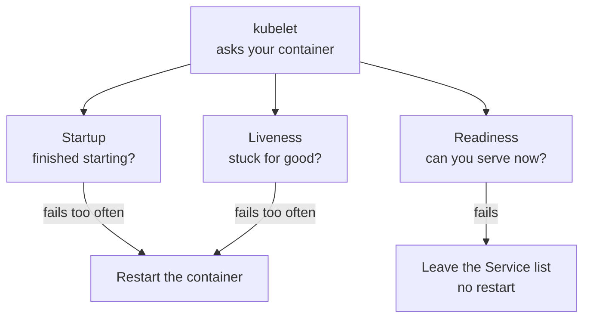
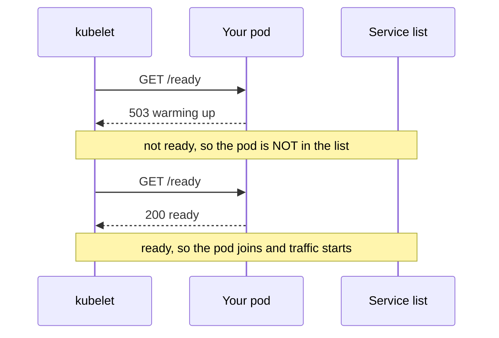
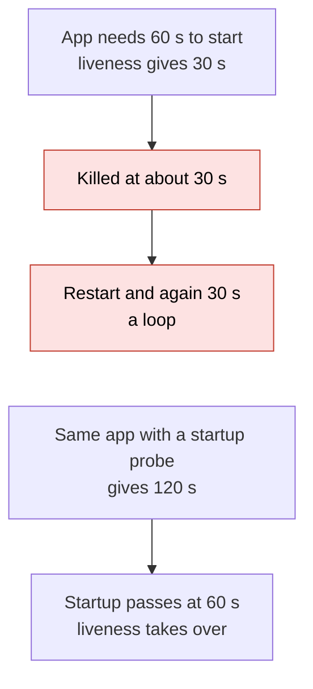
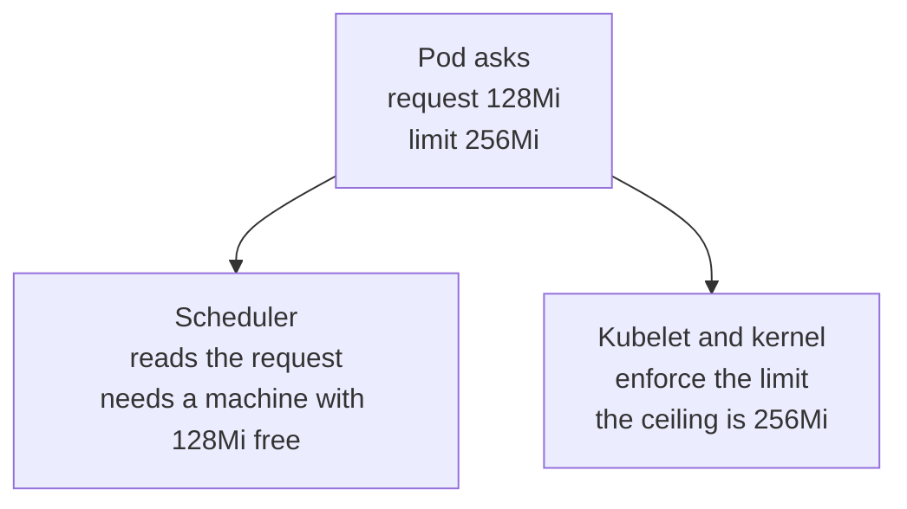
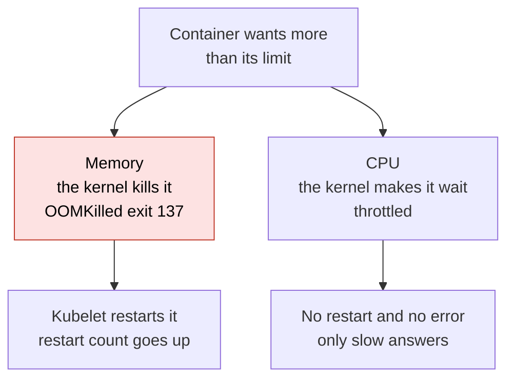
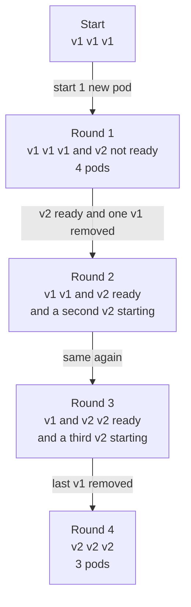
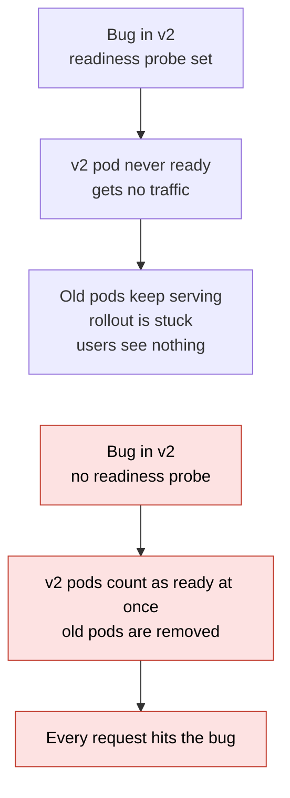

# 11. Kubernetes probes, limits and rollouts

> **Subject:** DevOps and Cloud · **Lesson:** 11 · **Made:** 2026-11-17 · **Status:** ready
>
> **You will be able to:** say what the three probes ask and what Kubernetes does when each one fails, say what a request and a limit are, explain why a memory limit kills and a CPU limit only slows, follow a rolling update with maxSurge and maxUnavailable, and explain why a readiness probe turns a bad release into a stuck rollout and not an outage.
>
> **Before this:** [Logs and monitoring](10-logs-and-monitoring.md) and [Kubernetes objects](04-kubernetes-objects.md) · **Next:** Metrics, dashboards and alerts (planned)
>
> **How to read it:** one card is one idea. Look at the picture, guess, then press the orange bar to check. The blue bars (📖 More detail) hold the longer explanation. Skip them on the first read, and open them when you want more. Kubernetes facts come from the official docs (the pages are for Kubernetes 1.37), opened on 2026-11-17. There was no cluster on the machine that made this lesson, so anything that needs one is marked "from the docs, not run here". The limit numbers, the Node code and the Compose file were really run on Docker Desktop 29.3.1. About 20 minutes for the cards.

## 1. Three questions: startup, readiness, liveness

Lesson 10 showed that a Docker health check only reports. It does not act. Kubernetes goes further. The **kubelet** (the helper program on each machine, from lesson 04) asks your container a question again and again. One question is a **probe**. It is usually a web request to your own app. There are three kinds, and each one acts differently when the answer is no.



Notice: only the readiness question ends with no restart.

<details class="guess"><summary>🤔 Guess: a readiness probe fails 3 times in a row. Does Kubernetes restart the container? Press to check.</summary>

**No.** The pod leaves the Service's list of pods (lesson 04, card 5), so it gets no traffic. The container keeps running, and the kubelet keeps asking. When the answer is yes again, the pod rejoins. (From the docs, not run here.)

</details>

> **Remember:** startup asks "finished starting?", readiness asks "send me traffic?", liveness asks "restart me?". Only a failed readiness probe does not restart the container.

<details class="more"><summary>📖 More detail: four new words, the settings, a real endpoint, and what you know from Compose</summary>

**Four new words in this lesson:** probe (this card), limit (card 4), OOMKilled (card 5), throttled (card 5). A **rolling update** was named in lesson 04. Card 6 shows it.

**The settings of a probe** (Kubernetes docs, Pod probes, opened 2026-11-17):

| Setting | Default | Meaning |
|---|---|---|
| `periodSeconds` | 10 | Seconds between two checks |
| `timeoutSeconds` | 1 | Seconds to wait for one answer. Too slow counts as a fail |
| `failureThreshold` | 3 | Failures in a row before Kubernetes acts |
| `successThreshold` | 1 | Passes in a row to count as ok. It must be 1 for liveness and startup |
| `initialDelaySeconds` | 0 | Seconds to wait before the first check |

A probe uses one of four ways: `httpGet` (the answer must be 200 to 399), `tcpSocket`, `exec` (a command that exits with 0) or `grpc`. The docs also say: "If a container does not provide a particular probe, the kubelet always considers the result as `Success`." So a container with no readiness probe counts as ready as soon as it runs.

**A real endpoint.** A Node server with two pages. `/health` only proves the process answers. `/ready` says "no" for the first 2 seconds, like an app that is warming up.

```js
const http = require("http");
let ready = false;
setTimeout(() => (ready = true), 2000);
http.createServer((req, res) => {
  // liveness: can the process answer at all
  if (req.url === "/health") return res.end("ok");
  // readiness: can it serve users right now
  res.statusCode = ready ? 200 : 503;
  res.end(ready ? "ready" : "warming up");
}).listen(3000);
```

I started it and called it with `curl`. **Output:**

```
t=0.4s
/health 200
warming up  /ready 503
t=2.6s
/health 200
ready  /ready 200
```

Checked on 2026-11-17 with Node 26.5.0. A 503 is a failed probe, and a 200 is a pass.

**What you know already.** Docker Compose and your Dockerfile have one `HEALTHCHECK` (lesson 10, card 5). It only reports. Kubernetes splits that one check into three questions, and acts on them.

| Compose `healthcheck` key | Kubernetes probe setting |
|---|---|
| `test` | `httpGet`, `exec` and so on |
| `interval` | `periodSeconds` |
| `timeout` | `timeoutSeconds` |
| `retries` | `failureThreshold` |
| `start_period` | close to a startup probe |

I wrote a Compose file with `interval: 10s`, `timeout: 1s`, `retries: 3` and `start_period: 120s`, and `docker compose config` accepted it. An idea, not a fact: CapRover runs on Swarm, which can read a Dockerfile `HEALTHCHECK`. I did not test how CapRover reacts to it.

**Words you will hear:** the Service's list of pods is called **EndpointSlices**. The docs say a failed readiness probe makes "the EndpointSlice controller" remove "the Pod's IP address from the EndpointSlices of all Services that match the Pod".

</details>

## 2. Readiness: no traffic until the pod is ready

A new pod starts, but your Node app needs 20 seconds to load. If the Service sends requests at second 1, users get errors. A **readiness probe** fixes this. The pod stays out of the Service's list until the probe passes. If the probe fails later, the pod leaves the list again.



Notice: the container is never restarted here. Only the list changes.

<details class="guess"><summary>🤔 Guess: a new pod has no readiness probe and needs 20 seconds to start. When does the Service start sending it traffic? Press to check.</summary>

**As soon as the container runs.** With no probe, the kubelet counts the pod as ready. The first 20 seconds of requests to that pod fail. (From the docs, not run here.)

</details>

> **Remember:** readiness decides who gets traffic. A pod that is not ready is out of the Service's list, and nothing restarts. The probe runs for the whole life of the pod.

<details class="more"><summary>📖 More detail: the YAML, what /ready should check, and the docs</summary>

**The YAML** (part of the Deployment in card 6):

```yaml
readinessProbe:
  httpGet:
    path: /ready
    port: 3000
  periodSeconds: 5
  failureThreshold: 2
```

With these numbers a pod leaves the list after 2 failed checks in a row, so after about 10 seconds. It comes back after one pass.

**What the docs say** (Pod probes and the probes task page, opened 2026-11-17):

- "Readiness probes determine when a container is ready to accept traffic."
- "Readiness probes run on the container during its whole lifecycle."
- "The readiness and liveness probes do not depend on each other to succeed."

**What `/ready` should check.** Ask: "can I serve a user right now?" That can mean the warm-up is done, or the connection to the database is open. The docs say: "When your app has a strict dependency on back-end services, you can implement both a liveness and a readiness probe. The liveness probe passes when the app itself is healthy, but the readiness probe additionally checks that each required back-end service is available."

**The cost.** If every pod checks one shared database in `/ready` and the database stops, every pod leaves the list at once. Users then see errors from the Service, but nothing restarts. That is much better than a restart loop (card 8).

**Watch it move:** open [the stepper](visuals/11-kubernetes-probes-limits-and-rollouts.html), tab 3 "Probes over time".

</details>

## 3. Liveness and startup: restart the stuck, and be patient with the slow

Sometimes the app is alive but stuck for good, for example in a deadlock. Only a restart helps. A **liveness probe** asks "are you stuck for good?". After enough failures the kubelet kills the container and starts it again. A slow app has a problem. Liveness may kill it before it has finished starting. A **startup probe** fixes this. While it runs, the other two probes wait.



Notice: the startup probe only guards the start. After it passes, it never runs again for that container.

<details class="guess"><summary>🤔 Guess: your app needs 60 seconds to start. Liveness checks every 10 seconds and allows 3 failures. There is no startup probe. What happens? Press to check.</summary>

**A restart loop.** The kubelet kills the container after about 30 seconds, before it is up. The new container needs 60 seconds again, and is killed again. Between restarts the kubelet waits longer each time (10 s, 20 s, 40 s, up to 5 minutes), and `kubectl` shows `CrashLoopBackOff`. (From the docs, not run here.)

</details>

> **Remember:** liveness means "restart me". Use it only for "stuck for good", and keep the database out of it. A startup probe gives a slow app time, and holds back liveness and readiness until it passes.

<details class="more"><summary>📖 More detail: the YAML, the step by step trace, the docs, and back-off</summary>

**The YAML:**

```yaml
startupProbe:
  httpGet:
    path: /health
    port: 3000
  periodSeconds: 5
  failureThreshold: 24     # 24 x 5 s = 120 s to start
livenessProbe:
  httpGet:
    path: /health
    port: 3000
  periodSeconds: 10
  failureThreshold: 3      # 3 x 10 s = about 30 s stuck
```

**What the docs say** (opened 2026-11-17). Startup: "If a startup probe is configured, Kubernetes does not execute liveness or readiness probes until the startup probe succeeds". If it fails: "the kubelet kills the container, and the container is subjected to its restart policy". The docs give the same advice as card 3: if your container usually starts in more than `initialDelaySeconds + failureThreshold × periodSeconds`, add a startup probe that checks the same page as liveness. Their example gives "a maximum of 5 minutes (30 * 10 = 300s)" to start.

**The step by step trace** of one pod (stepper, tab 3). The thresholds are: startup 24, readiness 2, liveness 3. `probeAction` and `probesRunning` are the practice functions. This is a model of the docs, not a cluster run.

| Time | What the kubelet sees | `probeAction` or `probesRunning` says | State after |
|---|---|---|---|
| 0 s | Container starts | `probesRunning(true, false)` gives `["startup"]` | Not ready, no traffic |
| 5 to 15 s | Startup fails 3 times | `probeAction("startup", ..., 24)` gives `none` | Still starting. Liveness is not running |
| 20 s | Startup passes | `probesRunning(true, true)` gives `["liveness", "readiness"]` | Waiting for readiness |
| 25 s | Readiness passes | | In the Service, traffic starts |
| 30 to 35 s | Readiness fails twice | `probeAction("readiness", ..., 2)` gives `stop traffic` | Out of the Service, restarts 0 |
| 40 s | Readiness passes | `none` | In the Service again |
| 60 to 70 s | The app is stuck. Liveness fails twice | `probeAction("liveness", ..., 3)` gives `none` | No traffic, not restarted yet |
| 80 s | Liveness fails a third time | `restart` | **Restarts 1.** Back to the startup probe |

**Restarts and back-off** (docs): "After containers in a Pod exit, the kubelet restarts them with an exponential backoff delay (10s, 20s, 40s, …), that is capped at 300 seconds (5 minutes)." After 10 minutes without problems the delay resets. The pod keeps its name. A restarted container is not a new pod (lesson 04, card 3).

**Careful with liveness.** The docs warn: "Liveness probes must be configured carefully to ensure that they truly indicate unrecoverable application failure, for example a deadlock. Incorrect implementation of liveness probes can lead to cascading failures."

**Newer fields.** A probe can have its own `terminationGracePeriodSeconds` (since 1.25, not for readiness). More in the Go deeper card.

</details>

## 4. Requests and limits: two numbers for CPU and for memory

Every pod uses CPU and memory on a machine. Kubernetes has two numbers for each. A **request** is what the pod asks to reserve. The scheduler (the part that picks a machine) uses it to find a machine with enough room. A **limit** is the most the pod may use. The kubelet and the Linux kernel (the core of the operating system) enforce it while the pod runs. `cpu: 500m` means 500 thousandths of one core, so half a core. `memory: 256Mi` means 256 MiB.



Notice: two different helpers read the two numbers.

<details class="guess"><summary>🤔 Guess: a pod requests 1 CPU. Every machine has less than 1 CPU left when you count the requests, but all machines are idle. Does the pod start? Press to check.</summary>

**No, it waits as `Pending`.** The scheduler adds up the requests of the pods on a machine. It does not look at real use. An idle machine can still be "full". (From the docs and the lab guide, not run here.)

</details>

> **Remember:** a request is for the scheduler: it reserves room. A limit is for the kernel: it is the ceiling. Docker's `--memory` and `--cpus` set the same limits.

<details class="more"><summary>📖 More detail: units, the real Docker proof, defaults, and the M against Mi trap</summary>

**Units** (Kubernetes docs, Resource management, opened 2026-11-17):

| Written | Means |
|---|---|
| `500m` or `0.5` | Half a CPU core. "100m" is "one hundred millicpu" |
| `1` | One core. It is the same amount of power on a small or a big machine |
| `128Mi` | 128 x 1024 x 1024 bytes |
| `128M` | 128 x 1000 x 1000 bytes. Smaller than 128Mi |
| `128m` | A trap: it means 0.128 **bytes** |

The docs say: "Pay attention to the case of the suffixes. 'M' means megabytes, while 'm' means millibytes. If you request `400m` of memory, this is a request for 0.4 bytes." Practice C has a function `parseQuantity` for exactly this.

**Docker uses the same kernel feature** (lesson 01, card 4, cgroups). I started containers with a limit and read the files the kernel uses:

```
docker run --memory=64m ...  cat /sys/fs/cgroup/memory.max   67108864
docker run --cpus=0.5   ...  cat /sys/fs/cgroup/cpu.max      50000 100000
```

`67108864` is 64 x 1024 x 1024. `50000 100000` means "50 ms of CPU in every 100 ms". The Kubernetes docs say: "On Linux nodes, the Linux kernel enforces limits with cgroups."

**Compose has the same two numbers**, with a Docker spelling: `deploy.resources.limits` and `reservations`. `docker compose config` turned `memory: 256M` into `268435456`, which is 256 x 1024 x 1024. In Docker, `M` is a power of two. In Kubernetes, `M` is a power of ten, so write `Mi` and you are safe in both.

**Other rules** (docs):

- A pod may use more than its request if the machine has room: "it's possible (and allowed) for a container to use more resource than its `request`".
- A limit with no request: "Kubernetes copies the limit you specified and uses it as the requested value".
- The scheduler "uses this information to decide which node to place the Pod on".

**Your numbers in the lesson YAML** (card 6): request `100m` CPU and `128Mi`, limit `500m` and `256Mi`. I ran `kubectl set resources --local` (it needs no cluster) and it printed the same block. A good starting plan: measure real use first, set the request near normal use, and set the memory limit with room above the peak.

</details>

## 5. Over the limit: memory kills, CPU slows

A container that goes over its limit meets the kernel. Memory and CPU are treated very differently. Over the **memory** limit, the kernel kills the container. That is **OOMKilled** (out of memory, killed). It shows an exit code of 137. Over the **CPU** limit, the kernel makes the container wait. That is **throttled**. The container is slower, and nothing prints an error.



Notice: the CPU path has no error anywhere. You find it by slow answers.

<details class="guess"><summary>🤔 Guess: a job needs 1 second of CPU. The container has a CPU limit of 0.5. About how long does the job take? Press to check.</summary>

**About 2 seconds.** In my run it took 1960 ms. With a limit of 0.25 it took 4007 ms. The job did not fail. It only waited.

</details>

> **Remember:** over the memory limit, the container is killed with exit code 137. Over the CPU limit, it is only slowed, with no error. Look at the restart count for memory, and at slow answers for CPU.

<details class="more"><summary>📖 More detail: the real runs, the Node surprise, and the docs</summary>

**The CPU runs** (Docker Desktop 29.3.1, a Node job that burns 1000 ms of CPU, then reads the kernel counters):

| Limit | Wall time for 1000 ms of work | Throttled periods |
|---|---|---|
| none | 1006 ms | 0 |
| `--cpus=0.5` | 1960 ms | 20 of 20 |
| `--cpus=0.25` | 4007 ms | 41 of 41 |

The model `limitEffect` (practice C) gives the speed 0.5 and 0.25, so 2000 and 4000 ms.

**The memory run** (`--memory=64m`, the app grabs 10 MB every 100 ms and keeps it):

```
held 10 MB
held 20 MB
held 30 MB
held 40 MB
held 50 MB
exit code: 137
OOMKilled=true ExitCode=137 Status=exited
```

No JavaScript error appears. The kernel ends the process, so your code cannot catch it. Exit code 137 is 128 + 9, and signal 9 is "kill". In Kubernetes, `kubectl describe pod` shows `Reason: OOMKilled` and `Exit Code: 137` (from the docs and the [lab guide](examples/kubernetes-local-demo/README.md), step 9, not run here).

**The Node surprise.** Node decides its own heap size (the memory for your JavaScript objects). I asked for it inside containers:

```
no memory limit        heap_size_limit 2240 MB
--memory=128m          heap_size_limit  259 MB
--memory=512m          heap_size_limit  259 MB
```

With a 128 MB container, Node thinks it may use 259 MB. A leak in a 128 MB container was killed by the kernel (`OOMKilled=true`, exit 137, no JavaScript error). With `node --max-old-space-size=96` the same leak stopped with `FATAL ERROR: Reached heap limit Allocation failed - JavaScript heap out of memory` and `OOMKilled=false`. That is a clear message you can search for. An idea to check for your app: set `--max-old-space-size` a little below the memory limit.

**What the docs say** (opened 2026-11-17): "`cpu` limits are enforced by CPU throttling... a `cpu` limit is a hard limit the kernel enforces." And: "`memory` limits are enforced by the kernel with out of memory (OOM) kills... A container may use more memory than its `memory` limit, but if it does, it may get killed." The kill only happens when the kernel sees memory pressure.

**The tradeoff.** A memory limit protects the other pods on the machine. It also kills your own pod when you guess wrong. A CPU limit is a hard cap, so it can make your API slow when the machine is idle. Sources disagree on whether to set one. I did not test either choice on a cluster. Pick one on purpose, and check your latency.

**Watch it move:** [the stepper](visuals/11-kubernetes-probes-limits-and-rollouts.html), tab 4 "Limits".

</details>

## 6. A rolling update: start new, wait for ready, remove old

You push a new image. You do not want a gap where no pod can answer. A **rolling update** replaces pods a few at a time. Kubernetes starts a new pod, waits until it is ready, then removes an old one. Two settings set the pace. **maxSurge** is how many extra pods may exist above the wanted number. **maxUnavailable** is how many wanted pods may be missing. Both default to 25 percent.



Notice: 3 pods are ready in every picture.

<details class="guess"><summary>🤔 Guess: 3 pods, maxSurge 1, maxUnavailable 0. What is the most pods that exist at once, and the fewest that are ready? Press to check.</summary>

**4 and 3.** The most is 3 + 1 surge. The fewest ready is 3 - 0. The model in practice C gives `maxPods: 4` and `minReady: 3`.

</details>

> **Remember:** a rolling update starts a new pod, waits for ready, then removes an old one. maxSurge allows extra pods. maxUnavailable allows missing pods. Both default to 25 percent.

<details class="more"><summary>📖 More detail: the step by step trace, the numbers, the full YAML, and the quiet half</summary>

**The step by step trace** (stepper, tab 1). It is the practice function `rollout`: a small model of the Deployment controller. Each round does three things in this order: new pods that were starting pass readiness, old pods are removed while ready stays at the minimum, then new pods are started while the total stays at the maximum.

| Round | What happens | old / starting / ready (new) | Pods that serve |
|---|---|---|---|
| 0 | Three v1 pods run | 3 / 0 / 0 | 3 |
| 1 | Nothing can be removed (only 2 would serve). Start 1 new pod. Now 4 exist | 3 / 1 / 0 | 3. The new pod is **not** in the Service |
| 2 | The v2 pod passes readiness. 4 serve, so remove 1 v1 pod. Start another v2 | 2 / 1 / 1 | 3 |
| 3 | The second v2 passes. Remove 1 v1. Start the third v2 | 1 / 1 / 2 | 3 |
| 4 | The third v2 passes. Remove the last v1 | 0 / 0 / 3 | 3 |

The real controller works out the new size like this (Kubernetes source, `NewRSNewReplicas`, opened 2026-11-17): the total may be `replicas + maxSurge`, and it adds only the room that is left. That is round step 3 above.

**The numbers** (Deployment docs, opened 2026-11-17):

| Setting | Default | Rounding of a percentage | Rule |
|---|---|---|---|
| `maxSurge` | 25% | **up** | Cannot be 0 when maxUnavailable is 0 |
| `maxUnavailable` | 25% | **down** | Cannot be 0 when maxSurge is 0 |

For 3 pods the defaults give a surge of 1 (0.75 rounds up) and 0 unavailable (0.75 rounds down). That is the same as the example above. In the source, if rounding makes both 0, Kubernetes sets `maxUnavailable` to 1 so the update can still move. Practice C has this in `rolloutLimits`.

**The other choice.** `maxSurge: 0` and `maxUnavailable: 1` needs no spare room, but capacity drops to 2 of 3 during the update. The model gives `minReady: 2`. With `maxSurge: 1`, the extra pod needs room: if no machine has room for its request (card 4), the new pod waits as `Pending` and the rollout is stuck.

**The full Deployment** for the lesson's shop-api (from lesson 04). I parsed it with Ruby's YAML reader and checked that the selector matches the labels, all three probes use the container port, no limit is below its request, and the two rollout numbers are not both 0. I did not run it on a cluster.

```yaml
apiVersion: apps/v1
kind: Deployment
metadata:
  name: shop-api
spec:
  replicas: 3
  selector:
    matchLabels:
      app: shop-api
  strategy:
    type: RollingUpdate
    rollingUpdate:
      maxSurge: 1                # one extra pod while updating
      maxUnavailable: 0          # always 3 ready pods
  template:
    metadata:
      labels:
        app: shop-api
    spec:
      terminationGracePeriodSeconds: 30
      containers:
        - name: shop-api
          image: shop-api:1.5.0
          ports:
            - containerPort: 3000
          resources:
            requests:
              cpu: 100m          # the scheduler reserves this
              memory: 128Mi
            limits:
              cpu: 500m          # over this: slowed
              memory: 256Mi      # over this: killed
          startupProbe:
            httpGet:
              path: /health
              port: 3000
            periodSeconds: 5
            failureThreshold: 24 # 24 x 5 s = 120 s to start
          readinessProbe:
            httpGet:
              path: /ready
              port: 3000
            periodSeconds: 5
            failureThreshold: 2
          livenessProbe:
            httpGet:
              path: /health
              port: 3000
            periodSeconds: 10
            failureThreshold: 3
```

**The quiet half: stopping an old pod.** The model does not show it. The docs say the kubelet sends `SIGTERM` to the main process, waits for a grace period ("defaults to 30 seconds"), then sends the KILL signal. In lesson 10 the lab app printed `got SIGTERM` when Docker stopped it, so you have seen this signal. An idea: a Node app that ignores `SIGTERM` is cut off after 30 seconds, with requests still running. Catch `SIGTERM`, stop taking new requests, and finish the current ones.

**Other settings** (docs): `minReadySeconds` (default 0) makes a new pod stay ready that many seconds, with no crash, before it counts. `progressDeadlineSeconds` (default 600) is explained in card 7.

**Watch it move:** [the stepper](visuals/11-kubernetes-probes-limits-and-rollouts.html), tab 1 "A rolling update".

</details>

## 7. A bad release: stuck is better than broken, and you roll back

Your new version has a bug. What do users see? It depends on the readiness probe. With one, the new pod never becomes ready. The rollout stops, and the old pods keep serving. With no probe, every new pod counts as ready at once, and the bug reaches everyone. Kubernetes does not undo a stuck rollout by itself. You, or your pipeline, run `kubectl rollout undo`.



Notice: the only difference is one probe.

<details class="guess"><summary>🤔 Guess: the rollout is stuck for 10 minutes. Does Kubernetes roll back by itself? Press to check.</summary>

**No.** After `progressDeadlineSeconds` (600 by default) the Deployment gets the condition `ProgressDeadlineExceeded`. The docs say: "Kubernetes takes no action on a stalled Deployment other than to report a status condition". `kubectl rollout status` then ends with an error, and that is your signal. (From the docs, not run here.)

</details>

> **Remember:** a readiness probe plus `maxUnavailable: 0` makes a bad release stall, not break. Kubernetes reports the stall but does not roll back. `kubectl rollout undo` does.

<details class="more"><summary>📖 More detail: the step by step trace, the commands, what a probe cannot catch, and the pipeline</summary>

**The step by step trace** (stepper, tab 2). The `rollout` model with `newPodsPassReadiness` set to false gives `status: "stalled"`, `minReady: 3`.

| Step | What happens | old / starting / ready (new) | Users see |
|---|---|---|---|
| 1 | v2 is pushed. One v2 pod starts | 3 / 1 / 0 | Fine. v1 serves |
| 2 | The v2 pod's `/ready` gives 503. It is not ready | 3 / 1 / 0 | Fine |
| 3 | No v1 pod can go (2 would be left). No new pod can start (4 exist) | 3 / 1 / 0 | Fine. The rollout waits |
| 4 | 600 seconds pass. The condition `ProgressDeadlineExceeded` appears | 3 / 1 / 0 | Fine. Nobody has acted yet |
| 5 | You run `kubectl rollout undo` | 3 / 0 / 0 | Fine. The bad pod is gone |

Without a readiness probe the model passes readiness at once (`newPodsPassReadiness` true). After round 2, 1 of 3 pods is broken. After round 4, all 3 are broken, and the rollout reports success.

**The commands** (Deployment docs, opened 2026-11-17):

```
kubectl rollout status deployment/shop-api
kubectl rollout undo deployment/shop-api
kubectl rollout undo deployment/shop-api --to-revision=2
kubectl rollout history deployment/shop-api
```

`rollout status` "returns a non-zero exit code if the Deployment has exceeded the progression deadline". `rollout undo` goes back to the earlier pod blueprint. Old ReplicaSets are kept so this is possible: `revisionHistoryLimit` is 10 by default. Only a change to the pod blueprint makes a revision. The docs: "Other updates, such as scaling the Deployment, do not create a Deployment revision". So a rollback does not undo a change to `replicas`.

**The real run is in the lab.** [The local lab](examples/kubernetes-local-demo/README.md), steps 6 and 7, ships a deliberately broken release and shows the new pod at `READY 0/1`, no failures for users, and the undo. This lesson did not run it.

**What a readiness probe cannot catch.** A probe tests only the page it asks. If `/ready` says 200 but the checkout page is broken, the rollout finishes. A change that already ran on the database is not undone either (lesson [05](05-ci-cd-pipelines.md), card 5). For those, send a small share of traffic to the new version first (a canary) and watch the errors. That is in [Safe deploys](../system-design/27-safe-deploys.md), and the alert rules are in [lesson 10](10-logs-and-monitoring.md), card 4.

**The pipeline.** An idea, not a fact: the last step of the pipeline from lesson 05 runs `kubectl rollout status deployment/shop-api`. If it ends with an error, the next step runs `kubectl rollout undo deployment/shop-api` and the pipeline fails with a clear message. I did not run this.

</details>

## 8. Four mistakes with probes and limits

Most trouble comes from a few settings. Each one is cheap to avoid at the start.

| Problem | Why it hurts | Fix |
|---|---|---|
| No readiness probe | New pods get traffic at once. A bad release goes live (card 7) | Add `/ready` |
| A liveness probe that calls the database | The database is slow, every pod fails liveness, every pod restarts together | Liveness checks only the process (card 3) |
| A slow app and no startup probe | The app is killed before it starts, in a loop | Add a startup probe |
| A memory limit set by guess | The container is killed with exit 137, and no error shows | Measure first. Tell Node the limit (card 5) |

Notice: the first three are about the probes. The last one is about the limits.

<details class="guess"><summary>🤔 Guess: all 3 pods share one liveness probe, and it calls the database. The database is slow for 2 minutes. What happens? Press to check.</summary>

**All 3 pods fail liveness together, and all 3 restart together.** The trouble in the database becomes a trouble in your whole app, and the restarts make it last longer. The docs warn that wrong liveness probes "can lead to cascading failures". (From the docs, not run here.)

</details>

> **Remember:** liveness checks only the process. Readiness may check what you need to serve. Measure memory before you set a limit.

<details class="more"><summary>📖 More detail: wrong and right code, the unit trap, and the freeze plan</summary>

**Wrong:**

```js
// liveness: asks the database
app.get("/health", async (req, res) => {
  await db.query("select 1");
  res.end("ok");
});
```

**Right:**

```js
// liveness: only the process
app.get("/health", (req, res) => res.end("ok"));
// readiness: what I need to serve
app.get("/ready", async (req, res) => {
  await db.query("select 1");
  res.end("ready");
});
```

**Why:** the first version restarts healthy pods when the database is slow. The second takes pods out of the list instead, and nothing restarts. Even then, a shared database makes every pod unready at once, so keep the readiness query small and fast. (The code shape is an idea from the docs, I did not run it with a database.)

**Wrong:** `memory: 400m`. **Right:** `memory: 400Mi`. **Why:** `m` means thousandths, so the first one asks for 0.4 bytes (card 4). In my test, `parseQuantity("128m")` gives `0.128`.

**Wrong:** a limit set because a blog said "512Mi". **Right:** watch the real use for a few days (lesson 10), set the request near normal use, and set the limit above the peak with room to spare. The lab guide notes that Kubernetes refuses a limit that is lower than the request.

**If you freeze:**

1. Say "Startup, readiness and liveness are three questions. Readiness controls traffic. Liveness restarts."
2. Say "A request reserves room for the scheduler. A limit is the ceiling. Over memory is killed, over CPU is slowed."
3. Say "A rolling update starts new, waits for ready, then removes old. A readiness probe makes a bad release stall, and I undo it."

</details>

## 9. Watch and play

Links were checked on 2026-11-17. For the videos I read the title and channel from the YouTube oEmbed data. I did not watch them, and I did not check how long they are. For the pages I opened them and read the parts named below. If a link is broken, tell me and I will replace it.

- **Play with it:** [the stepper in this folder](visuals/11-kubernetes-probes-limits-and-rollouts.html) - guess first, then press Next. Four tabs: a rolling update, a bad release, probes over time, and limits.
- **Run it for real:** [the local lab](examples/kubernetes-local-demo/README.md) - a free cluster on your laptop with kind. Step 6 is the rolling update, step 7 is the broken release and the undo, step 9 is OOMKilled. Its `deployment.yaml` has probes and limits, line by line. This lesson did not run it.
- **Play with it:** [Kubelings, liveness vs readiness](https://labs.iximiuz.com/courses/kubelings-dbd840c8/module-02/liveness-vs-readiness) - a hands-on exercise: a liveness probe checks the wrong port and the kubelet keeps restarting a healthy container, so you fix it. I read the task text. I did not start it, and I do not know if it needs an account.
- **Video:** [Day 18/40 - Kubernetes Health Probes Explained | Liveness vs Readiness Probes](https://www.youtube.com/watch?v=x2e6pIBLKzw) - Tech Tutorials with Piyush. Title and channel checked only. Compare it with cards 1 to 3.
- **Video:** [The Real Reason Your Kubernetes Pods Get OOMKilled](https://www.youtube.com/watch?v=PgRBnEphSa4) - Techi Nik. Title and channel checked only. Compare it with card 5.
- **Read:** [Kubernetes docs: Liveness, Readiness, and Startup Probes](https://kubernetes.io/docs/concepts/workloads/pods/probes/) - the three probes, what each failure does, and the defaults table. It is cards 1 to 3.
- **Pictures:** [Kubernetes Basics: Performing a Rolling Update](https://kubernetes.io/docs/tutorials/kubernetes-basics/update/update-intro/) - four small diagrams of pods being replaced, and the `rollout undo` of card 7. I could not read the diagrams as text, so open the page and look.

<details><summary>Go deeper (optional)</summary>

**More pages I opened.** [Resource management for pods and containers](https://kubernetes.io/docs/concepts/configuration/manage-resources-containers/) (requests, limits, units, the quotes in card 5). [Deployments](https://kubernetes.io/docs/concepts/workloads/controllers/deployment/) (maxSurge, maxUnavailable, progressDeadlineSeconds, rollback). [Configure probes](https://kubernetes.io/docs/tasks/configure-pod-container/configure-liveness-readiness-startup-probes/) (the startup example). [Pod lifecycle](https://kubernetes.io/docs/concepts/workloads/pods/pod-lifecycle/) (back-off, stopping a pod). [Pod QoS classes](https://kubernetes.io/docs/concepts/workloads/pods/pod-qos/). [Resize CPU and memory in place](https://kubernetes.io/docs/tasks/configure-pod-container/resize-container-resources/). [Sidecar containers](https://kubernetes.io/docs/concepts/workloads/pods/sidecar-containers/). The Kubernetes source for [ResolveFenceposts and NewRSNewReplicas](https://github.com/kubernetes/kubernetes/blob/master/pkg/controller/deployment/util/deployment_util.go).

**More to play with and watch.** [Killercoda Kubernetes playground](https://killercoda.com/playgrounds/scenario/kubernetes) - a free cluster in the browser (page title checked only, I did not start it). Video: [Kubernetes Rolling Updates & Rollbacks | Zero Downtime Deployments Explained](https://www.youtube.com/watch?v=wWA9JgAvuqw) - Techi Nik (title and channel checked only). Compare it with cards 6 and 7.

**Newer things in the docs** (opened 2026-11-17, all from the docs, not run here):

- **Resize in place.** "Stable since Kubernetes v1.35". You can change a running container's CPU and memory requests and limits through the pod's `resize` subresource, "without recreating the Pod". A `resizePolicy` says whether a change needs a restart: CPU defaults to no restart, and the docs say memory changes often need one. The pod's QoS class cannot change in a resize.
- **QoS classes.** Kubernetes gives each pod a class from its requests and limits. `Guaranteed` (requests equal limits for CPU and memory), `Burstable` (some request or limit) and `BestEffort` (none). When a machine runs out of memory, `BestEffort` pods go first. The lesson YAML is `Burstable`.
- **Pod-level resources.** "Beta since Kubernetes v1.34; enabled by default". You can set CPU and memory for the whole pod, not only for each container.
- **Sidecars.** A sidecar is an init container with `restartPolicy: Always` ("Stable since Kubernetes v1.33"). Its `startupProbe` can delay the next container, and its `readinessProbe` counts for the pod's ready state.
- **Probe grace period.** A probe can set its own `terminationGracePeriodSeconds` (since 1.25). It cannot be set on a readiness probe.

**One number I trust less.** The basics tutorial says that by default one pod may be unavailable and one new pod may be created. The Deployment reference says 25 percent for both. I used the Deployment page. For 3 pods the two pages give the same surge (1) and a different unavailable number (0 against 1).

**Checked on 2026-11-17** with Docker Desktop 29.3.1 (memory and CPU limits, `docker inspect`, the cgroup files, `docker compose config`), `node:24-alpine` (Node 24.22.3) for the container runs, Node 26.5.0 on the host for the endpoint, the practice code and the stepper, `kubectl` v1.34.1 (`create --dry-run=client` and `set resources --local`, which need no cluster), and Ruby's YAML reader for the Deployment.

**What I did not test.** Any cluster. The probes, `kubectl rollout`, `rollout undo`, `ProgressDeadlineExceeded`, `CrashLoopBackOff` and `OOMKilled` in Kubernetes are from the docs and the lab guide, not run here. `kubectl apply --dry-run` fails without a cluster, so the Deployment YAML was parsed and its resources block was matched with kubectl, but not checked against the full API. A CPU limit against no CPU limit on a real cluster. CapRover. How Swarm reacts to a failed health check. The video lengths and the two exercise sites.

**The stepper and the practice answer share their code.** The page runs the same functions as the answer in card 10, and I compared them after removing comments. The two models are small: the real controller also removes broken old pods first and handles several ReplicaSets.

**Temporary Docker things** made for this lesson were named with the prefix `lesson11-` and removed when I finished. I did not touch other containers.

</details>

## 10. Practice

**A. Predict the output** (write your answer before opening)

```js
console.log(probeAction("readiness", [true, false, false], 2));
console.log(probeAction("liveness", [false, false, true, false, false], 3));
console.log(parseQuantity("500m"), parseQuantity("128m"), parseQuantity("128Mi"));
console.log(limitEffect({ memory: "256Mi", cpu: "500m" }, { memory: "300Mi", cpu: "1" }));
const r = rollout(3, { maxSurge: 0, maxUnavailable: 1 }, false);
console.log(r.status, r.minReady);
```

Then answer: why is the second line `none`, and why is `minReady` 2 and not 3?

<details><summary>Answer</summary>

```
stop traffic
none
0.5 0.128 134217728
{ killed: true, exitCode: 137, speed: 0.5 }
stalled 2
```

Two failures in a row at the end of the readiness list reach the threshold of 2, so the pod stops getting traffic. The liveness list has failures, but a pass sits between them, and only the last two are in a row. That is 2, which is under 3. `500m` is half a core. `128m` is 0.128 (a trap: it is not 128 MiB). The container wants 300Mi and may use 256Mi, so it is killed, and it wants 1 core and may use half, so it would also run at half speed. With `maxUnavailable: 1`, Kubernetes removes one old pod at once, so only 2 serve. The new pod never passes readiness, so the rollout stalls, but the capacity is already lower. With `maxUnavailable: 0` it would stay at 3. (Checked on 2026-11-17 with Node 26.5.0.)

</details>

**B. Fix the bug**

This `probeAction` should return `"none"` for `("liveness", [false, false, true, false, false], 3)`. It returns `"restart"`. Find the bug.

```js
function probeAction(type, results, failureThreshold = 3) {
  let failures = 0;
  for (const ok of results) {
    if (ok === false) failures++;
  }
  if (failures < failureThreshold) return "none";
  return type === "readiness" ? "stop traffic" : "restart";
}
```

<details><summary>Answer</summary>

It counts every failure in the list. The rule is "failures in a row", so a pass must start the count again. With this bug, a healthy app that has 3 short blips in a day would be restarted. Fix: count only the failures at the end of the list.

```js
let failures = 0;
for (let i = results.length - 1; i >= 0 && results[i] === false; i--) failures++;
```

I ran the buggy version and it printed `restart`. With the fix it printed `none`. (Checked on 2026-11-17 with Node 26.5.0.)

</details>

**C. Write it yourself**

Open `learn/devops-cloud/practice/11-kubernetes-probes-limits-and-rollouts.js`. It has six empty pieces: `probeAction`, `probesRunning`, `parseQuantity`, `limitEffect`, `rolloutLimits` and `rollout`. The comments above them say exactly what each one must do. Write them, then run this from the repo root and make all the tests pass:

```
node --test learn/devops-cloud/practice/11-kubernetes-probes-limits-and-rollouts.test.js
```

`rollout` is the one to think about. Each round has three steps in a fixed order, and a round that changes nothing means the rollout is stuck.

<details><summary>One possible answer</summary>

```js
function probeAction(type, results, failureThreshold = 3) {
  if (!["startup", "readiness", "liveness"].includes(type)) throw new Error("unknown probe type: " + type);
  let failures = 0;
  for (let i = results.length - 1; i >= 0 && results[i] === false; i--) failures++;   // failures in a row, at the end
  if (failures < failureThreshold) return "none";
  return type === "readiness" ? "stop traffic" : "restart";                          // only readiness spares the container
}

function probesRunning(hasStartupProbe, startupPassed) {
  if (hasStartupProbe && !startupPassed) return ["startup"];                         // startup holds back the other two
  return ["liveness", "readiness"];
}

const FACTORS = {
  m: 1 / 1000,
  "": 1,
  k: 1e3, M: 1e6, G: 1e9, T: 1e12,
  Ki: 1024, Mi: 1024 ** 2, Gi: 1024 ** 3, Ti: 1024 ** 4,
};

function parseQuantity(text) {
  const match = /^(\d+(?:\.\d+)?)(m|k|M|G|T|Ki|Mi|Gi|Ti)?$/.exec(String(text).trim());
  if (!match) throw new Error("not a quantity: " + text);
  const suffix = match[2] || "";
  return suffix === "m" ? Number(match[1]) / 1000 : Number(match[1]) * FACTORS[suffix];   // "m" divides, so 500m is 0.5
}

function limitEffect(limits, use) {
  const memoryLimit = limits.memory === undefined ? Infinity : parseQuantity(limits.memory);
  const cpuLimit = limits.cpu === undefined ? Infinity : parseQuantity(limits.cpu);
  const killed = parseQuantity(use.memory) > memoryLimit;                            // over the memory limit: the kernel kills it
  const wanted = parseQuantity(use.cpu);
  const speed = wanted <= cpuLimit ? 1 : cpuLimit / wanted;                          // over the cpu limit: it only waits
  return { killed, exitCode: killed ? 137 : null, speed };
}

function fencepost(value, replicas, roundUp) {
  if (typeof value === "number") return value;
  const percent = Number(String(value).replace("%", ""));
  const exact = (replicas * percent) / 100;
  return roundUp ? Math.ceil(exact) : Math.floor(exact);
}
const rawZero = (value) => value === 0 || (typeof value === "string" && Number(value.replace("%", "")) === 0);

function rolloutLimits(replicas, maxSurge = "25%", maxUnavailable = "25%") {
  if (rawZero(maxSurge) && rawZero(maxUnavailable)) throw new Error("maxSurge and maxUnavailable cannot both be 0");
  const surge = fencepost(maxSurge, replicas, true);                                 // surge rounds up
  let unavailable = fencepost(maxUnavailable, replicas, false);                      // unavailable rounds down
  if (surge === 0 && unavailable === 0) unavailable = 1;                             // rounding gave 0 and 0: allow one
  return { maxPods: replicas + surge, minReady: replicas - unavailable };
}

function rollout(replicas, limits, newPodsPassReadiness) {
  const { maxPods, minReady } = rolloutLimits(replicas, limits.maxSurge, limits.maxUnavailable);
  let state = { old: replicas, starting: 0, ready: 0 };
  const steps = [{ ...state }];
  const isDone = (s) => s.old === 0 && s.ready === replicas;
  while (!isDone(state)) {
    let { old, starting, ready } = state;
    if (newPodsPassReadiness) { ready += starting; starting = 0; }                  // 1. readiness passes
    old -= Math.max(0, Math.min(old, old + ready - minReady));                      // 2. remove old pods, keep minReady
    const room = Math.min(replicas - (starting + ready), maxPods - (old + starting + ready));
    starting += Math.max(0, room);                                                  // 3. start new pods, stay under maxPods
    const next = { old, starting, ready };
    if (next.old === state.old && next.starting === state.starting && next.ready === state.ready) {
      return finish(steps, "stalled");                                              // nothing changed: stuck
    }
    steps.push({ ...next });
    state = next;
  }
  return finish(steps, "done");
}

function finish(steps, status) {
  return {
    steps,
    status,
    maxPods: Math.max(...steps.map((s) => s.old + s.starting + s.ready)),
    minReady: Math.min(...steps.map((s) => s.old + s.ready)),
  };
}

module.exports = { probeAction, probesRunning, parseQuantity, limitEffect, rolloutLimits, rollout };
```

Checked on 2026-11-17 with Node 26.5.0: the 46 tests fail on the empty stub and all 46 pass with this answer. I also made 38 broken copies of the answer (for example, failures counted anywhere in the list, a readiness probe that restarts, `m` that multiplies, a surge that rounds down, a rollout that ignores `maxUnavailable`, a stall that saves its last round). The tests caught 35. The other 3 gave the same results on every input I tried, for example `<` against `<=` where both give a speed of 1. The stepper page uses these same functions.

</details>

## 11. Interview question

**Q:** "You deploy a Node API to Kubernetes. How do you make sure an update does not drop requests, and a bad release does not take the site down?"

A common follow-up: "A pod keeps restarting and `kubectl describe` shows exit code 137. What is it, and what do you check?" Card 5 is the answer.

<details><summary>A strong answer, in four parts</summary>

1. **Problem:** A pod can be running and still not able to serve. It may be loading, or stuck, or short of memory. An update that starts new pods and removes old ones at once can leave no pod that works. A bad version can reach all users if nothing checks it.
2. **How it works:** I add three probes. A startup probe gives a slow app time. A readiness probe on `/ready` keeps a pod out of the Service until it can serve. A liveness probe on `/health` restarts a stuck process, and it checks only the process, never the database. I set requests (so the scheduler reserves room) and limits (the kernel's ceiling). A rolling update with `maxSurge: 1` and `maxUnavailable: 0` starts a new pod, waits for ready, and only then removes an old one. If the new version never becomes ready, the rollout stalls and the old pods keep serving. Kubernetes only reports it, so my pipeline runs `kubectl rollout status` and `kubectl rollout undo` when it fails. Exit code 137 is the kernel killing the container for going over its memory limit (OOMKilled). I check the real memory use, the limit, and for a Node app whether the heap setting fits the limit.
3. **Tradeoff:** `maxUnavailable: 0` keeps capacity, but the surge needs spare room, or the new pod waits as `Pending`. A strict liveness probe finds stuck apps faster but restarts healthy ones that are only slow, and one that calls the database can restart every pod at once. A memory limit protects the other pods and kills mine when I guess wrong. A CPU limit is a hard cap, so it can slow my API, and sources disagree on whether to set one. A readiness probe cannot catch a bug on a page it does not test, so I would also use a canary and alerts.
4. **My example:**
   - **Fact:** I deploy with Docker and CapRover. My DBO case study says the backend is four Node and TypeScript services on Docker Swarm via CapRover. My profile lists a little Docker, CapRover and AWS, and no production Kubernetes experience, so I should say that.
   - **Fact (from this lesson's runs on Docker Desktop, not from DBO):** a container over its memory limit was killed with exit code 137 and `OOMKilled=true`. A Node job under a CPU limit of 0.5 took 1960 ms instead of 1006 ms. In lesson 10, an unhealthy container with `--restart=always` was not restarted.
   - **Idea, not a fact:** for the DBO API service on Kubernetes, I would add `/health` and `/ready`, a startup probe, a memory limit from measured use, and a rolling update with `maxUnavailable: 0`. I did not check what DBO runs today, and I should say "this is how I would set it up", not "this is what we did".

</details>

## 12. Explain it back

Close this file. Explain probes, limits and rollouts out loud like to a new junior, in 4 parts (problem, how, tradeoff, my example). Use the story of the bad release: the new pod fails its readiness probe, gets no traffic, the rollout stalls, the old pods keep serving, and you run `kubectl rollout undo`. Then say what changes with no readiness probe, and what the kernel does when a container goes over its memory limit and over its CPU limit. Write your best version below and run `/explain-check kubernetes probes limits and rollouts` or ask the `explain-coach` agent to review it.

### My explanation

<write here>

### Coach feedback

<the explain-coach agent writes here>

## 13. Review questions (day 1, 3, 7, 21)

1. A readiness probe fails 3 times in a row. A liveness probe fails 3 times in a row. What does Kubernetes do in each case?
2. Your app needs 60 seconds to start, and it keeps restarting. Why, and what do you add?
3. What is the difference between a request and a limit, and who reads each one?
4. A container goes over its memory limit. Another goes over its CPU limit. What happens to each, and how do you notice?
5. 3 pods, maxSurge 1, maxUnavailable 0, and the new version never becomes ready. Say step by step what users see, and who must act. Draw the picture from memory: the four rounds of card 6.

<details><summary>Answers</summary>

1. Readiness fails: the pod leaves the Service's list and gets no traffic. The container is not restarted, and the pod comes back when a check passes. Liveness fails: the kubelet kills the container and starts it again, and the restart count goes up.
2. The liveness probe kills it before it has finished starting (about 30 seconds with a period of 10 and 3 failures), and it loops with a growing wait (`CrashLoopBackOff`). Add a startup probe with a high `failureThreshold`. Liveness and readiness wait until it passes.
3. A request is what the pod reserves, and the scheduler reads it to pick a machine. A limit is the ceiling, and the kubelet and the kernel enforce it. Docker's `--memory` and `--cpus` are the same limits.
4. Over memory: the kernel kills the container (`OOMKilled`, exit code 137), the kubelet restarts it, and you see the restart count go up. Over CPU: the container is throttled, so it is slower, with no error. You notice slow answers.
5. A v2 pod starts, but its readiness probe fails, so it gets no traffic. Kubernetes cannot remove a v1 pod (only 2 would be ready) and cannot start more (4 pods exist). The three v1 pods keep serving, so users see nothing. After `progressDeadlineSeconds` (600) the Deployment reports `ProgressDeadlineExceeded` and `kubectl rollout status` ends with an error. Kubernetes does not roll back. A person or the pipeline runs `kubectl rollout undo`. The four rounds: 3 v1; 3 v1 and 1 v2 not ready; 2 v1 and 1 v2 ready and 1 v2 starting; 1 v1 and 2 v2 ready and 1 starting; 3 v2.

</details>

## Connected lessons

- [Logs and monitoring](10-logs-and-monitoring.md) - the lesson before. Card 5 there shows a health check that only reports. This lesson is where something acts on it.
- [Kubernetes objects](04-kubernetes-objects.md) - the pods, Deployments and Services in this lesson. Card 4 there has the first rolling update.
- [CI/CD pipelines](05-ci-cd-pipelines.md) - the pipeline that runs the update and the undo (card 7 here).
- [Docker Compose](03-docker-compose.md) - the `healthcheck` and `deploy.resources` keys that map to probes and limits.
- [Containers vs virtual machines](01-containers-vs-virtual-machines.md) - cgroups, the kernel feature behind every limit.
- [Safe deploys](../system-design/27-safe-deploys.md) - canary and blue green, for the bugs a readiness probe cannot catch.
- [Observability](../system-design/14-observability.md) and [SLOs and error budgets](../system-design/26-slos-and-error-budgets.md) - how to notice a slow CPU-limited service or a restart loop.
- [Container orchestration guide](container-orchestration-guide.md) - the long guide, with probes and autoscaling in one place.
- [Local Kubernetes lab](examples/kubernetes-local-demo/README.md) - run the rolling update, the broken release and OOMKilled on your laptop.
