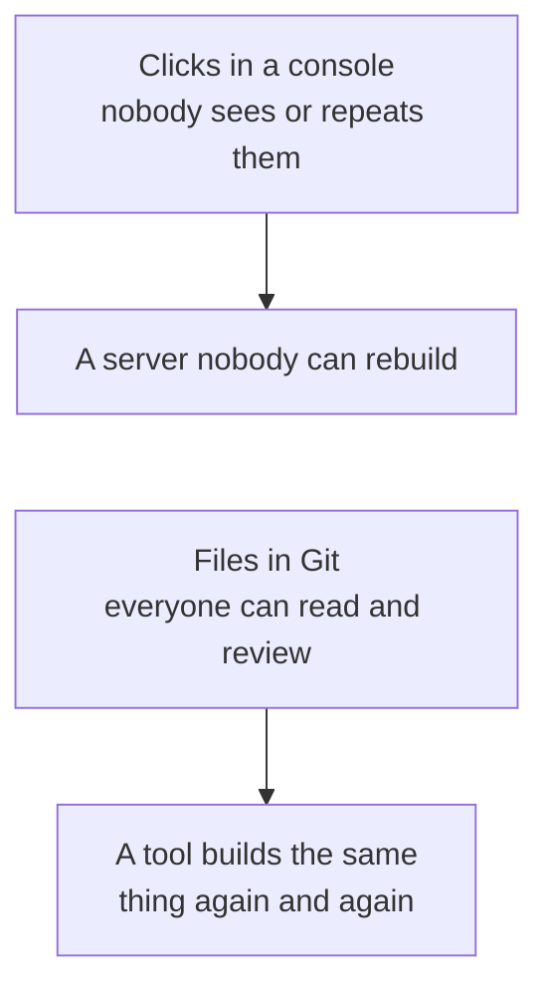
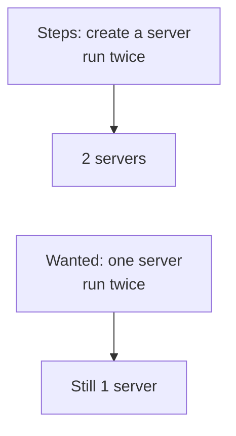
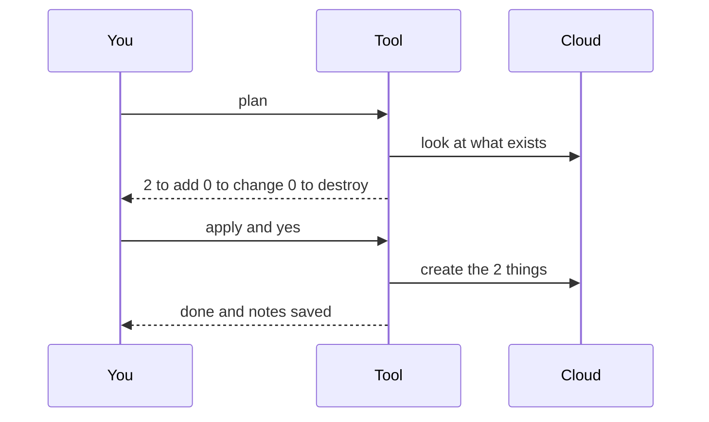
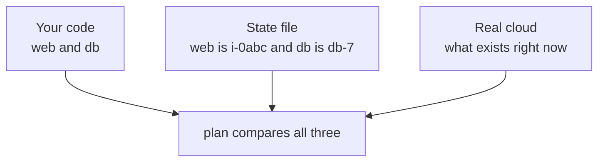
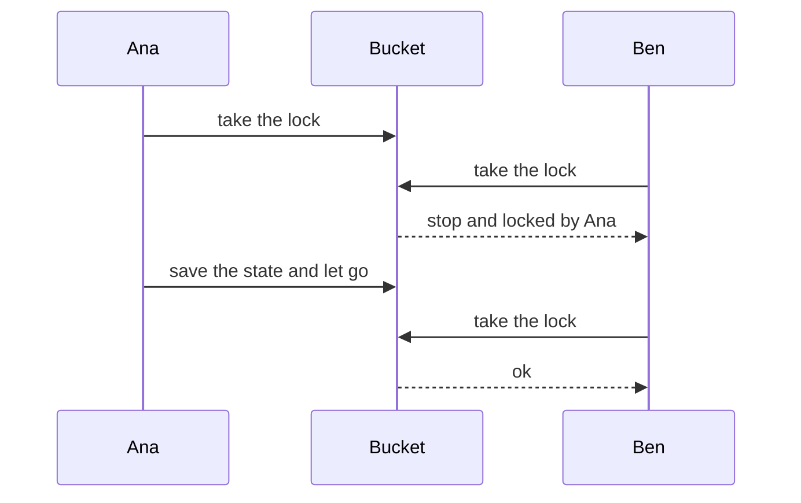
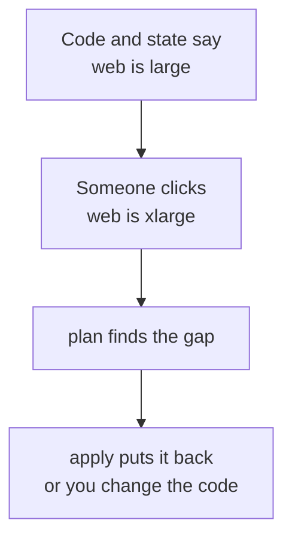
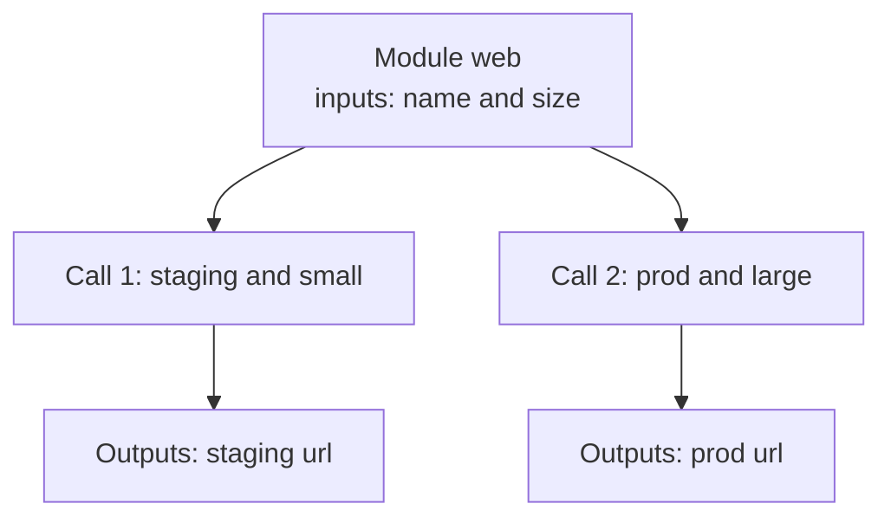

# 14. Infrastructure as code

> **Subject:** DevOps and Cloud · **Lesson:** 14 · **Made:** 2026-11-17 · **Status:** ready
>
> **You will be able to:** say why servers should be described in files and not clicked together, tell a "steps" script from a "wanted list" file, explain what `plan` and `apply` each do, say what the state file is and why it needs a shared place and a lock, explain drift and the two ways to fix it, and compare Terraform, OpenTofu, Pulumi and AWS CDK in one table.
>
> **Before this:** [CI/CD pipelines](05-ci-cd-pipelines.md) · **Also read:** [Cloud models](06-cloud-models.md) and [Config and secrets](09-config-and-secrets.md) · **Next:** The AWS map for a web developer (planned, lesson 15) and GitOps (planned, lesson 23)
>
> **How to read it:** one card is one idea. Look at the picture, guess, then press the orange bar to check. The blue bars (📖 More detail) hold the longer explanation. Skip them on the first read, and open them when you want more. **I did not install Terraform or run any plan or apply for this lesson.** What Terraform, OpenTofu, Pulumi and CDK do comes from their official docs (opened 2026-11-17) and is marked "from the docs, not run here". The small model in the practice file and in the stepper is plain JavaScript that I ran for real. About 20 minutes for the cards.

<!-- quick-summary:start -->
## Quick summary

> Short on time? Read only this. These are the "Remember" lines from the cards below, so you can read the whole lesson in one minute.

- Infrastructure as code means servers, databases and networks are written in files in Git, and a tool builds them. So they can be reviewed, repeated and rolled back.
- Declarative means you write what you want, not the steps. Run it again and nothing changes.
- Plan shows, apply does. Read the plan before you apply, and look hardest at the delete lines.
- The state is the tool's notes about which real thing has which name. Lose it and the tool forgets what it built.
- Keep the state in a shared place with a lock, so one run changes it at a time. It can hold secrets in plain text, so protect it like a password.
- Drift is a change made outside the code. `plan` finds it. Either let apply undo it, or put the change in the code.
- A module is a function: variables go in, outputs come out. Write the recipe once and call it for each place.
- Terraform and OpenTofu use HCL and many clouds. Pulumi uses normal languages and many clouds. The AWS CDK uses normal languages and AWS only.
<!-- quick-summary:end -->

## 1. The problem: servers made by clicking

Your app needs a server, a database and a network. The usual way is to click in the cloud's website, called the **console**. It works. But nobody sees the clicks, nobody can review them, and nobody can repeat them. **Infrastructure as code** means you write these things in files, keep the files in Git, and let a tool build them. Your CapRover dashboard is the small version of the same story: you click to make an app.



Notice: the top path ends in memory. The bottom path ends in a file.

<details class="guess"><summary>🤔 Guess: your test server dies. A teammate who left built it two years ago by clicking. How do you make the same one? Press to check.</summary>

**From memory and old screenshots, so you will get something close, not the same.** With code, you run the tool on the file in Git and get the same thing. The file is also the history: Git shows who changed what and when.

</details>

> **Remember:** infrastructure as code means servers, databases and networks are written in files in Git, and a tool builds them. So they can be reviewed, repeated and rolled back.

<details class="more"><summary>📖 More detail: four new words, what you gain, what it costs</summary>

**Four new words in this lesson:** declarative (card 2), state (card 4), drift (card 6), module (card 7).

**What you gain.**

| You get | Because |
|---|---|
| A review | A change to a server is a pull request, like a change to code |
| A history | Git keeps every version and who made it |
| A copy | Staging and production can come from the same file |
| A way back | To undo a change, revert the commit and run the tool (see [CI/CD](05-ci-cd-pipelines.md), card 5, for the same idea with images) |
| A rebuild plan | The [disaster recovery lesson](../system-design/28-disaster-recovery.md) says that without a script that builds the servers, restore takes much longer than you planned |

**What it costs.** You must learn a tool. A wrong line can delete a database as fast as it creates one. And people must stop clicking (card 6).

**Where it fits.** Lesson 05 ships your code. This lesson ships the machines your code runs on. In [Cloud models](06-cloud-models.md) terms, you describe the IaaS parts (servers, networks, disks) and the managed parts (databases, queues).

**What it does not do.** These tools create the servers and the cloud around them. Installing software inside a server is another job (configuration management, for example Ansible). With containers you often need less of it, because the image carries the software.

**Where your Compose and CapRover files fit.** A `compose.yaml` and a CapRover `captain-definition` file describe your app on a server that already exists. Infrastructure as code describes the server, the network and the database around it. The next card shows that both are the same kind of file.

</details>

## 2. Say what you want, not the steps

There are two ways to tell a tool what to do. **Steps:** "create a server". Run it twice and you have two servers. **A wanted list:** "I want one server". The tool looks first, so running it twice still gives one. The wanted list is called **declarative**. Terraform, Pulumi and CloudFormation work this way. You already know one: a Compose file lists the services you want, and `docker compose up` makes it so.



Notice: the same two runs give two different results. The difference is whether the tool looks before it acts.

Analogy: telling a helper "buy milk" twice gives two bottles. Writing "the fridge holds one milk" and sending the helper twice gives one. Where it stops: to reach your list, a real tool sometimes has to delete a thing and build it again. That is why you read the plan (card 3).

<details class="guess"><summary>🤔 Guess: a script runs "create 1 server" twice. A declarative file says "I want 1 server" and the tool runs twice. How many servers does each give? Press to check.</summary>

**The script gives 2 and the file gives 1.** The second run of the file finds the server already there and does nothing.

</details>

> **Remember:** declarative means you write what you want, not the steps. Run it again and nothing changes.

<details class="more"><summary>📖 More detail: Compose, the steps version, and tools that use TypeScript</summary>

**Your Compose file is declarative.** The Docker docs say `docker compose up` picks up a changed service by "stopping and recreating the containers", and that `--no-recreate` keeps existing containers as they are ([docker compose up](https://docs.docker.com/reference/cli/docker/compose/up/), opened 2026-11-17). From the docs, not run here: Docker was not running when I wrote this lesson.

**The steps version** is a shell script that calls the cloud's command line, such as a line that creates a server. Run it twice and it makes two, or it fails on the second run. You must add "if it exists, skip" checks yourself. A declarative tool does those checks for you.

**Words you will hear:** the interview word for "run it twice, same result" is **idempotent**. The word for the steps style is **imperative**.

**Code in a normal language is still declarative.** Pulumi and the AWS CDK let you write TypeScript. A loop in that code only builds a list of things you want. The tool then compares the list with what exists. So the style is the same, only the language is different (card 8).

**The cost.** You give up control of the order of steps. When the result is not what you expected, you must read the plan to see why.

</details>

## 3. plan shows. apply does.

Before the tool changes anything, you ask: what would you do? That is **`plan`**. The tool looks at what really exists, compares it with your code, and prints a list: `+` create, `~` change, `-` delete. It changes nothing. You read the list. If it is right, you run **`apply`**, and the tool does the work. In a team, the plan goes into the pull request for review, and apply runs after the merge.



Notice: the cloud is only changed on the second half, after you said yes.

<details class="guess"><summary>🤔 Guess: the plan says "2 to add, 0 to change, 0 to destroy". Has anything been built yet? Press to check.</summary>

**No.** `plan` only shows a preview. Nothing exists until `apply`. The number to check first is the last one: "to destroy".

</details>

> **Remember:** plan shows, apply does. Read the plan before you apply, and look hardest at the delete lines.

<details class="more"><summary>📖 More detail: the symbols, a saved plan, the trace, and the same step in other tools</summary>

**The symbols** (from the docs, [terraform plan](https://developer.hashicorp.com/terraform/cli/commands/plan), opened 2026-11-17, not run here):

| Symbol | Meaning |
|---|---|
| `+` | create: it does not exist yet |
| `~` | change it in place |
| `-` | delete it |
| `-/+` | delete it and build it again. **Read these twice.** A rebuilt database starts empty |

**The shape of a plan** (written by hand to show the shape, not copied from a run):

```
  + create web
  ~ update db: size small to large
Plan: 1 to add, 1 to change, 0 to destroy.
```

**A saved plan.** The docs say `-out=FILENAME` saves the plan in "an opaque file format that you can later pass to `terraform apply`", and that applying it carries out exactly the planned changes. The saved file can hold secrets, so treat it as sensitive.

**In a pipeline** ([lesson 05](05-ci-cd-pipelines.md)): run `plan` on every pull request and show the result to the reviewer. Run `apply` only after the merge, from the pipeline, with secrets that the pipeline holds ([lesson 09](09-config-and-secrets.md)). The Docker tutorial in "Watch and play" shows that `apply` also prints the plan and waits for you to type `yes`.

**The trace** (stepper, tab 1, the model code `plan` and `apply`):

| Step | You do | The tool does | The three places after |
|---|---|---|---|
| 1 | Write code: web and db, both small | Nothing | Code has 2 things. State and cloud are empty |
| 2 | `plan` | Compares, prints `+ create db` and `+ create web` | Nothing changed |
| 3 | `apply` | Creates both, then writes its notes | Cloud and state each have 2 things |
| 4 | Change web to `large` in the code | Nothing | Code and cloud disagree on one setting |
| 5 | `plan` | Prints `~ update web: size small to large`. The db is not in the list | Nothing changed |
| 6 | `apply` | Changes web, updates the notes | All three say web is large |
| 7 | `plan` again | Prints "No changes." | Same. This is the declarative part |

**The same step in other tools** (from the docs, not run here). The AWS CDK has `cdk diff`, which compares your app with the deployed stack and marks changes with `[+]`, `[-]` and `[~]` ([cdk diff](https://docs.aws.amazon.com/cdk/v2/guide/ref-cli-cmd-diff.html)). Pulumi has `pulumi preview`, which "shows what changes an update would make" without applying them ([pulumi preview](https://www.pulumi.com/docs/iac/cli/commands/pulumi_preview/)).

</details>

## 4. The state: the tool's notes

How does the tool know that `web` in your code is server `i-0abc` in the cloud? It keeps notes. The notes are the **state**: a file that maps each name in your code to the real thing, and remembers the settings it last made. `plan` compares three things: your code, the state and the real cloud. If you lose the state, the tool forgets what it owns.



Notice: the code says what you want. The cloud says what is true. The state says which real thing has which name.

Analogy: a coat check list. Ticket 12 is the blue coat. Without the list, the helper cannot tell which coat is yours. Where it stops: a coat check can look at the coats, but the tool cannot tell by looking which of the cloud's many servers belong to your project.

<details class="guess"><summary>🤔 Guess: the cloud has 2 servers from last week. You delete the state file and run apply. What does the tool plan? Press to check.</summary>

**To create 2 more servers.** The tool has no notes, so it thinks nothing exists. You get duplicates, or an error when names must be unique. That is why the state is precious.

</details>

> **Remember:** the state is the tool's notes about which real thing has which name. Lose it and the tool forgets what it built.

<details class="more"><summary>📖 More detail: why it exists, what it looks like, and the other tools</summary>

**Why Terraform needs it** (from the docs, [Purpose of state](https://developer.hashicorp.com/terraform/language/state/purpose), opened 2026-11-17):

- **Mapping.** "Terraform requires some sort of database to map Terraform config to the real world."
- **Order.** It "retains a copy of the most recent set of dependencies", so it can delete things in the right order even after you removed them from the code.
- **Speed.** It "stores a cache of the attribute values for all resources", so it does not ask the cloud about every thing on every run.

A **resource** is one thing the tool manages: a server, a database, a bucket.

**Where it lives by default.** With no setting, Terraform keeps a local file named `terraform.tfstate` in your project folder. The docs call local state a "plaintext file" ([sensitive data in state](https://developer.hashicorp.com/terraform/language/state/sensitive-data)). Card 5 is about where to put it instead.

**What it looks like** (a trimmed, made up shape, not copied from a run):

```
{ "resources": [
    { "type": "server", "name": "web",
      "id": "i-0abc", "settings": { "size": "small" } } ] }
```

**Do not edit it by hand.** The tool has commands to look at it (`terraform state list`, `terraform show`, from the [Docker tutorial](https://developer.hashicorp.com/terraform/tutorials/docker-get-started/docker-build)).

**The other tools.**

| Tool | Where the notes live |
|---|---|
| Terraform and OpenTofu | A state file in the place you choose (card 5) |
| Pulumi | "Pulumi Cloud" by default, or a bucket you manage (from the [Pulumi docs](https://www.pulumi.com/docs/iac/concepts/state-and-backends/)) |
| AWS CDK | Inside CloudFormation, in your AWS account. You hold no state file (from the [CDK docs](https://docs.aws.amazon.com/cdk/v2/guide/home.html)) |

**The trace.** It is the same as card 3: open the stepper (tab 1) and watch the middle column fill up after each apply.

</details>

## 5. Share the state: a lock, and care

On one laptop the state is just a file. In a team that breaks. Ana and Ben each have their own copy, or they run `apply` at the same moment. So the state goes to a shared place, for example an S3 bucket. This is **remote state**. The place adds a **lock**: while Ana's run changes things, Ben's run stops with an error. The state can hold secrets in plain text, so also limit who can read it.



Notice: Ben is not blocked forever. He only waits for his turn.

<details class="guess"><summary>🤔 Guess: Ana is running apply. Ben starts apply on the same state, and the state has a lock. What happens to Ben's run? Press to check.</summary>

**It stops with an error that names who holds the lock.** Ben tries again when Ana is done. Without a lock, both runs would read the same notes, and both could create the same thing.

</details>

> **Remember:** keep the state in a shared place with a lock, so one run changes it at a time. It can hold secrets in plain text, so protect it like a password.

<details class="more"><summary>📖 More detail: the S3 setting, the lock options, secrets in state, and the trace</summary>

**The S3 setting.** A **backend** is the place that stores the state. From the docs, [S3 backend](https://developer.hashicorp.com/terraform/language/backend/s3), opened 2026-11-17, not run here:

```
terraform {
  backend "s3" {
    bucket       = "example-bucket"
    key          = "path/to/state"
    use_lockfile = true
    region       = "us-east-1"
  }
}
```

**Three facts about it.**

- The docs say "State locking is an opt-in feature of the S3 backend". You turn it on with `use_lockfile`, and it keeps a lock file next to the state in the same bucket. The Terraform 1.11 upgrade guide says this lock is ready for production use.
- The older way was a DynamoDB table. The docs now say "DynamoDB-based locking is deprecated" and "will be removed in a future minor version". Old projects still show `dynamodb_table`.
- The docs say it is "highly recommended" to turn on bucket versioning, so you can recover the state after a mistake. They also list `encrypt` and a KMS key to encrypt the state.

**The bucket must exist first.** The example in the docs assumes the bucket is already made. So the first bucket is made by hand, or by a tiny separate project.

**OpenTofu** has the same S3 settings. Its docs call `use_lockfile` the preferred way, and say the team "has no plans to deprecate either option" (OpenTofu [S3 backend](https://opentofu.org/docs/language/settings/backends/s3/)).

**A stuck lock.** If a run crashes, the lock can stay. The docs say of the unlock command "Be very careful with this command". Unlocking while someone is really running can give two writers. First check that no run is active.

**Secrets in state.** The docs ([Sensitive data in state](https://developer.hashicorp.com/terraform/language/state/sensitive-data)) say values marked `sensitive` are still written to the state and to plan files. Marking only hides them from the screen. They advise: keep state out of Git, store it remotely, encrypt it, limit who can read it, and log access. You can keep a value out of state with an "ephemeral" value. If a secret reaches Git, follow [lesson 09](09-config-and-secrets.md), card 8: change it first.

**The trace** (stepper, tab 3, the model code `takeLock`, `releaseLock`, `plan` and `apply`):

| Step | What happens | The shared bucket after |
|---|---|---|
| 1 to 3 | No lock. Both plan `+ create db`, both apply | The cloud has 2 databases. The state knows 1 |
| 4 | Ana takes the lock (`ok: true`) | Lock: held by ana |
| 5 | Ben tries (`ok: false, holder: ana`) | Ben's run stops. Nothing changed |
| 6 | Ana applies | State has web and db |
| 7 | Ana lets go | Lock: free |
| 8 | Ben takes the lock and plans | His plan says "No changes." No second database |

**The tradeoff.** A lock makes runs wait in line. For a team that is fine. Teams that need more control use a service that also keeps a history and who may apply, such as HCP Terraform. I did not test one.

</details>

## 6. Drift: someone clicked in the console

**Drift** is when the real cloud no longer matches your code. It often starts at night. The site is slow, and someone makes the web server bigger in the console. The tool was not told. The next `plan` looks at the real cloud first and notices the change. It then plans to put things back as the code says. You choose: let `apply` undo the click, or write the change into the code.



Notice: nobody did anything wrong in the tool. The gap came from outside it.

<details class="guess"><summary>🤔 Guess: a teammate made web bigger in the console. You run apply with no change in the code. What happens to web? Press to check.</summary>

**The tool puts it back to what the code says.** The night fix is gone, and the site may be slow again. If the fix was good, put it in the code first.

</details>

> **Remember:** drift is a change made outside the code. `plan` finds it. Either let apply undo it, or put the change in the code.

<details class="more"><summary>📖 More detail: the three choices, the commands, a deleted server, and the trace</summary>

**The three choices** (from the docs, [Resource drift tutorial](https://developer.hashicorp.com/terraform/tutorials/state/resource-drift), opened 2026-11-17, not run here):

| Choice | How | Result |
|---|---|---|
| Undo the change | `plan` then `apply` | The docs: "Terraform would attempt to revert your manual changes." |
| Keep the change | Edit the code to match the cloud, then `plan` and `apply` | The code and the cloud agree. The history is in Git |
| Only look | `terraform plan -refresh-only` | Shows drift and "will not take any actions to undo these" |

The docs also say `terraform apply -refresh-only` writes the changes into the state and does not touch the real infrastructure.

**How it finds drift.** Terraform "compares your state file to real infrastructure whenever you invoke `terraform plan` or `terraform apply`".

**A server deleted by hand.** The plan lists a create. The tool builds a new, empty server. It brings back the server, not the data that was inside. Data needs backups ([disaster recovery lesson](../system-design/28-disaster-recovery.md)).

**How to find and prevent it.** Run a plan on a schedule in your pipeline and read the drift lines. Make changes through a pull request. Give most people a read-only console. An emergency click is fine, but write it into the code afterwards. Limiting who can click is the job of IAM and least privilege (planned, lesson 16).

**The trace** (stepper, tab 2, the model code):

| Step | What happens | `plan` says |
|---|---|---|
| 1 | Code, state and cloud all say web is `large` | No changes |
| 2 | Someone sets web to `xlarge` in the console | Not run yet |
| 3 | You run `plan` with no code change | Drift: web (size). `~ update web: size xlarge to large` |
| 4 | Choice A: apply | Web is `large` again |
| 5 | Choice B: code says `xlarge`, then `plan` | Drift on web, but no action |
| 6 | Choice B: apply | Only the state is updated. All three say `xlarge` |
| 7 | Someone deletes the db | Drift: db is gone. `+ create db` |

</details>

## 7. Variables, outputs and modules: a recipe with inputs

You want a staging copy and a production copy of the same setup. Copying the code twice makes two files that drift apart. So you write the setup once, as a **module**, and call it twice. If you know JavaScript, a module is a function. The **variables** are its arguments, and the **outputs** are its return value. A variable can also check its own value before anything is built.



Notice: one recipe, two calls, two sets of things with their own names.

Where the function comparison stops: a function runs and goes away. A module's resources stay alive and are tracked in the state.

<details class="guess"><summary>🤔 Guess: you call the same module twice, for staging and for prod. How many sets of resources exist? What if you delete the prod call from the code? Press to check.</summary>

**Two sets, one for each call.** If you delete the prod call, the next plan shows the prod things with `-`, and apply deletes them. The code is the wanted list.

</details>

> **Remember:** a module is a function: variables go in, outputs come out. Write the recipe once and call it for each place.

<details class="more"><summary>📖 More detail: the real syntax, root and child modules, sensitive variables, and the trace</summary>

**The shape in Terraform** (from the docs, not run here, written by hand):

```
variable "size" {
  type = string
  validation {
    condition     = contains(["small", "medium", "large"], var.size)
    error_message = "size must be small, medium or large"
  }
}

module "prod" {
  source = "./modules/web"
  name   = "prod"
  size   = "large"
}

output "prod_url" { value = module.prod.url }
```

**The words** ([Modules](https://developer.hashicorp.com/terraform/language/modules), [Variables](https://developer.hashicorp.com/terraform/language/values/variables), [Outputs](https://developer.hashicorp.com/terraform/language/values/outputs), opened 2026-11-17):

- "A module is a collection of resources that Terraform manages together." The files in your main folder are the **root module**. A module you call is a **child module**.
- Variables "let users pass custom values to your module at runtime". They can have a default, or be required, and can have a `validation` block.
- A child's output "exposes that value to the parent module", and the parent reads it as `module.<name>.<output name>`. The comparison to a return value is mine, not the docs.
- Things in a module get an address that starts with `module.<name>`. So two calls cannot clash, even when the inside names are the same. In my model I did that with a name prefix.

**A sensitive variable.** `sensitive = true` stops Terraform from showing the value in the terminal. But the docs say "Terraform still stores the values of sensitive variables in your state" (card 5).

**The trace** (stepper, tab 4, the model code `webModule`):

| Step | Call | Result |
|---|---|---|
| 1 | `webModule("staging", "small")` | `staging-web` (small), `staging-db`, url for staging |
| 2 | `webModule("prod", "large")` | `prod-web` (large), `prod-db`, url for prod |
| 3 | Put both together | 4 things, no two with the same name |
| 4 | `webModule("prod", "huge")` | Error: size must be small, medium or large. Nothing built |

**The cost.** A module hides detail. When a plan shows a change inside a module, you must open the module to understand it. Keep modules small, with few inputs.

</details>

## 8. Four tools side by side

The idea is the same in each tool: describe what you want, see a plan, apply it, keep notes. Four names to know. They differ in the language you write, where the notes live, and which clouds they reach.

| | You write | The notes (state) | Clouds | Licence and status |
|---|---|---|---|---|
| **Terraform** | HCL, its own small language | A state file, in a place you choose | Many, through plugins called providers | Business Source License, owned by IBM. Latest 1.17.2 |
| **OpenTofu** | HCL, the same | The same kind of state file | Many | Open source (MPL 2.0), under the Linux Foundation. Latest 1.13.9 |
| **Pulumi** | TypeScript, Python, Go, .NET, Java, YAML | Pulumi Cloud, or a bucket you manage | Many | Open source SDK, with a hosted service |
| **AWS CDK** | TypeScript, JavaScript, Python, Java, C#, Go | CloudFormation keeps it in your AWS account | **AWS only** | Open source, made by AWS |

Notice: the first two read the same files. The last two use languages you already know.

<details class="guess"><summary>🤔 Guess: a team only uses AWS and likes TypeScript. Which tool could fit best? What changes if they add a second cloud? Press to check.</summary>

**The AWS CDK fits: TypeScript, AWS only, and the notes are kept for you.** With a second cloud, the CDK cannot help. Terraform, OpenTofu or Pulumi can. Pick by team skills and by how many clouds you use.

</details>

> **Remember:** Terraform and OpenTofu use HCL and many clouds. Pulumi uses normal languages and many clouds. The AWS CDK uses normal languages and AWS only.

<details class="more"><summary>📖 More detail: the licence split, versions, the archived CDK for Terraform, and my pick</summary>

**All of this card is from the docs and pages I opened on 2026-11-17, not run here.**

**Terraform and OpenTofu.** Terraform changed its licence from open source to the Business Source License (BSL 1.1) from version 1.6.0. The licence file names IBM Corp. as the licensor, and it says the code changes to MPL 2.0 four years after each release ([LICENSE](https://github.com/hashicorp/terraform/blob/main/LICENSE)). OpenTofu is a fork, made "in response to HashiCorp's switch from an open-source license to the BUSL", and the project is given to the Linux Foundation ([OpenTofu FAQ](https://opentofu.org/faq/)). Its code is under MPL 2.0 ([opentofu/opentofu](https://github.com/opentofu/opentofu)). Both read your HCL files, and both work with the same providers. OpenTofu has its own registry and its own version numbers, so a version limit written for Terraform can block OpenTofu. OpenTofu also has state encryption ([docs](https://opentofu.org/docs/language/state/encryption/)).

**Versions I saw:** Terraform 1.17.2 (released 2026-11-11, [releases](https://github.com/hashicorp/terraform/releases)) and OpenTofu 1.13.9 (marked latest on its [releases](https://github.com/opentofu/opentofu/releases) page on 2026-11-17). Both numbers change fast. Look them up before you quote them.

**Pulumi.** Its docs list TypeScript, Python, Go, .NET, Java, YAML and HCL ([Pulumi IaC](https://www.pulumi.com/docs/iac/)). The Pulumi comparison page is written by Pulumi, so its framing is theirs. It says CDK state is "managed by the CloudFormation service inside the AWS account" ([comparison](https://www.pulumi.com/docs/iac/comparisons/cdk-vs-terraform/index.md)).

**AWS CDK.** The docs say it defines infrastructure in code and provisions it "through AWS CloudFormation". You write TypeScript, and the CDK produces a CloudFormation template. The docs say you get "rollback on error" from CloudFormation.

**CDK for Terraform is gone.** HashiCorp's repository says CDKTF was archived on Dec 10, 2025, with no further updates ([terraform-cdk](https://github.com/hashicorp/terraform-cdk)). If you see it in an old tutorial, do not start a new project with it.

**CloudFormation** is the AWS service under the CDK. You can also write its templates directly, in YAML or JSON. I did not test it.

**What I would say in an interview.** Pick by the team's language, the number of clouds, and the licence rules of the company. For a JavaScript developer, Pulumi and the CDK let you stay in TypeScript. Terraform and OpenTofu are the most common names in job posts. My PayPay prep note quotes a job posting that lists Terraform in the stack, so it is a name worth knowing.

</details>

## 9. Watch and play

Links were checked on 2026-11-17. For the videos I read the title and channel from the YouTube oEmbed data. I did not watch them, and I did not check their length. For the pages I opened them and read the parts named below. If a link is broken, tell me and I will replace it.

- **Play with it:** [the stepper in this folder](visuals/14-infrastructure-as-code.html) - guess first, then press Next. Five tabs: plan and apply, drift, a lock, a module, and a secret in state.
- **Run it for real, in your browser:** [Terraform Sandbox](https://developer.hashicorp.com/terraform/sandbox) - a ready terminal with Terraform, Docker and a fake AWS (LocalStack). Per the page, a session lasts up to one hour and nothing is saved. Try `plan`, `apply`, then change a setting and `plan` again.
- **Run it on your laptop:** [Build infrastructure (Docker tutorial)](https://developer.hashicorp.com/terraform/tutorials/docker-get-started/docker-build) - starts an nginx container with Terraform and your local Docker. No cloud and no bill. After `apply`, run `terraform state list` to see the notes.
- **Video:** [Terraform explained in 15 mins | Terraform Tutorial for Beginners](https://www.youtube.com/watch?v=l5k1ai_GBDE) - TechWorld with Nana. Title and channel checked only. Compare it with cards 2 to 4.
- **Video:** [Terraform in 100 Seconds](https://www.youtube.com/watch?v=tomUWcQ0P3k) - Fireship. Title and channel checked only. A very short version of the cycle.
- **Pictures:** [What is the AWS CDK?](https://docs.aws.amazon.com/cdk/v2/guide/home.html) - the diagram of an app, stacks and CloudFormation, and the same example in six languages. It goes with card 8.
- **Read:** [Resource drift tutorial](https://developer.hashicorp.com/terraform/tutorials/state/resource-drift) - the three choices of card 6, with real output.

<details><summary>Go deeper (optional)</summary>

**More pages I opened.** [Purpose of state](https://developer.hashicorp.com/terraform/language/state/purpose). [State locking](https://developer.hashicorp.com/terraform/language/state/locking). [Sensitive data in state](https://developer.hashicorp.com/terraform/language/state/sensitive-data). [S3 backend](https://developer.hashicorp.com/terraform/language/backend/s3). [terraform plan](https://developer.hashicorp.com/terraform/cli/commands/plan). [Modules](https://developer.hashicorp.com/terraform/language/modules). [Variables](https://developer.hashicorp.com/terraform/language/values/variables). [Outputs](https://developer.hashicorp.com/terraform/language/values/outputs). [OpenTofu S3 backend](https://opentofu.org/docs/language/settings/backends/s3/). [OpenTofu state encryption](https://opentofu.org/docs/language/state/encryption/). [Pulumi state and backends](https://www.pulumi.com/docs/iac/concepts/state-and-backends/). [Pulumi preview](https://www.pulumi.com/docs/iac/cli/commands/pulumi_preview/). [cdk diff](https://docs.aws.amazon.com/cdk/v2/guide/ref-cli-cmd-diff.html). [docker compose up](https://docs.docker.com/reference/cli/docker/compose/up/).

**One more video** (title and channel checked only): [What is Infrastructure as Code? Difference of Infrastructure as Code Tools](https://www.youtube.com/watch?v=POPP2WTJ8es) - TechWorld with Nana. It compares IaC with the older way of setting up servers.

**Checked on 2026-11-17** with Node v26.5.0 for the practice code and the stepper code (50 tests, and a click through every step of every tab with a fake page). The three copies of `plan` and `apply` (practice answer, stepper, and the answer in card 10) are the same code after removing comments.

**What I did not test.** Terraform, OpenTofu, Pulumi, the AWS CDK and CloudFormation. I did not install any of them, and I did not run a plan or an apply against any cloud. Every output of those tools in this lesson is from their docs or written by hand to show the shape. I also did not run Docker Compose, because Docker was not running. The S3 lock, a stuck lock, `-refresh-only`, a module, a sensitive variable and a state file are all from the docs. The licence and version facts come from the GitHub pages of the projects on 2026-11-17.

**Where the model is simpler than the real tool.** My `plan` compares flat settings and has no dependencies, no order, no "replace" case (`-/+`), and no names that change. Real tools build a graph of things that depend on each other. The model is there to show the three-way comparison, not to copy a real tool.

**More ideas not covered here.** Importing a thing that was made by hand into the state. Splitting state into small pieces. Workspaces. Policy checks on a plan. Running the pipeline from [lesson 05](05-ci-cd-pipelines.md) with a plan and an apply stage (GitHub Actions in practice is planned as lesson 12). A Git repository as the source of truth that a tool pulls from (GitOps, planned as lesson 23).

</details>

## 10. Practice

**A. Predict the output** (write your answer before opening)

```js
const desired = { web: { size: "large" }, db: { size: "small" } };
const state = { web: { size: "small" }, old: { size: "small" } };
const real = { web: { size: "xlarge" }, old: { size: "small" } };
const p = plan(desired, state, real);
console.log(p.drift);
console.log(p.actions);
const after = apply(p.actions, desired, state, real);
console.log(after.state);
console.log(plan(desired, after.state, after.real));
console.log(takeLock(null, "ana"), takeLock("ana", "ben"));
```

Then answer: why is the update for `web` listed as `size`, and why does the last plan have nothing to do?

<details><summary>Answer</summary>

```
[ { name: 'web', kind: 'changed', keys: [ 'size' ] } ]
[
  { name: 'db', action: 'create' },
  { name: 'old', action: 'delete' },
  { name: 'web', action: 'update', keys: [ 'size' ] }
]
{ web: { size: 'large' }, db: { size: 'small' } }
{ drift: [], actions: [] }
{ ok: true, holder: 'ana' } { ok: false, holder: 'ana' }
```

The state says `web` is `small`, but the cloud says `xlarge`, so that is drift. The code wants `large`, so `web` needs an update on the `size` setting. `db` is in the code only, so it is created. `old` left the code but is still in the cloud, so it is deleted. After apply, the state holds what the code wanted, so a new plan finds nothing to do. This is "run it again and nothing changes". The lock part: Ben cannot take it while Ana holds it. (Checked on 2026-11-17 with Node v26.5.0.)

</details>

**B. Fix the bug**

This function should list `web` as an update, because the cloud has `xlarge` and the code wants `large`. It returns an empty list. Find the bug.

```js
const differingKeys = (a, b) =>
  Object.keys({ ...a, ...b }).filter((k) => a[k] !== b[k]).sort();

function updates(desired, state, real) {
  const out = [];
  for (const name of Object.keys(desired)) {
    if (!(name in state) || !(name in real)) continue;
    const keys = differingKeys(desired[name], state[name]);
    if (keys.length > 0) out.push({ name, action: "update", keys });
  }
  return out;
}

const desired = { web: { size: "large" } };
const state = { web: { size: "large" } };
const real = { web: { size: "xlarge" } };
console.log(updates(desired, state, real));
```

<details><summary>Answer</summary>

It compares the code with the **state**, so it trusts the notes and never looks at the cloud. The notes still say `large`, so nothing differs. After someone's click in the console, the notes are old. The fix: compare with `real[name]`, not `state[name]`. The state is for knowing which real thing has which name. The cloud is the truth about its settings. I ran the buggy version and it printed `[]`. With the fix it printed `[ { name: 'web', action: 'update', keys: [ 'size' ] } ]`.

</details>

**C. Write it yourself**

Open `learn/devops-cloud/practice/14-infrastructure-as-code.js`. It has six empty pieces: `plan`, `apply`, `takeLock`, `releaseLock`, `maskSensitive` and `webModule`. The comments at the top say exactly what each one must do. Write them, then run this from the repo root and make all the tests pass:

```
node --test learn/devops-cloud/practice/14-infrastructure-as-code.test.js
```

`plan` is the one to think about. Decide drift from state against real. Decide actions from desired against real. A name that only exists in the cloud is not yours, so leave it alone.

<details><summary>One possible answer</summary>

```js
const has = (obj, key) => Object.prototype.hasOwnProperty.call(obj, key);

function differingKeys(a, b) {
  const keys = new Set([...Object.keys(a), ...Object.keys(b)]);
  return [...keys].filter((k) => !has(a, k) || !has(b, k) || a[k] !== b[k]).sort();
}

function plan(desired, state, real) {
  const drift = [];
  const actions = [];
  const names = [...new Set([...Object.keys(desired), ...Object.keys(state)])].sort();
  for (const name of names) {
    const inState = has(state, name);
    const inReal = has(real, name);
    if (inState) {
      if (!inReal) drift.push({ name, kind: "missing" });
      else {
        const keys = differingKeys(state[name], real[name]);
        if (keys.length > 0) drift.push({ name, kind: "changed", keys });
      }
    }
    if (has(desired, name)) {
      if (!inState || !inReal) actions.push({ name, action: "create" });   // new, or deleted by hand
      else {
        const keys = differingKeys(desired[name], real[name]);             // desired against REAL
        if (keys.length > 0) actions.push({ name, action: "update", keys });
      }
    } else if (inReal) {
      actions.push({ name, action: "delete" });                            // in state only, still alive
    }
  }
  return { drift, actions };
}

function apply(actions, desired, state, real) {
  const newState = {};
  for (const name of Object.keys(state)) {
    if (has(real, name)) newState[name] = { ...real[name] };               // refresh: state follows real
  }
  const newReal = {};
  for (const name of Object.keys(real)) newReal[name] = { ...real[name] };
  for (const { name, action } of actions) {
    if (action === "delete") {
      delete newReal[name];
      delete newState[name];
    } else {
      newReal[name] = { ...desired[name] };
      newState[name] = { ...desired[name] };
    }
  }
  return { state: newState, real: newReal };
}

function takeLock(holder, who) {
  if (holder === null) return { ok: true, holder: who };
  return { ok: false, holder };
}

function releaseLock(holder, who) {
  if (holder !== null && holder === who) return { ok: true, holder: null };
  return { ok: false, holder };
}

function maskSensitive(settings, sensitiveKeys) {
  const copy = { ...settings };
  for (const key of sensitiveKeys) {
    if (has(copy, key)) copy[key] = "(sensitive value)";
  }
  return copy;
}

const SIZES = ["small", "medium", "large"];

function webModule(name, size) {
  if (typeof name !== "string" || name === "") throw new Error("name is required");
  if (!SIZES.includes(size)) throw new Error("size must be small, medium or large");
  return {
    resources: {
      [name + "-web"]: { size, port: 3000 },
      [name + "-db"]: { size: "small" },
    },
    outputs: { url: "https://" + name + ".example.test" },
  };
}

module.exports = { plan, apply, takeLock, releaseLock, maskSensitive, webModule };
```

Checked on 2026-11-17 with Node v26.5.0: 48 of the 50 tests fail on the empty stub (the other 2 only check that your function does not change its inputs), and all 50 pass with this answer. I also tried 36 wrong versions of the answer (for example, a plan that compares the code with the state and not the cloud, an apply that skips the refresh, a lock that lets the holder take it twice, a mask that changes the original). The tests caught all 36. The stepper page uses these same functions.

</details>

## 11. Interview question

**Q:** "How do you manage your cloud infrastructure? What goes wrong when a team shares it, and how do you handle it?"

A common follow-up: "Someone changed a setting in the console. What happens on the next apply?" Card 6 is the answer.

<details><summary>A strong answer, in four parts</summary>

1. **Problem:** Servers made by clicking cannot be reviewed, repeated or rolled back. When one dies, nobody knows exactly how it was built. And a team that shares the work runs into two more problems: two people change things at the same moment, and people change things outside the code.
2. **How it works:** I write the infrastructure as code in Git, in a declarative tool such as Terraform or OpenTofu. A pull request shows the `plan`. After the merge, `apply` does the change. The tool keeps notes (the state) about which real thing has which name. I keep the state in a shared place such as an S3 bucket, with locking, versioning and encryption, so one run changes it at a time and I can recover an old copy. For reuse, I write small modules with variables and outputs. A scheduled plan finds drift.
3. **Tradeoff:** A plan is only as good as the review of it, and a `-/+` line can destroy a database. The state is critical: lose it, and the tool forgets what it owns. It can also hold secrets in plain text, even for values marked sensitive, so it needs tight access. A lock makes runs wait in line. Terraform moved to the Business Source License in version 1.6, and OpenTofu is the open fork, so a company may choose by its licence rules. Normal-language tools such as Pulumi and the CDK feel natural for a developer, but the CDK is AWS only.
4. **My example:**
   - **Fact:** I deploy with Docker and CapRover, and my profile lists a little AWS. My DBO case study says the backend is four Node and TypeScript services on Docker Swarm via CapRover.
   - **Fact (from this lesson, not from DBO):** I did not run Terraform here. I only ran a small JavaScript model of plan, apply, state, drift and a lock, so I should not say I have used Terraform.
   - **Idea, not a fact:** I do not know whether the DBO servers, DNS or database were made by hand or by code, so I should not claim either. A good next step would be to describe the CapRover server, its DNS records and a storage bucket in Terraform or OpenTofu, keep the state in a locked S3 bucket, and run a scheduled plan to catch drift. Compose and CapRover files describe the app. The new part would be the machine around it.

</details>

## 12. Explain it back

Close this file. Explain infrastructure as code out loud like to a new junior, in 4 parts (problem, how, tradeoff, my example). Use the story of the web server that someone made bigger in the console at night. Say what the code, the state and the real cloud each said, what `plan` showed, and the two ways to fix it. Then say why the state needs a shared place and a lock, and what is risky about what it holds. Write your best version below and run `/explain-check infrastructure as code` or ask the `explain-coach` agent to review it.

### My explanation

<write here>

### Coach feedback

<the explain-coach agent writes here>

## 13. Review questions (day 1, 3, 7, 21)

1. Why is a file in Git better than clicking in a console, and what does "declarative" mean?
2. What does `plan` do and what does `apply` do? What do `+`, `~`, `-` and `-/+` mean, and which would you read twice?
3. What is the state file, what three things does `plan` compare, and what happens if you lose the state?
4. Two people run apply at the same time. What stops it, where does the state live, and what is risky about what the state holds? Draw the picture from memory: the two Ana and Ben lines of card 5.
5. Someone clicked in the console and made a server bigger. What is that called, how does the tool find it, and what are your two choices?

<details><summary>Answers</summary>

1. Files in Git can be reviewed, repeated, rolled back and used to rebuild. Declarative means you write what you want, not the steps, so running it again changes nothing.
2. `plan` previews the changes and changes nothing. `apply` does them. `+` create, `~` change in place, `-` delete, `-/+` delete and build again. Read `-` and `-/+` twice, because a rebuilt database starts empty.
3. The state is the tool's notes about which real thing has which name. `plan` compares your code, the state and the real cloud. Without the state the tool thinks nothing exists and plans to create everything again.
4. A lock on the shared state: the second run stops with an error and tries again later. The state lives in a shared place such as an S3 bucket (Terraform has `use_lockfile`). It can hold secrets in plain text, even for values marked sensitive, so limit access, encrypt it, keep it out of Git and keep versions of it. The picture: Ana takes the lock, Ben is refused, Ana saves and lets go, Ben takes it.
5. Drift. The plan refreshes from the real cloud, sees that it differs from the state, and plans to put it back. Choose: let apply undo it, or put the change in the code so the code matches. `-refresh-only` shows drift without changing anything.

</details>

## Connected lessons

- [CI/CD pipelines](05-ci-cd-pipelines.md) - runs plan on a pull request and apply after the merge. Card 5 there is the same "way back" idea for images.
- [Cloud models](06-cloud-models.md) - the IaaS and managed parts that you describe in code.
- [Config and secrets](09-config-and-secrets.md) - what to do when a secret reaches the state or Git (card 8), and how to keep secrets out of files.
- [Docker Compose](03-docker-compose.md) - a declarative file you already use, for the app on one server.
- [Ways to run your app compared](26-ways-to-run-your-app.md) - the places where the things you describe in code will run.
- [Disaster recovery](../system-design/28-disaster-recovery.md) - why a script that builds the servers makes a restore fast.
- The AWS map for a web developer (planned, lesson 15) - next: the real AWS things (servers, buckets, databases) that you will describe in code.
- IAM and least privilege (planned, lesson 16) - who may click in the console and who may apply.
- GitHub Actions in practice (planned, lesson 12) - a real pipeline file with a plan stage and an apply stage.
- GitOps (planned, lesson 23) - next: Git as the source of truth, and a tool that pulls from it.
