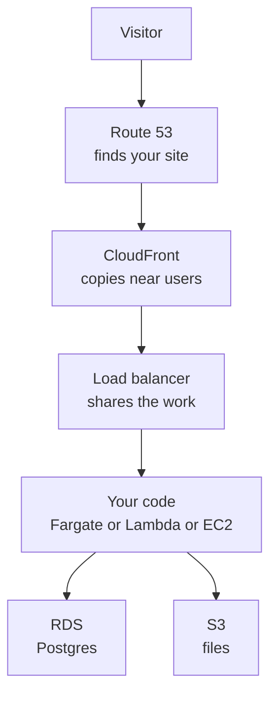
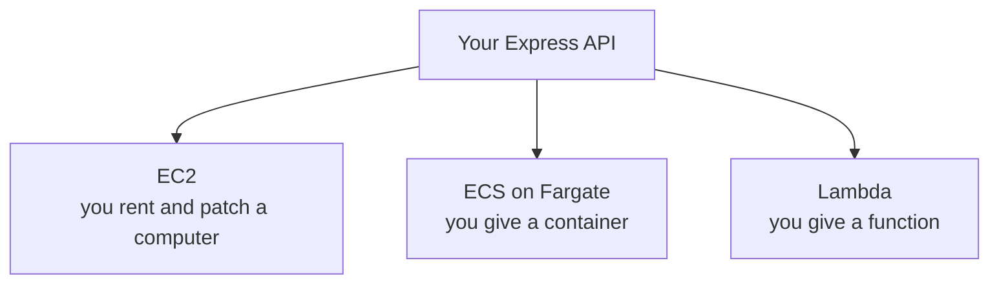
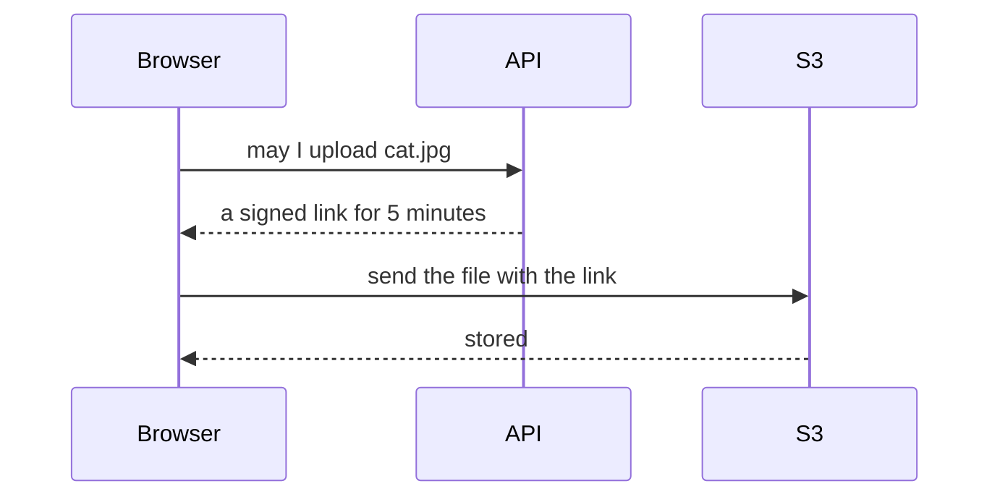
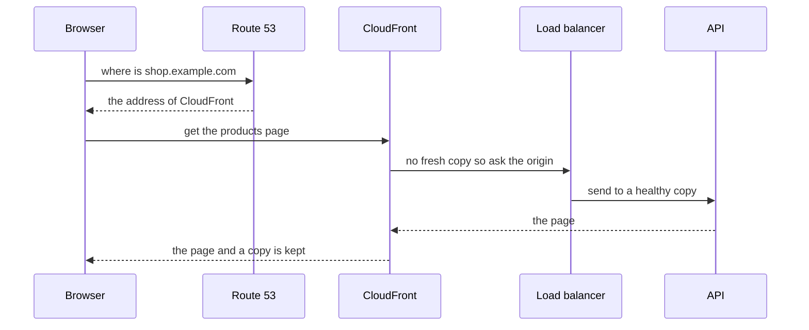
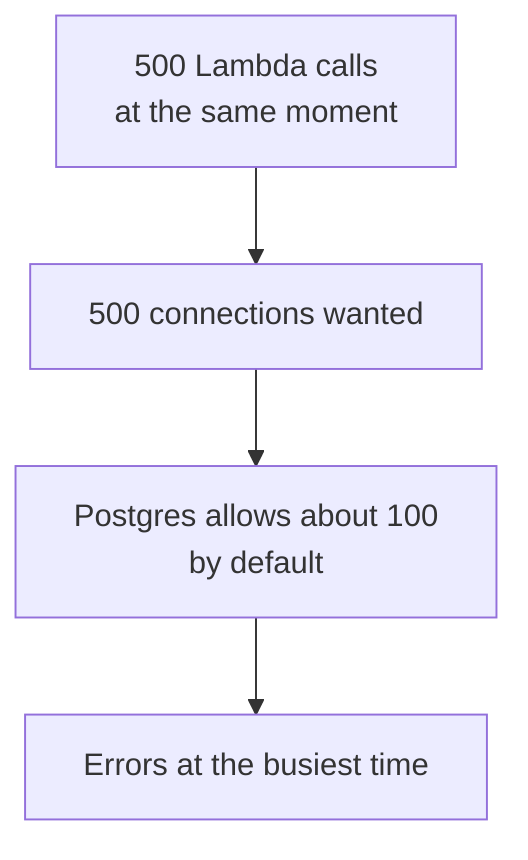
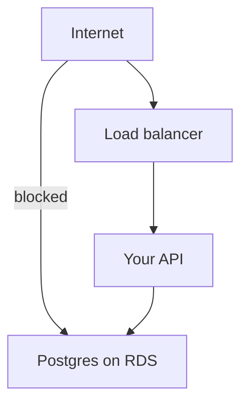

# 15. The AWS map for a web developer

> **Subject:** DevOps and Cloud · **Lesson:** 15 · **Made:** 2026-11-19 · **Status:** ready
>
> **You will be able to:** name the few AWS pieces a web app uses and say what each one does in one sentence, tell EC2, Fargate and Lambda apart by "who looks after the machine", say why uploads go to S3 and not to a server disk, say what RDS does for Postgres, follow one request from Route 53 to the database, and pick and defend a setup for a Next.js, Express and Postgres app.
>
> **Before this:** [Cloud models](06-cloud-models.md), [Serverless](07-serverless.md) and [Ways to run your app compared](26-ways-to-run-your-app.md) · **Also read:** [Infrastructure as code](14-infrastructure-as-code.md) · **Next:** IAM and least privilege (planned, lesson 16) and VPC networking basics (planned, lesson 17)
>
> **How to read it:** one card is one idea. Look at the picture, guess, then press the orange bar to check. The blue bars (📖 More detail) hold the longer explanation. Skip them on the first read, and open them when you want more. **I did not open an AWS account and I ran no AWS command for this lesson.** What each AWS service does comes from the AWS docs, opened on 2026-11-19, and is marked "from the docs, not run here". The small model in the practice file and in the stepper is plain JavaScript that I ran for real. About 20 minutes for the cards.

## 1. The map: a few pieces, each with one job

AWS has a very long list of services. A web app needs about six jobs done: find the site by its name, keep copies near the users, share the work, run your code, keep the data, keep the files. Each piece lives in a **Region**: a place in the world where AWS keeps its data centres. You pick one, usually near your users.



Notice: your Express code sits in the middle. The data and the files sit behind it.

<details class="guess"><summary>🤔 Guess: your shop must be found by name, run Express, keep Postgres data and keep photos. Which AWS names fit those four jobs? Press to check.</summary>

**Route 53** for the name, a compute service (**Fargate**, Lambda or EC2) for Express, **RDS** for Postgres, and **S3** for photos.

</details>

> **Remember:** a web app is six small jobs. In AWS each job has a service with its own name.

<details class="more"><summary>📖 More detail: four new words, where you know these from, and what this lesson leaves out</summary>

**Four new words in this lesson:** Region (above), instance (card 2), bucket (card 3), CDN (card 5).

**Where you may know these from.** This is a rough match, not an exact one:

| In AWS | Close to what you know |
|---|---|
| Load balancer | the nginx in front of your apps ([lesson 08](08-reverse-proxy-and-nginx.md)) |
| ECS service on Fargate | a Swarm service in CapRover, or a service in Compose ([lesson 03](03-docker-compose.md)) |
| RDS for PostgreSQL | the Postgres container you run yourself |
| Certificate Manager (ACM) | Let's Encrypt in CapRover. The ALB docs say an HTTPS listener can use ACM certificates |

**Left out on purpose.** Who may do what (IAM, planned lesson 16). The private network around your pieces (VPC, planned lesson 17). Queues, DynamoDB, Kubernetes (EKS) and all the other services. Logs and alarms are in [lesson 10](10-logs-and-monitoring.md).

**Where this fits.** [Lesson 26](26-ways-to-run-your-app.md) compares six ways to run an app, and only some are AWS. This lesson is the AWS map around the code: where the files, data and traffic go.

</details>

## 2. Three places to run your code

Your Express API is one image. AWS gives you three places to run it. They differ in **who looks after the machine**. **EC2:** you rent a computer, called an **instance**, and you patch it. **ECS on Fargate:** you give AWS a container, and AWS runs the machines. **Lambda:** you give AWS a function, and AWS runs it only when it is called, for up to 15 minutes.



Notice: the code is the same idea in all three. Only the work around it moves.

<details class="guess"><summary>🤔 Guess: the API gets steady traffic all day, and a few jobs take 20 minutes. Which of the three fits? Press to check.</summary>

**Fargate.** A container can run longer than 15 minutes and stays up all day. Lambda stops a call at 15 minutes, and a function that is called all day is a poor fit.

</details>

> **Remember:** pick by who looks after the machine, how long one run lasts, and how steady the traffic is.

<details class="more"><summary>📖 More detail: the three side by side, the ECS words, and the in-between options</summary>

From the docs, not run here (EC2 [concepts](https://docs.aws.amazon.com/AWSEC2/latest/UserGuide/concepts.html), ECS [welcome](https://docs.aws.amazon.com/AmazonECS/latest/developerguide/Welcome.html), [Lambda quotas](https://docs.aws.amazon.com/lambda/latest/dg/gettingstarted-limits.html), opened 2026-11-19):

| | EC2 | ECS on Fargate | Lambda |
|---|---|---|---|
| You give AWS | an image of a machine (AMI) and a type | a container image, CPU and memory | a function |
| Who patches the machine | you | AWS | AWS |
| Runs | until you stop it | until you stop it | per call, 15 minutes at most |
| Limits | the instance type you choose | 32 vCPU and 244 GiB per Linux task, no GPU | 10,240 MB memory, 6 MB normal response |
| Pick it when | you need your own machine, for example a GPU | an API, a site, a long job | short, rare or spiky work |

**The ECS words.** A **task definition** is the blueprint. A **task** is one running copy, and it may stop when its work is done. A **service** keeps a number of tasks alive, the "desired count" idea of [lesson 26](26-ways-to-run-your-app.md). Fargate is one kind of capacity for ECS. The others are EC2 machines you run, and ECS Managed Instances, where AWS runs EC2 machines for you and you get GPU types.

**Other doors.** ECS Express Mode and App Runner (card 6). Lightsail containers, a simple service with a predictable monthly price. EKS if you want Kubernetes ([lesson 04](04-kubernetes-objects.md)). The AWS [container decision guide](https://docs.aws.amazon.com/decision-guides/latest/containers-on-aws-how-to-choose/choosing-aws-container-service.html) (last updated 2026-11-11 on its page) compares them.

**EC2 prices.** On-Demand by the second, Savings Plans for a promise of use, Spot for spare capacity at a discount. Prices change, so I put none here.

</details>

## 3. S3: files go in a bucket, not on a disk

Say you save an uploaded photo on your API's disk. It works. Then you deploy, ECS replaces the task, and the photo is gone, because the disk belonged to the old task. **S3** keeps files without any server. A **bucket** is a box of files. Each file has a name called a key, such as `photos/cat.jpg`. A bucket is private until you open it.



Notice: the file goes from the browser straight to S3. The API only signs a link, so it never carries the file.

<details class="guess"><summary>🤔 Guess: the link was signed for photos/cat.jpg. Someone uses it for photos/dog.jpg. What does S3 do? Press to check.</summary>

**It refuses.** A signed link allows one key, one method and a short time. Try it in the stepper (tab 2).

</details>

> **Remember:** keep files in S3, not on a server disk. A signed link lets a browser upload one file, once, for a short time.

<details class="more"><summary>📖 More detail: buckets, keys, the signed link ("presigned URL"), and the trace</summary>

From the docs, not run here ([What is S3](https://docs.aws.amazon.com/AmazonS3/latest/userguide/Welcome.html), [objects](https://docs.aws.amazon.com/AmazonS3/latest/userguide/UsingObjects.html), [presigned URLs](https://docs.aws.amazon.com/AmazonS3/latest/userguide/using-presigned-url.html), opened 2026-11-19).

- **Object and key.** "An object is a file and any metadata that describes the file." An object can be up to 50 TB. The key is its unique name in the bucket. The docs show `https://amzn-s3-demo-bucket.s3.us-west-2.amazonaws.com/photos/puppy.jpg`, where `photos/puppy.jpg` is the key.
- **Private by default.** The docs say "By default, S3 buckets and the objects in them are private." Block Public Access is on at the bucket level by default. They advise you to keep it on, unless you know you need to turn a part off.
- **A bucket name is global.** It must be unique across all AWS accounts in a partition, and you cannot rename the bucket or move its Region later.
- **Strong reads.** After a successful write, the next read gets the new data. There is no waiting for it to spread.
- **Presigned link.** You give the bucket, the key, the HTTP method (`PUT` to upload, `GET` to download) and an end time. The link uses the permissions of whoever made it. The docs call presigned URLs "bearer tokens that grant access to those who possess them", so protect them. From the console the time can be 1 minute to 12 hours. From the CLI or an SDK it can be up to 7 days. A link made with temporary credentials ends when those credentials end, even earlier than you asked.
- **Other things.** Versioning keeps old copies of an object. Storage classes trade price for how often you read. A lifecycle rule can move or delete old objects. Your [lesson 14](14-infrastructure-as-code.md) state file is often kept in a bucket for this reason.
- **The Fargate disk.** The ECS docs call a task's disk "ephemeral storage": 20 GiB by default, up to 200 GiB. Ephemeral means short-lived and belonging to the task. Do not keep anything there that you cannot lose.

**The trace** (stepper, tab 2, the model code `checkPresigned`):

| Step | What happens | Result |
|---|---|---|
| 1 to 3 | Way A: the API saves the photo on the task disk, then a deploy replaces the task | The photo is gone |
| 4 | Way B: the API signs a link for `photos/cat.jpg`, `PUT`, until second 300 | A link exists. No file has moved yet |
| 5 | The browser sends the file at second 100 | `ok: true`. The object is stored |
| 6 | The same link for `photos/dog.jpg` | `ok: false, reason: "wrong key"` |
| 7 | The same link at second 700 | `ok: false, reason: "expired"` |

</details>

## 4. RDS: Postgres that AWS looks after

Postgres in a container on one machine works, until the machine dies at 3am. Then you need backups you made yourself, and a way to restore them. **RDS** (Relational Database Service) runs real PostgreSQL for you. AWS does the backups, the software patches and the failure detection. You still own the tables, the queries and the indexes. The word for this is **managed**: AWS looks after that layer.

| Job | Postgres on an EC2 machine | RDS for PostgreSQL |
|---|---|---|
| Install and patch the database | you | AWS |
| Backups | you | AWS |
| A standby copy for failure | you | AWS, if you turn it on |
| Schema, queries and indexes | you | you |

Notice: the last row does not move. A slow query is still your problem.

<details class="guess"><summary>🤔 Guess: who does the backups on RDS, and who does them on Postgres that you run on EC2? Press to check.</summary>

**AWS on RDS. You on EC2.** The RDS docs list backups, patching, and failure detection and recovery as work that RDS manages.

</details>

> **Remember:** RDS is Postgres where AWS does the backups and the patches. You still own the schema, the queries and the indexes.

<details class="more"><summary>📖 More detail: Multi-AZ, Aurora, Aurora Serverless, and the cost of being managed</summary>

From the docs, not run here ([What is RDS](https://docs.aws.amazon.com/AmazonRDS/latest/UserGuide/Welcome.html), [What is Aurora](https://docs.aws.amazon.com/AmazonRDS/latest/AuroraUserGuide/CHAP_AuroraOverview.html), [Aurora scale to zero](https://docs.aws.amazon.com/AmazonRDS/latest/AuroraUserGuide/aurora-serverless-v2-auto-pause.html), opened 2026-11-19).

- **Engines.** RDS runs PostgreSQL, MySQL, MariaDB, Oracle Database, SQL Server and Db2. The RDS page says "We recommend Amazon RDS as your default choice for most relational database deployments."
- **A standby copy.** In a Multi-AZ setup, RDS keeps a standby copy in another Availability Zone (a separate data centre group in the same Region) and switches to it when there are problems. Read replicas are another option, to spread reads.
- **Sizes.** You pick an instance class (for example `db.m7g.2xlarge`) and storage type, and can change them later.
- **Aurora.** A database engine made by AWS that is compatible with PostgreSQL and MySQL. Its storage grows by itself, up to 256 TiB for a cluster. AWS says it has "up to 6x the throughput of stock PostgreSQL". That is an AWS claim, not something I measured.
- **Aurora Serverless.** The size follows the load. With a minimum of 0 ACUs (a unit of database size), it pauses when nobody is connected, and you pay no compute while it is paused. The docs say resuming takes about 15 seconds, and 30 seconds or more after a day, so the first user waits. It needs a new enough engine version. It suits dev, test and quiet apps more than a busy shop.
- **The cost.** RDS costs more than the same Postgres in a container on a server you already pay for. You pay for the saving of work. Your ORM talks to it like any Postgres.
- **My pick for a first move.** Plain RDS for PostgreSQL. It is the same Postgres you know.

</details>

## 5. The front door: Route 53, CloudFront and a load balancer

Three pieces stand between the visitor and your code. **Route 53** is a DNS service: a phone book that turns `shop.example.com` into an address. **CloudFront** is a **CDN** (content delivery network): data centres near users that keep copies of your files, called its cache. If a copy is fresh, it answers. If not, it asks your server, called the origin. The **load balancer** is one front door for many copies of your API. It checks which copies are healthy and sends each request to one.



Notice: the second visitor never reaches the load balancer if the copy is still fresh.

<details class="guess"><summary>🤔 Guess: CloudFront keeps a copy of the products page for 60 seconds. You change a price. When do visitors see it? Press to check.</summary>

**Up to 60 seconds later**, when the old copy ends and CloudFront asks your server again. Try it in the stepper (tab 1).

</details>

> **Remember:** Route 53 finds you. CloudFront keeps copies near the users. The load balancer shares the work between copies.

<details class="more"><summary>📖 More detail: how long a copy lives, origins, health checks, and the trace</summary>

From the docs, not run here ([CloudFront](https://docs.aws.amazon.com/AmazonCloudFront/latest/DeveloperGuide/Introduction.html), [Route 53](https://docs.aws.amazon.com/Route53/latest/DeveloperGuide/Welcome.html), [Application Load Balancer](https://docs.aws.amazon.com/elasticloadbalancing/latest/application/introduction.html), opened 2026-11-19).

- **CloudFront.** It delivers content "through a worldwide network of data centers called edge locations". The origin can be an S3 bucket or an HTTP server such as your own web server. By default a file stays in an edge location for 24 hours. Your origin can send headers to set another time. The minimum is 0 seconds.
- **The bill.** CloudFront charges for data going out to viewers and for requests. Data from an AWS origin such as S3 or a load balancer into CloudFront is free.
- **Route 53.** Three jobs, in any mix: register a domain, route traffic for a domain, and check the health of your resources. The migration guide for App Runner shows "weighted routing": the same name can point at two places with a weight on each, so you can move traffic bit by bit.
- **Application Load Balancer.** It "monitors the health of its registered targets, and routes traffic only to the healthy targets". Targets can be EC2 instances, containers, IP addresses or Lambda functions. Rules can send requests by the URL path or by the host name, so one load balancer can serve a Next.js site and an Express API.
- **Careful with caching.** A copy is the same for every visitor. A page that is different for each logged-in user must not be cached that way. Set what is cached on purpose.

**The trace** (stepper, tab 1, the model code `cdnGet` with a copy life of 60 seconds):

| Step | What happens | `cdnGet` says |
|---|---|---|
| 1 | Route 53 gives the address of CloudFront | not used yet |
| 2 | CloudFront looks, the cache is empty | `from: "origin"` |
| 3 | The load balancer, Express and Postgres do the work. CloudFront stores a copy at time 0 | one trip to the origin |
| 4 | A second visitor at second 30 | `from: "edge"`. Nothing behind CloudFront is used |
| 5 | A third visitor at second 70 | `from: "origin"`. The copy was 70 seconds old |

</details>

## 6. Picking a setup for Next.js, Express and Postgres

Your stack has three parts: a Next.js site, an Express API and a Postgres database. There is no single right answer. These are four real setups, from the smallest to the most serverless. Read the last column first.

| Setup | Runs on | Good when | Watch out |
|---|---|---|---|
| **A. Quick start** | Next.js on Amplify Hosting, Express on ECS Express Mode, RDS | a small team, few AWS skills | Amplify lists the Next.js versions it supports, and some features are missing |
| **B. Containers** | Next.js and Express as two containers on ECS Fargate behind one load balancer, CloudFront in front, RDS, S3 | you already use Docker | more pieces to set up |
| **C. Serverless** | Next.js and Express on Lambda, Aurora or RDS with RDS Proxy, S3 | low or spiky traffic | cold starts, 15 minute limit, a proxy for Postgres (card 7) |
| **D. One server** | EC2 with Compose or CapRover, RDS or Postgres on it | a small app, one team | you patch it, and one machine can fail |

Notice: B and D look alike. The difference is who runs the machines.

<details class="guess"><summary>🤔 Guess: you already ship Docker images. A team wants no servers to patch, but also no limit of 15 minutes. Which setup fits best? Press to check.</summary>

**B**, or **A** if they want even less to set up. Both use containers on Fargate, which AWS runs. C hits the 15 minute limit, and D has servers to patch.

</details>

> **Remember:** start from "who looks after the machine" and "how steady is the traffic". Then add RDS for the data and S3 for the files.

<details class="more"><summary>📖 More detail: ECS Express Mode, App Runner, Amplify, OpenNext, and my pick</summary>

From the docs, not run here (opened 2026-11-19).

- **ECS Express Mode.** From the [overview](https://docs.aws.amazon.com/AmazonECS/latest/developerguide/express-service-overview.html): it needs only "a container image, a task execution role, an infrastructure role". It then sets up "a Fargate-based ECS service with a unique accessible URL, load balancer with SSL/TLS, auto scaling policies, monitoring, and networking components". It is for stateless web apps and APIs. There is no extra charge. You pay for what it creates: Fargate, the load balancer, logs and data transfer. It shares a load balancer between services on the same network, to save money. It does not make your database.
- **App Runner.** An older guide may list it. The AWS [availability change](https://docs.aws.amazon.com/apprunner/latest/dg/apprunner-availability-change.html) page says AWS decided "to close AWS App Runner to new customers". Existing customers can carry on, with no new features planned. AWS recommends Express Mode. See [lesson 06](06-cloud-models.md), Go deeper.
- **Amplify Hosting for Next.js.** The [Amplify page](https://docs.aws.amazon.com/amplify/latest/userguide/ssr-amplify-support.html) says it fully manages server-side rendering for Next.js 12 through 15. It supports API routes, ISR (which rebuilds static pages after a set time), middleware, image optimization and the app directory. It does not support Next.js streaming, on-demand ISR, or Edge API routes. The page lists no newer version, so check the current page for yours.
- **OpenNext.** An open source project that takes Next.js build output and packages it for other places. Its page says it supports AWS Lambda, Cloudflare and a classic Node.js server ([opennext.js.org](https://opennext.js.org/aws)). It is how people run Next.js on Lambda without Amplify. I did not try it.
- **Fargate size.** The container guide says Fargate fits when tasks stay within 32 vCPU and 244 GiB (Linux), with no GPU.
- **Your database in every setup.** RDS in a private network (card 8), with the password in a secret store ([lesson 09](09-config-and-secrets.md)).
- **My pick, as an opinion.** B for a team that already uses Docker. A for the first week. Both avoid patching servers. I would put it all in code ([lesson 14](14-infrastructure-as-code.md)). If the app is small and the team is one person, D is fine too, and that is what you may already run.

</details>

## 7. Mistake 1: Lambda straight to Postgres

A team puts the API on Lambda. It works in tests. On sale day, 500 calls run at the same moment. Each call gets its own copy of the code, and each copy opens its own connection to Postgres.



<details class="guess"><summary>🤔 Guess: what is the fix? Press to check.</summary>

**Put a proxy between them.** RDS Proxy keeps a small pool of connections to Postgres and shares it, so 500 calls become about 20 connections. Or run the API in containers, where a few long-lived copies each keep a small pool. Try it in the stepper (tab 3).

</details>

> **Remember:** many short Lambda calls plus Postgres need a pool in the middle, or a container instead of Lambda.

<details class="more"><summary>📖 More detail: what the docs say, the cost, and one trap with Aurora</summary>

From the docs, not run here ([Lambda with RDS](https://docs.aws.amazon.com/lambda/latest/dg/configuration-database.html), [Postgres settings](https://www.postgresql.org/docs/current/runtime-config-connection.html), opened 2026-11-19).

- **The proxy.** "A database proxy manages a pool of shared database connections which enables your function to reach high concurrency levels without exhausting database connections." Direct connections "are useful in simple scenarios, and proxies are recommended for production."
- **Its price.** Amazon RDS charges an hourly rate for proxies, based on the database size.
- **The limit.** The Postgres docs say the default `max_connections` "is typically 100 connections". I used 100 in the model as a round number. The real limit depends on your setup.
- **To connect at all.** The function must be in the same VPC as the database. The Lambda docs also list a Secrets Manager secret for the database login.
- **The Lambda limit.** The default is 1,000 concurrent runs per Region (new accounts start lower), and AWS can raise it. So a sale can reach that many connections.
- **A trap.** The Aurora docs say that a cluster with an RDS Proxy attached does not pause by itself, because the proxy keeps a connection open. So "scale to zero" and "proxy" do not work together.

**The trace** (stepper, tab 3, the model code `dbConnections`):

| Step | Calls | Proxy | Connections to Postgres |
|---|---|---|---|
| 1 | 3 | none | 3, fine |
| 2 | 500 | none | 500 wanted, 100 allowed in the model, about 400 refused |
| 3 | 500 | pool of 20 | 20 |
| 4 | 5 | pool of 20 | 5. The pool is a ceiling, not a fixed number |

</details>

## 8. Mistake 2: a database the internet can reach

A team makes the Postgres in RDS reachable from anywhere "so that I can connect from my laptop". Now anyone on the internet can try to log in.



<details class="guess"><summary>🤔 Guess: who really needs to reach your Postgres? Press to check.</summary>

**Only your API**, and you by a safe path. Nobody else. The fix is a private network. Only your API's group may connect, and the internet is not allowed. How to do that is the planned lesson 17 (VPC networking basics).

</details>

> **Remember:** put the database where only your app can reach it. The internet should have no way in.

<details class="more"><summary>📖 More detail: the example in the RDS docs, and the same idea for S3</summary>

From the docs, not run here ([What is RDS](https://docs.aws.amazon.com/AmazonRDS/latest/UserGuide/Welcome.html), opened 2026-11-19).

- **The picture in the docs.** Application servers sit in public subnets and the databases in private subnets. (A subnet is a slice of the network, and a private one has no way in from the internet.) The docs say "Because the subnets are private, no requests from the internet are permitted."
- **A security group** is a firewall rule for a database. In the docs example, one group is on the app server, and the database's group accepts only that group. "Client applications can't directly access the DB instance, but the EC2 instance can." In stepper tab 5, `reviewSetup` marks a public database as the first problem.
- **A password** also belongs in a secret store, not in the code. See [lesson 09](09-config-and-secrets.md).
- **The same idea for S3.** A new bucket is private, and Block Public Access is on by default (card 3). Open it on purpose, never by accident.
- **The wider habit.** Give each piece only the access it needs. That is IAM, planned lesson 16.

</details>

## 9. Watch and play

Links were checked on 2026-11-19. For the videos I read the title and channel from the YouTube oEmbed data. I did not watch them, and I did not check their length. For the pages I opened them and read the parts named below. If a link is broken, tell me and I will replace it.

- **Play with it:** [the stepper in this folder](visuals/15-the-aws-map-for-a-web-developer.html) - guess first, then press Next. Five tabs: a page request through CloudFront, an upload with a signed link, Lambda and Postgres connections, where to run a job, and a setup review.
- **Run S3 for real, on a fake AWS:** [Terraform Sandbox](https://developer.hashicorp.com/terraform/sandbox) - per the page, a browser terminal with Docker and LocalStack (a program that pretends to be AWS) already installed. A session lasts up to 1 hour. Try to make a bucket and an instance there, with no account and no bill.
- **Add up a bill:** [AWS Pricing Calculator](https://calculator.aws/) - the page is a tool for estimating AWS costs. I only checked that it opens. Add Fargate, an ALB and RDS for your setup B and look at which line is biggest.
- **Pictures:** [What is Amazon RDS](https://docs.aws.amazon.com/AmazonRDS/latest/UserGuide/Welcome.html) - the diagram of app servers and database in two Availability Zones, and the table of who does what. It goes with cards 4 and 8.
- **Pictures:** [Choosing an AWS container service](https://docs.aws.amazon.com/decision-guides/latest/containers-on-aws-how-to-choose/choosing-aws-container-service.html) - the matrix of Fargate, Managed Instances and EC2, and the note that App Runner is closed to new customers. It goes with cards 2 and 6.
- **Video:** [Top 50+ AWS Services Explained in 10 Minutes](https://www.youtube.com/watch?v=JIbIYCM48to) - Fireship. Title and channel checked only. A fast tour. A summary site lists it at about 11 minutes 45 seconds. Look only for EC2, S3, RDS, Lambda and the container services, and ignore the rest. The video is older than this lesson, so use the docs for current names.
- **Video:** [What is AWS? | Amazon Web Services](https://www.youtube.com/watch?v=a9__D53WsUs) - the Amazon Web Services channel. Title and channel checked only. A general first look, to go with card 1.

<details><summary>Go deeper (optional)</summary>

**More pages I opened.** [Amazon ECS Express Mode](https://docs.aws.amazon.com/AmazonECS/latest/developerguide/express-service-overview.html). [App Runner availability change](https://docs.aws.amazon.com/apprunner/latest/dg/apprunner-availability-change.html). [Amplify support for Next.js](https://docs.aws.amazon.com/amplify/latest/userguide/ssr-amplify-support.html). [OpenNext for AWS](https://opennext.js.org/aws). [Amazon S3 presigned URLs](https://docs.aws.amazon.com/AmazonS3/latest/userguide/using-presigned-url.html). [Amazon S3 objects](https://docs.aws.amazon.com/AmazonS3/latest/userguide/UsingObjects.html). [Amazon Aurora](https://docs.aws.amazon.com/AmazonRDS/latest/AuroraUserGuide/CHAP_AuroraOverview.html). [Aurora scale to zero](https://docs.aws.amazon.com/AmazonRDS/latest/AuroraUserGuide/aurora-serverless-v2-auto-pause.html). [Amazon CloudFront](https://docs.aws.amazon.com/AmazonCloudFront/latest/DeveloperGuide/Introduction.html). [Amazon Route 53](https://docs.aws.amazon.com/Route53/latest/DeveloperGuide/Welcome.html). [Application Load Balancer](https://docs.aws.amazon.com/elasticloadbalancing/latest/application/introduction.html). [Amazon EC2 concepts](https://docs.aws.amazon.com/AWSEC2/latest/UserGuide/concepts.html). [Amazon ECS](https://docs.aws.amazon.com/AmazonECS/latest/developerguide/Welcome.html). [Fargate task storage](https://docs.aws.amazon.com/AmazonECS/latest/developerguide/fargate-task-storage.html). [Lambda quotas](https://docs.aws.amazon.com/lambda/latest/dg/gettingstarted-limits.html). [Lambda with RDS](https://docs.aws.amazon.com/lambda/latest/dg/configuration-database.html). [AWS Architecture Icons](https://aws.amazon.com/architecture/icons/) for drawing your own diagrams. [PostgreSQL connection settings](https://www.postgresql.org/docs/current/runtime-config-connection.html).

**Checked on 2026-11-19** with Node v26.5.0 for the practice code and the stepper code (37 tests, and a click through every step of every tab with a fake page). The functions in the practice answer and in the stepper are the same code after removing comments. I also tried 24 wrong versions of the answer (for example, a cache that keeps a copy at exactly its end time, a link that ignores the key, a proxy that is ignored, a Lambda limit off by one, problems listed in the wrong order). The tests caught all 24.

**What I did not test.** Every AWS service. I opened no AWS account and ran no AWS command. Every statement about EC2, ECS, Fargate, Lambda, S3, RDS, Aurora, CloudFront, Route 53, the load balancer, Express Mode, Amplify and OpenNext comes from the pages named above, and may be out of date when you read it. I also did not run Next.js on any of them. In the model, the real limit of Postgres, the cost of each piece and the exact way CloudFront decides what to cache are all simpler than in real life.

**Where the model is simpler than the real thing.** `cdnGet` has one edge and one copy per path. Real CloudFront has many edge locations, each with its own cache, and it follows cache headers from your server. `checkPresigned` checks the key, the method and the time. A real link is a signature that S3 checks, and it also covers things I left out. `dbConnections` gives a pool that is always a ceiling. A real proxy also waits, queues and reuses connections with rules.

**More ideas not covered here.** Lambda also has a newer kind called Web Functions that runs a web server in a function. I only saw it on the quotas page. DynamoDB, a different kind of database. Queues. Kubernetes on AWS (EKS). A container registry (ECR) where your images are stored before ECS runs them. The AWS Batch service for long batch jobs. IAM, planned as lesson 16, and VPC networking, planned as lesson 17. Cost, planned as lesson 24.

</details>

## 10. Practice

**A. Predict the output** (write your answer before opening)

```js
const a = cdnGet({}, "/p", 0, 60);
const b = cdnGet(a.cache, "/p", 59, 60);
const d = cdnGet(b.cache, "/p", 60, 60);
console.log(a.from, b.from, d.from);
console.log(dbConnections(500, null),
  dbConnections(500, 20));
console.log(pickCompute({
  needsFullControl: false,
  maxMinutes: 15, traffic: "spiky" }));
console.log(reviewSetup({
  compute: "lambda", databasePublic: false,
  uploadsOn: "s3", dbProxy: false,
  secretsInCode: false }));
```

Then answer: why is the third word not `edge`, and why is the pick for a job of exactly 15 minutes not `fargate`?

<details><summary>Answer</summary>

```
origin edge origin
500 20
lambda
[ 'lambda without a proxy may use up database connections' ]
```

The copy was stored at time 0. At 59 it is 59 seconds old, which is less than 60, so the edge answers. At 60 it is exactly as old as the limit, which is too old, so the origin is asked again. A Lambda call may run up to 15 minutes, and exactly 15 still fits, so the pick is `lambda`. The last line shows one problem: the API is on Lambda with no proxy. (Checked on 2026-11-19 with Node v26.5.0.)

</details>

**B. Fix the bug**

This cache should keep a copy for 60 seconds from when it was fetched. A page that is asked for every 30 seconds should still go back to the origin once a minute. Instead it never does.

```js
function cdnGet(cache, path, now, ttl) {
  const entry = cache[path];
  const fresh = entry && now - entry.storedAt < ttl;
  return {
    from: fresh ? "edge" : "origin",
    cache: { ...cache, [path]: { storedAt: now } },
  };
}
// asked at 0, 30, 60, 90 and 120 seconds
```

<details><summary>Answer</summary>

It stores `storedAt: now` on every request, including a hit. So each hit makes the copy look new, and a page that is asked for every 30 seconds never gets old. I ran it: it prints `origin edge edge edge edge`. The fix: only store a new time on a miss, and keep the old entry on a hit. With the fix it prints `origin edge origin edge origin`, because the copy of second 0 ends at 60, and the copy of second 60 ends at 120. The real-life result of the bug: a price change would never show up on a popular page.

```js
function cdnGet(cache, path, now, ttl) {
  const entry = cache[path];
  const fresh = entry && now - entry.storedAt < ttl;
  const keep = fresh
    ? cache
    : { ...cache, [path]: { storedAt: now } };
  return { from: fresh ? "edge" : "origin", cache: keep };
}
```

</details>

**C. Write it yourself**

Open `learn/devops-cloud/practice/15-the-aws-map-for-a-web-developer.js`. It has six empty pieces: `cdnGet`, `checkPresigned`, `dbConnections`, `pickCompute`, `reviewSetup` and a table called `where`. The comments at the top of each say exactly what it must do. Write them, then run this from the repo root and make all the tests pass:

```
node --test learn/devops-cloud/practice/15-the-aws-map-for-a-web-developer.test.js
```

`cdnGet` is the one to think about. The age is `now - storedAt`. A hit must not change the stored time. `where` is a table of jobs and the AWS piece for each, and it needs no code.

<details><summary>One possible answer</summary>

```js
function cdnGet(cache, path, now, ttlSeconds) {
  const next = {};
  for (const key of Object.keys(cache)) {
    next[key] = { ...cache[key] };
  }
  const entry = cache[path];
  if (entry && now - entry.storedAt < ttlSeconds) {
    return { from: "edge", cache: next };
  }
  next[path] = { storedAt: now };
  return { from: "origin", cache: next };
}

function checkPresigned(link, request) {
  if (request.now > link.expiresAt)
    return { ok: false, reason: "expired" };
  if (request.key !== link.key)
    return { ok: false, reason: "wrong key" };
  if (request.method !== link.method)
    return { ok: false, reason: "wrong method" };
  return { ok: true };
}

function dbConnections(parallelCalls, proxyPool) {
  const calls = Math.max(0, parallelCalls);
  if (proxyPool === null) return calls;
  return Math.min(calls, proxyPool);
}

function pickCompute(job) {
  if (job.needsFullControl) return "ec2";
  if (job.maxMinutes > 15) return "fargate";
  if (job.traffic === "steady") return "fargate";
  return "lambda";
}

function reviewSetup(setup) {
  const problems = [];
  if (setup.databasePublic === true)
    problems.push("database is open to the internet");
  if (setup.uploadsOn === "server-disk")
    problems.push("uploads are on the server disk");
  if (setup.compute === "lambda" && !setup.dbProxy)
    problems.push("lambda without a proxy may use up database connections");
  if (setup.secretsInCode === true)
    problems.push("secrets are in the code");
  return problems;
}

const where = {
  theNameShopExampleComMustFindYourSite: "route53",
  copiesOfImagesKeptCloseToTheUsers: "cloudfront",
  profilePhotosThatUsersUpload: "s3",
  theOrdersTablesInPostgres: "rds",
  theExpressApiInAContainerWithNoServersToPatch: "fargate",
  aThirtySecondJobThatRunsOnceAnHour: "lambda",
  sharingRequestsBetweenSeveralCopiesOfTheApi: "load-balancer",
};
```

The `where` answers are a rule of thumb. The test accepts only these seven. The order of the rules in `pickCompute` matters: a need for your own machine comes first, because a GPU job is no use on Lambda or Fargate.

Checked on 2026-11-19 with Node v26.5.0: 36 of the 37 tests fail on the empty stub (the last one only checks that your function does not change its input), and all 37 pass with this answer. I also tried 24 wrong versions of the answer, and the tests caught all 24. The stepper page uses these same functions.

</details>

## 11. Interview question

**Q:** "You have a Next.js site, an Express API and Postgres, all in Docker. How would you run this on AWS, and why?"

A common follow-up: "Why not Lambda?" Card 7 and card 2 are the answer.

<details><summary>A strong answer, in four parts</summary>

1. **Problem:** AWS has a very long list of services. A wrong pick means either servers you did not want to patch, or a hard limit in production: a 15 minute limit on Lambda, a database that runs out of connections, or a database that the internet can reach.
2. **How I decide:** I name the jobs first. Route 53 for the name. CloudFront in front for copies near users. A load balancer for the API. For the code, containers on ECS Fargate, because the app is already in Docker and AWS runs the machines. ECS Express Mode is the quick start for a container web app, because App Runner is closed to new customers. For Next.js, Amplify Hosting is an option if my version and features are on its supported list. RDS for PostgreSQL for the data, in a private network that only the API can reach. S3 for uploads, with signed links so the browser sends files straight to the bucket. Secrets in a secret store. All of it written in code (Terraform or the CDK), so it can be reviewed and rebuilt.
3. **Tradeoff:** Fargate costs more per unit than a server I run myself, and it saves me from patching it. A load balancer and RDS also cost money all the time. Lambda costs nothing when idle, but has a 15 minute limit, cold starts, and Postgres needs a proxy for many parallel calls. Amplify is the least work, with fewer features and a list of supported Next.js versions. A cache in CloudFront makes pages fast, and a price change can show up late. More AWS pieces means more to learn, and IAM and the network come next.
4. **My example:**
   - **Fact:** my profile lists Docker, CapRover and a little AWS. So I know containers and running them, and my AWS experience is light.
   - **Fact (from this lesson, not from my projects):** I only ran a small JavaScript model of a cache, a signed link, connections and a setup review. I opened no AWS account for this lesson, so I should not say I have run these pieces.
   - **Idea, not a fact:** I do not know which AWS pieces my own projects used, so I should not claim any. A good next step: take one small app that I already run in Docker, put it on ECS Fargate behind a load balancer with RDS, and move its uploads to S3. I would explain each piece by "who looks after the machine".

</details>

## 12. Explain it back

Close this file. Press the **Record my explanation** button under this heading and explain it out loud, like to a new junior, in 4 parts: problem, how it works, tradeoff, my example. Use the story of a visitor opening your shop and uploading a photo. Say which AWS piece the request meets, in order. Say where the photo is kept and why not on the server disk. Say why Postgres goes in RDS, and what goes wrong when 500 Lambda calls meet a database with no proxy. Then save the transcript into `my-learning/recordings/`, or write your best version below. Run `/explain-check the AWS map for a web developer` or ask the `explain-coach` agent to review it.

### My explanation

<write here>

### Coach feedback

<the explain-coach agent writes here>

## 13. Review questions (day 1, 3, 7, 21)

1. Name the AWS piece for each of six jobs: finding the site by name, keeping copies near users, sharing work between copies, running your code, keeping Postgres data, and keeping photos.
2. EC2, Fargate and Lambda: who looks after the machine in each? Which one stops a run at 15 minutes?
3. A user uploads a photo and your API saves it on its disk. What goes wrong after a deploy, and what is the fix? What does a signed link allow?
4. 500 Lambda calls run at the same moment against Postgres. What goes wrong, and what are two ways to fix it? Then draw the picture from memory: the request path of card 1.

<details><summary>Answers</summary>

1. Route 53, CloudFront, a load balancer (ALB), Fargate or Lambda or EC2, RDS, and S3.
2. EC2: you do. Fargate: AWS does, and you give a container. Lambda: AWS does, and you give a function. Lambda stops a call at 15 minutes.
3. The disk belongs to the old task, so the photo is gone when ECS replaces the task. Keep files in S3. A signed link allows one key, one method and a short time.
4. Each call opens its own connection, and Postgres allows only about 100 by default, so most are refused. Put RDS Proxy in front to share a pool of connections, or run the API in containers where a few long-lived copies each keep a small pool. The picture: visitor, Route 53, CloudFront, load balancer, your code, then RDS and S3 behind it.

</details>

## Connected lessons

- [Cloud models](06-cloud-models.md) - the ladder IaaS, PaaS, FaaS, and the App Runner note in Go deeper.
- [Serverless](07-serverless.md) - cold starts, limits and when a fixed server is cheaper. The Lambda half of cards 2 and 7.
- [Ways to run your app compared](26-ways-to-run-your-app.md) - Compose, CapRover, hosted platforms, Fargate, Kubernetes and Lambda in one table.
- [Reverse proxy and Nginx](08-reverse-proxy-and-nginx.md) - what the load balancer does, in a version you run yourself.
- [Config and secrets](09-config-and-secrets.md) - where the database password goes.
- [Logs and monitoring](10-logs-and-monitoring.md) - what to watch once the pieces run.
- [Infrastructure as code](14-infrastructure-as-code.md) - how to write all of these pieces in files, with an S3 bucket for the state.
- IAM and least privilege (planned, lesson 16) - who may do what in an account.
- VPC networking basics (planned, lesson 17) - the private network for card 8.
