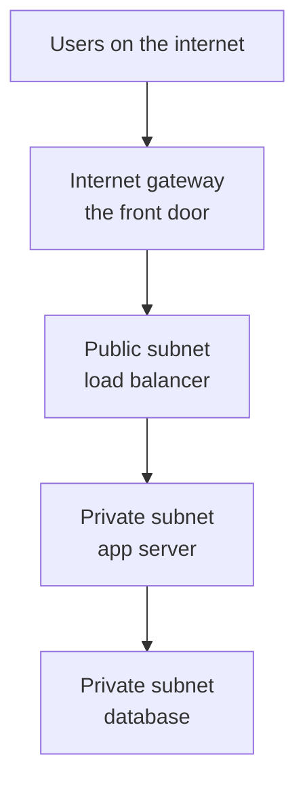
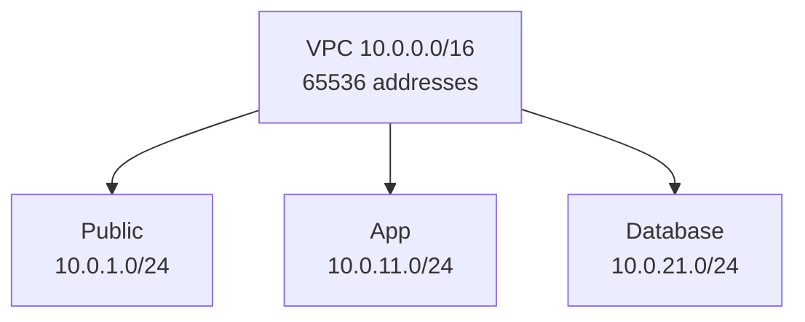
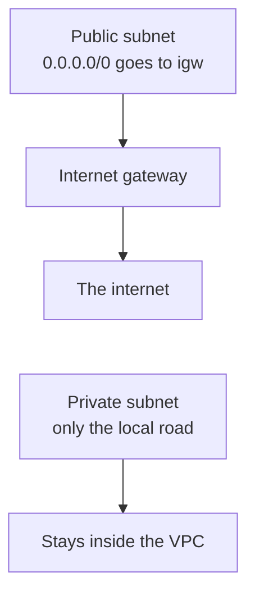
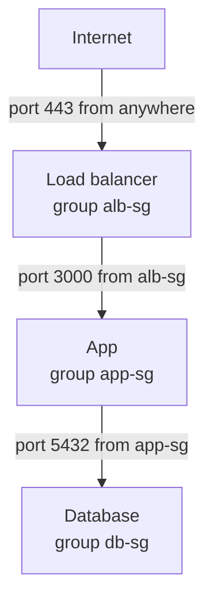
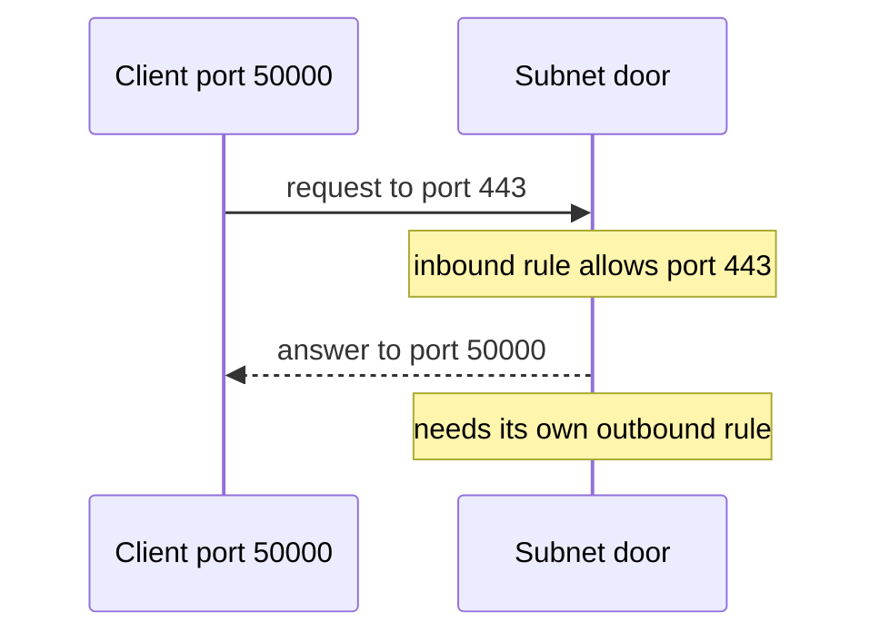
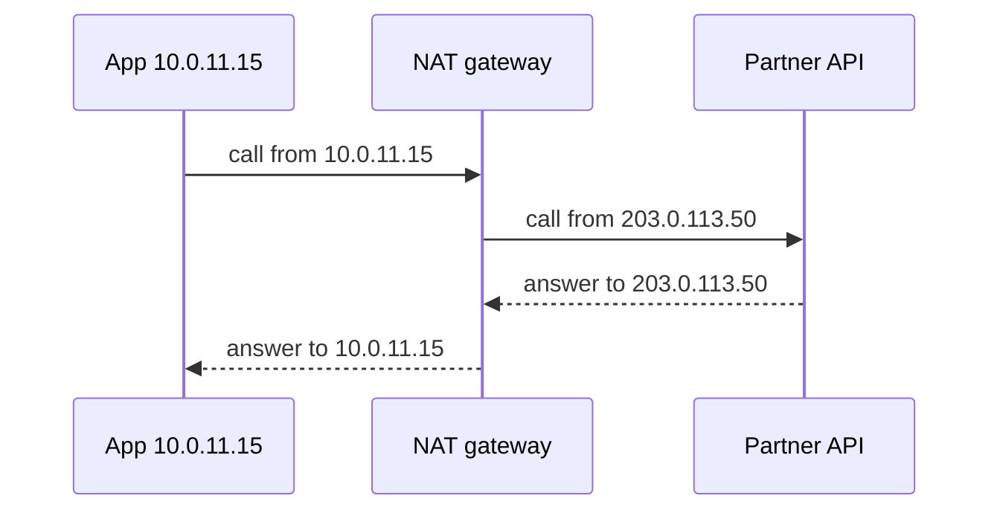
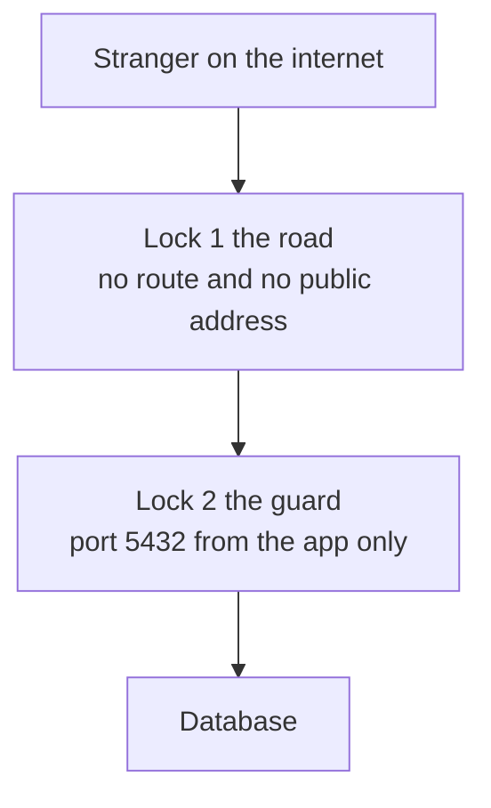
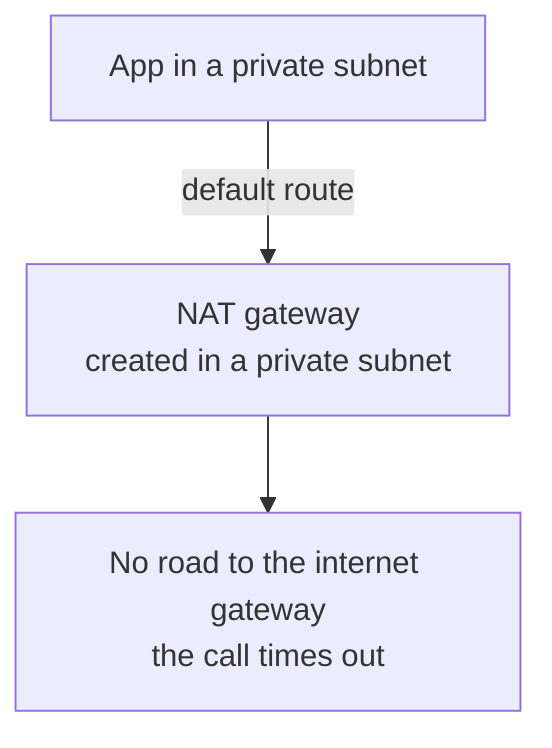

# 17. VPC networking basics

> **Subject:** DevOps and Cloud · **Lesson:** 17 · **Made:** 2026-11-19 · **Status:** ready
>
> **You will be able to:** say what a VPC, a subnet and a route table are, explain why a route to an internet gateway (and nothing else) makes a subnet public, tell a security group (remembers connections) from a network ACL (remembers nothing), say what a NAT gateway does and what it costs, and explain why the database sits in a private subnet.
>
> **Before this:** [Cloud models](06-cloud-models.md) · **Also read:** [Reverse proxy and Nginx](08-reverse-proxy-and-nginx.md) and [Infrastructure as code](14-infrastructure-as-code.md) · **Next:** IAM and least privilege (planned, lesson 16)
>
> **How to read it:** one card is one idea. Look at the picture, guess, then press the orange bar to check. The blue bars (📖 More detail) hold the longer explanation. Skip them on the first read, and open them when you want more. **I did not use AWS for this lesson.** The AWS facts come from the official docs and pricing pages (opened 2026-11-19) and are marked "from the docs, not run here". The small model in the practice file and in the stepper is plain JavaScript that I ran for real. This topic is a set of parts, so the lesson names about eight (more than the usual four). Each card adds one or two of them, with a picture. About 25 minutes for the cards.

## 1. The problem: a database that anyone can try

Give every server a public address, and anyone can try to log in to your database. Bots scan the internet for open database ports all day. So you build a small private network and decide who gets a door. Think of an office building. The building is a **VPC** (your own private network in the cloud). The rooms are **subnets**. The **internet gateway** is the front door to the street. Only the reception room has a corridor to that door.



Notice: users reach only the load balancer. The app and the database sit deeper inside. Where the picture stops: rooms and doors are settings, not walls. The next cards show which setting does what.

<details class="guess"><summary>🤔 Guess: which parts of this picture should a user's browser reach directly? Press to check.</summary>

**Only the load balancer.** It passes each request to the app, and the app asks the database. The browser never talks to them.

</details>

> **Remember:** only the load balancer faces the internet. The app and the database live in private subnets.

<details class="more"><summary>📖 More detail: the three words, the default VPC, and where this fits</summary>

**Three new words, with their one-line meanings** (from the docs, [How Amazon VPC works](https://docs.aws.amazon.com/vpc/latest/userguide/how-it-works.html), opened 2026-11-19):

- **VPC (virtual private cloud):** "a virtual network dedicated to your AWS account", cut off from other networks in the cloud.
- **Subnet:** "a range of IP addresses in your VPC". You put servers in subnets. Each subnet lives in one zone and cannot span zones ([Subnets](https://docs.aws.amazon.com/vpc/latest/userguide/configure-subnets.html)).
- **Internet gateway:** the part that connects your VPC to the internet.

**The default VPC.** Every account has a default VPC in each region. It comes with a public subnet in each zone, an internet gateway and a road to it. So a server you launch there can reach the internet at once. The docs say it suits "launching public instances such as a blog or simple website" ([Default VPCs](https://docs.aws.amazon.com/vpc/latest/userguide/default-vpc.html)). For an app with a private database, you build your own VPC.

**Where it fits.** In [Cloud models](06-cloud-models.md) terms, the VPC is part of the IaaS side: you design the network. This is the kind of thing you describe in code ([Infrastructure as code](14-infrastructure-as-code.md)). The load balancer is the "what sits in front" part from [Reverse proxy and Nginx](08-reverse-proxy-and-nginx.md) and [Load balancers](../system-design/03-load-balancers.md).

**One zone only.** A real layout repeats the boxes in a second zone, so one zone can fail. [Networking for system design, Part 9](../networking/networking-for-system-design.md) draws the two-zone version. These pictures use one zone to stay small.

**CapRover.** That guide says the same idea exists on CapRover and Docker Swarm: an overlay network is the private network, and only nginx publishes ports 80 and 443. I did not check this myself here.

</details>

## 2. CIDR: the address range, in plain words

An address like `10.0.1.20` is four numbers. A **CIDR block** (say "cider") writes a whole range as one line: `10.0.1.0/24`. The number after the slash says how many of the 32 bits are fixed. The rest are free. A bigger number means a smaller block. The VPC takes one big block. Each subnet takes a smaller slice of it, and slices must not overlap.



| Block | Fixed bits | Free bits | Addresses |
|---|---|---|---|
| `10.0.0.0/16` | 16 | 16 | 65,536 |
| `10.0.1.0/24` | 24 | 8 | 256 |
| `10.0.1.0/28` | 28 | 4 | 16 |
| `0.0.0.0/0` | 0 | 32 | every address |

Notice: each step of 1 in the slash number cuts the block in half.

<details class="guess"><summary>🤔 Guess: which block is bigger, a /16 or a /24? Press to check.</summary>

**The /16.** It holds 65,536 addresses. A /24 holds 256. The number after the slash counts the fixed bits, so more fixed bits leave less room.

</details>

> **Remember:** the number after the slash counts the fixed bits. A bigger number is a smaller block. A subnet is a slice of the VPC block.

<details class="more"><summary>📖 More detail: the sum, AWS limits, the 5 kept addresses, and planning ahead</summary>

**The sum.** Free bits give 2 to the power of the free bits. A /24 has 8 free bits, so 2 to the power of 8 is 256.

**AWS limits** (from the docs, [VPC CIDR blocks](https://docs.aws.amazon.com/vpc/latest/userguide/vpc-cidr-blocks.html) and [Subnet CIDR blocks](https://docs.aws.amazon.com/vpc/latest/userguide/subnet-sizing.html), opened 2026-11-19, not run here):

- A VPC block is between `/16` (65,536 addresses) and `/28` (16 addresses). A subnet is between `/28` and `/16`.
- AWS recommends the private ranges `10.0.0.0/8`, `172.16.0.0/12` and `192.168.0.0/16`.
- **AWS keeps 5 addresses in every subnet:** the first four and the last one (the network address, the VPC router, the DNS server, one for the future, and the broadcast address). So a /24 gives **251** usable addresses, not 256.
- A single address is written with `/32`, for example `203.0.113.1/32`.
- The default VPC is `172.31.0.0/16`, with a `/20` subnet (4,096 addresses) in each zone ([Default VPC components](https://docs.aws.amazon.com/vpc/latest/userguide/default-vpc-components.html)).

**Plan ahead.** The docs say you "cannot increase or decrease the size of an existing CIDR block". You can add another block later. Subnets must not overlap. VPCs that you connect together (for example with peering or a Direct Connect gateway) must not overlap either. So pick a big block (a /16 is the biggest) and give each subnet room to grow.

**Try it.** Type a block into [cidr.xyz](https://cidr.xyz) and see its first and last address. In the practice file, `cidrSize`, `usableInSubnet` and `cidrContains` are this card as code.

</details>

## 3. Public or private: the route table decides

A **route table** is a list of roads: "for addresses in this range, go that way". Every subnet uses one. Every table starts with a **local** road: addresses inside the VPC stay inside. A subnet is **public** when its table has a road to the internet gateway. It is **private** when it does not. The name does not matter. When two roads fit, the most specific one wins.



Notice: the two subnets are in the same VPC. One line in the route table is the whole difference.

<details class="guess"><summary>🤔 Guess: a server in a private subnet has a public IP address. Can the internet reach it? Press to check.</summary>

**No.** There is no road from the internet gateway to that subnet. The AWS docs say instances in a private subnet cannot reach the internet, even if they have public addresses. A public server needs both: a road and a public address.

</details>

> **Remember:** a public subnet is one with a route to an internet gateway. No route, no internet, even with a public IP address.

<details class="more"><summary>📖 More detail: the docs words, the three tables, which road wins, and the main route table</summary>

**The docs words** ([Subnets](https://docs.aws.amazon.com/vpc/latest/userguide/configure-subnets.html), [Internet gateway](https://docs.aws.amazon.com/vpc/latest/userguide/VPC_Internet_Gateway.html), opened 2026-11-19, not run here):

- Public subnet: "The subnet has a direct route to an internet gateway."
- Private subnet: "The subnet does not have a direct route to an internet gateway." It needs a NAT device to reach the internet (card 6).
- An isolated subnet has no routes to anything outside the VPC.
- For IPv4, the instance also needs a public IPv4 address or an Elastic IP address. The internet gateway swaps between the public address and the private one.
- The route may be narrower than `0.0.0.0/0`. A road to the gateway for only some addresses still makes the subnet public.
- The gateway itself has no charge. Data transfer charges apply.

**The three route tables of the example in the stepper:**

| Subnet | Roads | Public? |
|---|---|---|
| Public (load balancer) | `10.0.0.0/16` local, `0.0.0.0/0` to `igw-1` | yes |
| App | `10.0.0.0/16` local, `0.0.0.0/0` to `nat-1` | no |
| Database | `10.0.0.0/16` local | no |

**Which road wins** (the model's `pickRoute`, the docs call it the longest prefix match, [route priority](https://docs.aws.amazon.com/vpc/latest/userguide/route-tables-priority.html)):

| Packet to | From the subnet | Best road | Why |
|---|---|---|---|
| `10.0.21.30` | App | `local` | inside `10.0.0.0/16`, and more specific than `0.0.0.0/0` |
| `192.0.2.44` | App | `nat-1` | only `0.0.0.0/0` fits |
| `192.0.2.44` | Public | `igw-1` | only `0.0.0.0/0` fits |
| `192.0.2.44` | Database | none | no road fits, so the packet has nowhere to go |

**The main route table.** Each new subnet joins the VPC's main route table unless you choose another. My reading: if someone adds a gateway road to the main table, every subnet that uses it turns public. Many teams give private subnets their own table, so that cannot happen by accident.

</details>

## 4. Security group: a guard at each server

A **security group** is a list of allow rules at a server. Four facts. It only **allows**, never denies. A new group lets **nothing** in. It is **stateful**: it remembers a connection, so the answer to an allowed request is allowed too. And a rule can name **another group** as the source. So the database says "port 5432 from the app's group". Any server in the app group may connect, at any address.



Notice: each group trusts only the one before it. New app servers get access by joining the app group.

<details class="guess"><summary>🤔 Guess: you make a new security group and add no rules. Can anyone connect to the server? Press to check.</summary>

**No.** A new group has no inbound rules, so nothing gets in. (It has one outbound rule that allows everything out, until you remove it.)

</details>

> **Remember:** a security group allows only, remembers connections, and can name another group as the source. A new group lets nothing in.

<details class="more"><summary>📖 More detail: rule parts, the docs, and the trace of a request</summary>

**A rule has** a protocol, a port range, and a source (an address range, a prefix list or another group). From the docs ([Security groups](https://docs.aws.amazon.com/vpc/latest/userguide/vpc-security-groups.html), [Rules](https://docs.aws.amazon.com/vpc/latest/userguide/security-group-rules.html), opened 2026-11-19, not run here):

- "You can specify allow rules, but not deny rules."
- With several groups on one server, the rules are put together into one set.
- No extra charge for security groups.
- Do not open ports 22 or 3389 to `0.0.0.0/0`.
- The docs show this same chain (load balancer, web servers, database servers) as an example.

**The trace** (stepper, tab 1, the model code `pickRoute`, `isPublicSubnet`, `sgAllowsInbound`, `roundTrip`):

| Step | What happens | The check | Result |
|---|---|---|---|
| 1 | A user opens your site | none yet | the picture is set |
| 2 | The browser sends a packet to the load balancer's public address `203.0.113.25`, port 443 | none | it reaches the internet gateway |
| 3 | The internet gateway looks at the public subnet | `isPublicSubnet` is true, and the load balancer has a public address, so `internetAccess` is `two-way` | the destination becomes `10.0.1.20` |
| 4 | `alb-sg` checks the packet | rule: tcp 443 from `0.0.0.0/0` | ALLOWED |
| 5 | The load balancer calls the app `10.0.11.15`, port 3000 | `pickRoute` gives `local`, and `app-sg` trusts `sg-alb` | ALLOWED |
| 6 | The app asks the database `10.0.21.30`, port 5432 | `pickRoute` gives `local`, and `db-sg` trusts `sg-app` | ALLOWED |
| 7 | The answers travel back | `roundTrip` with no outbound rules gives `replyOk: true` | stateful, so no check |

</details>

## 5. Network ACL: a guard with no memory

A **network ACL** (access control list) is a second guard. It stands at the door of a whole subnet. It has **allow and deny** rules with numbers. It reads them from the lowest number up, and the first match decides. And it is **stateless**: it remembers nothing, so the answer needs its own rule, for the client's own port. Every subnet has one. The default allows everything.



| | Security group | Network ACL |
|---|---|---|
| Where | at the server | at the subnet |
| Rules | allow only | allow and deny |
| Order | checks all rules | lowest number first |
| The answer | allowed for you (stateful) | needs its own rule (stateless) |

<details class="guess"><summary>🤔 Guess: a network ACL allows port 443 in and has no outbound rules. A client connects from its port 50000. Does the answer get out? Press to check.</summary>

**No.** The answer is a new packet to port 50000, and no outbound rule matches. The page loads for nobody and times out. The fix is an outbound rule for the high ports, for example TCP 1024 to 65535.

</details>

> **Remember:** a network ACL is stateless, sits at the subnet, has allow and deny rules, and reads the lowest number first. Use security groups as the main tool.

<details class="more"><summary>📖 More detail: when to use it, the default, the order, and the trace</summary>

**When to use one** (from the docs, [Infrastructure security](https://docs.aws.amazon.com/vpc/latest/userguide/infrastructure-security.html), [Network ACLs](https://docs.aws.amazon.com/vpc/latest/userguide/vpc-network-acls.html), [Example](https://docs.aws.amazon.com/vpc/latest/userguide/nacl-examples.html), opened 2026-11-19, not run here):

- AWS says to use security groups as "the primary mechanism", and network ACLs as a second control, for example "to deny a specific subset of traffic" or as guard rails for a subnet.
- The docs example: if someone opens SSH to everyone in a security group by mistake, the network ACL still blocks it. It is a backup layer.
- Rule numbers go from 1 to 32766. Leave gaps (10, 20, 30) so you can add a rule later.
- The default network ACL has rule 100 "allow all" in both directions, and a last rule `*` that denies anything that matched nothing ([Default network ACL](https://docs.aws.amazon.com/vpc/latest/userguide/default-network-acl.html)).
- The docs example allows the outbound answer with TCP ports 1024 to 65535.

**The trace** (stepper, tab 3, the model code `roundTrip` and `naclAllows`):

| Step | The firewall | `roundTrip` or `naclAllows` says |
|---|---|---|
| 1 | Security group: 443 in, no outbound rules | `requestOk: true, replyOk: true` (stateful) |
| 2 | Network ACL: 443 in, no outbound rules | `requestOk: true, replyOk: false` |
| 3 | Network ACL: 443 in, and 443 out | `replyOk: false`. The answer goes to the client's port 50000, not 443 |
| 4 | Network ACL: 443 in, and TCP 1024 to 65535 out | `replyOk: true` |
| 5 | Rule 100 deny `198.51.100.0/24`, rule 200 allow all | a packet from `198.51.100.7` is REFUSED |
| 6 | The same rules with the numbers swapped | the same packet is ALLOWED, because the allow rule is read first |

</details>

## 6. NAT gateway: out yes, in no

Your app is in a private subnet. It must still call outside APIs, for example for email or payments. A **NAT gateway** (network address translation) is the go-between. It sits in a **public** subnet. The private subnet's default road points at it. It swaps the app's private address for its own public address, and it remembers the call, so the answer finds the app. Nobody outside can start a call in. It also **costs money**: for each hour it exists, and for each GB it processes.



Notice: the partner only ever sees the NAT gateway's public address. Where it stops: the internet gateway also takes part (card 3), and it is not shown here.

<details class="guess"><summary>🤔 Guess: your app calls a partner API through a NAT gateway. Which address does the partner see? Press to check.</summary>

**The NAT gateway's public address.** Never the app's private address. It is also one fixed address, so a partner can put it on an allow list.

</details>

> **Remember:** a NAT gateway lets private servers call out and lets nobody call in. It lives in a public subnet. It costs money every hour and for every GB.

<details class="more"><summary>📖 More detail: the cost, ways to pay less, newer options, and the trace</summary>

**The cost.** The AWS pricing page example (US East Ohio, opened 2026-11-19; other regions differ) says $0.045 per NAT gateway hour and $0.045 per GB processed. The model's `natCost` with a month of 730 hours:

| Case | Cost |
|---|---|
| 1 gateway, no traffic | $32.85 |
| 1 gateway, 100 GB | $37.35 |
| 1 gateway, 1,000 GB | $77.85 |
| 2 gateways (one per zone), no traffic | $65.70 |

The same page lists a public IPv4 address at $0.005 per hour. My reading is that the NAT gateway's public address counts too. Check your bill.

**Ways to pay less** (from the docs, [NAT gateway pricing](https://docs.aws.amazon.com/vpc/latest/userguide/nat-gateway-pricing.html)):

- Keep servers in the same zone as the NAT gateway they use, because crossing zones adds charges.
- For traffic to S3, use a gateway endpoint. The docs say there is "no additional charge" for gateway endpoints, and the traffic skips the NAT gateway ([S3 gateway endpoints](https://docs.aws.amazon.com/vpc/latest/privatelink/vpc-endpoints-s3.html)).
- A small test environment may not need one.

**One per zone.** A standard NAT gateway lives in one zone. For high availability you run one per zone. The docs also describe a newer **regional NAT gateway** that spreads over zones for you and needs no public subnet of its own ([Regional NAT gateways](https://docs.aws.amazon.com/vpc/latest/userguide/nat-gateways-regional.html)). I did not try it.

**IPv6.** For outbound-only IPv6 there is a similar part, the egress-only internet gateway (named in the docs).

**The trace** (stepper, tab 2, the model code `pickRoute`, `internetAccess`, `natCost`):

| Step | What happens | The state after |
|---|---|---|
| 1 | The app wants to call `192.0.2.44` | it has a private address only |
| 2 | `pickRoute(app table, 192.0.2.44)` | the target is `nat-1` |
| 3 | The NAT gateway swaps the source `10.0.11.15` for `10.0.1.50` and writes a note | `internetAccess` is `outbound-only` |
| 4 | The internet gateway swaps `10.0.1.50` for `203.0.113.50` | the partner sees `203.0.113.50` |
| 5 | The partner answers to `203.0.113.50`. The NAT gateway finds its note and sends the answer to `10.0.11.15` | the app has its answer |
| 6 | A stranger sends a packet to `203.0.113.50` | no note for it, so it is dropped |
| 7 | The bill | $32.85 with no traffic, $77.85 with 1,000 GB |

</details>

## 7. Why the database is private: two locks

To reach your database from the internet, a stranger needs three things: a **road** (a route to the internet gateway), a **public address**, and a **rule** that lets the packet in. A private database has no road and no public address. Its security group also trusts only the app. These are two locks. If someone opens port 5432 to everyone "so we can connect from home", the road is still missing. But now only one lock holds.



Notice: each lock stops the stranger on its own. Both must fail before the database is open.

<details class="guess"><summary>🤔 Guess: someone adds "port 5432 from anywhere" to the database's security group. The database is in a private subnet with no public IP. Is it exposed? Press to check.</summary>

**Not yet.** There is still no road from the internet. But you lost one lock. If the database later moves to a public subnet, or "publicly accessible" is switched on, it is open at once. Better: leave the door shut and give developers a bastion host or a VPN.

</details>

> **Remember:** the database is private for two reasons: no road from the internet, and a security group that trusts only the app. Keep both locks.

<details class="more"><summary>📖 More detail: RDS, the developer problem, and the trace</summary>

**RDS** (from the docs, [RDS in a VPC](https://docs.aws.amazon.com/AmazonRDS/latest/UserGuide/USER_VPC.WorkingWithRDSInstanceinaVPC.html), opened 2026-11-19, not run here):

- AWS names this layout: web servers in a public subnet, and a database that is "not publicly accessible" in a private subnet, so "only the web servers have access" to it.
- Every DB instance has a private address. The **Public access** option adds a public one. Access is "ultimately controlled by the security group". For public access the subnets also need an internet gateway.
- A DB subnet group needs subnets in at least two zones, even for a single-zone database.

**How can a developer reach it?** Two common ways (my notes, not a rule): a **bastion host** (a small server in a public subnet that you log in to first), or a private link from your own network (the docs list AWS VPN and Direct Connect for private connections from remote networks). The database keeps both locks either way.

**A guardrail.** [VPC Block Public Access](https://docs.aws.amazon.com/vpc/latest/userguide/security-vpc-bpa.html) is an account setting that can block internet traffic to and from internet gateways for a whole region. It is a third lock on top. I did not try it.

**The trace** (stepper, tab 4, the model code `internetAccess` and `sgAllowsInbound`):

| Step | What happens | The two locks |
|---|---|---|
| 1 | A stranger at `198.51.100.7` tries `10.0.21.30` port 5432 | not checked yet |
| 2 | The database's route table | `isPublicSubnet` false and `internetAccess` is `none`. Lock 1 holds |
| 3 | The database's security group | `sgAllowsInbound` is REFUSED. Lock 2 holds |
| 4 | Someone adds 5432 from `0.0.0.0/0` | Lock 2 is open (ALLOWED). Lock 1 still holds |
| 5 | The database moves to a public subnet with a public address | `internetAccess` is `two-way`. Both open, so reachable |

</details>

## 8. A mistake: the NAT gateway in the wrong subnet

Your app calls a partner API. Every call hangs and then times out. The app's route table is right: `0.0.0.0/0` goes to the NAT gateway. The problem is where the NAT gateway was made. It was created in a **private** subnet, so it has no road to the internet gateway of its own. The packet reaches it and goes nowhere. The fix: create the NAT gateway in a **public** subnet.



Notice: nothing is wrong with the app's own settings. The mistake is one hop later.

<details class="guess"><summary>🤔 Guess: the app's route table sends 0.0.0.0/0 to a NAT gateway, and calls still time out. What do you check first? Press to check.</summary>

**The subnet that holds the NAT gateway.** Does its route table have a road to the internet gateway? If not, the NAT gateway is in a private subnet. Move it to a public one.

</details>

> **Remember:** when a private server cannot call out, check its default road first. Then check that the NAT gateway sits in a public subnet.

<details class="more"><summary>📖 More detail: the three questions, five cases, and the trace</summary>

**Three questions for "it cannot reach the internet":**

1. Which road does the route table choose for that address?
2. If it is a NAT gateway: is the NAT gateway in a public subnet?
3. If it is an internet gateway: does the server have a public address?

**Five cases** (the model's `internetAccess`):

| Case | Result |
|---|---|
| Road to the internet gateway, public address | `two-way` |
| Road to the internet gateway, no public address | `none` |
| Road to a NAT gateway in a public subnet | `outbound-only` |
| Road to a NAT gateway in a private subnet | `none` |
| Only the local road, even with a public address | `none` |

**Not covered here.** A call can also fail for other reasons: the outbound rules of a security group, a network ACL, or DNS. The default security group allows all outbound traffic, so a removed rule is worth a look. I did not run any of these on AWS.

**The trace** (stepper, tab 5):

| Step | What happens | `internetAccess` |
|---|---|---|
| 1 | The app's calls time out, the route table points at `nat-1` | not checked yet |
| 2 | The NAT gateway sits in a subnet with only the local road | `none` |
| 3 | The NAT gateway is created in the public subnet | `outbound-only` |
| 4 | Someone gives the database a public address | `none`. There is no road |
| 5 | The five cases | see the table above |

</details>

## 9. Watch and play

Links were checked on 2026-11-19. For the videos I read the title and channel from the YouTube oEmbed data and the length from the YouTube page data. I did not watch them. For the pages I opened them and read the parts named below. If a link is broken, tell me and I will replace it.

- **Play with it:** [the stepper in this folder](visuals/17-vpc-networking-basics.html) - guess first, then press Next. Five tabs: a request in, a call out through NAT, stateful or stateless, two locks on the database, and a NAT gateway in the wrong place.
- **Play with addresses:** [cidr.xyz](https://cidr.xyz) - type `10.0.1.0/24` and see the first and last address. Try `/16` and `/28` and compare with card 2.
- **Video (16 minutes):** [AWS VPC Tutorial - Public & Private Subnets, Routing Tables, Internet & NAT Gateway #1](https://www.youtube.com/watch?v=wdVeuX2FGyk) - channel shown as "Cloud Guru". I did not check that it is the A Cloud Guru company. Watch it next to cards 3 and 6.
- **Video (58 minutes, deeper):** [AWS re:Invent 2025 - AWS Networking Fundamentals: Connect, secure and scale (NET208)](https://www.youtube.com/watch?v=nXBqxnp5ybY) - AWS Events channel. Long. Skim the VPC part when you want more.
- **Pictures:** [Subnets for your VPC](https://docs.aws.amazon.com/vpc/latest/userguide/configure-subnets.html) - a diagram of a VPC with a public and a private subnet in each of two zones. Compare it with card 1.
- **Pictures:** [Security group rules](https://docs.aws.amazon.com/vpc/latest/userguide/security-group-rules.html) - the section "Security group referencing" draws the load balancer, web servers and database chain of card 4.
- **Read:** [Compare security groups and network ACLs](https://docs.aws.amazon.com/vpc/latest/userguide/infrastructure-security.html) - the five-row table of card 5, from AWS.

<details><summary>Go deeper (optional)</summary>

**More pages I opened.** [How Amazon VPC works](https://docs.aws.amazon.com/vpc/latest/userguide/how-it-works.html). [VPC CIDR blocks](https://docs.aws.amazon.com/vpc/latest/userguide/vpc-cidr-blocks.html). [Subnet CIDR blocks](https://docs.aws.amazon.com/vpc/latest/userguide/subnet-sizing.html). [Internet gateway](https://docs.aws.amazon.com/vpc/latest/userguide/VPC_Internet_Gateway.html). [Route priority](https://docs.aws.amazon.com/vpc/latest/userguide/route-tables-priority.html). [Default VPCs](https://docs.aws.amazon.com/vpc/latest/userguide/default-vpc.html). [Network ACLs](https://docs.aws.amazon.com/vpc/latest/userguide/vpc-network-acls.html). [Default network ACL](https://docs.aws.amazon.com/vpc/latest/userguide/default-network-acl.html). [NAT gateways](https://docs.aws.amazon.com/vpc/latest/userguide/vpc-nat-gateway.html). [NAT gateway pricing](https://docs.aws.amazon.com/vpc/latest/userguide/nat-gateway-pricing.html). [Amazon VPC pricing](https://aws.amazon.com/vpc/pricing/). [Gateway endpoints for S3](https://docs.aws.amazon.com/vpc/latest/privatelink/vpc-endpoints-s3.html). [RDS in a VPC](https://docs.aws.amazon.com/AmazonRDS/latest/UserGuide/USER_VPC.WorkingWithRDSInstanceinaVPC.html). [Block public access](https://docs.aws.amazon.com/vpc/latest/userguide/security-vpc-bpa.html). [Amazon VPC FAQs](https://aws.amazon.com/vpc/faqs/).

**Public and private NAT gateways.** The docs say a NAT gateway is "public" by default and needs an Elastic IP address. A **private** NAT gateway is for traffic to other VPCs or your office network, and the docs say that traffic sent from it to an internet gateway is dropped. A public NAT gateway has to sit in a public subnet.

**VPC endpoints.** A gateway endpoint (S3 and DynamoDB) is a road in your route table that keeps the traffic inside AWS. An interface endpoint (PrivateLink) is a private address in your subnet for a service. The S3 docs say the interface kind costs extra, and the gateway kind has no extra charge. [Networking for system design, Part 9](../networking/networking-for-system-design.md) says the same in its cost notes.

**Flow logs.** VPC Flow Logs capture the traffic to and from network interfaces. They help when you ask "did my packet arrive, and who refused it?" (named in the docs, not tried).

**Checked on 2026-11-19** with Node v26.5.0 for the practice code and the stepper code (54 tests, and a click through every step of every tab with a fake page). The three copies of the ten functions (practice answer, stepper, and the answer in card 10) are the same code after removing comments. I also looked at the stepper in a 375 px wide frame: no sideways scroll.

**What I did not test.** Anything on AWS. I did not make a VPC, a subnet, a route table, a security group, a network ACL or a NAT gateway, and I did not read a real bill. Everything about AWS in this lesson is from the docs and pages I opened, or is written by hand to show a shape.

**Where the model is simpler than AWS.** It is one zone. It has no IPv6, no prefix lists, no rule for ICMP, no limits on the number of rules, no peering, no VPN, no endpoints and no route rules beyond the longest prefix. A security group source that names a group matches a packet that says it comes from that group. Real AWS checks the private addresses of the servers in the group. The model is there to show the checks, not to copy AWS.

**More ideas not covered here.** Bring-your-own address ranges. Transit gateways and peering between VPCs. Traffic mirroring. AWS Network Firewall. Running the app itself ([Ways to run your app compared](26-ways-to-run-your-app.md)). The cost of cloud networks as a whole (Cloud cost basics, planned as lesson 24). Who may change a security group (IAM and least privilege, planned as lesson 16).

</details>

## 10. Practice

**A. Predict the output** (write your answer before opening)

```js
const appRt = [
  { dest: "10.0.0.0/16", target: "local" },
  { dest: "0.0.0.0/0", target: "nat-1" },
];
const pubRt = [
  { dest: "10.0.0.0/16", target: "local" },
  { dest: "0.0.0.0/0", target: "igw-1" },
];
console.log(pickRoute(appRt, "10.0.21.30"));
console.log(pickRoute(appRt, "192.0.2.44"));
console.log(isPublicSubnet(appRt), isPublicSubnet(pubRt));
console.log(internetAccess({ routes: appRt, hasPublicIp: false, natSubnetRoutes: appRt }));
console.log(usableInSubnet("10.0.1.0/24"), cidrSize("10.0.0.0/16"));
const nacl = {
  type: "nacl",
  inbound: [{ number: 100, action: "allow", protocol: "tcp", portFrom: 443, portTo: 443, cidr: "0.0.0.0/0" }],
  outbound: [],
};
const req = { protocol: "tcp", port: 443, srcIp: "198.51.100.7", srcPort: 50000 };
console.log(roundTrip(nacl, req));
```

Then answer: why does line 4 print `none` even though the app's table points at a NAT gateway, and why is `replyOk` false?

<details><summary>Answer</summary>

```
local
nat-1
false true
none
251 65536
{ requestOk: true, replyOk: false }
```

The first address is inside the VPC, so the local road wins. The second is outside, so only `0.0.0.0/0` fits and it points at `nat-1`. Only the table with a road to an internet gateway is public. Line 4: the NAT gateway sits in a subnet whose table (`appRt`) has no road to an internet gateway, so the call goes nowhere (card 8). A /24 gives 256 minus the 5 that AWS keeps, so 251. `replyOk` is false because the network ACL has no outbound rule for the client's port 50000, and a network ACL remembers nothing (card 5). (Checked on 2026-11-19 with Node v26.5.0.)

</details>

**B. Fix the bug**

This function should say that a subnet whose default road goes to a NAT gateway is **not** public. It says `true`. Find the bug.

```js
const isPublicSubnet = (routes) =>
  routes.some((r) => r.dest === "0.0.0.0/0");

const withNat = [
  { dest: "10.0.0.0/16", target: "local" },
  { dest: "0.0.0.0/0", target: "nat-1" },
];
console.log(isPublicSubnet(withNat));
```

<details><summary>Answer</summary>

It looks at the **range** of the road (`0.0.0.0/0`) and never at the **target**. Every private subnet with a NAT gateway also has a default road, so they all look public. The thing that makes a subnet public is a road **to an internet gateway**. The fix: `routes.some((r) => r.target.startsWith("igw-"))`. I ran the buggy version and it printed `true`. With the fix it printed `false`. A road to a gateway for only some addresses (not `0.0.0.0/0`) would still count as public, and the fix handles that.

</details>

**C. Write it yourself**

Open `learn/devops-cloud/practice/17-vpc-networking-basics.js`. Two helpers (`ipToInt` and `parseCidr`) are already written. It has ten empty pieces: `cidrSize`, `usableInSubnet`, `cidrContains`, `pickRoute`, `isPublicSubnet`, `sgAllowsInbound`, `naclAllows`, `roundTrip`, `internetAccess` and `natCost`. The comments at the top say what each one must do. Write them, then run this from the repo root and make all the tests pass:

```
node --test learn/devops-cloud/practice/17-vpc-networking-basics.test.js
```

Start with the first five. Then `roundTrip` is the one to think about: a security group lets the answer out because it remembers, and a network ACL needs its own outbound check, against the client's port.

<details><summary>One possible answer</summary>

```js
function cidrSize(cidr) {
  return parseCidr(cidr).size;
}

function usableInSubnet(cidr) {
  const { prefix, size } = parseCidr(cidr);
  if (prefix < 16 || prefix > 28) throw new Error("a subnet must be between /16 and /28");
  return size - 5;
}

function cidrContains(cidr, ip) {
  const { base, last } = parseCidr(cidr);
  const n = ipToInt(ip);
  return n >= base && n <= last;
}

function pickRoute(routes, destIp) {
  let best = null;
  let bestPrefix = -1;
  for (const route of routes) {
    if (!cidrContains(route.dest, destIp)) continue;
    const { prefix } = parseCidr(route.dest);
    if (prefix > bestPrefix) {
      best = route.target;
      bestPrefix = prefix;
    }
  }
  return best;
}

function isPublicSubnet(routes) {
  return routes.some((route) => route.target.startsWith("igw-"));
}

function sgAllowsInbound(rules, packet) {
  return rules.some((rule) => {
    if (rule.protocol !== packet.protocol || rule.port !== packet.port) return false;
    if (rule.source.startsWith("sg-")) return (packet.srcGroups || []).includes(rule.source);
    return cidrContains(rule.source, packet.srcIp);
  });
}

function naclAllows(rules, packet) {
  const ordered = [...rules].sort((a, b) => a.number - b.number);
  for (const rule of ordered) {
    const protocolOk = rule.protocol === "all" || rule.protocol === packet.protocol;
    const portOk = packet.port >= rule.portFrom && packet.port <= rule.portTo;
    if (protocolOk && portOk && cidrContains(rule.cidr, packet.ip)) return rule.action === "allow";
  }
  return false;
}

function roundTrip(firewall, request) {
  if (firewall.type === "sg") {
    const requestOk = sgAllowsInbound(firewall.inbound, request);
    return { requestOk, replyOk: requestOk };
  }
  const requestOk = naclAllows(firewall.inbound, { protocol: request.protocol, port: request.port, ip: request.srcIp });
  const replyOk = requestOk && naclAllows(firewall.outbound, { protocol: request.protocol, port: request.srcPort, ip: request.srcIp });
  return { requestOk, replyOk };
}

function internetAccess({ routes, hasPublicIp, natSubnetRoutes }) {
  const target = pickRoute(routes, "8.8.8.8");
  if (target === null) return "none";
  if (target.startsWith("igw-")) return hasPublicIp ? "two-way" : "none";
  if (target.startsWith("nat-")) return natSubnetRoutes && isPublicSubnet(natSubnetRoutes) ? "outbound-only" : "none";
  return "none";
}

function natCost({ hours, gb, perHour, perGb }) {
  return Math.round((hours * perHour + gb * perGb) * 100) / 100;
}
```

Checked on 2026-11-19 with Node v26.5.0: 53 of the 54 tests fail on the empty stub (the other one only checks that `naclAllows` does not change its input), and all 54 pass with this answer. I also tried 30 wrong versions of the answer (for example a subnet that is public when it has any default road, a most specific road that is not chosen, a network ACL that does not sort by number, a reply that is checked against the wrong port, and a NAT gateway that works from a private subnet). The tests caught all 30. The stepper page uses these same functions.

</details>

## 11. Interview question

**Q:** "Design the network for a web app on AWS. What is public, what is private, and why?"

A common follow-up: "Your app in a private subnet cannot call an outside API. What do you check?" Card 8 is the answer.

<details><summary>A strong answer, in four parts</summary>

1. **Problem:** A server with a public address can be attacked. A database must not be reachable from the internet. But the app still needs to call outside APIs, and the team still needs a way to reach the database.
2. **How it works:** I make a VPC with a `/16` block and cut it into subnets in two zones. The **public** subnets (a route to the internet gateway) hold the load balancer and the NAT gateway. The **private** app subnets send their default road to the NAT gateway. The **private** data subnets have only the local road. Security groups form a chain: the load balancer takes 443 from the internet, the app takes its port from the load balancer's group, and the database takes 5432 from the app's group. I leave the network ACL at its default, or use it as a backup layer that denies a bad range. For S3 I add a gateway endpoint.
3. **Tradeoff:** A NAT gateway costs money for each hour and each GB, and one per zone doubles the hours. A private database means developers need a bastion host or a VPN. Network ACLs are stateless, so a rule for the way in needs a rule for the way back. The address range is hard to change later, so I plan a big block first.
4. **My example:**
   - **Fact:** my profile says I have a little AWS and I deploy with Docker and CapRover.
   - **Fact (from this lesson):** I did not run any of this on AWS. I only ran a small JavaScript model of routes, security groups, network ACLs and NAT, so I should not say I have built a VPC.
   - **Idea, not a fact:** I do not know whether any of my projects (DBO, Unloan, ZWS or Skyworx) used a custom VPC, so I should not claim it. A good next step is to build this exact layout in a free-tier or throw-away account (or describe it in Terraform, see [lesson 14](14-infrastructure-as-code.md)), and then look at the NAT gateway line on the bill.

</details>

## 12. Explain it back

Close this file. Explain how a web app, a worker and a database sit in a VPC, like to a new junior, in 4 parts (problem, how, tradeoff, my example). Use the story of the database that someone opened to the whole internet "so we can connect from home". Say what makes a subnet public, which two locks the database has, and what a user's request passes on the way in. Then say how the app calls an outside API, who sees which address, and what that costs. Also say why a security group lets the answer out and a network ACL does not. Write your best version below and run `/explain-check VPC networking basics` or ask the `explain-coach` agent to review it.

### My explanation

<write here>

### Coach feedback

<the explain-coach agent writes here>

## 13. Review questions (day 1, 3, 7, 21)

1. What makes a subnet public, and what is the other thing a server needs to be reached from the internet?
2. A security group and a network ACL both allow 443 in and have no outbound rules. Which lets the answer out, and why?
3. How does a private app call an outside API, which address does the partner see, and what does it cost? Where must the NAT gateway sit?
4. Draw the picture from memory: the three subnets (public, app, database) with the internet gateway, the NAT gateway, and the chain of three security groups.

<details><summary>Answers</summary>

1. A route to an internet gateway in its route table. A public server also needs a public address. No road means no internet, even with a public address.
2. The security group. It is stateful: it remembers the connection and lets the answer out. A network ACL is stateless, so the answer needs its own outbound rule, for the client's high port (for example TCP 1024 to 65535).
3. The app's default road points at a NAT gateway. The NAT gateway swaps the app's private address for its own public address, so the partner sees the NAT gateway's public address. It remembers the call, so the answer comes back, and nobody outside can start a call in. It costs money for each hour and each GB. It must sit in a public subnet, or it has no road out.
4. The picture: users, the internet gateway, the public subnet with the load balancer and the NAT gateway, the app subnet whose default road goes to the NAT gateway, and the database subnet with only the local road. The three groups point at each other: 443 from anywhere into the load balancer, 3000 from the load balancer's group into the app, 5432 from the app's group into the database.

</details>

## Connected lessons

- [Cloud models](06-cloud-models.md) - the VPC is the network part of the IaaS side.
- [Reverse proxy and Nginx](08-reverse-proxy-and-nginx.md) - what sits in front of your app. The load balancer in card 1 plays that role.
- [Infrastructure as code](14-infrastructure-as-code.md) - a VPC with its subnets, route tables and groups is a typical thing to describe in Terraform.
- [Ways to run your app compared](26-ways-to-run-your-app.md) - where the app in the private subnet can run.
- [Networking for system design, Part 9](../networking/networking-for-system-design.md) - the same layout across two zones, with the cost notes and a likely interview drawing.
- [Load balancers](../system-design/03-load-balancers.md) and [Security in a design](../system-design/29-security-in-a-design.md) - the same ideas from the design side.
- IAM and least privilege (planned, lesson 16) - who may change a security group or a route table.
- Cloud cost basics (planned, lesson 24) - the NAT gateway line is a classic surprise on the bill.
