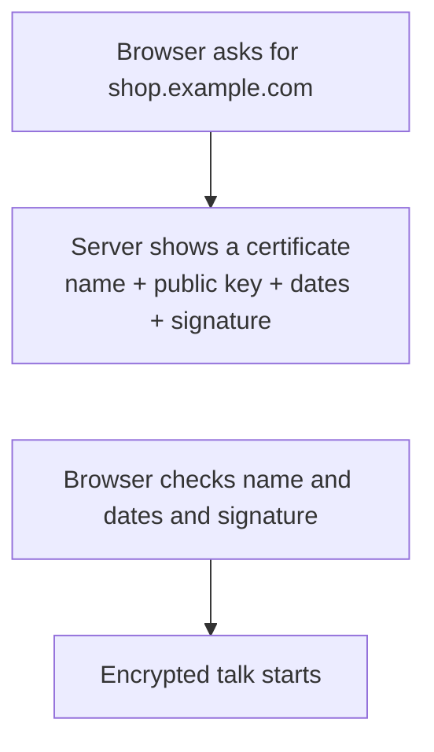
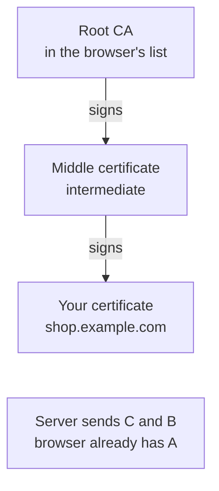
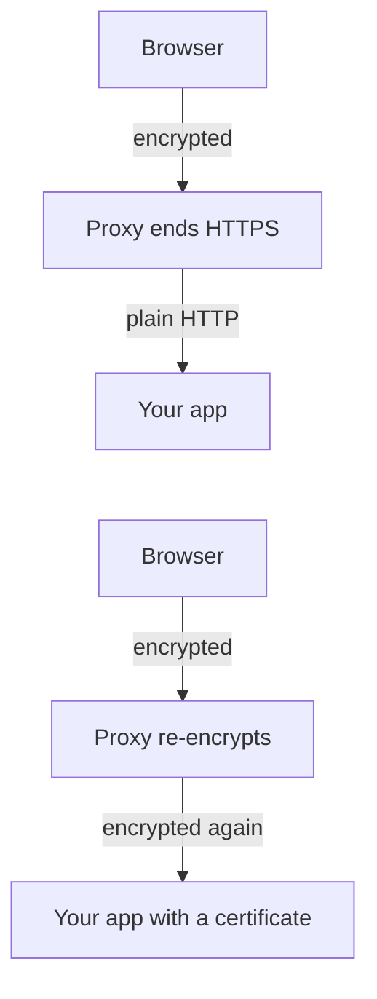
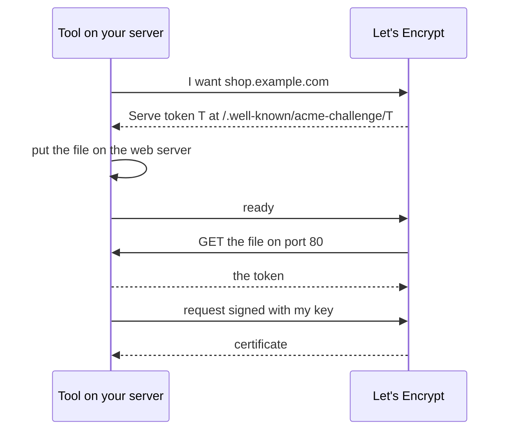
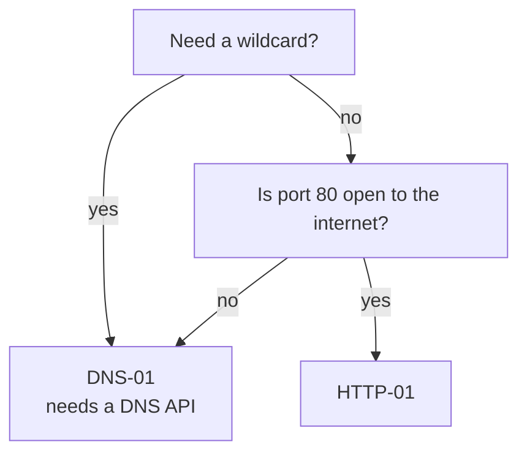
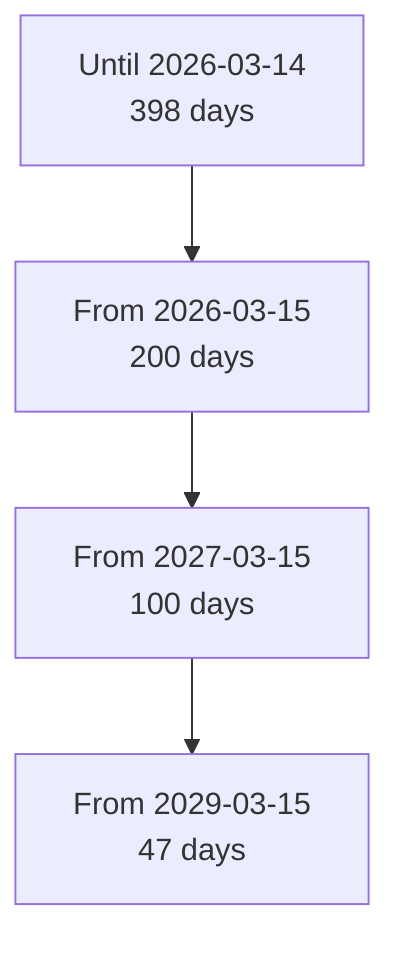
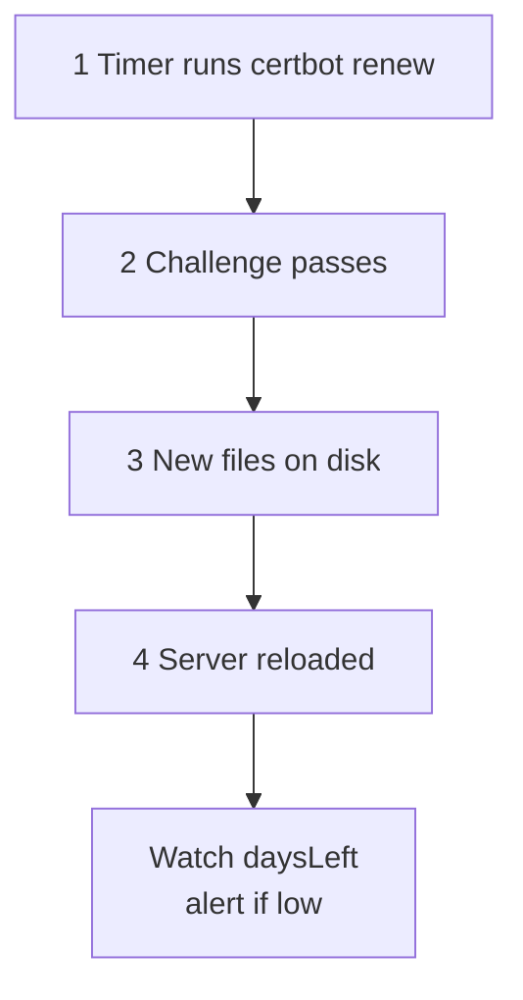
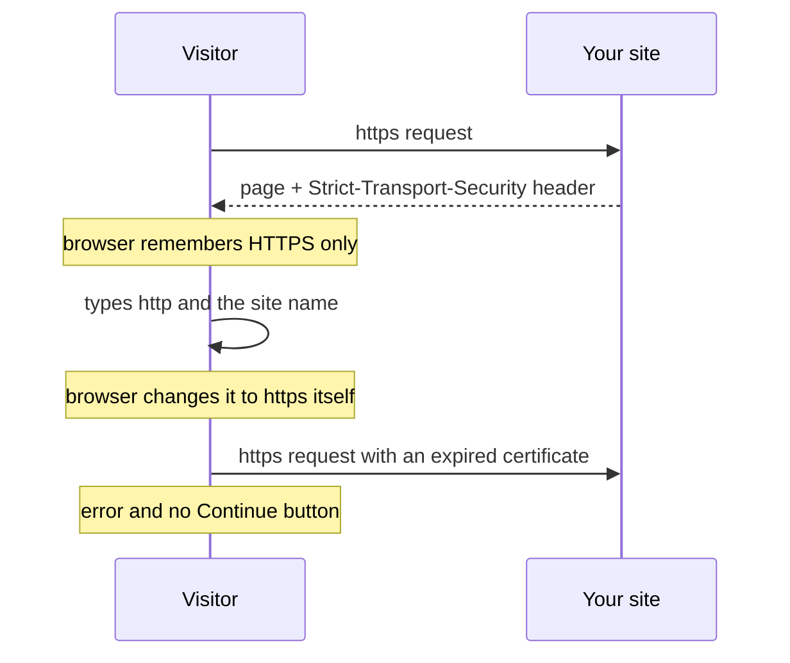

# 19. HTTPS and certificates in practice

> **Subject:** DevOps and Cloud · **Lesson:** 19 · **Made:** 2026-11-21 · **Status:** ready
>
> **You will be able to:** say what a certificate proves and what it does not, follow the chain of trust from your server to a root in the browser, say where the HTTPS ends (proxy, load balancer, or the app), explain how Let's Encrypt checks you control a name (HTTP-01 and DNS-01, and why wildcards need DNS-01), say how long certificates live now and how that is changing, list what breaks when renewal fails, and explain what HSTS adds.
>
> **Before this:** [Reverse proxy and Nginx](08-reverse-proxy-and-nginx.md) · **Also read:** [Config and secrets](09-config-and-secrets.md) and [Logs and monitoring](10-logs-and-monitoring.md) · **Next:** What CapRover does for you (planned, lesson 21) and Metrics, dashboards and alerts (planned, lesson 20)
>
> **How to read it:** one card is one idea. Look at the picture, guess, then press the orange bar to check. The blue bars (📖 More detail) hold the longer explanation. Skip them on the first read. **What I ran for real:** `openssl` and `curl` against live sites, a small certificate chain I made with `openssl`, a Node proxy that ends HTTPS, and the practice code. **What I did not run:** certbot, nginx, a real Let's Encrypt order, Cloudflare and AWS. Those are marked "from the docs, not run here". Facts and links were checked on 2026-11-19. About 25 minutes for the cards.

<!-- quick-summary:start -->
## Quick summary

> Short on time? Read only this. These are the "Remember" lines from the cards below, so you can read the whole lesson in one minute.

- A certificate proves who controls a name and carries the key to start encrypted talk. It does not prove the site is honest.
- The browser trusts a short list of roots. Your server must send its own certificate plus the middle ones (`fullchain.pem`).
- TLS termination means the HTTPS ends at the proxy. The leg behind it is plain unless you encrypt it again.
- ACME proves control of a name with a test: a file on port 80, or a DNS record. The private key stays on your server.
- A wildcard needs DNS-01. HTTP-01 needs port 80 open. DNS-01 needs a DNS API token, so keep that token narrow.
- Certificates are getting shorter (90 days at Let's Encrypt now, 47 days at most for every public CA from 2029). So renewal must be automatic and watched.
- Renewal has four weak spots: the timer, the challenge, the reload and the watching. Alert on days left, because Let's Encrypt no longer sends expiry emails.
- HSTS tells the browser "HTTPS only" for a time. It blocks click through, so make renewal solid first and start with a short time.
<!-- quick-summary:end -->

## 1. What a certificate proves

You open `https://shop.example.com`. Anyone on the Wi-Fi could answer instead of the real shop. So the server shows a **certificate**: a small file with the site's name, its public key, the dates it is valid, and a signature from an issuer the browser trusts. If the browser accepts it, it knows it talks to whoever controls that name, and it can start encrypted talk. The padlock does not say the site is honest.



Notice: the check is about the name, not about trust in the owner.

Analogy: a passport. A government stamp says this photo goes with this name. Where it stops: a passport is checked by a person, and a certificate is checked by math.

<details class="guess"><summary>🤔 Guess: a phishing site has a valid certificate for its own name. Does the padlock mean it is safe? Press to check.</summary>

**No.** The certificate only proves who controls that name. A bad site can control a bad name and still get a certificate.

</details>

> **Remember:** a certificate proves who controls a name and carries the key to start encrypted talk. It does not prove the site is honest.

<details class="more"><summary>📖 More detail: what is inside, four new words, and a real one</summary>

**Four new words in this lesson:** **CA** (certificate authority: the issuer that signs certificates, card 2), **TLS termination** (the place where HTTPS ends, card 3), **ACME** (the way a tool asks a CA for a certificate, card 4), **HSTS** (a browser rule that says "HTTPS only", card 8).

**What is inside** (made by hand with `openssl` on 2026-11-19, a demo certificate):

```
subject=CN=shop.example.test
issuer=CN=Demo Intermediate
notBefore=Nov 19 09:25:27 2026 GMT
notAfter=Feb 17 09:25:27 2027 GMT
X509v3 Subject Alternative Name:
    DNS:shop.example.test
```

The **Subject Alternative Name** list is the list of names the certificate is good for. The browser checks the name you typed against this list.

**A real one.** I asked `letsencrypt.org` for its certificate on 2026-11-19. It was valid from Nov 3 2026 to Feb 1 2027, which is 90 days, and it was issued by a Let's Encrypt middle certificate named YE2.

**What a certificate does not hold.** The private key. The server keeps it. A certificate is public, and the server sends it to everyone.

**Where it fits.** [The URL to page guide](../networking/networking-url-to-page-step-by-step.md) shows the TLS step inside a whole page load.

</details>

## 2. The chain of trust

The browser cannot know every site's issuer. It ships with a short list of **roots** (trusted issuers). A root signs a middle certificate, and the middle one signs yours. Your server sends your certificate and the middle ones. The browser walks up, link by link, until it reaches a root on its list. If any link is missing or wrong, the check fails.



Notice: the server does not have to send the root, but it must send the middle certificate.

<details class="guess"><summary>🤔 Guess: your nginx sends only your own certificate, not the middle one. A laptop browser seems fine, but curl fails. Why? Press to check.</summary>

**curl cannot link your certificate to a root.** It says it cannot get the local issuer certificate. Some browsers can find the missing piece by themselves (not run here), so the problem hides. **Fix:** use `fullchain.pem`, which holds your certificate and the middle ones.

</details>

> **Remember:** the browser trusts a short list of roots. Your server must send its own certificate plus the middle ones (`fullchain.pem`).

<details class="more"><summary>📖 More detail: a real chain, my demo chain, and the browser's four checks</summary>

**A real chain** (`openssl s_client` on letsencrypt.org, 2026-11-19):

```
0 s:CN=letsencrypt.org        i:CN=YE2
1 s:CN=YE2                    i:CN=Root YE
2 s:CN=Root YE                i:CN=ISRG Root X2
3 s:CN=ISRG Root X2           i:CN=ISRG Root X1
Verification: OK
```

Each line says "this certificate (s) was signed by (i)". The Let's Encrypt [certificates page](https://letsencrypt.org/certificates/) says the new roots YE and YR are "not yet widely trusted", so the chain climbs through X2 to ISRG Root X1, which older devices know.

**My demo chain.** I made a root, a middle certificate and a leaf with `openssl`, then ran `openssl verify`:

| Case | Result |
|---|---|
| Leaf and middle sent | `OK` |
| Middle missing | `error 20 ... unable to get local issuer certificate` |
| Checked in June 2027 (after the end date) | `error 10 ... certificate has expired` |
| Wrong host name | `error 62 ... hostname mismatch` |

**The four checks:** the name is on the certificate, every date is valid today, each certificate is signed by the next, and the top one is a trusted root. Revocation and public logs also exist, but they are not part of this lesson.

**The trace** (stepper, tab 4, the model code `verifyChain`):

| Step | Chain sent | Result |
|---|---|---|
| 1 | Leaf and middle | `ok: true` |
| 2 | Leaf only | `unknown issuer` |
| 3 | Leaf and middle, checked after the end date | `expired` |
| 4 | Leaf and middle, other host name | `hostname mismatch` |

</details>

## 3. Where the HTTPS ends

In front of your app there is usually a proxy: nginx, a cloud load balancer, or Cloudflare. It can hold the certificate and **end** the HTTPS there. This is **TLS termination**. The proxy decrypts the request, reads it, and sends a new plain request to your app on a private network. One place holds the certificates, and your Node app knows nothing about them. The cost: the last leg is not encrypted.



Notice: the top path has one plain leg. The bottom path is encrypted all the way, and the app needs a certificate.

| | Terminate | Re-encrypt | Passthrough |
|---|---|---|---|
| Certificate on | the proxy | proxy and app | the app |
| Last leg | plain | encrypted | encrypted |
| Proxy can read the path | yes | yes | no |
| Typical use | nginx or CapRover in front of an app | a rule that all traffic must be encrypted | the app must see the raw TLS |

<details class="guess"><summary>🤔 Guess: Cloudflare is in Flexible mode and visitors see the padlock. Is the leg from Cloudflare to your server encrypted? Press to check.</summary>

**No.** Per the Cloudflare docs, Flexible encrypts only the visitor leg. Full or Full (strict) also encrypts the origin leg, and Full (strict) checks the origin's certificate. Cloudflare recommends Full or Full (strict).

</details>

> **Remember:** TLS termination means the HTTPS ends at the proxy. The leg behind it is plain unless you encrypt it again.

<details class="more"><summary>📖 More detail: my Node proxy, the header the app needs, and cloud examples</summary>

**What I ran** (a Node proxy with the demo certificate, a Node app behind it, 2026-11-19):

```
trusted client:   app saw proto=https host=shop.example.test:4443
no CA given:      curl: (60) unable to get local issuer certificate
direct to app:    app saw proto=undefined host=127.0.0.1:4001
```

The proxy added `x-forwarded-proto: https`, so the app could tell. Called directly, the app saw plain HTTP and no header. In Express you tell the app to trust that header with `trust proxy` ([Express behind proxies](https://expressjs.com/en/guide/behind-proxies.html), from the docs, not run here).

**Cloud examples** (from the docs, not run here). The AWS Certificate Manager (ACM) certificate sits on the load balancer or CloudFront, not on your server. ACM renews itself if you used DNS validation and the validation record stays in DNS (card 6). CapRover runs nginx in front of each app and ends the HTTPS there. The [CapRover docs](https://caprover.com/docs/domains.html) say it uses Certbot, and that it needs port 80 for the HTTP-01 challenge (card 4). See also [Reverse proxy and Nginx](08-reverse-proxy-and-nginx.md), cards 7 and 8.

**Risk.** If the last leg crosses a network you do not control, plain HTTP can be read. Then use re-encrypt.

**The trace** (stepper, tab 3, the model code `legs` and `verifyChain`): hello with the name, the proxy sends its chain, the browser checks it, both make a session key, the request travels encrypted, the proxy decrypts it, sends plain HTTP to the app, and encrypts the answer.

</details>

## 4. How Let's Encrypt gives you one

Let's Encrypt has never met you. It cannot ask for papers. So a tool on your server asks for a certificate with a standard talk called **ACME**. Let's Encrypt answers with a test: prove you control this name. You pass the test, the tool sends a request signed with your private key, and a certificate comes back. The private key never leaves your server.



Notice: Let's Encrypt comes to you to fetch the file. The check is plain HTTP on port 80.

<details class="guess"><summary>🤔 Guess: what does Let's Encrypt check before it signs a certificate for shop.example.com? Press to check.</summary>

**That you control the name right now.** It fetches a file your server serves (HTTP-01). It does not check who you are or whether the site is good.

</details>

> **Remember:** ACME proves control of a name with a test: a file on port 80, or a DNS record. The private key stays on your server.

<details class="more"><summary>📖 More detail: the real names, what I could see, and the trace</summary>

**From the docs** ([How it works](https://letsencrypt.org/how-it-works/), not run here): the client identifies itself by a public key. After the test passes, the client sends a CSR (a certificate request) signed with the certificate key and with the account key. The CA checks both signatures, issues the certificate, and writes it to public Certificate Transparency logs. The CA checks "from multiple network perspectives". The standard is [RFC 8555](https://datatracker.ietf.org/doc/html/rfc8555).

**What I ran.** I read the live ACME directory of Let's Encrypt (`curl https://acme-v02.api.letsencrypt.org/directory`) on 2026-11-19. It lists `newAccount`, `newNonce`, `newOrder`, `revokeCert` and `renewalInfo`, and three profiles named `classic`, `shortlived` and `tlsserver` (card 6). I did **not** make an order, because I did not install certbot.

**Where the files go** (certbot docs): `/etc/letsencrypt/live/<name>/fullchain.pem` and `privkey.pem`. Point the server at those files. `privkey.pem` "must be kept secret at all times". The Let's Encrypt **staging** server is for tests: it has no rate-limit trouble but its certificates are not trusted ([staging docs](https://letsencrypt.org/docs/staging-environment/)).

**The trace** (stepper, tab 1, the model code `challengeFor`): keys made, challenge chosen, order, token file, Let's Encrypt fetches it, request, certificate, files saved, nginx reloaded.

</details>

## 5. HTTP-01 or DNS-01?

There are two common tests. **HTTP-01** is a file on your web server, fetched on port 80. **DNS-01** is a TXT record in your DNS, at `_acme-challenge.<your domain>`. Pick by what you need. One name with port 80 open: HTTP-01 is the easy way. A **wildcard** (`*.example.com`, one certificate for all the shops) or a server with no public port 80: DNS-01.



Notice: a wildcard always leads to DNS-01.

| | HTTP-01 | DNS-01 |
|---|---|---|
| Proof | a file on your website | a TXT record in your DNS |
| Needs | public port 80 | a DNS provider with an API |
| Wildcard | no | yes |
| Secret you store | none | a DNS API token |
| Main risk | a firewall closes port 80 | the token can change your DNS |

<details class="guess"><summary>🤔 Guess: you ask for *.example.com and port 80 is open. Can HTTP-01 do it? Press to check.</summary>

**No.** The docs say HTTP-01 "cannot be used to issue wildcard certificates". A file on one web server cannot prove control of every name under a domain.

</details>

> **Remember:** a wildcard needs DNS-01. HTTP-01 needs port 80 open. DNS-01 needs a DNS API token, so keep that token narrow.

<details class="more"><summary>📖 More detail: the docs, the wildcard trap, CapRover, and one thing that is not live</summary>

**From the docs** ([Challenge types](https://letsencrypt.org/docs/challenge-types/), not run here): HTTP-01 "can only be done on port 80". With several web servers the file must be on all of them. DNS-01 "only makes sense" if your DNS provider has an API, and the docs warn that "putting your full DNS API credentials on your web server significantly increases the impact if that web server is hacked". A third way, TLS-ALPN-01, uses port 443 and "is not suitable for most people".

**The wildcard trap.** `*.example.com` covers one label: `shop.example.com` yes. It does **not** cover `example.com` and it does not cover `a.shop.example.com`. So you list `example.com` and `*.example.com` together. The practice function `matchesName` is this rule.

**CapRover** (from the docs, not run here): wildcard DNS does not make a wildcard certificate. By default it uses HTTP-01. Since its Certbot override setting you can use DNS-01, with a Certbot image that has your DNS plugin ([advanced Certbot](https://caprover.com/docs/domains/advanced-certbot)).

**A new method, not live.** A third DNS method called `dns-persist-01` was announced for 2026. The last official word I found (community thread, 2026-06-25) says Let's Encrypt will not deploy it until an open question in the standard is settled. Do not plan on it.

**The trace** (stepper, tab 2): the file challenge refuses a wildcard, then DNS-01 with a token, the TXT record, the lookup, and which hosts the certificate covers.

</details>

## 6. Certificates are getting shorter

Public certificates used to last years. The browser makers and the CAs agreed to cut the longest life step by step. A stolen key then works for less time, and a wrong certificate disappears sooner. It also forces **automation**: nobody renews 8 certificates a year by hand. Let's Encrypt gives 90 days today, and offers 45 days and 6 days if you ask.



Notice: this is the longest life any public CA may give. Let's Encrypt is already shorter.

<details class="guess"><summary>🤔 Guess: your cron job renews every 60 days. Certificates now last 45 days. What happens? Press to check.</summary>

**The certificate expires before the first renewal.** Let's Encrypt says a hardcoded 60 day interval "will no longer be sufficient". Use a tool that checks the real dates, or one that asks the CA when to renew.

</details>

> **Remember:** certificates are getting shorter (90 days at Let's Encrypt now, 47 days at most for every public CA from 2029). So renewal must be automatic and watched.

<details class="more"><summary>📖 More detail: the dates, the Let's Encrypt plan, when to renew, and ACM (checked 2026-11-19)</summary>

**The industry rule** (CA/Browser Forum ballot SC-081v3, passed in April 2025). The Baseline Requirements "Relevant Dates" table says: the longest life of a certificate is 200 days from 2026-03-15, 100 days from 2027-03-15, and 47 days from 2029-03-15. The time you may reuse a domain check shrinks on the same dates, down to 10 days in 2029 ([Baseline Requirements](https://cabforum.org/working-groups/server/baseline-requirements/requirements/)). The rule is for public CAs. A private company CA can use any life.

**Let's Encrypt** ([profiles page](https://letsencrypt.org/docs/profiles/), updated 2026-10-04):

| Profile | Life | Status |
|---|---|---|
| `classic` | 90 days | The default |
| `tlsserver` | 45 days | Available, ask for it |
| `shortlived` | about 6 days (160 hours) | Available, ask for it |

**The plan** (from their post [Decreasing Certificate Lifetimes to 45 Days](https://letsencrypt.org/2025/12/02/from-90-to-45), 2025-12-02): the default `classic` moves to **64 days on 2027-02-10** and to **45 days on 2028-02-16**. Their [lifetimes page](https://letsencrypt.org/docs/cert-lifetimes/) (updated 2026-07-22) says "45 days by February 2028". Dates in a plan can move, so check before you quote them.

**When to renew.** Certbot 4.0.0 and later treats a certificate as due when "less than 1/3rd of its lifetime remains", and 1/2 for lifetimes of 10 days or less ([certbot docs](https://eff-certbot.readthedocs.io/en/latest/using.html)). A 90 day certificate is due with under 30 days left. A better way is **ARI** (ACME Renewal Information, [RFC 9773](https://datatracker.ietf.org/doc/html/rfc9773)), where the CA tells the client when to renew. Renewals that use ARI are exempt from the rate limits ([rate limits](https://letsencrypt.org/docs/rate-limits/)).

**AWS ACM** (from the docs, not run here): with DNS validation, ACM renews by itself 45 days before the end for a 198 day certificate, if the certificate is in use and the validation CNAME records are still in public DNS. It sends AWS Health events at 30, 15, 7, 3 and 1 days if it cannot validate.

**The trace** (stepper, tab 5, the model code `renewalStatus`, `daysLeft`, `maxLifetimeDays`): day 0, day 30, day 60 (exactly a third left is still ok), day 61 (renew), then 45 days and 6 days, and the broken 60 day job.

</details>

## 7. When renewal fails (four weak spots)

Renewal is a chain of small jobs. Any one can break without a sign. The site keeps working on the old certificate until the last day, so nobody looks. Then it expires. The four weak spots: **the timer** does not run, **the challenge** cannot pass (port 80 closed, DNS moved, token gone), **the server is not reloaded** so it keeps the old file in memory, and **nobody watches** the days left.



Notice: a break at 1, 2 or 4 gives the same result. The alert is the only part that catches all of them.

<details class="guess"><summary>🤔 Guess: certbot says it renewed, but the site shows an expired certificate a week later. What did you forget? Press to check.</summary>

**Reload the server.** nginx reads the certificate files when it starts or reloads. Use a **deploy hook** (a command that certbot runs only after a good renewal), for example `systemctl reload nginx`. Without it, the new file waits on disk.

</details>

> **Remember:** renewal has four weak spots: the timer, the challenge, the reload and the watching. Alert on days left, because Let's Encrypt no longer sends expiry emails.

<details class="more"><summary>📖 More detail: the checks, the limits, what to run, and the trace</summary>

**No more emails.** Let's Encrypt ended its expiration emails on 2025-06-04 and suggests a third-party monitor ([announcement](https://letsencrypt.org/2025/06/26/expiration-notification-service-has-ended)). So you must watch it yourself.

**Look at the real date** (I ran this on 2026-11-19):

```
echo | openssl s_client -connect letsencrypt.org:443 -servername letsencrypt.org 2>/dev/null | openssl x509 -noout -enddate
```

For a quick test of the whole renewal path, certbot has `certbot renew --dry-run`, which uses the staging server and saves nothing (from the certbot docs, not run here). Run it after every firewall or DNS change. `certbot certificates` lists each certificate and its end date.

**Rate limits** ([docs](https://letsencrypt.org/docs/rate-limits/)): 5 failed checks per name per hour, 5 certificates per exact set of names per 7 days. A loop that retries fast after a failure can lock you out for a while. Use the staging server while you test.

**Common causes** (my list from the docs above, not from one incident): a firewall change closes port 80, DNS now points to another server, a proxy in front does not pass `/.well-known/acme-challenge/`, the DNS token expired, a new subdomain is not on the certificate, or the deploy hook is missing.

**What breaks outside the browser.** API clients, mobile apps and webhooks stop with a certificate error. They often give no friendly message.

**The trace** (stepper, tab 6, the model code `renewalStatus` and `verifyChain`):

| Step | Day | What the job and the site do |
|---|---|---|
| 1 | 31 | Someone closes port 80. The site still works |
| 2 | 61 | `renew`: the challenge fails. The error goes to a log |
| 3 | 70 | An alert on "under 21 days left" would fire here |
| 4 | 90 | Expired: `verifyChain` says `expired` |
| 5 | 90 | HSTS: no click through |
| 6 | after | Open port 80, `certbot renew`, reload, add the alert |

</details>

## 8. HSTS: the browser will not go back to HTTP

**HSTS** is one header, `Strict-Transport-Security: max-age=31536000`, sent over HTTPS. The browser remembers it for that many seconds. Next time, even if you type `http://`, the browser changes it to `https://` by itself. The gain: nobody can trick a visitor into plain HTTP. The risk: if the certificate expires, the browser **does not let the visitor click through** the error.



Notice: the last line. HSTS turns a missed renewal into a full outage.

<details class="guess"><summary>🤔 Guess: your site sent HSTS for a year. Today the certificate expired. Can a visitor click "continue anyway"? Press to check.</summary>

**No.** The MDN page says the browser "does not offer the user a way to proceed or click through the error". The site stays closed to them until you fix the certificate.

</details>

> **Remember:** HSTS tells the browser "HTTPS only" for a time. It blocks click through, so make renewal solid first and start with a short time.

<details class="more"><summary>📖 More detail: the three settings, preload, a real header, and a safe start</summary>

**The header** (from the [MDN page](https://developer.mozilla.org/en-US/docs/Web/HTTP/Reference/Headers/Strict-Transport-Security), not run here): `max-age=<seconds>`, and optionally `includeSubDomains` and `preload`. The browser ignores the header if it comes over plain HTTP. `max-age=0` switches it off, but only once the browser makes an HTTPS request and gets that answer. A missing header does not clear the old one.

**A real one.** I asked `hsts.badssl.com` on 2026-11-19 and got `Strict-Transport-Security: max-age=15768000; includeSubDomains`, which is about 6 months. I also saw what a broken certificate looks like to curl, on the test sites of [badssl.com](https://badssl.com/): `expired.badssl.com` gave "certificate has expired", `wrong.host.badssl.com` gave "no alternative certificate subject name matches", and `untrusted-root.badssl.com` gave "self signed certificate in certificate chain".

**Preload** (from [hstspreload.org](https://hstspreload.org/)): browsers ship a built-in list of HSTS sites. To join, you need `max-age` of at least 31536000 (1 year), `includeSubDomains`, `preload`, a valid certificate, and every subdomain on HTTPS. The site warns that "inclusion in the preload list cannot easily be undone", and removal takes months to reach users. The practice function `hstsHeader` enforces these rules.

**A safe start** (my suggestion, not from the docs): begin with a short time, for example 1 day, without `includeSubDomains`. Check that renewal has worked at least once, and that every subdomain really serves HTTPS. Then raise the time in steps.

**See also.** [The URL to page guide](../networking/networking-url-to-page-step-by-step.md) explains how a browser upgrades a host on the HSTS list before it sends any packet.

</details>

## 9. Watch and play

Links were checked on 2026-11-19: I opened each page, and for the videos I read the title and channel from YouTube oEmbed data. I did not watch the videos. If a link is broken, tell me and I will replace it.

- **Play with it:** [the stepper in this folder](visuals/19-https-and-certificates-in-practice.html) - guess first, then press Next. Six tabs: get a certificate, a wildcard, a browser request, a chain check, renewal and shorter life, and a renewal that fails.
- **Video:** [SSL, TLS, HTTPS Explained](https://www.youtube.com/watch?v=j9QmMEWmcfo) - ByteByteGo. Title and channel checked only (a mirror lists it at about 6 minutes). Compare it with cards 1 to 3.
- **Video:** [Secure Web Browsing - Computerphile](https://www.youtube.com/watch?v=E_wX40fQwEA) - Computerphile. Title and channel checked only. A calm talk about why certificates are needed.
- **Try breaking it:** [badssl.com](https://badssl.com/) - open `expired.badssl.com` and `wrong.host.badssl.com` in your browser and read each error. Then open `hsts.badssl.com`.
- **Look at real certificates:** [crt.sh](https://crt.sh/) - type a domain you know and see every certificate ever issued for it, with start and end dates. You will see the 90 day pattern.
- **Pictures:** [Let's Encrypt, How it works](https://letsencrypt.org/how-it-works/) - four diagrams of the order, the challenge, the request and the revoke.
- **Read:** [Let's Encrypt profiles](https://letsencrypt.org/docs/profiles/) - the table of 90, 45 and 6 day certificates and the planned dates.

<details><summary>Go deeper (optional)</summary>

**More pages I opened.** [Challenge types](https://letsencrypt.org/docs/challenge-types/). [Certificate lifetimes](https://letsencrypt.org/docs/cert-lifetimes/). [Decreasing Certificate Lifetimes to 45 Days](https://letsencrypt.org/2025/12/02/from-90-to-45). [Chains and roots](https://letsencrypt.org/certificates/). [Rate limits](https://letsencrypt.org/docs/rate-limits/). [Expiration emails](https://letsencrypt.org/docs/expiration-emails/). [Staging environment](https://letsencrypt.org/docs/staging-environment/). [Certbot user guide](https://eff-certbot.readthedocs.io/en/latest/using.html). [RFC 8555 (ACME)](https://datatracker.ietf.org/doc/html/rfc8555). [RFC 9773 (ARI)](https://datatracker.ietf.org/doc/html/rfc9773). [CA/Browser Forum Baseline Requirements](https://cabforum.org/working-groups/server/baseline-requirements/requirements/). [MDN: Strict-Transport-Security](https://developer.mozilla.org/en-US/docs/Web/HTTP/Reference/Headers/Strict-Transport-Security). [HSTS preload](https://hstspreload.org/). [Cloudflare SSL modes](https://developers.cloudflare.com/ssl/origin-configuration/ssl-modes/). [AWS ACM DNS renewal](https://docs.aws.amazon.com/acm/latest/userguide/dns-renewal-validation.html). [CapRover domains and HTTPS](https://caprover.com/docs/domains.html). [nginx HTTPS servers](https://nginx.org/en/docs/http/configuring_https_servers.html). [SSL Labs server test](https://www.ssllabs.com/ssltest/). [The Illustrated TLS 1.3 Connection](https://tls13.xargs.org/) - every byte of a handshake.

**Checked on 2026-11-19 and 2026-11-21** with Node v26.5.0 and OpenSSL 4.1.0. The practice code has 64 tests. On the empty stub 60 fail (the other 4 only check that your function does not change its inputs). I also made 40 wrong versions of the answer (for example a plan that renews at a quarter of the life, a chain check that does not look at the middle certificate, an HSTS value in days and not seconds), and the tests caught every one that changed behavior. The stepper uses the same functions, and I ran every step of every tab through a script that looks for missing values.

**What I did not test.** certbot, nginx, a real Let's Encrypt order, Cloudflare, AWS ACM, CapRover and Docker (it was not running). The browser behavior with a missing middle certificate and the click-through block under HSTS come from the docs and from common experience, not from a browser test here. Every number about Let's Encrypt plans comes from their pages on the dates above.

**Where the model is simpler than the real thing.** My `verifyChain` has no revocation, no key signature check, no path length rule, no certificate logs, and it trusts a root by name. My `renewalStatus` uses only the dates. Real clients also use ARI.

**Not covered here.** How the TLS handshake works inside (see the Illustrated TLS 1.3 page), mutual TLS, certificates for IP addresses, Kubernetes with cert-manager, and certificate revocation.

</details>

## 10. Practice

**A. Predict the output** (write your answer before opening)

```js
const cert = { notBefore: "2026-11-03T00:00:00Z", notAfter: "2027-02-01T00:00:00Z" };
console.log(daysLeft(cert, "2027-01-02T00:00:00Z"));
console.log(renewalStatus(cert, "2027-01-02T00:00:00Z"));
console.log(renewalStatus(cert, "2027-01-03T00:00:00Z"));
console.log(challengeFor(["*.example.com"], { port80: true, dnsApi: false }));
console.log(hstsHeader({ days: 30, includeSubDomains: true }));
console.log(maxLifetimeDays("2026-11-21"));
```

Then answer: why is the second line `ok` and the third `renew`?

<details><summary>Answer</summary>

```
30
ok
renew
{ ok: false, reason: 'a wildcard needs dns-01 and a DNS API' }
max-age=2592000; includeSubDomains
200
```

The certificate lives 90 days, so a third is 30 days. On 2027-01-02 exactly 30 days are left, and the rule says renew when **less than** a third is left, so it is still `ok`. One day later 29 days are left, so it is `renew`. A wildcard needs DNS-01 and there is no DNS API. 30 days is 2,592,000 seconds. A certificate issued on 2026-11-21 may live at most 200 days. (Run on 2026-11-21 with Node v26.5.0.)

</details>

**B. Fix the bug**

This job should say a 45 day certificate is due at day 39, but it says `false`. Find the bug.

```js
function isDue(cert, now) {
  const age = (Date.parse(now) - Date.parse(cert.notBefore)) / 86400000;
  return age >= 60;
}

const short = { notBefore: "2026-11-01T00:00:00Z", notAfter: "2026-12-16T00:00:00Z" };
console.log(isDue(short, "2026-12-10T00:00:00Z"));
```

<details><summary>Answer</summary>

It uses a fixed 60 days, written for 90 day certificates. A 45 day certificate is already dead at day 45, long before day 60. **Fix:** decide from the certificate's own dates: due when less than a third of its life is left (`renewalStatus`). I ran the buggy version and it printed `false`. With `renewalStatus(short, "2026-12-10T00:00:00Z")` the answer is `renew`.

</details>

**C. Write it yourself**

Open `learn/devops-cloud/practice/19-https-and-certificates-in-practice.js`. It has eight empty pieces: `daysLeft`, `renewalStatus`, `challengeFor`, `matchesName`, `verifyChain`, `hstsHeader`, `maxLifetimeDays` and `legs`. The comments at the top say exactly what each must do. Write them, then run this from the repo root and make all the tests pass:

```
node --test learn/devops-cloud/practice/19-https-and-certificates-in-practice.test.js
```

`verifyChain` is the one to think about. Check in this order: the name, the dates, the links, the root.

<details><summary>One possible answer</summary>

```js
const DAY = 24 * 60 * 60 * 1000;

function daysLeft(cert, now) {
  return Math.floor((Date.parse(cert.notAfter) - Date.parse(now)) / DAY);
}

function renewalStatus(cert, now) {
  const start = Date.parse(cert.notBefore);
  const end = Date.parse(cert.notAfter);
  const t = Date.parse(now);
  if (t < start) return "not yet valid";
  if (t >= end) return "expired";
  const lifetime = end - start;
  const threshold = lifetime <= 10 * DAY ? lifetime / 2 : lifetime / 3;
  return end - t < threshold ? "renew" : "ok";
}

function challengeFor(names, options) {
  if (!Array.isArray(names) || names.length === 0) throw new Error("names must be a non-empty list");
  const { port80, dnsApi } = options;
  let wildcard = false;
  for (const name of names) {
    if (name.includes("*")) {
      if (!name.startsWith("*.") || name.indexOf("*", 1) !== -1) return { ok: false, reason: "bad wildcard name" };
      wildcard = true;
    }
  }
  if (wildcard) {
    if (!dnsApi) return { ok: false, reason: "a wildcard needs dns-01 and a DNS API" };
    return { ok: true, challenge: "dns-01" };
  }
  if (port80) return { ok: true, challenge: "http-01" };
  if (dnsApi) return { ok: true, challenge: "dns-01" };
  return { ok: false, reason: "needs open port 80 or a DNS API" };
}

function matchesName(pattern, host) {
  const p = pattern.toLowerCase();
  const h = host.toLowerCase();
  if (!p.startsWith("*.")) return p === h;
  const rest = p.slice(1);
  if (!h.endsWith(rest)) return false;
  const label = h.slice(0, h.length - rest.length);
  return label.length > 0 && !label.includes(".");
}

function verifyChain(chain, trustedRoots, host, now) {
  if (!Array.isArray(chain) || chain.length === 0) return { ok: false, reason: "no certificate" };
  const leaf = chain[0];
  if (!(leaf.names || []).some((n) => matchesName(n, host))) return { ok: false, reason: "hostname mismatch" };
  const t = Date.parse(now);
  for (const cert of chain) {
    if (t < Date.parse(cert.notBefore)) return { ok: false, reason: "not yet valid" };
    if (t >= Date.parse(cert.notAfter)) return { ok: false, reason: "expired" };
  }
  for (let i = 0; i < chain.length - 1; i++) {
    if (chain[i].issuer !== chain[i + 1].subject) return { ok: false, reason: "broken chain" };
  }
  const top = chain[chain.length - 1];
  if (trustedRoots.includes(top.subject) || trustedRoots.includes(top.issuer)) return { ok: true };
  return { ok: false, reason: "unknown issuer" };
}

function hstsHeader(options) {
  const { days, includeSubDomains = false, preload = false } = options;
  if (!Number.isInteger(days) || days < 0) throw new Error("days must be a whole number of 0 or more");
  if (preload && (days < 365 || !includeSubDomains)) throw new Error("preload needs at least 365 days and includeSubDomains");
  let value = "max-age=" + days * 86400;
  if (includeSubDomains) value += "; includeSubDomains";
  if (preload) value += "; preload";
  return value;
}

function maxLifetimeDays(issueDate) {
  const t = Date.parse(issueDate);
  if (t < Date.UTC(2026, 2, 15)) return 398;
  if (t < Date.UTC(2027, 2, 15)) return 200;
  if (t < Date.UTC(2029, 2, 15)) return 100;
  return 47;
}

function legs(mode) {
  if (mode === "terminate") return { browserLeg: "encrypted", appLeg: "plain", proxyCanRead: true, certificateOn: "proxy" };
  if (mode === "reencrypt") return { browserLeg: "encrypted", appLeg: "encrypted", proxyCanRead: true, certificateOn: "proxy and app" };
  if (mode === "passthrough") return { browserLeg: "encrypted", appLeg: "encrypted", proxyCanRead: false, certificateOn: "app" };
  throw new Error("mode must be terminate, reencrypt or passthrough");
}

module.exports = { daysLeft, renewalStatus, challengeFor, matchesName, verifyChain, hstsHeader, maxLifetimeDays, legs };
```

Checked with Node v26.5.0: 60 of the 64 tests fail on the empty stub (the other 4 only check that your function does not change its inputs), and all 64 pass with this answer. The stepper page uses these same functions.

</details>

## 11. Interview question

**Q:** "How do you set up HTTPS for a new service, and what happens when the certificate expires?"

A common follow-up: "Where does the HTTPS end, and is the rest of the path encrypted?" Card 3 is the answer.

<details><summary>A strong answer, in four parts</summary>

1. **Problem:** The browser must know it talks to the real owner of the name, and nobody on the way may read the traffic. Doing this by hand does not last, because certificates are getting shorter and an expired one takes the whole site down.
2. **How it works:** A certificate ties a name to a public key and is signed by a CA the browser trusts, through a chain: my certificate, a middle one, a root in the browser. The server must send `fullchain.pem`. I get the certificate from Let's Encrypt with ACME. The tool proves I control the name: HTTP-01 puts a file on port 80, and DNS-01 adds a TXT record, which is the only way to get a wildcard. The proxy (nginx, a load balancer) ends the TLS, so the app speaks plain HTTP behind it and reads `X-Forwarded-Proto`. A timer renews the certificate when less than a third of its life is left, and a deploy hook reloads the server. I alert on days left.
3. **Tradeoff:** Ending TLS at the proxy gives one place for certificates, but the last leg is plain, so across an untrusted network I re-encrypt. DNS-01 gives wildcards and works without port 80, but it stores a DNS token that can change my DNS. Lives are going from 398 days to 47 days by 2029, and Let's Encrypt plans 45 days, so manual renewal is not an option. HSTS stops downgrades, but it removes the click-through, so a missed renewal is a full outage.
4. **My example:**
   - **Fact:** my profile lists Docker, CapRover and a little AWS. The CapRover docs say it uses Certbot and the HTTP-01 challenge.
   - **Fact (from this lesson):** I ran `openssl` and a small Node proxy here, but I did not run certbot or a real Let's Encrypt order.
   - **Idea, not a fact:** I do not know how HTTPS or renewal was set up on my past servers, so I should not claim it. A good next step is to read the end date of each of my sites with `openssl s_client`, check how renewal is done, and set an alert for under 21 days left.

</details>

## 12. Explain it back

Close this file. Explain HTTPS and certificates out loud like to a new junior, in 4 parts (problem, how, tradeoff, my example). Use the story of the site where port 80 was closed in the firewall and renewal failed quietly. Say what the certificate proves, how the chain links to a root, where the HTTPS ends, how Let's Encrypt checks control (HTTP-01 and DNS-01), what the four weak spots are, and why HSTS makes the outage worse. Write your best version below and run `/explain-check https and certificates` or ask the `explain-coach` agent to review it.

### My explanation

<write here>

### Coach feedback

<the explain-coach agent writes here>

## 13. Review questions (day 1, 3, 7, 21)

1. What does a certificate prove, and what does it not prove?
2. Draw the chain of trust from memory. What must the server send, and what happens if the middle certificate is missing?
3. Where can the HTTPS end? Say what is encrypted and what is plain for terminate, re-encrypt and passthrough.
4. A wildcard certificate and a single name: which challenge does each use, what must be open or stored, and why can HTTP-01 not do a wildcard?
5. How long do certificates live now and how is that changing? Why must renewal be automatic, and what are the four weak spots?
6. Your site sent HSTS and the certificate expired. What happens to the visitor, and what is a safe way to start with HSTS?

<details><summary>Answers</summary>

1. It proves that whoever runs the server controls the name and holds the private key. It does not prove that the site is honest or safe.
2. Leaf, middle (intermediate), root. The root is in the browser's list. The server sends its own certificate and the middle ones (`fullchain.pem`). With the middle one missing, the check fails with "unable to get local issuer certificate" in curl.
3. Terminate: encrypted to the proxy, plain to the app, the certificate on the proxy. Re-encrypt: encrypted both legs, the proxy reads the request, certificates on the proxy and the app. Passthrough: encrypted both legs, the proxy cannot read it, the certificate on the app.
4. Wildcard: DNS-01, which needs a DNS provider with an API and a stored token. Single name: HTTP-01, which needs public port 80. A file on one web server cannot prove control of every name under a domain, but a DNS record can.
5. Let's Encrypt gives 90 days now (45 and 6 day on request, default 64 days from 2027-02-10 and 45 days from 2028-02-16 are planned). Public CAs may give at most 200 days now, 100 from 2027-03-15 and 47 from 2029-03-15. Automatic renewal is needed because manual work would be 8 or more times a year. Weak spots: the timer, the challenge, the reload, nobody watching.
6. The browser shows an error with no way to continue, so visitors are locked out until you fix it. Start with a short `max-age`, no `includeSubDomains`, check that renewal worked, then raise it in steps.

</details>

## Connected lessons

- [Reverse proxy and Nginx](08-reverse-proxy-and-nginx.md) - the proxy that holds the certificate and ends the HTTPS (cards 7 and 8).
- [Config and secrets](09-config-and-secrets.md) - the private key and the DNS token are secrets.
- [Logs and monitoring](10-logs-and-monitoring.md) - where the renewal error goes, and what to watch.
- [Ways to run your app compared](26-ways-to-run-your-app.md) - which of these places end the HTTPS for you.
- [Kubernetes objects](04-kubernetes-objects.md) - an Ingress is the proxy of a cluster.
- [The URL to page guide](../networking/networking-url-to-page-step-by-step.md) - the TLS step and the HSTS check inside a page load.
- [Networking for system design](../networking/networking-for-system-design.md) - the wider picture of connections.
- What CapRover does for you (planned, lesson 21) - next: Swarm, nginx and certificates in one tool.
- Metrics, dashboards and alerts (planned, lesson 20) - how to alert on days left.
