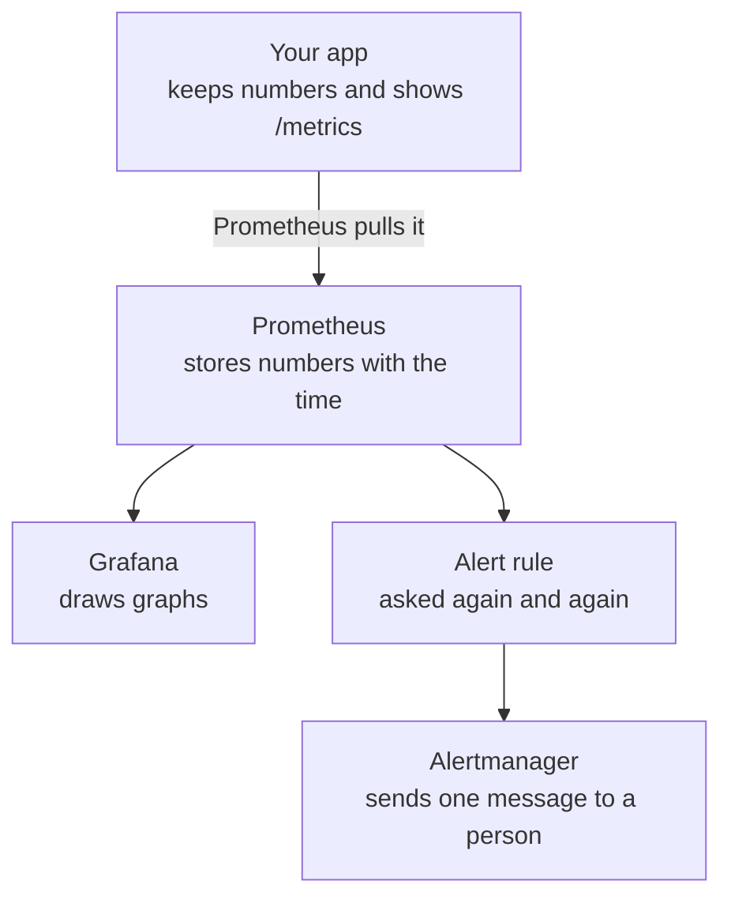
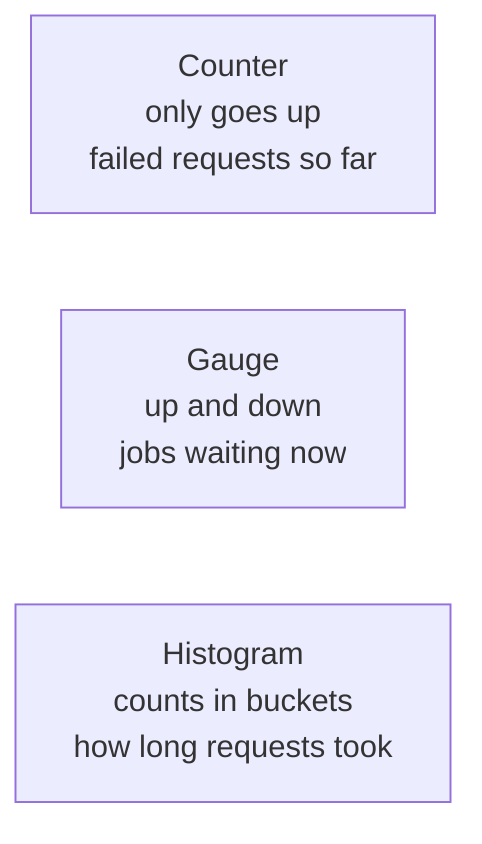
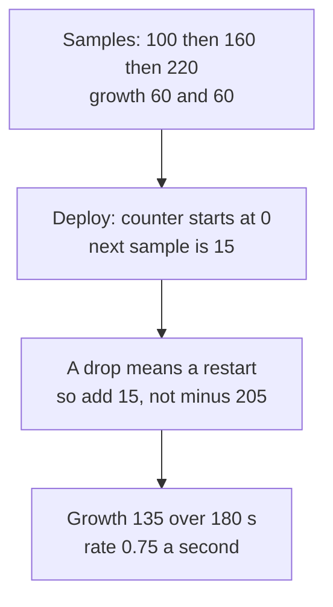
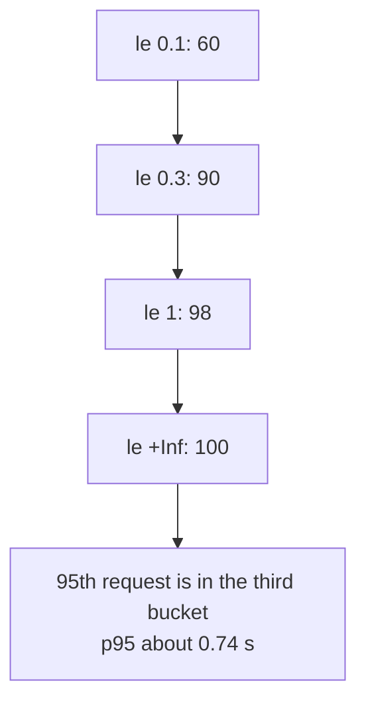
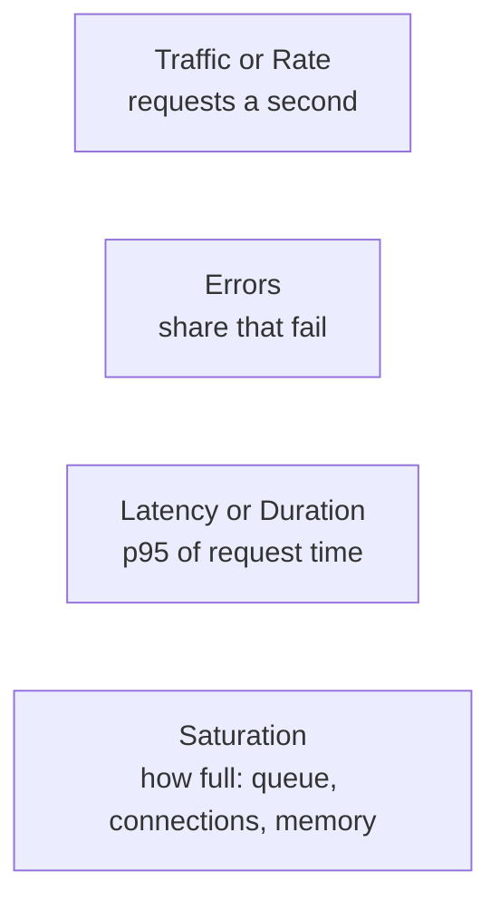
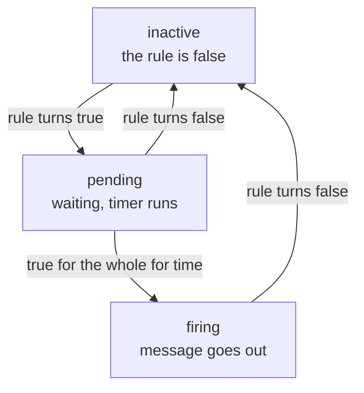
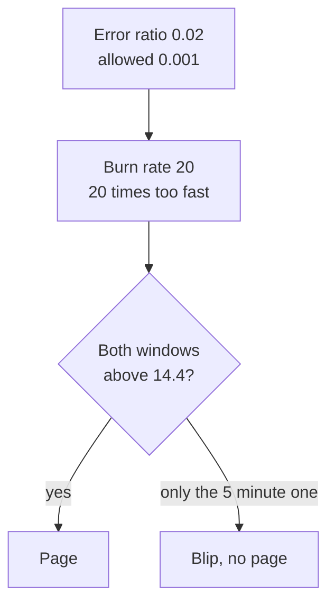

# 20. Metrics, dashboards and alerts

> **Subject:** DevOps and Cloud · **Lesson:** 20 · **Made:** 2026-11-21 · **Status:** ready
>
> **You will be able to:** say how a number travels from your Node app to Prometheus, a Grafana graph and a page, tell a counter from a gauge and a histogram, explain why you graph a counter with `rate()`, read p95 from histogram buckets, pick what to graph (golden signals, RED), explain what `for` does, say why you page on symptoms and not on causes, and explain burn rate in plain words.
>
> **Before this:** [Logs and monitoring](10-logs-and-monitoring.md) · **Also read:** [Kubernetes probes, limits and rollouts](11-kubernetes-probes-limits-and-rollouts.md) · **Next:** Incidents, on call and postmortems (planned, lesson 25)
>
> **How to read it:** one card is one idea. Look at the picture, guess, then press the orange bar to check. The blue bars (📖 More detail) hold the longer explanation. Skip them on the first read. **I did not run a Prometheus server or Grafana for this lesson.** What they do comes from their official docs and from a public Prometheus demo (opened 2026-11-19), and is marked "from the docs". The Node code (`@prometheus-io/client` and Express) and the small model in the practice file and the stepper were run for real. About 25 minutes for the cards.

## 1. Logs say what happened. Metrics say how it is going.

[Lesson 10](10-logs-and-monitoring.md) counted error lines in logs. That works for one server, but it is slow and clumsy. A **metric** is a number your app keeps, such as "failed requests so far". The app does not send it anywhere. It shows it on a page, `/metrics`. **Prometheus** comes to that page on a timer, reads the numbers and stores them with the time. Each visit is a **scrape** (the word for one visit). **Grafana** draws graphs from what Prometheus has stored. Prometheus also checks **alert rules** and tells **Alertmanager**, which sends the message.



Notice: the arrow between the app and Prometheus points toward the app. Prometheus asks, the app answers.

<details class="guess"><summary>🤔 Guess: who starts the trip of a number from your app to Prometheus? Press to check.</summary>

**Prometheus does.** This is the pull model. The app only answers when asked. If Prometheus cannot reach the app, it notices straight away, because the visit fails.

</details>

> **Remember:** the app keeps numbers. Prometheus pulls and stores them. Grafana draws them. Alert rules ask questions about them.

<details class="more"><summary>📖 More detail: four new words, the pull model, who does what, and the trace</summary>

**Four new words in this lesson:** scrape (this card), cumulative bucket (card 4), pending (card 6), burn rate (card 7).

**From the docs** ([Prometheus overview](https://prometheus.io/docs/introduction/overview/), opened 2026-11-19): Prometheus is "an open-source systems monitoring and alerting toolkit", and "time series collection happens via a pull model over HTTP". For short jobs that finish before a scrape, there is a Pushgateway. Alertmanager "takes care of deduplicating, grouping, and routing" alerts, and also silencing ([Alertmanager](https://prometheus.io/docs/alerting/latest/alertmanager/)).

**Who does which job.**

| Part | Job | Does not do |
|---|---|---|
| Your app | Keeps counters, answers `/metrics` | Store history, send anything |
| Prometheus | Pulls, stores, runs rules | Draw pretty dashboards |
| Grafana | Draws queries as graphs, keeps dashboards | Store the numbers itself |
| Alertmanager | Groups, removes duplicates, routes, silences | Decide when something is wrong |

**A real server I asked** (a public demo at demo.promlabs.com, Prometheus 3.14.0, asked on 2026-11-19): its config says `scrape_interval: 15s`, and it has five alert rules loaded. The API call `up` returned one row per target, with `1` for each target that answered the last scrape.

**The trace** (stepper, tab 1, one counter, scrape every 60 s so the picture is small):

| Step | What happens | State after |
|---|---|---|
| 1 | App runs `errors.inc()` | `errors_total` is 1000 in memory |
| 2 | Prometheus asks `GET /metrics` | It stores (minute 0, 1000) |
| 3 | Minutes 1 to 3 are quiet | Rate about 0.04 errors a second, alert `inactive` |
| 4 | Minute 4: 70 failed requests | Rate 0.6 is above 0.5, alert `pending` |
| 5 | Minute 5: still above | Pending for 60 s of 120 s |
| 6 | Minute 6: 120 s in a row | Alert `firing`, Alertmanager sends the page |
| 7 | Minute 8: the fix is in, but the window remembers minute 7 | Rate 0.56, still firing |
| 8 | Minute 9: window is quiet | Alert goes back to `inactive` |

**Where OpenTelemetry fits.** OpenTelemetry (OTel) is a standard for metrics, traces and logs. Its metrics have counters, histograms and gauges too, and the metrics part is marked stable ([OTel metrics](https://opentelemetry.io/docs/concepts/signals/metrics/)). You can use its Node library instead of the Prometheus one and send the numbers on. The ideas in this lesson are the same. I did not run OTel.

**The cost.** The pull model needs Prometheus to reach every app. That is easy on one network and harder across firewalls. Also, you lose what happened between two scrapes.

</details>

## 2. Three kinds of metric: counter, gauge, histogram

Think of a car. The **counter** is the odometer: it only goes up. The **gauge** is the fuel gauge: it goes up and down. The **histogram** is a tally sheet of trip times: how many trips took under 10 minutes, how many under 30. Pick the kind by one question: can the value go down? If yes, it is a gauge.



Notice: the counter looks the same after a restart as a brand new counter. It starts at 0 again (card 3).

<details class="guess"><summary>🤔 Guess: "number of open database connections". Counter or gauge? Press to check.</summary>

**Gauge.** It goes up when a connection opens and down when it closes. "Connections opened since the app started" would be a counter.

</details>

> **Remember:** counter only goes up. Gauge goes up and down. Histogram counts values into buckets.

<details class="more"><summary>📖 More detail: the real Node code, the real /metrics text, and the rules</summary>

**The code** (Express and the Prometheus client for Node, run for real on Node 26.5.0). The package was named `prom-client` for years. Version 0.16.0 (2026-08-24) renamed it to `@prometheus-io/client`, and it is now a Prometheus subproject ([repository](https://github.com/prometheus/client_js)). Old tutorials still show `prom-client`.

```js
const express = require("express");
const client = require("@prometheus-io/client");
const app = express();

const requests = new client.Counter({
  name: "http_requests_total",
  help: "Requests by route and status",
  labelNames: ["route", "status"],
});
const seconds = new client.Histogram({
  name: "http_request_duration_seconds",
  help: "Request time in seconds",
  buckets: [0.1, 0.3, 1],
});
app.use((req, res, next) => {
  const end = seconds.startTimer();
  res.on("finish", () => {
    requests.inc({ route: req.route ? req.route.path : "none", status: res.statusCode });
    end();
  });
  next();
});
app.get("/metrics", async (req, res) => {
  res.set("Content-Type", client.register.contentType);
  res.send(await client.register.metrics());
});
```

**What /metrics printed** after 3 calls to an `/order` route and 1 to a `/fail` route that answers 500:

```
# TYPE http_requests_total counter
http_requests_total{route="/order",status="200"} 3
http_requests_total{route="/fail",status="500"} 1
# TYPE http_request_duration_seconds histogram
http_request_duration_seconds_bucket{le="0.1"} 4
http_request_duration_seconds_bucket{le="0.3"} 4
http_request_duration_seconds_bucket{le="1"} 4
http_request_duration_seconds_bucket{le="+Inf"} 4
http_request_duration_seconds_sum 0.005805583
http_request_duration_seconds_count 4
```

**The rules from the docs** ([metric types](https://prometheus.io/docs/concepts/metric_types/), [naming](https://prometheus.io/docs/practices/naming/), opened 2026-11-19):

- A counter's "value can only increase or be reset to zero on restart". A gauge "can arbitrarily go up and down".
- Counters get the suffix `_total`. Use base units in the name: seconds, not milliseconds.
- A **label** is a key and value on a metric, such as `status="500"`. Every different label combination is its own series. The naming page warns against labels with many values, such as user ids.
- A histogram is several series: one `_bucket` per bound, plus `_sum` and `_count`. Default buckets in the client (I printed them) are 0.005 up to 10 seconds.
- There is also a fourth type, the summary. It computes quantiles inside each app, and you cannot add those across servers. Start with histograms.

**Free numbers.** `client.collectDefaultMetrics()` added 29 more metrics when I ran it, such as `process_cpu_seconds_total`, `process_resident_memory_bytes` and `nodejs_eventloop_lag_seconds`.

**A trap with labels.** A labelled counter that was never used prints only its `# HELP` and `# TYPE` lines. In my run, `errs_total{status="500"}` did not exist until the first `inc`. So a rule such as "rate of 500 answers" has nothing to read before the first error.

</details>

## 3. A counter is read as a rate

The raw value of a counter says little: "1,277,904 requests so far". What you want is how fast it grows. That is its **rate**: growth per second over a short window. Prometheus works it out with `rate()`. There is one more trap. A counter lives in the app's memory, so every deploy starts it at 0 again. `rate()` knows this: if the value drops, it treats it as a restart.



Notice: the result stays sensible. A raw subtraction would give 15 minus 100, which is negative.

<details class="guess"><summary>🤔 Guess: samples every 60 s are 100, 160, 220, then 15 after a restart. How much did the counter grow? Press to check.</summary>

**135.** 60 + 60 + 15. The drop from 220 to 15 is a restart, so the new value counts as growth from 0. (Real Prometheus also stretches the result to the ends of the window, so its number would differ a little.)

</details>

> **Remember:** never graph or alert on a raw counter. Use `rate()`. A drop in a counter means a restart.

<details class="more"><summary>📖 More detail: the docs, rate against increase, the trace, and the order of functions</summary>

**From the docs** ([query functions](https://prometheus.io/docs/prometheus/latest/querying/functions/), opened 2026-11-19): `rate()` "calculates the per-second average rate of increase", and "breaks in monotonicity (such as counter resets due to target restarts) are automatically adjusted for". It "extrapolates to the ends of the time range". It "should only be used with counters". The instrumentation page says: "Raw counters are rarely useful. Use the `rate()` function", and "You should never take a `rate()` of a gauge". A gauge that drops is not a restart.

Julius Volz (a Prometheus co-founder) explains the reset rule in [How Exactly Does PromQL Calculate Rates?](https://promlabs.com/blog/2021/01/29/how-exactly-does-promql-calculate-rates/): the functions "add the new sample value to the previously seen one, to compensate for the reset".

**`increase()` is the same thing times the seconds.** `rate()` gives per second. `increase()` gives the growth over the whole window. Use `rate()` in alerts and graphs.

**Order matters.** The docs say: "always take a `rate()` first, then aggregate." Sum the raw counters of many servers first, and one server's restart can hide inside the others.

**A query you will see** (shape from the docs, not run against my own server):

```
sum(rate(http_requests_total{status=~"5.."}[5m]))
  / sum(rate(http_requests_total[5m]))
```

`[5m]` is the window. The first line is 5xx requests per second, the second is all requests per second. The result is the share of failed requests.

**The trace** (stepper, tab 2, the practice functions `increase` and `rate`):

| Step | Samples seen | By hand | `increase()` |
|---|---|---|---|
| 1 | 100, 160, 220 | 120 over 120 s, 1 a second | 120, 1 a second |
| 2 | App restarts | Counter is 0 in memory | Nothing yet |
| 3 | Next sample 15 | 15 minus 100 is -85 | Not asked yet |
| 4 | Read pair by pair | Nonsense | 60 + 60 + 15 = 135 |
| 5 | Next sample 75 | -25 | 195 over 240 s, 0.8125 a second |

**The cost.** The window smooths the graph and delays the signal: in the card 1 trace, the rate stayed high one minute after the fix.

</details>

## 4. A histogram answers "how slow is the slow part?"

The average hides the slow users. Take 100 requests: 60 took 0.05 s, 30 took 0.2 s, 8 took 0.6 s and 2 took 2.5 s. The average is 0.19 s, which sounds fine. A histogram keeps counts in **buckets**. A bucket counts every request at or under its bound, so the counts only grow from left to right: this is **cumulative**. From these counts you can ask for **p95**: the time that 95 out of 100 requests beat.



Notice: the average (0.19 s) and p95 (0.74 s) tell two different stories about the same requests.

<details class="guess"><summary>🤔 Guess: with those counts, where does p95 fall? Press to check.</summary>

**Between 0.3 s and 1 s.** 60 and 90 are less than 95. 98 is enough. Inside that bucket Prometheus guesses an even spread: 0.3 + 0.7 x (5 / 8) = **0.7375 s**.

</details>

> **Remember:** a histogram is counts in cumulative buckets. p95 is an estimate made from them. Never average percentiles.

<details class="more"><summary>📖 More detail: the steps, why it is an estimate, buckets, and the trace</summary>

**Finding p95 in four steps.**

1. Rank = 0.95 x 100 = 95.
2. Find the first bucket with a count of at least 95. That is `le 1` (98).
3. The bucket before it starts at 0.3 and held 90, so this bucket holds 98 - 90 = 8 requests. We need the 5th.
4. Guess even spread: 0.3 + (1 - 0.3) x 5/8 = 0.7375.

**From the docs** ([Histograms and summaries](https://prometheus.io/docs/practices/histograms/), opened 2026-11-19): the error "is limited by the width of the bucket the quantile is located in", so you choose buckets near the speed you care about. Averaging quantiles "yields statistically nonsensical values"; add the buckets, then compute the quantile. In a real query you take the `rate()` of the buckets first, so you get the last few minutes and not all time:

```
histogram_quantile(0.95,
  sum by (le) (rate(http_request_duration_seconds_bucket[5m])))
```

Keep `le` in the `by` part, or the answer is wrong (query functions page).

**p99 can fall off the end.** Rank 99 is above 98, so it is in the `+Inf` bucket. The histogram can only say "above 1 s" (the model returns the top bound, 1). Fix it by adding buckets, such as 2.5 and 5.

**A real number.** I asked the demo server for the p95 of its example API on 2026-11-19 and it answered about 0.052 seconds. That is one live moment, so the number is only a sample of what a query returns.

**The trace** (stepper, tab 3, `cumulativeBuckets` and `histogramQuantile`):

| Step | What happens | Result |
|---|---|---|
| 1 | One 0.2 s request | Adds 1 to `le 0.3`, `le 1` and `le +Inf` |
| 2 | 100 requests | 60, 90, 98, 100. Sum 18.8, count 100 |
| 3 | Rank 95 | First two buckets are too small, third is enough |
| 4 | Interpolate | 0.7375 s |
| 5 | Ask for p99 | Lands in `+Inf`, answer is "above 1 s" |

**The cost.** More buckets give better answers and more series to store. Native histograms (a newer Prometheus kind) pick buckets for you; the docs say they are generally more efficient. I did not try them.

</details>

## 5. What to graph: four questions

You cannot graph everything. Google's SRE book gives four questions for any service, the **four golden signals**: **latency** (how long), **traffic** (how much), **errors** (how many fail) and **saturation** (how full). Tom Wilkie's **RED method** keeps three for a service: **R**ate, **E**rrors, **D**uration. One dashboard row per question. Grafana draws each row from a query to Prometheus.



Notice: the first three come from the same two metrics: a request counter with a status label, and a duration histogram.

<details class="guess"><summary>🤔 Guess: "database connections in use: 19 of 20". Which of the four is it? Press to check.</summary>

**Saturation.** It tells you how close a limit is. It is a gauge. RED does not include it, so many teams add it by hand.

</details>

> **Remember:** per service, watch rate, errors and duration. Add saturation for the resource that runs out first.

<details class="more"><summary>📖 More detail: the table, Grafana, and the Node numbers you get free</summary>

**The signals as queries** (shapes, not run on my own server):

| Question | Metric kind | Query shape |
|---|---|---|
| Traffic | Counter | `sum(rate(http_requests_total[5m]))` |
| Errors | Counter with a status label | 5xx rate divided by total rate |
| Latency | Histogram | `histogram_quantile(0.95, ...)` as in card 4 |
| Saturation | Gauge | `db_connections_in_use` against its limit |

**From the docs.** The SRE book ([Monitoring Distributed Systems](https://sre.google/sre-book/monitoring-distributed-systems/), opened 2026-11-19) defines latency as "the time it takes to service a request", and errors as "the rate of requests that fail". The RED slides were given by Tom Wilkie at GrafanaCon EU 2018; Grafana's own docs say the method fits services best. I could not open his original blog post, so I used those slides and secondary notes for the history.

**Grafana's job.** You add Prometheus as a data source, then each panel is a query and a drawing. Grafana keeps the dashboard layout and asks Prometheus for the numbers each time you look. Two public places to look at real dashboards are in "Watch and play".

**Saturation in Node.** The free default metrics include `nodejs_eventloop_lag_seconds`: how late the event loop is. A rising lag means the single JavaScript thread is too busy. That is a saturation signal for a Node service. I printed the list of default metrics, but I did not load-test a server to see the lag move.

**The cost.** A big dashboard is hard to read at 3 am. Keep one top row of the four questions, and put the detail rows below.

</details>

## 6. Page on symptoms. Wait with `for`.

An **alert rule** is a question that Prometheus asks again and again, such as "are more than 2 percent of requests failing?". When the answer turns yes, the alert does not fire at once. It becomes **pending** (waiting). Only after the answer has stayed yes for the `for` time does it become **firing**. If the answer turns no in between, the timer is forgotten. Pick the question from what users feel (a symptom), not from the machine (a cause).



Notice: pending can fall back to inactive. A short spike never reaches firing.

<details class="guess"><summary>🤔 Guess: a spike lasts 2 minutes. The rule has `for: 5m`. Does anyone get paged? Press to check.</summary>

**No.** The alert is pending for 2 minutes, then the rule turns false and the alert goes back to inactive. The cost: a real problem is also paged 5 minutes late.

</details>

> **Remember:** page on what users feel. `for` makes the rule wait, so blips do not wake you. Causes go on a dashboard.

<details class="more"><summary>📖 More detail: a real rule, cause or symptom, alert fatigue, and two traces</summary>

**A rule file** (the shape from the [alerting rules docs](https://prometheus.io/docs/prometheus/latest/configuration/alerting_rules/), opened 2026-11-19; written by hand and not run):

```yaml
groups:
- name: web
  rules:
  - alert: HighErrorRate
    expr: |
      sum(rate(http_requests_total{status=~"5.."}[5m]))
        / sum(rate(http_requests_total[5m])) > 0.02
    for: 5m
    labels:
      severity: page
    annotations:
      summary: More than 2 percent of requests fail
```

The docs: the `for` clause "causes Prometheus to wait for a certain duration", and "elements that are active, but not firing yet, are in the pending state". There is also `keep_firing_for`, to keep an alert firing for a while after the rule turns false, so it does not flap.

**A real rule I read.** The demo server (Prometheus 3.14.0, 2026-11-19) has a rule `DemoServiceHighErrorRate`. It divides the 5xx rate by the total rate over 1 minute, times 100, and checks `> 0.5`. Its `duration` was 60 seconds, which is `for: 1m`. Its alerts API listed one alert as `pending` with `activeAt` 09:25:46 and others as `firing` with older `activeAt` times. The firing ones had been true for more than 60 seconds. This is the same pending then firing path as the picture.

**Grafana has the same idea.** Its alert rules have a "pending period" ([evaluation docs](https://grafana.com/docs/grafana/latest/alerting/fundamentals/alert-rule-evaluation/)). The states are Normal, Pending and Alerting. The page says the pending period is "to prevent unnecessary notifications caused by temporary issues".

**Cause or symptom.** The Prometheus alerting page says: "keep alerting simple, alert on symptoms", "aim to have as few alerts as possible", and "avoid having pages where there is nothing to do" ([Alerting practices](https://prometheus.io/docs/practices/alerting/)). The SRE book says "every page should be actionable".

| | Cause rule | Symptom rule |
|---|---|---|
| Example | CPU above 80 percent | Failed requests above 2 percent |
| Users fine, rule fires | Yes: a backup job uses the CPU | No |
| Users hurt, rule silent | Yes: database has no free connections, CPU is calm | No |
| Where it belongs | A dashboard panel, or a ticket | The page |

**Alert fatigue** means people who get too many pages start to ignore them, including the real one. The fix is fewer pages, each one actionable.

**The trace** (stepper, tab 4, `evaluateAlert`, error percent each minute, threshold 2):

| Minute | Value | Rule A (`for` 0) | Rule B (`for` 5m) |
|---|---|---|---|
| 2 | 3.1 | firing | pending |
| 3 | 3.4 | firing | pending |
| 4 | 0.4 | inactive | inactive, timer forgotten |
| 7 | 5 | firing | pending, new timer |
| 11 | 9 | firing | pending, 240 s |
| 12 | 9 | firing | **firing**, 300 s |
| 13 | 2 | inactive | inactive |

**The trace of three nights** (stepper, tab 5): a backup job pages the CPU rule, memory climbing pages the memory rule, and an exhausted database pool pages only the failed-requests rule.

**The cost.** `for` makes every real page later. For a total outage use a short `for`. A page also needs more than a rule: who is told, what to do first (a runbook link), and a link to the dashboard in the message.

</details>

## 7. SLO and burn rate: how fast are we spending our allowed failures?

An **SLO** is a goal, such as "99.9 percent of requests succeed over 30 days". It also says how much failure is fine: 0.1 percent. That allowance is the **error budget**. The **burn rate** says how many times faster than allowed you are spending it. Burn rate 1 means the budget lasts exactly 30 days. Burn rate 14.4 means 2 percent of the whole month's budget is gone in one hour. Google suggests: page when both a long window (1 hour) and a short window (5 minutes) burn faster than 14.4.



Notice: the short window stops the page soon after a fix. The long window stops pages for blips.

<details class="guess"><summary>🤔 Guess: SLO 99.9 percent, error ratio 0.02 in both the last hour and the last 5 minutes. Burn rate? Page? Press to check.</summary>

**Burn rate 20, so page.** 0.02 divided by 0.001 is 20, above 14.4 in both windows.

</details>

> **Remember:** burn rate is the error ratio divided by the allowed ratio. Page when a long and a short window both burn fast.

<details class="more"><summary>📖 More detail: the table, the Prometheus line, and where the full story is</summary>

**From the docs** ([Alerting on SLOs](https://sre.google/workbook/alerting-on-slos/), opened 2026-11-19): "Burn rate is how fast, relative to the SLO, the service consumes the error budget." The workbook recommends "the multiwindow, multi-burn-rate alerting technique". For a 99.9 percent SLO over 30 days:

| Budget used | Long window | Burn rate | Action |
|---|---|---|---|
| 2 percent | 1 hour | 14.4 | Page |
| 5 percent | 6 hours | 6 | Page |
| 10 percent | 3 days | 1 | Ticket |

Check the 2 percent: 14.4 x 1 hour / 720 hours = 0.02. The workbook says a good short window is "1/12 the duration of the long window", and gives a paging line in Prometheus form: `job:slo_errors_per_request:ratio_rate1h{job="myjob"} > (14.4*0.001)`.

**In the model** (`burnRate`, `shouldPage` in the practice file): `burnRate(0.02, 0.999)` printed `19.999999999999982` (floating point, so about 20). `shouldPage(0.02, 0.02, 0.999)` is `true`, and `shouldPage(0.02, 0.0005, 0.999)` is `false`: after a fix the short window falls, so the page clears even while the hour is still high.

**The full story** (error budget, minutes of downtime, the bad deploy over time) is in [SLOs and error budgets](../system-design/26-slos-and-error-budgets.md), card 4, with its own stepper. This card only shows how it lands in an alert rule.

**The cost.** Burn rate rules need an SLO that people agreed on, and metrics good enough to compute a ratio. For a small app, one symptom rule with a `for` is a fine start.

</details>

## 8. Four mistakes with metrics

These four habits hurt later. Each is cheap to avoid at the start.

| Problem | Why it hurts | Fix |
|---|---|---|
| A label with many values (a user id, a full URL) | Every value is a new series. Memory and cost grow without limit | Use the route pattern, such as `/users/:id` |
| Graphing a raw counter | Every restart makes a hole or a negative line | `rate()` |
| Alerting on the average | Slow users are hidden | A p95 or p99 from a histogram |
| Paging on causes (CPU, memory) | Wakes you for nothing, and misses real outages | Page on symptoms, causes on a dashboard |

Notice: the first row is the one that quietly breaks the server that stores your metrics.

<details class="guess"><summary>🤔 Guess: an Express app uses `req.path` as a label. Three users call `/users/1`, `/users/2`, `/users/3`. How many series? Press to check.</summary>

**Three, one per user id.** With a million users it is a million series. With `req.route.path` it is one series, `/users/:id`.

</details>

> **Remember:** labels need few values. Use `rate()` on counters, histograms for time, and symptoms for pages.

<details class="more"><summary>📖 More detail: the real run, and what the docs say about labels</summary>

**The real run** (Express, Node 26.5.0, three calls to `/users/1` to `/users/3` and one to `/nope`):

```
bad_total{path="/users/1"} 1
bad_total{path="/users/2"} 1
bad_total{path="/users/3"} 1
bad_total{path="/nope"} 1
good_total{route="/users/:id"} 3
good_total{route="unmatched"} 1
```

`bad_total` used `req.path`. `good_total` used `req.route.path`. An unknown URL has no route, so the code writes `unmatched`. Without that, a scanner that tries thousands of URLs would make thousands of series.

**From the docs** ([instrumentation practices](https://prometheus.io/docs/practices/instrumentation/), opened 2026-11-19): "Each labelset is an additional time series that has RAM, CPU, disk, and network costs", and "the vast majority of your metrics should have no labels". As a rule of thumb, keep the number of values below 10.

**Alert fatigue lives in the other three rows.** The first two make graphs wrong. The last two make pages wrong.

</details>

## 9. Watch and play

Links were checked on 2026-11-21 (the pages returned 200 and the live demos answered; the Prometheus and Grafana demos also on 2026-11-19). For the videos I read the title and channel from the YouTube oEmbed data. I did not watch them, and I did not check how long they are. If a link is broken, tell me and I will replace it.

- **Play with it:** [the stepper in this folder](visuals/20-metrics-dashboards-and-alerts.html) - guess first, then press Next. Five tabs: a metric's trip, a counter reset, p95 from buckets, the `for` clause, and symptoms against causes.
- **Run real queries:** [PromLabs demo Prometheus](https://demo.promlabs.com/) - a public Prometheus. Try `up`, then `rate(demo_api_request_duration_seconds_count[5m])`, then the p95 query from card 4 with `demo_api_request_duration_seconds_bucket`. Open the Alerts tab to see pending and firing alerts.
- **Look at real dashboards:** [Grafana Play](https://play.grafana.org/) - Grafana's public demo. Open the folder "Demo: Prometheus" and click a panel to see its query.
- **Play with it:** [Alertmanager routing tree editor](https://prometheus.io/webtools/alerting/routing-tree-editor/) - a page on prometheus.io where you paste a routing config and test which receiver an alert reaches. I opened the page (it loaded) but did not use the editor.
- **Video:** [Introduction to the Prometheus Monitoring System](https://www.youtube.com/watch?v=STVMGrYIlfg) - PromLabs. Title and channel checked only. Compare it with card 1.
- **Video:** [Understanding Prometheus Histograms](https://www.youtube.com/watch?v=yYbXak-1hew) - PromLabs. Title and channel checked only. It goes with card 4.
- **Video:** [Alerting on error budget burn rate](https://www.youtube.com/watch?v=t1BGo-Il1AM) - Google Cloud Tech. Title and channel checked only. It goes with card 7.
- **Read:** [Prometheus: Alerting practices](https://prometheus.io/docs/practices/alerting/) - short. It is cards 6 and 8.

<details><summary>Go deeper (optional)</summary>

**More pages I opened.** [Metric types](https://prometheus.io/docs/concepts/metric_types/). [Query functions](https://prometheus.io/docs/prometheus/latest/querying/functions/). [Histograms and summaries](https://prometheus.io/docs/practices/histograms/). [Instrumentation practices](https://prometheus.io/docs/practices/instrumentation/). [Alerting rules](https://prometheus.io/docs/prometheus/latest/configuration/alerting_rules/). [Alertmanager](https://prometheus.io/docs/alerting/latest/alertmanager/). [Prometheus overview](https://prometheus.io/docs/introduction/overview/). [SRE book: Monitoring Distributed Systems](https://sre.google/sre-book/monitoring-distributed-systems/). [SRE Workbook: Alerting on SLOs](https://sre.google/workbook/alerting-on-slos/). [Grafana alert rule evaluation](https://grafana.com/docs/grafana/latest/alerting/fundamentals/alert-rule-evaluation/). [OpenTelemetry metrics](https://opentelemetry.io/docs/concepts/signals/metrics/). [Prometheus client for Node.js](https://github.com/prometheus/client_js). [PromQL rates explained](https://promlabs.com/blog/2021/01/29/how-exactly-does-promql-calculate-rates/). For allowed downtime per SLO, type 99.9 into [uptime.is](https://uptime.is/).

**Checked on 2026-11-19 and 2026-11-21** with Node v26.5.0 and `@prometheus-io/client` 0.16.1 (the latest on npm that day; the old name `prom-client` stops at 15.1.3). The latest Prometheus release I saw on GitHub was v3.16.0 (2026-11-05). The demo server ran 3.14.0. The practice tests (54) and a click through all 40 stepper steps ran against the same code. The practice answer and the stepper code are the same after removing comments.

**What I did not test.** A Prometheus server of my own (my attempt to download and run it was blocked, so I used the public demo instead), Grafana, Alertmanager, a real alert reaching a phone, OpenTelemetry, native histograms, the Pushgateway, and the routing tree editor. Rule files and queries shown as shapes are from the docs. The YAML rule was not checked with `promtool`.

**Where the model is simpler than Prometheus.** My `rate` does not stretch to the ends of the window. My alert model checks at the time of each point and has no `keep_firing_for`. Prometheus also tracks alerts per label set, so one rule can have many alerts.

**More ideas not covered here.** Recording rules (saving a heavy query), service discovery in Kubernetes, exporters for software you did not write (Node exporter, Postgres exporter), long term storage, and traces. See [Observability](../system-design/14-observability.md) for the design view.

</details>

## 10. Practice

**A. Predict the output** (write your answer before opening)

```js
const s = [{ t: 0, v: 100 }, { t: 60, v: 160 }, { t: 120, v: 220 }, { t: 180, v: 15 }];
console.log(increase(s), rate(s));
const b = [{ le: 0.1, count: 10 }, { le: 0.5, count: 40 }, { le: Infinity, count: 50 }];
console.log(histogramQuantile(0.5, b));
const pts = [0, 9, 9, 0, 9, 9, 9, 9, 9, 9].map((v, i) => ({ t: i * 60, v }));
const r = evaluateAlert(pts, { threshold: 5, forSeconds: 180 });
console.log(r.states[2], r.states[6], r.firedAt);
console.log(shouldPage(0.02, 0.02, 0.999), shouldPage(0.02, 0.0005, 0.999));
```

Then answer: why is `firedAt` not 240?

<details><summary>Answer</summary>

```
135 0.75
0.30000000000000004
pending firing 420
true false
```

The drop from 220 to 15 is a restart, so growth is 60 + 60 + 15 = 135 over 180 seconds, which is 0.75 a second. For the median, rank is 25. The second bucket holds 30 requests after 10, so the answer is 0.1 + 0.4 x (15 / 30) = 0.3 (floating point adds a tiny tail). The alert is pending at minute 1 and 2, then the rule is false at minute 3, so the timer is forgotten. It starts again at minute 4 (240 s) and reaches 180 s at minute 7 (420 s). Not 240, because the first run was cut short. The last line: both windows must be above the line, and the second call has a quiet 5 minute window. (Checked on 2026-11-21 with Node v26.5.0.)

</details>

**B. Fix the bug**

This `rate` should give `0.75` for the samples in A. It gives a negative number. Find the bug.

```js
function rate(samples) {
  const first = samples[0];
  const last = samples[samples.length - 1];
  return (last.v - first.v) / (last.t - first.t);
}
```

<details><summary>Answer</summary>

It subtracts the first value from the last, so a restart (220 to 15) is counted as a drop of 85. A counter only goes up or restarts, so a drop must be read as a restart. Fix: walk the samples in pairs, add `now - before` when the value went up, and add `now` when it went down, then divide by the seconds. I ran the buggy version and it printed `-0.4722222222222222`. The fixed one printed `0.75`.

</details>

**C. Write it yourself**

Open `learn/devops-cloud/practice/20-metrics-dashboards-and-alerts.js`. It has seven empty pieces: `cumulativeBuckets`, `increase`, `rate`, `histogramQuantile`, `evaluateAlert`, `burnRate` and `shouldPage`. The comments at the top say exactly what each one must do. Write them, then run this from the repo root and make all the tests pass:

```
node --test learn/devops-cloud/practice/20-metrics-dashboards-and-alerts.test.js
```

`evaluateAlert` is the one to think about: the timer starts at the first true point of a run, and any false point (or missing data) forgets it.

<details><summary>One possible answer</summary>

```js
function cumulativeBuckets(values, bounds) {
  const buckets = bounds.map((le) => ({ le, count: values.filter((v) => v <= le).length }));
  buckets.push({ le: Infinity, count: values.length });          // the last bucket holds everything
  return buckets;
}

function increase(samples) {
  if (samples.length < 2) return null;                           // one dot has no direction
  let total = 0;
  for (let i = 1; i < samples.length; i++) {
    const before = samples[i - 1].v;
    const now = samples[i].v;
    total += now >= before ? now - before : now;                 // a drop is a restart: it began again at 0
  }
  return total;
}

function rate(samples) {
  const total = increase(samples);
  if (total === null) return null;
  const seconds = samples[samples.length - 1].t - samples[0].t;
  return seconds > 0 ? total / seconds : null;
}

function histogramQuantile(q, buckets) {
  if (!(q > 0 && q <= 1)) throw new RangeError("q must be above 0 and at most 1");
  const last = buckets[buckets.length - 1];
  if (!last || last.le !== Infinity || last.count === 0) return null;
  const rank = q * last.count;
  for (let i = 0; i < buckets.length; i++) {
    if (buckets[i].count < rank) continue;
    if (buckets[i].le === Infinity) return buckets[i - 1] ? buckets[i - 1].le : null;   // above the top bound: no better answer
    const lowLe = i === 0 ? 0 : buckets[i - 1].le;
    const lowCount = i === 0 ? 0 : buckets[i - 1].count;
    const inBucket = buckets[i].count - lowCount;
    return lowLe + (buckets[i].le - lowLe) * ((rank - lowCount) / inBucket);   // assume an even spread inside the bucket
  }
  return null;
}

function evaluateAlert(points, rule) {
  const states = [];
  let activeAt = null;
  let firedAt = null;
  for (const { t, v } of points) {
    const bad = v !== null && v !== undefined && v > rule.threshold;
    if (!bad) {
      activeAt = null;                                           // the timer starts again next time
      states.push("inactive");
      continue;
    }
    if (activeAt === null) activeAt = t;
    const firing = t - activeAt >= rule.forSeconds;
    if (firing && firedAt === null) firedAt = t;
    states.push(firing ? "firing" : "pending");
  }
  return { states, firedAt };
}

function burnRate(errorRatio, slo) {
  return errorRatio / (1 - slo);
}

function shouldPage(longRatio, shortRatio, slo, factor = 14.4) {
  const line = factor * (1 - slo);
  return longRatio > line && shortRatio > line;                  // both windows must agree
}
module.exports = { cumulativeBuckets, increase, rate, histogramQuantile, evaluateAlert, burnRate, shouldPage };
```

Checked on 2026-11-21 with Node v26.5.0: 50 of the 54 tests fail on the empty stub (the other 4 only check that your function does not change its inputs), and all 54 pass with this answer. I also tried 38 wrong versions of the answer (for example, a rate with no reset handling, a quantile that skips the interpolation, an alert that does not forget its timer, a page rule that needs only one window). The tests caught all 38. The stepper page uses these same functions.

</details>

## 11. Interview question

**Q:** "How do you monitor a Node service in production, and how do you decide what should page someone?"

A common follow-up: "Your alert fires every night and nothing is wrong. What do you change?" Card 6 is the answer.

<details><summary>A strong answer, in four parts</summary>

1. **Problem:** Logs tell the story of one request, but not how the service is doing now. And a monitor that pages too often gets ignored, so the page that matters is missed.
2. **How it works:** The app keeps counters, gauges and histograms (for example with the Prometheus client for Node) and shows them on `/metrics`. Prometheus pulls and stores them (a scrape). I graph rate, errors and duration (RED) in Grafana, using `rate()` on counters and `histogram_quantile` for p95. Alert rules ask questions about user-facing symptoms, such as failed requests above 2 percent, with a `for` time so blips do not page. Alertmanager groups the alerts and sends one message with a link to the dashboard. For an SLO, I page on burn rate over a long and a short window.
3. **Tradeoff:** A longer `for` means fewer false pages and a later page for a real problem. Histogram buckets give p95 only as an estimate, and more buckets cost more storage. A label with many values can overload Prometheus. Pull is simple but needs a network path to every app. Cause alerts such as CPU can wake you for nothing and miss real outages, so they belong on a dashboard.
4. **My example:**
   - **Fact:** I deploy with Docker and CapRover, and my profile lists a little AWS and Docker. My DBO case study says the backend is four Node and TypeScript services on Docker Swarm via CapRover, and I led that team.
   - **Fact (from this lesson, not from DBO):** I ran the Node client and an Express `/metrics` route, and a small model of rate, p95 and a `for` rule. I did not run Prometheus or Grafana myself, so I should not say I have operated them.
   - **Idea, not a fact:** I do not know what DBO, Unloan or ZWS used for metrics, so I should not claim any. A good next step would be to add a `/metrics` route with a request counter and a duration histogram to one Node service, scrape it, and write one alert for failed checkout or login requests with a 5 minute `for`.

</details>

## 12. Explain it back

Close this file. Explain metrics and alerts out loud like to a new junior, in 4 parts (problem, how, tradeoff, my example). Use the story of the bad deploy at minute 4: the counter jumped, Prometheus pulled it, the graph showed the rate crossing the line, the alert was pending for 2 minutes, then it fired. Say why the graph used `rate()` and not the raw counter, why you would watch p95 and not the average, and why CPU at 95 percent at 3 am should not wake you. Then write your best version below and run `/explain-check metrics and alerts` or ask the `explain-coach` agent to review it.

### My explanation

<write here>

### Coach feedback

<the explain-coach agent writes here>

## 13. Review questions (day 1, 3, 7, 21)

1. How does a number get from your app to a Grafana graph? Who starts the trip, and what is a scrape?
2. What are counter, gauge and histogram, and how do you choose between them? Why do you graph a counter with `rate()`, and what does `rate()` do when the value drops?
3. 100 requests have cumulative counts 60, 90, 98 and 100 for bounds 0.1, 0.3, 1 and +Inf. Where is p95, and why is p99 a problem? Why can you not average p95 values?
4. An alert rule has `for: 5m`. Describe inactive, pending and firing, and what happens to a 2 minute spike. Draw the picture from memory: the four boxes of card 6.
5. Why page on failed requests and not on CPU? What is burn rate, and why use a long and a short window?

<details><summary>Answers</summary>

1. The app keeps numbers and shows them on `/metrics`. Prometheus pulls that page on a timer (a scrape) and stores each value with its time. Grafana and the alert rules both ask Prometheus for the numbers.
2. A counter only goes up (or restarts at 0), a gauge goes up and down, a histogram counts values into buckets. If the value can go down, it is a gauge. A raw counter says little and every deploy resets it, so you use `rate()`. A drop is read as a restart, and the new value counts as growth from 0.
3. p95 is in the 0.3 to 1 bucket (about 0.74 s by an even spread). p99 falls in the `+Inf` bucket, so the histogram only says "above 1 s": add buckets. A percentile of percentiles is meaningless, so add the bucket counts first and compute once.
4. Inactive: the rule is false. Pending: it is true but has not been true for 5 minutes. Firing: it has been true for 5 minutes in a row. A 2 minute spike goes pending and then back to inactive, with no page. The picture: inactive, pending, firing, and the arrows back to inactive.
5. CPU can be high when users are fine and calm when users are hurt, so it wakes you for nothing and misses real outages. Failed requests follow what users feel. Burn rate is the error ratio divided by the allowed ratio. The long window proves the problem is real, and the short window makes the page stop soon after the fix.

</details>

## Connected lessons

- [Logs and monitoring](10-logs-and-monitoring.md) - the lesson before. Card 4 there counted error lines; this lesson counts with metrics instead.
- [Kubernetes probes, limits and rollouts](11-kubernetes-probes-limits-and-rollouts.md) - the saturation numbers (CPU and memory limits) that you would put on a dashboard.
- [Observability](../system-design/14-observability.md) - the design view of metrics, traces and logs, RED and p99.
- [SLOs and error budgets](../system-design/26-slos-and-error-budgets.md) - the full story of burn rate and error budgets.
- [CI/CD pipelines](05-ci-cd-pipelines.md) - a deploy is what resets counters, and a bad deploy is what you see on the graph.
- [Ways to run your app compared](26-ways-to-run-your-app.md) - where your app and its `/metrics` page run.
- Incidents, on call and postmortems (planned, lesson 25) - next: what to do after the alert fires.
