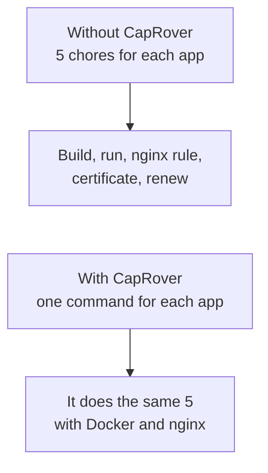
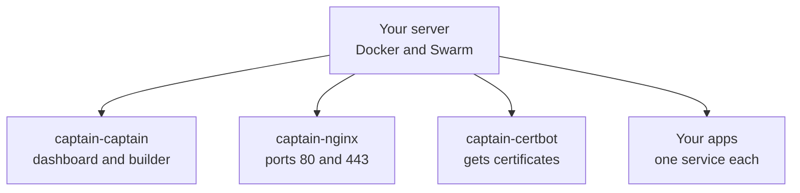
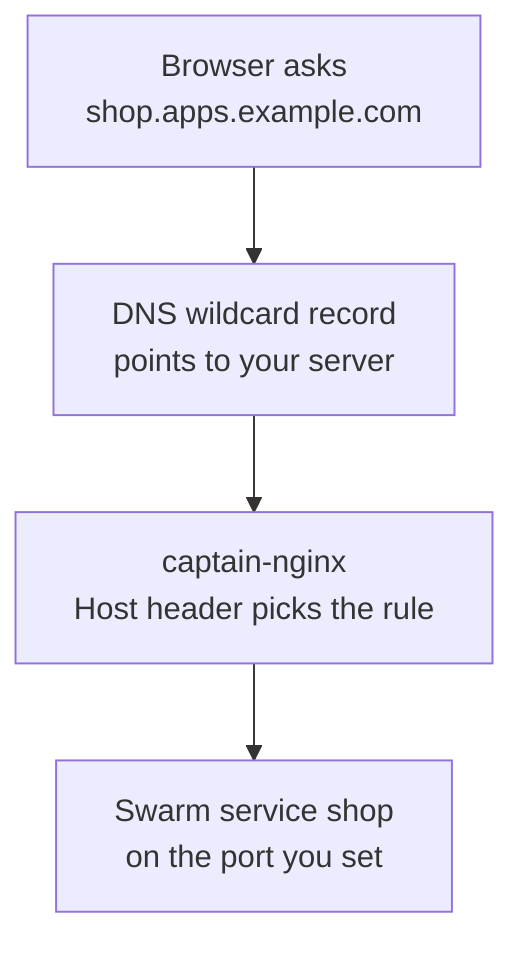
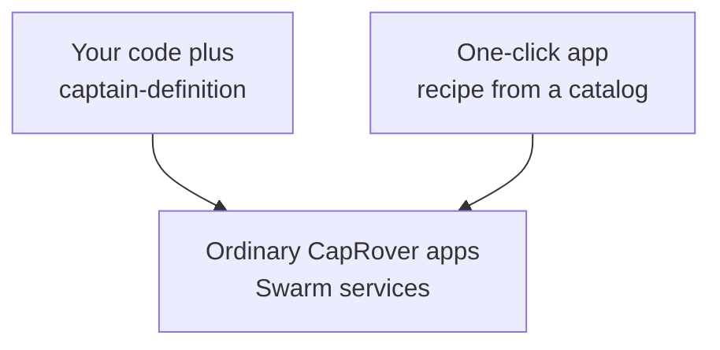
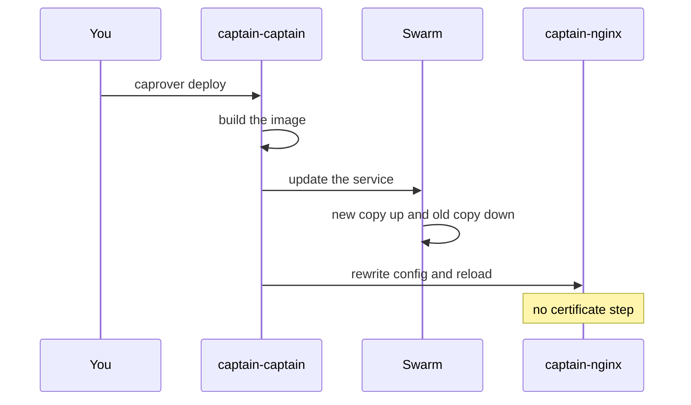
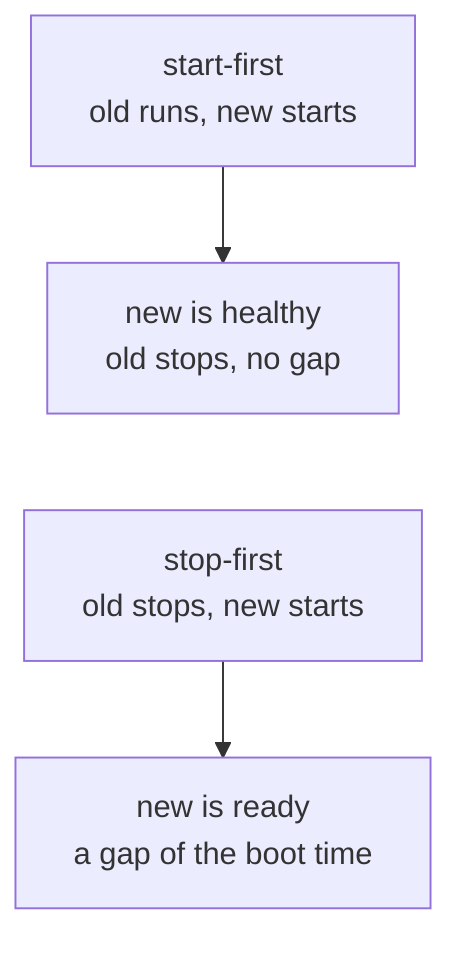
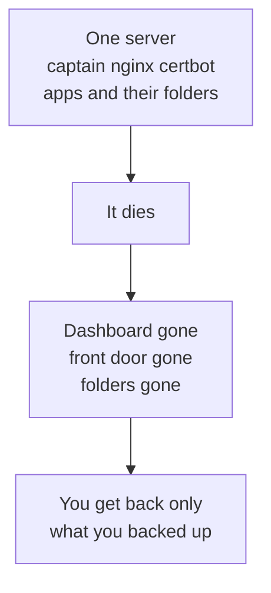

# 21. What CapRover does for you

> **Subject:** DevOps and Cloud · **Lesson:** 21 · **Made:** 2026-11-21 · **Status:** ready
>
> **You will be able to:** name what CapRover puts on your server, follow one deploy step by step (build, service update, nginx reload), say when a certificate is asked for and renewed, say why an app with a persistent folder has a short gap on deploy, and list what you must do yourself, in a table against a hosted platform and ECS on Fargate.
>
> **Before this:** [Reverse proxy and Nginx](08-reverse-proxy-and-nginx.md) and [Ways to run your app compared](26-ways-to-run-your-app.md) · **Also read:** [Docker and CapRover internals](docker-caprover-internals.md), [Docker Compose](03-docker-compose.md) and [Kubernetes probes, limits and rollouts](11-kubernetes-probes-limits-and-rollouts.md) · **Next:** HTTPS and certificates in practice (planned, lesson 19) and Container and supply chain security (planned, lesson 22)
>
> **How to read it:** one card is one idea. Look at the picture, guess, then press the orange bar to check. The blue bars (📖 More detail) hold the longer explanation. Skip them on the first read. **I did not install CapRover or run a deploy for this lesson.** What CapRover does comes from its docs and from its source code on GitHub, both opened on 2026-11-19, and is marked "docs" or "source". The small model in the practice file and in the stepper is plain JavaScript that I ran. About 20 minutes for the cards.

<!-- quick-summary:start -->
## Quick summary

> Short on time? Read only this. These are the "Remember" lines from the cards below, so you can read the whole lesson in one minute.

- CapRover is a helper for five chores: build, run, route, certificate, renew. Nothing it does is out of reach by hand.
- CapRover is three helper services (captain, nginx, certbot) plus your apps, all Swarm services on your server.
- One wildcard DNS record gives every app a name. Each name needs its own certificate, asked for once.
- The captain-definition says how to get the image, with exactly one of four choices. A one-click app is someone else's recipe, and still becomes ordinary apps.
- Deploy means build, then update the service, then reload nginx. A failed build changes nothing. Certificates are a separate job.
- A mounted folder means stop-first and a short gap. Only files in a mounted folder survive. Add a HEALTHCHECK so a copy that is not ready is never used.
- One machine, backups, upgrades and scaling are yours. Test a restore before you need it.
- The choice is who does the work. CapRover is the cheapest and leaves you the most jobs.
- If it must survive a deploy, it is a persistent directory, or it lives outside the server.
- A new CapRover is open until you close it. Port 3000 is for the first setup only.
<!-- quick-summary:end -->

## 1. The problem: five chores for every app

You have a Node API in a Docker image and a server. To put it online at `https://api.mysite.com` you do five chores: build the image, keep it running, write an nginx rule for the name, ask for a certificate, renew it before it ends. Then you do all five again for the next app. **CapRover** does these chores for you, from a dashboard or one command. It adds no new magic. It drives Docker, nginx and Let's Encrypt.



Notice: the work is the same. Only who does it changes.

<details class="guess"><summary>🤔 Guess: you have 4 apps on one server. Without CapRover, how many nginx rules and certificates do you look after? Press to check.</summary>

**Four of each.** Every certificate has its own end date, so you also renew four times. CapRover writes the rules and asks for the certificates for you.

</details>

> **Remember:** CapRover is a helper for five chores: build, run, route, certificate, renew. Nothing it does is out of reach by hand.

<details class="more"><summary>📖 More detail: four new words, the version, and where it sits in the table</summary>

**Four new words**, each with its own card: **wildcard domain** (card 3), **captain-definition** (card 4), **start-first** and **persistent directory** (card 6).

**What it is** (docs, [caprover.com](https://caprover.com/)): a "scalable, free, and self-hosted PaaS", shown as Docker + nginx + Let's Encrypt + Docker Swarm. You rent the server. CapRover is the software on it.

**Version.** The latest release on 2026-11-19 was v1.16.1 (2026-11-18). It only updates nginx to 1.31.9 to fix two security problems. The one before, v1.16.0 (2026-11-03), has a new dashboard ([releases](https://github.com/caprover/caprover/releases)). Look up the number before you quote it.

**Where it fits.** In [lesson 26](26-ways-to-run-your-app.md) it is the row "you look after the machines, your own servers, more than one machine possible". This lesson opens that row.

</details>

## 2. What CapRover puts on your server

You install CapRover by running one container. It then starts three helper services on Docker Swarm. **`captain-captain`** is the boss: dashboard, builder, and the one who tells the others what to do. **`captain-nginx`** owns ports 80 and 443. **`captain-certbot`** talks to Let's Encrypt, a free service that gives HTTPS certificates. Your apps run next to them as more Swarm services (the copies-alive loop from lesson 26).



Notice: the helpers are ordinary Swarm services. You can list them.

<details class="guess"><summary>🤔 Guess: you run `docker service ls` on a CapRover server with one app called shop. Which names do you expect? Press to check.</summary>

**captain-captain, captain-nginx, captain-certbot and shop.** A fourth helper, `captain-registry`, only exists if you turn on the registry (needed for several servers).

</details>

> **Remember:** CapRover is three helper services (captain, nginx, certbot) plus your apps, all Swarm services on your server.

<details class="more"><summary>📖 More detail: the service names, the install command, and ports</summary>

| Service | Job | Source |
|---|---|---|
| `captain-captain` | dashboard, API, builds images, updates services | service names in `CaptainConstants.ts` |
| `captain-nginx` | reverse proxy on ports 80 and 443 | same file |
| `captain-certbot` | asks for and renews certificates | same file |
| `captain-registry` | stores images when you use several servers | same file; docs say a registry is needed before adding nodes |

In the source, nginx and certbot are created on the same machine that runs captain. Apps join a private network (`captain-overlay-network`), so they reach each other by app name.

**The install** (docs, [manual setup](https://caprover.com/docs/installation/manual)) is one `docker run` that publishes ports 80, 443 and 3000, and mounts two things: the Docker socket (so CapRover can control Docker) and `/captain` (its own folder on the host). The first password in the docs is `captain42`: change it at once (card 10).

**Ports** (docs): 80, 443 and 3000 must be open at first. Close 3000 after dashboard HTTPS works. Compare [lesson 08](08-reverse-proxy-and-nginx.md): this is the front door from card 8 there.

</details>

## 3. One wildcard domain, one name per app

You do one DNS job, once. A **wildcard domain** record, for example everything under `apps.example.com`, points to your server. Every name under it now reaches the server, even names that do not exist yet. When you create an app called `shop`, CapRover gives it `shop.apps.example.com` and adds an nginx rule: this name goes to the app `shop`, on the port you set. HTTPS is a separate step: each name gets its own certificate, asked for once when you press Enable HTTPS.



Notice: one DNS record serves every app. nginx tells them apart by the Host header (lesson 08).

<details class="guess"><summary>🤔 Guess: you create a new app called blog. Do you add a DNS record? Does it get HTTPS by itself? Press to check.</summary>

**No DNS record, and no HTTPS yet.** The wildcard already covers the name. For HTTPS you press Enable HTTPS, and CapRover asks for a certificate for `blog.apps.example.com` only. The docs say wildcard DNS does not create a wildcard certificate.

</details>

> **Remember:** one wildcard DNS record gives every app a name. Each name needs its own certificate, asked for once.

<details class="more"><summary>📖 More detail: the real nginx rule, how the certificate is checked, and what breaks it</summary>

**The rule CapRover writes** (trimmed from [the template on GitHub](https://github.com/caprover/caprover/blob/master/template/server-block-conf.ejs), read 2026-11-19; I removed lines and added comments):

```nginx
server {
  listen 443 ssl;
  server_name shop.apps.example.com;
  # Docker's own DNS, looked up again after 10 seconds
  resolver 127.0.0.11 valid=10s;
  # the app name and the port you set in the dashboard
  set $upstream http://shop:3000;
  location / {
    proxy_pass $upstream;
    proxy_set_header Host $host;
    proxy_set_header X-Forwarded-For $proxy_add_x_forwarded_for;
    proxy_set_header X-Forwarded-Proto $scheme;
  }
  # used by Let's Encrypt
  location /.well-known/acme-challenge/ { }
}
```

The three headers are the ones from lesson 08, card 6. The name is in a variable with a `resolver`, so nginx looks it up when a request comes (nginx docs for `proxy_pass`). That avoids the stale address problem of lesson 08, card 5. I did not run it. In the source the service name is the app name. Older apps have a `srv-captain--` prefix.

**The check.** Let's Encrypt fetches a file from `http://<name>/.well-known/acme-challenge/...` on **port 80**. This challenge cannot give wildcard certificates ([Let's Encrypt docs](https://letsencrypt.org/docs/challenge-types/)). The CapRover docs ([domains](https://caprover.com/docs/domains)) list what must work: correct DNS, port 80 and port 443 open. Behind Cloudflare, use DNS-only mode for the first check.

**Other facts** (docs): custom domains point at the server and are then attached to the app. Set the Container HTTP Port to the port your process listens on, and bind to `0.0.0.0`. The stepper tab 5 shows the certificate story.

</details>

## 4. What you hand to CapRover: a recipe or a template

CapRover must know how to get your image. You put a small JSON file named **`captain-definition`** at the root of the project. It has `schemaVersion` 2 and **exactly one** of four choices: use my Dockerfile, use this ready image, use these inline Dockerfile lines, or use a built-in template such as `node/24`. The other way in is a **one-click app**: a ready recipe from a catalog, for a database or a tool, sometimes several services. Both end the same way: ordinary apps on your server.



```json
{"schemaVersion":2,"dockerfilePath":"./Dockerfile"}
```

<details class="guess"><summary>🤔 Guess: a captain-definition has both a dockerfilePath and an imageName. Which one does CapRover use? Press to check.</summary>

**Neither.** The docs say to give exactly one, and the parser rejects zero or several. Practice task 1 is this check.

</details>

> **Remember:** the captain-definition says how to get the image, with exactly one of four choices. A one-click app is someone else's recipe, and still becomes ordinary apps.

<details class="more"><summary>📖 More detail: the four choices, deploy methods, and one-click warnings</summary>

| Choice | What it does |
|---|---|
| `dockerfilePath` | build from a Dockerfile in the project (a path that leaves the project is rejected) |
| `imageName` | use a ready image, for example `nginx:stable-alpine` |
| `dockerfileLines` | an inline Dockerfile, as a list of lines |
| `templateId` | a built-in template, `NAME/VERSION`, with names `node`, `php`, `python-django`, `ruby-rack` |

(Docs: [captain-definition reference](https://caprover.com/docs/reference/captain-definition).)

**Ways to deploy** (docs): upload from the dashboard, `caprover deploy` from the command line (it uploads the committed Git content: files that are not committed or are ignored are not sent), a Git webhook (a push makes CapRover fetch the branch and build; treat the webhook URL as a secret), or a ready image with `caprover deploy --imageName IMAGE`. Pin an image tag or digest for predictable rollouts.

**One-click apps** ([docs](https://caprover.com/docs/one-click-apps)): templates create ordinary apps and may start several services. Review them first, because they can run images, open ports, mount storage and set credentials. Initial database passwords apply only on the first start. A CapRover configuration backup does not contain database volumes (card 7). The Kubernetes name for the same idea is a Helm chart.

</details>

## 5. One deploy, step by step

A deploy is five moves. You upload the committed files. captain builds the image on the server. captain updates the Swarm service. Swarm swaps the old copy for the new one. captain rewrites the nginx config and reloads nginx. **No certificate is asked for.** If the build fails, moves 3 to 5 never happen, so the old version keeps serving. Press Next in [the stepper](visuals/21-what-caprover-does-for-you.html), tabs 1 and 3.



<details class="guess"><summary>🤔 Guess: the build fails on line 4 of your Dockerfile. Which version do visitors get? Press to check.</summary>

**The old one, and nothing changes.** In the source, a failed build goes to the error path and never reaches the service update.

</details>

> **Remember:** deploy means build, then update the service, then reload nginx. A failed build changes nothing. Certificates are a separate job.

<details class="more"><summary>📖 More detail: the step by step trace, and what I read in the source</summary>

**The trace** (stepper, tab 1, an app with no folder and a health check; the model code is `parseCaptainDefinition`, `updateOrder`, `rollout`, `routeTable`):

| Step | What happens | State after |
|---|---|---|
| 1 | Version 1 is live | One copy. One nginx route to `api` on port 3000 |
| 2 | `caprover deploy` uploads committed files | Nothing changed on the server |
| 3 | captain reads the captain-definition | `source: dockerfilePath` |
| 4 | The image is built on the server | Service untouched. Visitors get v1 |
| 5 | The service update is sent. Order: start-first | Copies: v1 running, v2 starting |
| 6 | v2 passes its health check | Both copies can answer |
| 7 | Swarm stops v1 | One copy (v2). Downtime 0 seconds |
| 8 | captain waits 2 seconds, rewrites nginx, reloads | Same route text. nginx finds `api` through Docker DNS |
| 9 | No certificate step | Certificate as it was |

**Source facts** (read on GitHub master, 2026-11-19, not run): after a good build, `startDeployingNewVersion` calls the service update. After the update, there is a 2 second wait ("for docker DNS to pickup the service name"), then the nginx config is rebuilt. The update call does not wait for the swap to finish, so step 8 can overlap steps 6 and 7. For an existing app the config text does not change, so visitors do not notice.

**Heavy builds** (docs): CapRover builds on the server unless you send a ready image. Reserve CPU, RAM and disk for builds, or build in CI and deploy the image.

**Registry.** With one server you do not need one. The docs say a registry reachable by every node is needed before you add nodes.

**Where this differs from the older guide.** [docker-caprover-internals.md](docker-caprover-internals.md) lists "Let's Encrypt issues or renews the certificate" as a step of every deploy, and a push to a registry. In the source I read, a deploy does not request a certificate (card 3, tab 5), and the registry is only for several servers.

</details>

## 6. Zero downtime: when does the old copy stop?

Swarm must swap copies in some order. **Start-first**: start the new copy, wait until it is ready, then stop the old one. No gap. **Stop-first**: stop the old copy, then start the new one. A gap. CapRover picks by itself: stop-first if the app has a **persistent directory** (a folder on the server shown inside the container), start-first if not, so two copies never write to the same folder. Also, "ready" means "the process started" unless the image has a `HEALTHCHECK`. Without one, nginx can send visitors to a copy that is still booting: a 502.



<details class="guess"><summary>🤔 Guess: your API keeps photos in /app/uploads, a persistent directory. You deploy. Do visitors see a gap? What happens to a file saved in /app/tmp? Press to check.</summary>

**A short gap, and the tmp file is gone.** The folder means stop-first. Only mounted paths survive the new container.

</details>

> **Remember:** a mounted folder means stop-first and a short gap. Only files in a mounted folder survive. Add a HEALTHCHECK so a copy that is not ready is never used.

<details class="more"><summary>📖 More detail: the cases table, the source line, the HEALTHCHECK, and the same trap elsewhere</summary>

**The cases** (the practice function `rollout`, a model; stepper tabs 2 and 4):

| Order | Health check | New copy | Visitors |
|---|---|---|---|
| start-first | yes | works | no gap |
| start-first | yes | never works | old copy keeps serving, you fix it |
| start-first | no | takes 15 s | 15 s of 502 |
| start-first | no | never works | the broken copy replaces the old one: no answer |
| stop-first | any | works | a gap of the boot time |

**The source.** In `DockerApi.ts`, an "auto" order gives `'stop-first'` when the container has any mounts, and `'start-first'` otherwise. CapRover calls it with auto on every deploy. The docs agree: "Apps with mounted data use stop-first updates by default to prevent simultaneous writers", and only configured mount paths survive container replacement.

**A HEALTHCHECK** goes in the Dockerfile (docs [scaling](https://caprover.com/docs/scaling), which says to use a real readiness endpoint and a command that exists in your image). A shape, written by hand and not run here:

```dockerfile
HEALTHCHECK --interval=30s --timeout=5s --start-period=30s --retries=3 \
  CMD wget -qO- http://localhost:3000/health || exit 1
```

The [CapRover zero-downtime example](https://github.com/caprover/zero-downtime-example) says Swarm "will keep this app silent until the HEALTHCHECK starts to pass". The Kubernetes version of this idea is the readiness probe ([lesson 11](11-kubernetes-probes-limits-and-rollouts.md)).

**Same trap elsewhere.** Render's docs: services redeploy with zero downtime "unless they attach a persistent disk". Your one-click Postgres has a mounted folder too, so a redeploy of it has a gap.

**Where folders live** (docs): persistent apps are pinned to the node that holds the data. Local volumes are not shared between nodes.

</details>

## 7. What you give up

CapRover gives you the platform, not the safety. These jobs stay with you. **The machine:** you patch the server and upgrade CapRover (v1.16.1 only fixes nginx security problems, and nobody does it for you). **One brain:** captain, nginx and certbot sit on one machine, so if it dies the dashboard and the front door go too. **Backups:** the CapRover backup holds its settings, not your database or uploads. **Scaling:** the instance count is a number you set. I found no autoscaling setting in the docs.



<details class="guess"><summary>🤔 Guess: your server dies. You have a CapRover configuration backup stored elsewhere. What comes back after a restore on a new server? Name one thing that does not. Press to check.</summary>

**App settings, domains and certificates come back.** Your database and uploads do not, and neither do images built on the old server (you redeploy). Stepper tab 6 shows three cases.

</details>

> **Remember:** one machine, backups, upgrades and scaling are yours. Test a restore before you need it.

<details class="more"><summary>📖 More detail: the list with sources, more than one server, and the security habits</summary>

| Job | With CapRover | Source |
|---|---|---|
| Backup of your data | yours: the config backup "does not automatically include Docker volumes" | [backup docs](https://caprover.com/docs/server/backup) |
| Backup of CapRover itself | a dashboard button. The download is temporary: copy it off the server | same |
| Scaling | instance count set by hand. Scale only apps that keep no local data | [scaling docs](https://caprover.com/docs/scaling) |
| A dead machine | nothing is replaced on a one server setup | source: helpers on one node |
| Upgrades | you press upgrade, and test first | docs |

**More than one server** is possible. The docs ([multi-node](https://caprover.com/docs/scaling/multi-node)): "The manager runs CapRover's control services; workers run app tasks." A registry is needed first. Swarm ports (2377, 7946, 4789) go to trusted nodes only. "A node failure can make a pinned app unavailable until its data is restored elsewhere." Docker's own admin guide says that if Swarm loses its manager quorum, "swarm tasks on existing worker nodes continue to run", but you cannot add, update or remove things ([Swarm admin guide](https://docs.docker.com/engine/swarm/admin_guide/)). The docs do not say what CapRover does in that case, and I did not test it.

**Security habits** (docs, [production checklist](https://caprover.com/docs/production-checklist)): change the default password, turn on dashboard HTTPS and Force HTTPS, block port 3000, back up CapRover configuration off the server, and monitor disk usage. Docker-published ports can bypass simple UFW firewall rules.

**What CapRover does not have.** No managed database: a one-click Postgres is a container on your server that you back up and patch. I did not find autoscaling or built in monitoring beyond disk alerts in the docs I read. The right answer for "can it do X" is to check the current docs.

</details>

## 8. Side by side: CapRover, a hosted platform and ECS on Fargate

The same app in three places. The question is who does each job.

| | CapRover | Hosted platform (Render as the example) | ECS on Fargate |
|---|---|---|---|
| Who runs the machines | you, a rented server | the company | AWS, no servers to patch |
| HTTPS certificates | certbot on your server, one per name, renewed by a timer | free and automatic | usually AWS Certificate Manager on a load balancer, renewed automatically with DNS validation |
| Zero downtime deploy | yes, but not with a mounted folder | yes, but not with a persistent disk | rolling update with min and max percent, and a circuit breaker that can roll back |
| Scaling | instance count by hand | manual, or autoscaling on a Pro workspace or higher | service auto scaling: target, step or scheduled |
| Your database backup | yours | managed Postgres: point in time recovery, 3 days (Hobby) or 7 days (Pro) | RDS automated backups, with a retention period you set |
| If the machine dies | down until you rebuild (one server) | the company moves it | ECS replaces the task |
| The bill follows | the server you rent | the plan you pick | CPU and memory per running task, plus a load balancer and more |
| Pick it when | small team, few services, you want control and a low bill | small team, nobody wants ops | AWS shop, no servers to patch, automatic scaling |

Notice: CapRover has the most control and the most jobs for you.

<details class="guess"><summary>🤔 Guess: three people, two services and one Postgres, and nobody wants to be on call. Which column fits, and what do they pay? Press to check.</summary>

**The hosted platform.** They pay more per unit and get less control. CapRover also works if they accept patching and backups for a low bill. Fargate fits if they already live on AWS.

</details>

> **Remember:** the choice is who does the work. CapRover is the cheapest and leaves you the most jobs.

<details class="more"><summary>📖 More detail: where each cell comes from, and when to move</summary>

All checked on 2026-11-19, from the docs, not run here. Render: [deploys](https://render.com/docs/deploys), [scaling](https://render.com/docs/scaling), [TLS](https://render.com/docs/tls) (Let's Encrypt and Google Trust Services), [Postgres backups](https://render.com/docs/postgresql-backups). **I checked Render only.** Railway and Fly.io may differ. ECS: [rolling update](https://docs.aws.amazon.com/AmazonECS/latest/developerguide/deployment-type-ecs.html) (`minimumHealthyPercent`, `maximumPercent`), [service auto scaling](https://docs.aws.amazon.com/AmazonECS/latest/developerguide/service-auto-scaling.html), [ACM renewal](https://docs.aws.amazon.com/acm/latest/userguide/managed-renewal.html), [RDS backups](https://docs.aws.amazon.com/AmazonRDS/latest/UserGuide/USER_WorkingWithAutomatedBackups.html).

I put no prices here: they change often. The image runs in all three, so moving is possible ([lesson 26](26-ways-to-run-your-app.md)).

**Signals to move off CapRover:** you must survive a dead machine without waking up, many teams deploy on their own, or load changes fast and needs automatic scaling. **Signals to stay:** a few services, one small team, and a backup you have tested.

</details>

## 9. Mistake: files saved inside the container

An app saves uploads in `/app/uploads`. Nobody set a persistent directory. It works for weeks. Then a deploy replaces the container, and the folder is empty.

<details class="guess"><summary>🤔 Guess: what is the fix, and how do you prove it works? Press to check.</summary>

**Fix:** make `/app/uploads` a persistent directory (or keep uploads in object storage such as S3). **Proof:** write a file there, redeploy, and check it is still there (the docs suggest this test). Then back the folder up yourself.

</details>

> **Remember:** if it must survive a deploy, it is a persistent directory, or it lives outside the server.

<details class="more"><summary>📖 More detail: volumes, bind mounts, and the practice task</summary>

Docs ([data persistence](https://caprover.com/docs/data-persistence)): a **volume** has a name and is managed by Docker. A **bind mount** maps a host folder you create, with the right permissions. "The persistent-app flag alone does not save arbitrary container files." Both are usually local to one node. "Removing the app does not constitute a backup."

Practice task `survivesRedeploy` checks a path against the mounts. Watch for `/app/uploads2`: same first letters, different folder.

</details>

## 10. Mistake: the dashboard left open

A new install uses the first password from the docs and leaves port 3000 open to the internet.

<details class="guess"><summary>🤔 Guess: what do you do in the first hour? Press to check.</summary>

**Change the password, turn on HTTPS and Force HTTPS for the dashboard, then close port 3000** (docs, production checklist). Then check the certificates of the dashboard and of each app.

</details>

> **Remember:** a new CapRover is open until you close it. Port 3000 is for the first setup only.

<details class="more"><summary>📖 More detail: why it matters</summary>

The dashboard can build images and start containers on your server, so it is a very strong key. Use limited credentials for automation (deployment tokens, docs). Docker-published ports can skip simple UFW rules, so check each published port too.

</details>

## 11. Watch and play

Links checked on 2026-11-19: I opened every page, and the two videos load. For the videos I read the title and channel only, not the length or the content. The Render, AWS and CapRover pages were read for the parts named in the cards.

- **Play with it:** [the stepper in this folder](visuals/21-what-caprover-does-for-you.html) - guess first, then press Next. Six tabs: a deploy, a folder, a failed build, a health check, a certificate, a dead server.
- **Read:** [CapRover scaling docs](https://caprover.com/docs/scaling) - the start-first and stop-first lines and the HEALTHCHECK example.
- **Read:** [CapRover zero-downtime example](https://github.com/caprover/zero-downtime-example) - a small app that is slow to start, with a HEALTHCHECK in its Dockerfile.
- **Read:** [captain-definition reference](https://caprover.com/docs/reference/captain-definition) - the four choices of card 4.
- **Pictures:** [How Let's Encrypt works](https://letsencrypt.org/how-it-works/) - the diagrams of the check behind card 3.
- **Video:** [Deploy Any App on Your VPS in 1-Click with CapRover (Free Heroku Alternative)](https://www.youtube.com/watch?v=ursEEFHx7ZE) - Web Shanks. Compare it with cards 1 to 4.
- **Video:** [Late Night Docker: Swarm Zero Downtime Updates?](https://www.youtube.com/watch?v=dLBGoaMz7dQ) - Bret Fisher (channel "Bret Old Stuff"). Compare it with card 6.

<details><summary>Go deeper (optional)</summary>

**More pages I opened.** [Backup and restore](https://caprover.com/docs/server/backup). [Data persistence](https://caprover.com/docs/data-persistence). [Domains and HTTPS](https://caprover.com/docs/domains). [Advanced nginx](https://caprover.com/docs/domains/advanced-nginx). [Production checklist](https://caprover.com/docs/production-checklist). [Multi-node](https://caprover.com/docs/scaling/multi-node). [One-click apps](https://caprover.com/docs/one-click-apps). [CLI deploy](https://caprover.com/docs/deployments/cli). [Swarm rolling update tutorial](https://docs.docker.com/engine/swarm/swarm-tutorial/rolling-update/). [Swarm admin guide](https://docs.docker.com/engine/swarm/admin_guide/). [Docker Swarm Visualizer](https://github.com/dockersamples/docker-swarm-visualizer) (a small app that draws your Swarm services, run it on a swarm you own).

**Source files I read** (GitHub master, 2026-11-19): [DockerApi.ts](https://github.com/caprover/caprover/blob/master/src/docker/DockerApi.ts) (the update order), [LoadBalancerManager.ts](https://github.com/caprover/caprover/blob/master/src/user/system/LoadBalancerManager.ts) (the renewal timer, about every 20.3 hours), `ServiceManager.ts`, `CertbotManager.ts` and `CaptainConstants.ts`. The comment in the source says `certbot renew` renews certificates that expire in less than 30 days.

**What I did not test.** CapRover itself: I did not install it or run a deploy. Docker was not used. The deploy order, the stop-first rule and the certificate timer come from reading the source and the docs. A restore, a multi-node cluster and what happens when a manager node dies are from the docs and Docker's guide. The Render and AWS cells are from their docs.

**Checked on 2026-11-21** with Node v26.5.0: the practice code (46 tests, 42 wrong versions of the answer were all caught) and the stepper (43 steps, a click through every tab with a fake page). The stepper uses the same seven functions as the practice answer.

**Where the model is simpler than CapRover.** It has one app, no queue of builds, no registry, no nodes, and `rollout` is a short rule, not Swarm.

</details>

## 12. Practice

**A. Predict the output** (write your answer before opening)

```js
const definition =
  '{"schemaVersion":2,"dockerfilePath":"./Dockerfile","imageName":"nginx"}';
try { parseCaptainDefinition(definition); } catch (e) { console.log(e.message); }
console.log(updateOrder([]), updateOrder([{ path: "/app/uploads" }]));
console.log(rollout({ order: "start-first", healthCheck: false, bootSeconds: 8, newWorks: true }));
console.log(rollout({ order: "start-first", healthCheck: true, bootSeconds: 8, newWorks: false }));
console.log(certsToRenew([{ host: "a.apps.example.com", daysLeft: 12 }, { host: "b.apps.example.com", daysLeft: 45 }]));
console.log(survivesRedeploy(["/app/uploads"], "/app/uploads2/x.png"));
```

<details><summary>Answer</summary>

```
use exactly one of dockerfilePath, imageName, dockerfileLines, templateId
start-first stop-first
{ downtimeSeconds: 8, serving: 'new' }
{ downtimeSeconds: 0, serving: 'old' }
[ 'a.apps.example.com' ]
false
```

Two choices are rejected. No folder gives start-first, a folder gives stop-first. Without a health check the new copy counts as ready at once, so visitors see the 8 second boot. With a health check and a copy that never works, the old copy keeps serving. Only the certificate under 30 days is renewed. `/app/uploads2` is another folder. (Checked on 2026-11-21 with Node v26.5.0.)

</details>

**B. Fix the bug**

```js
const survives = (mounts, path) => mounts.some((m) => path.startsWith(m));
console.log(survives(["/app/uploads"], "/app/uploads2/x.png"));
```

It should print `false`. What does it print, and why?

<details><summary>Answer</summary>

It prints `true`. `startsWith` only checks the first letters, and `/app/uploads2/x.png` starts with `/app/uploads`. It is the same prefix mistake as in [lesson 08](08-reverse-proxy-and-nginx.md). Fix: the path must equal the mount, or start with the mount plus a slash: `path === m || path.startsWith(m + "/")`. (Also remove a slash at the end of the mount first.)

</details>

**C. Write it yourself**

Open `learn/devops-cloud/practice/21-what-caprover-does-for-you.js`. It has seven empty pieces: `parseCaptainDefinition`, `updateOrder`, `rollout`, `routeTable`, `certsToRenew`, `survivesRedeploy` and `restoreReport`. The comments at the top say exactly what each one must do. Write them, then run this from the repo root:

```
node --test learn/devops-cloud/practice/21-what-caprover-does-for-you.test.js
```

At the start all 46 tests fail. `rollout` is the one to think about: write the table of card 6 as code.

<details><summary>One possible answer</summary>

```js
const SELECTORS = ["dockerfilePath", "imageName", "dockerfileLines", "templateId"];
const TEMPLATE_NAMES = ["node", "php", "python-django", "ruby-rack"];

function parseCaptainDefinition(text) {
  let data;
  try { data = JSON.parse(text); } catch (error) { throw new Error("captain-definition must be a JSON object"); }
  if (data === null || typeof data !== "object" || Array.isArray(data)) throw new Error("captain-definition must be a JSON object");
  if (data.schemaVersion !== 2) throw new Error("schemaVersion must be 2");
  const given = SELECTORS.filter((key) => Object.prototype.hasOwnProperty.call(data, key));
  if (given.length !== 1) throw new Error("use exactly one of dockerfilePath, imageName, dockerfileLines, templateId");
  const source = given[0];
  const value = data[source];
  if (source === "dockerfileLines") {
    const good = Array.isArray(value) && value.length > 0 && value.every((line) => typeof line === "string");
    if (!good) throw new Error("dockerfileLines must be a list of lines");
    return { source, value };
  }
  if (typeof value !== "string" || value.trim() === "") throw new Error(source + " must be text");
  if (source === "dockerfilePath" && value.split("/").includes("..")) throw new Error("dockerfilePath must stay inside the project");
  if (source === "templateId") {
    const parts = value.split("/");
    if (parts.length !== 2 || !TEMPLATE_NAMES.includes(parts[0]) || parts[1] === "") throw new Error("templateId must look like node/24");
  }
  return { source, value };
}

function updateOrder(volumes) {
  return volumes && volumes.length > 0 ? "stop-first" : "start-first";
}

function rollout({ order, healthCheck, bootSeconds, newWorks, buildOk = true }) {
  if (!buildOk) return { downtimeSeconds: 0, serving: "old" };
  if (order === "start-first" && healthCheck) {
    return newWorks ? { downtimeSeconds: 0, serving: "new" } : { downtimeSeconds: 0, serving: "old" };
  }
  return newWorks ? { downtimeSeconds: bootSeconds, serving: "new" } : { downtimeSeconds: Infinity, serving: "nothing" };
}

function routeTable(apps, rootDomain) {
  const rows = [];
  for (const app of apps) {
    if (app.web === false) continue;
    const upstream = "http://" + app.name + ":" + (app.port || 80);
    const hosts = [{ host: app.name + "." + rootDomain, https: Boolean(app.https) }];
    for (const extra of app.domains || []) hosts.push({ host: extra.host, https: Boolean(extra.https) });
    for (const { host, https } of hosts) rows.push({ host, upstream, https, redirectToHttps: Boolean(app.forceHttps) && https });
  }
  return rows.sort((a, b) => (a.host < b.host ? -1 : a.host > b.host ? 1 : 0));
}

function certsToRenew(certs) {
  return certs.filter((cert) => cert.daysLeft < 30).map((cert) => cert.host);
}

function survivesRedeploy(mounts, path) {
  return mounts.some((mount) => {
    const base = mount.endsWith("/") && mount.length > 1 ? mount.slice(0, -1) : mount;
    return path === base || path.startsWith(base === "/" ? "/" : base + "/");
  });
}

function restoreReport({ configBackup, dataBackup, registry }) {
  return {
    settingsBack: Boolean(configBackup),
    certificatesBack: Boolean(configBackup),
    imagesBack: Boolean(configBackup) && Boolean(registry),
    dataBack: Boolean(dataBackup),
  };
}
```

Checked on 2026-11-21 with Node v26.5.0: all 46 tests fail on the empty stub and all 46 pass with this answer. I also tried 42 wrong versions (for example a slash check that is missing, a limit of `<= 30`, a restore that brings back the data, a build failure that still updates the service). The tests caught all of them. The stepper page uses these same functions.

</details>

## 13. Interview question

**Q:** "What does CapRover do for you, and what does it not? When would you use something else?"

A common follow-up: "Users get 502 for a few seconds after each deploy. Why?" Card 6 is the answer.

<details><summary>A strong answer, in four parts</summary>

1. **Problem:** for every app you must build an image, keep it running, route a name to it, get a certificate and renew it. Doing that by hand for many apps is slow and easy to get wrong.
2. **How it works:** CapRover is a small platform on Docker Swarm. Three helper services run next to your apps: captain (dashboard and builder), nginx and certbot. A wildcard DNS record gives each app a name, and nginx routes it by the Host header. A deploy uploads the files, builds the image on the server, updates the Swarm service, and reloads nginx. Certificates come from Let's Encrypt, asked for once per name and renewed by a timer. For the swap, CapRover uses start-first, or stop-first when the app has a persistent directory. A HEALTHCHECK stops a copy that is not ready from taking traffic.
3. **Tradeoff:** it is cheap and gives control, and the jobs stay with me: patching, upgrades, tested backups of my data (the CapRover backup holds only its own settings), and one machine that is a single point of failure. There is no autoscaling setting, apps with folders stay on one node, and builds use the server's resources. A hosted platform or ECS on Fargate takes more of those jobs for a higher price. I would move when I must survive a dead machine without waking up, or when many teams deploy on their own.
4. **My example:**
   - **Fact:** my profile lists CapRover and Docker with light experience. The DBO case study says the backend runs on Docker Swarm via CapRover, with four Node and TypeScript services.
   - **Fact (from this lesson, not from DBO):** I did not run CapRover for this lesson. I read its docs and source, and ran a small JavaScript model.
   - **Idea, not a fact:** I do not know how DBO's deploys, health checks or backups were set up, so I should not claim it. I could check: does each app have a HEALTHCHECK, which apps have a persistent directory, and was a restore ever tested?

</details>

## 14. Explain it back

Close this file. Explain what CapRover does like to a new junior, in 4 parts (problem, how it works, tradeoff, my example). Walk through one deploy: the upload, the build, the service update, the nginx reload. Say why an app with an uploads folder has a short gap, and why a certificate is not part of a deploy. Then say what you must still do yourself. Write your best version below and run `/explain-check what caprover does for you` or ask the `explain-coach` agent to review it.

### My explanation

<write here>

### Coach feedback

<the explain-coach agent writes here>

## 15. Review questions (day 1, 3, 7, 21)

1. Which services does CapRover run on your server, and what does each one do?
2. You create a new app. What do you do about DNS, and what about HTTPS?
3. Name the five moves of a deploy. What happens if the build fails?
4. When does CapRover use stop-first, why, and what do visitors see? What does a HEALTHCHECK change for start-first?
5. Your server dies. What does the CapRover backup bring back, and what do you need your own backup for? Draw the picture of card 7 from memory.

<details><summary>Answers</summary>

1. `captain-captain` (dashboard, builder, boss), `captain-nginx` (ports 80 and 443, routes by name) and `captain-certbot` (certificates), plus `captain-registry` when you use several servers. Your apps are more Swarm services.
2. DNS: nothing, one wildcard record is made once. HTTPS: press Enable HTTPS for the name, which asks Let's Encrypt for that one name. A timer renews it.
3. Upload the committed files, build on the server, update the Swarm service, Swarm swaps the copies, captain reloads nginx. A failed build stops before the service update, so the old version keeps serving.
4. When the app has a persistent directory, so two copies never write to the same folder. Visitors see a gap of the boot time. With start-first, a HEALTHCHECK keeps the new copy silent until it answers, and the old copy serves until then.
5. App settings, domains and certificates come back. Database volumes and uploads come back only from your own backups. Images built on the old server are not in it, so you redeploy. The picture: one server holding everything, it dies, and you get back only what you backed up.

</details>

## Connected lessons

- [Reverse proxy and Nginx](08-reverse-proxy-and-nginx.md) - the nginx rule, headers and 502 that CapRover writes for you.
- [Ways to run your app compared](26-ways-to-run-your-app.md) - the table that CapRover is one row of.
- [Docker and CapRover internals](docker-caprover-internals.md) - the long guide. See card 5 for two points where this lesson differs.
- [Docker Compose](03-docker-compose.md) - one machine, no loop that keeps copies alive.
- [Kubernetes objects](04-kubernetes-objects.md) and [Kubernetes probes, limits and rollouts](11-kubernetes-probes-limits-and-rollouts.md) - the same ideas (rolling update, readiness) in Kubernetes.
- [Config and secrets](09-config-and-secrets.md) - environment variables in CapRover are stored with the service, and backups may contain them.
- [Infrastructure as code](14-infrastructure-as-code.md) - how you could describe the server around CapRover in a file.
- HTTPS and certificates in practice (planned, lesson 19) - the certificate side in more depth.
- Container and supply chain security (planned, lesson 22) - pinning images and scanning.
