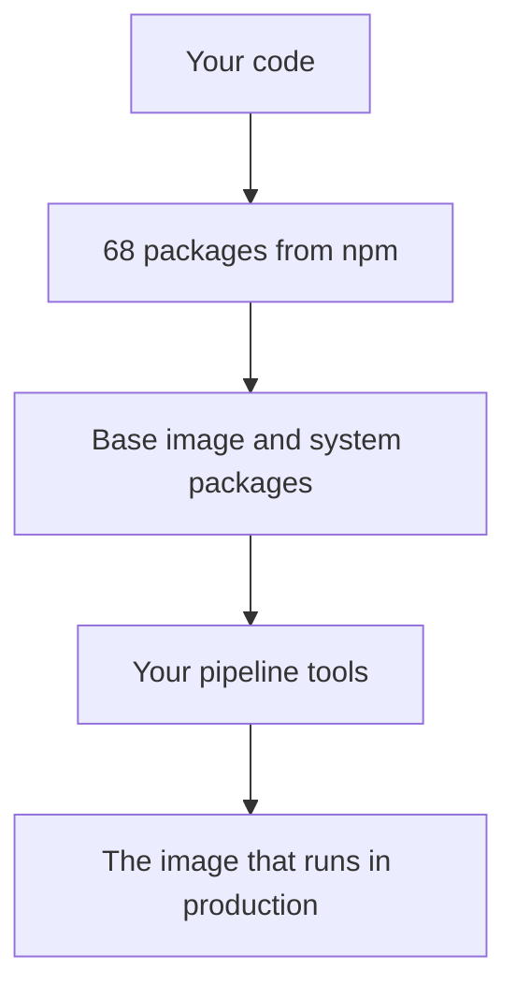
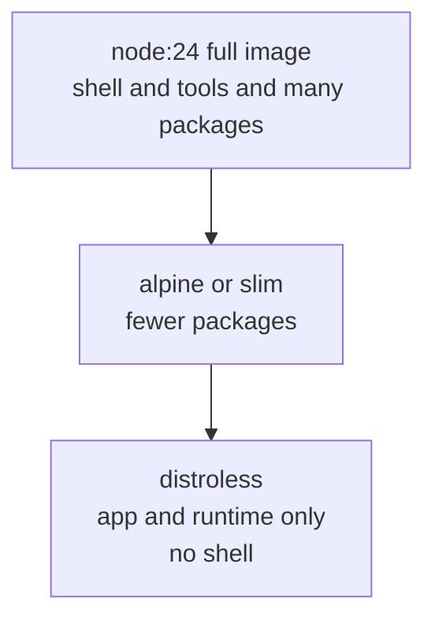
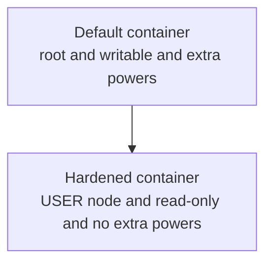
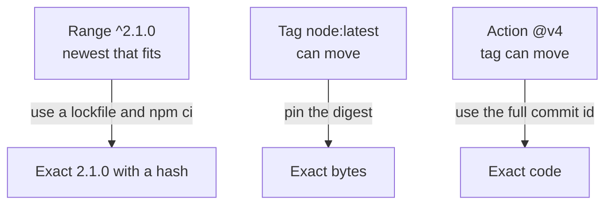
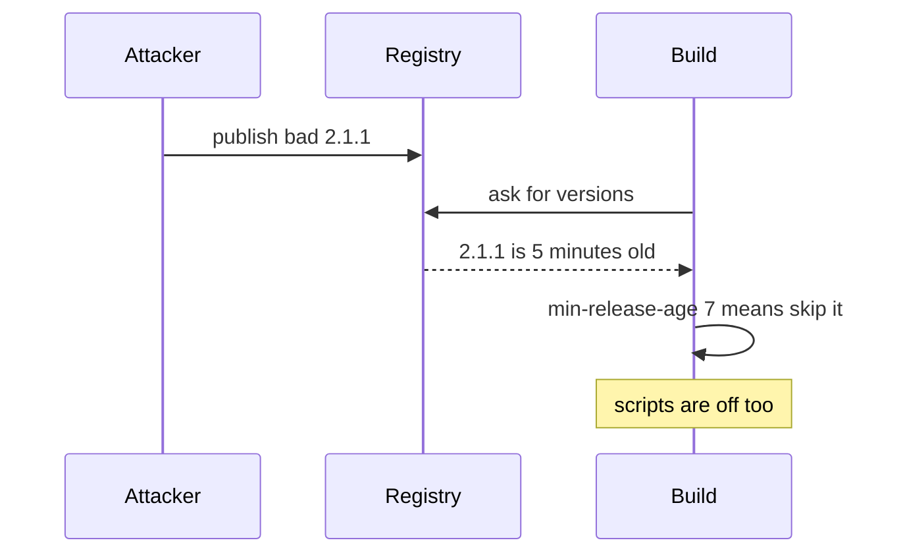
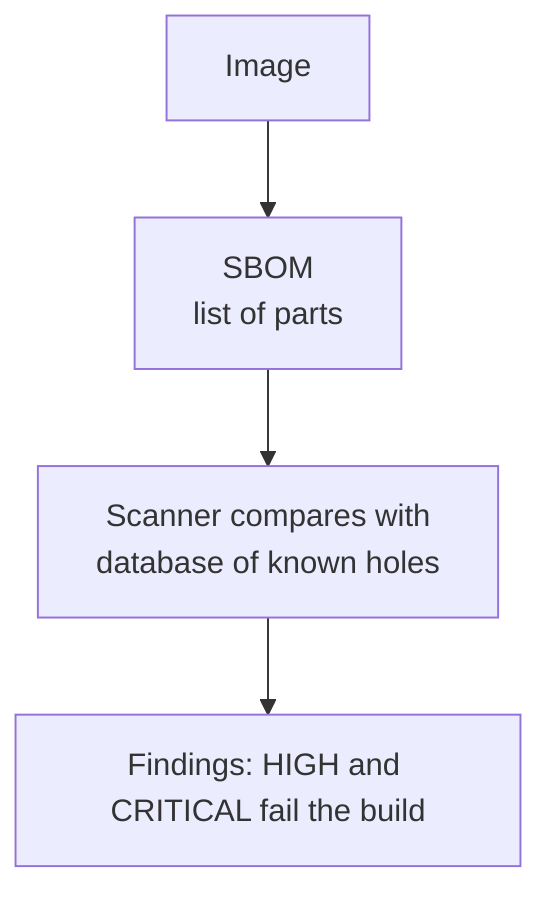
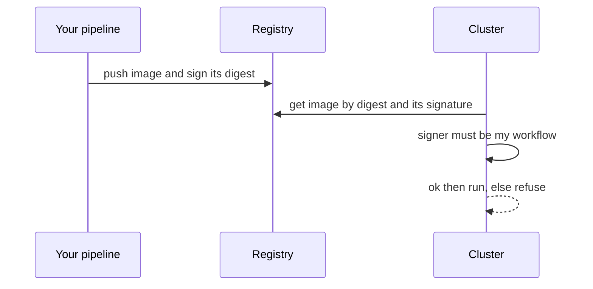

# 22. Container and supply chain security

> **Subject:** DevOps and Cloud · **Lesson:** 22 · **Made:** 2026-11-21 · **Status:** ready
>
> **You will be able to:** say what a supply chain is and where an attack can enter it, name four real attacks of 2025 and 2026 and what each one teaches, make an image smaller and less powerful (small base, non-root user, read-only filesystem, no secrets in layers), keep the same bytes every build (lockfile, `npm ci`, digest, full commit ids), say what a scan can and cannot find, and explain signing and verifying an image.
>
> **Before this:** [Docker images and layers](02-docker-images-and-layers.md) · **Also read:** [Config and secrets](09-config-and-secrets.md) and [CI/CD pipelines](05-ci-cd-pipelines.md) · **Next:** GitOps (planned, lesson 23)
>
> **How to read it:** one card is one idea. Look at the picture, guess, then press the orange bar to check. The blue bars (📖 More detail) hold the longer explanation. Skip them on the first read. **I did not run Trivy, cosign or Docker for this lesson** (Docker was not running). Their behavior comes from their docs and is marked "from the docs, not run here". What I did run: `npm ci`, `npm audit signatures` and an install script test on npm 11.17.0, and the practice code in Node v26.5.0. The attack facts come from the sources linked in the cards (opened 2026-11-19). About 25 minutes for the cards.

<!-- quick-summary:start -->
## Quick summary

> Short on time? Read only this. These are the "Remember" lines from the cards below, so you can read the whole lesson in one minute.

- Your supply chain is everything that arrives with your code. One bad link is enough.
- Every attack used a different door. No single defense covers them all, so use layers.
- A small base and a multi-stage build leave less to attack. A secret in any layer is public to everyone who can pull the image.
- `USER node`, a read-only filesystem, and no extra Linux powers. The app can then do little, even if it is broken into.
- Exact names beat moving names. Lockfile and `npm ci`, a digest for images, a full commit id for actions.
- Scripts off, and a short wait for new versions. Neither one needs to know the attack exists.
- A scan finds known holes only. A clean scan means "nothing known". Scan old images too, because a hole becomes known after you built the image.
- Deploy by digest, check there is a signature for it, check who signed. A signature proves who built it, not that the code is safe.
<!-- quick-summary:end -->

## 1. The problem: you run code you did not write

Your `package.json` names 1 library. After `npm install` there were **68 packages** on my machine (I installed `express`). Your image also has a base image, system packages and build tools. Your pipeline runs tools made by others. Together this is your **supply chain**: everything that arrives with your code. An attacker does not need to break your code. One bad link is enough.



Notice: your own code is only the first box. Every box after it is somebody else's work.

<details class="guess"><summary>🤔 Guess: you add 1 library to package.json. How many packages can run code on your build machine? Press to check.</summary>

**Many more than 1.** My test: 1 library gave 68 packages. Each one can run code when installed, and again when your app runs.

</details>

> **Remember:** your supply chain is everything that arrives with your code. One bad link is enough.

<details class="more"><summary>📖 More detail: the real numbers, and the four new words</summary>

**Four new words in this lesson:** supply chain (this card), vulnerability (card 7, a hole that is already known), SBOM (card 7, a list of what is inside), signature (card 8).

**My test** (npm 11.17.0, 2026-11-19, `express@5.1.0`): `package.json` had 1 dependency. The lockfile listed 68 packages, and each had a hash (an `integrity` field). `npm audit signatures` said "68 packages have verified registry signatures" and "5 verified attestations".

**Where the attack can enter.** The stepper uses this list of seven doors:

| # | Door | Example |
|---|---|---|
| 1 | The publisher account | A stolen npm login or token |
| 2 | The version range | `^2.1.0` takes the newest version that fits |
| 3 | Install scripts | They run on your build machine |
| 4 | The base image tag | `node:latest` can move |
| 5 | Your Dockerfile | Root user, secrets in layers |
| 6 | Your pipeline tools | An action or scanner named by a tag |
| 7 | The registry | The image replaced after you built it |

**Where this fits.** [Lesson 02](02-docker-images-and-layers.md) taught layers, the digest and `USER node`. [Lesson 09](09-config-and-secrets.md) taught secrets. This lesson puts them together as a defense.

</details>

## 2. Four real attacks, four different doors

These are real. **Shai-Hulud** (September 2025): a worm that spread through more than 500 npm packages. **axios** (March 2026): two versions got a bad new dependency. **Trivy** (March 2026): the scanner's own pipeline tags were moved. **TanStack** (May 2026): 42 packages published with a valid signed record. Each one used a different door.

| Attack | The door | What helps |
|---|---|---|
| Shai-Hulud, Sep 2025 | Stolen logins, then install scripts | Lockfile, scripts off, a wait |
| axios, Mar 2026 | A maintainer account, a new dependency | Lockfile, scripts off, a wait |
| Trivy, Mar 2026 | Version tags of a pipeline tool | Name actions by full commit id |
| TanStack, May 2026 | A poisoned build cache in the release pipeline | A wait, review the pipeline |

Notice: no row has the same door as another. That is why you need layers of defense.

<details class="guess"><summary>🤔 Guess: in the TanStack attack, the bad versions came with a valid signed build record. Does a valid record mean the code is safe? Press to check.</summary>

**No.** The real pipeline built the bad versions, so the record was valid. It says where the code was built, not that the code is good.

</details>

> **Remember:** every attack used a different door. No single defense covers them all, so use layers.

<details class="more"><summary>📖 More detail: what each source says (checked 2026-11-19)</summary>

**Shai-Hulud.** CISA's alert of 2025-09-23 says a self-replicating worm had compromised "over 500" packages. It looked for GitHub and cloud keys, sent them out, and used stolen npm access to publish bad versions of the victim's other packages ([CISA alert](https://www.cisa.gov/news-events/alerts/2025/09/23/widespread-supply-chain-compromise-impacting-npm-ecosystem)). A second wave in November 2025 added a script that ran at the preinstall step ([Microsoft](https://www.microsoft.com/en-us/security/blog/2025/12/09/shai-hulud-2-0-guidance-for-detecting-investigating-and-defending-against-the-supply-chain-attack/)). Microsoft also reports a return called Mini Shai-Hulud in May 2026 (170+ npm packages and 2 PyPI packages).

**axios.** CISA (alert of 2026-04-20): on 2026-03-31, `axios@1.14.1` and `axios@0.30.4` pulled in the bad dependency `plain-crypto-js@4.2.1`, which downloads a remote access program. CISA's advice includes `ignore-scripts=true` and `min-release-age=7` ([CISA alert](https://www.cisa.gov/news-events/alerts/2026/04/20/supply-chain-compromise-impacts-axios-node-package-manager)). Security vendors say a maintainer account was taken over. CISA does not say how the login was stolen.

**Trivy.** Aqua Security says that on 2026-03-19 attackers moved 76 of 77 tags of `trivy-action` to bad commits and published a bad Trivy `v0.69.4`. A pipeline that used a tag ran the bad code with no visible change. Aqua's advice: "Pin GitHub Actions to full, immutable commit SHA hashes" ([Aqua advisory](https://www.aquasec.com/blog/trivy-supply-chain-attack-what-you-need-to-know/)). The lesson: the tool that checks you is code too.

**TanStack.** Their postmortem: on 2026-05-11, 84 bad versions of 42 packages were published in 6 minutes. A pull request ran in a `pull_request_target` workflow and poisoned a build cache. The release workflow then restored the cache, and the attacker read its publish token from memory. "No npm tokens were stolen" ([postmortem](https://tanstack.com/blog/npm-supply-chain-compromise-postmortem)). Snyk says the bad packages carried valid SLSA Build Level 3 provenance ([Snyk](https://snyk.io/blog/tanstack-npm-packages-compromised)). An outside researcher saw it about 26 minutes after the first publish.

**The scores differ by source.** Package counts differ between vendors. I used CISA, the maintainers' own reports and Aqua where I could.

</details>

## 3. Put less inside the image

Everything inside the image is something an attacker can use. A full OS image has a shell, a package manager and tools for downloading. Most apps need none of them. So start from a **small base** and ship only what runs. Keep secrets out: a file deleted in a later line is still in a lower layer ([lesson 02](02-docker-images-and-layers.md), card 4).



Notice: each step down has less for an attacker to use.

<details class="guess"><summary>🤔 Guess: an attacker gets into your running app. What can they run if the image has no shell and no curl? Press to check.</summary>

**Much less.** They cannot open a shell or download tools with the image's own programs. It does not make the app safe. It makes their next step harder.

</details>

> **Remember:** a small base and a multi-stage build leave less to attack. A secret in any layer is public to everyone who can pull the image.

<details class="more"><summary>📖 More detail: distroless, alpine, slim, and secrets (from the docs, not run here)</summary>

| Base | What it is | Watch out |
|---|---|---|
| Full (`node:24`) | A normal Debian with many tools | The biggest, with the most to attack |
| `slim` | Debian with fewer packages | Uses glibc, so native packages usually work |
| `alpine` | A very small Linux, uses musl | Some native packages need glibc ([lesson 02](02-docker-images-and-layers.md), card 5) |
| Distroless | Your app and its runtime only | No shell. The `:debug` tag adds a busybox shell for trouble shooting |
| Docker Hardened Images | Small images made by Docker | The core is free under Apache 2.0 and includes SBOMs and signatures (see the docs) |

The distroless project says its images "do not contain package managers, shells or any other programs" from a normal Linux, and that they are signed by cosign ([distroless](https://github.com/GoogleContainerTools/distroless)). It lists Node images such as `nodejs24-debian13`, with `:nonroot` tags. Docker's best practices say to pick a trusted source and "keep it small" because fewer packages mean fewer vulnerabilities ([best practices](https://docs.docker.com/build/building/best-practices/)). Docker Hardened Images are described at [docs.docker.com/dhi](https://docs.docker.com/dhi/).

**No secrets in layers.** Docker says build arguments and environment variables "are inappropriate for passing secrets to your build" and offers `RUN --mount=type=secret` ([Build secrets](https://docs.docker.com/build/building/secrets/)). Also write a `.dockerignore` with `.env*` and `.npmrc` ([lesson 02](02-docker-images-and-layers.md), card 6).

**The cost of distroless.** With no shell you cannot `docker exec` into the container to look around. Use the `:debug` image for that, in a test place and not in production.

</details>

## 4. Give the app less power

Say an attacker gets into your app anyway. What can they do? In a default container the app runs as **root**, the filesystem is writable, and it has extra Linux powers. Three settings take that away: run as a normal user, make the filesystem **read-only**, and drop the powers the app does not need.



Notice: the app is the same. Only what it is allowed to do changes.

<details class="guess"><summary>🤔 Guess: the attacker is inside your app and wants to save a tool in the container. What stops them if the filesystem is read-only? Press to check.</summary>

**The write fails.** A read-only root filesystem cannot be changed. If your app needs to write, give it one small folder for that, such as a temporary folder.

</details>

> **Remember:** `USER node`, a read-only filesystem, and no extra Linux powers. The app can then do little, even if it is broken into.

<details class="more"><summary>📖 More detail: the real settings (from the docs, not run here)</summary>

**In a Dockerfile:** `USER node` (see [lesson 02](02-docker-images-and-layers.md), card 7, where `id` printed `uid=1000(node)`).

**With `docker run`** (from the [OWASP Docker cheat sheet](https://cheatsheetseries.owasp.org/cheatsheets/Docker_Security_Cheat_Sheet.html)):

```
docker run --read-only --cap-drop all --security-opt=no-new-privileges myapp
```

The cheat sheet says: "Configuring the container to use an unprivileged user is the best way to prevent privilege escalation attacks". It also says "The most secure setup is to drop all capabilities `--cap-drop all` and then add only required ones". And: do not expose the Docker daemon socket to a container.

**In Kubernetes** ([security context](https://kubernetes.io/docs/tasks/configure-pod-container/security-context/), see also [lesson 04](04-kubernetes-objects.md)):

```yaml
securityContext:
  runAsNonRoot: true
  readOnlyRootFilesystem: true
  allowPrivilegeEscalation: false
  capabilities:
    drop: ["ALL"]
```

The Kubernetes page says `readOnlyRootFilesystem` "Mounts the container's root filesystem as read-only" and that `allowPrivilegeEscalation` controls whether a process can gain more privileges than its parent, for example with a setuid program.

**The cost.** An app that writes logs or temporary files to its own folder will fail. Give it a writable temporary folder, and send logs to the screen ([lesson 10](10-logs-and-monitoring.md)). Test this before production. I did not run any of these settings.

</details>

## 5. Keep the same bytes every time

The attacks in card 2 worked because a build **asked for the newest thing**. A range like `^2.1.0` takes whatever is newest today. A tag like `node:latest` is whatever the publisher set today. The fix: ask for exact things. A **lockfile** names exact versions, and `npm ci` installs only those. A **digest** names exact image bytes. A full commit id names an exact version of a pipeline action.



Notice: each risky name on the left becomes a fixed name on the right.

<details class="guess"><summary>🤔 Guess: the lockfile says 2.1.0. Someone publishes 2.1.1. You run npm ci. Which version do you get? Press to check.</summary>

**2.1.0.** `npm ci` installs exactly what the lockfile says. If the lockfile and `package.json` disagree, it stops with an error and does not change the lockfile.

</details>

> **Remember:** exact names beat moving names. Lockfile and `npm ci`, a digest for images, a full commit id for actions.

<details class="more"><summary>📖 More detail: what I ran, the trace of the build, and the cost</summary>

**What I ran** (npm 11.17.0, 2026-11-19). A project with `"ms": "2.1.3"` got a lockfile with a `sha512` hash for it. I then changed `package.json` to `2.1.2` and ran `npm ci`. It stopped:

```
npm error `npm ci` can only install packages when your package.json and package-lock.json ... are in sync.
npm error Invalid: lock file's ms@2.1.3 does not satisfy ms@2.1.2
```

The npm docs say `npm ci` "will never write to package.json or any of the package-locks: installs are essentially frozen" ([npm ci](https://docs.npmjs.com/cli/v11/commands/npm-ci)).

**The trace** (stepper tab 2, steps 1 to 3):

| Step | What happens | State after |
|---|---|---|
| 1 | Lockfile says `tiny-logger 2.1.0` | The registry has 2.1.0 only |
| 2 | An attacker publishes `2.1.1` | The registry has 2.1.0 and a bad 2.1.1 |
| 3 | `npm ci` reads the lockfile | Build has 2.1.0. The bad 2.1.1 is never asked for |

**Pinning has a cost.** A pinned thing stops getting fixes by itself. Docker's guide says you "opt out of automated security fixes" and suggests Dependabot to raise pull requests that update tags and digests ([best practices](https://docs.docker.com/build/building/best-practices/)). A new lockfile entry is also a place to look: review lockfile changes in pull requests.

**Pin the pipeline too.** Name actions by the full commit id: `uses: owner/action@<40 letters and numbers>`. Dependabot can update these ([Dependabot options](https://docs.github.com/en/code-security/dependabot/working-with-dependabot/dependabot-options-reference)).

**A lockfile does not make a bad version good.** If the bad version was already in your lockfile, `npm ci` installs it. A lockfile only stops surprise changes.

</details>

## 6. Do not run strangers' code at install, and wait

Two more doors from card 2. **Install scripts** are small programs a package can run when you install it. They run on your build machine, which holds your secrets. And **a brand new version** is the most dangerous kind, because nobody has had time to notice a problem. So: turn install scripts off, and ask npm to skip versions younger than a few days.



Notice: the build never needs to know the version is bad. It is only too young.

<details class="guess"><summary>🤔 Guess: a bad version is published and the registry removes it 3 hours later. You wait 7 days before taking new versions. Do you ever install it? Press to check.</summary>

**No.** It is gone long before day 7. In the TanStack case the files were removed within about 4 hours. A wait protects you without anyone knowing about the attack.

</details>

> **Remember:** scripts off, and a short wait for new versions. Neither one needs to know the attack exists.

<details class="more"><summary>📖 More detail: npm 12, the settings, my script test, and the cost</summary>

**npm 12** (GitHub changelog of 2026-07-08, [source](https://github.blog/changelog/2026-07-08-npm-install-time-security-and-gat-bypass2fa-deprecation/)): dependency install scripts and implicit `node-gyp` builds are off unless allowed in `allowScripts`. Git dependencies (`--allow-git`) and remote URL dependencies (`--allow-remote`) default to `none`. To prepare, run `npm approve-scripts --allow-scripts-pending` and commit the list into `package.json`. These changes showed as warnings from npm 11.16.0.

**Settings** (npm 11 [config docs](https://docs.npmjs.com/cli/v11/using-npm/config)):

| Setting | Meaning |
|---|---|
| `ignore-scripts=true` | npm does not run scripts from `package.json` files |
| `strict-allow-scripts=true` | An unapproved install script becomes an error, not a warning |
| `min-release-age=7` | "only versions that were available more than the given number of days ago will be installed". The unit is days |

CISA's axios advice lists `ignore-scripts=true` and `min-release-age=7`. Careful: the old `ignore-scripts=true` setting can silently cancel the `allowScripts` list ([InfoQ](https://www.infoq.com/news/2026/08/npm-12-released/), a comment on the npm 12 article).

**My test** (npm 11.17.0): I made a harmless package whose `postinstall` writes a file. A plain install ran it, and printed `npm warn allow-scripts ... Run npm approve-scripts`. With `--ignore-scripts`, the file was not written. npm 12 itself I did not run.

**The cost of a wait.** Real fixes arrive later, too. Dependabot's `cooldown` option delays version updates ("This default cooldown does not apply to security updates", and its default is 3 days), so security fixes still come fast ([Dependabot options](https://docs.github.com/en/code-security/dependabot/working-with-dependabot/dependabot-options-reference)). Scripts off will break packages that need a build step at install, for example some with native code. You then list them in `allowScripts`.

**The trace** (stepper tab 2, steps 3 and 4, and tab 4, last steps):

| Step | What happens | State after |
|---|---|---|
| 1 | Bad `2.1.1` is 5 minutes old | The registry has it |
| 2 | Build with `min-release-age=7` checks its age | `cooldownOk` is `false` |
| 3 | Build takes `2.1.0` | No bad code installed |
| 4 | A dependency has an install script | Not run, because scripts are off |

</details>

## 7. Look for known holes, and keep a list

A **vulnerability** is a hole in some software that people already know about. A **scanner** (Trivy, `npm audit`, Docker Scout) compares what is in your image with a database of known holes and prints a list. To do that it needs a list of the parts: the **SBOM** (software bill of materials), like the ingredients on a food packet. You can fail the build when the scan finds a serious hole.



Notice: the scanner only finds what is already in its database.

<details class="guess"><summary>🤔 Guess: a bad version was published 5 minutes ago and has no advisory yet. You scan. What does the scan say? Press to check.</summary>

**Nothing found.** The scanner does not know about it yet. In the TanStack timeline the advisory came about 2 hours after the first publish. Before that, a scan was clean. A wait (card 6) covers those hours.

</details>

> **Remember:** a scan finds known holes only. A clean scan means "nothing known". Scan old images too, because a hole becomes known after you built the image.

<details class="more"><summary>📖 More detail: the tools, the stepper trace, and the Trivy lesson</summary>

**The tools** (from the docs, not run here):

| Tool | What it does |
|---|---|
| Trivy | `trivy image <name>` scans files inside an image for vulnerabilities and secrets by default ([docs](https://trivy.dev/latest/docs/target/container_image/)) |
| `npm audit` | Sends your dependency list to npm and prints known holes ([docs](https://docs.npmjs.com/cli/v11/commands/npm-audit)) |
| Dependabot | Opens pull requests for updates, including Docker base images and GitHub Actions |
| OSV | A public database of open source holes: [osv.dev](https://osv.dev/) |
| Docker Scout | Checks images and says when a base image is old ([best practices](https://docs.docker.com/build/building/best-practices/)) |

**SBOM.** With Docker BuildKit, `--sbom=true` attaches a list in the SPDX format to the image. Docker says to validate it before you push ([SBOM attestations](https://docs.docker.com/build/metadata/attestations/sbom/)). I did not run it.

**The trace** (stepper tab 4, the time line of the TanStack case):

| Time (UTC) | What happens | `scan` says |
|---|---|---|
| 19:20 | A bad version is published, and a build at 19:25 installs it | 0 findings, the build goes on |
| 19:46 | An outside researcher opens a report | 0 findings, the database is the same |
| 21:30 | An advisory is published | 1 CRITICAL, `gate` = 1, the build would fail |
| 22:13 | The registry starts removing the files | New installs fail. Your old image still has a copy |

**The Trivy lesson.** Card 2 says the Trivy pipeline tool itself was attacked in March 2026. So treat the scanner like any code that runs with your secrets: pin it by commit id.

**The cost.** Scanners find many holes that do not matter for your app, so decide in advance what fails a build (for example HIGH and CRITICAL with a fix available) and what only warns.

</details>

## 8. Sign the image, and check the signature at the door

Someone could swap your image in the registry after you built it. A **signature** is a proof that says: this pipeline made these exact bytes. **Cosign** (part of the **Sigstore** project) signs the image **digest**, the fingerprint of the exact bytes. Before the cluster runs the image, it checks that a signature exists, and that it came from the pipeline you named.



Notice: the signature belongs to the digest, so new bytes do not carry the old signature.

<details class="guess"><summary>🤔 Guess: someone pushes new bytes under the tag app:1.4. Your cluster only runs images signed by your pipeline. Does the new image start? Press to check.</summary>

**No.** A tag is refused, because it can move. The new bytes have a new digest, and there is no signature for it. Even a signature from someone else's copy is refused, because the signer is wrong.

</details>

> **Remember:** deploy by digest, check there is a signature for it, check who signed. A signature proves who built it, not that the code is safe.

<details class="more"><summary>📖 More detail: keyless signing, the real commands, provenance, trusted publishing (from the docs, not run here)</summary>

**Keyless signing** ([Sigstore docs](https://docs.sigstore.dev/cosign/signing/overview/)): cosign makes a key pair in memory, gets an identity token (for example from GitHub Actions), and a service called Fulcio issues a short-lived certificate for it. The private key is then destroyed. The signing event is written in a public log called Rekor. So there is no long-lived key to steal. You can look in the log at [search.sigstore.dev](https://search.sigstore.dev/).

**Verify** ([docs](https://docs.sigstore.dev/cosign/verifying/verify/)):

```
cosign verify <image by digest> \
  --certificate-identity=<exact signer> \
  --certificate-oidc-issuer=<exact issuer>
```

Use the exact identity. A broad pattern lets someone else sign their own copy and pass.

**Provenance.** A signed record of where and how the software was built. GitHub's artifact attestations record the workflow, repository, commit and event, use Sigstore, and meet SLSA Build Level 2 by themselves ([GitHub docs](https://docs.github.com/en/actions/concepts/security/artifact-attestations)). The docs add that attestations "are not a guarantee that an artifact is secure". SLSA Level 3 means a hardened build platform ([SLSA levels](https://slsa.dev/spec/v1.0/levels)). The TanStack case shows the limit: the real pipeline built the bad code, so its record was valid.

**npm trusted publishing.** For the packages you publish, the old way was a long-lived token in your pipeline. With trusted publishing, a workflow gets a short-lived token through OIDC, and npm accepts publishes only from the workflow you named. It also makes provenance automatically for public packages, and it supports GitHub Actions, GitLab and CircleCI, not self-hosted runners ([npm docs](https://docs.npmjs.com/trusted-publishers)). Why it exists: npm revoked all classic tokens on 2025-12-09, and write tokens now last at most 90 days ([GitHub changelog](https://github.blog/changelog/2025-12-09-npm-classic-tokens-revoked-session-based-auth-and-cli-token-management-now-available/)). Careful: the TanStack postmortem says "any code path in the workflow can mint a publish-capable token". So keep the publish workflow small and review `pull_request_target` workflows. For packages that bypass 2FA, GitHub plans to limit them to staging a publish that a person approves, around January 2027 (same changelog of 2026-07-08, an estimate).

**The trace** (stepper tab 3, the model code `verifyDeploy`):

| Step | The deploy asks for | `verifyDeploy` says |
|---|---|---|
| 1 | `app:1.4` (a tag) | `not-pinned` |
| 2 | The signed digest | `ok` |
| 3 | One byte changed, a new digest | `unsigned` |
| 4 | New digest signed by a copy owned by someone else | `wrong-signer` |

**What enforces it.** Cosign only signs and checks. A cluster rule such as a Kubernetes admission policy (for example Kyverno) stops unsigned images. I did not run either.

**The cost.** A signing step, a rule in the cluster, and a plan for when the check blocks a real release.

</details>

## 9. Watch and play

Links were checked on 2026-11-19. For the videos I read the title and channel from YouTube data, and the length from the page. I did not watch them. The Sigstore video is from 2021 and the Trivy one from 2022, so commands may differ today. For the pages I opened them and read the parts named. If a link is broken, tell me and I will replace it.

- **Play with it:** [the stepper in this folder](visuals/22-container-and-supply-chain-security.html) - guess first, then press Next. Five tabs: a bad version gets in, the same path with defenses, the deploy gate, what a scanner can see, and four real attacks.
- **Video (about 5 minutes):** [300+ npm Packages COMPROMISED: The Shai-Hulud Worm Is Back!](https://www.youtube.com/watch?v=ncRrh7zS1gY) - Better Stack, from November 2025. Compare it with card 2.
- **Video (about 6 minutes):** [Container Image Scanning with Trivy, Ep. 1 Trivy Overview](https://www.youtube.com/watch?v=-IH5inFyEqU) - Aqua Security Open Source. Compare it with card 7.
- **Video (about 11 minutes):** [Sigstore demo with cosign](https://www.youtube.com/watch?v=gCi9_4NYyR0) - Sigstore. Compare it with card 8.
- **Search for real:** [Rekor search](https://search.sigstore.dev/) - the public log of signing events. I opened the page and saw the search form. I did not search it.
- **Search for real:** [OSV](https://osv.dev/) - type an npm package name and see its known holes.
- **Read:** [TanStack postmortem](https://tanstack.com/blog/npm-supply-chain-compromise-postmortem) - a real time line, a real attack chain, and an honest list of what went well and badly.

<details><summary>Go deeper (optional)</summary>

**More pages I opened.** [CISA, Shai-Hulud](https://www.cisa.gov/news-events/alerts/2025/09/23/widespread-supply-chain-compromise-impacting-npm-ecosystem). [CISA, axios](https://www.cisa.gov/news-events/alerts/2026/04/20/supply-chain-compromise-impacts-axios-node-package-manager). [Aqua, Trivy](https://www.aquasec.com/blog/trivy-supply-chain-attack-what-you-need-to-know/). [Snyk, TanStack](https://snyk.io/blog/tanstack-npm-packages-compromised). [Microsoft, Shai-Hulud 2.0](https://www.microsoft.com/en-us/security/blog/2025/12/09/shai-hulud-2-0-guidance-for-detecting-investigating-and-defending-against-the-supply-chain-attack/). [GitHub: npm v12 changes](https://github.blog/changelog/2026-07-08-npm-install-time-security-and-gat-bypass2fa-deprecation/). [GitHub: classic tokens revoked](https://github.blog/changelog/2025-12-09-npm-classic-tokens-revoked-session-based-auth-and-cli-token-management-now-available/). [npm trusted publishers](https://docs.npmjs.com/trusted-publishers). [npm audit](https://docs.npmjs.com/cli/v11/commands/npm-audit). [npm config](https://docs.npmjs.com/cli/v11/using-npm/config). [Sigstore signing](https://docs.sigstore.dev/cosign/signing/overview/). [Sigstore verifying](https://docs.sigstore.dev/cosign/verifying/verify/). [GitHub artifact attestations](https://docs.github.com/en/actions/concepts/security/artifact-attestations). [SLSA levels](https://slsa.dev/spec/v1.0/levels). [Docker SBOM attestations](https://docs.docker.com/build/metadata/attestations/sbom/). [Docker best practices](https://docs.docker.com/build/building/best-practices/). [distroless](https://github.com/GoogleContainerTools/distroless). [OWASP Docker cheat sheet](https://cheatsheetseries.owasp.org/cheatsheets/Docker_Security_Cheat_Sheet.html). [Kubernetes security context](https://kubernetes.io/docs/tasks/configure-pod-container/security-context/).

**The news changes fast.** The facts about attacks and npm changes are from 2026-11-19. The dates for token changes in 2026 and 2027 are GitHub's estimates. Look them up again before you quote them.

**Checked on 2026-11-21** with Node v26.5.0: the practice answer passes 99 tests, and the stub fails 96 of them (3 only check that your function does not change its inputs). I also tried 69 wrong versions of the answer. The tests caught all except 2 that give exactly the same results as the right answer (a repeated check, and a sort that is already in order). The stepper uses these same functions. Its digests are real sha256 values of two made up texts. I ran all 35 steps of the five tabs in Node.

**What I did not test.** Trivy, cosign, Sigstore, Docker builds, SBOM generation, `docker run --read-only`, Kubernetes settings, npm 12 itself, Dependabot and trusted publishing. Those come from their docs. What I ran: `npm ci` with a lockfile mismatch, `npm audit signatures`, and a harmless install script test, all on npm 11.17.0.

**Where the model is simpler than the real tools.** My linter reads lines with simple rules. Real linters (hadolint) parse the whole file. My scan matches exact versions, and real scanners match version ranges. My `verifyDeploy` compares text, and cosign checks certificates and a transparency log.

**More ideas not covered here.** Policy tools in the cluster (Kyverno, OPA). Private package registries and mirrors. Network rules that stop a build machine from calling out. Rotating secrets after an incident. Code signing for commits.

</details>

## 10. Practice

**A. Predict the output** (write your answer before opening)

```js
const text = ["FROM node:latest", "ENV DB_PASSWORD=hunter2",
  "RUN npm install -g typescript", 'CMD ["node", "app.js"]'].join("\n");
console.log(lintDockerfile(text));
console.log(cooldownOk("2026-11-19T10:00:00Z", "2026-11-19T12:00:00Z", 7));
console.log(verifyDeploy("ghcr.io/me/app:1.4", [], { identity: "a", issuer: "b" }));
```

Then answer: why does line 1 appear twice, and why is the last answer not `unsigned`?

<details><summary>Answer</summary>

```
[
  { line: 1, rule: 'latest-tag' },
  { line: 1, rule: 'root-user' },
  { line: 2, rule: 'secret-in-env' },
  { line: 3, rule: 'unpinned-package' }
]
false
{ ok: false, reason: 'not-pinned' }
```

Line 1 has two problems: the tag `latest` can move, and the last stage has no `USER`, so it runs as root (the finding for a missing `USER` sits on the last `FROM`). Line 2 puts a secret in an `ENV`, line 3 installs `typescript` with no version. The version is 2 hours old and the wait is 7 days, so it is not ok yet. The last answer is `not-pinned` because the check refuses a tag before it looks for a signature. (Checked on 2026-11-21 with Node v26.5.0.)

</details>

**B. Fix the bug**

This Dockerfile passes a scan today but has two problems that a linter finds. Find them and fix them.

```
FROM node:24-alpine
COPY package*.json ./
RUN npm install
COPY . .
CMD ["node", "server.js"]
```

<details><summary>Answer</summary>

The linter reports `root-user` on line 1 (no `USER`, so the app runs as root) and `npm-not-ci` on line 3 (`npm install` may change versions, `npm ci` follows the lockfile). Fix: add `USER node` before `CMD`, and change line 3 to `RUN npm ci --omit=dev`. Better still, pin the base: `FROM node:24-alpine@sha256:<digest>`. I ran the linter on the first version and got `[ { line: 1, rule: 'root-user' }, { line: 3, rule: 'npm-not-ci' } ]`. The fixed version gives `[]`.

</details>

**C. Write it yourself**

Open `learn/devops-cloud/practice/22-container-and-supply-chain-security.js`. It has five empty pieces: `lintDockerfile`, `verifyDeploy`, `cooldownOk`, `scan` and `gate`. The comments at the top say exactly what each one must do. Write them, then run this from the repo root and make all the tests pass:

```
node --test learn/devops-cloud/practice/22-container-and-supply-chain-security.test.js
```

`lintDockerfile` is the one to think about: join the lines that end with a backslash first, and look only at the last stage for the user.

<details><summary>One possible answer</summary>

```js
const SECRET_NAME = /(PASSWORD|PASSWD|SECRET|TOKEN|API_?KEY|PRIVATE_?KEY|ACCESS_?KEY)/i;
const SECRET_FILE = /^(\.env(\..+)?|.+\.pem|.+\.key|id_rsa|id_ed25519|\.npmrc)$/;
const SEVERITIES = ["LOW", "MEDIUM", "HIGH", "CRITICAL"];

// Joins lines that end with a backslash. Each instruction keeps the number of its first line.
function readInstructions(text) {
  const out = [];
  const lines = text.split("\n");
  for (let i = 0; i < lines.length; i++) {
    const first = lines[i].trim();
    if (first === "" || first.startsWith("#")) continue;
    let whole = first;
    const start = i + 1;
    while (whole.endsWith("\\") && i + 1 < lines.length) {
      i++;
      whole = whole.slice(0, -1).trim() + " " + lines[i].trim();
    }
    const space = whole.search(/\s/);
    const word = (space === -1 ? whole : whole.slice(0, space)).toUpperCase();
    const rest = space === -1 ? "" : whole.slice(space).trim();
    out.push({ line: start, word, rest });
  }
  return out;
}

function parseFrom(rest) {
  const words = rest.split(/\s+/).filter((w) => !w.startsWith("--"));
  const asAt = words.findIndex((w) => w.toUpperCase() === "AS");
  return { ref: words[0] || "", alias: asAt === -1 ? null : words[asAt + 1] };
}

function tagOf(ref) {
  const slash = ref.lastIndexOf("/");
  const colon = ref.lastIndexOf(":");
  return colon > slash ? ref.slice(colon + 1) : null;
}

function segmentsOf(command) {
  return command.split(/&&|;|\|/).map((s) => s.trim().split(/\s+/)).filter((t) => t[0]);
}

function packageArgs(tokens, after) {
  return tokens.slice(after).filter((t) => !t.startsWith("-"));
}

function lintDockerfile(text) {
  const found = new Map();
  const add = (line, rule) => found.set(line + ":" + rule, { line, rule });
  const stages = [];
  const aliases = new Set();
  for (const ins of readInstructions(text)) {
    if (ins.word === "FROM") {
      const { ref, alias } = parseFrom(ins.rest);
      stages.push({ line: ins.line, ref, users: [] });
      const skip = aliases.has(ref) || ref === "scratch" || ref.includes("$") || ref.includes("@sha256:");
      if (!skip) {
        const tag = tagOf(ref);
        if (tag === null || tag === "latest") add(ins.line, "latest-tag");
      }
      if (alias) aliases.add(alias);
      continue;
    }
    if (ins.word === "USER" && stages.length) {
      stages[stages.length - 1].users.push({ line: ins.line, name: ins.rest.split(/\s+/)[0] });
    } else if (ins.word === "ENV" || ins.word === "ARG") {
      const pairs = ins.rest.includes("=")
        ? ins.rest.split(/\s+(?=[A-Za-z_][A-Za-z0-9_]*=)/).map((p) => p.split(/=(.*)/s))
        : [[ins.rest.split(/\s+/)[0], ins.rest.split(/\s+/).slice(1).join(" ")]];
      const bad = pairs.some(([name, value]) => SECRET_NAME.test(name) && (ins.word === "ARG" || (value || "").trim() !== ""));
      if (bad) add(ins.line, "secret-in-env");
    } else if (ins.word === "COPY" || ins.word === "ADD") {
      const words = ins.rest.split(/\s+/);
      if (words.some((w) => w.startsWith("--from"))) continue;
      const sources = words.filter((w) => !w.startsWith("--")).slice(0, -1);
      if (sources.some((s) => SECRET_FILE.test(s.split("/").pop()))) add(ins.line, "secret-file");
    } else if (ins.word === "RUN") {
      if (/\b(curl|wget)\b[^|]*\|\s*(sudo\s+)?(sh|bash)\b/.test(ins.rest)) add(ins.line, "curl-pipe-shell");
      for (const t of segmentsOf(ins.rest)) {
        if (t[0] === "npm" && (t[1] === "install" || t[1] === "i")) {
          const pkgs = packageArgs(t, 2).filter((p) => !/^[./]|:\/\//.test(p));
          if (packageArgs(t, 2).length === 0) add(ins.line, "npm-not-ci");
          if (pkgs.some((p) => !p.slice(1).includes("@"))) add(ins.line, "unpinned-package");
        } else if ((t[0] === "apt-get" || t[0] === "apt") && t[1] === "install") {
          if (packageArgs(t, 2).some((p) => !p.includes("="))) add(ins.line, "unpinned-package");
        } else if (t[0] === "apk" && t[1] === "add") {
          if (packageArgs(t, 2).some((p) => !p.includes("="))) add(ins.line, "unpinned-package");
        }
      }
    }
  }
  const last = stages[stages.length - 1];
  if (last) {
    const tag = tagOf(last.ref) || "";
    const user = last.users[last.users.length - 1];
    if (user) {
      const name = user.name.split(":")[0].toLowerCase();
      if (name === "root" || name === "0") add(user.line, "root-user");
    } else if (!tag.includes("nonroot")) {
      add(last.line, "root-user");
    }
  }
  return [...found.values()].sort((a, b) => a.line - b.line || a.rule.localeCompare(b.rule));
}

function verifyDeploy(ref, signatures, policy) {
  const match = /@(sha256:[a-f0-9]+)$/.exec(ref);
  if (!match) return { ok: false, reason: "not-pinned" };
  const digest = match[1];
  const forThis = signatures.filter((s) => s.digest === digest);
  if (forThis.length === 0) return { ok: false, reason: "unsigned" };
  const fits = forThis.some((s) => s.identity === policy.identity && s.issuer === policy.issuer);
  return fits ? { ok: true } : { ok: false, reason: "wrong-signer" };
}

function cooldownOk(publishedAt, now, minDays) {
  if (!minDays) return true;
  const days = (Date.parse(now) - Date.parse(publishedAt)) / 86400000;
  return days > minDays;
}

function scan(sbom, advisories) {
  const seen = new Set();
  const findings = [];
  for (const { name, version } of sbom) {
    const key = name + "@" + version;
    if (seen.has(key)) continue;
    seen.add(key);
    for (const adv of advisories) {
      if (adv.name === name && adv.affected.includes(version)) {
        findings.push({ id: adv.id, name, version, severity: adv.severity, fixed: adv.fixed });
      }
    }
  }
  return findings.sort(
    (a, b) => SEVERITIES.indexOf(b.severity) - SEVERITIES.indexOf(a.severity) || a.name.localeCompare(b.name) || a.id.localeCompare(b.id)
  );
}

function gate(findings, failOn) {
  const limit = SEVERITIES.indexOf(failOn);
  if (limit === -1) throw new Error("unknown severity: " + failOn);
  return findings.some((f) => SEVERITIES.indexOf(f.severity) >= limit) ? 1 : 0;
}

module.exports = { lintDockerfile, verifyDeploy, cooldownOk, scan, gate };
```

Checked on 2026-11-21 with Node v26.5.0: 96 of the 99 tests fail on the empty stub (the other 3 only check that your function does not change its inputs), and all 99 pass with this answer. The stepper page uses these same functions.

</details>

## 11. Interview question

**Q:** "How do you secure a container image and your build pipeline against supply chain attacks?"

A common follow-up: "A popular npm package was just compromised. What do you do?" Cards 2, 5 and 6 are the answer.

<details><summary>A strong answer, in four parts</summary>

1. **Problem:** I run code I did not write: 68 packages for one library, a base image and pipeline tools. In 2025 and 2026, attackers used different doors: stolen publisher logins (Shai-Hulud, axios), the tags of a pipeline tool (Trivy), and a poisoned build cache that gave a valid signed record to bad code (TanStack). One bad link is enough.
2. **How it works:** I use layers. Exact versions: a lockfile with `npm ci`, the base image by digest, actions by full commit id. Install scripts off and a short wait before taking new versions. A small base, a multi-stage build, no secrets in layers, `USER node`, a read-only filesystem and dropped capabilities. A linter and a scan in the pipeline that fail the build on serious holes, and a regular scan of images that already run. A signature on the image digest, checked at deploy against the exact signer I named. For packages I publish, trusted publishing and no long-lived tokens.
3. **Tradeoff:** Pinning stops automatic fixes, so I add Dependabot. A wait delays fixes, but it can leave security updates out. A scan is blind to a new attack in the first hours. A signature and a provenance record say who built it, not that it is safe: TanStack's bad versions had a valid record. Distroless has no shell, which makes debugging harder. Read-only filesystems break apps that write files.
4. **My example:**
   - **Fact:** I deploy with Docker and CapRover, and my profile lists a little AWS. My DBO case study says the backend is four Node and TypeScript services on Docker Swarm via CapRover.
   - **Fact (from this lesson):** I did not run Trivy, cosign or the Docker settings. I ran a small JavaScript model and `npm ci` on a test project.
   - **Idea, not a fact:** I do not know whether the DBO or Unloan Dockerfiles use `npm ci`, a digest, `USER node` or a scan, so I should not claim it. A good next step is to run a linter and `trivy image` on one service's image, add a `.dockerignore`, and turn on Dependabot for the base image.
   - **If asked "a popular package was compromised":** I check the lockfile and the images for the bad version, remove it, and rotate every secret the build machine could reach. Snyk's advice on the May 2026 worm: first look for a background process that the malware left, because revoking tokens before that can trigger a wipe of files.

</details>

## 12. Explain it back

Close this file. Explain container and supply chain security out loud like to a new junior, in 4 parts (problem, how, tradeoff, my example). Use the story of the bad `tiny-logger 2.1.1`: the same attack against a build with no defenses, and the same attack against a build with a lockfile, scripts off, a wait, a scan, a signature and a non-root user. Say what each defense stopped. Then say why a clean scan does not mean safe, and why a valid signature does not either. Write your best version below and run `/explain-check container and supply chain security` or ask the `explain-coach` agent to review it.

### My explanation

<write here>

### Coach feedback

<the explain-coach agent writes here>

## 13. Review questions (day 1, 3, 7, 21)

1. What is a supply chain, and which seven doors can an attack use?
2. Why does `npm ci` stop a bad new version, and what does it not stop?
3. Name four ways to give a container less power or less content.
4. What does a scan find, what does it miss, and what covers the gap?
5. A signature exists for your image. Does that mean it is safe? Draw the picture from memory: the push, the sign, the verify at deploy, and the four tries of the deploy gate.

<details><summary>Answers</summary>

1. Everything that arrives with your code: libraries, the base image, system packages and pipeline tools. The doors: the publisher account, the version range, install scripts, the base image tag, your Dockerfile, your pipeline tools, and the registry.
2. It installs exactly what the lockfile says and checks the hash, so a newly published version is never asked for. It does not stop a bad version that was already in the lockfile.
3. A small base (distroless, alpine, slim), a multi-stage build, `USER node`, a read-only filesystem, dropped capabilities, no secrets in layers.
4. A scan finds holes that are already in its database. It misses a new attack before an advisory exists. A wait before taking new versions covers those hours, and a schedule of scans of old images covers the time after.
5. No. It says who built these exact bytes. The TanStack versions had a valid record. The picture: the pipeline pushes and signs the digest, the cluster checks the digest, the signature and the signer. Tag: `not-pinned`. Signed digest from the right signer: `ok`. Changed bytes: `unsigned`. Signed by someone else: `wrong-signer`.

</details>

## Connected lessons

- [Docker images and layers](02-docker-images-and-layers.md) - the lesson before. Layers, the digest, `USER node` and why a deleted file stays in a lower layer.
- [Config and secrets](09-config-and-secrets.md) - where secrets should live, and what to do when one leaks.
- [CI/CD pipelines](05-ci-cd-pipelines.md) - the pipeline where the lint, scan and sign steps run.
- [Kubernetes objects](04-kubernetes-objects.md) and [probes, limits and rollouts](11-kubernetes-probes-limits-and-rollouts.md) - where the security context and the deploy check apply.
- [Infrastructure as code](14-infrastructure-as-code.md) - the state file holds secrets in plain text, the same kind of leak.
- [Ways to run your app compared](26-ways-to-run-your-app.md) - where these images will run.
- GitOps (planned, lesson 23) - next: Git as the source of truth, and a tool that pulls from it.
