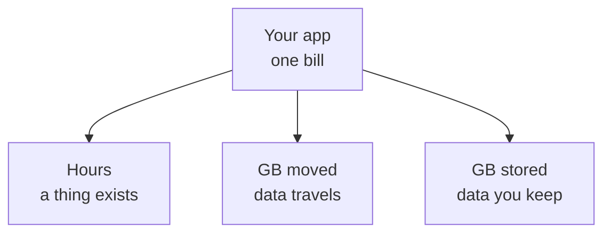
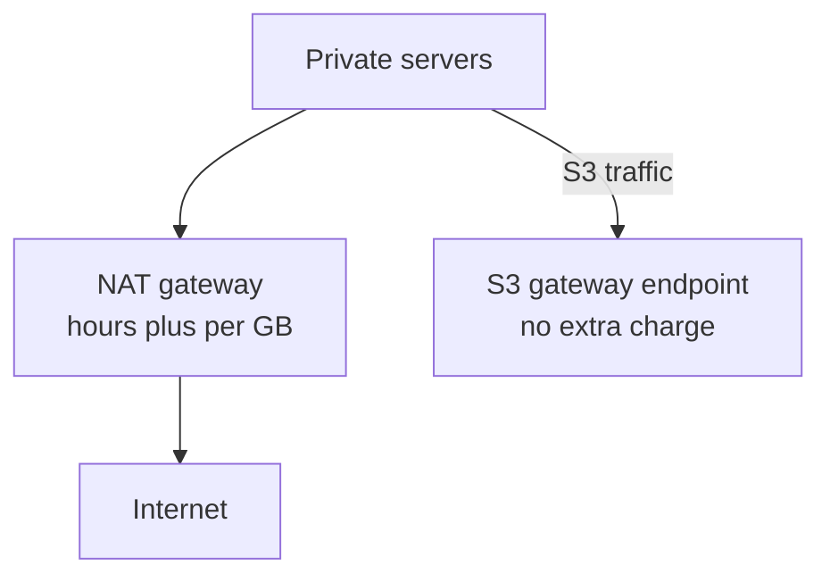
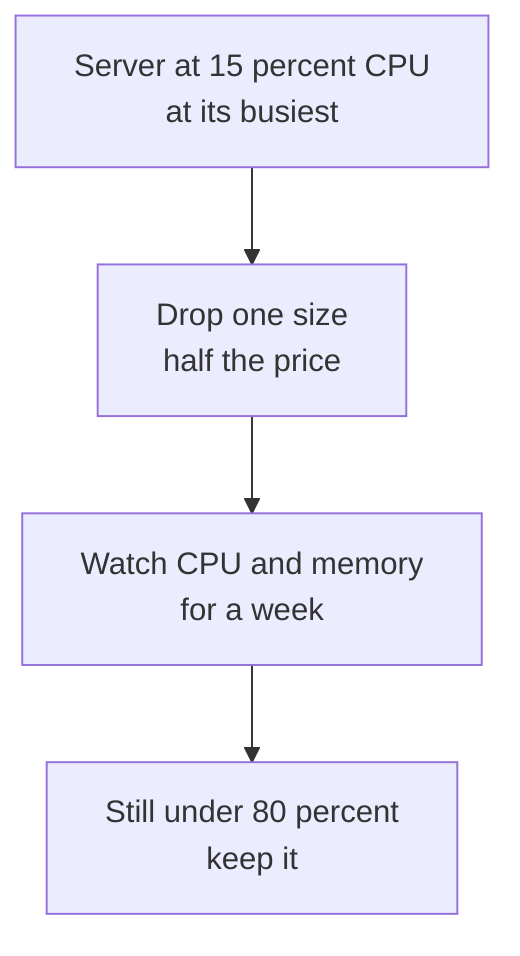
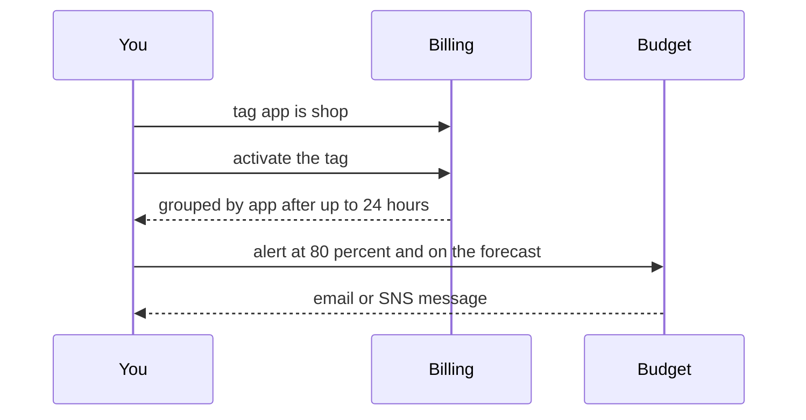
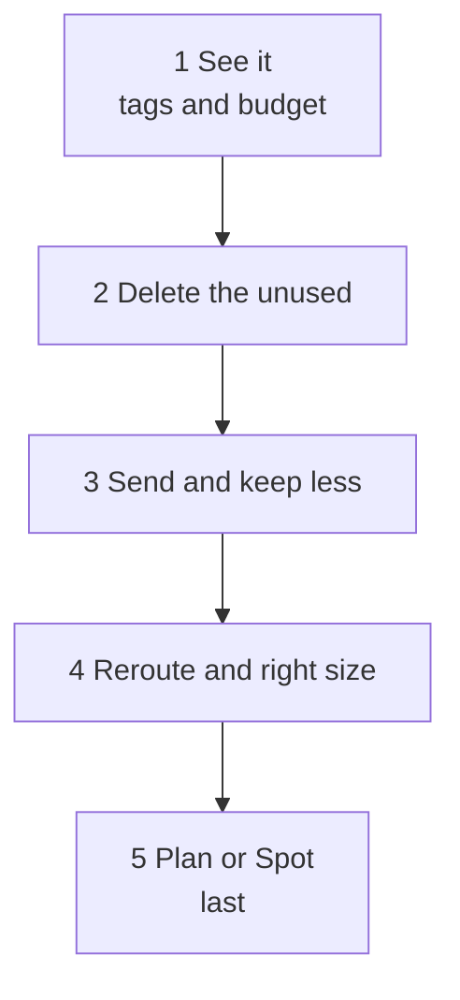

# 24. Cloud cost basics

> **Subject:** DevOps and Cloud · **Lesson:** 24 · **Made:** 2026-11-21 · **Status:** ready
>
> **You will be able to:** read a cloud bill as a list of meters, name the costs that hide (the NAT gateway, data out, idle load balancers, forgotten disks, logs, traffic between zones), tell on demand, a plan and Spot apart, work out when a plan is worth it, cut a bill in a safe order, set budgets, alerts and tags, and answer "how would you cut the cloud bill".
>
> **Before this:** [Cloud models](06-cloud-models.md) and [Ways to run your app compared](26-ways-to-run-your-app.md) · **Also read:** [Serverless](07-serverless.md), [Logs and monitoring](10-logs-and-monitoring.md) and [Infrastructure as code](14-infrastructure-as-code.md)
>
> **How to read it:** one card is one idea. Look at the picture, guess, then press the orange bar to check. The blue bars (📖 More detail) hold the longer explanation. Skip them on the first read, and open them when you want more. **Every price in this lesson is an example.** I read the prices on 2026-11-19 from the official AWS price list files, for the region US East (N. Virginia). Prices change and differ by region, so look them up again before you decide anything. **The amounts of traffic and storage in the example app are made up.** I used no real AWS account and saw no real bill. The small model in the practice file and in the stepper is plain JavaScript that I ran for real. About 20 minutes for the cards.

<!-- quick-summary:start -->
## Quick summary

> Short on time? Read only this. These are the "Remember" lines from the cards below, so you can read the whole lesson in one minute.

- A cloud bill is many meters. Each one counts hours, GB moved or GB stored. Ask which kind a line is.
- Read the bill by line, not by the total. The biggest line is often a pipe or something forgotten, not the app.
- Hours bill while a thing exists, not while it works. Look for the things that exist and do nothing.
- Data that moves costs money each time it moves. Send less, keep it close, and keep a free route for the big flows.
- A plan bills every hour. It wins only when the server runs more than the break-even share of the hours. Use Spot only for work that can stop and restart.
- First use less (smaller, fewer, off at night), then pay less per hour. The practice function `rightSize` moves one size down at 40 percent peak or less, and one up at 85 percent or more.
- A budget tells you early, a tag tells you who. Neither fixes anything. Someone must own the fix.
- See it, delete it, use less, then pay less per hour. A plan or a year promise goes last.
<!-- quick-summary:end -->

## 1. The problem: one bill, many small meters

At the end of the month the cloud sends one number. It looks like one price. It is really **many small meters**, and each one counts something different. Some count **hours** (a thing exists, so it costs). Some count **GB moved** (data travels). Some count **GB stored** (you keep data). A CapRover server on a flat monthly rent has one meter. A cloud account has dozens.



Notice: the same app has all three kinds. Switching one thing off only helps if you know which kind it is.

<details class="guess"><summary>🤔 Guess: a small server runs all month, and nobody visits your site at night. Does the bill drop at night? Press to check.</summary>

**No.** The hours meter counts every hour the server exists, busy or not. To pay less you must make it smaller, or switch it off.

</details>

> **Remember:** a cloud bill is many meters. Each one counts hours, GB moved or GB stored. Ask which kind a line is.

<details class="more"><summary>📖 More detail: four new words, what a month is, and the rent comparison</summary>

**Four new words in this lesson:** NAT gateway (card 3), egress (card 4), plan (card 5), tag (card 7).

**A month is about 730 hours** (365 days x 24 hours / 12 months). This lesson uses 730 for every hours meter.

**Rent against meters.** Your DBO notes say the backend runs on Docker Swarm through CapRover (see [Cloud models](06-cloud-models.md)). A rented server costs the same at 3am and in a sale. That is easy to plan for. A cloud bill follows what you use, which is fair, but it can also jump when something you did not watch grows. [Ways to run your app compared](26-ways-to-run-your-app.md), card 5, calls this the **shape** of the bill. This lesson shows what the shapes cost in numbers.

**Where the numbers come from.** The AWS price list files, [index.json](https://pricing.us-east-1.amazonaws.com/offers/v1.0/aws/index.json), published on 2026-11-19 (checked that day). I read the US East (N. Virginia) files for EC2, the load balancers, RDS, CloudWatch and data transfer. I did not use the pricing web pages for the numbers, because they load their tables with scripts.

</details>

## 2. One month of a small app, line by line

Here is a small shop app: 2 servers, a Postgres database, a load balancer, a private network with a NAT gateway, and some logs. Added up with the example prices, it costs **$176.96** a month. Look at which line is biggest.

| Line | What is counted | Example cost |
|---|---|---|
| Compute | 2 servers (t3.small) x 730 hours | $30.37 |
| Database | 730 hours (db.t4g.small) + 50 GB kept | $29.11 |
| Load balancer | 730 hours + about 1.2 capacity units | $23.43 |
| **NAT gateway** | **730 hours + 200 GB through it** | **$41.85** |
| Data out | 300 GB out, the first 100 GB free | $18.00 |
| Disk | 40 GB in use + 1 forgotten 100 GB disk | $11.20 |
| Logs | 40 GB sent in + 100 GB kept | $23.00 |

Notice: the biggest line is not the app. It is the door the app uses to reach the internet.

<details class="guess"><summary>🤔 Guess: which line do most people expect to be biggest, and which one really is? Press to check.</summary>

**Most expect the servers or the database.** In this example the **NAT gateway** is biggest at $41.85, bigger than the two servers together ($30.37). The forgotten disk ($8.00) is a line you pay for with no benefit.

</details>

> **Remember:** read the bill by line, not by the total. The biggest line is often a pipe or something forgotten, not the app.

<details class="more"><summary>📖 More detail: the step by step trace, and the formulas</summary>

**Watch it.** Tab 1 of the [stepper](visuals/24-cloud-cost-basics.html) adds the lines one at a time with the same `estimateBill` code as the practice.

| Step | What is added | How it is counted | The bill so far |
|---|---|---|---|
| 1 | Compute | 2 x $0.0208 x 730 | $30.37 |
| 2 | Database | $0.032 x 730 = $23.36, plus 50 GB x $0.115 = $5.75 | $59.48 |
| 3 | Load balancer | $0.0225 x 730 = $16.43, plus 1.2 units x $0.008 x 730 = $7.01 | $82.91 |
| 4 | NAT gateway, hours | 1 x $0.045 x 730 | $115.76 |
| 5 | NAT gateway, traffic | 200 GB x $0.045 = $9.00 | $124.76 |
| 6 | Data out | (300 - 100 free) GB x $0.09 | $142.76 |
| 7 | Disk | (40 + 100) GB x $0.08 | $153.96 |
| 8 | Logs | 40 GB x $0.50, plus 100 GB x $0.03 | $176.96 |

**The three kinds of meter, added up:** hours $110.01 (servers, database, load balancer, NAT gateway hours), GB moved $47.00 (NAT traffic, data out, logs sent in), GB stored $19.95 (database storage, disks, logs kept). Together $176.96.

**The example prices** (US East N. Virginia, from the AWS price list files, 2026-11-19):

| Thing | Example price |
|---|---|
| EC2 t3.small, on demand, Linux | $0.0208 an hour |
| RDS PostgreSQL db.t4g.small, one zone | $0.032 an hour |
| RDS storage, gp3 | $0.115 per GB-month |
| Application load balancer | $0.0225 an hour, plus $0.008 per capacity unit hour |
| NAT gateway | $0.045 an hour, plus $0.045 per GB processed |
| Data out to the internet | $0.09 per GB for the first 10 TB (after a free part) |
| EBS gp3 disk | $0.08 per GB-month |
| CloudWatch Logs | $0.50 per GB sent in, $0.03 per GB-month kept |
| Public IPv4 address | $0.005 an hour, about $3.65 a month, in use or idle |
| S3 standard storage | $0.023 per GB-month, first 50 TB |

The AWS pages say 100 GB of data out to the internet is free each month ([EC2 on demand pricing](https://aws.amazon.com/ec2/pricing/on-demand/)).

**What the model leaves out.** Taxes, support plans, free tier credits, snapshots, requests to S3, a second zone for the database, and prices that change by region. A real bill has more lines. The model is there to teach the shape.

</details>

## 3. Costs that run even when nothing happens

Some things bill while they do nothing. A **NAT gateway** is a shared exit door. Servers in a private network have no public address, so they use the door to reach the internet, for example to call a payment service. AWS charges for every hour the door exists. A load balancer, a disk and a public address work the same way: they exist, so they cost.



Notice: a free side door for S3 keeps those GB off the paid door.

| Costs while idle | Meter | Example |
|---|---|---|
| NAT gateway | hours | $32.85 a month |
| Load balancer with no requests | hours | $16.43 a month |
| Disk that is not attached | GB-months | $8.00 for 100 GB |
| Public IPv4 address, even idle | hours | $3.65 a month |
| Logs that never expire | GB-months | grows every month |

<details class="guess"><summary>🤔 Guess: you delete a test server. Which of its parts can still be on your bill next month? Press to check.</summary>

**Its disk, if it was not deleted with it, and its public address if it was kept.** Also its logs. The server's own hours stop, but the other things were separate items. Look for unattached disks and idle addresses.

</details>

> **Remember:** hours bill while a thing exists, not while it works. Look for the things that exist and do nothing.

<details class="more"><summary>📖 More detail: what the docs say, and what to do about each</summary>

- **NAT gateway.** The AWS VPC pricing page says you pay for each hour the gateway is provisioned and available, and data processing charges apply for each GB processed ([VPC pricing](https://aws.amazon.com/vpc/pricing/), opened 2026-11-19). It also says there are data transfer charges between your NAT gateway and an EC2 instance in a **different** zone. Card 4 comes back to this.
- **The free side door.** AWS says a gateway endpoint for S3 lets a VPC reach S3 "without requiring an internet gateway or NAT device", and "there is no additional charge for using gateway endpoints" ([Gateway endpoints for Amazon S3](https://docs.aws.amazon.com/vpc/latest/privatelink/vpc-endpoints-s3.html)). It does not cover access from on-premises networks or other regions. Your servers still need the NAT gateway for other internet calls.
- **Unattached disks.** I could not find a sentence on the EBS pricing page that says it directly. The page says you pay for what you provision, until you release it. The usual reading is that a provisioned volume bills whether or not it is attached. Check this on your own account before you rely on it.
- **Public IPv4 addresses.** The price list shows $0.005 an hour for an in-use address and the same for an idle one.
- **Log retention.** The CloudWatch Logs docs say "By default, log data is stored in CloudWatch Logs indefinitely". You can set how long to keep it for each log group ([log groups](https://docs.aws.amazon.com/AmazonCloudWatch/latest/logs/Working-with-log-groups-and-streams.html)).
- **Finding them.** The practice function `findWaste` looks for four of these: an unattached disk, a load balancer with no requests in 7 days, an idle address, and a log group that never expires. A real account has more places to check. Your cloud's cost tools can also list unused things.

**Side effects of deleting.** An old disk may hold data nobody remembers. Take a snapshot first if you are not sure. A snapshot costs $0.05 per GB-month in the price list, less than keeping the disk ($0.08).

</details>

## 4. Costs that grow with traffic

Other lines grow with use. **Egress** is data leaving AWS for the internet. Data coming in is not charged here. Egress, the GB through a NAT gateway, and the logs you send in all grow when your traffic grows. A quiet month is cheap, and a busy month is a surprise.

| Moves data | Example price | 100 GB costs |
|---|---|---|
| Out to the internet | $0.09 per GB, after the free part | $9.00 |
| Through the NAT gateway | $0.045 per GB | $4.50 |
| Logs sent in | $0.50 per GB | $50.00 |
| Between two zones | about $0.01 per GB | about $1.00 or $2.00 |

Notice: logs are the most expensive to move. Debug lines in production add up fast.

<details class="guess"><summary>🤔 Guess: a setting adds 16 GB of logs a day. About what does it add to a 30 day month? Press to check.</summary>

**$240.** 16 GB x $0.50 = $8 a day, and 30 days is $240. The stepper's budget tab uses this: a single log setting makes the month end far above the budget.

</details>

> **Remember:** data that moves costs money each time it moves. Send less, keep it close, and keep a free route for the big flows.

<details class="more"><summary>📖 More detail: cross zone traffic, the free part, and what I could not confirm</summary>

- **Between zones.** The price list shows $0.01 per GB for "regional data transfer - in/out/between EC2 AZs or using elastic IPs or ELB". An AWS architecture post says data transfer inside one zone is free, and that crossing zones "typically incurs a data transfer charge" ([Overview of Data Transfer Costs for Common Architectures](https://aws.amazon.com/blogs/architecture/overview-of-data-transfer-costs-for-common-architectures/)). I could not open the pricing page text that says whether the charge applies on both sides, so I put "about $1 or $2" in the table. Check it before you quote it.
- **Why it surprises people.** For high availability you spread copies over zones ([Cloud models](06-cloud-models.md), card 5). Then a server in zone a talks to a database in zone b, and every GB counts. A NAT gateway in one zone used by servers in another zone adds the same charge. The usual fix is to keep chatty parts in the same zone, or to run one gateway per zone and accept the extra hours.
- **Free part.** AWS says customers get 100 GB of data out to the internet free each month. The free part is shared across your account, so a big account sees little of it.
- **Cut egress.** A cache or a CDN in front of your site serves repeated files from near the user. I did not price one in this lesson.
- **Cut logs.** Send fewer lines (no debug in production), and keep them for a set time. [Logs and monitoring](10-logs-and-monitoring.md) says what is worth logging.

</details>

## 5. Pay less per hour: on demand, a plan, Spot

The same server has three ways to pay. **On demand:** full price, only for the hours it runs, no promise. **A plan:** you promise to pay for a set amount of compute every hour for 1 or 3 years, and the price per hour is lower. **Spot:** spare servers at a big discount that AWS can take back. A plan bills **every** hour, used or not. So it only wins above a **break-even share** of use.

| Way to pay | Example t3.small price | You promise | Best for |
|---|---|---|---|
| On demand | $0.0208 an hour | nothing | new, uncertain, often off |
| 1 year plan, no money upfront | $0.0130 an hour | 1 year | always on, steady |
| 3 year plan, no money upfront | $0.0090 an hour | 3 years | always on, very sure |
| Spot | up to 90 percent off | can be taken back | work that can restart |

Notice: the plan price is 62.5 percent of on demand. That number is the break-even share.

<details class="guess"><summary>🤔 Guess: a 1 year plan is 37.5 percent cheaper per hour. Your server runs half of the month. Which is cheaper? Press to check.</summary>

**On demand.** Half a month on demand costs $7.59. The plan costs $9.49, because it bills all 730 hours. Above 62.5 percent use (about 456 hours) the plan wins.

</details>

> **Remember:** a plan bills every hour. It wins only when the server runs more than the break-even share of the hours. Use Spot only for work that can stop and restart.

<details class="more"><summary>📖 More detail: the interview names, the docs, and the trace</summary>

**Interview names.** A **Reserved Instance** is the older way: a promise on one instance type. A **Savings Plan** is the newer way: a promise of a dollar amount per hour. The word **commitment** covers both.

**What the docs say.**
- Savings Plans give lower prices "in exchange for a commitment of using a specified amount of compute power (measured per hour) for a one or three year period" ([What are Savings Plans](https://docs.aws.amazon.com/savingsplans/latest/userguide/what-is-savings-plans.html), opened 2026-11-19).
- **Compute Savings Plans** are "up to 66% off". They also apply to Fargate and Lambda and let you change family, size and region. **EC2 Instance Savings Plans** are "up to 72% off", for one instance family in one region ([Savings Plans types](https://docs.aws.amazon.com/savingsplans/latest/userguide/plan-types.html)). The promise "can't be changed after purchase". The AWS Savings Plans marketing page shows only "up to 72%". These are the most you can get, not what you will get.
- **Spot.** The AWS Spot page says "up-to 90%" off On-Demand. The docs say a Spot interruption notice is issued two minutes before EC2 stops or terminates the instance ([notices](https://docs.aws.amazon.com/AWSEC2/latest/UserGuide/spot-instance-termination-notices.html)). Spot suits stateless, fault tolerant work.

**The break-even maths** (the practice functions `breakEvenShare` and `cheaperOption`, stepper tab 3):

| Hours used of 730 | On demand | 1 year plan | Cheaper |
|---|---|---|---|
| 730 | $15.18 | $9.49 | the plan |
| 600 | $12.48 | $9.49 | the plan |
| 456 | $9.48 | $9.49 | about a tie |
| 365 | $7.59 | $9.49 | on demand |
| 219 (work hours only) | $4.56 | $9.49 | on demand, or better, switch it off |

**Real prices of one server in the price file** (t3.small, Linux, US East, 2026-11-19): on demand $0.0208, standard Reserved 1 year no upfront $0.0130, standard Reserved 3 year no upfront $0.0090. The model uses the 1 year one.

**The cost.** A plan removes your freedom to shrink or delete. That is why the right order (card 8) puts it last.

</details>

## 6. Pay for less: right size, switch off, scale

The cheapest server is the one you do not run, and the next cheapest is a smaller one. **Right sizing** means picking the size that fits what the app really uses. In one family each size costs twice the one below: t3.micro $0.0104, t3.small $0.0208, t3.medium $0.0416 an hour. A server that never goes above 15 percent CPU can drop one size and save half. **Scale to zero** and **autoscaling** do the same over time: run fewer copies when few people visit.



Notice: you shrink, then you watch. You do not shrink and hope.

<details class="guess"><summary>🤔 Guess: a test server is used from 9 to 6 on workdays only. What is the best saving, a plan or a switch? Press to check.</summary>

**A switch.** It runs about 219 of 730 hours. Switched off at night and on weekends it costs $4.56 on demand. A plan would cost $9.49, because it bills every hour.

</details>

> **Remember:** first use less (smaller, fewer, off at night), then pay less per hour. The practice function `rightSize` moves one size down at 40 percent peak or less, and one up at 85 percent or more.

<details class="more"><summary>📖 More detail: the real names, and the limits of each idea</summary>

- **Right sizing** (the interview word). Look at the peak CPU and memory over a few weeks, not an average day. A server at 15 percent CPU but at 90 percent memory cannot be shrunk. The 40 and 85 in `rightSize` are my teaching numbers, not AWS rules.
- **Burstable servers.** The t3 family can burst above its base speed for a short time. The AWS docs describe credits for it. I did not test how credits behave for your load, so watch the first week after a change.
- **Autoscaling** adds and removes copies when load changes. It needs a loop and a rule, as in [Kubernetes objects](04-kubernetes-objects.md) and [Ways to run your app compared](26-ways-to-run-your-app.md), card 3.
- **Scale to zero.** A function or a serverless container costs nothing when nobody calls, but a first call after a quiet time waits for a start. [Serverless](07-serverless.md) draws it and does the maths with real numbers. [Ways to run your app compared](26-ways-to-run-your-app.md), card 5, says Lambda is the cheapest at low or spiky load and not at steady high load.
- **Off at night.** For test and staging copies, switch them off outside work hours. In [Infrastructure as code](14-infrastructure-as-code.md) terms, a schedule in your pipeline or a count of 0 does it.
- **Memory limits.** On Kubernetes, [requests and limits](11-kubernetes-probes-limits-and-rollouts.md) are the "size" of a container. Asking for far more than you use wastes the machines under it.

</details>

## 7. See it: budgets, alerts and tags

You cannot cut what you cannot see. A **budget** sends you a message when spending passes a line. A **tag** is a label on a resource (a key and a value, for example `app=shop`). Tags let the bill answer "which app, which team". Without them, the bill only lists services.



Notice: two steps are yours (tag, activate). Neither is instant.

<details class="guess"><summary>🤔 Guess: you tag every resource app=shop today. Can you group the bill by that tag in the next hour? Press to check.</summary>

**No.** You must activate the tag in the billing console, and the AWS docs say tags can take up to 24 hours to appear.

</details>

> **Remember:** a budget tells you early, a tag tells you who. Neither fixes anything. Someone must own the fix.

<details class="more"><summary>📖 More detail: what the docs say, and the budget trace</summary>

**Budgets** (from the [AWS Budgets docs](https://docs.aws.amazon.com/cost-management/latest/userguide/budgets-managing-costs.html), opened 2026-11-19):
- You can set a monthly cost budget and be alerted for both actual and forecasted spend.
- Notifications go to an Amazon SNS topic, to an email address, or both.
- A budget can run an action, for example apply an IAM policy that denies new resources. Use this with care.
- "AWS Budgets information is updated up to three times a day." There can be a delay between a charge and the alert, so your cost may pass the line before you hear.
- Budgets also exist for Reserved Instance and Savings Plans use and coverage, so you can see if a plan is wasted.

**Tags** (from [cost allocation tags](https://docs.aws.amazon.com/awsaccountbilling/latest/aboutv2/cost-alloc-tags.html)): you must activate both AWS tags and your own tags before they appear in Cost Explorer or a cost report. The report includes tagged and untagged things, so the untagged part is visible. "All tags can take up to 24 hours to appear." Do not put secrets in tags. Tag keys and values are case sensitive, so `App` and `app` are two keys.

**The budget trace** (stepper tab 4, `forecastMonth` and `firstAlertDay`): a budget of $200 with an alert at 80 percent ($160). A normal day costs $5.90.

| Day | What happens | Spent | Forecast of my model |
|---|---|---|---|
| 9 | All normal | $53.10 | $177.00 |
| 10 | Debug logging goes on, a day now costs $13.90 | $67.00 | $201.00, over the budget |
| 17 | The 80 percent alert on actual spend | $164.30 | |
| 30 | If nobody acts | $345.00 | |
| 30 | Fixed on day 12 instead | $193.00 | |

The forecast is my own simple average. The AWS forecast uses its own method and needs history, so it may fire later.

**Tags in code.** Set tags in your infrastructure files ([lesson 14](14-infrastructure-as-code.md)), so no resource is born without an owner. `costByTag` in the practice adds up each tag value and puts the rest under "(untagged)".

</details>

## 8. The order to cut a bill, and the mistake to avoid

You have found the waste, the traffic and the prices. Now pick an order. **Delete what nobody uses. Send and keep less. Move traffic off the paid door. Use smaller servers. Pay less per hour with a plan, last.** The common mistake is to start with the plan. A plan is a promise. If you promise first and shrink later, you still pay for the old size.



Notice: steps get riskier and more binding from top to bottom.

<details class="guess"><summary>🤔 Guess: a team buys a plan for 2 servers on day one. Later they shrink the servers to half the size. What do they pay? Press to check.</summary>

**More than they need.** In the example the promise stays at $18.98 a month. The shrunken servers on demand cost $15.18. In the right order, the shrunken servers with a plan cost $9.49. The model simplifies a real plan, but the shape is right: you promised before you knew the size.

</details>

> **Remember:** see it, delete it, use less, then pay less per hour. A plan or a year promise goes last.

<details class="more"><summary>📖 More detail: the five cuts, the trace, and the honest limits</summary>

**Watch it.** Tab 2 of the [stepper](visuals/24-cloud-cost-basics.html) applies the cuts in order.

| Step | Change | Saves | The bill after |
|---|---|---|---|
| start | the example bill | | $176.96 |
| 1 | delete the forgotten 100 GB disk | $8.00 | $168.96 |
| 2 | stop debug logs (40 to 20 GB), keep 14 days (100 to 10 GB) | $12.70 | $156.26 |
| 3 | S3 gateway endpoint, 120 of 200 GB skip the NAT gateway | $5.40 | $150.86 |
| 4 | both servers from t3.small to t3.micro | $15.19 | $135.67 |
| 5 | a 1 year plan on those servers | $5.69 | $129.98 |

The bill falls by $46.98, or 26.5 percent. The amounts of logs and S3 traffic are made up, so your own savings will differ.

**What stays.** The NAT gateway is still the biggest line ($36.45), because its $32.85 for the hours stays. Removing it is a design change. The servers would need public addresses or another route, and that costs security. Decide it with the team. It is not a quick saving.

**Mistakes to avoid.**
- Buying a plan before right sizing (above).
- Cutting the safety net to save money: backups, a second zone for the database, or logs you need for an incident ([Disaster recovery](../system-design/28-disaster-recovery.md)). The cost of an outage is also a cost.
- Using Spot for the only copy of something.
- Tagging only some things, so the untagged line hides the waste.
- Looking at the bill once a month. Alerts and a weekly look find a jump in days.

**The word for all this.** **FinOps** is the name for the habit of teams watching, owning and tuning their cloud cost. The AWS Well-Architected Cost Optimization pillar groups it into cloud financial management, expenditure and usage awareness, cost efficient resources, and continuous optimization ([pillar](https://docs.aws.amazon.com/wellarchitected/latest/cost-optimization-pillar/welcome.html), opened 2026-11-19). It says the goal is "the best ratio between cost and business value", not the lowest bill.

</details>

## 9. Watch and play

Links were checked on 2026-11-19. For the two videos I read the title and the channel from the YouTube page data and the length (8 and 4 minutes). I did not watch them. For the pages I opened them and read the parts named below. If a link is broken, tell me and I will replace it.

- **Play with it:** [the stepper in this folder](visuals/24-cloud-cost-basics.html) - guess first, then press Next. Five tabs: one month line by line, cutting the bill, on demand against a plan, a budget alert, and tags.
- **Play with prices:** [AWS Pricing Calculator](https://calculator.aws/) - the AWS tool to estimate a bill before you build. The page opened, but it is a script based app, so I did not try it. Build the example app from card 2 and compare it with $176.96.
- **Video (about 8 minutes):** [AWS VPCs Free? The Real Costs Behind the Scenes](https://www.youtube.com/watch?v=y6zIEtEyN_0) - Cloud Cost Clinic. Title and channel checked only. The title matches the hidden costs of card 3.
- **Video (about 4 minutes):** [AWS Savings Plans Explained: Cost Optimization for EC2 and Compute Workloads](https://www.youtube.com/watch?v=9BZVvZcyc1k) - Harness. Title and channel checked only. Compare it with card 5.
- **Pictures:** [Overview of Data Transfer Costs for Common Architectures](https://aws.amazon.com/blogs/architecture/overview-of-data-transfer-costs-for-common-architectures/) - AWS architecture blog. It has figures of traffic inside one zone, across zones and over a peering link. It goes with card 4.
- **Read:** [Cost optimization pillar](https://docs.aws.amazon.com/wellarchitected/latest/cost-optimization-pillar/welcome.html) - the four areas of card 8.

<details><summary>Go deeper (optional)</summary>

**More pages I opened.** [Savings Plans types](https://docs.aws.amazon.com/savingsplans/latest/userguide/plan-types.html). [Spot interruption notices](https://docs.aws.amazon.com/AWSEC2/latest/UserGuide/spot-instance-termination-notices.html). [AWS Budgets](https://docs.aws.amazon.com/cost-management/latest/userguide/budgets-managing-costs.html). [Cost allocation tags](https://docs.aws.amazon.com/awsaccountbilling/latest/aboutv2/cost-alloc-tags.html). [Gateway endpoints for S3](https://docs.aws.amazon.com/vpc/latest/privatelink/vpc-endpoints-s3.html). [CloudWatch log groups](https://docs.aws.amazon.com/AmazonCloudWatch/latest/logs/Working-with-log-groups-and-streams.html). [VPC pricing](https://aws.amazon.com/vpc/pricing/). [EC2 on demand pricing](https://aws.amazon.com/ec2/pricing/on-demand/). [Savings Plans](https://aws.amazon.com/savingsplans/). [EC2 Spot](https://aws.amazon.com/ec2/spot/). [The AWS price list](https://pricing.us-east-1.amazonaws.com/offers/v1.0/aws/index.json).

**Checked on 2026-11-21** with Node v26.5.0: the practice tests (40) fail on the empty stub and pass with the answer below, 31 wrong versions of the answer were each caught by the tests, and a click through every step of every tab of the stepper with a fake page found no empty or broken step. The stepper and the answer use the same functions.

**What I did not test.** I used no AWS account. I did not build the example app, see a real bill, try the Pricing Calculator, create a gateway endpoint, buy a plan or run Spot. All AWS facts are from the price list files and the docs named above. The usage amounts (traffic, logs, the forgotten disk) are made up. The cross zone charge on both sides, and whether an unattached disk is billed (the pricing page does not say it in a sentence), I could not confirm from the pages I could read.

**Where the model is simpler than a real bill.** No free tier, tax, support, requests, snapshots, tiered egress above 10 TB, a second zone for the database, or the way a real Savings Plan counts a dollar amount per hour.

**More ideas not covered here.** Reserved database instances and the Database Savings Plans (up to 35 percent per the docs). Graviton servers. S3 storage classes and lifecycle rules. CDNs to cut egress. Cost Explorer reports and anomaly detection. Showback and chargeback between teams. Other clouds have the same meters with other names and prices.

</details>

## 10. Practice

**A. Predict the output** (write your answer before opening)

```js
console.log(cheaperOption(365, 730, 0.0208, 0.013));
console.log(breakEvenShare(0.0208, 0.013));
console.log(costByTag(
  [{ name: "a", cost: 10, tags: { app: "shop" } },
   { name: "b", cost: 2.5 }], "app"));
console.log(firstAlertDay([50, 50, 50, 50], 200, 80));
```

Then answer: why is the option `on demand` when the plan price per hour is lower?

<details><summary>Answer</summary>

```
{ option: 'on demand', onDemandCost: 7.59, commitCost: 9.49 }
0.625
{ shop: 10, '(untagged)': 2.5 }
4
```

On demand pays for 365 hours at $0.0208 ($7.59). The plan pays for all 730 hours at $0.013 ($9.49), used or not. The break-even share is 0.625, and the server ran 0.5 of the hours. The untagged thing gets its own group. The limit is 80 percent of $200 = $160, and the total passes it on day 4 ($200). (Checked on 2026-11-21 with Node v26.5.0.)

</details>

**B. Fix the bug**

This function should say whether a plan or on demand is cheaper for a server. It says `commit` for a server that ran only half the month. Find the bug.

```js
function cheaper(hoursUsed, hoursInPeriod, od, committed) {
  const onDemand = hoursUsed * od;
  const commit = hoursUsed * committed;
  return commit < onDemand ? "commit" : "on demand";
}
console.log(cheaper(365, 730, 0.0208, 0.013));
```

<details><summary>Answer</summary>

The plan cost uses `hoursUsed`. A plan bills **every** hour of the period, used or not. So the plan always looks cheaper (it only compares a lower price per hour). The fix: `const commit = hoursInPeriod * committed;`. The buggy version printed `commit`. With the fix it prints `on demand`, because $9.49 is more than $7.59. (Real runs, 2026-11-21.)

</details>

**C. Write it yourself**

Open `learn/devops-cloud/practice/24-cloud-cost-basics.js`. It has nine empty pieces: `estimateBill`, `biggestLine`, `breakEvenShare`, `cheaperOption`, `rightSize`, `findWaste`, `forecastMonth`, `firstAlertDay` and `costByTag`. The comments at the top say exactly what each one must do. Write them, then run this from the repo root and make all the tests pass:

```
node --test learn/devops-cloud/practice/24-cloud-cost-basics.test.js
```

Start with `estimateBill`. It is the bill of card 2 as code: seven lines, and the total of the rounded lines. Then `cheaperOption`, which is card 5.

<details><summary>One possible answer</summary>

```js
const round2 = (n) => Math.round(n * 100 + 1e-9) / 100;
const num = (n) => (typeof n === "number" && !Number.isNaN(n) ? n : 0);

function estimateBill(usage, prices) {
  const hours = usage.hours === undefined ? 730 : usage.hours;
  const priceOf = (table, kind, key) => {
    if (!Object.prototype.hasOwnProperty.call(table, key)) throw new Error("unknown " + kind + " type: " + key);
    return table[key];
  };
  const servers = num(usage.servers);
  const compute = servers > 0 ? servers * priceOf(prices.server, "server", usage.serverType) * hours : 0;
  const database = usage.dbType
    ? priceOf(prices.db, "database", usage.dbType) * hours + num(usage.dbStorageGb) * prices.dbStoragePerGb
    : 0;
  const balancer = num(usage.loadBalancers) * (prices.lbPerHour * hours + num(usage.lcu) * prices.lcuPerHour * hours);
  const nat = num(usage.natGateways) * prices.natPerHour * hours + num(usage.natGb) * prices.natPerGb;
  const dataOut = Math.max(0, num(usage.egressGb) - prices.egressFreeGb) * prices.egressPerGb;
  const disk = (num(usage.diskGb) + num(usage.unattachedDiskGb)) * prices.diskPerGb;
  const logs = num(usage.logIngestGb) * prices.logIngestPerGb + num(usage.logStoredGb) * prices.logStoragePerGb;
  const lines = [
    { name: "compute", cost: round2(compute) },
    { name: "database", cost: round2(database) },
    { name: "load balancer", cost: round2(balancer) },
    { name: "nat gateway", cost: round2(nat) },
    { name: "data out", cost: round2(dataOut) },
    { name: "disk", cost: round2(disk) },
    { name: "logs", cost: round2(logs) },
  ];
  return { lines, total: round2(lines.reduce((sum, line) => sum + line.cost, 0)) };
}

function biggestLine(bill) {
  if (!bill.lines || bill.lines.length === 0) return null;
  let best = bill.lines[0];
  for (const line of bill.lines) if (line.cost > best.cost) best = line;
  return best.name;
}

function breakEvenShare(onDemandPerHour, committedPerHour) {
  if (!(onDemandPerHour > 0)) throw new Error("onDemandPerHour must be more than 0");
  if (!(committedPerHour >= 0)) throw new Error("committedPerHour must be 0 or more");
  return Math.round((committedPerHour / onDemandPerHour) * 10000) / 10000;
}

function cheaperOption(hoursUsed, hoursInPeriod, onDemandPerHour, committedPerHour) {
  if (hoursUsed < 0 || hoursUsed > hoursInPeriod) throw new Error("hoursUsed must be between 0 and hoursInPeriod");
  const onDemand = hoursUsed * onDemandPerHour;
  const commit = hoursInPeriod * committedPerHour;
  return {
    option: commit < onDemand ? "commit" : "on demand",
    onDemandCost: round2(onDemand),
    commitCost: round2(commit),
  };
}

function forecastMonth(dailySpend, daysInMonth) {
  if (dailySpend.length === 0) return 0;
  const sum = dailySpend.reduce((a, b) => a + b, 0);
  return round2((sum / dailySpend.length) * daysInMonth);
}

function firstAlertDay(dailySpend, budget, percent) {
  const limit = (budget * percent) / 100;
  let total = 0;
  for (let i = 0; i < dailySpend.length; i++) {
    total += dailySpend[i];
    if (total >= limit) return i + 1;
  }
  return null;
}

function costByTag(items, tagKey) {
  const sums = {};
  for (const item of items) {
    const value = item.tags && item.tags[tagKey] !== undefined ? item.tags[tagKey] : "(untagged)";
    sums[value] = (sums[value] || 0) + item.cost;
  }
  for (const key of Object.keys(sums)) sums[key] = round2(sums[key]);
  return sums;
}


function rightSize(sizes, current, peakCpuPercent) {
  const at = sizes.indexOf(current);
  if (at === -1) throw new Error("unknown size: " + current);
  if (peakCpuPercent <= 40 && at > 0) return sizes[at - 1];
  if (peakCpuPercent >= 85 && at < sizes.length - 1) return sizes[at + 1];
  return current;
}

function findWaste(resources) {
  const found = [];
  for (const r of resources) {
    if (r.type === "volume" && r.attached === false) found.push({ id: r.id, reason: "unattached volume" });
    else if (r.type === "load-balancer" && r.requestsLast7Days === 0) found.push({ id: r.id, reason: "no traffic" });
    else if (r.type === "public-ip" && r.inUse === false) found.push({ id: r.id, reason: "idle public address" });
    else if (r.type === "log-group" && (r.retentionDays === null || r.retentionDays === undefined)) found.push({ id: r.id, reason: "logs never expire" });
  }
  return found.sort((a, b) => (a.id < b.id ? -1 : a.id > b.id ? 1 : 0));
}
module.exports = { estimateBill, biggestLine, breakEvenShare, cheaperOption, rightSize, findWaste, forecastMonth, firstAlertDay, costByTag };
```

Checked on 2026-11-21 with Node v26.5.0: all 40 tests fail on the empty stub and all 40 pass with this answer. I also tried 31 wrong versions of the answer (no free part for data out, a disk that ignores the unattached one, a NAT gateway without its hours, a plan billed for used hours only, a tie that picks the plan, an alert that counts days from 0, a forecast with the wrong division, and more). The tests caught all of them. The stepper page uses these same functions.

</details>

## 11. Interview question

**Q:** "Our cloud bill doubled. How would you find out why, and how would you cut it?"

A common follow-up: "Would you buy a Savings Plan?" Card 8 is the answer.

<details><summary>A strong answer, in four parts</summary>

1. **Problem:** A cloud bill is many meters (hours, GB moved, GB stored). When it doubles, one meter grew, or something was left running. Guessing wastes days.
2. **How it works:** First I look at the bill by service and by tag, and I check when the jump started. Then I look for the usual causes: a NAT gateway and its data, data out, cross zone traffic, a load balancer or disk nobody uses, and logs sent in or kept forever. I fix in order: delete the unused, send and keep less, move traffic off paid routes (for example a free S3 gateway endpoint), right size, then pay less per hour with a plan or Spot for the steady or restartable parts. I set a budget with an alert on actual and forecast spend, and I tag everything in code, so a jump shows in days.
3. **Tradeoff:** A plan saves money per hour but is a promise. It bills every hour, so it only wins above its break-even share, and it must come after right sizing. Spot is cheap but can be taken back, so not for the only copy. Cutting a safety net (backups, a second zone) saves money until the day it is needed. A budget alert only tells you, so someone must own the fix.
4. **My example:**
   - **Fact:** I deploy with Docker and CapRover, and my profile lists a little AWS. My DBO case study says the backend is four Node and TypeScript services on Docker Swarm via CapRover. A fixed server rent gives a flat bill, which is easy to predict.
   - **Fact (from this lesson, not from my work):** I did not cut a real AWS bill here. The numbers are from the AWS price list and a made up example app.
   - **Idea, not a fact:** If the team moved to AWS, I would set the budget alerts and tags in code on day one ([lesson 14](14-infrastructure-as-code.md)), and look at the NAT gateway and the logs first. Your notes do not say what DBO's hosting costs, so I should not claim a saving.

</details>

## 12. Explain it back

Close this file. Explain cloud cost out loud like to a new junior, in 4 parts (problem, how, tradeoff, my example). Use the story of the small shop app whose biggest line was a NAT gateway. Say what the three kinds of meter are, name three costs that hide, say why a plan bills every hour and when it wins, and say the order in which you would cut the bill and why the plan comes last. Write your best version below and run `/explain-check cloud cost basics` or ask the `explain-coach` agent to review it.

### My explanation

<write here>

### Coach feedback

<the explain-coach agent writes here>

## 13. Review questions (day 1, 3, 7, 21)

1. What are the three kinds of meter on a cloud bill, and which kind is a NAT gateway (both parts)?
2. Name four things that cost money even when your app does nothing.
3. A plan is 37.5 percent cheaper per hour than on demand. What is the break-even share, and why does a server that runs half the month lose with the plan?
4. In what order do you cut a bill, and why does the plan come last? Draw the picture from memory: the five steps of card 8.
5. You tag everything and set a budget. What two things must you still do, and what can the alert not do?

<details><summary>Answers</summary>

1. Hours (a thing exists), GB moved, and GB stored. A NAT gateway has two meters: hours for being there, and GB moved through it.
2. Any four of: a NAT gateway, a load balancer with no requests, a disk that is not attached, an idle public address, logs that never expire, a server that is on but unused.
3. The share is plan price divided by on demand price: 0.625 (62.5 percent) of the hours. At half a month, on demand costs 50 percent of a full month and the plan costs 62.5 percent, because it bills every hour, used or not.
4. See it (tags and budget), delete the unused, send and keep less, reroute traffic and right size, then a plan or Spot. A plan is a promise for a year, so if you shrink later you still pay for the old size.
5. Activate the tags for billing (it can take up to 24 hours), and have someone own the fix. The alert only tells you. It is late by hours and it does not stop the spend.

</details>

## Connected lessons

- [Cloud models](06-cloud-models.md) - IaaS, PaaS and regions and zones, which explain the hours meters and the cross zone traffic.
- [Serverless](07-serverless.md) - scale to zero, and the maths of when a function is cheaper than a fixed server.
- [Ways to run your app compared](26-ways-to-run-your-app.md) - the shape of each bill (card 5), which this lesson fills with numbers.
- [Logs and monitoring](10-logs-and-monitoring.md) - what is worth logging, which is the way to lower the logs line.
- [Kubernetes probes, limits and rollouts](11-kubernetes-probes-limits-and-rollouts.md) - requests and limits, the "size" of a container.
- [Infrastructure as code](14-infrastructure-as-code.md) - set tags and schedules in code so no resource has no owner.
- [Disaster recovery](../system-design/28-disaster-recovery.md) - what not to cut to save money.
- [Config and secrets](09-config-and-secrets.md) - do not put secrets in tags.
