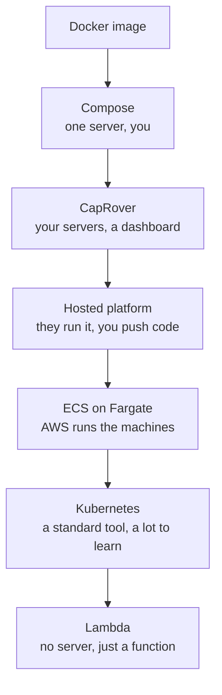
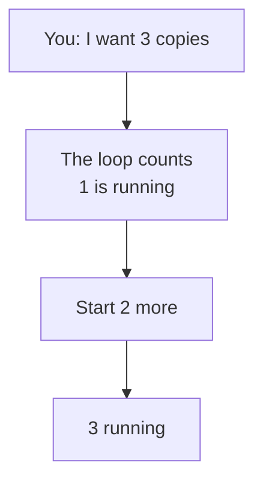

# 26. Ways to run your app compared

> **Subject:** DevOps and Cloud · **Lesson:** 26 · **Made:** 2026-11-17 · **Status:** ready
>
> **You will be able to:** compare Docker Compose, CapRover, a hosted platform, ECS on Fargate, Kubernetes and Lambda in one table, say who looks after the machine in each, say what Lambda cannot do, and pick one for a real app and defend it.
>
> **Before this:** [Docker Compose](03-docker-compose.md), [Kubernetes objects](04-kubernetes-objects.md) and [Cloud models](06-cloud-models.md) · **Also read:** [Serverless](07-serverless.md)
>
> **How to read it:** one card is one idea. Look at the picture, guess, then press the orange bar to check. The blue bars (📖 More detail) hold the longer explanation. Skip them on the first read, and open them when you want more. About 15 minutes for the cards.

<!-- quick-summary:start -->
## Quick summary

> Short on time? Read only this. These are the "Remember" lines from the cards below, so you can read the whole lesson in one minute.

- Pick by who looks after the machine, how much you want to learn, and the shape of your traffic. Not by what sounds modern.
- The first column decides your Friday night. If it says "you", you patch the server.
- An orchestrator is a loop that compares "want" with "have". Swarm, ECS and Kubernetes all work this way.
- Lambda is for short, small and spiky work. A 20 minute video job belongs on a container.
- Match the bill's shape to your traffic's shape.
- Choose the smallest option that solves today's problem and has a clear next step.
- Copies on one machine are not safety. Spread them over machines.
- Read the limits before you choose Lambda, not after.
<!-- quick-summary:end -->

## 1. The idea: the same container, six places to run it

You have a Docker image of your API. Where does it run? The honest answer is "it depends", and the interview question is really: **who looks after the machine, and how much do you want to write and learn?** Each option below moves that work from you to somebody else.



Notice: this is not a ladder from bad to good. It is a list of different trades.

<details class="guess"><summary>🤔 Guess: you have 2 services, one small server and 200 users. Which of the six is the right size? Press to check.</summary>

**Docker Compose**, or CapRover if you want a dashboard and automatic HTTPS. Kubernetes would add a lot to learn and run for no gain at this size.

</details>

> **Remember:** pick by who looks after the machine, how much you want to learn, and the shape of your traffic. Not by what sounds modern.

<details class="more"><summary>📖 More detail: five new words, and where this fits</summary>

**New words.**

- **Orchestrator:** a program that keeps your containers running on a group of machines (Swarm, ECS, Kubernetes).
- **Desired count:** how many copies you want alive. The orchestrator keeps it true (card 3).
- **Fargate:** AWS's way to run ECS containers without servers of your own (card 2).
- **Cold start:** the wait when a function has to start from nothing. Lesson 07 draws it.
- **Managed:** somebody else runs that layer for you.

You already know **container**, **image**, **Compose** and **Kubernetes objects** from lessons 01 to 04. Lesson 06 gives the ladder IaaS, PaaS and FaaS. This lesson puts real tools on that ladder.

</details>

## 2. The six side by side

This is the table to keep. Read each row left to right.

| | Who looks after the machines | How it scales | If your app dies | What you write | Pick it when |
|---|---|---|---|---|---|
| **Compose on a server** | you, one server | it does not: one machine | a restart policy restarts it | a `compose.yaml` | one small server, local work, tests |
| **CapRover** | you, your own servers | more instances, more servers (Swarm) | Swarm starts a new one | a Dockerfile, a dashboard | a small team, a few services, you want HTTPS and a dashboard |
| **Hosted platform** (Render, Railway, Fly.io) | the company | you move a slider | the platform restarts it | push code or an image | a small team that does not want ops |
| **ECS on Fargate** | AWS: no servers to choose or patch | you set the count and rules | the ECS service replaces it | a task definition, a service, IAM and networking | an AWS team that wants containers and no servers |
| **Kubernetes** | you, or a cloud that runs the control plane | built in, even automatic | it restarts and replaces it | YAML objects (lesson 04) | many services and teams, one standard tool |
| **Lambda** | AWS | one copy per request, up to a limit | each call is a fresh run | one function | short, rare or spiky jobs |

<details class="guess"><summary>🤔 Guess: which two rows say "you look after the machines"? Which of those two can run on more than one machine? Press to check.</summary>

**Compose** (one server) and **CapRover** (your servers). Only CapRover, because it is built on Swarm, can use more than one machine. Compose controls one Docker engine, so it stays on one machine (lesson 03).

</details>

> **Remember:** the first column decides your Friday night. If it says "you", you patch the server.

<details class="more"><summary>📖 More detail: what the sources say about each row</summary>

All checked on 2026-11-17.

- **Compose:** lesson 03 shows the Docker docs saying the easiest way to deploy is on a single server, and to use Swarm to scale.
- **CapRover:** its site calls it a "Scalable, free, and self-hosted PaaS" built on Docker, nginx, Let's Encrypt and Docker Swarm, with one-click apps and automatic HTTPS. The [internals guide](docker-caprover-internals.md) shows what happens on each deploy.
- **Fargate:** the AWS docs say it lets you run containers without managing servers or clusters of Amazon EC2 instances, and that you do not choose server types, decide when to scale a cluster, or optimize packing. You give the CPU and memory for each task.
- **ECS service:** it keeps a desired number of tasks running and replaces a failed task.
- **Kubernetes:** its overview lists self-healing (it restarts and replaces containers), rollouts and rollbacks to a desired state, scaling, and service discovery.
- **Lambda:** card 4.
- **Hosted platform:** the names come from the [container orchestration guide](container-orchestration-guide.md), which lists them as PaaS products. A hosted platform changes its features and prices often, so check the current docs before you pick.

**Serverless containers.** The idea in the middle of the table: give the platform a container and let it run and scale it. Google Cloud Run is one. Its docs say it runs containers on Google's infrastructure, with no cluster for you to create, and that a service with no requests scales to zero (opened 2026-11-17). Fargate is AWS's answer. See the [cloud models and serverless guide](cloud-computing-models-serverless-guide.md).

</details>

## 3. One idea behind most of them: keep N copies alive

Swarm (so CapRover), ECS and Kubernetes all do one job: you say **how many copies** you want, and a loop makes it true. Compose does not. This is called the **desired count**, and the loop compares it with what is running.



```js
function reconcile(desired, running) {
  const want = Math.max(0, desired);
  return {
    start: Math.max(0, want - running),
    stop: Math.max(0, running - want),
  };
}
console.log(JSON.stringify(reconcile(3, 1)));
console.log(JSON.stringify(reconcile(3, 5)));
console.log(JSON.stringify(reconcile(3, 3)));
```

<details class="guess"><summary>🤔 Guess: what do the three lines print? Press to check.</summary>

```
{"start":2,"stop":0}
{"start":0,"stop":2}
{"start":0,"stop":0}
```

Too few copies: start 2. Too many: stop 2. The right number: do nothing. When a copy crashes, `running` drops by one, and the next pass starts a new one. That is "self healing".

</details>

> **Remember:** an orchestrator is a loop that compares "want" with "have". Swarm, ECS and Kubernetes all work this way.

<details class="more"><summary>📖 More detail: the real names, and what Compose lacks</summary>

| Idea | CapRover (Swarm) | ECS | Kubernetes |
|---|---|---|---|
| "How many copies" | instance count | desired count of a service | `replicas` of a Deployment |
| What the loop runs | Swarm | the service scheduler | the Deployment controller |

Compose has no such loop. It starts what you ask once. A restart policy can restart one container on one machine, but nothing moves your app to another machine.

A real loop also does rolling updates and checks health. The Kubernetes version of this is in [lesson 04](04-kubernetes-objects.md), with a stepper.

</details>

## 4. Lambda: what it cannot do

Lambda is the odd one in the table. There is no server to look after, and no copy running when nobody calls. The price is a set of **limits**. If your job breaks a limit, Lambda is the wrong tool.

| Limit | Value |
|---|---|
| Longest one call | 900 seconds (15 minutes) |
| Memory for one function | 128 MB to 10,240 MB |
| Answer size, a normal call | 6 MB each way |
| Container image size | up to 10 GB |
| Zip package size | 50 MB zipped, 250 MB unzipped |

```js
const LAMBDA = { maxSeconds: 900, maxMemoryMb: 10240, maxResponseMb: 6 };
function lambdaFits(job) {
  const problems = [];
  if (job.durationSeconds > LAMBDA.maxSeconds)
    problems.push("too long");
  if (job.memoryMb > LAMBDA.maxMemoryMb)
    problems.push("too much memory");
  if (job.responseMb > LAMBDA.maxResponseMb)
    problems.push("response too big");
  return problems;
}
console.log(JSON.stringify(lambdaFits(
  { durationSeconds: 2, memoryMb: 512, responseMb: 1 })));
console.log(JSON.stringify(lambdaFits(
  { durationSeconds: 1200, memoryMb: 512, responseMb: 1 })));
console.log(JSON.stringify(lambdaFits(
  { durationSeconds: 5000, memoryMb: 20000, responseMb: 50 })));
```

<details class="guess"><summary>🤔 Guess: what do the three lines print? Press to check.</summary>

```
[]
["too long"]
["too long","too much memory","response too big"]
```

A short, small job fits (empty list). A 20 minute job is too long. A huge job breaks all three limits.

</details>

> **Remember:** Lambda is for short, small and spiky work. A 20 minute video job belongs on a container.

<details class="more"><summary>📖 More detail: the source, and what the limits do not say</summary>

The numbers come from the AWS Lambda quotas page (opened 2026-11-17). Some facts from the same page:

- A single call can run up to 15 minutes. For Lambda Managed Instances functions called asynchronously, the page lists up to 90 minutes. That is a different product, so I used the normal 15 minutes.
- A function may use up to 10,240 MB of memory. Lambda gives CPU in proportion to memory, and at 1,769 MB a function has the equivalent of one vCPU.
- A normal (synchronous) call may send 6 MB each way. A streamed response may be up to 200 MB.
- A container image may be up to 10 GB uncompressed.
- New AWS accounts start with lower quotas, and AWS raises them with use. Concurrent runs start at 1,000 per Region, and can be increased.

Quotas change. Open the page before you quote a number in an interview. Lesson 07 covers cold starts and when a fixed server is cheaper.

</details>

## 5. What it costs: fixed, per task, or per use

Every option has a bill with a different **shape**. The shape matters more than the price.

| Option | The bill follows | So |
|---|---|---|
| Compose, CapRover | the **server you rent**, on all month | the same bill at 3am and in a sale |
| Hosted platform | the plan or instance size you choose | easy to predict, check the current prices |
| ECS on Fargate | the CPU and memory **you set per task**, for as long as it runs | you pay for tasks that are running |
| Kubernetes | the machines in the cluster, plus the control plane if the cloud runs it | cheap per app at large size, costly at small size |
| Lambda | **each call** | nothing when nobody calls |

<details class="guess"><summary>🤔 Guess: steady high traffic, 24 hours a day. Which bill shape usually gets expensive? Press to check.</summary>

**Per use (Lambda).** At steady high load, a right-sized always-on container is often cheaper, because you stop paying a premium for each call. At low or spiky load, Lambda wins, because you stop paying for idle time. Lesson 07 does this math with real numbers.

</details>

> **Remember:** match the bill's shape to your traffic's shape.

<details class="more"><summary>📖 More detail: the part that is not on the bill</summary>

**Your time is a cost too.** A rented server is cheap, but you patch it (lesson 06, "shared responsibility"). Kubernetes needs a person who knows it. Fargate and a hosted platform cost more per unit, and they save that time.

**Hidden bills.** Load balancers, logs, data leaving the cloud, and idle test environments are often the surprise. A cost lesson is planned: lesson 24.

I did not put real prices in this lesson, because they change often and differ by region.

</details>

## 6. Mistake 1: Kubernetes for three services

A team of three runs three services with 500 users. Someone says "we should be on Kubernetes".

<details class="guess"><summary>🤔 Guess: what do they get, and what do they pay? Press to check.</summary>

They get self-healing, rolling updates and a standard tool. They pay with a lot of new parts (pods, Deployments, Services, Ingress, probes, YAML), a person who must learn and run it, and often a monthly bill for the cluster. For three services, Compose, CapRover or a serverless container does the job with a fraction of the work. Move up when the pain is real: many teams, many services, or a need for a standard tool.

</details>

> **Remember:** choose the smallest option that solves today's problem and has a clear next step.

<details class="more"><summary>📖 More detail: what to say in an interview</summary>

Say it honestly, as in [lesson 04](04-kubernetes-objects.md): "At my size I would not start with Kubernetes. Here is what it adds, here is what it costs, and here is the signal that would make me move." A good answer names a trigger, such as "more than a dozen services, several teams, and a real need for rolling updates and autoscaling".

</details>

## 7. Mistake 2: Compose as a cluster

```yaml
# on one server (a sketch)
services:
  api:
    image: myapp
    deploy:
      replicas: 5
```

<details class="guess"><summary>🤔 Guess: this runs 5 copies of the API. Is the app now safe if the server dies? Press to check.</summary>

No. All 5 copies are on **one machine**. If it dies, all 5 die. Compose controls one Docker engine, so it cannot spread copies across servers. For that, use Swarm (CapRover), ECS or Kubernetes.

</details>

> **Remember:** copies on one machine are not safety. Spread them over machines.

<details class="more"><summary>📖 More detail: what Compose is good at</summary>

Compose is the best tool for local development, tests and one small server. Lesson 03 says it plainly: one file for the whole app, on one machine. When the app must survive a dead machine, move to an orchestrator.

</details>

## 8. Mistake 3: a long job on Lambda

A team puts a 25 minute report job on Lambda because "serverless is cheap".

<details class="guess"><summary>🤔 Guess: what happens at minute 15? Press to check.</summary>

Lambda stops the call at its time limit (900 seconds). The job does not finish. Split it into small steps that each finish in a few minutes, or run it as a container task on Fargate or on a server.

</details>

> **Remember:** read the limits before you choose Lambda, not after.

<details class="more"><summary>📖 More detail: the check in code</summary>

Task 1 in the practice file is exactly this check. Run `lambdaFits` on the job you have in mind: an empty list means it fits.

</details>

## 9. Picking one, and what it costs

| Situation | Use | Why |
|---|---|---|
| 2 services, one small server, never scales | Compose | the simplest thing that works |
| 5 services on your own server, you want a dashboard and HTTPS | CapRover | one tool you may already know |
| A small team that does not want ops | hosted platform | push code and go |
| AWS shop, steady API, no servers to patch | ECS on Fargate | containers without machines |
| Many teams, many services, one standard tool | Kubernetes | self-healing, rollouts, scaling |
| A job that runs rarely or in short bursts | Lambda | pay per call, nothing idle |
| Most real systems | **a mix** | for example containers for the API and Lambda for a few small jobs |

- **Without it:** you pick a tool by habit, and you meet its limit in production.
- **With it:** you pick by who looks after the machine, the traffic shape, and the next step if you outgrow it.
- **The cost:** a bigger tool means more to learn and run. A smaller tool means you move later. Moving is possible, because a container image runs in all of them.

<details class="more"><summary>📖 More detail: where my own projects fit</summary>

A fact from your DBO notes: DBO runs four Node and TypeScript services (API, Auth, Queue and Cron) on Docker Swarm through CapRover. So you already run the "CapRover" row, and Swarm is the loop in card 3. Your profile lists a little Docker, CapRover and AWS. Nothing in your notes says you ran Kubernetes or Fargate in production.

*Idea, not a fact:* a managed container service such as ECS is a natural next step if you want AWS to patch the machines. Your notes do not say DBO moved there. Say what you really did, and what you would choose and why.

</details>

## 10. Watch and play

Links checked on 2026-11-17. I opened every page. For the video I checked only the title and the channel, not the length or the content.

- **Video:** [ECS vs EKS vs Lambda: Which AWS Service to Choose?](https://www.youtube.com/watch?v=1Bkp9sNC6rI) by DheerajTechInsight. The title matches the AWS rows of the table. Watch it after reading card 2.
- **Read:** [Kubernetes overview](https://kubernetes.io/docs/concepts/overview/). Find the list that starts with service discovery and ends with self-healing.
- **Read:** [AWS Fargate for Amazon ECS](https://docs.aws.amazon.com/AmazonECS/latest/developerguide/AWS_Fargate.html). The first paragraph is the one-line difference from ECS on your own instances.
- **Read:** [AWS Lambda quotas](https://docs.aws.amazon.com/lambda/latest/dg/gettingstarted-limits.html). Find "Function timeout" and "Function memory allocation".
- **Read:** [CapRover](https://caprover.com/). Look at what it is built from.

<details><summary>More links (optional)</summary>

- **Read:** [What is Cloud Run](https://docs.cloud.google.com/run/docs/overview/what-is-cloud-run). A serverless container platform that scales to zero.
- **Read:** [Amazon ECS services](https://docs.aws.amazon.com/AmazonECS/latest/developerguide/ecs-services.html). The page that explains a service. The page text came back thin when I opened it, so the ECS service claim in card 2 comes from general knowledge of ECS. Check the current wording yourself.

</details>

## 11. Practice

**A. Predict the output** (write your answer before opening)

```js
function reconcile(desired, running) {
  const want = Math.max(0, desired);
  return { start: Math.max(0, want - running), stop: Math.max(0, running - want) };
}
console.log(JSON.stringify(reconcile(4, 4)));
console.log(JSON.stringify(reconcile(4, 1)));
console.log(JSON.stringify(reconcile(2, 5)));
```

<details><summary>Answer</summary>

```
{"start":0,"stop":0}
{"start":3,"stop":0}
{"start":0,"stop":3}
```

The same count: nothing to do. Three short: start 3. Three too many: stop 3.

</details>

**B. Fix the bug**

```js
function reconcile(desired, running) {
  return { start: desired - running, stop: running - desired };
}
```

<details><summary>Answer</summary>

When there are too many copies, `start` is negative. For `reconcile(3, 5)` it gives `{ start: -2, stop: 2 }`. A loop cannot start minus two copies. Use `Math.max(0, ...)` on both numbers, and treat a negative desired count as 0:

```js
function reconcile(desired, running) {
  const want = Math.max(0, desired);
  return { start: Math.max(0, want - running), stop: Math.max(0, running - want) };
}
```

</details>

**C. Write it yourself**

Open `practice/26-ways-to-run-your-app.js`. There are three small tasks: `lambdaFits` (check a job against the Lambda limits), `reconcile` (the desired count loop), and `choices` (pick the right way to run five apps).

```
node --test learn/devops-cloud/practice/26-ways-to-run-your-app.test.js
```

At the start, all 8 tests fail. Each test starts with a plain "yes" case before it checks the "no" cases, so an empty function cannot pass by accident.

<details><summary>One possible answer</summary>

```js
function lambdaFits(job) {
  const problems = [];
  if (job.durationSeconds > LAMBDA.maxSeconds) problems.push("too long");
  if (job.memoryMb > LAMBDA.maxMemoryMb) problems.push("too much memory");
  if (job.responseMb > LAMBDA.maxResponseMb) problems.push("response too big");
  return problems;
}

function reconcile(desired, running) {
  const want = Math.max(0, desired);
  return { start: Math.max(0, want - running), stop: Math.max(0, running - want) };
}

const choices = {
  twoServicesOnOneSmallServerNeverScales: "compose",
  fiveServicesOnMyOwnServerWantADashboardAndHttps: "caprover",
  awsOnlyTeamWantsContainersAndNoServersToPatch: "fargate",
  manyTeamsManyServicesNeedOneStandardTool: "kubernetes",
  resizeAnImageWhenAFileIsUploadedAFewTimesADay: "lambda",
};
```

The `choices` are a rule of thumb, not a law. If your answers differ, be ready to say why. The test only accepts these five.

</details>

## 12. Interview question

**Q:** "You have a Node API in a Docker image. Where would you run it, and how would you decide between Compose, CapRover, ECS, Kubernetes and Lambda?"

<details><summary>A strong answer, in four parts</summary>

1. **Problem:** the same image can run in many places. The wrong choice means either a lot of work for nothing (Kubernetes for 3 services) or a hard limit in production (a 25 minute job on Lambda).
2. **How I decide:** three questions. First, who looks after the machines (me, or a provider)? Second, what is the traffic shape (steady, or spiky and rare)? Third, how many services and teams are there? Small and simple: Compose or CapRover on a server I rent. No ops wanted: a hosted platform. An AWS team that wants containers without servers: ECS on Fargate. Many services and teams that need one standard tool: Kubernetes. Short, rare or spiky jobs: Lambda, after I check its limits (15 minutes, 10,240 MB, 6 MB for a normal response).
3. **Tradeoff:** a bigger tool gives self-healing, rolling updates and scaling, and costs learning, YAML and a person to run it. A smaller tool is simple and cheap, and I move later, which is fine because the image runs everywhere. Lambda scales to nothing, and breaks at its limits and at steady high load. Copies on one machine are not safety.
4. **My example:** a fact from your DBO notes: four Node and TypeScript services (API, Auth, Queue and Cron) on Docker Swarm through CapRover. Your profile lists a little Docker, CapRover and AWS, and no Kubernetes in production. *Idea, not a fact:* ECS on Fargate would be a natural next step if you want AWS to patch the machines. Your notes do not say you made that move. Say what you really did, and the signal that would make you move.

</details>

## 13. Explain it back

Close this file. Press the **Record my explanation** button under this heading and explain it out loud, like to a new junior, in 4 parts: problem, how it works, tradeoff, my example. Use the words "who looks after the machine", "desired count" and "limits". Then save the transcript into `my-learning/recordings/`, or write your best version below. Run `/explain-check ways to run your app` or ask the `explain-coach` agent to review it.

### My explanation

<write here>

### Coach feedback

<the explain-coach agent writes here>

## 14. Review questions (day 1, 3, 7, 21)

1. In which two options do you look after the machines yourself? Which of the two can use more than one machine?
2. What is a "desired count", and which tools keep it true?
3. Name two Lambda limits.
4. A team runs 5 copies of an API with Compose on one server. Is that safe? Why or why not?

<details><summary>Answers</summary>

1. Compose (one server) and CapRover (your own servers). CapRover can use more than one machine, because it is built on Swarm. Compose controls one Docker engine.
2. The number of copies you want alive. Swarm (so CapRover), ECS and Kubernetes keep it true with a loop that compares what you want with what is running. Compose does not.
3. Any two of: 15 minutes for one call, 10,240 MB of memory, 6 MB for a normal response, 10 GB for a container image, 50 MB for a zip package (250 MB unzipped).
4. No. All 5 copies are on one machine, so one failure takes them all. Spread them over machines with Swarm, ECS or Kubernetes.

</details>

## 15. Go deeper (optional)

Open these when you are ready. None of them is needed for the cards above.

<details><summary>Managed Kubernetes, Fargate Spot, and when to move</summary>

**Managed Kubernetes.** On AWS this is EKS: the cloud runs the control plane, and you run or rent the worker machines. You still write all the YAML. It lowers the work of running Kubernetes, not the work of learning it.

**Fargate Spot.** The AWS docs list "Fargate Spot" as a capacity provider: run interruption-tolerant ECS tasks at a discount, on spare capacity. Tasks get a two-minute warning when AWS needs the capacity back. Good for batch jobs, not for the only copy of your API.

**When to move up.** Signals that Compose or CapRover is not enough: you need to survive a dead machine without waking up, you deploy many times a day to many services, or several teams need the same standard way to run things. Signals that Kubernetes is too much: nobody on the team wants to own it.

**Old guides.** An older guide in this folder lists AWS App Runner as an example. Lesson 06 explains that it went away for new customers. Check the date on any tool list before you copy it.

</details>

## Connected lessons

- [Docker Compose](03-docker-compose.md): the one-machine row of the table.
- [Kubernetes objects](04-kubernetes-objects.md): the desired count loop, drawn step by step.
- [Cloud models](06-cloud-models.md): the ladder from IaaS to FaaS, and shared responsibility.
- [Serverless](07-serverless.md): cold starts, scale to zero, and when a fixed server is cheaper.
- [Containers: Docker, CapRover to Kubernetes](container-orchestration-guide.md): the long guide that lists the same options and the CapRover to Kubernetes names.
- [Docker and CapRover internals](docker-caprover-internals.md): what CapRover does on each deploy.
