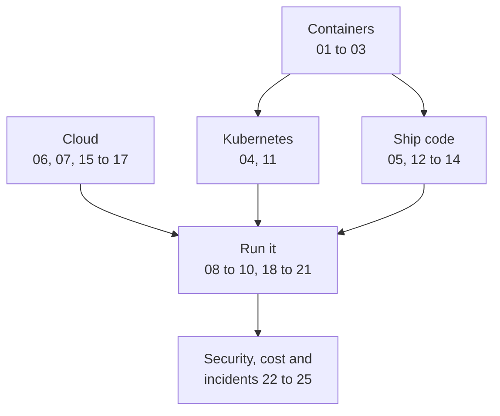

# DevOps and Cloud

Containers, Kubernetes, cloud models, serverless, and how code gets to production.

**Why it matters in interviews:** You deploy with Docker and CapRover. Interviews ask how containers work, what Kubernetes adds, and when serverless fits.

## The map

How the lessons connect. Learn top to bottom.

## Lessons, one concept per file

Each lesson is one small file made from [the lesson template](../../templates/lesson-template.md): picture first, a code trace, practice, links to watch and play, and an explain it back section.

Status: `planned` (not written yet), `ready` (written, not studied), `learning`, `can explain` (passed explain-check).

### Containers

| # | Lesson | You will understand | Status |
|---|---|---|---|
| 01 | [Containers vs virtual machines](01-containers-vs-virtual-machines.md) | what a container really is, namespaces and cgroups | ready |
| 02 | [Docker images and layers](02-docker-images-and-layers.md) | Dockerfile, layer cache, small images | ready |
| 03 | [Docker Compose](03-docker-compose.md) | running several services together | ready |

### Kubernetes

| # | Lesson | You will understand | Status |
|---|---|---|---|
| 04 | [Kubernetes objects](04-kubernetes-objects.md) | pod, deployment, service, ingress, mapped to CapRover | ready |
| 11 | Kubernetes probes, limits and rollouts `11-kubernetes-probes-limits-and-rollouts.md` | readiness, liveness, requests and limits, rolling updates | planned |

### Shipping code

| # | Lesson | You will understand | Status |
|---|---|---|---|
| 05 | [CI/CD pipelines](05-ci-cd-pipelines.md) | build, test, deploy, rollback | ready |
| 12 | GitHub Actions in practice `12-github-actions-in-practice.md` | a real pipeline file, caching, secrets, environments | planned |
| 13 | Git branching and release strategies `13-git-branching-and-release-strategies.md` | trunk based vs GitFlow, tags, hotfixes | planned |
| 14 | Infrastructure as code `14-infrastructure-as-code.md` | Terraform plan and apply, state, drift | planned |

### Cloud

| # | Lesson | You will understand | Status |
|---|---|---|---|
| 06 | [Cloud models](06-cloud-models.md) | IaaS, PaaS, SaaS, FaaS | ready |
| 07 | [Serverless](07-serverless.md) | cold starts, limits, when it fits | ready |
| 15 | The AWS map for a web developer `15-the-aws-map-for-a-web-developer.md` | EC2, S3, RDS, Lambda, ECS and what you pick | planned |
| 16 | IAM and least privilege `16-iam-and-least-privilege.md` | users, roles, policies, why no star permissions | planned |
| 17 | VPC networking basics `17-vpc-networking-basics.md` | subnets, security groups, NAT, what is public | planned |
| 26 | [Ways to run your app compared](26-ways-to-run-your-app.md) | Compose, CapRover, a hosted platform, ECS on Fargate, Kubernetes and Lambda in one table, Lambda limits, and how to pick | ready |

### Running it in production

| # | Lesson | You will understand | Status |
|---|---|---|---|
| 08 | [Reverse proxy and Nginx](08-reverse-proxy-and-nginx.md) | what sits in front of your app | ready |
| 09 | [Config and secrets](09-config-and-secrets.md) | environment variables, secret stores | ready |
| 10 | [Logs and monitoring](10-logs-and-monitoring.md) | what to watch in production | ready |
| 18 | Linux survival skills `18-linux-survival-skills.md` | processes, ports, permissions, systemd, ssh | planned |
| 19 | HTTPS and certificates in practice `19-https-and-certificates-in-practice.md` | TLS termination, Let's Encrypt, renewal | planned |
| 20 | Metrics, dashboards and alerts `20-metrics-dashboards-and-alerts.md` | Prometheus, Grafana, alerts that do not wake you for nothing | planned |
| 21 | What CapRover does for you `21-what-caprover-does-for-you.md` | Swarm, nginx, certificates and what you give up | planned |

### Security, cost and incidents

| # | Lesson | You will understand | Status |
|---|---|---|---|
| 22 | Container and supply chain security `22-container-and-supply-chain-security.md` | scanning, non root, pinned versions, signed images | planned |
| 23 | GitOps `23-gitops.md` | Git as the source of truth, Argo CD style pull deploys | planned |
| 24 | Cloud cost basics `24-cloud-cost-basics.md` | where the bill comes from and how to lower it | planned |
| 25 | Incidents, on call and postmortems `25-incidents-on-call-and-postmortems.md` | what to do in the first 15 minutes, blameless reviews | planned |

**To make the next lesson:** in a chat with this folder open, say `/learn devops-cloud 05` to learn it live with Claude, or ask "make lesson devops-cloud 05" and the `research-material` agent writes the file. When a lesson file exists, its row becomes a link and the status changes to `ready`.

## Guides already here

Longer guides that cover many concepts at once. Good for revision after the lessons.

- [Containers: Docker, CapRover to Kubernetes](container-orchestration-guide.md)
- [Docker and CapRover internals](docker-caprover-internals.md)
- [Cloud models and serverless](cloud-computing-models-serverless-guide.md)

## Visual cheatsheets

Open in the browser. Everything visible on one page.

- [Container orchestration visual cheatsheet](container-orchestration-guide-cheatsheet.html)
- [Cloud and serverless visual cheatsheet](cloud-computing-models-serverless-guide-cheatsheet.html)

## Examples to run

- [examples/kubernetes-local-demo/](examples/kubernetes-local-demo/) - Kubernetes on your laptop with kind
- [examples/cloudflare-worker-hello/](examples/cloudflare-worker-hello/) - A tiny serverless function on Cloudflare Workers

## Watch and play

Trusted places to see the ideas, not only read them. Each lesson adds its own checked video and visualizer links.

- [Docker Get Started](https://docs.docker.com/get-started/) - official tutorial
- [Kubernetes Concepts](https://kubernetes.io/docs/concepts/) - official docs with diagrams
- [roadmap.sh DevOps](https://roadmap.sh/devops) - visual map of the topics
