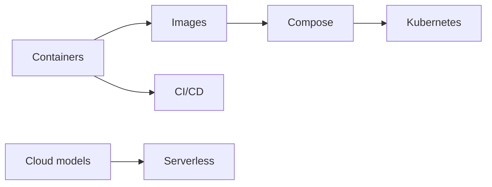

# DevOps and Cloud

Containers, Kubernetes, cloud models, serverless, and how code gets to production.

**Why it matters in interviews:** You deploy with Docker and CapRover. Interviews ask how containers work, what Kubernetes adds, and when serverless fits.

## The map

How the lessons connect. Learn left to right.

## Lessons, one concept per file

Each lesson is one small file made from [the lesson template](../../templates/lesson-template.md): picture first, a code trace, practice, links to watch and play, and an explain it back section.

Status: `planned` (not written yet), `ready` (written, not studied), `learning`, `can explain` (passed explain-check).

### Lessons

| # | Lesson | You will understand | Status |
|---|---|---|---|
| 01 | Containers vs virtual machines `01-containers-vs-virtual-machines.md` | what a container really is, namespaces and cgroups | planned |
| 02 | Docker images and layers `02-docker-images-and-layers.md` | Dockerfile, layer cache, small images | planned |
| 03 | Docker Compose `03-docker-compose.md` | running several services together | planned |
| 04 | Kubernetes objects `04-kubernetes-objects.md` | pod, deployment, service, ingress, mapped to CapRover | planned |
| 05 | CI/CD pipelines `05-ci-cd-pipelines.md` | build, test, deploy, rollback | planned |
| 06 | Cloud models `06-cloud-models.md` | IaaS, PaaS, SaaS, FaaS | planned |
| 07 | Serverless `07-serverless.md` | cold starts, limits, when it fits | planned |
| 08 | Reverse proxy and Nginx `08-reverse-proxy-and-nginx.md` | what sits in front of your app | planned |
| 09 | Config and secrets `09-config-and-secrets.md` | environment variables, secret stores | planned |
| 10 | Logs and monitoring `10-logs-and-monitoring.md` | what to watch in production | planned |

**To make the next lesson:** in a chat with this folder open, say `/learn devops-cloud 01` to learn it live with Claude, or ask "make lesson devops-cloud 01" and the `research-material` agent writes the file. When a lesson file exists, its row becomes a link and the status changes to `ready`.

## Guides already here

Longer guides that cover many concepts at once. Good for revision after the lessons.

- [Containers: Docker, CapRover to Kubernetes](container-orchestration-guide.md)
- [Docker and CapRover internals](docker-caprover-internals.md)
- [Cloud models and serverless](cloud-computing-models-serverless-guide.md)

## Visual cheatsheets

Open in the browser. Everything visible on one page.

- [Container orchestration visual cheatsheet](container-orchestration-guide-cheatsheet.html)
- [Cloud and serverless visual cheatsheet](cloud-computing-models-serverless-guide-cheatsheet.html)

## Examples to run

- [examples/kubernetes-local-demo/](examples/kubernetes-local-demo/) - Kubernetes on your laptop with kind
- [examples/cloudflare-worker-hello/](examples/cloudflare-worker-hello/) - A tiny serverless function on Cloudflare Workers

## Watch and play

Trusted places to see the ideas, not only read them. Each lesson adds its own checked video and visualizer links.

- [Docker Get Started](https://docs.docker.com/get-started/) - official tutorial
- [Kubernetes Concepts](https://kubernetes.io/docs/concepts/) - official docs with diagrams
- [roadmap.sh DevOps](https://roadmap.sh/devops) - visual map of the topics
