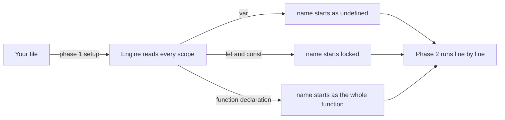
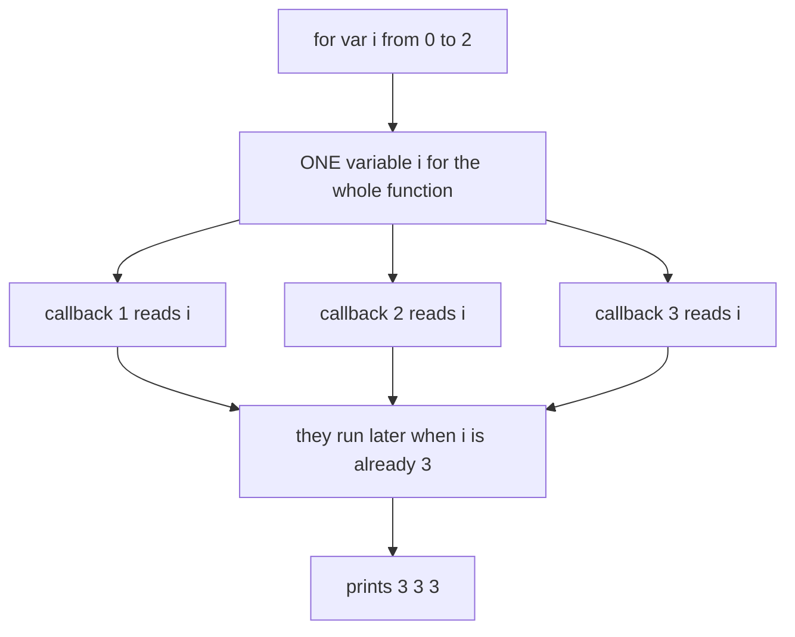
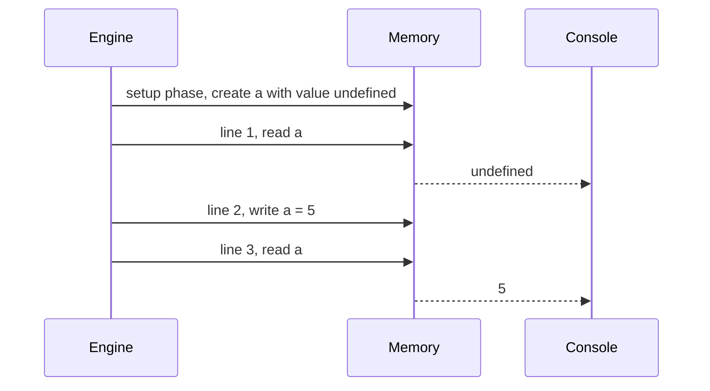
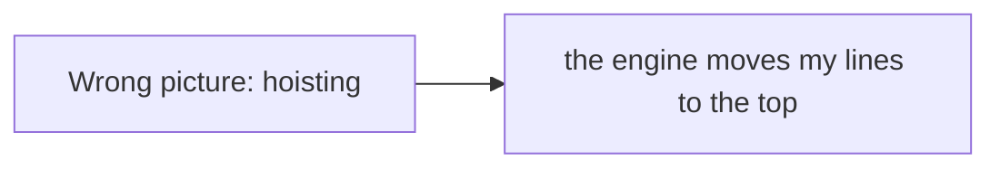
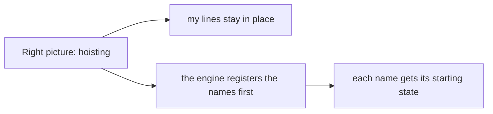
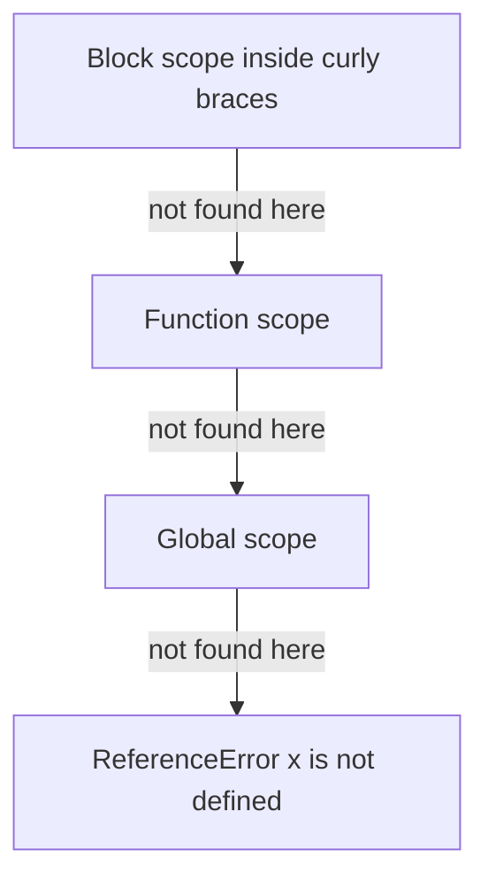

# 01. Variables, scope and hoisting

> **Subject:** JavaScript · **Lesson:** 01 · **Made:** 2026-10-11 · **Status:** ready
> **You will be able to:** say what the engine does with `var`, `let` and `const` before line 1 runs, and explain why `var` gives `undefined` while `let` gives an error.
> **Before this:** this is the first lesson · **Next:** Values, types and coercion (not written yet)

## 1. The idea in one sentence

Before JavaScript runs a single line, it **reads the whole scope and sets up every name in memory**: `var` starts as `undefined`, `let` and `const` start locked, and a function declaration starts as the full function. That setup is what people call **hoisting**.

New words, in plain English:

- **Scope:** the area of code where a name can be seen. Think of a room. Names made inside a room are not visible outside it.
- **Hoisting:** the name is registered before the code runs. Your code is **not** moved. Only the name is set up early.
- **Temporal dead zone (TDZ):** the time between "the name is set up" and "the line that declares it has run". For `let` and `const`, reading the name in this time is an error.
- **Declaration:** the part that creates the name, like `let b`. **Assignment** is the part that gives it a value, like `= 5`.

## 2. The pictures (at least five)

### 2a. The big picture

The engine works in **two phases**. Notice that phase 1 happens before any line runs, and that each kind of name starts in a different state.



### 2b. The problem, drawn

This is the bug that made old JavaScript famous. A `var` inside a loop is **one shared variable**, so every callback reads the same value later. Notice that all three callbacks point to the same box.



### 2c. How it works over time

This is snippet A from section 4. Notice that the value `undefined` appears **before** the line `var a = 5` has run.



### 2d. What is in memory right now

A snapshot taken **after setup and before line 1**. Notice the last column. This one table explains almost every hoisting question.

| Name | Written with | Value before line 1 | What happens if you read it |
|---|---|---|---|
| `a` | `var a = 5` | `undefined` | you get `undefined` |
| `b` | `let b = 5` | locked (not initialized) | `ReferenceError` |
| `c` | `const c = 5` | locked (not initialized) | `ReferenceError` |
| `hello` | `function hello() {}` | the whole function | works, you can call it |
| `greet` | `var greet = function () {}` | `undefined` | reading works, **calling** gives `TypeError` |

### 2e. Right against wrong

The most common wrong picture is "hoisting moves my code to the top". It does not. The code stays where it is.





### 2f. Where the engine looks for a name

When your code uses a name, the engine searches from the inside out. Notice that it stops at the first room that has the name.



`var` belongs to the **function** room, so it ignores curly braces of `if` and `for`. `let` and `const` belong to the **block** room, the nearest pair of curly braces.

## 3. Real life analogy

A teacher writes the **roll sheet** before the class starts. Every student's name is on the sheet from the beginning.

- A `var` student is on the sheet with an empty seat. If you ask "who sits there?", the answer is "nobody yet" (`undefined`).
- A `let` or `const` student is on the sheet with a red stamp: "do not call this name yet". If you call it anyway, the teacher stops the class (`ReferenceError`).
- A function declaration is a student who is already in the seat before class starts. You can call them at once.

Where the analogy stops: the engine does not really write on paper or move students. It only sets up a slot in memory for each name.

## 4. The smallest code that shows it

Run each snippet in its own file. Snippet B crashes, so it would stop the file.

```js
// Snippet A
console.log(a);   // the slot for a exists already
var a = 5;
console.log(a);

// Snippet B
console.log(b);   // the slot for b exists, but it is locked
let b = 5;
console.log(b);
```

**Output of A:**

```
undefined
5
```

**Output of B:**

```
ReferenceError: Cannot access 'b' before initialization
```

The exact words of the error change between engines. Chrome and Node use the words above. The type, `ReferenceError`, is the same everywhere.

## 5. What really happens, step by step

Snippet A:

| Step | Code line | What the engine does | Memory after | Console |
|---|---|---|---|---|
| 1 | setup | Reads the scope, finds `var a`, creates `a` with `undefined` | a: undefined | |
| 2 | line 1 | Reads `a`. The slot exists, so it gives `undefined` | a: undefined | undefined |
| 3 | line 2 | Runs the assignment. Now `a` gets the value 5 | a: 5 | undefined |
| 4 | line 3 | Reads `a` | a: 5 | undefined 5 |

Snippet B:

| Step | Code line | What the engine does | Memory after | Console |
|---|---|---|---|---|
| 1 | setup | Reads the scope, finds `let b`, creates `b` but **locks** it | b: locked | |
| 2 | line 1 | Reads `b`. It is locked, so the engine throws | b: locked | ReferenceError |
| 3 | stop | The error is not caught, so the program stops. Lines 2 and 3 never run | | |

**Step through it yourself:** [open the scope and hoisting stepper](visuals/01-scope-and-hoisting.html). It has six small programs: `var`, `let`, functions, block scope, and the loop bug with `var` and with `let`. Write your guess first, then press Next.

## 6. Why it exists and what it costs

- **Problem without it:** before 2015 JavaScript only had `var`. A `var` ignores curly braces, so it leaks out of `if` and `for`. Reading it too early gives a quiet `undefined`, and the bug hides. The loop in picture 2b is the famous case.
- **How it solves it:** `let` and `const` (added in ES2015) live inside the nearest curly braces, so each loop pass can have its own variable. The locked state turns the quiet `undefined` into a loud `ReferenceError` that points at the line.
- **Cost or tradeoff:**
  - `var` is still everywhere in old code, so you must read it.
  - Hoisting of **function declarations** is useful: you can put helpers at the bottom of a file. But it also makes the order of a file harder to follow.
  - `const` does **not** freeze the value. It only stops you from pointing the name at something else.

Simple rule for new code: use `const` by default, use `let` when the value must change, and do not use `var`.

## 7. Common mistakes

**Wrong:** thinking `const` makes an object unchangeable.

```js
const user = { name: "Ana" };
user.name = "Budi";   // allowed
user = {};            // TypeError: Assignment to constant variable.
```

**Right:** `const` locks the **name**, not the **inside** of the object. To stop changes inside, use `Object.freeze(user)`. That is a separate tool, and it is shallow.

**Why:** the name holds an arrow to the object. `const` protects the arrow.

**Wrong:** calling a function expression before its line.

```js
greet();                         // TypeError: greet is not a function
var greet = function () { console.log("hi"); };
```

**Right:** call it after its line, or write a function declaration instead.

```js
function greet() { console.log("hi"); }
greet();   // works anywhere in the scope
```

**Why:** only the name `greet` is set up early, as `undefined`. Calling `undefined` is a `TypeError`.

**Wrong:** the loop bug.

```js
for (var i = 0; i < 3; i++) {
  setTimeout(() => console.log(i), 0);
}
// prints 3 3 3
```

**Right:** use `let`. Each pass gets its own `i`.

```js
for (let i = 0; i < 3; i++) {
  setTimeout(() => console.log(i), 0);
}
// prints 0 1 2
```

**Why:** the timer callbacks run later, after the loop is done (see [the event loop](11-the-event-loop.md)). With `var` they all read the one shared `i`, which is 3 by then.

## 8. Watch and play

Links checked on 2026-10-11.

- **Video:** [Hoisting in JavaScript (variables and functions), Namaste JavaScript Ep. 3](https://www.youtube.com/watch?v=Fnlnw8uY6jo) by Akshay Saini. I confirmed the title and channel through YouTube. I did not check the length. Watch it after the stepper, and listen for the words "memory creation phase".
- **Video:** [let and const in JS, Temporal Dead Zone, Namaste JavaScript Ep. 8](https://www.youtube.com/watch?v=BNC6slYCj50) by Akshay Saini. Title and channel confirmed, length not checked. Watch it for the dead zone.
- **Play with it:** [The scope and hoisting stepper](visuals/01-scope-and-hoisting.html) in this folder. Predict, then press Next.
- **Play with it:** [Python Tutor for JavaScript](https://pythontutor.com/javascript.html). Paste snippet A and click Visualize Execution. Compare what it shows before line 1 with the stepper.
- **Read:** [The old "var"](https://javascript.info/var) on javascript.info. It shows `var` having no block scope and being declared below its use.
- **Read:** [let, the temporal dead zone section](https://developer.mozilla.org/en-US/docs/Web/JavaScript/Reference/Statements/let) on MDN. Look for the section called "Temporal dead zone (TDZ)".
- **Read:** [Hoisting on MDN](https://developer.mozilla.org/en-US/docs/Glossary/Hoisting). A short page that says what happens to `var`, `let`, `const` and functions.

## 9. Practice

**A. Predict the output** (write your answer before opening)

```js
var x = "outer";
function show() {
  console.log(x);
  var x = "inner";
  console.log(x);
}
show();
```

<details><summary>Answer</summary>

`undefined` then `inner`.

The `var x` inside `show` is set up at the start of `show`, with `undefined`. That new `x` hides the outer `x` for the whole function, even in the line **above** its declaration. So the first `console.log` does not see `"outer"`.

</details>

**B. Fix the bug**

```js
const buttons = [];
for (var i = 0; i < 3; i++) {
  buttons.push(() => "button " + i);
}
console.log(buttons[0]());   // "button 3". It should be "button 0".
```

<details><summary>Answer</summary>

Change `var` to `let`. Each pass of the loop then gets its own `i`, and each function remembers its own.

```js
for (let i = 0; i < 3; i++) {
  buttons.push(() => "button " + i);
}
console.log(buttons[0]());   // "button 0"
```

The reason each function keeps its own `i` is a **closure**. That is lesson 05.

</details>

**C. Write it yourself**

Open `practice/01-scope-and-hoisting.js`. There are two tasks. One is to fix a loop. The other is to write down what five snippets print, and the test runs the real snippets to check your guesses. Run the tests from the folder that contains `learn/`:

```
node --test learn/javascript/practice/01-scope-and-hoisting.test.js
```

<details><summary>One possible answer</summary>

```js
function collectIndexes(n) {
  const out = [];
  for (let i = 0; i < n; i++) {          // var became let
    setTimeout(() => out.push(i), 0);
  }
  return new Promise(resolve => setTimeout(() => resolve(out), 10));
}

const predictions = {
  s1: ["undefined", "number"],
  s2: ["ReferenceError"],
  s3: ["foo"],
  s4: ["TypeError"],
  s5: ["1"],
};
```

</details>

## 10. Interview question

**Q:** "What is hoisting? What is the difference between `var`, `let` and `const`? What does this print?"

```js
for (var i = 0; i < 3; i++) setTimeout(() => console.log(i), 0);
```

<details><summary>A strong answer, in four parts</summary>

1. **Problem:** old JavaScript had only `var`. It ignores curly braces and gives a silent `undefined` when read too early. That caused hidden bugs, like the loop that prints the same number every time.
2. **How it works:** before running, the engine reads the scope and sets up every name. `var` starts as `undefined` and belongs to the function. `let` and `const` belong to the nearest curly braces and start locked until their line runs, so reading them early is a `ReferenceError`. Function declarations start as the whole function. The code above prints `3 3 3`, because the timers run after the loop and all read the one shared `i`. With `let` it prints `0 1 2`.
3. **Tradeoff:** `let` and `const` are safer and fail loudly, but you still meet `var` in old code. `const` locks the name, not the contents of an object. Function hoisting is handy but can make a file harder to read in order.
4. **My example:** *This is an idea, not a fact. Replace it with your own real story from DBO, Unloan, ZWS or Skyworx.* A list where every row's click handler used the last row's index, because the loop used `var`.

</details>

## 11. Explain it back

Close this file. Press the **Record my explanation** button under this heading and explain hoisting out loud, like to a new junior, in 4 parts: problem, how it works, tradeoff, my example. Then save the transcript file into `my-learning/recordings/`, or write your best version below. Run `/explain-check hoisting` or ask the `explain-coach` agent to review it.

### My explanation

<write here>

### Coach feedback

<the explain-coach agent writes here>

## 12. Review questions (day 1, 3, 7, 21)

1. What does the engine do with `var a = 5` **before** line 1 runs, and what do you get if you read `a` first?
2. Why does reading a `let` variable early give an error, when `var` gives `undefined`?
3. What does `for (var i = 0; i < 3; i++) setTimeout(() => console.log(i), 0)` print, and why?
4. Draw the picture from section 2d from memory: five names and what each looks like before line 1.

<details><summary>Answers</summary>

1. It creates the name `a` in memory with the value `undefined`. Reading `a` first gives `undefined`, and the `= 5` happens only when line 2 runs.
2. Both are set up early. A `var` starts as `undefined`, so reading it works. A `let` starts locked (the temporal dead zone) until its line runs, so reading it throws a `ReferenceError`. The language chose to fail loudly.
3. `3 3 3`. There is one shared `i`. The timers run after the loop is finished, when `i` is 3.
4. `var` gives `undefined`. `let` and `const` are locked. A function declaration is the whole function. `var x = function` is `undefined`, so calling it is a `TypeError`.

</details>

## Connected lessons

- [The event loop](11-the-event-loop.md): why the timer callbacks in the loop bug run after the loop ends.
- Values, types and coercion (not written yet): what the values `undefined` and `5` really are.
- Closures (not written yet): how each `let` pass keeps its own `i` after the loop is done.
- Functions (not written yet): declarations against expressions, and why one is hoisted whole.
