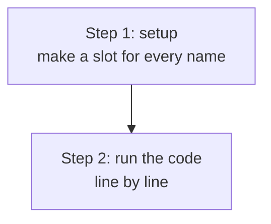
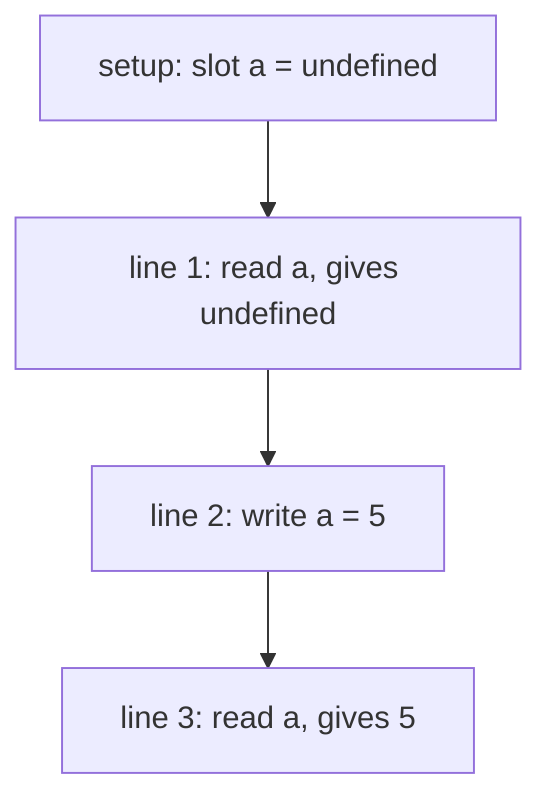
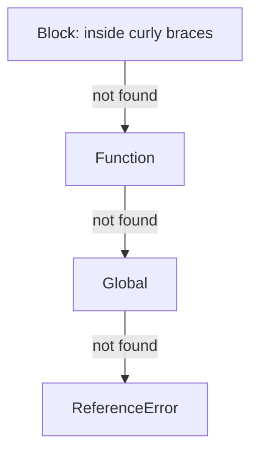
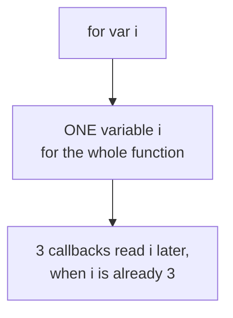

# 01. Variables, scope and hoisting

> **Subject:** JavaScript · **Lesson:** 01 · **Made:** 2026-10-11 · **Rewritten in simpler words:** 2026-10-15 · **Remade in short cards:** 2026-10-28 · **Status:** ready
>
> **You will be able to:** say what JavaScript does with `var`, `let` and `const` before line 1 runs, and explain why `var` gives `undefined` while `let` gives an error.
>
> **Before this:** this is the first lesson · **Next:** [Values, types and coercion](02-values-types-and-coercion.md)
>
> **How to read it:** one card is one idea. Look at the picture, guess, then press the orange bar to check. The blue bars (📖 More detail) hold the longer explanation. Skip them on the first read, and open them when you want more. About 20 minutes for the cards.

## 1. The idea: the roll sheet

A teacher writes the **roll sheet** before the class starts. Every student's name is on the sheet from the beginning.



Notice: JavaScript works in **two steps**. Step 1 happens before any line runs. Each kind of name starts in a different state.

| Written with | Slot starts as |
|---|---|
| `var a = 5` | `undefined` |
| `let b = 5` | locked |
| `const c = 5` | locked |
| `function hello() {}` | the whole function |

<details class="guess"><summary>🤔 Guess: line 1 reads `a`, and `var a = 5` is on line 2. What does line 1 print? Press to check.</summary>

`undefined`. The slot for `a` was made before line 1, and it started as `undefined`. Nothing crashes.

</details>

> **Remember:** before line 1 runs, JavaScript makes a slot for every name. This early setup is called **hoisting**. Your code does **not** move.

<details class="more"><summary>📖 More detail: the four words, and where the roll sheet stops</summary>

- **Scope:** the part of the code where a name can be seen. Think of a room. A name made inside a room cannot be seen outside it.
- **Slot:** a named place in memory that holds one value.
- **Hoisting:** making the slots early, before the code runs. Your code does **not** move. Only the slots are made early.
- **Locked slot:** a slot you may not read yet. It stays locked until JavaScript reaches the line that makes it. (Interview word: *temporal dead zone*, or *TDZ*.)

Two small words: a **declaration** makes the name (`let b`). An **assignment** gives it a value (`= 5`).

In the roll sheet picture: a `var` student has an empty seat ("nobody yet", `undefined`). A `let` or `const` student has a red stamp: "do not call this name yet". A function declaration is a student who is already in the seat.

The most common wrong picture is "hoisting moves my code to the top". It does not. The code stays where it is. Where the picture stops: JavaScript does not write on paper or move students. It only makes a slot in memory for each name.

</details>

## 2. `var`: a quiet undefined

Snippet A. Run it in its own file.

```js
console.log(a);   // slot exists already
var a = 5;
console.log(a);
```



<details class="guess"><summary>🤔 Guess: what does the console print? Press to check.</summary>

```
undefined
5
```

`undefined` shows up **before** the line `var a = 5` has run, because the slot was made in step 1.

</details>

> **Remember:** a `var` slot starts as `undefined`, so reading it too early gives a quiet `undefined`. The bug hides.

<details class="more"><summary>📖 More detail: snippet A, step by step</summary>

| Step | Line | What happens | Memory after | Console |
|---|---|---|---|---|
| 1 | setup | JavaScript reads the scope and sees `var a`. It makes slot `a` holding `undefined`. | a: undefined | |
| 2 | 1 | Reads `a`. The slot exists, so it gives `undefined`. | a: undefined | undefined |
| 3 | 2 | Runs the assignment. Now `a` holds 5. | a: 5 | undefined |
| 4 | 3 | Reads `a`. | a: 5 | undefined 5 |

Checked on 2026-10-28 with Node 26.12.1.

</details>

## 3. `let` and `const`: a locked slot

Snippet B. Same shape, with `let`.

```js
console.log(b);   // slot exists, locked
let b = 5;
console.log(b);
```

<details class="guess"><summary>🤔 Guess: what does this print? Press to check.</summary>

```
ReferenceError: Cannot access 'b' before initialization
```

The slot for `b` exists, but it is **locked** until line 2 runs. Reading it throws a loud error that points at the line. Nobody catches it, so the program stops. Lines 2 and 3 never run.

</details>

> **Remember:** a `let` or `const` slot starts locked. Reading it early gives a `ReferenceError`, not a quiet `undefined`.

<details class="more"><summary>📖 More detail: snippet B, step by step</summary>

| Step | Line | What happens | Memory after | Console |
|---|---|---|---|---|
| 1 | setup | JavaScript reads the scope and sees `let b`. It makes slot `b` and **locks** it. | b: locked | |
| 2 | 1 | Reads `b`. It is locked, so JavaScript throws an error. | b: locked | ReferenceError |
| 3 | stop | Nobody catches the error, so the program stops. Lines 2 and 3 never run. | | |

The exact words of the error change between browsers and Node. Chrome and Node use the words above. The type, `ReferenceError`, is the same everywhere.

</details>

## 4. Functions: a declaration against an expression

A function **declaration** is already in the seat before class starts. A function **expression** stored in a `var` is only a name that starts as `undefined`.

```js
// Snippet C
greet();
var greet = function () {
  console.log("hi");
};
```

```js
// Snippet D
hello();
function hello() {
  console.log("hello works");
}
```

<details class="guess"><summary>🤔 Guess: what happens in snippet C? And in snippet D? Press to check.</summary>

C: `TypeError: greet is not a function`. Only the name `greet` was made early, as `undefined`. Calling `undefined` is a `TypeError`.

D: prints `hello works`. The whole function was in the slot, so it works anywhere in the scope.

Fix for C: call it after its line, or write a function declaration instead.

</details>

> **Remember:** a function declaration works before its line. A function expression in a `var` does not.

<details class="more"><summary>📖 More detail: the memory table before line 1</summary>

A snapshot **after setup and before line 1**. This one table explains almost every hoisting question.

| Name | Written with | Value before line 1 | What happens if you read it |
|---|---|---|---|
| `a` | `var a = 5` | `undefined` | you get `undefined` |
| `b` | `let b = 5` | locked | `ReferenceError` |
| `c` | `const c = 5` | locked | `ReferenceError` |
| `hello` | `function hello() {}` | the whole function | works, you can call it |
| `greet` | `var greet = function () {}` | `undefined` | reading works, but **calling** gives `TypeError` |

</details>

## 5. Where JavaScript looks for a name

When your code uses a name, JavaScript searches from the inside out. It stops at the first room that has the name.



`var` belongs to the **function** room, so it ignores the curly braces of `if` and `for`. `let` and `const` belong to the **block** room, the nearest pair of curly braces.

```js
if (true) {
  var x = 1;
  let y = 2;
}
console.log(x);
console.log(y);
```

<details class="guess"><summary>🤔 Guess: what do the two `console.log` lines give? Press to check.</summary>

```
1
ReferenceError: y is not defined
```

`x` leaked out of the `if`. `y` stayed inside its block.

</details>

> **Remember:** `var` leaks out of `if` and `for`. `let` and `const` stay inside the nearest curly braces.

<details class="more"><summary>📖 More detail: the block room</summary>

Before 2015 JavaScript only had `var`. Because a `var` ignores curly braces, it leaks out of `if` and `for`. `let` and `const` (added in ES2015) live inside the nearest curly braces, so each loop pass can have its own variable (card 6).

</details>

## 6. Mistake 1: the loop bug

This is the bug that made old JavaScript famous. Three timers each print `i`.

```js
for (var i = 0; i < 3; i++) {
  setTimeout(() => console.log(i), 0);
}
```



<details class="guess"><summary>🤔 Guess: what does it print, and what changes with `let i`? Press to check.</summary>

With `var`: `3 3 3`. With `let`: `0 1 2`.

```js
for (let i = 0; i < 3; i++) {
  setTimeout(() => console.log(i), 0);
}
```

The timer callbacks run later, after the loop is done (see [the event loop](11-the-event-loop.md)). With `var` they all read the one shared `i`, which is 3 by then. With `let`, each pass gets its own `i`.

</details>

> **Remember:** `var` in a loop is one shared variable. `let` gives each pass its own.

<details class="more"><summary>📖 More detail: where this goes next</summary>

This is a closure ([lesson 05](05-closures.md)): each callback remembers the variable it was made next to. With `let`, "the variable" is a different one on every pass.

</details>

## 7. Mistake 2: `const` does not freeze an object

You write `const user = { name: "Ana" }`. Is the object now unchangeable?

```js
const user = { name: "Ana" };
user.name = "Budi";
user = {};
```

<details class="guess"><summary>🤔 Guess: which of the last two lines throw an error? Press to check.</summary>

Only the last one:

```
TypeError: Assignment to constant variable.
```

`user.name = "Budi"` is allowed. The name `user` holds an arrow to the object, and `const` protects the **arrow**, not the **inside** of the object.

</details>

> **Remember:** `const` locks the name, not the inside of the object.

<details class="more"><summary>📖 More detail: how to really stop changes</summary>

To stop changes inside, use `Object.freeze(user)`. That is a separate tool, and it only works one level deep.

</details>

## 8. Watch it run, step by step

The stepper has six small programs: `var`, `let`, functions, block scope, and the loop bug with `var` and with `let`. Write your guess first, then press Next.

**Step through it yourself:** [open the scope and hoisting stepper](visuals/01-scope-and-hoisting.html).

## 9. Why it matters and what it costs

- **Without it,** `var` ignores curly braces and leaks out of `if` and `for`. Reading it too early gives a quiet `undefined`, so the bug hides.
- **With it,** `let` and `const` live inside the nearest curly braces. The locked state turns the quiet `undefined` into a loud `ReferenceError` that points at the line.
- **The cost:**
  - `var` is still everywhere in old code, so you must be able to read it.
  - Hoisting of **function declarations** is useful: you can put helpers at the bottom of a file. But it also makes a file harder to read from top to bottom.
  - `const` does **not** freeze the value. It only stops you from pointing the name at something else.

Simple rule for new code: use `const` by default, use `let` when the value must change, and do not use `var`.

## 10. Watch and play

Links checked on 2026-10-11. Each page opened. For each video, the title and channel matched. I did not watch the videos, so their lengths are not checked.

- **Video:** [Hoisting in JavaScript (variables and functions), Namaste JavaScript Ep. 3](https://www.youtube.com/watch?v=Fnlnw8uY6jo) by Akshay Saini. Watch it after the stepper. Listen for the words "memory creation phase".
- **Video:** [let and const in JS, Temporal Dead Zone, Namaste JavaScript Ep. 8](https://www.youtube.com/watch?v=BNC6slYCj50) by Akshay Saini. Watch it for the locked slot (the dead zone).
- **Play with it:** [The scope and hoisting stepper](visuals/01-scope-and-hoisting.html) in this folder. Guess first, then press Next.
- **Play with it:** [Python Tutor for JavaScript](https://pythontutor.com/javascript.html). Paste snippet A and click Visualize Execution. Compare what it shows before line 1 with the stepper.
- **Read:** [The old "var"](https://javascript.info/var) on javascript.info. It shows `var` having no block scope and being used before its line.
- **Read:** [let on MDN](https://developer.mozilla.org/en-US/docs/Web/JavaScript/Reference/Statements/let). Look for the section called "Temporal dead zone (TDZ)".
- **Read:** [Hoisting on MDN](https://developer.mozilla.org/en-US/docs/Glossary/Hoisting). A short page on what happens to `var`, `let`, `const` and functions.

## 11. Practice

**A. Predict the output** (write your answer before opening)

```js
var x = "outer";
function show() {
  console.log(x);
  var x = "inner";
  console.log(x);
}
show();
```

<details><summary>Answer</summary>

`undefined` then `inner`.

The `var x` inside `show` is made at the start of `show`, holding `undefined`. This new `x` hides the outer `x` for the whole function, even in the line **above** its declaration. So the first `console.log` does not see `"outer"`.

</details>

**B. Fix the bug**

```js
const buttons = [];
for (var i = 0; i < 3; i++) {
  buttons.push(() => "button " + i);
}
console.log(buttons[0]());   // "button 3". It should be "button 0".
```

<details><summary>Answer</summary>

Change `var` to `let`. Each pass of the loop then gets its own `i`, and each function remembers its own.

```js
for (let i = 0; i < 3; i++) {
  buttons.push(() => "button " + i);
}
console.log(buttons[0]());   // "button 0"
```

The reason each function keeps its own `i` is a **closure**. That is lesson 05.

</details>

**C. Write it yourself**

Open `practice/01-scope-and-hoisting.js`. There are two tasks:

1. Fix a loop.
2. Write down what five snippets print. The test runs the real snippets to check your guesses.

Run the tests from the folder that contains `learn/`:

```
node --test learn/javascript/practice/01-scope-and-hoisting.test.js
```

<details><summary>One possible answer</summary>

```js
function collectIndexes(n) {
  const out = [];
  for (let i = 0; i < n; i++) {          // var became let
    setTimeout(() => out.push(i), 0);
  }
  return new Promise(resolve => setTimeout(() => resolve(out), 10));
}

const predictions = {
  s1: ["undefined", "number"],
  s2: ["ReferenceError"],
  s3: ["foo"],
  s4: ["TypeError"],
  s5: ["1"],
};
```

</details>

## 12. Interview question

**Q:** "What is hoisting? What is the difference between `var`, `let` and `const`? What does this print?"

```js
for (var i = 0; i < 3; i++) setTimeout(() => console.log(i), 0);
```

<details><summary>A strong answer, in four parts</summary>

1. **Problem:** old JavaScript had only `var`. It ignores curly braces and gives a silent `undefined` when read too early. That caused hidden bugs, like the loop that prints the same number every time.
2. **How it works:**
   - Before running, JavaScript reads the scope and makes a slot for every name.
   - `var` starts as `undefined` and belongs to the function.
   - `let` and `const` belong to the nearest curly braces. They start locked until their line runs, so reading them early is a `ReferenceError`.
   - Function declarations start as the whole function.
   - The code above prints `3 3 3`, because the timers run after the loop and all read the one shared `i`. With `let` it prints `0 1 2`.
3. **Tradeoff:** `let` and `const` are safer and fail loudly, but you still meet `var` in old code. `const` locks the name, not the contents of an object. Function hoisting is handy but can make a file harder to read in order.
4. **My example:** *This is an idea, not a fact. Replace it with your own real story from DBO, Unloan, ZWS or Skyworx.* A list where every row's click handler used the last row's index, because the loop used `var`.

</details>

## 13. Explain it back

Close this file. Press the **Record my explanation** button under this heading and explain hoisting out loud, like to a new junior, in 4 parts: problem, how it works, tradeoff, my example. Then save the transcript file into `my-learning/recordings/`, or write your best version below. Run `/explain-check hoisting` or ask the `explain-coach` agent to review it.

### My explanation

<write here>

### Coach feedback

<the explain-coach agent writes here>

## 14. Review questions (day 1, 3, 7, 21)

1. What does JavaScript do with `var a = 5` **before** line 1 runs, and what do you get if you read `a` first?
2. Why does reading a `let` variable early give an error, when `var` gives `undefined`?
3. What does `for (var i = 0; i < 3; i++) setTimeout(() => console.log(i), 0)` print, and why?
4. Draw the table from card 1 and card 4 from memory: five names and what each looks like before line 1.

<details><summary>Answers</summary>

1. It makes the slot `a` in memory holding `undefined`. Reading `a` first gives `undefined`. The `= 5` happens only when line 2 runs.
2. Both are set up early. A `var` starts as `undefined`, so reading it works. A `let` starts locked (the temporal dead zone) until its line runs, so reading it throws a `ReferenceError`. The language chose to fail loudly.
3. `3 3 3`. There is one shared `i`. The timers run after the loop is finished, when `i` is 3.
4. `var` gives `undefined`. `let` and `const` are locked. A function declaration is the whole function. `var x = function` is `undefined`, so calling it is a `TypeError`.

</details>

## Connected lessons

- [The event loop](11-the-event-loop.md): why the timer callbacks in the loop bug run after the loop ends.
- [Values, types and coercion](02-values-types-and-coercion.md): what the values `undefined` and `5` really are.
- [Closures](05-closures.md): how each `let` pass keeps its own `i` after the loop is done.
- [Functions](04-functions.md): declarations against expressions, and why one is hoisted whole.
