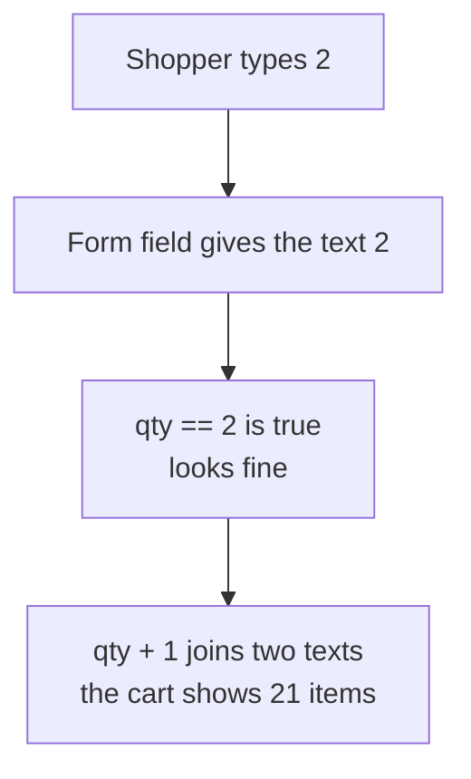
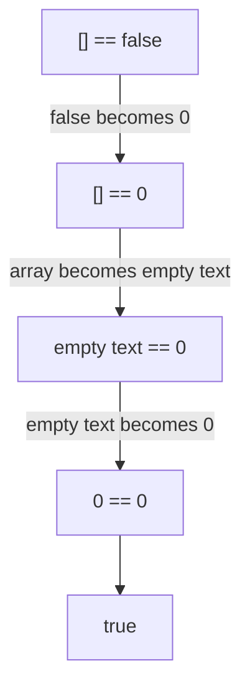

# 02. Values, types and coercion

> **Subject:** JavaScript · **Lesson:** 02 · **Made:** 2026-10-15 · **Remade in short cards:** 2026-10-28 · **Status:** ready
>
> **You will be able to:** say the difference between a simple value and an object, walk `[] == false` round by round, and list the 8 values that count as false.
>
> **Before this:** [Variables, scope and hoisting](01-variables-scope-and-hoisting.md) · **Next:** [Reference vs copy](03-reference-vs-copy.md)
>
> **How to read it:** one card is one idea. Look at the picture, guess, then press the orange bar to check. The blue bars (📖 More detail) hold the longer explanation. Skip them on the first read, and open them when you want more. About 25 minutes for the cards.

## 1. The idea: a money changer

You compare a price in dollars with a price in baht. The strict check `===` says: "Different money. Not equal." It never converts. The loose check `==` converts one price into the other money with a fixed list of rules, then compares.

A form field always gives you **text**, even when the shopper types a number.



Notice: `==` says everything is fine, and then `+` breaks it.

<details class="guess"><summary>🤔 Guess: `qty` is the text `"2"`. What is `qty + 1`? Press to check.</summary>

`"21"`. `+` joins when either side is text. JavaScript turned the number `1` into the text `"1"` and joined them. No error.

</details>

> **Remember:** `===` never changes a type. `==` and `+` sometimes do. An `if` only asks: "is this one of the 8 values that count as false?"

<details class="more"><summary>📖 More detail: the four words, and where the money changer stops</summary>

A **type** is the kind of value: a number, some text, `true` or `false`, and so on. `typeof` tells you the type name.

- **Simple value:** one plain value like `5`, `"2"` or `true`. It has no parts, and you cannot change it. (Interview word: *primitive*.)
- **Changing the type:** JavaScript turns a value into another type on its own. For example, the text `"2"` becomes the number `2`. (Interview word: *coercion*.)
- **Loose check and strict check:** `==` may change types before it compares. `===` never changes a type. (Interview words: *loose equality* and *strict equality*.)
- **Counts as true, counts as false:** what an `if` decides about a value that is not `true` or `false`. (Interview words: *truthy* and *falsy*.)

Where the picture stops:

- A real money changer picks a sensible rate. JavaScript's rules are fixed and sometimes surprising. An empty array becomes empty text, and then `0`.
- JavaScript almost always converts toward a **number**, not toward whatever makes sense.

</details>

## 2. Every value has a type

Every value is either a simple value or an object. Arrays and functions are objects too. `typeof` gives you the type name, with two surprises.

| Code | `typeof` gives |
|---|---|
| `typeof 5` | `"number"` |
| `typeof "hi"` | `"string"` |
| `typeof true` | `"boolean"` |
| `typeof undefined` | `"undefined"` |
| `typeof null` | **`"object"`** |
| `typeof []` | **`"object"`** |
| `typeof function () {}` | `"function"` |

<details class="guess"><summary>🤔 Guess: `typeof null` and `typeof []`. What do they give? Press to check.</summary>

Both give `"object"`. `typeof null` is an old mistake that was never fixed. For an array, use `Array.isArray(x)` to check.

</details>

> **Remember:** `typeof null` is `"object"`, and so is `typeof []`. They are the two surprises.

<details class="more"><summary>📖 More detail: the kinds of values</summary>

- **Simple values, 7 kinds:** number (`5`, `3.5`), string (text like `"hi"`), boolean (`true` or `false`), `undefined` (no value given yet), `null` (empty on purpose), `bigint` and `symbol` (rare).
- **Objects, values with parts:** a plain object like `{ a: 1 }`, an array like `[1, 2, 3]`, and a function.

Checked on 2026-10-28 with Node 26.12.1.

</details>

## 3. `+` joins, `-` converts

`+` and `-` do different things with text.

```js
const qty = "2";
console.log(typeof qty);
console.log(qty + 1);
console.log(qty - 1);
```

<details class="guess"><summary>🤔 Guess: what are the three lines of output? Press to check.</summary>

```
string
21
1
```

`+` joined the text (`"2"` and `"1"`). But `-` only works on numbers, so it turned `"2"` into `2` and gave `1`.

</details>

> **Remember:** if either side of `+` is text, it joins. `-`, `*` and `/` always turn both sides into numbers.

<details class="more"><summary>📖 More detail: why JavaScript does this</summary>

JavaScript was made for small scripts in web pages. Almost everything from a page arrives as text. Changing types on its own let short scripts work without extra code. `"3" * 2` just gives `6`. The cost: the changes are hidden, so bugs are hidden too. `"2" + 1` gives `"21"` with no error.

</details>

## 4. `==` against `===`

```js
const qty = "2";
console.log(qty == 2);
console.log(qty === 2);
console.log(null == 0);
```

<details class="guess"><summary>🤔 Guess: what are the three answers? Press to check.</summary>

```
true
false
false
```

- `qty == 2`: a string and a number, so `==` turns `"2"` into `2`. Then `2 == 2`.
- `qty === 2`: two different types. `===` stops at once and never changes them.
- `null == 0`: `null` only equals `null` or `undefined`. `0` is neither.

</details>

> **Remember:** use `===` everywhere. Change types yourself, with `Number(qty)` or `String(id)`.

<details class="more"><summary>📖 More detail: the checklist that `==` walks</summary>

`==` walks this list from the top. After it changes one side, it starts again at rule 1.

| Rule | If | Then |
|---|---|---|
| 1 | Both sides have the same type | Compare like `===`. |
| 2 | `null` or `undefined` on one side | `true` only if the other side is `null` or `undefined` too. |
| 3 | A string and a number | Turn the string into a number. |
| 4 | `true` or `false` on one side | Turn it into a number. `true` is 1 and `false` is 0. |
| 5 | An object on one side | Turn the object into a simple value. |
| 6 | Nothing matched | `false`. |

One exception to "use `===`": `value == null` catches `null` and `undefined` together.

</details>

## 5. `[] == false`, round by round

The famous one. Every round changes only **one** side.



```js
console.log([] == false);
console.log(Boolean([]));
```

<details class="guess"><summary>🤔 Guess: the same empty array is `== false`. Does `Boolean([])` say false too? Press to check.</summary>

```
true
true
```

`[] == false` is `true` (the rounds above). But `Boolean([])` is also `true`: an empty array is **not** on the "counts as false" list. `==` and `if` use different rules.

</details>

> **Remember:** `==` and `if` do not use the same rules. An empty array is `== false`, and it also counts as true.

<details class="more"><summary>📖 More detail: why the array becomes empty text</summary>

An object becomes a simple value: JavaScript first calls `valueOf()`. For arrays and plain objects that gives back the object itself, which is not simple. So JavaScript calls `toString()`. `[]` gives `""`. `[1, 2]` gives `"1,2"`. Then rule 3 turns `""` into `0`.

Memory check. After these lines, `a` and `b` point at two different array objects:

```js
const a = [1];
const b = [1];
console.log(a == b);
```

That prints `false`. Two arrays are two objects, even when both hold `[1]`. For objects, JavaScript does not look inside. It asks: is this the **same** object? ([Lesson 03](03-reference-vs-copy.md) goes deep into this.)

</details>

## 6. The 8 values that count as false

An `if` does not use the `==` checklist. It only looks at a short list. Notice what is **not** on it.

| Counts as false (only these 8) | Counts as true (everything else) |
|---|---|
| `false` | the text `"0"` |
| `0` and `-0` | the text `"false"` |
| `0n` | an empty array `[]` |
| empty text `""` | an empty object `{}` |
| `null` | |
| `undefined` | |
| `NaN` | |

<details class="guess"><summary>🤔 Guess: does the text `"0"` count as false? Press to check.</summary>

No. `Boolean("0")` is `true`. Only the real number `0` is on the list. A text with something in it is always true, even `"false"`.

</details>

> **Remember:** 8 values count as false. Everything else counts as true.

<details class="more"><summary>📖 More detail: NaN and 0n</summary>

`NaN` means "not a number". JavaScript gives it when it cannot make a number, like `Number("abc")`. `0n` is zero as a `bigint`, a rare type for very big whole numbers.

`NaN` is the one value that is not equal to itself, so `n === NaN` is `false`, always. Check with `Number.isNaN(n)`:

```js
const n = Number("abc");
console.log(n === NaN);
console.log(Number.isNaN(n));
```

That prints `false` and then `true`.

</details>

## 7. Mistake 1: `if (!price)` for a missing value

A free item has a price of `0`.

```js
function priceLabel(price) {
  if (!price) return "Price missing";
  return "$" + price;
}
console.log(priceLabel(0));
```

<details class="guess"><summary>🤔 Guess: what does `priceLabel(0)` give? Press to check.</summary>

`"Price missing"`, but the item is free, not missing. `0` is on the "counts as false" list, but it is a real price.

Fix: catch only `null` and `undefined`.

```js
if (price == null) return "Price missing";
```

Now `priceLabel(0)` is `"$0"`, and `null` or `undefined` still gives `"Price missing"`.

</details>

> **Remember:** when `0` or empty text is a real value, do not use `if (value)`. Use `value == null`.

<details class="more"><summary>📖 More detail: `??` against `||`</summary>

`count || 10` gives `10` when `count` is `0`, because `0` counts as false. `count ?? 10` only replaces `null` and `undefined`, so it keeps `0`.

</details>

## 8. Mistake 2: a number on the left of `&&` in React

*This is an idea about your stack, not a fact about your code.*

```jsx
{messageCount && <p>New messages</p>}
```

<details class="guess"><summary>🤔 Guess: `messageCount` is `0`. What does the screen show? Press to check.</summary>

It shows a **0** on the screen. `&&` gives back the left value when it counts as false. That value is `0`, and React draws numbers. The React docs warn about this exact case.

Fix: make the left side a real `true` or `false`.

```jsx
{messageCount > 0 && <p>New messages</p>}
```

</details>

> **Remember:** make the left side of `&&` a real boolean, like `count > 0`.

<details class="more"><summary>📖 More detail: the React docs</summary>

The pitfall is called "Don't put numbers on the left side of &&" in [Conditional Rendering](https://react.dev/learn/conditional-rendering).

</details>

## 9. Watch it run, step by step

On the left, the checklist lights up the rule that matches in each round. On the right, you watch the two values and their types change. It has six small programs. Type your guess first, then press Next.

**Step through it yourself:** [open the == stepper](visuals/02-values-types-and-coercion.html).

<details class="more"><summary>📖 More detail: the code from cards 3 to 5, line by line</summary>

| Step | Line | What JavaScript does | The two sides now | Prints |
|---|---|---|---|---|
| 1 | 1 | Puts the text `"2"` in the slot `qty`. It is a simple value. | | |
| 2 | 2 | `typeof qty` reads the type name. | | `string` |
| 3 | 3 | `+` sees text on one side. **If either side is text, `+` joins.** It turns `1` into `"1"` and joins. | `"2"` and `"1"` | `21` |
| 4 | 4 | `-` only works on numbers. It turns `"2"` into `2`. | `2` and `1` | `1` |
| 5 | 5 | `==` with a string and a number. Rule 3 turns `"2"` into `2`. | `2 == 2` | |
| 6 | 5 | Same type now. Rule 1 compares like `===`. | `2 == 2` | `true` |
| 7 | 6 | `===` sees two different types. It stops at once and never changes them. | `"2"` and `2` | `false` |
| 8 | 7 | `==` with `null`. Rule 2: `null` only equals `null` or `undefined`. `0` is neither. | `null` and `0` | `false` |
| 9 | 8 | Round 1. Rule 4: `false` becomes `0`. | `[] == 0` | |
| 10 | 8 | Round 2. Rule 5: the array becomes a simple value. It joins its items with commas. There are none, so it gives empty text. | `"" == 0` | |
| 11 | 8 | Round 3. Rule 3: empty text becomes `0`. | `0 == 0` | |
| 12 | 8 | Round 4. Same type. `0` is `0`. | `0 == 0` | `true` |
| 13 | 9 | `Boolean([])` asks the short list. `[]` is not on it, so it counts as true. | | `true` |

Checked on 2026-10-28 with Node 26.12.1.

</details>

## 10. Why it matters and what it costs

- **Without it,** you cannot explain why `"2" + 1` is `"21"`, or why `[] == false` is true.
- **With it,** you know a few signs change types for you: `==` walks the checklist, `+` joins if either side is text, `-` `*` `/` turn both sides into numbers, and `if` `!` `&&` `||` use the "counts as false" list.
- **The cost:** the changes are hidden, so bugs are hidden too. `"2" + 1` gives `"21"` with no error.

Simple rules for your own code:

- Use `===` everywhere. Change types yourself, with `Number(qty)` or `String(id)`.
- One exception: `value == null` catches `null` and `undefined` together.
- When `0` or empty text is a real value, do not use `if (value)`.

## 11. Watch and play

Links checked on 2026-10-15. Each page opened. For each video, the title and channel matched. The video lengths were not checked.

- **Video:** [Watch This If You Don't Understand Type Coercion](https://www.youtube.com/watch?v=GKJh3vdat8A) by Web Dev Simplified. Watch it after the stepper.
- **Video:** [Falsy and Truthy in JavaScript](https://www.youtube.com/watch?v=J3CTnNtsi_w) by Lucas Paganini. A walk through the "counts as false" list.
- **Play with it:** [The == stepper](visuals/02-values-types-and-coercion.html) in this folder. Guess first, then press Next.
- **Play with it:** [JS Comparison Table](https://dorey.github.io/JavaScript-Equality-Table/). Many value pairs side by side. Compare the `==` section with the `===` section and the `if()` section.
- **Play with it:** [Python Tutor for JavaScript](https://pythontutor.com/javascript.html). Paste the code from card 5 (More detail). Its guide says it shows when two names point at the same array, so check that `a` and `b` point at two different arrays.
- **Read:** [Type Conversions](https://javascript.info/type-conversions) on javascript.info. Two short tables: what becomes which number, and what becomes `false`.
- **Read:** [Comparisons](https://javascript.info/comparison) on javascript.info. Read "Strict equality" and "Comparison with null and undefined".

<details><summary>More links (optional)</summary>

- **Read:** [Equality (==) on MDN](https://developer.mozilla.org/en-US/docs/Web/JavaScript/Reference/Operators/Equality). The checklist in MDN's words.
- **Read:** [Equality comparisons and sameness on MDN](https://developer.mozilla.org/en-US/docs/Web/JavaScript/Guide/Equality_comparisons_and_sameness). A big table of `==`, `===` and `Object.is` for about 30 pairs.
- **Read:** [Falsy on MDN](https://developer.mozilla.org/en-US/docs/Glossary/Falsy). The full list, with `document.all`.
- **Read:** [typeof on MDN](https://developer.mozilla.org/en-US/docs/Web/JavaScript/Reference/Operators/typeof). The full table, and the story of `typeof null`.
- **Read:** [JavaScript data types and data structures on MDN](https://developer.mozilla.org/en-US/docs/Web/JavaScript/Guide/Data_structures). The 7 simple types, and a "Type coercion" section.
- **Read (React):** [Conditional Rendering](https://react.dev/learn/conditional-rendering). The pitfall "Don't put numbers on the left side of &&".
- **Read (interview):** [What is the difference between == and ===?](https://www.greatfrontend.com/questions/quiz/what-is-the-difference-between-double-equal-and-triple-equal) on GreatFrontEnd. How the question is asked, with `[] == ![]`.
- **Read (spec):** [IsLooselyEqual in the ECMAScript spec](https://tc39.es/ecma262/#sec-islooselyequal). The real 14 steps. Very dry.

</details>

## 12. Practice

**A. Predict the output** (write your answer before opening)

```js
console.log(typeof NaN);
console.log("3" * "4");
console.log(true + 1);
console.log(0 == "");
console.log(Boolean("0"));
console.log(Boolean(" "));
```

<details><summary>Answer</summary>

```
number
12
2
true
true
true
```

- `NaN` means "not a number", but its type is still `number`.
- `*` turns both texts into numbers.
- `+` has no text here, so it adds numbers. `true` becomes `1`.
- `0 == ""`: rule 3 turns empty text into `0`.
- `"0"` and `" "` are not empty text. Any text with something in it counts as true.

</details>

**B. Fix the bug**

```js
function stockLabel(stock) {
  if (!stock) return "Unknown";
  return stock + " left";
}
console.log(stockLabel(0));          // "Unknown". It should be "0 left".
console.log(stockLabel(undefined));  // "Unknown". This one is right.
```

<details><summary>Answer</summary>

`0` counts as false, so `!stock` is `true` and the function stops early. Catch only `null` and `undefined`:

```js
function stockLabel(stock) {
  if (stock == null) return "Unknown";
  return stock + " left";
}
```

Now `stockLabel(0)` gives `"0 left"`, and `stockLabel(undefined)` still gives `"Unknown"`. If your team bans `==`, write `stock === null || stock === undefined`.

</details>

**C. Write it yourself**

Open `practice/02-values-types-and-coercion.js`. There are four tasks:

1. Fix `totalQty` so `totalQty("2", "1")` gives the number `3`.
2. Write `typeName(value)`: like `typeof`, but it says `"null"` and `"array"`.
3. Write `isMissing(value)`: `true` only for `null` and `undefined`.
4. Write down what six snippets print.

Run the tests from the folder that contains `learn/`:

```
node --test learn/javascript/practice/02-values-types-and-coercion.test.js
```

At the start, one test already passes: two real numbers add fine. That is how the bug hides. It only shows when text comes in.

<details><summary>One possible answer</summary>

```js
function totalQty(a, b) {
  return Number(a) + Number(b);   // change the types yourself, then + adds
}

function typeName(value) {
  if (value === null) return "null";
  if (Array.isArray(value)) return "array";
  return typeof value;
}

function isMissing(value) {
  return value == null;           // true only for null and undefined
}

const predictions = {
  s1: ["object", "object"],
  s2: ["51", "4"],
  s3: ["true", "false"],
  s4: ["false", "true"],
  s5: ["true", "runs"],
  s6: ["false", "false"],
};
```

For `s6`: `"" == "0"` is `false` because both sides are strings. Rule 1 matches, and two different texts are not equal.

</details>

## 13. Interview question

**Q:** "What is the difference between `==` and `===`? What does `[] == false` give, and why? Which values are falsy?"

<details><summary>A strong answer, in four parts</summary>

1. **Problem:** values often arrive with the wrong type. Form fields and URL values are always text. You need to compare them safely.
2. **How it works:**
   - `===` never changes a type. Different types give `false` at once.
   - `==` walks a checklist. If the types differ, it changes one side and starts again. Strings and booleans become numbers. Objects become simple values. `null` only equals `undefined`.
   - `[] == false`: `false` becomes `0`. The array becomes empty text. Empty text becomes `0`. `0 == 0` is `true`.
   - An `if` uses a different rule. It counts 8 values as false: `false`, `0`, `-0`, `0n`, `""`, `null`, `undefined` and `NaN`. Everything else counts as true, so `if ([])` runs.
3. **Tradeoff:** `==` is shorter, but its changes are hidden and surprising. I use `===` everywhere. The one exception is `value == null`, which catches `null` and `undefined` together. I also change types myself, with `Number()` or `String()`.
4. **My example:** *This is an idea, not a fact. Replace it with your own real story from DBO, Unloan, ZWS or Skyworx.* In a commerce app like DBO, a quantity or price from a form field or a URL is text. Adding it with `+` would join text, like `"2" + 1` giving `"21"`. A check like `if (!price)` would treat a free item as missing. The fix is to turn the value into a number where it comes in, and check for `null` instead of "counts as false".

</details>

## 14. Explain it back

Close this file. Press the **Record my explanation** button under this heading and explain this lesson out loud, like to a new junior, in 4 parts: problem, how it works, tradeoff, my example. Walk `[] == false` round by round, and name the 8 values that count as false. Then save the transcript file into `my-learning/recordings/`, or write your best version below. Run `/explain-check coercion` or ask the `explain-coach` agent to review it.

### My explanation

<write here>

### Coach feedback

<the explain-coach agent writes here>

## 15. Review questions (day 1, 3, 7, 21)

1. What is the difference between a simple value and an object? What does `typeof null` give, and what does `typeof []` give?
2. Walk `true == "1"` round by round. Which rule matches in each round?
3. Name the 8 values that count as false. Does `if ("0")` run? Does `if ([])` run?
4. Draw the `[] == false` rounds from card 5 from memory, and write the `==` checklist from card 4.

<details><summary>Answers</summary>

1. A simple value is one plain value with no parts, like `5`, `"hi"` or `true`. It sits inside its slot. An object has parts, like `{}`, `[]` or a function, and the slot points at it. `typeof null` gives `"object"` (an old mistake). `typeof []` gives `"object"` too, so use `Array.isArray`.
2. Round 1: rule 4, `true` becomes `1`, so `1 == "1"`. Round 2: rule 3, `"1"` becomes `1`, so `1 == 1`. Round 3: rule 1, same type, `true`.
3. `false`, `0`, `-0`, `0n`, `""`, `null`, `undefined`, `NaN`. Yes, `if ("0")` runs, because the text is not empty. Yes, `if ([])` runs, because every object counts as true.
4. Same type? Compare like `===`. null or undefined? True only if both are. String and number? String becomes a number. Boolean? It becomes a number. Object? It becomes a simple value. Nothing matched? False. After a change, start again at the top.

</details>

## 16. Go deeper (optional)

Open these when you are ready. None of them is needed for the cards above.

<details><summary>More</summary>

**The full checklist.** The language rules (the ECMAScript spec, section "IsLooselyEqual") have 14 steps. The extra steps handle `bigint` and one old browser object, `document.all`. The order is: same type, null and undefined, string and number, bigint and string, boolean, object, bigint and number, then false. MDN's summary puts "object" before "boolean". Both orders give the same answers.

**Why `typeof null` is `"object"`.** In the first version of JavaScript, every value had a small type tag. The tag for objects was 0. `null` was stored as all zeros, so it looked like an object. A fix was proposed later, but it was rejected.

**Simple values cannot change.** `let s = "hi"; s[0] = "H";` leaves `s` as `"hi"`. Methods like `s.toUpperCase()` give you a **new** string. The interview word for "cannot change" is *immutable*.

**`NaN` and `-0`.** `NaN === NaN` is `false`. Use `Number.isNaN(x)`. `0 === -0` is `true`. `Object.is(a, b)` is like `===`, except `Object.is(NaN, NaN)` is `true` and `Object.is(0, -0)` is `false`.

**`<` and `>` use different rules from `==`.** `null == 0` is `false`, but `null >= 0` is `true`. The size checks turn `null` into `0`. `==` does not.

**`??` against `||`.** `count || 10` gives `10` when `count` is `0`, because `0` counts as false. `count ?? 10` only replaces `null` and `undefined`, so it keeps `0`.

**Finding a plain object.** `typeof value === "object"` is also true for `null` and for arrays. Write `value !== null && typeof value === "object" && !Array.isArray(value)`.

**`==` is not even consistent with itself.** `0 == ""` is `true` and `0 == "0"` is `true`, but `"" == "0"` is `false`. Both sides are strings there, so no type changes.

</details>

## Connected lessons

- [Variables, scope and hoisting](01-variables-scope-and-hoisting.md): the slots that hold these values. A simple value sits inside the slot.
- [Reference vs copy](03-reference-vs-copy.md): the next lesson. Why a slot only points at an object, and why changing a copy can change the original.
- [Functions](04-functions.md): functions are objects, which is why `typeof` has its own answer for them.
- [Objects and prototypes](07-objects-and-prototypes.md): where `valueOf` and `toString` come from when an object becomes a simple value.
- [Destructuring, spread and rest](10-destructuring-spread-and-rest.md): default values there only replace `undefined`, not every value that counts as false.
