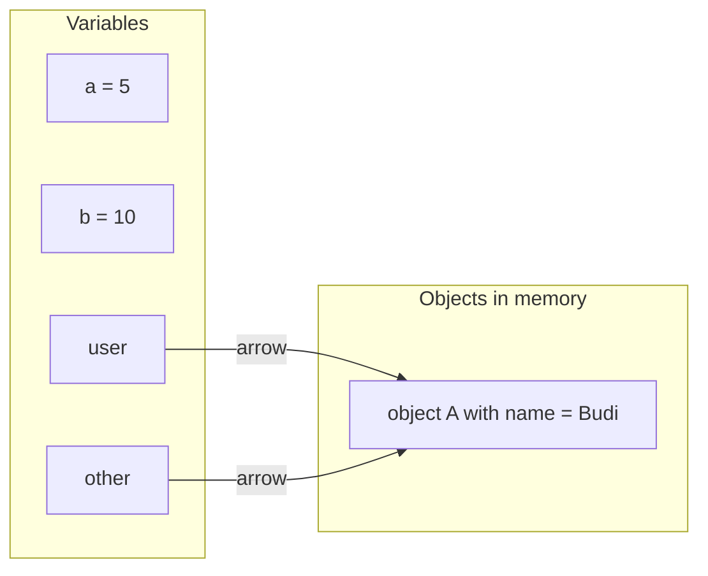
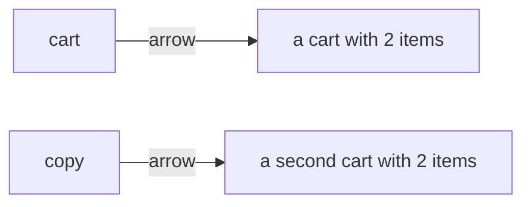
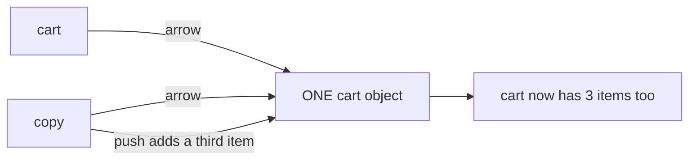
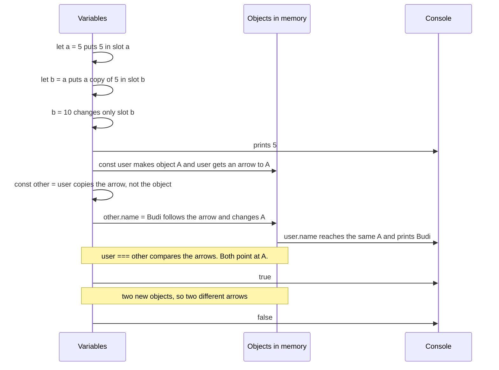
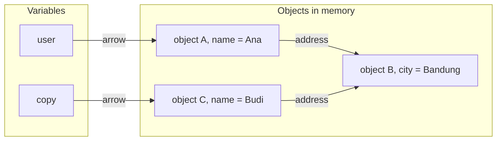
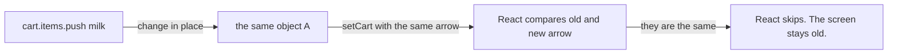
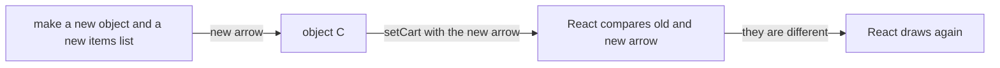
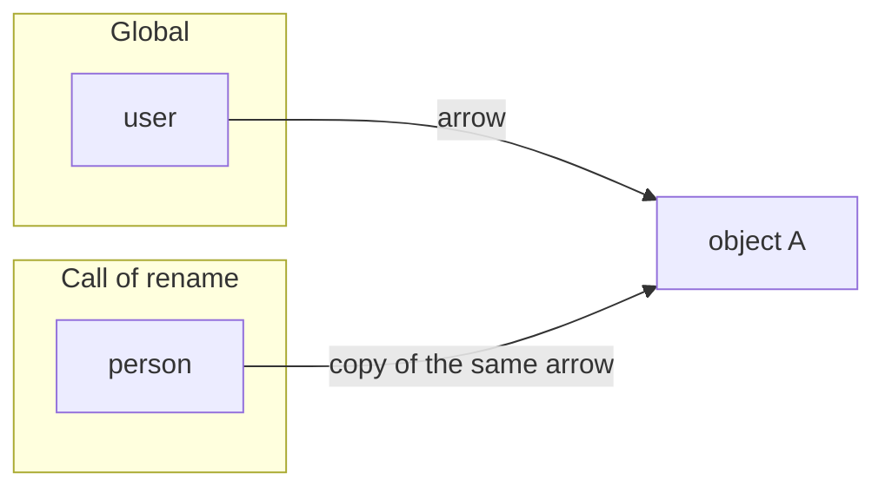

# 03. Reference vs copy

> **Subject:** JavaScript · **Lesson:** 03 · **Made:** 2026-10-15 · **Status:** ready
> **You will be able to:** draw what is in memory after `b = a` for a number and for an object, say why changing a "copy" can change the original, and choose between a shallow copy and a deep copy.
> **Before this:** [Values, types and coercion](02-values-types-and-coercion.md) · **Next:** [Functions](04-functions.md)

## 1. The idea in one sentence

When you copy a number or a piece of text, you get your own copy. When you copy an object, you only copy an **arrow** to the same object.

New words:

- **Simple value:** a number, text, `true`, `false`, `null` or `undefined`. It sits right inside the variable's slot, its place in memory. (Interview word: *primitive*.)
- **Arrow:** what a variable holds when its value is an object or an array. It points at the object. It is not the object. (Interview word: *reference*.)
- **Change in place:** changing the inside of an object that already exists, like `user.name = "Budi"` or `list.push(4)`. (Interview word: *mutate*.)
- **Shallow copy and deep copy:** a shallow copy makes a new outer object, but the objects inside it are still shared. A deep copy makes every level new.

The rule to remember: **`=` copies what is in the slot. For an object, what is in the slot is an arrow.**

## 2. The pictures

### 2a. The big picture

This is memory at the end of the code in section 4. Notice that the numbers sit inside the slots. The object sits outside, and two arrows point at it.



### 2b. The problem, drawn

You write `const copy = cart` and think you have two carts. Notice the difference.

**What you think happens:**



**What really happens:** there is one cart. You add an item through `copy`, and `cart` shows it too.



### 2c. How it works over time

This is the code from section 4, line by line. Notice that `=` never makes a new object. Only `{ }` does.



### 2d. What is in memory right now

This is the most confusing moment: just after a **shallow copy** has been changed. Notice the two arrows that point at object B.

```js
const user = { name: "Ana", address: { city: "Jakarta" } };
const copy = { ...user };            // a new outer object
copy.name = "Budi";
copy.address.city = "Bandung";       // <- we are here
```



`{ ...user }` (the three dots are called *spread*) makes a new object and copies each field of `user` into it. The names are separate, because A and C are two objects. The address is shared, because both hold an arrow to B. So `user.address.city` is now `"Bandung"`.

### 2e. Right against wrong: React state

React draws the screen again only when it gets a **new arrow**. Notice where the two paths split.

**Wrong:** change the object in place, then give React the same arrow.



**Right:** make a new object, then give React the new arrow.



### 2f. Passing an object to a function

The parameter (the name in the function's brackets, here `person`) gets a **copy of the arrow**. Notice that both arrows point at the same object.



So the function can change your object through its arrow. But if it points `person` at a new object, only its own slot changes. Your `user` still points at A.

## 3. Real life analogy

**A simple value is a sticky note** with "5" on it. Copying it gives you your own note. Write 10 on yours, and mine still says 5.

**An object is a house.** The variable holds a paper with the house address, not the house.

- `other = user` copies the paper. Two papers now lead to one house.
- Paint the door using one paper, and the owner of the other paper sees it too.
- `===` asks "same address?" It does not ask "do the houses look alike?"
- A shallow copy builds a new house. But it copies the paper that says where the garage is, not the garage. Both houses share one garage.

Where the analogy stops:

- You can read a real address. In JavaScript you never see the arrow itself.
- Long text is still a simple value. JavaScript never changes text in place, so sharing it is safe.

## 4. The smallest code that shows it

```js
let a = 5;
let b = a;        // b gets its own 5
b = 10;
console.log(a);   // 5

const user = { name: "Ana" };
const other = user;          // other gets a copy of the arrow
other.name = "Budi";         // changes the one object
console.log(user.name);      // Budi
console.log(user === other); // true: same arrow
console.log({ name: "Ana" } === { name: "Ana" }); // false: two objects
```

**Output:**

```
5
Budi
true
false
```

Look at the last line. Two objects with the same content are still **not** `===`. It compares arrows, not content.

## 5. What really happens, step by step

| Step | Line | What JavaScript does | Variables after | Objects after | Prints |
|---|---|---|---|---|---|
| 1 | 1 | Puts the number 5 in slot `a`. | a = 5 | none | |
| 2 | 2 | Reads 5 from `a`. Puts a **copy** of 5 in slot `b`. | a = 5, b = 5 | none | |
| 3 | 3 | Puts 10 in slot `b`. Slot `a` is not touched. | a = 5, b = 10 | none | |
| 4 | 4 | Reads slot `a`. | same | none | 5 |
| 5 | 6 | Makes **object A** with `name: "Ana"`. Puts an **arrow to A** in slot `user`. | user → A | A: name "Ana" | |
| 6 | 7 | Copies what is in slot `user`. That is the arrow. **No new object.** | user → A, other → A | A: name "Ana" | |
| 7 | 8 | Follows the arrow in `other` to A. Changes `name` inside A. | same | A: name "Budi" | |
| 8 | 9 | Follows the arrow in `user`. It reaches the same A. | same | A: name "Budi" | Budi |
| 9 | 10 | Compares two arrows. Both point at A. | same | A | true |
| 10 | 11 | Each `{ }` makes a new object. Two objects, so two different arrows. | same | A, plus two short-lived objects | false |

**Step through it yourself:** [open the reference vs copy stepper](visuals/03-reference-vs-copy.html). Variables are on the left, objects on the right, and a coloured line shows each arrow. It has seven programs, from "Copy a number" to "Shallow copy trap", "Deep copy" and "React state, a small model". Write your guess first, then press Next.

## 6. Why it exists and what it costs

- **Problem without it:** imagine `=` copied the whole object every time. Passing 10,000 orders to a function would copy 10,000 orders. That is slow and uses a lot of memory.
- **How it solves it:** JavaScript keeps each object in one place. Variables, fields and parameters only hold arrows to it. Copying an arrow is cheap, however big the object is.
- **Cost:**
  - **Surprise changes.** Change the object through one arrow, and every other arrow sees it.
  - **You must copy on purpose.** `=` never copies an object for you.
  - **`===` cannot check content.** Two objects with the same fields are still not equal.

### How to copy on purpose

| Way | What it copies | Good to know |
|---|---|---|
| `{ ...obj }` | one level (shallow) | the usual way. [Lesson 10](10-destructuring-spread-and-rest.md) covers the three dots |
| `Object.assign({}, obj)` | one level (shallow) | the older way, same result |
| `arr.slice()` or `[...arr]` | one level (shallow) | for arrays |
| `structuredClone(obj)` | every level (deep) | keeps `Date`, `Map` and `Set`. Throws an error if the data holds a function |
| `JSON.parse(JSON.stringify(obj))` | every level (deep) | loses things, see the next table |

**Why the JSON way loses things:** JSON is a text format for sending data. It only knows text, numbers, `true`, `false`, `null`, arrays and plain objects. JavaScript changes or drops anything else.

| In the original | After the JSON copy |
|---|---|
| a `Date` | a string, not a date |
| a field set to `undefined` | the field is gone |
| `NaN` | `null` |
| a `Set` or a `Map` | an empty object `{}` |
| a function | gone |
| an object that points at itself | it throws a `TypeError` |

Simple rule: use a shallow copy, and copy only the levels you change. Use `structuredClone` when you really need a full copy.

### Why React needs new objects

React checks if state changed by comparing the old arrow with the new arrow. (It uses `Object.is`, which works like `===` for objects.) If you change the object in place and pass the same arrow, React thinks nothing changed. It skips drawing.

```jsx
// Wrong: same object, same arrow
cart.items.push("milk");
setCart(cart);                     // React skips. The screen still shows the old cart.

// Right: a new object and a new items array
setCart({ ...cart, items: [...cart.items, "milk"] });
```

Checked on 2026-10-15 with React 19.3.1: the wrong version did not draw again, and the right version did.

<details><summary>Go deeper (optional)</summary>

- **All the simple values.** There are seven kinds: number, string (text), boolean (`true` and `false`), `null`, `undefined`, bigint and symbol. Everything else is an object, including arrays and functions.
- **Text is never changed in place.** `let t = "cat"; t[0] = "b";` leaves `t` as `"cat"`. Every text method gives back new text.
- **"Pass by value" or "pass by reference"?** JavaScript always copies what is in the variable's slot. That is *pass by value*. For an object, the value in the slot is the arrow. Some people call this *call by sharing*. It is not *pass by reference*: in a pass by reference language, `person = { ... }` inside a function would change the caller's variable too. In JavaScript it does not (see "Passing to a function" in the stepper).
- **Stack and heap.** Interviewers sometimes say "simple values live on the stack, objects live on the heap". This is a simplified picture. The engine may store things in other ways. What matters is the behavior: the value is copied, or the arrow is copied.
- **More about `structuredClone`:**
  - It is not part of the JavaScript language itself. Browsers and Node give it to you. It exists in Node 17 and newer.
  - It keeps an object that points at itself, without an error.
  - A class instance comes back as a plain object. Its methods are gone, and `copy instanceof MyClass` is `false`.
  - A getter is read once, and the copy gets a plain value. Private `#fields` are not copied.
- **`Object.freeze` is shallow too.** It stops changes to the top level only. See [lesson 01](01-variables-scope-and-hoisting.md).
- **Proof of the JSON table**, checked on 2026-10-15 with Node 24.15.0:

```js
const order = {
  when: new Date("2026-10-15T00:00:00Z"),
  note: undefined,
  total: NaN,
  tags: new Set(["vip"]),
  greet() { return "hi"; },
};
console.log(JSON.parse(JSON.stringify(order)));
// { when: '2026-10-15T00:00:00.000Z', total: null, tags: {} }
structuredClone(order);   // throws DataCloneError, because of greet
```

- **One note on the web.dev article** in the links below: it says `JSON.stringify` "will throw" on `Map`, `Set` and `Date`. In Node 24 it does not throw. It turns them into `{}` and a string, as the table shows.

</details>

## 7. Common mistakes

**Wrong:** thinking `=` makes a copy of an object.

```js
const cart = { items: ["tea"] };
const copy = cart;
copy.items.push("milk");
console.log(cart.items);   // [ 'tea', 'milk' ]
```

**Right:** make a new object on purpose: `const copy = { ...cart, items: [...cart.items] };`

**Why:** `copy = cart` copies the arrow. There is only one cart.

**Wrong:** a shallow copy, then a change deep inside it.

```js
const copy = { ...user };
copy.address.city = "Bandung";   // user.address.city is "Bandung" too
```

**Right:** copy every level on the path to the change.

```js
const safe = { ...user, address: { ...user.address, city: "Bandung" } };
// user.address.city is still "Jakarta"
```

**Why:** spread copies one level. The `address` field holds an arrow, and the arrow is copied, not the address.

**Wrong:** using `===` to check if two objects hold the same data.

```js
const a = { id: 1, name: "Ana" };
const b = { id: 1, name: "Ana" };
console.log(a === b);         // false
```

**Right:** compare the fields you care about: `a.id === b.id` gives `true`.

**Why:** `===` on objects compares arrows. `a` and `b` are two different objects.

**Wrong:** a function that changes the array you gave it.

```js
function sortedNames(list) { return list.sort(); }
const names = ["Citra", "Ana", "Budi"];
sortedNames(names);
console.log(names);   // [ 'Ana', 'Budi', 'Citra' ]  the original changed
```

**Right:** copy first: `return [...list].sort();` (or `list.toSorted()`, see [lesson 09](09-arrays-and-higher-order-functions.md)).

**Why:** the parameter `list` holds a copy of the arrow. `sort` changes the array in place, so the caller's array changes.

**Wrong:** a JSON copy of data that holds a date.

```js
const copy = JSON.parse(JSON.stringify({ when: new Date() }));
copy.when.getFullYear();   // TypeError: copy.when.getFullYear is not a function
```

**Right:** `structuredClone({ when: new Date() })` keeps it a real `Date`.

**Why:** JSON turns a date into a string.

## 8. Watch and play

Links checked on 2026-10-15: each page opened and was about this topic. For videos, the title and channel matched. Video lengths are not checked.

- **Video:** [Reference Vs Value In JavaScript](https://www.youtube.com/watch?v=-hBJz2PPIVE) by Web Dev Simplified. Watch it after the stepper. Listen for "primitive" and "reference".
- **Play with it:** [The reference vs copy stepper](visuals/03-reference-vs-copy.html) in this folder. Guess first, then press Next.
- **Play with it:** [Python Tutor for JavaScript](https://pythontutor.com/javascript.html). Paste the code from section 4 and click Visualize Execution. Watch two variables point at one object.
- **Read:** [Object references and copying](https://javascript.info/object-copy) on javascript.info. Pictures of one object with two arrows, and a part on `structuredClone`.
- **Read:** [structuredClone() on MDN](https://developer.mozilla.org/en-US/docs/Web/API/Window/structuredClone). Short. Look at the examples.
- **Read (React):** [Updating Objects in State](https://react.dev/learn/updating-objects-in-state). Read "Treat state as read-only", then try the challenge "Find and fix the mutation".

<details><summary>More links (optional)</summary>

- **Video:** [The Best Way to Deep Copy Objects in JavaScript - Structured Clone in 2 Minutes](https://www.youtube.com/watch?v=WLuEXwQiqac) by dcode. A short demo of `structuredClone`.
- **Read:** [Python Tutor's JavaScript guide](https://pythontutor.com/articles/javascript-visualizer.html). It says that after `b = a` "both variables now refer to the same array object, and the diagram shows it clearly."
- **Read:** [Shallow copy](https://developer.mozilla.org/en-US/docs/Glossary/Shallow_copy) and [Deep copy](https://developer.mozilla.org/en-US/docs/Glossary/Deep_copy) on MDN. Two short pages. The first lists which built-in tools make shallow copies.
- **Read:** [The structured clone algorithm](https://developer.mozilla.org/en-US/docs/Web/API/Web_Workers_API/Structured_clone_algorithm) on MDN. The full list of what `structuredClone` can and cannot copy.
- **Read:** [Deep-copying in JavaScript using structuredClone](https://web.dev/articles/structured-clone) on web.dev, by Surma. Why it was added. See the note in the Go deeper box in section 6.
- **Read (React):** [useState](https://react.dev/reference/react/useState), the part "I've updated the state, but the screen doesn't update". It shows the `Object.is` check.

</details>

## 9. Practice

**A. Predict the output** (write your answer before opening)

```js
const a = { score: 1, tags: ["new"] };
const b = { ...a };
const c = a;
b.score = 2;
b.tags.push("hot");
c.score = 3;
console.log(a.score, a.tags.length);
console.log(a === c, a === b, a.tags === b.tags);
```

<details><summary>Answer</summary>

```
3 2
true false true
```

- `c` holds the same arrow as `a`, so `c.score = 3` changes `a`.
- `b` is a new object, so `b.score = 2` does not touch `a`.
- `b.tags` holds a copy of the arrow to the **same** array. So `push` adds to the array that `a` sees too.

</details>

**B. Fix the bug**

```js
function addDiscount(order) {
  order.total = order.total * 0.9;
  return order;
}
const order = { id: 7, total: 100 };
const discounted = addDiscount(order);
console.log(order.total, discounted.total);   // 90 90, but the original should stay 100
```

<details><summary>Answer</summary>

The parameter `order` holds a copy of the arrow, so the function changes the caller's object. Return a new object instead:

```js
function addDiscount(order) {
  return { ...order, total: order.total * 0.9 };
}
// prints 100 90
```

</details>

**C. Write it yourself**

Open `practice/03-reference-vs-copy.js`. There are four tasks:

1. Fix `addItem` so it gives back a new cart and leaves the old one alone.
2. Write `moveTo(user, city)`, which copies only the path to the change.
3. Write `deepCopy(value)` by hand, for plain objects and arrays.
4. Write down what six snippets print.

Run the tests from the folder that contains `learn/`:

```
node --test learn/javascript/practice/03-reference-vs-copy.test.js
```

At the start, three tests already pass. Two of them pass only because the empty functions do nothing yet. The bug in `addItem` only shows when you look at the old cart.

<details><summary>One possible answer</summary>

```js
function addItem(cart, item) {
  return { ...cart, items: [...cart.items, item] };   // new cart, new items array
}

function moveTo(user, city) {
  return { ...user, address: { ...user.address, city } };   // copy the path only
}

function deepCopy(value) {
  if (value === null || typeof value !== "object") return value;   // simple value
  if (Array.isArray(value)) return value.map(item => deepCopy(item));
  const copy = {};
  for (const key of Object.keys(value)) {
    copy[key] = deepCopy(value[key]);
  }
  return copy;
}

const predictions = {
  s1: ["1", "2"],
  s2: ["5", "true"],
  s3: ["false", "true"],
  s4: ["2"],
  s5: ["2", "2"],
  s6: ["string", "false"],
};
```

Why `value === null` comes first in `deepCopy`: `typeof null` is `"object"`, an old mistake in the language. Without that check, the function would try to copy `null` like an object.

</details>

## 10. Interview question

**Q:** "Is JavaScript pass by value or pass by reference? What is the difference between a shallow copy and a deep copy?"

<details><summary>A strong answer, in four parts</summary>

1. **Problem:** copying a whole object on every `=` or function call would be slow. So JavaScript shares objects. The price is that a "copy" can change the original by surprise.
2. **How it works:** JavaScript always copies what is in the variable's slot.
   - For a simple value, the slot holds the value, so you get your own copy.
   - For an object, the slot holds a reference (an arrow). You get a second arrow to the same object.
   - So it is pass by value, and for objects the value is the reference. A function can change your object through it. But if it points the parameter at a new object, your variable does not change.
   - `===` on objects compares references, not content.
   - A shallow copy (`{ ...obj }`, `Object.assign`, `slice`) makes a new outer object, but nested objects are shared. A deep copy (`structuredClone`) makes every level new.
3. **Tradeoff:** a shallow copy is cheap. In React it is what you want: copy only the levels you change, and share the rest. A deep copy costs time and memory on big data, and `structuredClone` throws on functions. `JSON.parse(JSON.stringify())` loses dates, `undefined`, `Map` and `Set`.
4. **My example:** *This is an idea, not a fact. Replace it with your own real story from DBO, Unloan, ZWS or Skyworx.* In a React admin screen like the DBO CMS, a product form may hold nested data, like a price inside a variant. To update the price, I copy the product, the variants list and that one variant. If I change the variant in place instead, React sees the same arrow and the screen does not update.

</details>

## 11. Explain it back

Close this file. Press the **Record my explanation** button under this heading and explain reference vs copy out loud, like to a new junior, in 4 parts: problem, how it works, tradeoff, my example. Use the words "slot", "arrow" and "shallow copy". Then save the transcript file into `my-learning/recordings/`, or write your best version below. Run `/explain-check reference vs copy` or ask the `explain-coach` agent to review it.

### My explanation

<write here>

### Coach feedback

<the explain-coach agent writes here>

## 12. Review questions (day 1, 3, 7, 21)

1. After `let b = a`, what is in `b`'s slot when `a` holds 5? And when `a` holds an object?
2. Why does `{ ...user }` not protect `user.address`? Name one way that does.
3. Why does React not draw again after `cart.items.push(x); setCart(cart)`?
4. Draw the picture from section 2d from memory: two variables, three objects, and four arrows.

<details><summary>Answers</summary>

1. With 5, `b`'s slot holds its own copy of 5. With an object, `b`'s slot holds a copy of the arrow, so `a` and `b` point at the same object.
2. Spread copies one level. The field `address` holds an arrow, so the copy gets the same arrow to the same address object. To protect it, copy that level too, `{ ...user, address: { ...user.address } }`, or make a deep copy with `structuredClone(user)`.
3. `push` changes the array in place, so `cart` is still the same object. React compares the old and new arrow with `Object.is`. They are the same, so React thinks nothing changed and skips drawing.
4. `user` points at object A (name Ana). `copy` points at object C (name Budi). A's `address` and C's `address` both point at object B (city Bandung).

</details>

## Connected lessons

- [Variables, scope and hoisting](01-variables-scope-and-hoisting.md): `const` protects the arrow, not the object.
- [Values, types and coercion](02-values-types-and-coercion.md): the lesson before. It lists the simple values.
- [Functions](04-functions.md): the next lesson. Parameters work as in picture 2f.
- [Closures](05-closures.md): a function keeps a link to its slot, not a copy of the values.
- [Arrays and higher order functions](09-arrays-and-higher-order-functions.md): which methods change the array in place.
- [Destructuring, spread and rest](10-destructuring-spread-and-rest.md): the three dots in detail.
- Memory and garbage collection (lesson 17, not written yet): what happens to an object when no arrow points at it.
