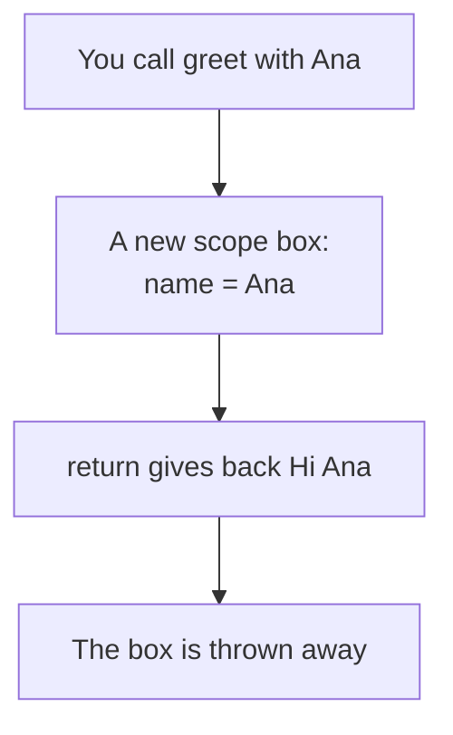
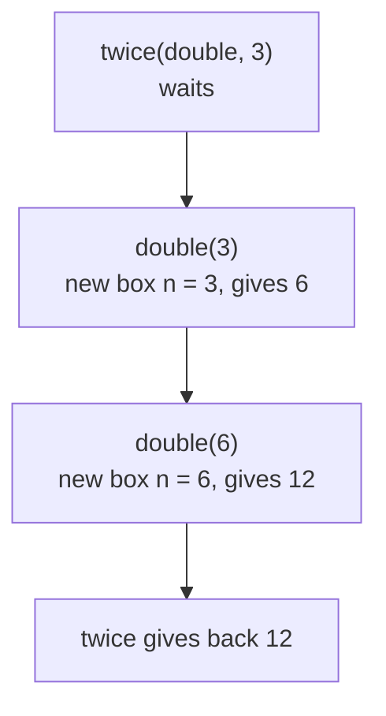
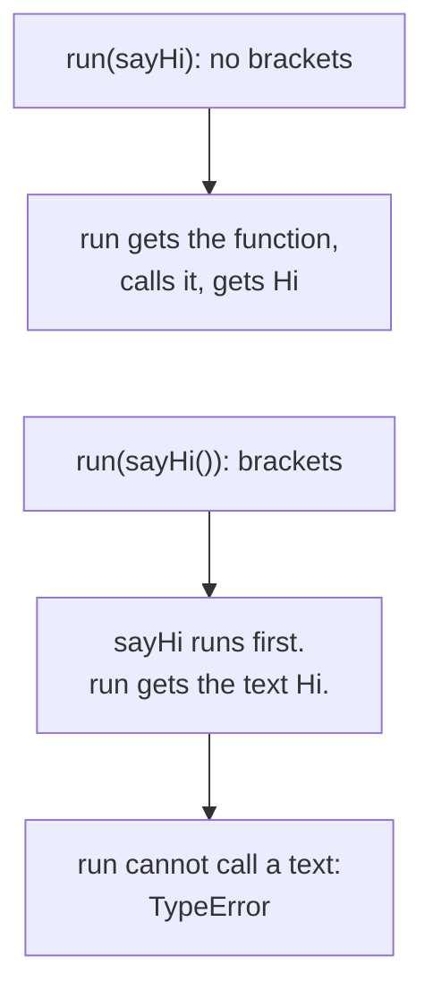

# 04. Functions

> **Subject:** JavaScript · **Lesson:** 04 · **Made:** 2026-10-15 · **Remade in short cards:** 2026-10-28 · **Status:** ready
>
> **You will be able to:** write a function in three ways and say which one you can call before its line, say what one call puts on the call stack, and pass a function to another function without calling it.
>
> **Before this:** [Reference vs copy](03-reference-vs-copy.md) · **Next:** [Closures](05-closures.md)
>
> **How to read it:** one card is one idea. Look at the picture, guess, then press the orange bar to check. The blue bars (📖 More detail) hold the longer explanation. Skip them on the first read, and open them when you want more. About 25 minutes for the cards.

## 1. The idea: a recipe card

A function is a **recipe card**. Writing the card is not cooking. Each time you cook, you get a clean worktop, and you hand over one finished dish.



Notice: every call starts with a **new box** and ends by giving one value back.

<details class="guess"><summary>🤔 Guess: a function reaches its end with no `return`. What does the call give back? Press to check.</summary>

`undefined`. A card with no "serve" step hands over nothing.

</details>

> **Remember:** a function is steps you write once and run many times. Each call gets its own new box, and gives one value back.

<details class="more"><summary>📖 More detail: the four words, and where the recipe picture stops</summary>

- **Scope box:** the place in memory where the names of one call live. Every call makes a **new** box. (Interview word: *execution context*.)
- **Call stack:** the list of calls that are running now. A new call goes on top. When it is done, it leaves.
- **Parameter and argument:** a parameter is a name in the brackets where you write the function, like `name`. An argument is the value you put in when you call it, like `"Ana"`. A parameter can have a **default**, a value used when no argument comes in: `word = "Hello"`.
- **Return value:** the value a call gives back. With no `return`, you get `undefined`.

Words from lesson 01: a **slot** is a named place that holds one value. A **locked** slot is a `let` or `const` slot before its line runs.

In the recipe picture: the blanks on the card ("use ___ eggs") are the parameters, and what you fill in today (3) is the argument. A step can say "now make the sauce card": you stop the cake, make the sauce, then continue. That is the call stack.

Where the picture stops: in real life you might hand over a photocopy. In JavaScript nothing is copied. Both names point at the **same** function. A function also remembers the kitchen where it was written. That is lesson 05.

</details>

## 2. Three ways to write a function

```js
function greet(name, word = "Hello") {
  return word + " " + name;
}
const double = function (n) {
  return n * 2;
};
const twice = (fn, x) => fn(fn(x));
console.log(greet("Ana", "Hi"));
console.log(greet("Budi"));
console.log(greet());
console.log(twice(double, 3));
```

The first is a **declaration**, the second an **expression**, the third an **arrow**. The last line, `twice(double, 3)`, runs like this:



<details class="guess"><summary>🤔 Guess: what are the four lines of output? Press to check.</summary>

```
Hi Ana
Hello Budi
Hello undefined
12
```

`greet("Budi")` has no second argument, so the default `"Hello"` goes in. `greet()` has no arguments at all: a missing argument is not an error, it is `undefined`. `twice(double, 3)` is `double(double(3))`: 6, then 12.

</details>

> **Remember:** a missing argument is `undefined`, not an error. A default fills in only when no value comes in.

<details class="more"><summary>📖 More detail: each call, step by step</summary>

| Step | Line | What happens | Call stack | Boxes alive | Prints |
|---|---|---|---|---|---|
| 1 | setup | JavaScript makes the Global box. `greet` holds the whole function. `double` and `twice` are locked. | main | Global | |
| 2 | 4 | JavaScript makes a function and puts it in `double`. | main | Global | |
| 3 | 7 | JavaScript makes an arrow function and puts it in `twice`. | main | Global | |
| 4 | 8 | `greet("Ana", "Hi")` is called. A new box: `name = "Ana"`, `word = "Hi"`. | main, greet | Global, greet box | |
| 5 | 2 | It gives back `"Hi Ana"`. The call leaves. Its box is thrown away. | main | Global | Hi Ana |
| 6 | 9 | `greet("Budi")`. A new box: `name = "Budi"`. `word` got nothing, so the default `"Hello"` goes in. | main, greet | Global, greet box | |
| 7 | 2 | It gives back `"Hello Budi"`. Its box is thrown away. | main | Global | Hello Budi |
| 8 | 10 | `greet()`. A new box: `name` is `undefined`, `word` is `"Hello"`. It gives back `"Hello undefined"`. | main | Global | Hello undefined |
| 9 | 11 | `twice(double, 3)`. A new box: `fn` points at the `double` function, `x = 3`. | main, twice | Global, twice box | |
| 10 | 7 | The inner `fn(x)` runs first. It calls `double(3)`. A new box: `n = 3`. `twice` is paused. | main, twice, double | Global, twice box, double box | |
| 11 | 5 | `double` gives back 6. Its box is thrown away. | main, twice | Global, twice box | |
| 12 | 7 | The outer `fn(6)` calls `double` again. **Another new box**: `n = 6`. | main, twice, double | Global, twice box, new double box | |
| 13 | 5 | `double` gives back 12. Its box is thrown away. | main, twice | Global, twice box | |
| 14 | 7 | `twice` gives back 12 and leaves. Its box is thrown away. | main | Global | 12 |

Two more facts:

- **Extra arguments are ignored.** `greet("Ana", "Hi", "x")` works the same. To collect any number of arguments, use rest parameters, `...args` (lesson 10).
- **Parameters are slots inside the call box.** Two calls never share them. That is why `n = 3` and `n = 6` never mix.

Checked on 2026-10-28 with Node 26.12.1.

</details>

## 3. Mistake 1: calling a function before its line

Before line 1, JavaScript makes a slot for every name (hoisting, lesson 01). What sits in the slot depends on how you wrote the function.

| Written as | Slot before its line | Calling early gives |
|---|---|---|
| declaration | the whole function | works anywhere |
| `const` or `let` with an expression | locked | `ReferenceError` |
| `const` or `let` with an arrow | locked | `ReferenceError` |
| `var` with an expression | `undefined` | `TypeError` |

```js
console.log(b());
const b = () => "b";
```

<details class="guess"><summary>🤔 Guess: what does this print? Press to check.</summary>

```
ReferenceError: Cannot access 'b' before initialization
```

The `const` slot is locked until its line runs. Only a declaration slot holds the whole function from the start.

Fix: call it after its line, or write it as a function declaration.

</details>

> **Remember:** only the **slots** are made early. A declaration is ready anywhere in the file. An arrow or expression is ready only after its line.

<details class="more"><summary>📖 More detail: the `var` case, and the wrong picture</summary>

The wrong picture is "every function is made before line 1, so I can call any of them early". Only the slots are made early. With `var c = function () {}`, the slot holds `undefined`, so calling it early gives `TypeError: c is not a function`.

</details>

## 4. A function is a value

You can store a function, pass it in, or give it back, like a number.

| You can | Example | It leads to |
|---|---|---|
| store it in a slot | `const hello = sayHi` | |
| pass it into another function | `runTwice(sayHi)` | `map` and `filter` (lesson 09) |
| give it back from a call | `return` a function | closures (lesson 05) |

<details class="guess"><summary>🤔 Guess: `const double = function...` and the parameter `fn` in `twice(double, 3)`. Are they two functions, or one? Press to check.</summary>

**One.** The slot `double` and the slot `fn` point at the **same** function. Nothing is copied. A function you pass in, so another function can call it later, is a **callback**.

</details>

> **Remember:** a function is a value. The interview word is *first-class functions*.

<details class="more"><summary>📖 More detail: what the call stack holds in the middle</summary>

At the moment inside the first `double` call, three calls are on the stack: `double` (with `n = 3`) on top, `twice` paused under it, and the main script at the bottom. `twice` waits while `double` runs, and `double` gets a new box each time.

</details>

## 5. Mistake 2: passing `fn()` when you meant `fn`

Brackets mean **call it now**.

```js
function sayHi() { return "Hi"; }
function run(fn) { return fn(); }
console.log(run(sayHi()));
```



<details class="guess"><summary>🤔 Guess: does `run(sayHi())` work? Press to check.</summary>

No:

```
TypeError: fn is not a function
```

`sayHi()` runs first and gives back the text `"Hi"`. Then `run` tries to call a text, which fails.

Fix: `run(sayHi)`, no brackets. It prints `Hi`. `run` gets the function and calls it when it wants.

</details>

> **Remember:** brackets mean "call it now". Pass `fn`, not `fn()`.

<details class="more"><summary>📖 More detail: the same bug in React</summary>

In React it is the same: `onClick={handleClick}`, not `onClick={handleClick()}`. The second one runs during render.

</details>

## 6. Mistake 3: an arrow with braces and no `return`

```js
const double = (n) => {
  n * 2;
};
console.log(double(4));
```

<details class="guess"><summary>🤔 Guess: what does `double(4)` give? Press to check.</summary>

`undefined`. With curly braces, an arrow is like any function. It reaches its end with no `return`.

Fix: add `return`, or remove the braces.

```js
const double = (n) => n * 2;
```

Now `double(4)` is `8`.

</details>

> **Remember:** an arrow without braces returns the value. An arrow with braces needs `return`.

<details class="more"><summary>📖 More detail: an arrow that returns an object</summary>

`() => { id: 1 }` gives `undefined`, because JavaScript reads the curly braces as the body. Write `() => ({ id: 1 })`. The Go deeper card has more small traps.

</details>

## 7. Watch it run, step by step

The stepper has two panels: the **call stack** and the **scope boxes**. It has six programs: "Before its line", "Missing argument", "No return", "Pass a function", "fn or fn()", and "Nested calls", which is the code from card 2. Write your guess first, then press Next.

**Step through it yourself:** [open the functions stepper](visuals/04-functions.html).

## 8. Why it matters and what it costs

- **Without it,** you copy the same steps into many places. One change needs many edits, and one gets missed.
- **With it,** you write the steps **once** and call them from anywhere. Each call gets its **own box**, so two calls never disturb each other. Because a function is a value, you can pass in **what to do**. One `twice` works with `double`, `square` or anything else. This is the idea behind `map` and `filter` (lesson 09).
- **The cost:**
  - Every call takes a place on the call stack and a new box. This is tiny. Only very deep calls run out of room.
  - Many tiny functions make code jump around, which is harder to read.
  - A declaration can be called before its line. Handy, but the file no longer reads top to bottom.

**Which one to pick:**

- **Declaration** for a named helper. It is ready anywhere in the file.
- **Arrow** for a short function you pass in, like `prices.map(p => p * 2)`.
- **Expression** when you want the function to exist only after its line.
- Many teams use `const` with arrows everywhere. Both styles are fine. Pick one and be consistent.
- Arrow functions also handle `this` differently. That is lesson 06.

## 9. Watch and play

Links checked on 2026-10-15. Each page opened. For each video, the title and channel matched. The video lengths are not checked.

- **Video:** [How functions work in JS & Variable Environment, Namaste JavaScript Ep. 4](https://www.youtube.com/watch?v=gSDncyuGw0s) by Akshay Saini. A new box for every call, and the call stack. He says "execution context" for the box.
- **Video:** [First Class Functions ft. Anonymous Functions, Namaste JavaScript Ep. 13](https://www.youtube.com/watch?v=SHINoHxvTso) by Akshay Saini. Declaration against expression, and functions as values.
- **Video:** [JavaScript ES6 Arrow Functions Tutorial](https://www.youtube.com/watch?v=h33Srr5J9nY) by Web Dev Simplified. How to turn a normal function into an arrow. Skip the `this` part until lesson 06.
- **Play with it:** [The functions stepper](visuals/04-functions.html) in this folder. Guess first, then press Next.
- **Play with it:** [Python Tutor for JavaScript](https://pythontutor.com/javascript.html). Paste the code from card 2. Its [guide](https://pythontutor.com/articles/javascript-visualizer.html) says each function call gets its own frame. Watch the frames appear and go.
- **Read:** [Function expressions](https://javascript.info/function-expressions) on javascript.info. Read "Function is a value" and "Function Expression vs Function Declaration".
- **Read:** [Call stack](https://developer.mozilla.org/en-US/docs/Glossary/Call_stack) on MDN. A short page with a step list of what goes on and off the stack.

<details><summary>More links (optional)</summary>

- **Read:** [Functions](https://javascript.info/function-basics) on javascript.info. Parameters, default values, and `return`.
- **Read:** [Arrow functions, the basics](https://javascript.info/arrow-functions-basics) on javascript.info. See "Multiline arrow functions" for the missing `return` bug.
- **Read:** [Functions guide on MDN](https://developer.mozilla.org/en-US/docs/Web/JavaScript/Guide/Functions). See "Function hoisting" and "Default parameters".
- **Read:** [Default parameters on MDN](https://developer.mozilla.org/en-US/docs/Web/JavaScript/Reference/Functions/Default_parameters). See "Passing undefined vs. other falsy values".
- **Read:** [First-class function on MDN](https://developer.mozilla.org/en-US/docs/Glossary/First-class_Function). Three short examples: store, pass, return.

</details>

## 10. Practice

**A. Predict the output** (write your answer before opening)

```js
console.log(total(10));
function total(price, qty = 2) {
  return price * qty;
}
console.log(total(10, 3));
const half = (n) => { n / 2; };
console.log(half(8));
console.log(typeof half);
```

<details><summary>Answer</summary>

```
20
30
undefined
function
```

- Line 1 works: `total` is a declaration, so it is ready before its line. `qty` is missing, so the default 2 is used.
- `total(10, 3)` uses the 3 you passed.
- `half` has curly braces and no `return`, so it gives back `undefined`.
- A function is a value, and its type is `"function"`.

</details>

**B. Fix the bug**

This should print `working`, then `done`.

```js
function sayDone() {
  console.log("done");
}
function runLater(callback) {
  console.log("working");
  callback();
}
runLater(sayDone());
```

<details><summary>Answer</summary>

It prints `done`, then `working`, then `TypeError: callback is not a function`.

`sayDone()` has brackets, so it runs **first**, before `runLater`. It prints `done` and gives back `undefined`. So `callback` is `undefined`, and calling it fails.

Fix: pass the function, not its result.

```js
runLater(sayDone);   // prints working, then done
```

</details>

**C. Write it yourself**

Open `practice/04-functions.js`. There are five tasks:

1. Fix `addFee`, which gives back `undefined`.
2. Write `formatPrice(amount, currency)` with a default currency.
3. Write `applyTimes(fn, times, start)`, which calls a function you pass in.
4. Write `getOperation(name)`, which gives back a function.
5. Write down what six snippets print.

Run the tests from the folder that contains `learn/`:

```
node --test learn/javascript/practice/04-functions.test.js
```

At the start, all 16 tests fail. That is expected.

<details><summary>One possible answer</summary>

```js
const addFee = (price) => price + 10;      // or keep the braces and add return

function formatPrice(amount, currency = "IDR") {
  return currency + " " + amount;
}

function applyTimes(fn, times, start) {
  let result = start;
  for (let i = 0; i < times; i++) {
    result = fn(result);                    // call the function you were given
  }
  return result;
}

const double = (n) => n * 2;
const square = (n) => n * n;
const same = (n) => n;

function getOperation(name) {
  if (name === "double") return double;     // no brackets: give back the function
  if (name === "square") return square;
  return same;
}

const predictions = {
  s1: ["function", "undefined"],
  s2: ["1", "undefined"],
  s3: ["5", "0"],
  s4: ["undefined", "2"],
  s5: ["hi", "function", "true"],
  s6: ["a starts", "b runs", "a ends"],
};
```

Why `s6` is in that order: `a` is paused while `b` is on top of the stack. When `b` is done, `a` continues.

</details>

## 11. Interview question

**Q:** "What is the difference between a function declaration, a function expression and an arrow function? What does this print? And what does 'functions are first-class' mean?"

```js
console.log(a());
console.log(b());
function a() { return "a"; }
const b = () => "b";
```

<details><summary>A strong answer, in four parts</summary>

1. **Problem:** you need steps you can run many times with different values. And you often need to hand those steps to other code, like `map`, a timer or a click handler.
2. **How it works:**
   - Every call goes on the call stack and gets a new scope box. The arguments go into the parameter slots. A missing one is `undefined`, unless it has a default. The call gives back its return value, or `undefined`, then leaves the stack.
   - Before line 1, JavaScript makes the slots. A **declaration** slot holds the whole function, so you can call it early. An **expression** or **arrow** in a `const` slot is locked until its line runs.
   - So the code prints `a`, then throws `ReferenceError: Cannot access 'b' before initialization`.
   - **First-class** means a function is a value. You can store it, pass it in, and give it back. Passing it in gives you callbacks and `map` and `filter`. Giving it back gives you closures.
3. **Tradeoff:** declarations are ready anywhere, but the file stops reading top to bottom. Arrows are short and good for callbacks, but they treat `this` differently (lesson 06). Every call costs a stack place and a box, which only matters for very deep calls.
4. **My example:** *This is an idea, not a fact. Replace it with your own real story from DBO, Unloan, ZWS or Skyworx.* In an Express API, `app.get("/orders", (req, res) => { ... })` passes an arrow function. Express calls it later, once per request. In React Native, `onPress={handlePress}` passes the function. `onPress={handlePress()}` would run it during render.

</details>

## 12. Explain it back

Close this file. Press the **Record my explanation** button under this heading and explain functions out loud, like to a new junior, in 4 parts: problem, how it works, tradeoff, my example. Use the words "call stack", "scope box" and "return value". Then save the transcript file into `my-learning/recordings/`, or write your best version below. Run `/explain-check functions` or ask the `explain-coach` agent to review it.

### My explanation

<write here>

### Coach feedback

<the explain-coach agent writes here>

## 13. Review questions (day 1, 3, 7, 21)

1. Which of the three ways to write a function can you call before its line, and why?
2. What happens on the call stack and in memory when you call `greet("Budi")`? What is in the `word` slot?
3. What is the difference between `run(sayHi)` and `run(sayHi())`?
4. Draw the picture from card 4 from memory: the call stack with three calls, the boxes, and the two slots that point at one function.

<details><summary>Answers</summary>

1. Only a function declaration. Before line 1, JavaScript puts the whole function in its slot. A function expression or arrow in `const` or `let` is in a locked slot until its line runs, so calling it early is a `ReferenceError`. With `var`, the slot holds `undefined`, so it is a `TypeError`.
2. The call goes on top of the stack and gets a new scope box. `name` gets `"Budi"`. `word` got no argument, so it would be `undefined`, but it has a default, so it holds `"Hello"`. The call gives back `"Hello Budi"`, leaves the stack, and its box is thrown away.
3. `run(sayHi)` hands over the function, and `run` calls it when it wants. `run(sayHi())` calls `sayHi` first and hands over what it gave back. If that is not a function, `run` cannot call it.
4. The stack is main, then `twice` (paused), then `double` with `n = 3` on top. The Global box holds `greet`, `double` and `twice`. The `twice` box holds `fn` and `x = 3`. The `double` box holds `n = 3`. The slot `double` and the slot `fn` both point at the same function.

</details>

## 14. Go deeper (optional)

Open these when you are ready. None of them is needed for the cards above.

<details><summary>More</summary>

All of these were run with Node 24.15.0 on 2026-10-15.

- **A default fills in only for `undefined`.** `function f(x = 5) { return x; }` gives `f(null)` = `null`, `f(undefined)` = `5`, `f(0)` = `0`. MDN shows this in "Passing undefined vs. other falsy values".
- **`return` on its own line gives `undefined`.** If you write `return` and put the value on the next line, JavaScript ends the line after `return` and gives back `undefined`. Keep the value on the same line as `return`.
- **An arrow that gives back an object needs round brackets.** `() => { id: 1 }` gives `undefined`, because JavaScript reads the curly braces as the body. Write `() => ({ id: 1 })`.
- **An object you pass in is not copied.** The parameter points at the same object. So `function rename(user) { user.name = "Budi"; }` changes the object you passed in. See lesson 03.
- **The stack has a size limit.** A function that calls itself forever fills the stack. Node throws `RangeError: Maximum call stack size exceeded`.
- **Arrow functions have no `arguments` object and cannot be used with `new`.** See lessons 06 and 08.
- **`typeof` of any function is `"function"`.** That includes arrows.

</details>

## Connected lessons

- [Variables, scope and hoisting](01-variables-scope-and-hoisting.md): why a declaration is ready before its line and a `const` is locked.
- [Reference vs copy](03-reference-vs-copy.md): when you pass an object into a function, the function can change it.
- [Closures](05-closures.md): the next lesson. A function given back from a call remembers the box where it was made.
- [this, call, apply and bind](06-this-call-apply-and-bind.md): how arrow functions and normal functions differ in `this`.
- [Arrays and higher order functions](09-arrays-and-higher-order-functions.md): `map`, `filter` and `reduce` take a function you pass in.
- [Destructuring, spread and rest](10-destructuring-spread-and-rest.md): `...args` collects any number of arguments.
- [The event loop](11-the-event-loop.md): a timer callback is a function you pass in, which runs later when the stack is empty.
