# 05. Closures

> **Subject:** JavaScript · **Lesson:** 05 · **Made:** 2026-10-12 · **Status:** ready
> **You will be able to:** say what a closure is in one sentence, draw the scope box that stays alive after `makeCounter` has finished, and explain why two counters do not share `count`.
> **Before this:** Functions (lesson 04, not written yet) · **Next:** [this, call, apply and bind](06-this-call-apply-and-bind.md)

## 1. The idea in one sentence

A **closure** is a function **plus a link to the scope where it was created**. Because of that link, the function can still read and change those variables later, even after the outer function has finished.

New words, in plain English:

- **Scope box:** the place in memory where the names of one scope live. The proper name is **environment**. Every call of a function makes a **new** scope box. Lesson 01 called the same idea a "room".
- **Outer link:** every scope box points to the box around it. When a name is not found in one box, the engine follows this link to the next box.
- **Lexical scope:** "lexical" means "by where the code is written". A function finds names by **where it was written**, not by where it is called.
- **Call stack:** the list of calls that are running right now. When a call ends, it leaves the stack.
- **Garbage collector:** the part of the engine that frees memory that nothing points at any more.
- **Stale closure:** a function that keeps reading an old scope box, so it sees an old value.

The one rule to carry: **a function carries a link to the box where it was created. A box stays alive as long as something points at it.**

## 2. The pictures (at least five)

### 2a. The big picture

When `makeCounter` finishes, it leaves the call stack. Notice that its scope box does **not** disappear, because the inner function points at it.

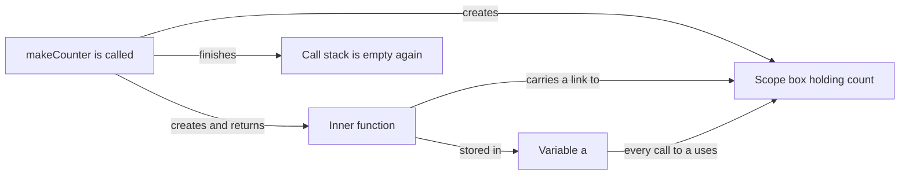

### 2b. The problem, drawn

Without closures, you have two bad choices when a function must remember something. Notice what each one breaks.

**Choice 1: a local variable.** It dies when the call ends, so the function forgets.

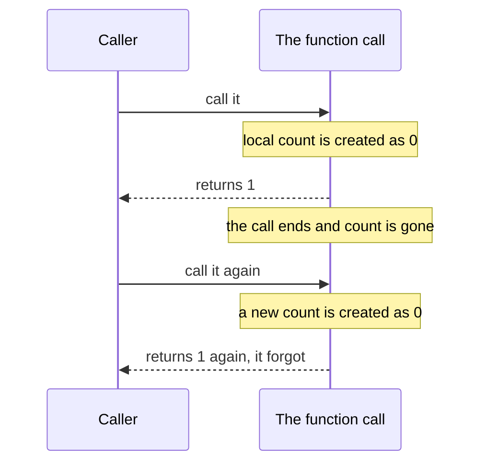

**Choice 2: a global variable.** It survives, but everyone shares it and anyone can change it.

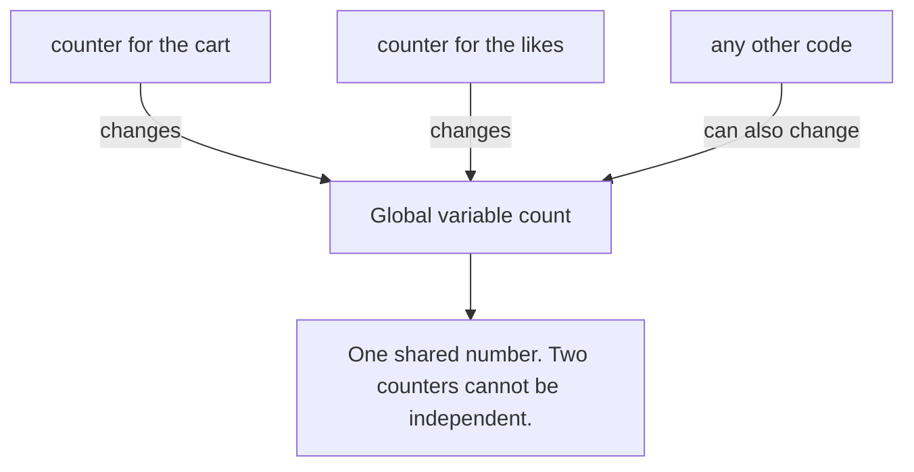

### 2c. How it works over time

This is the program from section 4. Notice the note in the middle: the stack is empty, but box 1 is still alive.

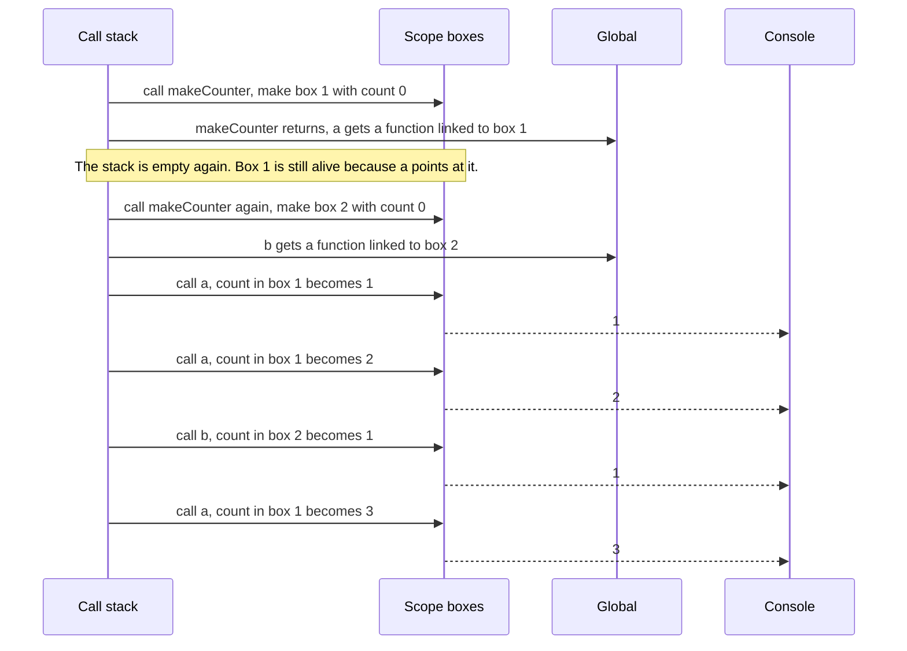

### 2d. What is in memory right now

A snapshot taken after line 9, `const b = makeCounter();`. The call stack holds only the script itself. Notice that **two** boxes are alive, and each function points at its own box.

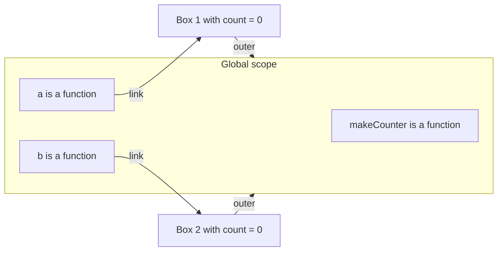

### 2e. Right against wrong

There are two wrong pictures. Both are common in interviews.

**Wrong picture 1:** "A function reads names from the place that calls it."

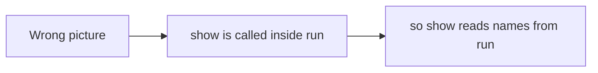

**Right picture 1:** lexical scope. Only the place where the function was written matters.

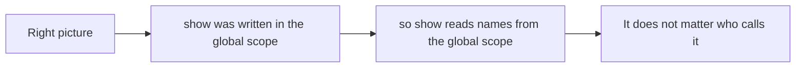

**Wrong picture 2:** "A closure copies the value when it is created."

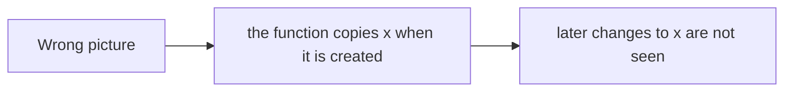

**Right picture 2:** it keeps a link to the **box**, not a copy of the value.

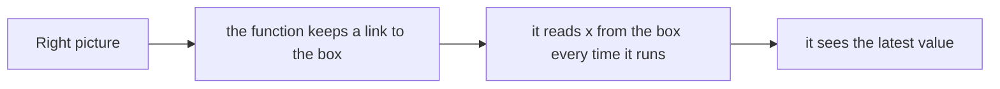

### 2f. The loop callbacks are closures

Lesson 01 promised this picture. With `var` there is one box. With `let` every pass of the loop has its own box. Notice which box each callback points at.

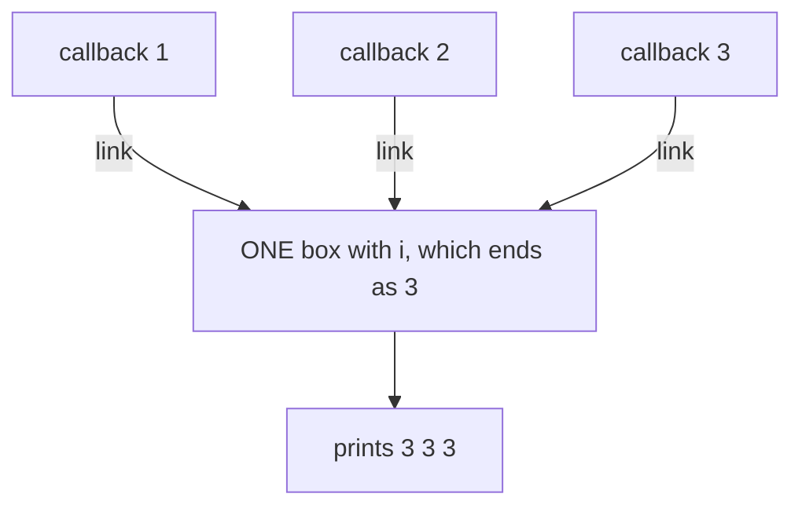

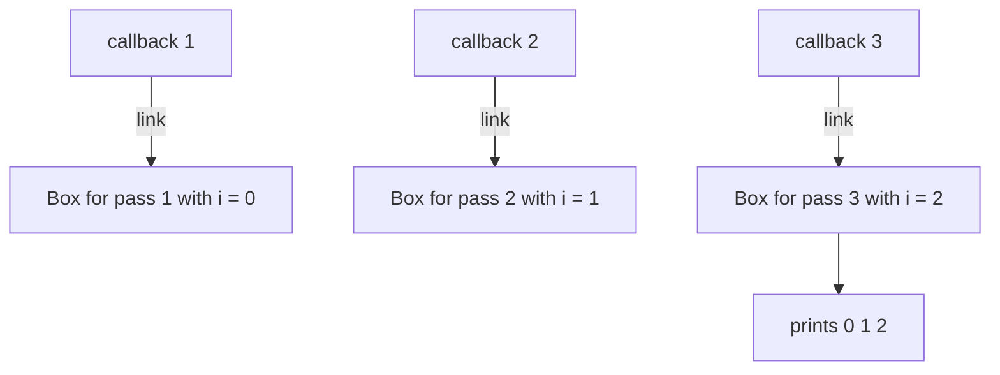

### 2g. How the engine finds a name

When `a()` runs and needs `count`, it follows the links. Notice that it never looks at the box that **called** `a`.

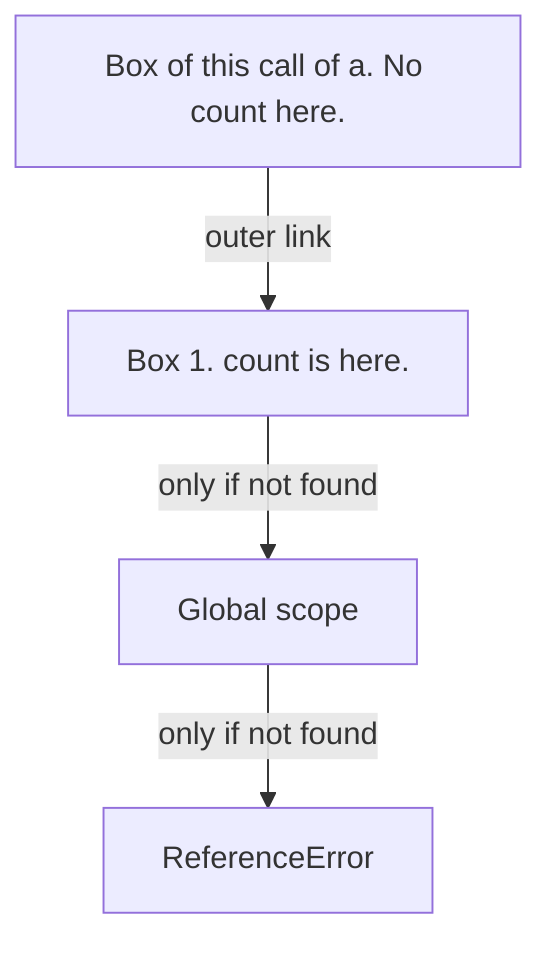

## 3. Real life analogy

A school has a rule: every new student gets **their own locker**, and a **key** to it. The locker holds a number, `count`. Student A and student B each have their own locker.

- The school day ends. The office closes (the outer function finishes, the call leaves the stack).
- The lockers are **not** removed, because a student still has a key.
- Student A opens locker A and adds one. Student B cannot touch locker A. They have a different key.
- When the last key to a locker is thrown away, the school can remove the locker (the garbage collector).

Where the analogy stops:

- A real key opens a locker once. In JavaScript the link is not a copy. It points at the **live** box, so the function always sees the newest value inside.
- Several functions can hold keys to the **same** box. In the bank account example in the stepper, `deposit` and `read` share one box.

## 4. The smallest code that shows it

```js
function makeCounter() {
  let count = 0;
  return function () {
    count = count + 1;
    return count;
  };
}
const a = makeCounter();
const b = makeCounter();
console.log(a());
console.log(a());
console.log(b());
console.log(a());
```

**Output:**

```
1
2
1
3
```

Look at the third line of output. `b()` printed `1`, not `3`. The second counter has its own `count`.

## 5. What really happens, step by step

| Step | Code line | What the engine does | Call stack | Scope boxes alive | Console |
|---|---|---|---|---|---|
| 1 | setup | Makes the Global box. `makeCounter` is a function that links to Global. `a` and `b` are locked. | main | Global | |
| 2 | line 8 | Calls `makeCounter()`. A **new box S1** is made for this call, with outer link Global. | main, makeCounter | Global, S1 (count locked) | |
| 3 | line 2 | `count = 0` is written into S1. | main, makeCounter | Global, S1 (count 0) | |
| 4 | line 3 | The inner function is created **while the engine is inside S1**, so it gets a **link to S1**. It is returned. | main, makeCounter | Global, S1 | |
| 5 | line 8 | `makeCounter` finishes and leaves the stack. **S1 is not freed**, because the returned function points at it. It is stored in `a`. | main | Global, S1 (count 0) | |
| 6 | line 9 | Calls `makeCounter()` again. A **new box S2** is made. `count = 0` goes into S2. | main, makeCounter | Global, S1, S2 | |
| 7 | line 9 | It returns a function linked to S2. It is stored in `b`. | main | Global, S1 (0), S2 (0) | |
| 8 | line 10 | Calls `a()`. A small box is made for this call. Its outer link is the one `a` carries: **S1**. | main, a | Global, S1, S2, call box | |
| 9 | line 4 | `count = count + 1`. Not in the call box, so follow the link to S1: 0 becomes 1. | main, a | S1 (1), S2 (0), call box | |
| 10 | line 5 | Returns 1. The call box is thrown away. Prints 1. | main | S1 (1), S2 (0) | 1 |
| 11 | line 11 | `a()` again. S1 holds 1, so it becomes 2. Prints 2. | main | S1 (2), S2 (0) | 1 2 |
| 12 | line 12 | `b()`. Its link is **S2**. S2 holds 0, so it becomes 1. S1 is not touched. Prints 1. | main | S1 (2), S2 (1) | 1 2 1 |
| 13 | line 13 | `a()`. S1 holds 2, so it becomes 3. Prints 3. | main | S1 (3), S2 (1) | 1 2 1 3 |

**Step through it yourself:** [open the closures stepper](visuals/05-closures.html). It has two separate panels, the **call stack** and the **scope boxes**, so you can watch `makeCounter` leave the stack while S1 stays. It has six programs: written against called, two counters, private state, the loop with `let`, a stale closure (a model of the React idea), and the memory cost. Write your guess first, then press Next.

## 6. Why it exists and what it costs

- **Problem without it:** a local variable dies when its call ends, so a function cannot remember anything between calls (picture 2b). A global variable remembers, but anyone can change it and two counters would share it. Also, a callback that runs later, like a timer or a click handler, would have no way to use the data around it.
- **How it solves it:** every function carries a link to the box where it was created. The link keeps that box alive. The box is private, because only functions that carry the link can reach it. This gives you:
  - **Memory between calls** (counter, `once`, `memoize`).
  - **Private state** (the bank account in the stepper: nobody can read `balance` except through `read`).
  - **Callbacks that remember** (timers, click handlers, promise callbacks).
  - **Function factories** (`multiplyBy(2)` returns a new function that doubles).
- **Cost or tradeoff:**
  - **Memory.** Everything in the box stays alive as long as any function that links to it is alive. The usual leak is a long-living function that holds a big box. Examples: a listener you never remove, a timer you never clear, a global cache.
  - **A V8 surprise.** In V8 (Chrome and Node), the functions created in one call **share one box**. If one of them uses `big`, then a second function that does **not** use `big` still keeps it alive. If no function uses `big`, V8 drops it. I checked this on Node 24.15.0 on 2026-10-12 with `WeakRef` and a forced garbage collection. It is an engine detail, so it can change. The idea to keep: small boxes are cheap, big boxes can hide in a closure.
  - **Needless functions cost time and memory.** MDN says it is unwise to create functions inside other functions if you do not need a closure. Each call makes a new function object.
  - **Stale closures** are a real source of bugs in React (see section 7).
  - **Hidden data is harder to debug.** The values are not on any object. In Chrome DevTools, the Scope pane shows them (see section 8).

Simple rule: use a closure when a function must **remember** something or **hide** something. Do not create functions inside functions for no reason, and let go of long-living functions you no longer need.

## 7. Common mistakes

**Wrong:** thinking the closure copies the value.

```js
function make() {
  let x = 1;
  const read = () => x;
  x = 2;
  return read;
}
console.log(make()());   // many people expect 1
```

**Right:** the output is `2`. The function reads `x` from its box every time it runs.

**Why:** it holds a link to the box, not a copy of the value.

**Wrong:** thinking a function reads names from the place that calls it.

```js
const name = "global";
function show() { console.log(name); }
function run() {
  const name = "inside run";
  show();
}
run();   // many people expect "inside run"
```

**Right:** the output is `global`. `show` was written in the global scope, so its link points there. `run` calling it changes nothing.

**Why:** lexical scope. The link is made when the function is created, and it never changes.

**Wrong:** the loop callbacks (the closure behind lesson 01).

```js
for (var i = 0; i < 3; i++) {
  setTimeout(() => console.log(i), 0);
}
// prints 3 3 3
```

**Right:** use `let`. Every pass gets its own box, and each callback links to its own box.

```js
for (let i = 0; i < 3; i++) {
  setTimeout(() => console.log(i), 0);
}
// prints 0 1 2
```

**Why:** with `var` there is one box and three links to it. With `let` there are three boxes. The callbacks run later (see [the event loop](11-the-event-loop.md)), but the boxes are still alive because the callbacks point at them.

**Wrong:** a stale closure in React. *This is an idea about your stack, not a fact about your code.*

```jsx
useEffect(() => {
  const id = setInterval(() => setCount(count + 1), 1000);
  return () => clearInterval(id);
}, []);   // the effect runs once, in render 1, where count is 0
```

**Right:** ask React for the latest value instead of reading the old one.

```jsx
useEffect(() => {
  const id = setInterval(() => setCount(c => c + 1), 1000);
  return () => clearInterval(id);
}, []);
```

**Why:** every render of a component is a new call of your function, so it is a new scope box with its own `count`. The effect with `[]` runs only after render 1. The timer callback keeps the box of render 1, so it always reads `count = 0` and sets 1 again and again. I ran both versions with real React 19.3.0 (in jsdom) on 2026-10-12. The first showed `count 1, 1, 1` after three ticks. The second showed `1, 2, 3`. Another fix is to put `count` in the dependency list, but then React makes a new timer after every tick. React's docs show this in the challenge "Fix a resetting interval" (section 8).

**Wrong:** a timer that is never cleared.

```js
function startLogging() {
  const big = new Array(1_000_000).fill(0);
  return setInterval(() => console.log(big.length), 1000);
}
const id = startLogging();
// the timer keeps the callback, the callback keeps the box, the box keeps big
```

**Right:** clear the timer when you are done. Remove event listeners the same way.

```js
clearInterval(id);   // now nothing points at the box, and big can be freed
```

**Why:** a timer is a long-living function. I checked this with `WeakRef` and `node --expose-gc`: `big` was alive while the timer ran, and freed after `clearInterval`. In React, the `return () => clearInterval(id)` in the effect above does exactly this.

## 8. Watch and play

Links checked on 2026-10-12. I opened each page, or for a video asked YouTube's oEmbed address for the title and channel. I did not play the videos, so I did not check their length except where the title says it.

- **Video:** [Closures Explained in 100 Seconds // Tricky JavaScript Interview Prep](https://www.youtube.com/watch?v=vKJpN5FAeF4) by Fireship. Title and channel confirmed. The title says 100 seconds. Watch it after the stepper as a fast recap.
- **Video:** [Learn Closures In 7 Minutes](https://www.youtube.com/watch?v=3a0I8ICR1Vg) by Web Dev Simplified. Title and channel confirmed. The title says 7 minutes. A calm walk through the counter example.
- **Video:** [Closures in JS, Namaste JavaScript Episode 10](https://www.youtube.com/watch?v=qikxEIxsXco) by Akshay Saini. Title and channel confirmed, length not checked. Longer, and it uses the interview words "lexical environment" and "scope chain".
- **Play with it:** [The closures stepper](visuals/05-closures.html) in this folder. Predict, then press Next. Watch the call stack and the scope boxes as two separate panels.
- **Play with it:** [Python Tutor for JavaScript](https://pythontutor.com/javascript.html). The page loads with an editor and a Visualize Execution button, and [its own guide](https://pythontutor.com/articles/javascript-visualizer.html) says the visualizer supports closures. Paste the code from section 4 and step through it. I did not run it myself, so compare how it draws the function with the stepper.
- **Play with it:** [Chrome DevTools, the Scope pane](https://developer.chrome.com/docs/devtools/javascript/reference). The page says the Scope pane shows the local, closure and global scopes while you are paused. To try it: open DevTools, go to Sources, make a new snippet, paste section 4, click the line number of `count = count + 1`, run the snippet, and look in the Scope pane for the closure scope that holds `count`.
- **Read:** [Variable scope, closure](https://javascript.info/closure) on javascript.info. It has many diagrams of the `makeCounter` scope boxes, and a section on garbage collection.
- **Read:** [Closures on MDN](https://developer.mozilla.org/en-US/docs/Web/JavaScript/Guide/Closures). Look at "Emulating private methods with closures", "Creating closures in loops: A common mistake" and "Performance considerations".
- **Read (React idea):** [State as a Snapshot](https://react.dev/learn/state-as-a-snapshot). Its `setTimeout` example shows a handler that keeps the state of the render it was created in. Then the challenge "Fix a resetting interval" on [Removing Effect Dependencies](https://react.dev/learn/removing-effect-dependencies), which shows the `setCount(c => c + 1)` fix.
- **Read (advanced, old):** [Grokking V8 closures for fun (and profit?)](https://mrale.ph/blog/2012/09/23/grokking-v8-closures-for-fun.html). It was written in 2012 and updated until 2014. It explains how V8 shares one context between closures and why that can cause surprising memory leaks. It is old, so treat it as background. The behavior still matched on Node 24 when I tested it (section 6).

## 9. Practice

**A. Predict the output** (write your answer before opening)

```js
function make() {
  let n = 0;
  return { up: () => ++n, read: () => n };
}
const x = make();
const y = make();
x.up(); x.up(); y.up();
console.log(x.read(), y.read());
```

<details><summary>Answer</summary>

`2 1`

`x` and `y` come from two calls of `make`, so they have two boxes. `x.up()` ran twice, so its `n` is 2. `y.up()` ran once, so its `n` is 1. Inside one object, `up` and `read` share one box, so `read` sees what `up` changed.

</details>

**B. Fix the bug**

```js
const names = ["Ana", "Budi", "Citra"];
const handlers = [];
for (var i = 0; i < names.length; i++) {
  handlers.push(() => "Hello " + names[i]);
}
console.log(handlers[0]());   // "Hello undefined". It should be "Hello Ana".
```

<details><summary>Answer</summary>

There is one shared `i`, because of `var`. After the loop it is 3. `names[3]` does not exist, so the answer is `undefined`. Each handler links to the same box.

Fix 1: use `let`, so every pass has its own box.

```js
for (let i = 0; i < names.length; i++) {
  handlers.push(() => "Hello " + names[i]);
}
```

Fix 2: build each function inside another function, so each call makes its own box.

```js
const handlers = names.map(name => () => "Hello " + name);
```

Both print `Hello Ana` for `handlers[0]()` and `Hello Citra` for `handlers[2]()`.

</details>

**C. Write it yourself**

Open `practice/05-closures.js`. There are four tasks: fix `makeCounter` by moving one line, write `once(fn)`, write `createCounter(start)` with a private count and a `reset`, and write down what five snippets print. Run the tests from the folder that contains `learn/`:

```
node --test learn/javascript/practice/05-closures.test.js
```

At the start, one test already passes: one counter alone works. That is the bug hiding. It only shows when you make two counters.

<details><summary>One possible answer</summary>

```js
function makeCounter() {
  let count = 0;              // moved inside, so every call makes a new box
  return function () {
    count = count + 1;
    return count;
  };
}

function once(fn) {
  let called = false;         // a flag, not "result === undefined"
  let result;
  return function (...args) {
    if (!called) {
      called = true;
      result = fn(...args);
    }
    return result;
  };
}

function createCounter(start = 0) {
  let count = start;
  return {
    increment() { count = count + 1; return count; },
    decrement() { count = count - 1; return count; },
    reset() { count = start; return count; },
    value() { return count; },
  };
}

const predictions = {
  s1: ["global"],
  s2: ["1", "2", "1"],
  s3: ["2"],
  s4: ["0", "2"],
  s5: ["2", "undefined"],
};
```

Why a flag in `once`: if `fn` returns `undefined`, a check like `result === undefined` would call `fn` again. The test "still calls only once when the function returns undefined" checks this.

</details>

## 10. Interview question

**Q:** "What is a closure? Give an example, say what it is used for, and say what this prints."

```js
function makeCounter() { let c = 0; return () => ++c; }
const a = makeCounter(), b = makeCounter();
console.log(a(), a(), b());
```

<details><summary>A strong answer, in four parts</summary>

1. **Problem:** a function needs to remember something between calls, or later when a callback runs. A normal local variable dies when the call ends. A global variable is shared and anyone can change it.
2. **How it works:** a function carries a link to the scope box where it was created. That is the closure. Every call of the outer function makes a new box. The box stays alive as long as a function points at it, even after the outer call has left the call stack. The code above prints `1 2 1`. `a` and `b` come from two calls of `makeCounter`, so each has its own `c`. A name is searched in the function's own box first, then along the outer links. It is searched where the function was **written**, not where it is called. That is lexical scope.
3. **Tradeoff:** closures keep everything in the box alive, so a long-living function (a timer or a listener that is never removed) can leak memory. In React, an effect or handler can read an old render's value, which is called a stale closure. Creating functions inside functions without a need costs time and memory.
4. **My example:** *This is an idea, not a fact. Replace it with your own real story from DBO, Unloan, ZWS or Skyworx.* In a React or React Native screen, a `setInterval` inside `useEffect` with an empty dependency list reads the first render's state forever. The fix is the updater form, `setCount(c => c + 1)`, and clearing the timer in the cleanup.

</details>

<details><summary>The classics, written with closures (I ran all of these)</summary>

Interviewers often ask for these four. Each one is a function that returns a function, and the inner function uses a variable of the outer one.

```js
// 1. once: run fn one time, then always return the first result
function once(fn) {
  let called = false, result;
  return function (...args) {
    if (!called) { called = true; result = fn(...args); }
    return result;
  };
}
// 2. memoize: remember results for one argument
function memoize(fn) {
  const cache = new Map();
  return function (x) {
    if (!cache.has(x)) cache.set(x, fn(x));
    return cache.get(x);
  };
}
// 3. add(1)(2)(3): each call returns a function that remembers the earlier arguments
const add = a => b => c => a + b + c;
// 3b. any number of calls: an empty call ends the chain
function sum(a) { return b => (b === undefined ? a : sum(a + b)); }
// 4. a function that returns functions
const multiplyBy = n => x => x * n;
```

Results from my run on Node 24.15.0:

- `once(() => { calls++; return "ready"; })` called three times returns `ready ready ready`, and `calls` is `1`.
- `memoize(n => n * n)` with `square(4)`, `square(4)`, `square(5)` returns `16 16 25`, and the slow function ran `2` times.
- `add(1)(2)(3)` is `6`. `sum(1)(2)(3)()` is `6`.
- `multiplyBy(2)(5)` is `10`. `multiplyBy(3)(5)` is `15`.

For each one, say out loud: which variable lives in the box, and which function holds the link to it.

</details>

## 11. Explain it back

Close this file. Press the **Record my explanation** button under this heading and explain closures out loud, like to a new junior, in 4 parts: problem, how it works, tradeoff, my example. Use the words "scope box" and "link". Then save the transcript file into `my-learning/recordings/`, or write your best version below. Run `/explain-check closures` or ask the `explain-coach` agent to review it.

### My explanation

<write here>

### Coach feedback

<the explain-coach agent writes here>

## 12. Review questions (day 1, 3, 7, 21)

1. What is a closure, in one sentence? After `makeCounter` has finished, why is `count` still there?
2. Why do two counters made by `makeCounter` not share `count`?
3. How can a closure cause a memory leak, and what is a stale closure?
4. Draw the picture from section 2d from memory: two functions, two boxes, and the links.

<details><summary>Answers</summary>

1. A closure is a function plus a link to the scope box where it was created. `count` is still there because the returned function points at the box that holds it, and the engine keeps a box alive while anything points at it.
2. Every call of `makeCounter` makes a **new** scope box with its own `count`. Each returned function links to the box of its own call.
3. A function keeps its whole box alive. If the function lives a long time (a timer never cleared, a listener never removed), the big data in its box lives just as long. A stale closure is a function that keeps reading an old box, for example a timer made in render 1 that keeps reading the `count` of render 1.
4. The global scope holds `a` and `b`. `a` has a link to box 1, with `count`. `b` has a link to box 2, with its own `count`. Both boxes have an outer link to the global scope. The call stack holds only the script.

</details>

## Connected lessons

- [Variables, scope and hoisting](01-variables-scope-and-hoisting.md): the loop bug with `var` and the fix with `let` are closures. Picture 2f shows why.
- [The event loop](11-the-event-loop.md): a timer keeps its callback, and so keeps the callback's scope box alive until the callback has run (or the timer is cleared).
- Functions (lesson 04, not written yet): functions are values, so they can be returned, and that is what makes closures possible.
- [this, call, apply and bind](06-this-call-apply-and-bind.md): the next lesson. Arrow functions take `this` from the box where they were created, the same way they take any other name.
- Memory and garbage collection (lesson 17, not written yet): how the engine decides that a box can be freed.
- Debounce and throttle (lesson 18, not written yet): both are closures that keep a timer in their box.
