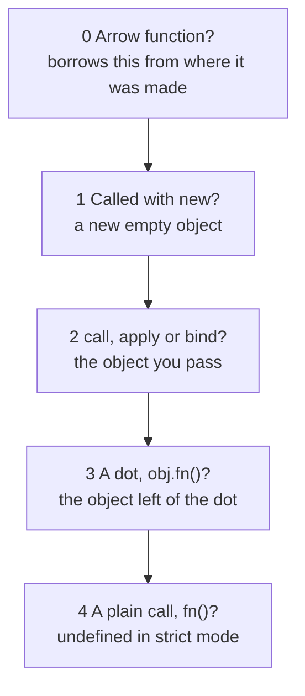
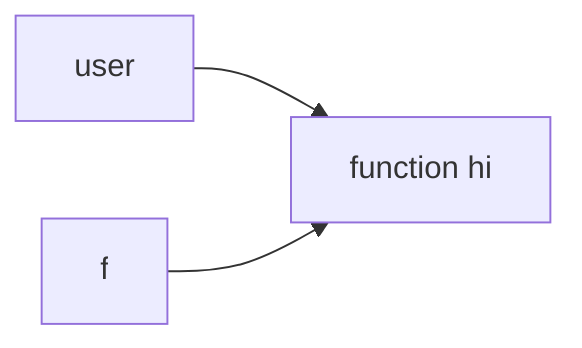
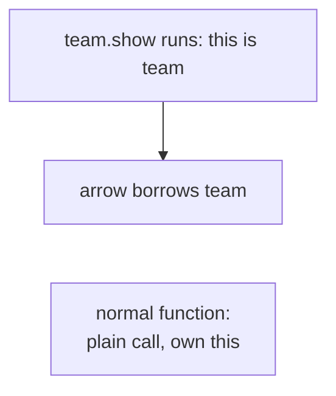

# 06. this, call, apply and bind

> **Subject:** JavaScript · **Lesson:** 06 · **Made:** 2026-10-15 · **Remade in short cards:** 2026-10-28 · **Status:** ready
>
> **You will be able to:** look at any function call and say what `this` is, say what `call`, `apply` and `bind` each do, and explain why an arrow function behaves differently.
>
> **Before this:** [Closures](05-closures.md) · **Next:** [Objects and prototypes](07-objects-and-prototypes.md)
>
> **How to read it:** one card is one idea. Look at the picture, guess, then press the orange bar to check. The blue bars (📖 More detail) hold the longer explanation. Skip them on the first read, and open them when you want more. About 25 minutes for the cards.

## 1. The idea: the word "my"

Think of the word **"my"** in the sentence "my name is ...". The sentence never changes. The **person who says it** decides what "my" means. `this` works the same way: it is a hidden input of a normal function, and **the way you call the function** decides what goes into it.



Notice: ask the questions **in this order**. The first rule that matches wins. You stop asking.

<details class="guess"><summary>🤔 Guess: `hi` is written inside the object `user`. Does that make `this` always `user`? Press to check.</summary>

No. `this` is decided by the **call**, not by where the function is written. `user.hi()` has a dot, so `this` is `user`. But the same function called as `f()` has no dot.

</details>

> **Remember:** `this` is decided by the call, not by where the function is written.

<details class="more"><summary>📖 More detail: the four words, and the rules in plain words</summary>

A function stored inside an object is called a **method**, like `hi` in `user.hi()`.

- **this:** a hidden input of a normal function. Usually it is the object this call works for.
- **Call site:** the place where a function is called, like `user.hi()` or `f()`.
- **Strict mode:** a safer setting that you turn on with `"use strict"`. Code inside a class, and code in a module, always use it. The old default without it is called **sloppy mode**.
- **Bound function:** the new function that `bind` gives back, with `this` locked.

The rules: **new** gives a brand new empty object. **call, apply or bind** gives the object you pass. **A dot call** `obj.fn()` gives the object left of the dot. **A plain call** `fn()` gives `undefined` in strict mode. In sloppy mode it is `globalThis`, the one global object (in a browser it is `window`).

In the "my" picture: Ana says it, so "my" means Ana (the dot call). You hand the card to Budi for one reading (`call` and `apply`). You record Ana saying it, and the recording always means Ana (`bind`). Nobody says it, so "my" means nobody (a plain call in strict mode). An arrow is a quote inside someone's speech: "my" means the speaker.

Where the picture stops: in sloppy mode, "nobody" becomes the global object. And `new` has no match here.

</details>

## 2. A dot call, and a lost `this`

One function can live in two objects, so the function itself cannot know which object it works for. A dot call passes the object left of the dot. But when you copy the function out, the object is not copied with it.

```js
"use strict";
const user = {
  name: "Ana",
  hi() { return this.name; },
};
console.log(user.hi());
const f = user.hi;
try { f(); } catch (e) {
  console.log(e.name);
}
```



Notice: `f` holds only the function. It has no link back to `user`.

<details class="guess"><summary>🤔 Guess: what do the two lines print? Press to check.</summary>

```
Ana
TypeError
```

`user.hi()` has a dot, so `this` is `user`. `f()` is a plain call in strict mode, so `this` is `undefined`, and `this.name` throws a `TypeError`.

</details>

> **Remember:** copy a method out, and the dot stays behind. `this` is gone.

<details class="more"><summary>📖 More detail: the program, step by step</summary>

The table follows the whole program of cards 2 and 3 together, with `"use strict";` as line 1.

| Step | Line | What JavaScript does | Rule that wins | `this` is | Prints |
|---|---|---|---|---|---|
| 1 | 1 | Turns on strict mode for the file. This matters only for rule 4. | | | |
| 2 | 2 to 5 | Makes the object `user`. It holds `name` and the function `hi`. The function does not know which object holds it. | | | |
| 3 | 6 | Reads the call site `user.hi()`. Arrow? No. `new`? No. call, apply or bind? No. A dot? **Yes**. | 3, a dot | `user` | |
| 4 | 4 | Inside `hi`, `this.name` reads `name` from `user`. It returns `"Ana"`. | | `user` | Ana |
| 5 | 7 | `const f = user.hi` copies the function into `f`. Nothing in `f` points back to `user`. | | | |
| 6 | 8 | Reads the call site `f()`. No `new`, no call, no dot. It is a plain call, and strict mode is on. | 4, plain | `undefined` | |
| 7 | 4 | `this.name` tries to read `name` from `undefined`. JavaScript throws a TypeError. The `catch` prints its name. | | `undefined` | TypeError |
| 8 | 9 | Reads `user.hi.call({ name: "Budi" })`. `call` runs `hi` now, with the first input as `this`. Rule 2 is asked before the dot rule. | 2, call | the Budi object | Budi |
| 9 | 10 | `bind` does **not** run `hi`. It makes a new bound function `g`. `g` remembers the target `hi` and the locked `this`, `user`. | | | |
| 10 | 11 | Reads `g()`. It looks like a plain call. But `g` is bound, so it always passes its locked object. | 2, hidden in bind | `user` | Ana |

</details>

## 3. call, apply and bind

`call`, `apply` and `bind` let **you** choose the object.

```js
console.log(user.hi.call({ name: "Budi" }));
const g = user.hi.bind(user);
console.log(g());
```

| | Runs now? | How you pass the other inputs | Gives back |
|---|---|---|---|
| `hi.call(ana, "Hello")` | yes | one by one, with commas | what `hi` returns |
| `hi.apply(ana, ["Hello"])` | yes | in one array | what `hi` returns |
| `hi.bind(ana, "Hello")` | **no** | one by one, saved for later | a **new** bound function |

<details class="guess"><summary>🤔 Guess: what do the two lines print, and does `bind` run `hi`? Press to check.</summary>

```
Budi
Ana
```

`call` runs `hi` now with `this` as the Budi object. `bind` does **not** run `hi`. It only makes a new function `g` with `this` locked to `user`. Then `g()` looks like a plain call, but it is bound, so it always passes its locked object.

</details>

> **Remember:** **c**all takes **c**ommas, **a**pply takes an **a**rray, **b**ind is for **b**efore (lock it now, call it later).

<details class="more"><summary>📖 More detail: where `new` fits</summary>

`new` beats `bind`: `new` on a bound function makes a new object and ignores the locked `this`. So the full order is: new, then bind, then call and apply, then the dot, then plain. A second `bind` cannot change `this` either.

</details>

## 4. An arrow borrows `this`

An arrow function has no `this` of its own. It borrows `this` from the box where it was made.

```js
"use strict";
const team = {
  name: "Blue",
  show() {
    const arrow = () => this.name;
    function normal() { return this; }
    console.log(arrow());
    console.log(normal());
  },
};
team.show();
```



<details class="guess"><summary>🤔 Guess: both are called with no dot. What do they print? Press to check.</summary>

```
Blue
undefined
```

The arrow borrows `this` from `show`, which is `team`. The normal function gets its own `this`: a plain call, so `undefined`.

</details>

> **Remember:** inside a method, use an arrow for a callback. A normal function callback loses `this`.

<details class="more"><summary>📖 More detail: the common bug, with `map`</summary>

```js
"use strict";
const team = {
  name: "Blue",
  members: ["Ana"],
  show() {
    return this.members.map(function (m) {
      return m + " in " + this.name;
    });
  },
};
team.show();   // TypeError
```

`map` calls the normal function as a plain call, so its own `this` is `undefined`. Fix: an arrow for the callback.

```js
show() {
  return this.members.map(
    (m) => m + " in " + this.name);
},
// [ 'Ana in Blue' ]
```

The arrow has no `this` of its own, so it borrows `team` from `show`. You cannot change an arrow's `this` with `call`, `apply` or `bind`. `new` on an arrow throws a `TypeError`.

</details>

## 5. Mistake 1: a method handed over without its object

A timer, `map` and a click handler all call your function later, without your object.

```js
"use strict";
const user = {
  name: "Ana",
  hi() { console.log(this === user); }
};
setTimeout(user.hi, 0);
```

<details class="guess"><summary>🤔 Guess: does it print `true` or `false`? And how do you fix it? Press to check.</summary>

`false`. `setTimeout(user.hi)` hands over only the function, the same as `const f = user.hi`. The timer calls it later, without `user`.

Fix: keep the dot, or lock `this`.

```js
setTimeout(() => user.hi(), 0);
setTimeout(user.hi.bind(user), 0);
```

Both print `true`. The arrow calls it **with** a dot. `bind` locks `this`.

</details>

> **Remember:** hand a method to someone else with an arrow wrapper or `bind`.

<details class="more"><summary>📖 More detail: the same bug with a class method</summary>

*This is an idea about your stack, not a fact about your code.* A router or a job queue calls your handler without your object. Class code is always strict, so the lost `this` is `undefined`.

```js
class LoanService {
  constructor() { this.rows = ["loan 1"]; }
  list() { return this.rows.length; }
}
const service = new LoanService();
function runLater(handler) {
  return handler();
}
runLater(service.list);   // TypeError
```

Fix:

```js
runLater(() => service.list());
runLater(service.list.bind(service));
```

Both give `1`.

</details>

## 6. Mistake 2: an arrow function as a method

```js
const user = { name: "Ana", hi: () => this.name };
console.log(user.hi());
```

<details class="guess"><summary>🤔 Guess: does it print `Ana`? Press to check.</summary>

No. In a Node file it prints `undefined`. An arrow ignores the dot. It takes `this` from the box where it was made. The curly braces of an object are not a box, so the arrow gets the `this` of the file. That is never `user`.

Fix: write a normal method.

```js
const user = {
  name: "Ana",
  hi() { return this.name; }
};
```

Now `user.hi()` is `Ana`.

</details>

> **Remember:** the dot does not help an arrow. Write methods as normal functions.

<details class="more"><summary>📖 More detail: what `this` is at the top of a file</summary>

It depends on the file type. In a Node CommonJS file (one that uses `require`) it is `module.exports`, an empty object. In an ES module it is `undefined`. In a classic browser script it is `window`.

</details>

## 7. Watch it run, step by step

At every call the stepper stops so you can pick the rule. Then it lights up the rule that wins and draws an arrow from `this` to the object. Type your guess first, then press Next. It has nine programs.

**Step through it yourself:** [open the this, call, apply and bind stepper](visuals/06-this-call-apply-and-bind.html).

<details class="more"><summary>📖 More detail: the nine programs</summary>

| Tab | What it shows |
|---|---|
| 1. Method call | one function, two objects, two answers |
| 2. Lost this (strict) | the method is copied out and throws |
| 3. Lost this (sloppy) | the same bug, but quiet |
| 4. new | rule 1, and forgetting `new` |
| 5. call, apply, bind | rule 2, and why a bound function ignores a later `call` |
| 6. Arrow inside a method | the arrow borrows `this` |
| 7. function inside a method | a normal function callback loses `this` |
| 8. Arrow as a method | the dot does not help an arrow |
| 9. Callback in setTimeout | the timer loses the object, and two fixes |

Checked on 2026-10-28 with Node 26.12.1.

</details>

## 8. Why it matters and what it costs

- **Without it,** one function could not serve many objects. You would write a separate `hi` for every user, or pass the object in by hand on every call.
- **With it,** the call passes the object in as a hidden input. This is how many objects share one method (lesson 07), and how classes work (lesson 08). `call`, `apply` and `bind` let **you** choose the object instead.
- **The cost:**
  - **Easy to lose.** Pass a method somewhere without its dot, and `this` is gone. Timers, `map` and click handlers all do this.
  - **You cannot see it in the function.** You must find the call site, maybe in someone else's code.
  - **Arrows do not fit everywhere.** They are great for callbacks inside methods. They are wrong as methods, and they cannot be used with `new`.
  - **`bind` makes a new function** every time you call it, for example on every React render.

Simple rule: use a normal method on the object. Use an arrow for a callback inside it. Use `bind` or an arrow wrapper when you hand a method to someone else.

## 9. Watch and play

Links checked on 2026-10-15. Each page opened. For each video, the title and channel matched. I did not watch the videos, so their lengths are not checked.

- **Video:** [What is THIS in JavaScript? in 100 seconds](https://www.youtube.com/watch?v=YOlr79NaAtQ) by Fireship. A fast recap of the rules, arrows, and bind. Watch it after the stepper.
- **Video:** [call, apply and bind method in JavaScript](https://www.youtube.com/watch?v=75W8UPQ5l7k) by Akshay Saini. A calm walk through all three, in the way interviewers ask.
- **Play with it:** [The this, call, apply and bind stepper](visuals/06-this-call-apply-and-bind.html) in this folder. Guess first, then press Next.
- **Play with it:** [Python Tutor for JavaScript](https://pythontutor.com/javascript.html). Paste the code from cards 2 and 3 and step through it. Its [guide](https://pythontutor.com/articles/javascript-visualizer.html) says it draws `this` inside method calls. It supports code up to ES6 (2015), which is enough here.
- **Read:** [Object methods, "this"](https://javascript.info/object-methods) on javascript.info. Read "this is not bound" and "Arrow functions have no this".
- **Read:** [Function binding](https://javascript.info/bind) on javascript.info. It shows the `setTimeout` bug, then the wrapper fix, then `bind`.
- **Read:** [this on MDN](https://developer.mozilla.org/en-US/docs/Web/JavaScript/Reference/Operators/this). The full reference. Read "Function context" and "Arrow functions".

<details><summary>More links (optional)</summary>

- **Video:** [this keyword in JavaScript, Namaste JavaScript Season 2 Ep.06](https://www.youtube.com/watch?v=9T4z98JcHR0) by Akshay Saini. Longer. It walks through `this` in many places: global, functions, methods, arrows.
- **Read:** [Arrow functions revisited](https://javascript.info/arrow-functions) on javascript.info. Why arrows have no `this` and cannot be used with `new`.
- **Read:** [Function.prototype.bind() on MDN](https://developer.mozilla.org/en-US/docs/Web/JavaScript/Reference/Global_Objects/Function/bind). See "With setTimeout()" and "Partially applied functions". It also shows that a second `bind` cannot change `this`.
- **Read:** [setTimeout() on MDN](https://developer.mozilla.org/en-US/docs/Web/API/Window/setTimeout). The part "Functions are called with the global this" shows the timer bug in a class.

</details>

## 10. Practice

**A. Predict the output** (write your answer before opening)

```js
"use strict";
const cat = { name: "Mimi", say() { return this.name; } };
const dog = { name: "Rex", say: cat.say };
console.log(dog.say());
console.log(cat.say.call(dog));
console.log(cat.say.bind(cat).call(dog));
const s = dog.say;
try { console.log(s()); } catch (e) { console.log(e.name); }
```

<details><summary>Answer</summary>

```
Rex
Rex
Mimi
TypeError
```

- `dog.say()`: a dot call, so `this` is `dog`.
- `cat.say.call(dog)`: rule 2, so `this` is `dog`.
- `cat.say.bind(cat).call(dog)`: the bound function locked `cat` first. `call` cannot change it.
- `s()`: a plain call in strict mode, so `this` is `undefined`, and `this.name` throws.

</details>

**B. Fix the bug**

```js
"use strict";
const timer = {
  seconds: 0,
  start() {
    setTimeout(function () {
      this.seconds++;
      console.log(this.seconds);
    }, 0);
  },
};
timer.start();   // prints NaN. It should print 1.
```

<details><summary>Answer</summary>

The timer calls the normal function without `timer`. In Node, its `this` is the timer's own object. In a browser, it is `window`. Neither has `seconds`, so `undefined + 1` gives `NaN`.

Fix: make the callback an arrow. It borrows `this` from `start`, and `start` was called as `timer.start()`.

```js
start() {
  setTimeout(() => {
    this.seconds++;
    console.log(this.seconds);   // 1
  }, 0);
},
```

Another fix: write `.bind(this)` after the normal function.

</details>

**C. Write it yourself**

Open `practice/06-this-call-apply-and-bind.js`. It uses strict mode. There are three tasks:

1. **Fix the bug** in one line. `incrementLater` hands `counter.increment` to `callLater`, which calls it with no dot. Do not change `callLater`.
2. **Write your own bind.** `myBind(fn, thisArg, ...presetArgs)` gives back a new function. It calls `fn` with `this` set to `thisArg`, preset inputs first, and returns what `fn` returns. Use `call` or `apply`, not `bind`.
3. **Predict** what six snippets print. Find the call site first, then the rule.

Run the tests from the folder that contains `learn/`:

```
node --test learn/javascript/practice/06-this-call-apply-and-bind.test.js
```

At the start, only the test that checks `callLater` passes.

<details><summary>One possible answer</summary>

```js
// 1. Keep the dot. The arrow calls increment WITH counter.
function incrementLater(counter) {
  return callLater(() => counter.increment());
  // or: return callLater(counter.increment.bind(counter));
}

// 2. A new function that calls fn with apply, so this is thisArg.
function myBind(fn, thisArg, ...presetArgs) {
  return function (...args) {
    return fn.apply(thisArg, [...presetArgs, ...args]);
  };
}

// 3. Predictions
const predictions = {
  s1: ["1", "undefined"],
  s2: ["A", "B", "B"],
  s3: ["A", "A"],
  s4: ["A", "TypeError"],
  s5: ["7", "TypeError"],
  s6: ["object", "undefined"],
};
```

Why `myBind` cannot be changed by a later `call`: the new function never uses its own `this`. It always passes `thisArg` to `apply`. That is exactly why a real bound function ignores a second `call`.

Why each prediction:

- **s1:** `o.get()` is a dot call, so 1. `g()` is plain in strict mode, so `this` is `undefined`. `this && this.n` stops at `undefined`, with no error.
- **s2:** two dot calls give A and B. `who.call(b)` gives B.
- **s3:** the bound function locked `{ name: "A" }`. The `call` with B is ignored.
- **s4:** the arrow borrows `this` from `later`. Called as `o.later()`, that is `o`, so A. Called as `p()`, `later` gets `undefined`, so the arrow reads `undefined.name` and throws.
- **s5:** `new P(7)` makes a new object, so 7. `P(8)` without `new` is plain in strict mode, so a TypeError.
- **s6:** `a` is sloppy, so a plain call gives the global object, and `typeof` is `"object"`. `b` is strict, so `this` stays `undefined`.

</details>

## 11. Interview question

**Q:** "How does JavaScript decide the value of `this`? What is the difference between `call`, `apply` and `bind`? What does this print?"

```js
"use strict";
const user = { name: "Ana", hi() { return this.name; } };
const f = user.hi;
console.log(user.hi());
try { f(); } catch (e) { console.log(e.name); }
```

<details><summary>A strong answer, in four parts</summary>

1. **Problem:** one function is often shared by many objects. It needs to know which object it is working for on this call. `this` is that hidden input.
2. **How it works:** `this` is decided by the call site, not by where the function is written.
   - First: an arrow function has no `this` of its own. It borrows it from the box where it was made.
   - Otherwise, check in order. `new` gives a new object. `call`, `apply` or `bind` give the object you pass. A dot call gives the object left of the dot. A plain call gives `undefined` in strict mode and `globalThis` in sloppy mode.
   - `call` and `apply` run the function now. `call` takes inputs with commas, `apply` takes an array. `bind` does not run it. It gives back a new function with `this` locked, and a later `call` cannot change it.
   - The code prints `Ana`, then `TypeError`. `f` holds only the function, so `f()` is a plain call.
3. **Tradeoff:** sharing one function is cheap and flexible. But `this` is easy to lose when you pass a method as a callback. Arrow functions fix callbacks, but they are wrong as object methods and cannot be used with `new`. `bind` makes a new function each time you call it.
4. **My example:** *This is an idea, not a fact. Replace it with your own real story from DBO, Unloan, ZWS or Skyworx.* In a Node backend, a loan service class has a method `list` that reads `this.rows`. If you pass `service.list` straight to a router or a job queue, it is called with no dot, and it throws a TypeError. The fix is `() => service.list()` or `service.list.bind(service)`.

</details>

<details><summary>The classic follow up: write bind yourself</summary>

Interviewers often say "now write your own `bind`". This is the answer from task 2 of the practice file. It passes all the tests there.

```js
function myBind(fn, thisArg, ...presetArgs) {
  return function (...args) {
    return fn.apply(thisArg, [...presetArgs, ...args]);
  };
}
```

Say out loud: "`myBind` gives back a new function. That function is a closure: it keeps `fn`, `thisArg` and `presetArgs` in its box. When it runs, it calls `fn` with `apply`, so `this` is always `thisArg`."

The real `bind` also works with `new`. This short version does not. That is fine in most interviews, but say it.

</details>

## 12. Explain it back

Close this file. Press the **Record my explanation** button under this heading and explain `this` out loud, like to a new junior, in 4 parts: problem, how it works, tradeoff, my example. Use the words "call site" and "bound function", and say the four rules in order. Then save the transcript file into `my-learning/recordings/`, or write your best version below. Run `/explain-check this` or ask the `explain-coach` agent to review it.

### My explanation

<write here>

### Coach feedback

<the explain-coach agent writes here>

## 13. Review questions (day 1, 3, 7, 21)

1. What do you ask, in order, to find `this` for a call? Where do arrow functions fit?
2. Why does `const f = user.hi; f();` throw in strict mode? Give two fixes.
3. What is the difference between `call`, `apply` and `bind`? Why does an arrow callback inside a method work, when a normal function callback fails?
4. Draw the picture from card 1 from memory: the five questions, in order.

<details><summary>Answers</summary>

1. First: is it an arrow function? If yes, it borrows `this` from the box where it was made. If not: 1 `new` gives a new empty object. 2 `call`, `apply` or `bind` give the object you pass. 3 a dot call gives the object left of the dot. 4 a plain call gives `undefined` in strict mode and `globalThis` in sloppy mode. The first rule that matches wins.
2. `f` holds only the function, not the object. `f()` has no dot, so it is a plain call, and in strict mode `this` is `undefined`. Reading `undefined.name` throws a TypeError. Fixes: call it with the dot through an arrow, `() => user.hi()`, or lock it with `user.hi.bind(user)`.
3. `call` and `apply` run the function now with the `this` you give. `call` takes inputs with commas, `apply` takes one array. `bind` does not run it. It gives back a new bound function with `this` locked. An arrow callback has no `this` of its own, so it borrows the method's `this`. A normal function callback gets its own `this`, and `map` or a timer calls it without your object.
4. A question "is it an arrow?" first. Then four questions in order: new, call or apply or bind, a dot, a plain call. Each "yes" gives its answer and stops.

</details>

## 14. Go deeper (optional)

Open these when you are ready. None of them is needed for the cards above.

<details><summary>Rare cases and runtime differences</summary>

Checked on 2026-10-15 with Node 24.15.0 and the MDN pages for `this`, `bind` and `setTimeout`.

- **`new` beats `bind`.** `new` on a bound function makes a new object and ignores the locked `this`. So the full order is: new, then bind, then call and apply, then the dot, then plain.
- **You cannot change an arrow's `this`.** `call`, `apply` and `bind` on an arrow do nothing to its `this`. `new` on an arrow throws a TypeError.
- **`this` at the top of a file** depends on the file type. In a Node CommonJS file (one that uses `require`) it is `module.exports`, an empty object. In an ES module it is `undefined`. In a classic browser script it is `window`.
- **Timers.** Node calls a timer callback through its own `Timeout` object, so `this` is that object. A browser uses `window`. Neither one is your object.
- **DOM events.** A normal function passed to `addEventListener` gets the element as `this`. An arrow does not.
- **`map`, `forEach` and `filter` take a second input** that becomes `this` for a normal function callback: `[1].map(function () { return this.v; }, { v: 9 })` gives `[9]`.
- **Sloppy mode turns numbers and strings into objects.** `function t() { return typeof this; }` with `t.call(5)` gives `"object"`. With `"use strict"` it gives `"number"`.
- **A bound function has a name** that starts with "bound", like `bound hi`. You see it in stack traces.

</details>

## Connected lessons

- [Closures](05-closures.md): an arrow function finds `this` the same way it finds any other name. It looks in the box where it was made.
- [Functions](04-functions.md): the three ways to write a function. Only arrow functions borrow `this`.
- [Objects and prototypes](07-objects-and-prototypes.md): the next lesson. Many objects can share one method, and the dot rule tells it which object called.
- [Classes](08-classes.md): code inside a class is always strict, so a lost `this` is `undefined`. `new` is rule 1.
- [Arrays and higher order functions](09-arrays-and-higher-order-functions.md): `map`, `filter` and `forEach` call your callback with no dot.
- [The event loop](11-the-event-loop.md): a timer calls your callback later, without your object.
