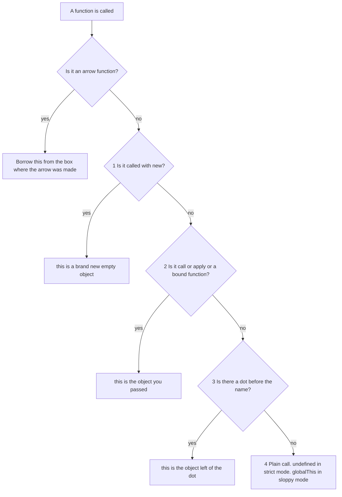
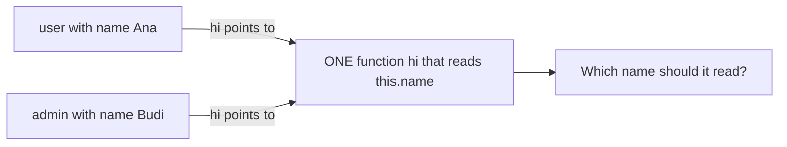
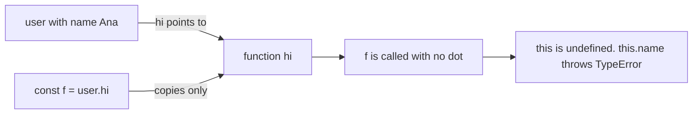
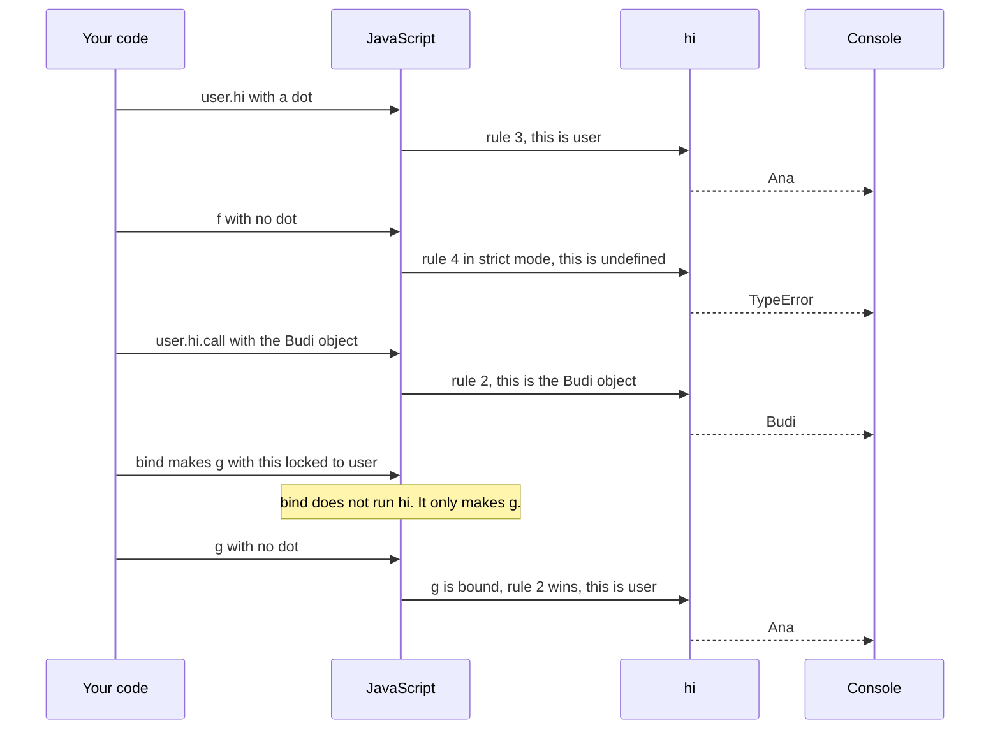
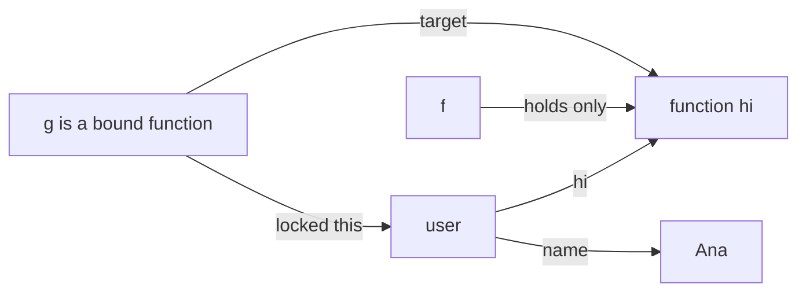
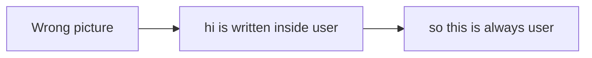
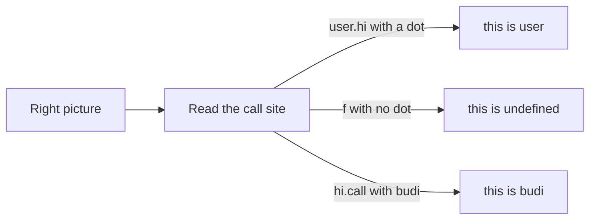
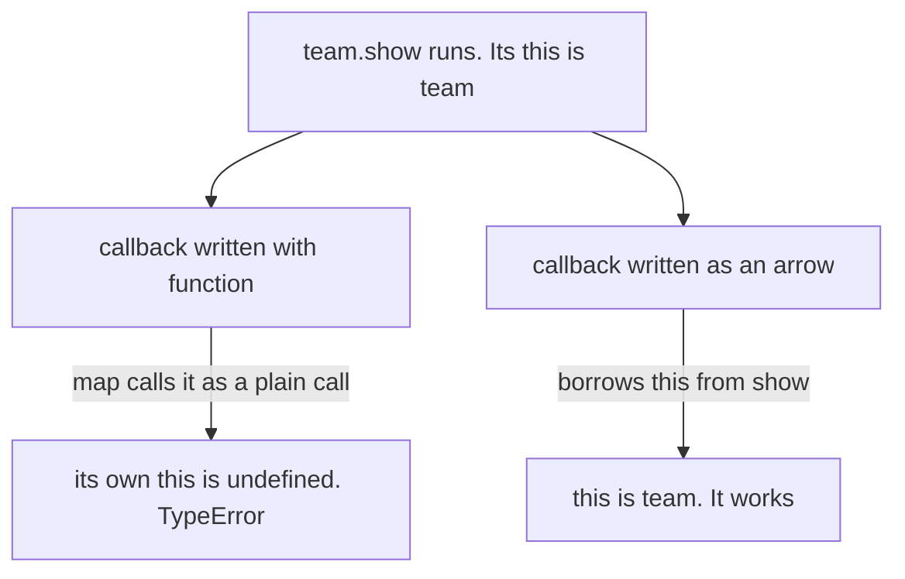

# 06. this, call, apply and bind

> **Subject:** JavaScript · **Lesson:** 06 · **Made:** 2026-10-15 · **Status:** ready
> **You will be able to:** look at any function call and say what `this` is, say what `call`, `apply` and `bind` each do, and explain why an arrow function behaves differently.
> **Before this:** [Closures](05-closures.md) · **Next:** [Objects and prototypes](07-objects-and-prototypes.md)

## 1. The idea in one sentence

`this` is a hidden input of a normal function, and **the way you call the function** decides what goes into it.

A function stored inside an object is called a **method**, like `hi` in `user.hi()`.

New words:

- **this:** a hidden input of a normal function. Usually it is the object this call works for.
- **Call site:** the place where a function is called, like `user.hi()` or `f()`.
- **Strict mode:** a safer setting that you turn on with `"use strict"`. Code inside a class, and code in a module, always use it. The old default without it is called **sloppy mode**.
- **Bound function:** the new function that `bind` gives back, with `this` locked.

The rule to remember: **`this` is decided by the call, not by where the function is written.** First ask: is it an arrow function? If yes, it borrows `this` from the box where it was made. If no, ask in this order:

1. **new**: `this` is a brand new empty object.
2. **call, apply or bind**: `this` is the object you pass.
3. **a dot call** `obj.fn()`: `this` is the object left of the dot.
4. **a plain call** `fn()`: `this` is `undefined` in strict mode. In sloppy mode it is `globalThis`, the one global object (in a browser it is `window`).

The first rule that matches wins. You stop asking.

## 2. The pictures

### 2a. The big picture

This is the whole lesson in one picture. Notice that the arrow question comes first, and the plain call is the last option.



### 2b. The problem, drawn

One function can live in two objects. Notice the question mark: the function itself cannot know which object it is working for.



JavaScript answers this question at every call. A dot call passes the object left of the dot. But when you copy the function out, the object is not copied with it. Notice that `f` has no link back to `user`.



### 2c. How it works over time

This is the program from section 4. Notice that the same function `hi` gets three different values of `this`.



### 2d. What is in memory right now

A snapshot after line 10 of section 4, `const g = user.hi.bind(user)`. Notice there is only **one** function `hi`. Three names point to it, but only `user` and `g` know about the object.



- Calling `user.hi()` works, because the dot passes `user`.
- Calling `f()` fails, because `f` knows only the function.
- Calling `g()` works, because `g` carries a locked `this`.

### 2e. Right against wrong

**Wrong picture:** "`this` is the object where the function is written."



**Right picture:** the call decides. Where it is written does not matter.



**Normal function against arrow function, inside a method.** This is the most common bug. Notice where each one gets `this`.



## 3. Real life analogy

Think of the word **"my"** in the sentence "my name is ...". The sentence never changes. The **person who says it** decides what "my" means.

- Ana says it, so "my" means Ana. That is the dot call.
- You hand the card to Budi for one reading. That is `call` and `apply`.
- You record Ana saying it. The recording always means Ana. That is `bind`.
- Nobody says it. "My" means nobody. That is a plain call in strict mode.
- An arrow is a quote inside someone's speech. "My" means the speaker.

Where the analogy stops: in sloppy mode, "nobody" becomes the global object. And `new` has no match here.

## 4. The smallest code that shows it

```js
"use strict";
const user = {
  name: "Ana",
  hi() { return this.name; },
};
console.log(user.hi());                        // rule 3, a dot
const f = user.hi;                             // copies only the function
try { f(); } catch (e) { console.log(e.name); } // rule 4, no dot
console.log(user.hi.call({ name: "Budi" }));  // rule 2, call
const g = user.hi.bind(user);                  // makes a bound function
console.log(g());                              // rule 2, hidden in bind
```

**Output:**

```
Ana
TypeError
Budi
Ana
```

Look at line 2 of the output. The same function `hi` throws, because the call `f()` has no dot.

**And the arrow function difference:**

```js
"use strict";
const team = {
  name: "Blue",
  show() {
    const arrow = () => this.name;
    function normal() { return this; }
    console.log(arrow());
    console.log(normal());
  },
};
team.show();
```

**Output:**

```
Blue
undefined
```

Both functions are written inside `show`, and both are called with no dot. The arrow borrows `this` from `show`, which is `team`. The normal function gets its own `this`: a plain call, so `undefined`.

**call, apply and bind side by side:**

| | Runs the function now? | How you pass the other inputs | Gives back |
|---|---|---|---|
| `hi.call(ana, "Hello")` | yes | one by one, with commas | what `hi` returns |
| `hi.apply(ana, ["Hello"])` | yes | in one array | what `hi` returns |
| `hi.bind(ana, "Hello")` | **no** | one by one, saved for later | a **new** bound function |

Easy to remember: **c**all takes **c**ommas, **a**pply takes an **a**rray, **b**ind is for **b**efore (you lock it now, you call it later).

## 5. What really happens, step by step

The program from section 4. Line numbers count from `"use strict";` as line 1.

| Step | Line | What JavaScript does | Rule that wins | `this` is | Prints |
|---|---|---|---|---|---|
| 1 | 1 | Turns on strict mode for the file. This matters only for rule 4. | | | |
| 2 | 2 to 5 | Makes the object `user`. It holds `name` and the function `hi`. The function does not know which object holds it. | | | |
| 3 | 6 | Reads the call site `user.hi()`. Arrow? No. `new`? No. call, apply or bind? No. A dot? **Yes**. | 3, a dot | `user` | |
| 4 | 4 | Inside `hi`, `this.name` reads `name` from `user`. It returns `"Ana"`. | | `user` | Ana |
| 5 | 7 | `const f = user.hi` copies the function into `f`. Nothing in `f` points back to `user`. | | | |
| 6 | 8 | Reads the call site `f()`. No `new`, no call, no dot. It is a plain call, and strict mode is on. | 4, plain | `undefined` | |
| 7 | 4 | `this.name` tries to read `name` from `undefined`. JavaScript throws a TypeError. The `catch` prints its name. | | `undefined` | TypeError |
| 8 | 9 | Reads `user.hi.call({ name: "Budi" })`. `call` runs `hi` now, with the first input as `this`. Rule 2 is asked before the dot rule. | 2, call | the Budi object | Budi |
| 9 | 10 | `bind` does **not** run `hi`. It makes a new bound function `g`. `g` remembers the target `hi` and the locked `this`, `user`. | | | |
| 10 | 11 | Reads `g()`. It looks like a plain call. But `g` is bound, so it always passes its locked object. | 2, hidden in bind | `user` | Ana |

**Step through it yourself:** [open the this, call, apply and bind stepper](visuals/06-this-call-apply-and-bind.html). At every call it stops so you can pick the rule. Then it lights up the rule that wins and draws an arrow from `this` to the object. Type your guess first, then press Next. It has nine programs:

| Tab | What it shows |
|---|---|
| 1. Method call | one function, two objects, two answers |
| 2. Lost this (strict) | the method is copied out and throws |
| 3. Lost this (sloppy) | the same bug, but quiet |
| 4. new | rule 1, and forgetting `new` |
| 5. call, apply, bind | rule 2, and why a bound function ignores a later `call` |
| 6. Arrow inside a method | the arrow borrows `this` |
| 7. function inside a method | a normal function callback loses `this` |
| 8. Arrow as a method | the dot does not help an arrow |
| 9. Callback in setTimeout | the timer loses the object, and two fixes |

## 6. Why it exists and what it costs

- **Problem without it:** one function often serves many objects. Without `this`, you would write a separate `hi` for every user. Or you would pass the object in by hand on every call.
- **How it solves it:** the call passes the object in as a hidden input. This is how many objects share one method (lesson 07), and how classes work (lesson 08). `call`, `apply` and `bind` let **you** choose the object instead.
- **Cost:**
  - **Easy to lose.** Pass a method somewhere without its dot, and `this` is gone. Timers, `map` and click handlers all do this.
  - **You cannot see it in the function.** You must find the call site, maybe in someone else's code.
  - **Arrows do not fit everywhere.** They are great for callbacks inside methods. They are wrong as methods, and they cannot be used with `new`.
  - **`bind` makes a new function** every time you call it, for example on every React render.

Simple rule: use a normal method on the object. Use an arrow for a callback inside it. Use `bind` or an arrow wrapper when you hand a method to someone else.

<details><summary>Go deeper (optional): rare cases and runtime differences</summary>

Checked on 2026-10-15 with Node 24.15.0 and the MDN pages for `this`, `bind` and `setTimeout`.

- **`new` beats `bind`.** `new` on a bound function makes a new object and ignores the locked `this`. So the full order is: new, then bind, then call and apply, then the dot, then plain.
- **You cannot change an arrow's `this`.** `call`, `apply` and `bind` on an arrow do nothing to its `this`. `new` on an arrow throws a TypeError.
- **`this` at the top of a file** depends on the file type. In a Node CommonJS file (one that uses `require`) it is `module.exports`, an empty object. In an ES module it is `undefined`. In a classic browser script it is `window`.
- **Timers.** Node calls a timer callback through its own `Timeout` object, so `this` is that object. A browser uses `window`. Neither one is your object.
- **DOM events.** A normal function passed to `addEventListener` gets the element as `this`. An arrow does not.
- **`map`, `forEach` and `filter` take a second input** that becomes `this` for a normal function callback: `[1].map(function () { return this.v; }, { v: 9 })` gives `[9]`.
- **Sloppy mode turns numbers and strings into objects.** `function t() { return typeof this; }` with `t.call(5)` gives `"object"`. With `"use strict"` it gives `"number"`.
- **A bound function has a name** that starts with "bound", like `bound hi`. You see it in stack traces.

</details>

## 7. Common mistakes

**Wrong:** handing a method to a timer, or any callback, without its object.

```js
"use strict";
const user = { name: "Ana", hi() { console.log(this === user); } };
setTimeout(user.hi, 0);   // prints false
```

**Right:** keep the dot, or lock `this`.

```js
setTimeout(() => user.hi(), 0);      // prints true: the arrow calls it WITH a dot
setTimeout(user.hi.bind(user), 0);   // prints true: this is locked to user
```

**Why:** `setTimeout(user.hi)` hands over only the function, the same as `const f = user.hi`. The timer calls it later, without `user`.

**Wrong:** an arrow function as a method.

```js
const user = { name: "Ana", hi: () => this.name };
console.log(user.hi());   // does not print Ana
```

**Right:** write a normal method.

```js
const user = { name: "Ana", hi() { return this.name; } };
console.log(user.hi());   // Ana
```

**Why:** an arrow ignores the dot. It takes `this` from the box where it was made. The curly braces of an object are not a box, so the arrow gets the `this` of the file. That is never `user`.

**Wrong:** a normal function as a callback inside a method.

```js
"use strict";
const team = {
  name: "Blue",
  members: ["Ana"],
  show() { return this.members.map(function (m) { return m + " in " + this.name; }); },
};
team.show();   // TypeError
```

**Right:** use an arrow for the callback.

```js
show() { return this.members.map((m) => m + " in " + this.name); },
// [ 'Ana in Blue' ]
```

**Why:** `map` calls the normal function as a plain call, so its own `this` is `undefined`. The arrow has no `this` of its own, so it borrows `team` from `show`.

**Wrong:** passing a class method as a handler. *This is an idea about your stack, not a fact about your code.*

```js
class LoanService {
  constructor() { this.rows = ["loan 1"]; }
  list() { return this.rows.length; }
}
const service = new LoanService();
function runLater(handler) { return handler(); }   // calls it with no dot
runLater(service.list);   // TypeError
```

**Right:**

```js
runLater(() => service.list());          // 1
runLater(service.list.bind(service));    // 1
```

**Why:** a router or a job queue calls your handler without your object. Class code is always strict, so the lost `this` is `undefined`.

## 8. Watch and play

Links checked on 2026-10-15. Each page opened. For each video, the title and channel matched. I did not watch the videos, so their lengths are not checked.

- **Video:** [What is THIS in JavaScript? in 100 seconds](https://www.youtube.com/watch?v=YOlr79NaAtQ) by Fireship. A fast recap of the rules, arrows, and bind. Watch it after the stepper.
- **Video:** [call, apply and bind method in JavaScript](https://www.youtube.com/watch?v=75W8UPQ5l7k) by Akshay Saini. A calm walk through all three, in the way interviewers ask.
- **Play with it:** [The this, call, apply and bind stepper](visuals/06-this-call-apply-and-bind.html) in this folder. Guess first, then press Next.
- **Play with it:** [Python Tutor for JavaScript](https://pythontutor.com/javascript.html). Paste the first code from section 4 and step through it. Its [guide](https://pythontutor.com/articles/javascript-visualizer.html) says it draws `this` inside method calls. It supports code up to ES6 (2015), which is enough here.
- **Read:** [Object methods, "this"](https://javascript.info/object-methods) on javascript.info. Read "this is not bound" and "Arrow functions have no this".
- **Read:** [Function binding](https://javascript.info/bind) on javascript.info. It shows the `setTimeout` bug, then the wrapper fix, then `bind`.
- **Read:** [this on MDN](https://developer.mozilla.org/en-US/docs/Web/JavaScript/Reference/Operators/this). The full reference. Read "Function context" and "Arrow functions".

<details><summary>More links (optional)</summary>

- **Video:** [this keyword in JavaScript, Namaste JavaScript Season 2 Ep.06](https://www.youtube.com/watch?v=9T4z98JcHR0) by Akshay Saini. Longer. It walks through `this` in many places: global, functions, methods, arrows.
- **Read:** [Arrow functions revisited](https://javascript.info/arrow-functions) on javascript.info. Why arrows have no `this` and cannot be used with `new`.
- **Read:** [Function.prototype.bind() on MDN](https://developer.mozilla.org/en-US/docs/Web/JavaScript/Reference/Global_Objects/Function/bind). See "With setTimeout()" and "Partially applied functions". It also shows that a second `bind` cannot change `this`.
- **Read:** [setTimeout() on MDN](https://developer.mozilla.org/en-US/docs/Web/API/Window/setTimeout). The part "Functions are called with the global this" shows the timer bug in a class.

</details>

## 9. Practice

**A. Predict the output** (write your answer before opening)

```js
"use strict";
const cat = { name: "Mimi", say() { return this.name; } };
const dog = { name: "Rex", say: cat.say };
console.log(dog.say());
console.log(cat.say.call(dog));
console.log(cat.say.bind(cat).call(dog));
const s = dog.say;
try { console.log(s()); } catch (e) { console.log(e.name); }
```

<details><summary>Answer</summary>

```
Rex
Rex
Mimi
TypeError
```

- `dog.say()`: a dot call, so `this` is `dog`.
- `cat.say.call(dog)`: rule 2, so `this` is `dog`.
- `cat.say.bind(cat).call(dog)`: the bound function locked `cat` first. `call` cannot change it.
- `s()`: a plain call in strict mode, so `this` is `undefined`, and `this.name` throws.

</details>

**B. Fix the bug**

```js
"use strict";
const timer = {
  seconds: 0,
  start() {
    setTimeout(function () {
      this.seconds++;
      console.log(this.seconds);
    }, 0);
  },
};
timer.start();   // prints NaN. It should print 1.
```

<details><summary>Answer</summary>

The timer calls the normal function without `timer`. In Node, its `this` is the timer's own object. In a browser, it is `window`. Neither has `seconds`, so `undefined + 1` gives `NaN`.

Fix: make the callback an arrow. It borrows `this` from `start`, and `start` was called as `timer.start()`.

```js
start() {
  setTimeout(() => {
    this.seconds++;
    console.log(this.seconds);   // 1
  }, 0);
},
```

Another fix: write `.bind(this)` after the normal function.

</details>

**C. Write it yourself**

Open `practice/06-this-call-apply-and-bind.js`. It uses strict mode. There are three tasks:

1. **Fix the bug** in one line. `incrementLater` hands `counter.increment` to `callLater`, which calls it with no dot. Do not change `callLater`.
2. **Write your own bind.** `myBind(fn, thisArg, ...presetArgs)` gives back a new function. It calls `fn` with `this` set to `thisArg`, preset inputs first, and returns what `fn` returns. Use `call` or `apply`, not `bind`.
3. **Predict** what six snippets print. Find the call site first, then the rule.

Run the tests from the folder that contains `learn/`:

```
node --test learn/javascript/practice/06-this-call-apply-and-bind.test.js
```

At the start, only the test that checks `callLater` passes.

<details><summary>One possible answer</summary>

```js
// 1. Keep the dot. The arrow calls increment WITH counter.
function incrementLater(counter) {
  return callLater(() => counter.increment());
  // or: return callLater(counter.increment.bind(counter));
}

// 2. A new function that calls fn with apply, so this is thisArg.
function myBind(fn, thisArg, ...presetArgs) {
  return function (...args) {
    return fn.apply(thisArg, [...presetArgs, ...args]);
  };
}

// 3. Predictions
const predictions = {
  s1: ["1", "undefined"],
  s2: ["A", "B", "B"],
  s3: ["A", "A"],
  s4: ["A", "TypeError"],
  s5: ["7", "TypeError"],
  s6: ["object", "undefined"],
};
```

Why `myBind` cannot be changed by a later `call`: the new function never uses its own `this`. It always passes `thisArg` to `apply`. That is exactly why a real bound function ignores a second `call`.

Why each prediction:

- **s1:** `o.get()` is a dot call, so 1. `g()` is plain in strict mode, so `this` is `undefined`. `this && this.n` stops at `undefined`, with no error.
- **s2:** two dot calls give A and B. `who.call(b)` gives B.
- **s3:** the bound function locked `{ name: "A" }`. The `call` with B is ignored.
- **s4:** the arrow borrows `this` from `later`. Called as `o.later()`, that is `o`, so A. Called as `p()`, `later` gets `undefined`, so the arrow reads `undefined.name` and throws.
- **s5:** `new P(7)` makes a new object, so 7. `P(8)` without `new` is plain in strict mode, so a TypeError.
- **s6:** `a` is sloppy, so a plain call gives the global object, and `typeof` is `"object"`. `b` is strict, so `this` stays `undefined`.

</details>

## 10. Interview question

**Q:** "How does JavaScript decide the value of `this`? What is the difference between `call`, `apply` and `bind`? What does this print?"

```js
"use strict";
const user = { name: "Ana", hi() { return this.name; } };
const f = user.hi;
console.log(user.hi());
try { f(); } catch (e) { console.log(e.name); }
```

<details><summary>A strong answer, in four parts</summary>

1. **Problem:** one function is often shared by many objects. It needs to know which object it is working for on this call. `this` is that hidden input.
2. **How it works:** `this` is decided by the call site, not by where the function is written.
   - First: an arrow function has no `this` of its own. It borrows it from the box where it was made.
   - Otherwise, check in order. `new` gives a new object. `call`, `apply` or `bind` give the object you pass. A dot call gives the object left of the dot. A plain call gives `undefined` in strict mode and `globalThis` in sloppy mode.
   - `call` and `apply` run the function now. `call` takes inputs with commas, `apply` takes an array. `bind` does not run it. It gives back a new function with `this` locked, and a later `call` cannot change it.
   - The code prints `Ana`, then `TypeError`. `f` holds only the function, so `f()` is a plain call.
3. **Tradeoff:** sharing one function is cheap and flexible. But `this` is easy to lose when you pass a method as a callback. Arrow functions fix callbacks, but they are wrong as object methods and cannot be used with `new`. `bind` makes a new function each time you call it.
4. **My example:** *This is an idea, not a fact. Replace it with your own real story from DBO, Unloan, ZWS or Skyworx.* In a Node backend, a loan service class has a method `list` that reads `this.rows`. If you pass `service.list` straight to a router or a job queue, it is called with no dot, and it throws a TypeError. The fix is `() => service.list()` or `service.list.bind(service)`.

</details>

<details><summary>The classic follow up: write bind yourself</summary>

Interviewers often say "now write your own `bind`". This is the answer from task 2 of the practice file. It passes all the tests there.

```js
function myBind(fn, thisArg, ...presetArgs) {
  return function (...args) {
    return fn.apply(thisArg, [...presetArgs, ...args]);
  };
}
```

Say out loud: "`myBind` gives back a new function. That function is a closure: it keeps `fn`, `thisArg` and `presetArgs` in its box. When it runs, it calls `fn` with `apply`, so `this` is always `thisArg`."

The real `bind` also works with `new`. This short version does not. That is fine in most interviews, but say it.

</details>

## 11. Explain it back

Close this file. Press the **Record my explanation** button under this heading and explain `this` out loud, like to a new junior, in 4 parts: problem, how it works, tradeoff, my example. Use the words "call site" and "bound function", and say the four rules in order. Then save the transcript file into `my-learning/recordings/`, or write your best version below. Run `/explain-check this` or ask the `explain-coach` agent to review it.

### My explanation

<write here>

### Coach feedback

<the explain-coach agent writes here>

## 12. Review questions (day 1, 3, 7, 21)

1. What do you ask, in order, to find `this` for a call? Where do arrow functions fit?
2. Why does `const f = user.hi; f();` throw in strict mode? Give two fixes.
3. What is the difference between `call`, `apply` and `bind`? Why does an arrow callback inside a method work, when a normal function callback fails?
4. Draw the picture from section 2a from memory.

<details><summary>Answers</summary>

1. First: is it an arrow function? If yes, it borrows `this` from the box where it was made. If not: 1 `new` gives a new empty object. 2 `call`, `apply` or `bind` give the object you pass. 3 a dot call gives the object left of the dot. 4 a plain call gives `undefined` in strict mode and `globalThis` in sloppy mode. The first rule that matches wins.
2. `f` holds only the function, not the object. `f()` has no dot, so it is a plain call, and in strict mode `this` is `undefined`. Reading `undefined.name` throws a TypeError. Fixes: call it with the dot through an arrow, `() => user.hi()`, or lock it with `user.hi.bind(user)`.
3. `call` and `apply` run the function now with the `this` you give. `call` takes inputs with commas, `apply` takes one array. `bind` does not run it. It gives back a new bound function with `this` locked. An arrow callback has no `this` of its own, so it borrows the method's `this`. A normal function callback gets its own `this`, and `map` or a timer calls it without your object.
4. A question "is it an arrow?" first. Then four questions in order: new, call or apply or bind, a dot, a plain call. Each "yes" gives its answer and stops.

</details>

## Connected lessons

- [Closures](05-closures.md): an arrow function finds `this` the same way it finds any other name. It looks in the box where it was made.
- [Functions](04-functions.md): the three ways to write a function. Only arrow functions borrow `this`.
- [Objects and prototypes](07-objects-and-prototypes.md): the next lesson. Many objects can share one method, and the dot rule tells it which object called.
- [Classes](08-classes.md): code inside a class is always strict, so a lost `this` is `undefined`. `new` is rule 1.
- [Arrays and higher order functions](09-arrays-and-higher-order-functions.md): `map`, `filter` and `forEach` call your callback with no dot.
- [The event loop](11-the-event-loop.md): a timer calls your callback later, without your object.
