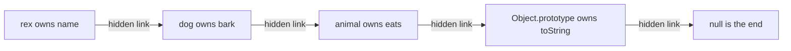
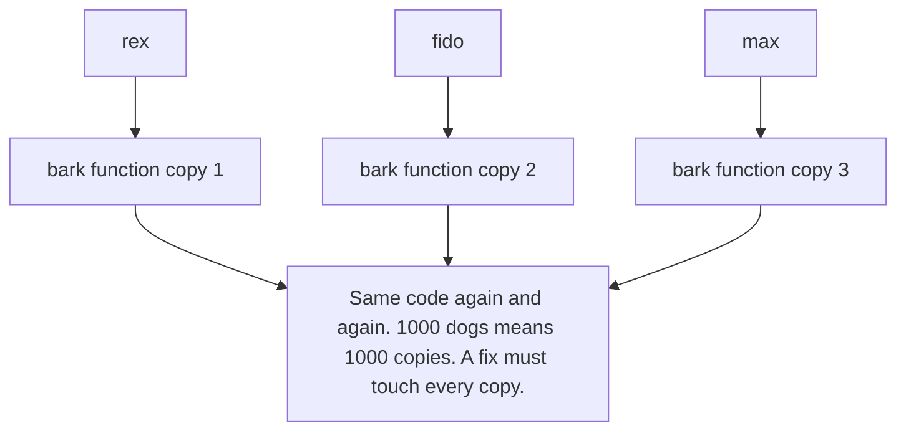
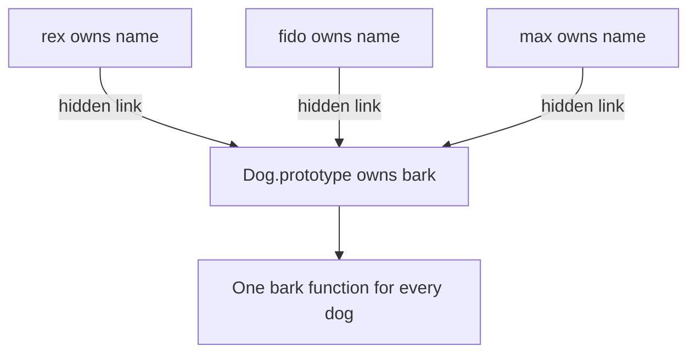
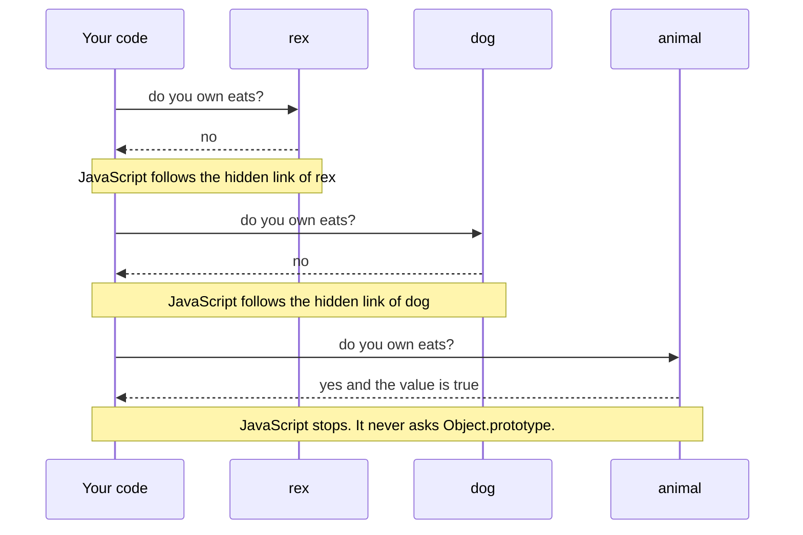
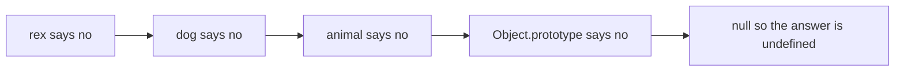
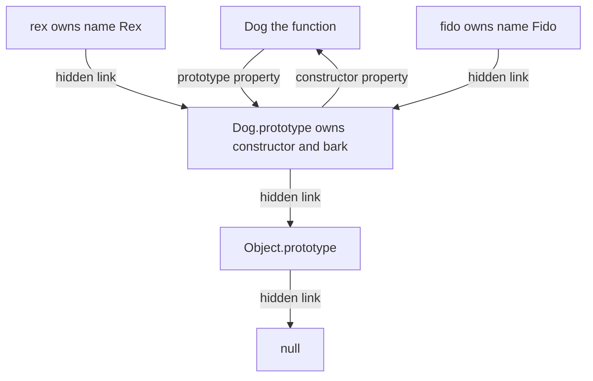
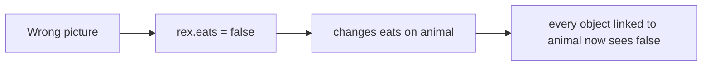
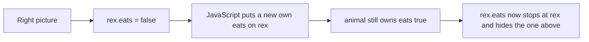
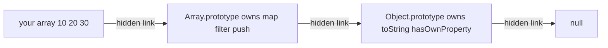

# 07. Objects and prototypes

> **Subject:** JavaScript · **Lesson:** 07 · **Made:** 2026-10-15 · **Status:** ready
> **You will be able to:** draw the chain of hidden links behind an object, say where JavaScript finds a property the object does not have, and explain why writing a property never changes the object above it.
> **Before this:** [this, call, apply and bind](06-this-call-apply-and-bind.md) · **Next:** [Classes](08-classes.md)

## 1. The idea in one sentence

When you ask an object for a property it does not have, JavaScript follows a hidden link to another object and asks there.

A **property** is a named value inside an object, like `name` in `{ name: "Rex" }`. Every object has one **hidden link** to one other object, or to `null`. You do not see the link in your code. (Interview word: `[[Prototype]]`.)

New words:

- **Own property:** a property stored on the object itself. `rex.name = "Rex"` puts an own property on `rex`.
- **Inherited:** a property the object does not own. It finds it by walking up the hidden links.
- **Chain:** the line of hidden links, from the object up to `null`. The object at the other end of a hidden link is that object's **prototype**. (Interview word: *prototype chain*.)
- **Constructor:** a normal function that you call with `new` to make objects, like `new Dog("Rex")`.

The rule to remember: **reading a property walks up the chain and stops at the first object that owns it. If it reaches `null`, the answer is `undefined`. Writing a property never walks up. It always changes the object you wrote it on.**

## 2. The pictures

### 2a. The big picture

Three objects and their hidden links. Notice that `rex` owns only `name`. It finds `bark` and `eats` by walking up.



`Object.prototype` is an object that JavaScript makes for you. Almost every chain ends there, then at `null`.

### 2b. The problem, drawn

You make 1000 dog objects. Every dog needs a `bark` function. (A function stored in an object is called a **method**.) Without a shared place, each dog carries its own copy. Notice the identical functions.



With the chain, the function lives in one place, a shared object called `Dog.prototype`. Picture 2d shows where it comes from. Notice that every dog links to the same object.



### 2c. How it works over time

What JavaScript does for `rex.eats`. Notice that it asks one object at a time, and stops at the first yes.



And for `rex.fly`, which nobody owns. Notice that the end is `undefined`, not an error.



### 2d. What is in memory right now

A snapshot after this code has run:

```js
function Dog(name) { this.name = name; }
Dog.prototype.bark = function () { return this.name + " says woof"; };
const rex = new Dog("Rex");
const fido = new Dog("Fido");
```

Notice the two kinds of arrows. The function has a normal property called `prototype`. The dogs have hidden links.



This is the most confusing name in JavaScript:

- `Dog.prototype` is a **normal property** on the function `Dog`. It is not Dog's own hidden link.
- `new Dog()` reads it and makes it the target of the new object's hidden link.
- So `rex.prototype` is `undefined`, but `Object.getPrototypeOf(rex) === Dog.prototype` is `true`.

### 2e. Right against wrong

**Wrong picture:** "writing walks up and changes the object above."



**Right picture:** writing makes a new own property, on the object you wrote on.



The value above is only hidden, not changed. (Interview word: it is *shadowed*.) `delete rex.eats` removes the own one, and `true` shows again.

### 2f. Where map and toString come from

You never wrote `map`, yet every array has it. Notice that your array owns only its items and `length`.



## 3. Real life analogy

You sit at a desk in an office and need a stapler.

- You look in **your own drawer** first. (Own property.)
- Not there? You walk to the **team cupboard**. (The hidden link.)
- Not there? You walk to the **supply room** for the whole building. (`Object.prototype`.)
- Not there? Nobody has one. (`null`, so `undefined`.)
- If you put your own stapler in your drawer, the cupboard does not change. Next time you stop at your drawer. (Writing makes an own property.)
- One team cupboard serves 20 desks. Nobody needs 20 staplers. (Shared methods.)

Where the analogy stops:

- In an office you could skip the cupboard and go straight to the supply room. JavaScript never skips. It always asks in the same order and stops at the first owner.
- If you **change** something you found in the cupboard, like adding a page to a shared notebook, everyone sees it. That part is true in JavaScript too (practice B).

## 4. The smallest code that shows it

`Object.create(x)` makes a new empty object whose hidden link points at `x`.

```js
const animal = { eats: true };
const dog = Object.create(animal);
dog.bark = () => "woof";
const rex = Object.create(dog);
rex.name = "Rex";

console.log(rex.name);
console.log(rex.bark());
console.log(rex.eats);
console.log(rex.fly);
rex.eats = false;
console.log(rex.eats, animal.eats);
```

**Output:**

```
Rex
woof
true
undefined
false true
```

Look at the last line. `rex` changed. `animal` did not.

## 5. What really happens, step by step

| Step | Line | What JavaScript does | Objects asked | Result |
|---|---|---|---|---|
| 1 | 1 | Makes `animal` with own `eats: true`. Its hidden link points at `Object.prototype`. | | |
| 2 | 2 | Makes an empty `dog`. Its hidden link points at `animal`. | | |
| 3 | 3 | Puts own `bark` on `dog`. | | |
| 4 | 4 | Makes an empty `rex`. Its hidden link points at `dog`. | | |
| 5 | 5 | Puts own `name` on `rex`. Chain: rex, dog, animal, Object.prototype, null. | | |
| 6 | 7 | Reads `rex.name`. `rex` owns it. Stops at once. The hidden link is not used. | rex | `Rex` |
| 7 | 8 | Reads `rex.bark`. `rex` says no. Follows the link. `dog` owns it. Calls it. | rex, dog | `woof` |
| 8 | 9 | Reads `rex.eats`. `rex` no, `dog` no, `animal` yes. | rex, dog, animal | `true` |
| 9 | 10 | Reads `rex.fly`. Nobody owns it. The link of `Object.prototype` is `null`, so it stops. No error. | rex, dog, animal, Object.prototype | `undefined` |
| 10 | 11 | **Writes** `rex.eats = false`. It does not walk up. It puts a new own `eats` on `rex`. | none | rex owns `eats: false` |
| 11 | 12 | Reads `rex.eats`. `rex` owns it now, so it stops at `rex`. Reads `animal.eats`. `animal` owns it, still `true`. | rex, then animal | `false true` |

Code checked on 2026-10-15 with Node 24.15.0.

**Step through it yourself:** [open the objects and prototypes stepper](visuals/07-objects-and-prototypes.html). The right side shows each object, its own properties and its hidden link. Each object lights up when JavaScript asks it. It has five programs:

1. **"1. Look up a property"**: the same three objects as section 4. Its `animal` also has an `eat` method. Pick a property on `rex` (`name`, `bark`, `eat`, `eats`, `toString`, `hasOwnProperty`, `fly`, or your own). Guess the level first, then watch the walk.
2. **"2. Reading and writing"**: write, read, then `delete`. Watch `animal` stay the same.
3. **"3. A method copied into every object"**: the problem from picture 2b. Watch the counter of `bark` functions grow.
4. **"4. One shared method"**: the fix. The counter stays at 1.
5. **"5. What new does"**: the four things `new` does, one per step.

## 6. Why it exists and what it costs

- **Problem without it:** every object would carry its own copy of every function. 1000 objects means 1000 copies of the same code (picture 2b). Every array would need its own `map`.
- **How it solves it:**
  - Each object keeps only its own data, plus one hidden link.
  - Shared functions live once, on the object at the other end of the link.
  - Reading walks up and finds them. A fix in that one place reaches every object.
- **Cost:**
  - **Shared changes reach everyone.** An array stored on a prototype is shared. `a.tags.push(x)` first reads the shared array, then changes it for every object (practice B).
  - **"Does it have x?" needs care.** `"x" in obj` says `true` for inherited properties. `for...in` also loops over them. Use `Object.hasOwn(obj, "x")` to ask about own properties only.
  - **A missing property is quiet.** JavaScript gives `undefined`, not an error. A typo like `user.nmae` will not warn you.
  - **Changing built-in prototypes is risky.** `Array.prototype` is shared by every array in the app and in every library (section 7).

Simple rule: put **data** on each object. Put **functions** on the prototype.

<details><summary>Go deeper (optional)</summary>

- **Two exceptions to "writing never walks up".** If an object up the chain has a setter (a `set x()` function) for that name, the write calls the setter instead. If the property up the chain is read only (for example on a frozen object), the write is ignored, or throws a `TypeError` in strict mode. MDN states the setter exception on its "Inheritance and the prototype chain" page.
- **`__proto__`.** Old code reads the hidden link with `obj.__proto__`. MDN marks that form as not standard and deprecated (old, do not use in new code). Use `Object.getPrototypeOf(obj)`. The object literal form `{ __proto__: x }` is different: it is standard, and it sets the link when the object is made.
- **Speed.** MDN notes that reading a property far up the chain takes longer, and that a missing property always walks the full chain. In normal app code this is very small, because engines remember where they found a property.
- **`Object.create(null)`** makes an object with no hidden link at all. It has no `toString` and no `hasOwnProperty`. People use it as a plain dictionary, so a key like `"constructor"` cannot clash with an inherited one.
- **Classes are built on this.** `class Dog { bark() {} }` puts `bark` on `Dog.prototype`, the same as picture 2d. Lesson 08 shows this.
- **What `new` does, in four things** (the stepper, program 5): make a blank object, set its hidden link to `Dog.prototype`, run `Dog` with `this` set to that object, and return it. If the function returns a different object, `new` returns that one instead.

</details>

## 7. Common mistakes

**Wrong:** thinking `obj.prototype` is the hidden link.

```js
function Dog(name) { this.name = name; }
const rex = new Dog("Rex");
console.log(rex.prototype);   // many people expect Dog.prototype
```

**Right:** ask for the hidden link with `Object.getPrototypeOf`.

```js
console.log(rex.prototype);                                // undefined
console.log(Object.getPrototypeOf(rex) === Dog.prototype); // true
```

**Why:** only functions get a `prototype` property. It is a normal property that `new` reads. The hidden link of `rex` is something else (picture 2d).

**Wrong:** using `in` to check if an object has its own value.

```js
const user = { name: "Ana" };
console.log("toString" in user);   // true. user did not write toString.
```

**Right:**

```js
console.log(Object.hasOwn(user, "toString"));   // false
console.log(Object.hasOwn(user, "name"));       // true
```

**Why:** `in` walks up the chain. `Object.hasOwn` looks only at the object itself.

**Wrong:** adding your own method to a built-in prototype.

```js
Array.prototype.last = function () { return this[this.length - 1]; };
```

**Right:** write a normal function.

```js
const last = (arr) => arr[arr.length - 1];
```

**Why:** every array in the app, and in every library, shares `Array.prototype`. A library or a future version of JavaScript may add a `last` that works differently. MDN says the only good reason to change a built-in prototype is to add a newer standard feature to an older engine.

## 8. Watch and play

Links checked on 2026-10-15. Each page opened and matched the topic. For each video, the title, channel and length came from YouTube itself. I did not watch the videos.

- **Video:** [Visually Understanding JavaScript Prototypes](https://www.youtube.com/watch?v=01jVgCK-HX4) by Steve Griffith, about 15 minutes. A visual walk through prototypes. Watch it after the stepper.
- **Video:** [Prototype and Prototypal Inheritance in Javascript | Frontend Interview Question](https://www.youtube.com/watch?v=wstwjQ1yqWQ) by Akshay Saini, about 20 minutes. The topic as a frontend interview question.
- **Play with it:** [The objects and prototypes stepper](visuals/07-objects-and-prototypes.html) in this folder. Guess first, then press Next.
- **Play with it:** your browser console. Open DevTools, paste section 4, then type `rex` and open the `[[Prototype]]` rows one by one. MDN's [Object prototypes](https://developer.mozilla.org/en-US/docs/Learn_web_development/Extensions/Advanced_JavaScript_objects/Object_prototypes) page walks you through the same thing ("The prototype chain" and "Shadowing properties").
- **Play with it:** [Object Playground](https://www.objectplayground.com/) by James Shore. Type code, and it draws every object and its links. It is an older page (2013). If the drawing does not load, use the console instead.
- **Read:** [Prototypal inheritance](https://javascript.info/prototype-inheritance) on javascript.info. Clear diagrams. Read "Writing doesn't use prototype", then try the task "Where does it write?".
- **Read:** [JavaScript Visualized: Prototypal Inheritance](https://dev.to/lydiahallie/javascript-visualized-prototypal-inheritance-47co) by Lydia Hallie. Animated pictures of a `Dog` with `bark` moved onto `Dog.prototype`.

<details><summary>More links (optional)</summary>

- **Read:** [F.prototype](https://javascript.info/function-prototype) on javascript.info. Only about the name trap from picture 2d: the `prototype` property is used only when `new` runs.
- **Read:** [Inheritance and the prototype chain](https://developer.mozilla.org/en-US/docs/Web/JavaScript/Guide/Inheritance_and_the_prototype_chain) on MDN. The full guide. See the "Performance" part and the warning about changing built-in prototypes.
- **Video (long):** [The Definitive Guide to Object-Oriented JavaScript](https://www.youtube.com/watch?v=PMfcsYzj-9M) by James Shore, about 27 minutes. The talk that goes with Object Playground. It is from 2013, so it uses older code style.

</details>

## 9. Practice

**A. Predict the output** (write your answer before opening)

```js
const base = { name: "base", greet() { return "hi " + this.name; } };
const user = Object.create(base);
user.name = "Ana";
console.log(user.greet());
console.log(base.greet());
console.log(Object.hasOwn(user, "greet"));
```

<details><summary>Answer</summary>

```
hi Ana
hi base
false
```

- `user` does not own `greet`, so JavaScript finds it on `base`. But `this` is the object before the dot, which is `user` (see [lesson 06](06-this-call-apply-and-bind.md)). `user` owns `name: "Ana"`, so it says `hi Ana`.
- `base.greet()` runs with `this` as `base`, so it says `hi base`.
- `greet` is inherited, not own, so `Object.hasOwn` says `false`.

</details>

**B. Fix the bug**

```js
const defaults = { theme: "light", tags: [] };
const a = Object.create(defaults);
const b = Object.create(defaults);
a.theme = "dark";
a.tags.push("new");
console.log(b.theme, b.tags);   // prints: light [ 'new' ]. It should be: light []
```

<details><summary>Answer</summary>

`a.theme = "dark"` is a **write**, so JavaScript puts an own `theme` on `a`. That part works.

`a.tags.push("new")` is a **read** first. `a` does not own `tags`, so JavaScript walks up and finds the one array on `defaults`. Then `push` changes that shared array. `b` finds the same array.

Fix 1: give each object its own array when you make it.

```js
function makeSettings() {
  const s = Object.create(defaults);
  s.tags = [];          // own array for this object
  return s;
}
```

Fix 2: write a new array instead of changing the shared one.

```js
a.tags = [...a.tags, "new"];   // a write, so a gets its own tags
```

Both print `light []` for `b`, and `defaults.tags` stays `[]`.

</details>

**C. Write it yourself**

Open `practice/07-objects-and-prototypes.js`. There are five tasks:

1. Fix `Dog`. Every dog gets its own copy of `speak`. Make `speak` live once, on `Dog.prototype`.
2. Fix `Cart`. Two carts share one `items` array. Give each cart its own.
3. Write `myCreate(proto)`, your own `Object.create`, without calling `Object.create`. It must also work for `myCreate(null)`.
4. Write `findOwner(obj, key)`. It walks up the chain and returns the **object** that owns `key`, or `null`.
5. Write down what six snippets print.

Run the tests from the folder that contains `learn/`:

```
node --test learn/javascript/practice/07-objects-and-prototypes.test.js
```

At the start, 2 of the 20 tests already pass:

- "speak still says the name" passes, because the copied `speak` works. It is only wasteful. Read why the other two Dog tests fail.
- "add stays shared on the prototype" passes, because `add` is already in the right place. Only `items` is in the wrong place.

<details><summary>One possible answer</summary>

```js
function Dog(name) {
  this.name = name;            // own data stays on each dog
}
Dog.prototype.speak = function () {
  return this.name + " says woof";
};

function Cart() {
  this.items = [];             // each cart gets its own array
}
Cart.prototype.add = function (item) {
  this.items.push(item);
  return this;
};

function myCreate(proto) {
  return { __proto__: proto }; // sets the hidden link, also when proto is null
}

function findOwner(obj, key) {
  let current = obj;
  while (current !== null) {
    if (Object.hasOwn(current, key)) return current;
    current = Object.getPrototypeOf(current);   // follow the hidden link
  }
  return null;
}

const predictions = {
  s1: ["1", "2"],
  s2: ["1", "false", "true"],
  s3: ["3", "4"],
  s4: ["undefined", "TypeError"],
  s5: ["false", "function"],
  s6: ["undefined", "object", "true"],
};
```

Why hint B and not hint A for `null`: with hint A you write `F.prototype = proto` and call `new F()`. When `proto` is `null`, `new` sees that `F.prototype` is not an object. It links the new object to `Object.prototype` instead. So the test for `myCreate(null)` fails.

Why `Object.hasOwn` in `findOwner`: a check like `current[key] !== undefined` would walk up the chain by itself, and would miss a property whose value is `undefined`.

</details>

## 10. Interview question

**Q:** "What is the prototype chain? What is the difference between `prototype` and the hidden link? What does this print?"

```js
function User(name) { this.name = name; }
User.prototype.hello = function () { return "hi " + this.name; };
const u = new User("Ana");
console.log(u.hello(), Object.hasOwn(u, "hello"), u.prototype);
```

<details><summary>A strong answer, in four parts</summary>

1. **Problem:** many objects need the same functions. Copying the functions into every object wastes memory, and a fix must touch every copy.
2. **How it works:** every object has a hidden link, `[[Prototype]]`, to another object or to `null`.
   - Reading a property checks the object's own properties first. If the name is not there, JavaScript follows the link and asks the next object. It stops at the first owner. At `null` it gives `undefined`.
   - Writing never walks up. It makes or changes an own property.
   - `new User("Ana")` makes an object and sets its hidden link to `User.prototype`. `User.prototype` is a normal property on the function. The object's own hidden link is a different thing.
   - The code prints `hi Ana false undefined`. `hello` is found on `User.prototype`. `u` does not own it. `u.prototype` does not exist.
3. **Tradeoff:** a shared method is great. Shared **data** (an array on the prototype) is a bug, because every object changes the same array. `in` and `for...in` include inherited names, so use `Object.hasOwn`. Never add your own methods to built-in prototypes.
4. **My example:** *This is an idea, not a fact. Replace it with your own real story from DBO, Unloan, ZWS or Skyworx.* Every array in my React and TypeScript code finds `map` and `filter` on `Array.prototype`. The TypeScript classes I write put their methods on the class prototype, so many objects share one copy. Lesson 08 shows this.

</details>

<details><summary>A classic task: write your own new (I ran this)</summary>

Interviewers sometimes ask you to write `new` yourself. It is the four things from the stepper, program 5.

```js
function myNew(Fn, ...args) {
  const obj = { __proto__: Fn.prototype };   // 1 blank object, 2 hidden link set
  const result = Fn.apply(obj, args);        // 3 run Fn with this = obj
  const isObject = (typeof result === "object" && result !== null) || typeof result === "function";
  return isObject ? result : obj;            // 4 return the new object
}
function Dog(name) { this.name = name; }
Dog.prototype.bark = function () { return this.name + " says woof"; };
const rex = myNew(Dog, "Rex");
console.log(rex.bark(), rex instanceof Dog);   // Rex says woof true
```

Say out loud which line makes the hidden link.

</details>

## 11. Explain it back

Close this file. Press the **Record my explanation** button under this heading and explain the prototype chain out loud, like to a new junior, in 4 parts: problem, how it works, tradeoff, my example. Use the words "own property", "hidden link" and "chain". Then save the transcript file into `my-learning/recordings/`, or write your best version below. Run `/explain-check prototypes` or ask the `explain-coach` agent to review it.

### My explanation

<write here>

### Coach feedback

<the explain-coach agent writes here>

## 12. Review questions (day 1, 3, 7, 21)

1. `rex` does not own `eats`. What does JavaScript do when you read `rex.eats`? When does it stop?
2. After `rex.eats = false`, what is `animal.eats`, and why?
3. What is the difference between `Dog.prototype` and the hidden link of `rex`? How do you read the hidden link?
4. Draw the picture from section 2d from memory: the function, `Dog.prototype`, two dogs, and all the arrows.

<details><summary>Answers</summary>

1. JavaScript asks `rex` if it owns `eats`. No, so it follows the hidden link to the next object and asks again. It stops at the first object that owns `eats` and gives its value. If it reaches `null`, it gives `undefined`.
2. Still `true`. Writing never walks up. JavaScript put a new own `eats` on `rex`. It hides the one on `animal` but does not change it.
3. `Dog.prototype` is a normal property on the function `Dog`. `new Dog()` uses it as the target of the new object's hidden link. So the hidden link of `rex` points **at** `Dog.prototype`. Read it with `Object.getPrototypeOf(rex)`. `rex.prototype` is `undefined`.
4. `Dog` has a `prototype` arrow to `Dog.prototype`, which owns `constructor` and `bark`. `constructor` points back to `Dog`. `rex` (owns `name`) and `fido` (owns `name`) each have a hidden link to `Dog.prototype`. `Dog.prototype` has a hidden link to `Object.prototype`, which links to `null`.

</details>

## Connected lessons

- [Reference vs copy](03-reference-vs-copy.md): a hidden link points at an object, it does not copy it. That is why a change to a shared array shows up everywhere.
- [this, call, apply and bind](06-this-call-apply-and-bind.md): the lesson before. A method found far up the chain still runs with `this` set to the object before the dot.
- [Classes](08-classes.md): the next lesson. A `class` builds the same picture as 2d, with shorter code.
- [Arrays and higher order functions](09-arrays-and-higher-order-functions.md): `map`, `filter` and `reduce` live on `Array.prototype` (picture 2f).
- [Closures](05-closures.md): another way to share functions and hide data. A closure hides data in a scope box. A prototype shares functions through a hidden link.
