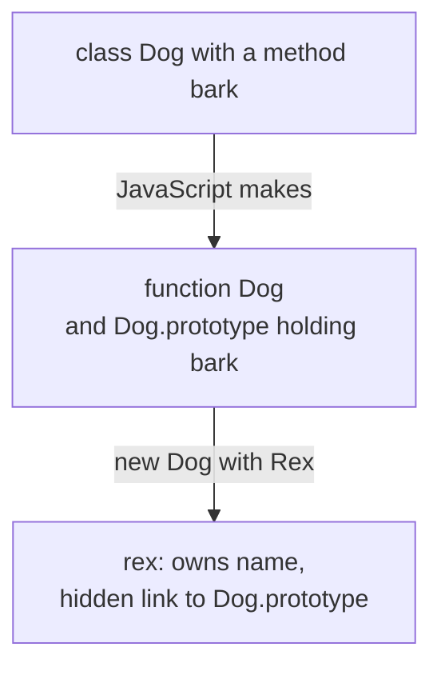
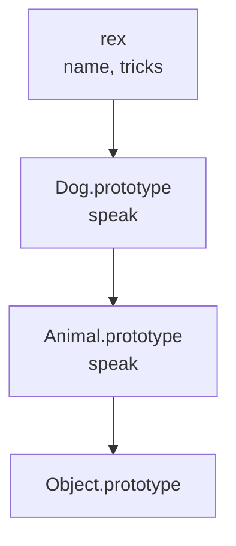
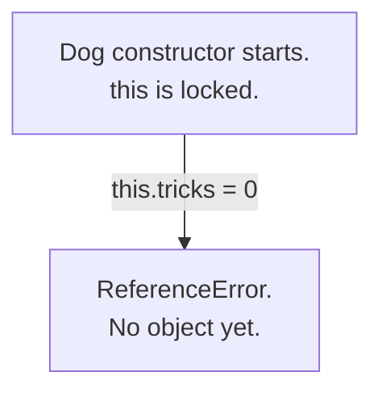

# 08. Classes

> **Subject:** JavaScript · **Lesson:** 08 · **Made:** 2026-10-15 · **Remade in short cards:** 2026-10-28 · **Status:** ready
>
> **You will be able to:** draw the objects that one `class` line makes, say why `super()` must run before `this` in a child class, and explain why a `#` field is really private.
>
> **Before this:** [Objects and prototypes](07-objects-and-prototypes.md) · **Next:** [Arrays and higher order functions](09-arrays-and-higher-order-functions.md)
>
> **How to read it:** one card is one idea. Look at the picture, guess, then press the orange bar to check. The blue bars (📖 More detail) hold the longer explanation. Skip them on the first read, and open them when you want more. About 25 minutes for the cards.

## 1. The idea: a chain of shops

Think of a chain of shops. Each shop keeps its own stock. The how-to steps sit in **one** manual at head office. Shops phone head office for a step.



Notice: `bark` is stored **once**, on `Dog.prototype`. Every instance has an arrow to it. In lesson 07 you built these two things by hand. A class is a shorter way, plus a few safety rules.

<details class="guess"><summary>🤔 Guess: you make 1000 dogs with `new Dog`. How many copies of `bark` exist? Press to check.</summary>

**One.** It sits on `Dog.prototype`. Each dog keeps only its own data (`name`) and one hidden link.

</details>

> **Remember:** a class is a function. Its methods sit on one shared prototype object. Every instance has an arrow to that object.

<details class="more"><summary>📖 More detail: the four words, and where the shop picture stops</summary>

- **Instance:** an object made from a class with `new`. In `const rex = new Dog("Rex")`, `rex` is an instance of `Dog`.
- **Parent class and child class:** in `class Dog extends Animal`, `Animal` is the parent class and `Dog` is the child class. (Interview words: *base class* or *superclass*, and *derived class* or *subclass*.)
- **Field:** a line in the class body like `count = 0`. JavaScript runs it again for every new instance and writes the value on that instance. (Interview word: *class field*.)
- **Private slot:** a field whose name starts with `#`. It sits inside the object, but it is not a property. Only code written inside the class can reach it. (Interview word: *private field*.)

Words from earlier lessons: the **hidden link** leads to the next object JavaScript asks (lesson 07). An **own property** is stored on the object itself. **Strict mode** is the safer setting from lesson 06, and class code always uses it.

The picture: a sub-brand (a child class) has its own manual. For anything missing, it asks the parent brand's manual. The parent company must open a sub-brand shop first (`super()`). Only then can the shop fill its shelves (`this`). Each shop has a safe (a private slot).

Where the picture stops: real manuals get copied. In JavaScript there is truly one prototype object. Change it, and every instance sees the change. And a child class **cannot** open the parent's `#` safe.

</details>

## 2. `extends` and `super()`

`extends` makes a child class. `super(name)` runs the parent constructor. `super.speak()` runs the parent method.

```js
class Animal {
  constructor(name) { this.name = name; }
  speak() { return this.name + " makes a sound"; }
}
class Dog extends Animal {
  constructor(name) {
    super(name);
    this.tricks = 0;
  }
  speak() { return super.speak() + ", woof"; }
}
const rex = new Dog("Rex");
console.log(rex.speak());
console.log(rex instanceof Animal);
```



<details class="guess"><summary>🤔 Guess: what are the two lines of output? Press to check.</summary>

```
Rex makes a sound, woof
true
```

`rex.speak()` finds Dog's `speak` first. `super.speak()` starts the search **one step up**, at `Animal.prototype`. `rex instanceof Animal` walks rex's chain: `Dog.prototype`? No. `Animal.prototype`? Yes.

</details>

> **Remember:** `extends` links the prototypes. `super.method()` runs the parent's version.

<details class="more"><summary>📖 More detail: `new Dog("Rex")`, step by step</summary>

| Step | Line | What JavaScript does | Call stack | Memory after | Prints |
|---|---|---|---|---|---|
| 1 | setup | Sets up the names `Animal`, `Dog` and `rex`. All three are **locked** until their line runs, like `let`. | main | only `Object.prototype` | |
| 2 | 1 to 4 | `class Animal` makes the function `Animal` and the object `Animal.prototype` holding `speak`. They point at each other. The lock on `Animal` opens. | main | Animal, Animal.prototype | |
| 3 | 5 | `class Dog extends Animal` makes `Dog` and `Dog.prototype`. `extends` adds **two** hidden links: `Dog.prototype` to `Animal.prototype`, and `Dog` to `Animal`. | main | + Dog, Dog.prototype | |
| 4 | 7 | Dog's `speak` goes on `Dog.prototype`. Now there are two `speak` functions. A dog finds Dog's first. (Interview word: *overriding*.) The lock on `Dog` opens. | main | same | |
| 5 | 9 | `new Dog("Rex")`. Dog is a child class, so `new` does **not** make the object. Dog's constructor starts with `this` **locked**. | main, Dog constructor | no object yet | |
| 6 | 6 | `super(name)` runs Animal's constructor. Animal has no `extends`, so **it** makes the empty object. Its hidden link goes to `Dog.prototype`, because `new` was called on `Dog`. | main, Dog constructor, Animal constructor | empty object, linked to Dog.prototype | |
| 7 | 2 | `this.name = name` writes `name = "Rex"` on the object. | same | object has name | |
| 8 | 6 | Animal's constructor ends. `this` is **unlocked** in Dog's constructor. `this.tricks = 0` runs. | main, Dog constructor | object has name, tricks | |
| 9 | 9 | Dog's constructor ends. `new` gives back the object. The lock on `rex` opens. | main | rex points at the object | |
| 10 | 10 | `rex.speak()`. `rex` has no own `speak`. JavaScript follows the hidden link to `Dog.prototype` and finds it. `this` is `rex`. | main, Dog speak | same | |
| 11 | 7 | `super.speak()` starts the search **one step up** from `Dog.prototype`, so at `Animal.prototype`. It runs Animal's `speak`, and `this` is still `rex`. | main, Dog speak, Animal speak | same | |
| 12 | 3, 7 | Animal's `speak` returns `"Rex makes a sound"`. Dog's `speak` adds `", woof"`. | main | same | Rex makes a sound, woof |
| 13 | 11 | `rex instanceof Animal` walks rex's chain. `Dog.prototype`? No. `Animal.prototype`? Yes. | main | same | true |

`extends` also adds a second arrow from class to class (`Dog` to `Animal`), so a child class finds the parent's `static` methods too. Checked on 2026-10-28 with Node 26.12.1.

</details>

## 3. Mistake 1: `this` before `super()`

In a child class, the **parent** constructor makes the object. Until it does, `this` is locked.

```js
class Dog extends Animal {
  constructor(name) {
    this.tricks = 0;
    super(name);
  }
}
```



<details class="guess"><summary>🤔 Guess: what happens with `new Dog("Rex")`? Press to check.</summary>

```
ReferenceError: Must call super constructor in derived class before accessing 'this' or returning from derived constructor
```

Before `super()` returns, there is no object for `this` to be.

Fix: call `super(name)` first, then `this.tricks = 0`.

</details>

> **Remember:** in a child class, call `super()` first. Then `this` works.

<details class="more"><summary>📖 More detail: why the parent builds the object</summary>

When you call `new Dog`, a child class does **not** make the object. Dog's constructor starts with `this` locked. `super(name)` runs Animal's constructor. Animal has no `extends`, so **it** makes the empty object, and its hidden link goes to `Dog.prototype` (because `new` was called on `Dog`). Then `this` is unlocked.

If you write no constructor in a child class, it gets `constructor(...args) { super(...args); }` for free.

</details>

## 4. Mistake 2: passing a method around on its own

A method lives on the prototype, not inside the object. Copy it out, and the object stays behind.

```js
class Counter {
  count = 0;
  inc() { this.count++; }
}
const c = new Counter();
const inc = c.inc;
inc();
```

<details class="guess"><summary>🤔 Guess: what happens when you call `inc()`? Press to check.</summary>

```
TypeError: Cannot read properties of undefined (reading 'count')
```

`c.inc` gives only the function. With no dot at the call, `this` is `undefined`, because class code is strict.

Fix: keep the object with the call. Pick one:

```js
const inc1 = () => c.inc();
const inc2 = c.inc.bind(c);
```

Both work (`count` becomes 2 after calling both).

</details>

> **Remember:** a class method is the same as any method: pass it with an arrow wrapper or `bind`.

<details class="more"><summary>📖 More detail: arrow fields</summary>

You can also write the method as an arrow field: `inc = () => { this.count++; };`. It works because each instance gets its own arrow function, which keeps `this`. That costs one function per instance. See [lesson 06](06-this-call-apply-and-bind.md).

</details>

## 5. A private slot with `#`

People wrote `_balance` to mean "please do not touch". But it is a normal property. Outside code can read and change it. A name that starts with `#` is a **private slot**.

```js
class Account {
  #balance = 0;
  deposit(n) { this.#balance += n; }
  get balance() { return this.#balance; }
}
const a = new Account();
a.deposit(50);
console.log(a.balance);
console.log(a["#balance"], Object.keys(a).length);
```

<details class="guess"><summary>🤔 Guess: what do the two `console.log` lines print? Press to check.</summary>

```
50
undefined 0
```

A **getter** (`get balance()`) is a method that runs when you read a property, with no brackets. Outside code has no name for the `#` slot, so it has no way in. `Object.keys` does not see it either.

</details>

> **Remember:** `_balance` is only a polite sign. `#balance` is really private.

<details class="more"><summary>📖 More detail: checking for a private slot</summary>

Inside the class, `#balance in obj` gives `true` if `obj` has that slot. This is a safe check that does not throw. `JSON.stringify` and `Object.keys` see only normal properties, never `#` slots.

</details>

## 6. Mistake 3: a child class reading the parent's `#` slot

```js
class Account { #balance = 0; }
class Savings extends Account {
  read() { return this.#balance; }
}
```

<details class="guess"><summary>🤔 Guess: what happens? Press to check.</summary>

```
SyntaxError: Private field '#balance' must be declared in an enclosing class
```

The file does not even start. A `#` name belongs only to the class body where it is written. It is not on the chain, so the child class does not get it.

Fix: the parent offers a getter, and the child uses it.

```js
class Account {
  #balance = 0;
  get balance() { return this.#balance; }
}
class Savings extends Account {
  read() { return this.balance; }
}
```

</details>

> **Remember:** a child class cannot read the parent's `#` slot. Offer a getter.

<details class="more"><summary>📖 More detail: the cost of `#` slots</summary>

A `#` slot is hard to check in tests. A child class cannot read it either. Use `#balance` when the data must stay inside.

</details>

## 7. Watch it run, step by step

The stepper shows your code, the names, the call stack, and the objects in memory with their arrows. It has six programs: "A class is a function", "extends and super()", "super() forgotten", "Lost this and arrow fields", "Private field #", and "instanceof walks the chain". Type your guess in the box first, then press Next.

**Step through it yourself:** [open the classes stepper](visuals/08-classes.html).

## 8. Why it matters and what it costs

- **Without it,** you wire prototypes by hand in five steps. A forgotten step gives a quiet bug. And `_balance` hides nothing.
- **With it,** one `class` line makes the function, the prototype object and the links. A `#` field is really private. Free safety rules: you must use `new`, the code is strict, and methods are hidden from `Object.keys` and `for...in` (interview word: *not enumerable*).
- **The cost:**
  - It is still prototypes underneath, so prototype bugs still happen.
  - **Lost `this`.** A shared method has no fixed `this`. An arrow field fixes it, but makes one function per instance.
  - **Long `extends` chains are hard to change.** A change in a parent can break every child. React now recommends function components over class components.
  - A `#` slot is hard to check in tests. A child class cannot read it either.

Simple rule: use a class when you make **many objects of one kind** that **keep their own data** and **share many methods**.

## 9. Watch and play

Links checked on 2026-10-15. Each page opened. For each video, the title and channel matched, and the length came from the YouTube page. I did not watch the videos.

- **Video:** [The JavaScript SUPER keyword is super!](https://www.youtube.com/watch?v=Cto38GpvJgg) by Bro Code, about 9 minutes. Watch it after tab 2 of the stepper.
- **Video:** [ES2022: Class Private Fields and Methods](https://www.youtube.com/watch?v=dwfUJRbGXX0) by All Things JavaScript, about 10 minutes. Watch it after tab 5.
- **Play with it:** [The classes stepper](visuals/08-classes.html) in this folder. Guess first, then press Next.
- **Play with it:** [Python Tutor for JavaScript](https://pythontutor.com/javascript.html). Paste the program from card 2. Its [guide](https://pythontutor.com/articles/javascript-visualizer.html) says it draws classes, but runs only ES6 code, so fields like `count = 0` and `#balance` fail there.
- **Read:** [Class basic syntax](https://javascript.info/class) on javascript.info. The picture in "What is a class?" is like the picture in card 1.
- **Read:** [Class inheritance](https://javascript.info/class-inheritance) on javascript.info. The picture in "The extends keyword" is like the picture in card 2.
- **Read:** [Private elements on MDN](https://developer.mozilla.org/en-US/docs/Web/JavaScript/Reference/Classes/Private_properties). Read the first two sections.

<details><summary>More links (optional)</summary>

- **Video:** [Javascript Classes Explained](https://www.youtube.com/watch?v=5fmifZZeJJ4) by Dave Gray, about 31 minutes. Longer. It also compares classes with functions that return objects (factory functions).
- **Read:** [Using classes on MDN](https://developer.mozilla.org/en-US/docs/Web/JavaScript/Guide/Using_classes). The section "Why classes?" says when a class is a good fit.
- **Read:** [super on MDN](https://developer.mozilla.org/en-US/docs/Web/JavaScript/Reference/Operators/super). The example says "Moving this to the top causes a ReferenceError."
- **Read:** [What are the differences between JavaScript ES2015 classes and ES5 function constructors?](https://greatfrontend.com/questions/quiz/what-are-the-differences-between-es6-class-and-es5-function-constructors) on GreatFrontEnd. A common interview question, with both versions side by side.
- **Read:** [Component on react.dev](https://react.dev/reference/react/Component). The first warning says "We recommend defining components as functions instead of classes."

</details>

## 10. Practice

**A. Predict the output** (write your answer before opening)

```js
class Shape {
  constructor() { this.sides = 0; }
  describe() { return "I have " + this.sides + " sides"; }
}
class Square extends Shape {
  constructor() { super(); this.sides = 4; }
}
const s = new Square();
console.log(s.describe());
console.log(Object.keys(s));
console.log(s instanceof Shape, Object.hasOwn(s, "describe"));
```

<details><summary>Answer</summary>

```
I have 4 sides
[ 'sides' ]
true false
```

- `super()` runs Shape's constructor first and writes `sides = 0`. Then Square's constructor changes it to 4.
- There is one own property, `sides`. `describe` lives on `Shape.prototype`, so it is not own, and `Object.keys` does not list it.
- `Shape.prototype` is on the chain of `s`, so `instanceof` gives `true`.

</details>

**B. Fix the bug**

```js
class Cart {
  items = [];
  add(item) { this.items.push(item); }
}
const cart = new Cart();
["apple", "pear"].forEach(cart.add);   // TypeError
console.log(cart.items);               // should be [ 'apple', 'pear' ]
```

<details><summary>Answer</summary>

`forEach(cart.add)` passes only the function. `forEach` calls it with no dot, so `this` is `undefined`. Then `this.items` throws `TypeError: Cannot read properties of undefined (reading 'items')`.

Keep the object with the call:

```js
["apple", "pear"].forEach(item => cart.add(item));
console.log(cart.items);   // [ 'apple', 'pear' ]
```

`forEach(cart.add.bind(cart))` also works. So does writing `add` as an arrow field.

</details>

**C. Write it yourself**

Open `practice/08-classes.js`. There are four tasks:

1. Fix two bugs in a child class `Dog`.
2. Write a `Wallet` class with a private `#` balance, `deposit`, `withdraw` and a `balance` getter.
3. Write `LimitedWallet extends Wallet`, which uses `super` in two places.
4. Write down what six snippets print.

Run the tests from the folder that contains `learn/`:

```
node --test learn/javascript/practice/08-classes.test.js
```

At the start, all 23 tests fail. When you fix the first bug in `Dog`, the second one shows up.

<details><summary>One possible answer</summary>

```js
class Dog extends Animal {
  constructor(name, tricks) {
    super(name);                 // bug 1: super first, then this
    this.tricks = tricks;
  }
  describe() {
    // bug 2: this.describe() called itself forever (RangeError). super starts one step up.
    return super.describe() + " and knows " + this.tricks + " tricks";
  }
}

class Wallet {
  #balance;
  constructor(start = 0) { this.#balance = start; }
  deposit(n) { this.#balance += n; return this.#balance; }
  withdraw(n) {
    if (n > this.#balance) throw new Error("Not enough money");
    this.#balance -= n;
    return this.#balance;
  }
  get balance() { return this.#balance; }
}

class LimitedWallet extends Wallet {
  constructor(limit, start = 0) {
    super(start);                // the parent makes the object and its # slot
    this.limit = limit;
  }
  withdraw(n) {
    if (n > this.limit) throw new Error("Over the limit");
    return super.withdraw(n);    // the parent's rules still run
  }
}

const predictions = {
  s1: ["function", "0", "true"],
  s2: ["TypeError"],
  s3: ["x,y", "true"],
  s4: ["TypeError", "5"],
  s5: ["true", "undefined", "{}"],
  s6: ["BA", "A"],
};
```

Why `LimitedWallet` cannot read `#balance`: the `#` name belongs to the body of `Wallet`. So it uses `super.withdraw` and the `balance` getter instead.

</details>

## 11. Interview question

**Q:** "Are classes in JavaScript just syntax sugar? What does a class really make, and what do `extends` and `super` do?"

<details><summary>A strong answer, in four parts</summary>

1. **Problem:** you need many objects of one kind. Each keeps its own data, and all share the same methods. Some kinds also need a parent's methods. Wiring prototypes by hand for this takes many steps and is easy to get wrong.
2. **How it works:**
   - A class makes a function plus one prototype object that holds the methods. `new` makes an instance with a hidden link to that object.
   - `extends` makes two links. The child prototype links to the parent prototype, for methods. The child class links to the parent class, for static methods.
   - In a child class, the parent constructor makes the object. So `super()` must run before `this`.
   - `super.method()` starts the search one step above the method's own prototype, and keeps the same `this`.
   - A `#` field is a private slot that only code inside the class body can reach.
3. **Tradeoff:** mostly sugar, but not only. You must call it with `new`, the code is always strict, methods are not enumerable, and `#` fields and `super()` have no simple old version. Costs: methods lose `this` when passed around. Arrow fields fix that, but cost one function per instance. Deep `extends` chains are hard to change, and React now recommends function components over class components.
4. **My example:**
   - *A fact about your tools:* Prisma code starts with `const prisma = new PrismaClient()`. `PrismaClient` is a class, and your app makes one instance of it.
   - *An idea, not a fact. Replace it with a real story:* in the Skyworx loan systems, a custom error such as `class LoanRuleError extends Error` would let a `catch` block use `err instanceof LoanRuleError` to tell a rule failure from a crash.

</details>

## 12. Explain it back

Close this file. Press the **Record my explanation** button under this heading and explain classes out loud, like to a new junior, in 4 parts: problem, how it works, tradeoff, my example. Use the words "prototype object", "hidden link", "instance" and "super". Then save the transcript file into `my-learning/recordings/`, or write your best version below. Run `/explain-check classes` or ask the `explain-coach` agent to review it.

### My explanation

<write here>

### Coach feedback

<the explain-coach agent writes here>

## 13. Review questions (day 1, 3, 7, 21)

1. What two objects does `class Dog { bark() {} }` make? Where does `bark` live?
2. In a child class, why must `super()` run before you use `this`?
3. What is the difference between `_balance` and `#balance`?
4. Draw the picture from card 2 from memory: `rex`, the two prototypes, the two classes, and every arrow.

<details><summary>Answers</summary>

1. A function `Dog`, and one object `Dog.prototype`. `bark` lives once on `Dog.prototype`. Every instance has a hidden link to it, so they all share one `bark`.
2. In a child class, `new` does not make the object. The parent constructor makes it when `super()` runs. Before that, `this` is locked, and using it throws a `ReferenceError`.
3. `_balance` is a normal property. Anyone can read it and change it, and `Object.keys` lists it. `#balance` is a private slot. Only code inside the class body can reach it. Outside code that writes `obj.#balance` is a `SyntaxError`.
4. `rex` links to `Dog.prototype`, which links to `Animal.prototype`, which links to `Object.prototype`. `Dog` points to `Dog.prototype` and `Animal` points to `Animal.prototype`. `Dog` also has a hidden link to `Animal`.

</details>

## 14. Go deeper (optional)

Open these when you are ready. None of them is needed for the cards above.

<details><summary>More</summary>

- **The second arrow, from class to class.** A method written with `static` is stored on the class itself, not on the prototype. For example, `static create() {}` is called as `Dog.create()`. Because `Dog` links to `Animal`, `Dog` also finds Animal's static methods. Built-in classes have them too, like `Array.from`.
- **When fields run.** In a parent class, fields run when the object is made, before the constructor body. In a child class, they run right after `super()` returns. That is one more reason `super()` comes first.
- **No constructor written?** A child class gets `constructor(...args) { super(...args); }` for free (stepper tab 6). A parent class gets an empty one.
- **The safety rules in detail.** `Dog("Rex")` without `new` throws `TypeError: Class constructor Dog cannot be invoked without 'new'`. The class name is locked until the class line runs, like `let` (lesson 01), so `new Late()` above `class Late {}` throws a `ReferenceError`. Methods written by hand on a prototype (lesson 07) do show up in `for...in`. Class methods do not.
- **Checking for a private slot.** Inside the class, `#balance in obj` gives `true` if `obj` has that slot. This is a safe check that does not throw.
- **instanceof only walks the chain.** It does not ask which constructor ran. If you change an object's hidden link with `Object.setPrototypeOf`, the answer changes (stepper tab 6).
- **`super` is fixed where the method is written.** Copying a method to another object does not change where `super` starts its search. `this` does change.

Checked on 2026-10-15 with Node 24.15.0. Every output and error name in this lesson came from a real run.

</details>

## Connected lessons

- [Objects and prototypes](07-objects-and-prototypes.md): the hidden links a class builds for you.
- [this, call, apply and bind](06-this-call-apply-and-bind.md): why a copied method loses `this`.
- [Closures](05-closures.md): the older way to hide data, in a scope box instead of a `#` slot.
- [Variables, scope and hoisting](01-variables-scope-and-hoisting.md): a class name is locked until its line runs, like `let`.
- [Arrays and higher order functions](09-arrays-and-higher-order-functions.md): the next lesson. Practice B passes a method to `forEach`.
