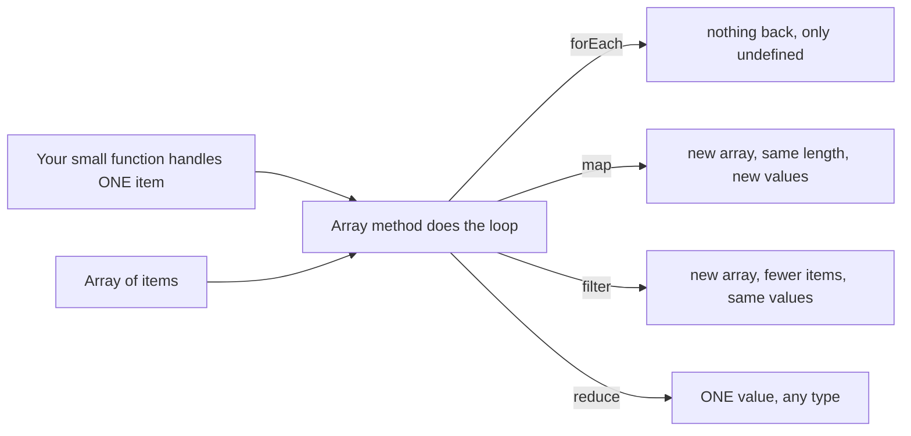
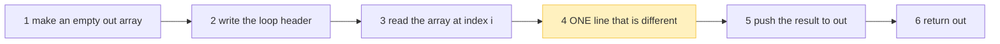
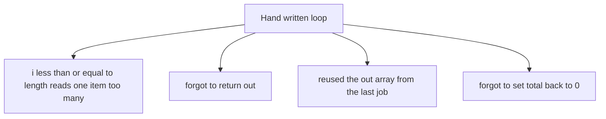
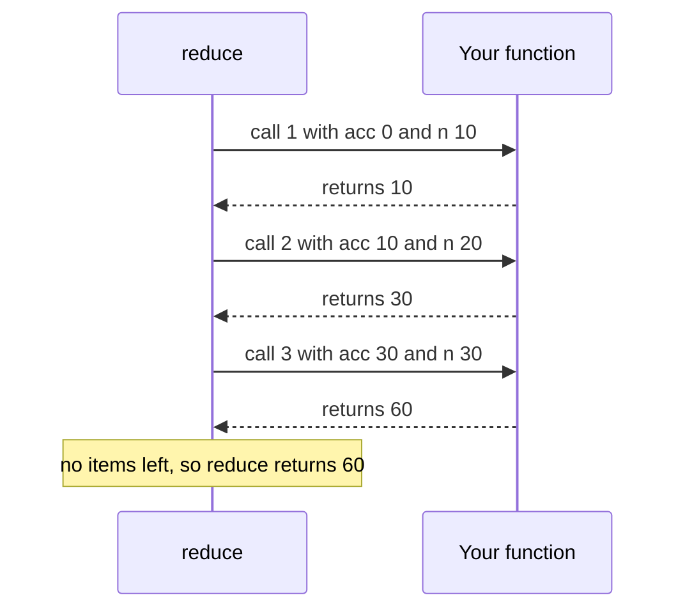
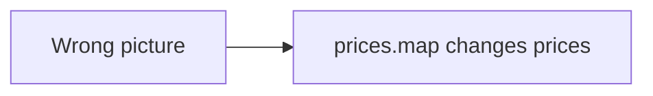
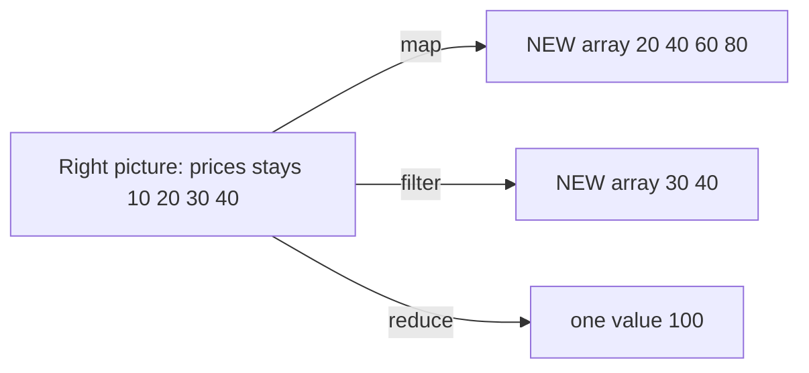
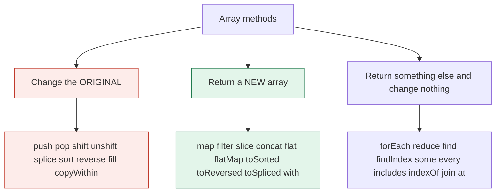
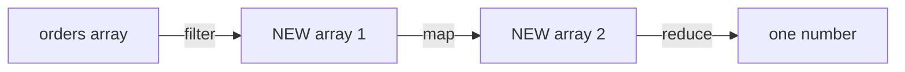
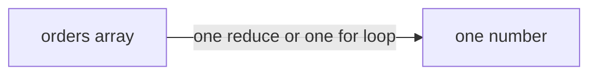
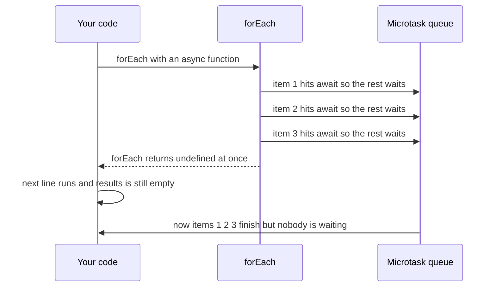

# 09. Arrays and higher order functions

> **Subject:** JavaScript · **Lesson:** 09 · **Made:** 2026-10-12 · **Status:** ready
> **You will be able to:** pick `forEach`, `map`, `filter` or `reduce` for a job, say which array methods change the original array and which return a new one, and trace `reduce` one item at a time.
> **Before this:** [Classes](08-classes.md) · **Next:** [Destructuring, spread and rest](10-destructuring-spread-and-rest.md)

## 1. The idea in one sentence

`map`, `filter` and `reduce` are **higher order functions**: you give each one a small function that handles **one item**, and it does the looping and the collecting for you.

New words, in plain English:

- **Array:** an ordered list of values. The first item has index 0, not 1.
- **Higher order function:** a function that **takes a function** as input, or **gives a function back**. `map` takes one. This works because a function is a value you can pass around (see Functions, lesson 04, not written yet).
- **Callback:** the small function you pass in. The method calls it for you, once per item, in order. A callback also remembers the variables around it (see [Closures](05-closures.md)).
- **Accumulator:** in `reduce`, the box that carries the running answer from one call to the next.
- **Mutate:** change the original array in place. A method that does not mutate leaves the original alone and gives you a new array.

## 2. The pictures (at least five)

### 2a. The big picture

Notice that the four methods take the same two inputs and give four different shapes of output.



### 2b. The problem, drawn

Without these methods you write the same loop by hand for every job. Notice that only step 4 is different between "double every price", "keep the big ones" and "add them up". The other five steps are copied each time.



Every copy is a new chance for a typo. Notice that all four mistakes are about the loop, not about the real job.



### 2c. How it works over time

This is `[10, 20, 30].reduce((acc, n) => acc + n, 0)`. Notice that the value returned by one call becomes `acc` in the next call.



### 2d. What is in memory right now

A snapshot taken **inside call 2** of `prices.reduce((sum, p) => sum + p, 0)` with `prices = [10, 20, 30, 40]`. Notice the last row: `reduce` has no answer until the last item is done.

| Name | Value | What it is |
|---|---|---|
| `prices` | `[10, 20, 30, 40]` | the original array. It never changes. |
| index | `1` | which item is being handled |
| `sum` (the accumulator) | `10` | what call 1 returned |
| `p` (the item) | `20` | `prices[1]` |
| your function is computing | `sum + p` = `30` | not returned yet |
| the answer so far | none | it exists only after the last call |

### 2e. Right against wrong

The most common wrong picture is that `map` and `filter` edit my array. They do not. They build a new one.





### 2f. Which methods change the original?

This matters a lot in React state, where you must not change the old array. Notice the red group. These are the dangerous ones.



The same thing as a table. I ran every method in Node v24.15.0 on 2026-10-12 to check the middle column.

| Method | Changes the original? | What it gives back |
|---|---|---|
| `push`, `unshift` | **yes** | the new length |
| `pop`, `shift` | **yes** | the removed item |
| `splice` | **yes** | an array of the removed items |
| `sort`, `reverse`, `fill`, `copyWithin` | **yes** | the **same** array, not a copy (`a.sort() === a` is `true`) |
| `map`, `filter`, `slice`, `concat`, `flat`, `flatMap` | no | a new array |
| `toSorted`, `toReversed`, `toSpliced`, `with` | no | a new array (Node 20 or newer, see 5c) |
| `forEach` | no | `undefined` |
| `reduce` | no | one value |
| `find`, `findIndex`, `some`, `every`, `includes`, `indexOf`, `join`, `at` | no | an item, a number, true or false, or a string |

"No" means the method itself leaves the array alone. Two limits:

- Your callback can still change things. Do not do that.
- The new array is a **shallow copy**. It holds the **same objects** as the old one. Changing an object inside the copy also changes it in the original.

### 2g. Chaining, and what it costs

Chaining means calling one method on the result of the last one. Notice that every arrow makes a **new array**. The second picture does the same job in one pass.





## 3. Real life analogy

A **factory belt** with items on it, and one worker at each station.

- `forEach` is a worker who touches every item but puts nothing on a new belt.
- `map` is a painter. Every item goes in, one painted item comes out. The new belt has the same number of items.
- `filter` is an inspector. Items that pass are copied to a new belt. Items that fail are left out. The new belt is shorter, and the items are not changed.
- `reduce` is a worker with one bucket (the accumulator). Each item is added to the bucket, and at the end you get the bucket.

Where the analogy stops: a real belt moves the items away. An array does not lose anything. The old belt stays full, and `map` and `filter` copy the **values** to a new belt. Also, a real factory can work on many items at once. These methods handle one item at a time, in order.

## 4. The smallest code that shows it

Snippet A. The three jobs on the same list. Run it in its own file.

```js
const prices = [10, 20, 30, 40];

const doubled = prices.map(p => p * 2);                 // same length, new values
const big     = prices.filter(p => p > 25);             // fewer items, same values
const total   = prices.reduce((sum, p) => sum + p, 0);  // many in, one out

console.log(doubled);
console.log(big);
console.log(total);
console.log(prices);   // the original never changed
```

**Output:**

```
[ 20, 40, 60, 80 ]
[ 30, 40 ]
100
[ 10, 20, 30, 40 ]
```

Snippet B. `sort` compares as text unless you tell it how to compare.

```js
const scores = [10, 9, 1];
console.log([...scores].sort());                 // wrong, compares as text
console.log([...scores].sort((a, b) => a - b));  // right
console.log(scores);                             // the copy was sorted, not scores
```

**Output:**

```
[ 1, 10, 9 ]
[ 1, 9, 10 ]
[ 10, 9, 1 ]
```

Snippet C. Group words by their first letter with `reduce`. The accumulator is an object.

```js
const words = ["apple", "banana", "avocado", "blueberry"];
const byLetter = words.reduce((acc, w) => {
  const k = w[0];
  if (!acc[k]) acc[k] = [];
  acc[k].push(w);
  return acc;
}, {});
console.log(byLetter);
```

**Output:**

```
{ a: [ 'apple', 'avocado' ], b: [ 'banana', 'blueberry' ] }
```

## 5. What really happens, step by step

### 5a. The three traces

Each row is one callback call. These are the same numbers as snippet A, so you can check them against the output.

**`prices.map(p => p * 2)`**

| Step | What the engine does | index | `p` | Callback returns | New array after |
|---|---|---|---|---|---|
| 1 | `map` makes a new array with the same length | | | | 4 empty slots |
| 2 | call 1 | 0 | 10 | 20 | `[20, empty, empty, empty]` |
| 3 | call 2 | 1 | 20 | 40 | `[20, 40, empty, empty]` |
| 4 | call 3 | 2 | 30 | 60 | `[20, 40, 60, empty]` |
| 5 | call 4 | 3 | 40 | 80 | `[20, 40, 60, 80]` |
| 6 | no items left, `map` returns the new array | | | | `[20, 40, 60, 80]` |

**`prices.filter(p => p > 25)`**

| Step | What the engine does | index | `p` | Callback returns | New array after |
|---|---|---|---|---|---|
| 1 | `filter` makes a new **empty** array | | | | `[]` |
| 2 | call 1 | 0 | 10 | `false`, skip | `[]` |
| 3 | call 2 | 1 | 20 | `false`, skip | `[]` |
| 4 | call 3 | 2 | 30 | `true`, keep 30 | `[30]` |
| 5 | call 4 | 3 | 40 | `true`, keep 40 | `[30, 40]` |
| 6 | no items left, `filter` returns the new array | | | | `[30, 40]` |

**`prices.reduce((sum, p) => sum + p, 0)`**

| Step | What the engine does | index | `sum` | `p` | Callback returns | Accumulator after |
|---|---|---|---|---|---|---|
| 1 | the start value `0` becomes the accumulator | | | | | 0 |
| 2 | call 1 | 0 | 0 | 10 | 10 | 10 |
| 3 | call 2 | 1 | 10 | 20 | 30 | 30 |
| 4 | call 3 | 2 | 30 | 30 | 60 | 60 |
| 5 | call 4 | 3 | 60 | 40 | 100 | 100 |
| 6 | no items left, `reduce` returns the accumulator | | | | | **100** |

Two variations, and both are in the stepper:

- **No start value.** `prices.reduce((sum, p) => sum + p)`. The first item becomes the accumulator, and the first call has `sum = 10`, `p = 20`, **index 1**. That is 3 calls, not 4.
- **Empty array and no start value.** There is no first item to use. `reduce` throws `TypeError: Reduce of empty array with no initial value`. With a start value, `[].reduce(fn, 0)` returns `0` and never calls `fn`.

**Step through it yourself:** [open the map, filter and reduce stepper](visuals/09-arrays-and-higher-order-functions.html). It has seven small programs: `map`, `filter`, `reduce` with and without a start value, `reduce` on an empty array, `reduce` that groups, and `map` with a forgotten `return`. Each one shows the array, the current index, the callback call with its arguments, the accumulator and the growing result. Write your guess first, then press Next.

### 5b. The question-asking methods

These ask a question about the array and stop early when they know the answer. Notice what each one gives back when nothing matches. I ran all of these in Node.

| Method | The question | When something matches | When nothing matches |
|---|---|---|---|
| `find(fn)` | which is the first item that passes? | the item | `undefined` |
| `findIndex(fn)` | where is the first item that passes? | its index | `-1` |
| `some(fn)` | does at least one item pass? | `true` | `false` |
| `every(fn)` | do all items pass? | `true` | `false`. On an **empty** array it is `true`. |
| `includes(value)` | is this value in the array? | `true` | `false` |
| `flatMap(fn)` | `map`, then flatten one level | a new array | `[]` |

Things to remember:

- `findIndex` returns `-1` when nothing is found, and `0` is a real position. So `if (index)` is wrong. Write `if (index !== -1)`.
- `["a b", "c d"].map(s => s.split(" "))` gives `[ [ 'a', 'b' ], [ 'c', 'd' ] ]`. With `flatMap` it gives `[ 'a', 'b', 'c', 'd' ]`.
- `includes` can find `NaN` (`[NaN].includes(NaN)` is `true`). `indexOf` cannot (`[NaN].indexOf(NaN)` is `-1`).
- `some` stops at the first match. I checked: on `[1, 2, 3, 4]` with a test for `n === 2`, the callback ran 2 times. `forEach` always runs for every item (4 times).

### 5c. `sort`, and the copy methods that came later

- `sort` **changes the original** and gives back the **same array**.
- With no compare function, `sort` turns every item into a **string** and compares the text. `"10"` comes before `"9"` because the character `"1"` comes before `"9"`. That is why `[10, 9, 1].sort()` gives `[1, 10, 9]`.
- Pass a compare function. `(a, b) => a - b` sorts numbers from small to large. It must return a **number**: negative means `a` goes first, positive means `b` goes first. A function that returns `true` or `false` does not work. In Node 24, `[3, 1, 2].sort((a, b) => a > b)` stays `[ 3, 1, 2 ]`.
- To avoid changing the original, copy first: `[...arr].sort(...)` works in every environment.

New copy methods, and the version they came in:

| Method | Does the same as | First Node version (MDN compatibility data) | Checked here |
|---|---|---|---|
| `toSorted(fn)` | a copy, then `sort(fn)` | 20.0.0 | exists in the installed Node v24.15.0 |
| `toReversed()` | a copy, then `reverse()` | 20.0.0 | exists |
| `toSpliced(...)` | a copy, then `splice(...)` | 20.0.0 | exists |
| `with(index, value)` | a copy with one item replaced | 20.0.0 | exists |
| `Object.groupBy(array, fn)` | the `reduce` grouping in snippet C | **21.0.0** | exists |

- `toSorted` has the **same** default text comparison as `sort`. `[10, 9, 1].toSorted()` is still `[1, 10, 9]`.
- `Object.groupBy` returns an object with **no prototype**, so it prints as `[Object: null prototype] { ... }`. `Map.groupBy` gives a `Map`.
- I confirmed the Node versions in MDN's browser compatibility data (the `mdn/browser-compat-data` files for `Array` and `Object`), and I confirmed with `typeof` that the installed Node has them. **I could not confirm whether Hermes (the engine in React Native) has them.** In a React Native app, run `typeof [].toSorted` and `typeof Object.groupBy` on a real build. `[...items].sort(...)` and `reduce` work everywhere.

## 6. Why it exists and what it costs

- **Problem without it:** the same hand written loop for every job (picture 2b). The reader must read the whole loop to learn what it does. Each copy can hide a typo.
- **How it solves it:** the loop is written once, inside the method. The method name says the job: `map` changes each item, `filter` chooses items, `reduce` combines them. You write only the one different line, as a callback. This works because a function is a value.
- **Cost or tradeoff:**
  - **Every step in a chain makes a new array.** That costs time and memory. For normal lists it is fine, and it reads well. For a very large array, measure first. Then use one `reduce` or `for` loop. Or use lazy iterator helpers, which do one pass: `[1, 2, 3, 4].values().filter(n => n % 2 === 0).map(n => n * 10).toArray()` gives `[ 20, 40 ]`. MDN's data says Node 22 or newer, and I ran it on Node 24.
  - **You cannot stop early** in `forEach`, `map`, `filter` or `reduce`. They visit every item. To stop early use `for...of` with `break`, or `some`, `every` or `find`.
  - **`reduce` is easy to overuse.** If the callback is long, use a `for` loop, or two steps (`filter`, then `map`).
  - **`forEach` does not wait** for async callbacks (section 7).
  - **Use `map` only when you want the new array.** If you do not use the result, use `forEach` or `for...of`.

## 7. Common mistakes

**Wrong:** sorting numbers with no compare function, and changing the original.

```js
function topThree(scores) {
  return scores.sort().reverse().slice(0, 3);
}
const scores = [50, 9, 100, 75, 8];
console.log(topThree(scores));   // [ 9, 8, 75 ]
console.log(scores);             // [ 9, 8, 75, 50, 100 ]  the input was changed
```

**Right:** copy, then sort by number.

```js
function topThree(scores) {
  return [...scores].sort((a, b) => b - a).slice(0, 3);
}
// topThree([50, 9, 100, 75, 8]) gives [ 100, 75, 50 ] and scores stays the same
```

**Why:** the default compares text, and `sort` and `reverse` both change the array they are called on.

**Wrong:** `map` with curly braces and no `return`.

```js
const doubled = [1, 2, 3].map(n => { n * 2; });
console.log(doubled);   // [ undefined, undefined, undefined ]
```

**Right:** return the value. Or drop the curly braces, so the value is returned for you.

```js
const doubled = [1, 2, 3].map(n => n * 2);   // [ 2, 4, 6 ]
```

**Why:** a function with curly braces returns `undefined` unless it says `return`. The tab "map, forgot return" in the stepper shows `undefined` going into each slot.

**Wrong:** `reduce` with no start value, on a list that can be empty.

```js
const total = [].reduce((sum, p) => sum + p);
// TypeError: Reduce of empty array with no initial value
```

**Right:** always give a start value.

```js
const total = [].reduce((sum, p) => sum + p, 0);   // 0
```

**Why:** with no start value, `reduce` uses the first item as the accumulator. An empty array has none.

**Wrong:** `forEach` with an async callback, then using the result.

```js
const ids = [1, 2, 3];
const results = [];
ids.forEach(async (id) => { await null; results.push(id * 10); });
console.log(results);   // []
```

**Right:** to run them together and wait, use `Promise.all` with `map`. To run them one after another, use `for...of` with `await`. Both give `[ 10, 20, 30 ]`.

```js
// inside an async function
const results = await Promise.all(ids.map(async (id) => { await null; return id * 10; }));
```

**Why:** `forEach` starts each async function and does not wait. It returns `undefined` at once. The next line runs while `results` is still empty. See [the event loop](11-the-event-loop.md) for why the code after an `await` runs later.



**Wrong:** changing an array that React state holds.

```js
const next = todos.sort((a, b) => a.id - b.id);   // next === todos is true
setTodos(next);                                    // React sees the same array, so it may skip the update
```

**Right:** make a new array.

```js
setTodos(todos.toSorted((a, b) => a.id - b.id));   // Node 20 or newer, check Hermes
setTodos([...todos].sort((a, b) => a.id - b.id));  // works everywhere
```

**Why:** React compares the old and new state by reference. `sort` gives back the same array, so nothing looks new. The [React docs page on updating arrays](https://react.dev/learn/updating-arrays-in-state) has a table of methods to avoid and methods to prefer.

**Wrong:** `map(parseInt)`.

```js
console.log(["1", "2", "3"].map(parseInt));   // [ 1, NaN, NaN ]
```

**Right:** pass only what you need.

```js
console.log(["1", "2", "3"].map(s => parseInt(s, 10)));   // [ 1, 2, 3 ]
console.log(["1", "2", "3"].map(Number));                 // [ 1, 2, 3 ]
```

**Why:** `map` calls the function with **three** arguments: item, index, array. `parseInt` reads the second one as the number base. So `parseInt("2", 1)` and `parseInt("3", 2)` give `NaN`.

**Wrong:** thinking `map` makes a deep copy, and then changing an object in the copy.

```js
const users = [{ name: "Ana" }, { name: "Budi" }];
const copy = users.map(u => u);
copy[0].name = "CHANGED";
console.log(users[0].name);   // CHANGED
```

**Right:** make a new object for the item you change. The `...` is covered in [Destructuring, spread and rest](10-destructuring-spread-and-rest.md).

```js
const users = [{ id: 1, name: "Ana" }, { id: 2, name: "Budi" }];
const updated = users.map(u => (u.id === 1 ? { ...u, name: "Ani" } : u));
// users[0].name is still "Ana". updated[0].name is "Ani". updated[1] is the same object as users[1].
```

**Why:** the new array holds the same objects. Only the arrow to each object is copied.

## 8. Watch and play

Links checked on 2026-10-12.

- **Video:** [Higher-order functions, Part 1 of Functional Programming in JavaScript](https://www.youtube.com/watch?v=BMUiFMZr7vk) by Fun Fun Function. I confirmed the title and channel through YouTube. I did not check the length. Watch it first, for the idea of passing a function to a function.
- **Video:** [Reduce basics, Part 3 of Functional Programming in JavaScript](https://www.youtube.com/watch?v=Wl98eZpkp-c) by Fun Fun Function. Title and channel confirmed through YouTube, length not checked. Watch it after tab 3 of the stepper.
- **Video:** [map, filter & reduce, Namaste JavaScript Ep. 19](https://www.youtube.com/watch?v=zdp0zrpKzIE) by Akshay Saini. Title and channel confirmed through YouTube, length not checked. Watch it for more `reduce` examples.
- **Play with it:** [The map, filter and reduce stepper](visuals/09-arrays-and-higher-order-functions.html) in this folder. Predict, then press Next.
- **Play with it:** [Python Tutor for JavaScript](https://pythontutor.com/javascript.html). I confirmed the page loads and describes a step by step JavaScript visualizer. I did not run a program in it from here. Paste snippet A and see if it steps into the callback. If it does not, put a breakpoint inside the callback in your browser DevTools and step through it there.
- **Play with it:** [JavaScript Array Explorer](https://sdras.github.io/array-explorer/) by Sarah Drasner. I confirmed the page title, and the GitHub page says it helps you pick the best array method for a job. The page runs from a script, so I could not check its inside. Use it to find a method by what you want to do.
- **Read:** [Updating Arrays in State](https://react.dev/learn/updating-arrays-in-state) on react.dev. It has a table "avoid (mutates the array)" against "prefer (returns a new array)". It is the same idea as picture 2f.
- **Read:** [Array on MDN](https://developer.mozilla.org/en-US/docs/Web/JavaScript/Reference/Global_Objects/Array). Find the section "Copying methods and mutating methods". It has the `sort` to `toSorted` table.
- **Read:** [Array.prototype.reduce() on MDN](https://developer.mozilla.org/en-US/docs/Web/JavaScript/Reference/Global_Objects/Array/reduce). It says what the accumulator is on the first call, and when the TypeError is thrown.
- **Read:** [Array.prototype.sort() on MDN](https://developer.mozilla.org/en-US/docs/Web/JavaScript/Reference/Global_Objects/Array/sort). It explains the string comparison and the `(a, b) => a - b` fix.
- **Read:** [Array.prototype.forEach() on MDN](https://developer.mozilla.org/en-US/docs/Web/JavaScript/Reference/Global_Objects/Array/forEach). It says `forEach` "expects a synchronous function" and does not wait for promises.
- **Read:** [Array methods](https://javascript.info/array-methods) on javascript.info. Short examples of `map`, `filter`, `reduce` and `sort`, with the line "The items are sorted as strings by default".
- **Read:** [Higher-Order Functions](https://eloquentjavascript.net/05_higher_order.html) in Eloquent JavaScript. Chapter 5, with sections on filtering, `map` and `reduce`. It is text with code, not diagrams.
- **Read:** [50+ Must-know JavaScript Interview Questions by Ex-interviewers (2026)](https://www.greatfrontend.com/blog/50-must-know-javascript-interview-questions-by-ex-interviewers) on GreatFrontEnd. It has a question on `toSorted`, `toReversed`, `toSpliced` and `with`, so interviewers do ask about them now.

## 9. Practice

**A. Predict the output** (write your answer before opening)

```js
const nums = [3, 20, 100];
const sorted = nums.sort();
const doubled = sorted.map(n => { n * 2 });
console.log(sorted, nums === sorted, doubled);
```

<details><summary>Answer</summary>

`[ 100, 20, 3 ] true [ undefined, undefined, undefined ]`

- `sort()` with no compare function compares text. `"100"` is before `"20"`, which is before `"3"`.
- `sort` changes `nums` and gives back the same array, so `nums === sorted` is `true`.
- The `map` callback has curly braces and no `return`, so every slot is `undefined`.

</details>

**B. Fix the bug**

```js
function topThree(scores) {
  return scores.sort().reverse().slice(0, 3);
}
const scores = [50, 9, 100, 75, 8];
console.log(topThree(scores));   // should be [ 100, 75, 50 ]
console.log(scores);             // should still be [ 50, 9, 100, 75, 8 ]
```

<details><summary>Answer</summary>

There are two bugs. The default `sort` compares text, and `sort` and `reverse` change the input. Copy first, and give `sort` a compare function that puts the biggest first:

```js
function topThree(scores) {
  return [...scores].sort((a, b) => b - a).slice(0, 3);
}
```

Result: `[ 100, 75, 50 ]`, and `scores` is unchanged. With Node 20 or newer you can write `scores.toSorted((a, b) => b - a).slice(0, 3)`.

</details>

**C. Write it yourself**

Open `practice/09-arrays-and-higher-order-functions.js`. There are five tasks:

1. Fix `sortNumbers`. It sorts as text and it changes the input.
2. Fix `totalPrice`. It crashes on an empty list.
3. Write your own `myMap`, `myFilter` and `myReduce` with a `for` loop. The test arrays throw an error if you call the built in methods.
4. Write `groupBy` with `reduce`.
5. Write down what six snippets print. The test runs the real snippets and checks your guesses.

Run the tests from the folder that contains `learn/`:

```
node --test learn/javascript/practice/09-arrays-and-higher-order-functions.test.js
```

<details><summary>One possible answer</summary>

```js
function sortNumbers(nums) {
  return [...nums].sort((a, b) => a - b);        // copy first, compare as numbers
}

function totalPrice(prices) {
  return prices.reduce((sum, p) => sum + p, 0);  // the start value 0
}

function myMap(array, fn) {
  const out = [];
  for (let i = 0; i < array.length; i++) {
    out.push(fn(array[i], i, array));
  }
  return out;
}

function myFilter(array, fn) {
  const out = [];
  for (let i = 0; i < array.length; i++) {
    if (fn(array[i], i, array)) out.push(array[i]);
  }
  return out;
}

function myReduce(array, fn, start) {
  let acc = start;
  let i = 0;
  if (arguments.length < 3) {          // no start value was given
    if (array.length === 0) throw new TypeError("Reduce of empty array with no initial value");
    acc = array[0];
    i = 1;
  }
  for (; i < array.length; i++) {
    acc = fn(acc, array[i], i, array);
  }
  return acc;
}

function groupBy(array, keyFn) {
  return array.reduce((groups, item) => {
    const key = keyFn(item);
    if (!groups[key]) groups[key] = [];
    groups[key].push(item);
    return groups;
  }, {});
}

const predictions = {
  s1: ["[ 1, 10, 9 ]"],
  s2: ["[ 1, 2, 3 ] true"],
  s3: ["[ undefined, undefined, undefined ]"],
  s4: ["TypeError"],
  s5: ["0"],
  s6: ["[ 10, 30 ]"],
};
```

Notes on the predictions: `s5` is `0` because each async callback stops at its `await`, so `sum` is still `0` when `console.log` runs. `s6` works because `n % 2` gives `1` or `0`, and `filter` keeps truthy values.

</details>

## 10. Interview question

**Q:** "What is a higher order function? Explain `map`, `filter` and `reduce`. Which array methods mutate the array? Why does `[10, 9, 1].sort()` give `[1, 10, 9]`? Then write your own `reduce`."

Interviewers often ask you to write `map`, `filter` or `reduce` yourself. Recent question lists also ask about `toSorted`, `toReversed`, `toSpliced` and `with`.

<details><summary>A strong answer, in four parts</summary>

1. **Problem:** without these methods you copy the same hand written loop for every job. Only one line changes each time, and each copy can hide a typo. The loop also hides the job from the reader.
2. **How it works:** a higher order function takes a function or returns one. `map`, `filter` and `reduce` take a callback and call it once per item, in order, with the item, the index and the array. `map` returns a new array of the same length with the return values. `filter` returns a new array with only the items where the callback is truthy. `reduce` carries an accumulator: the return value of each call becomes the accumulator of the next call, and the last one is the result. Give it a start value, because without one an empty array throws a `TypeError`. `push`, `pop`, `splice`, `sort` and `reverse` change the original. `map`, `filter`, `slice` and the newer `toSorted`, `toReversed`, `toSpliced` and `with` return a new array. `sort` compares as text by default, so `10` comes before `9`. Pass `(a, b) => a - b`.
3. **Tradeoff:** every step in a chain makes a new array, so on very large lists, measure and think about one pass. You cannot `break` out of them, and `forEach` does not wait for async callbacks. The copies are shallow, so objects inside are shared. `toSorted` and `Object.groupBy` need Node 20 and Node 21, so check the runtime.
4. **My example:** *This is an idea, not a fact. Replace it with your own real story from DBO, Unloan, ZWS or Skyworx.* In a cart screen, the total is `items.reduce((sum, item) => sum + item.price * item.qty, 0)`. In a React list, sorting the state with `sort()` gives back the same array, so the screen may not update. Using `[...items].sort(...)` makes a new array.

</details>

## 11. Explain it back

Close this file. Press the **Record my explanation** button under this heading and explain higher order functions out loud, like to a new junior, in 4 parts: problem, how it works, tradeoff, my example. Then save the transcript file into `my-learning/recordings/`, or write your best version below. Run `/explain-check arrays and higher order functions` or ask the `explain-coach` agent to review it.

### My explanation

<write here>

### Coach feedback

<the explain-coach agent writes here>

## 12. Review questions (day 1, 3, 7, 21)

1. What does `map` return, what does `filter` return, and what does `reduce` return? Say it with the length and the values.
2. In `[10, 20, 30].reduce((sum, n) => sum + n, 0)`, what is `sum` in call 2? What happens with no start value on an empty array?
3. Why does `[10, 9, 1].sort()` give `[1, 10, 9]`? Name two ways to sort without changing the original.
4. Draw the picture from section 2f from memory: three groups of methods, and which group is dangerous for React state.

<details><summary>Answers</summary>

1. `map` returns a new array with the **same length** and new values. `filter` returns a new array with **fewer items** (or the same number) and the **same values**. `reduce` returns **one value** of any type.
2. `sum` is `10`, the value call 1 returned. With no start value on an empty array, `reduce` throws a `TypeError`, because there is no first item to use as the accumulator.
3. With no compare function, `sort` turns each number into text and compares the text, so `"10"` is before `"9"`. It also changes the original array. Use `[...arr].sort((a, b) => a - b)` (works everywhere) or `arr.toSorted((a, b) => a - b)` (Node 20 or newer).
4. Red: methods that change the original (`push`, `pop`, `shift`, `unshift`, `splice`, `sort`, `reverse`, `fill`, `copyWithin`). Green: methods that return a new array (`map`, `filter`, `slice`, `concat`, `flat`, `flatMap`, `toSorted`, `toReversed`, `toSpliced`, `with`). Grey: methods that return something else and change nothing (`forEach`, `reduce`, `find`, `findIndex`, `some`, `every`, `includes`, `indexOf`, `join`, `at`). Red is dangerous for React state.

</details>

## Connected lessons

- Functions (lesson 04, not written yet): a function is a value, so you can pass it to `map` or return it from another function. This is the reason higher order functions exist.
- [Closures](05-closures.md): a callback remembers the variables around it. That is how `p => p * rate` can use `rate` from outside.
- [Classes](08-classes.md): an array is an instance of the built in `Array` class, and `map` and `filter` are methods on `Array.prototype`.
- [Destructuring, spread and rest](10-destructuring-spread-and-rest.md): `[...arr]` and `{ ...obj }` are the usual way to copy before you change something.
- [The event loop](11-the-event-loop.md): why `forEach` with an async callback does not wait, and when the code after an `await` runs.
- Promises (lesson 13, not written yet): `Promise.all(array.map(async ...))` is the usual way to run many async jobs and wait for all of them.
