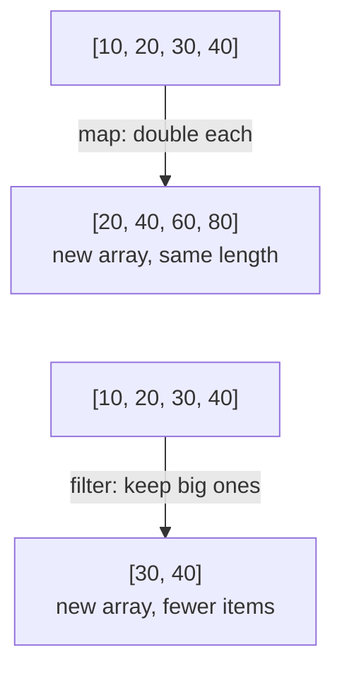
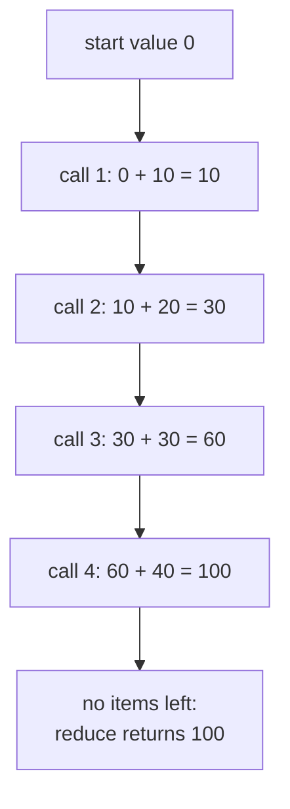
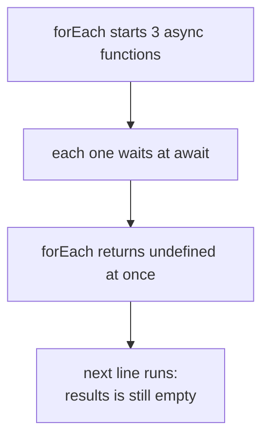

# 09. Arrays and higher order functions

> **Subject:** JavaScript · **Lesson:** 09 · **Made:** 2026-10-12 · **Rewritten in simpler words:** 2026-10-15 · **Remade in short cards:** 2026-10-28 · **Status:** ready
>
> **You will be able to:** pick `forEach`, `map`, `filter` or `reduce` for a job, say which array methods change the original array and which give a new one, and trace `reduce` one item at a time.
>
> **Before this:** [Classes](08-classes.md) · **Next:** [Destructuring, spread and rest](10-destructuring-spread-and-rest.md)
>
> **How to read it:** one card is one idea. Look at the picture, guess, then press the orange bar to check. The blue bars (📖 More detail) hold the longer explanation. Skip them on the first read, and open them when you want more. About 30 minutes for the cards.

## 1. The idea: a factory belt

Picture a **factory belt** with items on it, and one worker at each station. You give each worker one small function that handles **one item**. The worker does the looping. `map`, `filter` and `reduce` take a function like this, so they are called **higher order functions**.



| Method | Gives back |
|---|---|
| `forEach` | nothing, only `undefined` |
| `map` | a new array, same length, new values |
| `filter` | a new array, fewer items, same values |
| `reduce` | ONE value, any type |

<details class="guess"><summary>🤔 Guess: which of `map` and `filter` can give a shorter array? Press to check.</summary>

`filter`. Items that fail the test are left out, and the items that stay are not changed. `map` always gives the same number of items.

</details>

> **Remember:** you write only the one different line, as a callback. The method does the loop.

<details class="more"><summary>📖 More detail: the four words, and where the belt picture stops</summary>

- **Array:** an ordered list of values. The first item has index 0, not 1.
- **Callback:** the small function you give to `map`, `filter` or `reduce`. They call it for you, once per item, in order. A callback also remembers the variables around it (see [Closures](05-closures.md)).
- **Running total:** in `reduce`, the one value that moves from one call to the next. (Interview word: *accumulator*.)
- **Change the original:** some methods change the array you call them on. Others leave it alone and give you a new array. (Interview word: *mutate*.)

The belt: `forEach` is a worker who touches every item but puts nothing on a new belt. `map` is a painter: every item goes in, one painted item comes out. `filter` is an inspector: items that pass are copied to a new belt. `reduce` is a worker with one bucket (the running total): each item is added to the bucket, and at the end you get the bucket.

Where the picture stops: a real belt moves the items away. An array does not lose anything. The old belt stays full, and `map` and `filter` copy the values to a new belt. And these methods handle one item at a time, in order.

</details>

## 2. `map`, `filter` and `reduce` on one list

```js
const prices = [10, 20, 30, 40];

const doubled = prices.map(p => p * 2);
const big = prices.filter(p => p > 25);
const total = prices.reduce(
  (sum, p) => sum + p, 0);

console.log(doubled);
console.log(big);
console.log(total);
console.log(prices);
```

<details class="guess"><summary>🤔 Guess: what are the four lines of output? Press to check.</summary>

```
[ 20, 40, 60, 80 ]
[ 30, 40 ]
100
[ 10, 20, 30, 40 ]
```

`map`: same length, new values. `filter`: fewer items, same values. `reduce`: many in, one out. And `prices` itself **never changed**: `map` and `filter` build a new array, they do not edit yours.

</details>

> **Remember:** `map` and `filter` do not change the array you call them on. They build a new one.

<details class="more"><summary>📖 More detail: `map` and `filter`, one callback call at a time</summary>

Each row is one callback call. These are the same numbers as the snippet, so you can check them against the output.

**`prices.map(p => p * 2)`**

| Step | What happens | index | `p` | Callback returns | New array after |
|---|---|---|---|---|---|
| 1 | `map` makes a new array with the same length | | | | 4 empty slots |
| 2 | call 1 | 0 | 10 | 20 | `[20, empty, empty, empty]` |
| 3 | call 2 | 1 | 20 | 40 | `[20, 40, empty, empty]` |
| 4 | call 3 | 2 | 30 | 60 | `[20, 40, 60, empty]` |
| 5 | call 4 | 3 | 40 | 80 | `[20, 40, 60, 80]` |
| 6 | no items left, `map` returns the new array | | | | `[20, 40, 60, 80]` |

**`prices.filter(p => p > 25)`**

| Step | What happens | index | `p` | Callback returns | New array after |
|---|---|---|---|---|---|
| 1 | `filter` makes a new **empty** array | | | | `[]` |
| 2 | call 1 | 0 | 10 | `false`, skip | `[]` |
| 3 | call 2 | 1 | 20 | `false`, skip | `[]` |
| 4 | call 3 | 2 | 30 | `true`, keep 30 | `[30]` |
| 5 | call 4 | 3 | 40 | `true`, keep 40 | `[30, 40]` |
| 6 | no items left, `filter` returns the new array | | | | `[30, 40]` |

Checked on 2026-10-28 with Node 26.12.1.

</details>

## 3. `reduce`, one item at a time

`reduce` keeps one **running total**. The value one call returns becomes `sum` in the next call.



<details class="guess"><summary>🤔 Guess: no start value: `prices.reduce((sum, p) => sum + p)`. How many calls, and what is `sum` in call 1? Press to check.</summary>

**3 calls**, not 4. With no start value, the first item becomes the running total. So call 1 has `sum = 10`, `p = 20`, and **index 1**. The answer is still 100.

</details>

> **Remember:** always give `reduce` a start value, like `0`.

<details class="more"><summary>📖 More detail: the trace, the empty array, and grouping with `reduce`</summary>

**`prices.reduce((sum, p) => sum + p, 0)`**

| Step | What happens | index | `sum` | `p` | Callback returns | Running total after |
|---|---|---|---|---|---|---|
| 1 | the start value `0` becomes the running total | | | | | 0 |
| 2 | call 1 | 0 | 0 | 10 | 10 | 10 |
| 3 | call 2 | 1 | 10 | 20 | 30 | 30 |
| 4 | call 3 | 2 | 30 | 30 | 60 | 60 |
| 5 | call 4 | 3 | 60 | 40 | 100 | 100 |
| 6 | no items left, `reduce` returns the running total | | | | | **100** |

Two variations. Both are in the stepper:

- **No start value.** `prices.reduce((sum, p) => sum + p)`. The first item becomes the running total. The first call has `sum = 10`, `p = 20`, **index 1**. That is 3 calls, not 4.
- **Empty array and no start value.** There is no first item to use, so `reduce` throws `TypeError: Reduce of empty array with no initial value`. With a start value, `[].reduce(fn, 0)` returns `0` and never calls `fn`.

A snapshot **inside call 2** of `prices.reduce((sum, p) => sum + p, 0)`:

| Name | Value | What it is |
|---|---|---|
| `prices` | `[10, 20, 30, 40]` | the original array. It never changes. |
| index | `1` | which item is being handled |
| `sum` (the running total) | `10` | what call 1 returned |
| `p` (the item) | `20` | `prices[1]` |
| your function is working out | `sum + p` = `30` | not returned yet |
| the answer so far | none | it exists only after the last call |

The running total can be an object. Group words by their first letter:

```js
const words = ["apple", "banana", "avocado", "blueberry"];
const byLetter = words.reduce((acc, w) => {
  const k = w[0];
  if (!acc[k]) acc[k] = [];
  acc[k].push(w);
  return acc;
}, {});
console.log(byLetter);
```

```
{ a: [ 'apple', 'avocado' ], b: [ 'banana', 'blueberry' ] }
```

</details>

## 4. Which methods change the original?

This matters a lot in React state, where you must not change the old array.

| Group | Methods |
|---|---|
| **Change the ORIGINAL** (dangerous) | `push` `pop` `shift` `unshift` `splice` `sort` `reverse` `fill` `copyWithin` |
| Return a **NEW** array | `map` `filter` `slice` `concat` `flat` `flatMap` `toSorted` `toReversed` `toSpliced` `with` |
| Return something else, change nothing | `forEach` `reduce` `find` `findIndex` `some` `every` `includes` `indexOf` `join` `at` |

<details class="guess"><summary>🤔 Guess: `const a = [3, 1, 2]`. Is `a.sort() === a`? Press to check.</summary>

**`true`.** `sort` changes the original and gives back the **same** array, not a copy. To keep the original, copy first: `[...arr].sort(...)`.

</details>

> **Remember:** `sort` and `reverse` change the array you call them on. Copy first, or use `toSorted`.

<details class="more"><summary>📖 More detail: the full table, and two limits</summary>

| Method | Changes the original? | What it gives back |
|---|---|---|
| `push`, `unshift` | **yes** | the new length |
| `pop`, `shift` | **yes** | the removed item |
| `splice` | **yes** | an array of the removed items |
| `sort`, `reverse`, `fill`, `copyWithin` | **yes** | the **same** array, not a copy (`a.sort() === a` is `true`) |
| `map`, `filter`, `slice`, `concat`, `flat`, `flatMap` | no | a new array |
| `toSorted`, `toReversed`, `toSpliced`, `with` | no | a new array (Node 20 or newer, see card 5) |
| `forEach` | no | `undefined` |
| `reduce` | no | one value |
| `find`, `findIndex`, `some`, `every`, `includes`, `indexOf`, `join`, `at` | no | an item, a number, true or false, or a string |

Two limits to know:

- "No" means the method itself leaves the array alone. Your callback can still change things. Do not do that.
- The new array holds the **same objects** as the old one. If you change an object inside the copy, the original changes too. (Interview word: *shallow copy*.)

</details>

## 5. Mistake 1: `sort` with no compare function

`sort` compares as **text** unless you tell it how to compare.

```js
const scores = [10, 9, 1];
console.log([...scores].sort());
console.log([...scores].sort((a, b) => a - b));
console.log(scores);
```

<details class="guess"><summary>🤔 Guess: what are the three lines? Press to check.</summary>

```
[ 1, 10, 9 ]
[ 1, 9, 10 ]
[ 10, 9, 1 ]
```

With no compare function, `"10"` comes before `"9"`, because the character `"1"` comes before `"9"`. `(a, b) => a - b` sorts numbers from small to large. And the third line shows `scores` is unchanged: the copy was sorted.

Real bug: `scores.sort().reverse().slice(0, 3)` on `[50, 9, 100, 75, 8]` gives `[ 9, 8, 75 ]` and also **changes the input**. Fix:

```js
function topThree(scores) {
  return [...scores]
    .sort((a, b) => b - a)
    .slice(0, 3);
}
```

That gives `[ 100, 75, 50 ]`, and `scores` stays the same.

</details>

> **Remember:** to sort numbers, pass `(a, b) => a - b`, and copy first.

<details class="more"><summary>📖 More detail: the compare function, and the newer copy methods</summary>

- `sort` **changes the original** and gives back the **same array**.
- With no compare function, `sort` turns every item into text and compares the text. `"10"` comes before `"9"` because the character `"1"` comes before `"9"`. That is why `[10, 9, 1].sort()` gives `[1, 10, 9]`.
- To sort numbers, pass a compare function: `(a, b) => a - b` sorts from small to large. It must return a **number**. Negative means `a` goes first. Positive means `b` goes first. A function that returns `true` or `false` does not work. In Node 24, `[3, 1, 2].sort((a, b) => a > b)` stays `[ 3, 1, 2 ]`.
- To keep the original, copy first: `[...arr].sort(...)`. This works everywhere.
- Newer methods make the copy for you: `toSorted`, `toReversed`, `toSpliced` and `with`. They need Node 20 or newer. `toSorted` compares text the same way `sort` does, so `[10, 9, 1].toSorted()` is still `[1, 10, 9]`.

</details>

## 6. Mistake 2: `map` with curly braces and no `return`

```js
const doubled = [1, 2, 3].map(n => {
  n * 2;
});
console.log(doubled);
```

<details class="guess"><summary>🤔 Guess: what does it print? Press to check.</summary>

`[ undefined, undefined, undefined ]`. A function with curly braces gives back `undefined` unless it says `return`.

Fix: return the value, or drop the curly braces so the value is returned for you.

```js
const doubled = [1, 2, 3].map(n => n * 2);
```

That gives `[ 2, 4, 6 ]`. The stepper tab "map, forgot return" shows `undefined` going into each slot.

</details>

> **Remember:** an arrow with braces needs `return`. An arrow without braces returns the value.

<details class="more"><summary>📖 More detail: use `map` only for the new array</summary>

If you ignore the result of `map`, use `forEach` or `for...of` instead.

</details>

## 7. Mistake 3: `reduce` on a list that can be empty

```js
const total = [].reduce(
  (sum, p) => sum + p
);
```

<details class="guess"><summary>🤔 Guess: what happens? Press to check.</summary>

```
TypeError: Reduce of empty array with no initial value
```

With no start value, `reduce` uses the first item as the running total. An empty array has no first item.

Fix: always give a start value. `[].reduce((sum, p) => sum + p, 0)` returns `0` and never calls the callback.

</details>

> **Remember:** a start value makes `reduce` safe on an empty array.

<details class="more"><summary>📖 More detail: when `reduce` is too much</summary>

`reduce` is easy to overuse. If the callback is long, use a `for` loop, or two steps (`filter`, then `map`).

</details>

## 8. Mistake 4: `forEach` with an async callback

```js
const ids = [1, 2, 3];
const results = [];
ids.forEach(async (id) => {
  await null;
  results.push(id * 10);
});
console.log(results);
```



<details class="guess"><summary>🤔 Guess: what does `console.log(results)` print? Press to check.</summary>

`[]`. `forEach` starts each async function and does not wait. The next line runs while `results` is still empty. The items finish later, but nobody is waiting.

Fix: to run them together and wait, use `Promise.all` with `map`:

```js
const results = await Promise.all(
  ids.map(async (id) => {
    await null;
    return id * 10;
  }));
```

To run them one after another, use `for...of` with `await`. Both give `[ 10, 20, 30 ]`.

</details>

> **Remember:** `forEach` does not wait for async callbacks. Use `Promise.all` with `map`.

<details class="more"><summary>📖 More detail: why the code after an `await` runs later</summary>

See [the event loop](11-the-event-loop.md): code after an `await` goes into the microtask queue and runs after the current code finishes. You cannot stop early in `forEach`, `map`, `filter` or `reduce`. They visit every item. To stop early, use `for...of` with `break`, or `some`, `every` or `find`.

</details>

## 9. Questions to ask an array

These ask a question about the array. They stop early when they know the answer.

| Method | The question | Match | No match |
|---|---|---|---|
| `find(fn)` | which is the first item that passes? | the item | `undefined` |
| `findIndex(fn)` | where is the first item that passes? | its index | `-1` |
| `some(fn)` | does at least one item pass? | `true` | `false` |
| `every(fn)` | do all items pass? | `true` | `false` (and `true` on an **empty** array) |
| `includes(value)` | is this value in the array? | `true` | `false` |
| `flatMap(fn)` | `map`, then flatten one level | a new array | `[]` |

<details class="guess"><summary>🤔 Guess: `findIndex` gives `-1` when nothing matches. Is `if (index)` a good check? Press to check.</summary>

No. `0` is a real position (the first item), and `0` counts as false. Write `if (index !== -1)`.

</details>

> **Remember:** `findIndex` gives `-1` for "not found". Check with `!== -1`.

<details class="more"><summary>📖 More detail: small facts to remember</summary>

Things to remember:

- `findIndex` gives `-1` when nothing is found, and `0` is a real position. So `if (index)` is wrong. Write `if (index !== -1)`.
- `["a b", "c d"].map(s => s.split(" "))` gives `[ [ 'a', 'b' ], [ 'c', 'd' ] ]`. With `flatMap` it gives `[ 'a', 'b', 'c', 'd' ]`.
- `includes` can find `NaN` (`[NaN].includes(NaN)` is `true`). `indexOf` cannot (`[NaN].indexOf(NaN)` is `-1`).
- `some` stops at the first match. On `[1, 2, 3, 4]`, testing for `n === 2` runs the callback 2 times. `forEach` always runs for every item (4 times).

</details>

## 10. Watch it run, step by step

The stepper has seven small programs: `map`, `filter`, `reduce` with and without a start value, `reduce` on an empty array, `reduce` that groups, and `map` with a forgotten `return`. Each one shows the array, the current index, the callback call, the running total and the growing result. Write your guess first, then press Next.

**Step through it yourself:** [open the map, filter and reduce stepper](visuals/09-arrays-and-higher-order-functions.html).

## 11. Why it matters and what it costs

- **Without it,** you copy the same hand written loop for every job. The reader must read the whole loop to learn what it does. Each copy can hide a typo.
- **With it,** the loop is written once, inside the method. The method name tells the job: `map` changes each item, `filter` chooses items, `reduce` combines them. You write only the one different line, as a callback.
- **The cost:**
  - **Every step in a chain makes a new array.** That costs time and memory. For normal lists it is fine, and it reads well. For a very large array, measure first. Then use one `reduce` or one `for` loop. (The Go deeper card shows lazy chains.)
  - **You cannot stop early** in `forEach`, `map`, `filter` or `reduce`.
  - **`reduce` is easy to overuse.**
  - **`forEach` does not wait** for async callbacks (card 8).

## 12. Watch and play

Links checked on 2026-10-12. Each page opened. For each video, the title and channel matched. I did not watch the videos, so their lengths are not checked.

- **Video:** [Higher-order functions, Part 1 of Functional Programming in JavaScript](https://www.youtube.com/watch?v=BMUiFMZr7vk) by Fun Fun Function. Watch it first, for the idea of giving a function to a function.
- **Video:** [Reduce basics, Part 3 of Functional Programming in JavaScript](https://www.youtube.com/watch?v=Wl98eZpkp-c) by Fun Fun Function. Watch it after tab 3 of the stepper.
- **Play with it:** [The map, filter and reduce stepper](visuals/09-arrays-and-higher-order-functions.html) in this folder. Guess first, then press Next.
- **Play with it:** [Python Tutor for JavaScript](https://pythontutor.com/javascript.html). Paste snippet A. I did not run a program in it from here, so I do not know if it steps into the callback. If it does not, put a breakpoint inside the callback in your browser DevTools and step through it there.
- **Play with it:** [JavaScript Array Explorer](https://sdras.github.io/array-explorer/) by Sarah Drasner. The page loads, but I could not test it. Use it to find a method by what you want to do.
- **Read:** [Updating Arrays in State](https://react.dev/learn/updating-arrays-in-state) on react.dev. A table of "avoid" against "prefer" methods. It is the same idea as the table in card 4.
- **Read:** [Array on MDN](https://developer.mozilla.org/en-US/docs/Web/JavaScript/Reference/Global_Objects/Array). Find the section "Copying methods and mutating methods".

<details><summary>More links (optional)</summary>

- **Video:** [map, filter & reduce, Namaste JavaScript Ep. 19](https://www.youtube.com/watch?v=zdp0zrpKzIE) by Akshay Saini. More `reduce` examples.
- **Read:** [Array.prototype.reduce() on MDN](https://developer.mozilla.org/en-US/docs/Web/JavaScript/Reference/Global_Objects/Array/reduce). It says what the running total is on the first call, and when the TypeError is thrown.
- **Read:** [Array.prototype.sort() on MDN](https://developer.mozilla.org/en-US/docs/Web/JavaScript/Reference/Global_Objects/Array/sort). It explains the text comparison and the `(a, b) => a - b` fix.
- **Read:** [Array.prototype.forEach() on MDN](https://developer.mozilla.org/en-US/docs/Web/JavaScript/Reference/Global_Objects/Array/forEach). It says `forEach` "expects a synchronous function" and does not wait for promises.
- **Read:** [Array methods](https://javascript.info/array-methods) on javascript.info. Short examples, with the line "The items are sorted as strings by default".
- **Read:** [Higher-Order Functions](https://eloquentjavascript.net/05_higher_order.html) in Eloquent JavaScript. Chapter 5. It is text with code, not diagrams.
- **Read:** [50+ Must-know JavaScript Interview Questions by Ex-interviewers (2026)](https://www.greatfrontend.com/blog/50-must-know-javascript-interview-questions-by-ex-interviewers) on GreatFrontEnd. It has a question on `toSorted`, `toReversed`, `toSpliced` and `with`, so interviewers do ask about them now.

</details>

## 13. Practice

**A. Predict the output** (write your answer before opening)

```js
const nums = [3, 20, 100];
const sorted = nums.sort();
const doubled = sorted.map(n => { n * 2 });
console.log(sorted, nums === sorted, doubled);
```

<details><summary>Answer</summary>

`[ 100, 20, 3 ] true [ undefined, undefined, undefined ]`

- `sort()` with no compare function compares text. `"100"` is before `"20"`, which is before `"3"`.
- `sort` changes `nums` and gives back the same array, so `nums === sorted` is `true`.
- The `map` callback has curly braces and no `return`, so every slot is `undefined`.

</details>

**B. Fix the bug**

```js
function topThree(scores) {
  return scores.sort().reverse().slice(0, 3);
}
const scores = [50, 9, 100, 75, 8];
console.log(topThree(scores));   // should be [ 100, 75, 50 ]
console.log(scores);             // should still be [ 50, 9, 100, 75, 8 ]
```

<details><summary>Answer</summary>

There are two bugs. The default `sort` compares text, and `sort` and `reverse` change the input. Copy first, and give `sort` a compare function that puts the biggest first:

```js
function topThree(scores) {
  return [...scores].sort((a, b) => b - a).slice(0, 3);
}
```

Result: `[ 100, 75, 50 ]`, and `scores` is unchanged. With Node 20 or newer you can write `scores.toSorted((a, b) => b - a).slice(0, 3)`.

</details>

**C. Write it yourself**

Open `practice/09-arrays-and-higher-order-functions.js`. There are five tasks:

1. Fix `sortNumbers`. It sorts as text and it changes the input.
2. Fix `totalPrice`. It crashes on an empty list.
3. Write your own `myMap`, `myFilter` and `myReduce` with a `for` loop. The test arrays throw an error if you call the built in methods.
4. Write `groupBy` with `reduce`.
5. Write down what six snippets print. The test runs the real snippets and checks your guesses.

Run the tests from the folder that contains `learn/`:

```
node --test learn/javascript/practice/09-arrays-and-higher-order-functions.test.js
```

<details><summary>One possible answer</summary>

```js
function sortNumbers(nums) {
  return [...nums].sort((a, b) => a - b);        // copy first, compare as numbers
}

function totalPrice(prices) {
  return prices.reduce((sum, p) => sum + p, 0);  // the start value 0
}

function myMap(array, fn) {
  const out = [];
  for (let i = 0; i < array.length; i++) {
    out.push(fn(array[i], i, array));
  }
  return out;
}

function myFilter(array, fn) {
  const out = [];
  for (let i = 0; i < array.length; i++) {
    if (fn(array[i], i, array)) out.push(array[i]);
  }
  return out;
}

function myReduce(array, fn, start) {
  let acc = start;
  let i = 0;
  if (arguments.length < 3) {          // no start value was given
    if (array.length === 0) throw new TypeError("Reduce of empty array with no initial value");
    acc = array[0];
    i = 1;
  }
  for (; i < array.length; i++) {
    acc = fn(acc, array[i], i, array);
  }
  return acc;
}

function groupBy(array, keyFn) {
  return array.reduce((groups, item) => {
    const key = keyFn(item);
    if (!groups[key]) groups[key] = [];
    groups[key].push(item);
    return groups;
  }, {});
}

const predictions = {
  s1: ["[ 1, 10, 9 ]"],
  s2: ["[ 1, 2, 3 ] true"],
  s3: ["[ undefined, undefined, undefined ]"],
  s4: ["TypeError"],
  s5: ["0"],
  s6: ["[ 10, 30 ]"],
};
```

Notes on the predictions:

- `s5` is `0` because each async callback stops at its `await`, so `sum` is still `0` when `console.log` runs.
- `s6` works because `n % 2` gives `1` or `0`. `filter` keeps the item when the callback gives `1` (counts as true), and drops it for `0` (counts as false).

</details>

## 14. Interview question

**Q:** "What is a higher order function? Explain `map`, `filter` and `reduce`. Which array methods change the array? Why does `[10, 9, 1].sort()` give `[1, 10, 9]`? Then write your own `reduce`."

Interviewers often ask you to write `map`, `filter` or `reduce` yourself. Recent question lists also ask about `toSorted`, `toReversed`, `toSpliced` and `with`.

<details><summary>A strong answer, in four parts</summary>

1. **Problem:** without these methods you copy the same hand written loop for every job. Only one line changes each time, and each copy can hide a typo. The loop also hides the real job from the reader.
2. **How it works:**
   - A higher order function takes a function, or gives one back.
   - `map`, `filter` and `reduce` take a callback. They call it once per item, in order, with the item, the index and the array.
   - `map` gives a new array of the same length, made from the return values.
   - `filter` gives a new array with only the items where the callback gives a true value.
   - `reduce` carries a running total. The value one call returns becomes the running total of the next call. The last one is the result. Always give a start value, because an empty array with no start value throws a `TypeError`.
   - `push`, `pop`, `splice`, `sort` and `reverse` change the original. `map`, `filter`, `slice` and the newer `toSorted`, `toReversed`, `toSpliced` and `with` give a new array.
   - `sort` compares as text by default, so `10` comes before `9`. Pass `(a, b) => a - b`.
3. **Tradeoff:** every step in a chain makes a new array, so on very large lists, measure and think about one pass. You cannot `break` out of them, and `forEach` does not wait for async callbacks. The copies share the same objects. `toSorted` needs Node 20 and `Object.groupBy` needs Node 21, so check where your code runs.
4. **My example:** *This is an idea, not a fact. Replace it with your own real story from DBO, Unloan, ZWS or Skyworx.* In a cart screen, the total is `items.reduce((sum, item) => sum + item.price * item.qty, 0)`. In a React list, sorting the state with `sort()` gives back the same array, so the screen may not update. Using `[...items].sort(...)` makes a new array.

</details>

## 15. Explain it back

Close this file. Press the **Record my explanation** button under this heading and explain higher order functions out loud, like to a new junior, in 4 parts: problem, how it works, tradeoff, my example. Then save the transcript file into `my-learning/recordings/`, or write your best version below. Run `/explain-check arrays and higher order functions` or ask the `explain-coach` agent to review it.

### My explanation

<write here>

### Coach feedback

<the explain-coach agent writes here>

## 16. Review questions (day 1, 3, 7, 21)

1. What does `map` give back, what does `filter` give back, and what does `reduce` give back? Say it with the length and the values.
2. In `[10, 20, 30].reduce((sum, n) => sum + n, 0)`, what is `sum` in call 2? What happens with no start value on an empty array?
3. Why does `[10, 9, 1].sort()` give `[1, 10, 9]`? Name two ways to sort without changing the original.
4. Draw the table from card 4 from memory: three groups of methods, and which group is dangerous for React state.

<details><summary>Answers</summary>

1. `map` gives a new array with the **same length** and new values. `filter` gives a new array with **fewer items** (or the same number) and the **same values**. `reduce` gives **one value** of any type.
2. `sum` is `10`, the value call 1 returned. With no start value on an empty array, `reduce` throws a `TypeError`, because there is no first item to start with.
3. With no compare function, `sort` turns each number into text and compares the text, so `"10"` is before `"9"`. It also changes the original array. Use `[...arr].sort((a, b) => a - b)` (works everywhere) or `arr.toSorted((a, b) => a - b)` (Node 20 or newer).
4. Red: methods that change the original (`push`, `pop`, `shift`, `unshift`, `splice`, `sort`, `reverse`, `fill`, `copyWithin`). Green: methods that give a new array (`map`, `filter`, `slice`, `concat`, `flat`, `flatMap`, `toSorted`, `toReversed`, `toSpliced`, `with`). Grey: methods that give something else and change nothing (`forEach`, `reduce`, `find`, `findIndex`, `some`, `every`, `includes`, `indexOf`, `join`, `at`). Red is dangerous for React state.

</details>

## 17. Go deeper (optional)

Open these when you are ready. None of them is needed for the cards above.

<details><summary>Versions, grouping, and lazy chains</summary>

| Method | Does the same as | First Node version (MDN data) | Checked here |
|---|---|---|---|
| `toSorted(fn)` | a copy, then `sort(fn)` | 20.0.0 | exists in Node v24.15.0 |
| `toReversed()` | a copy, then `reverse()` | 20.0.0 | exists |
| `toSpliced(...)` | a copy, then `splice(...)` | 20.0.0 | exists |
| `with(index, value)` | a copy with one item replaced | 20.0.0 | exists |
| `Object.groupBy(array, fn)` | the `reduce` grouping in snippet C | **21.0.0** | exists |

- `Object.groupBy` gives an object with **no prototype**, so it prints as `[Object: null prototype] { ... }`. `Map.groupBy` gives a `Map`.
- I took the Node versions from MDN's browser compatibility data (the `mdn/browser-compat-data` files for `Array` and `Object`). I used `typeof` to check that the installed Node has them.
- **I could not confirm whether Hermes (the engine in React Native) has them.** In a React Native app, run `typeof [].toSorted` and `typeof Object.groupBy` on a real build. `[...items].sort(...)` and `reduce` work everywhere.
- **Lazy chains.** Iterator helpers do a whole chain in one pass: `[1, 2, 3, 4].values().filter(n => n % 2 === 0).map(n => n * 10).toArray()` gives `[ 20, 40 ]`. MDN's data says Node 22 or newer, and I ran it on Node 24.

</details>

## Connected lessons

- [Functions](04-functions.md): a function is a value, so you can pass it to `map` or return it from another function. This is why higher order functions exist.
- [Closures](05-closures.md): a callback remembers the variables around it. That is how `p => p * rate` can use `rate` from outside.
- [Classes](08-classes.md): an array is made by the built in `Array` class, and `map` and `filter` are methods on `Array.prototype`.
- [Destructuring, spread and rest](10-destructuring-spread-and-rest.md): `[...arr]` and `{ ...obj }` are the usual way to copy before you change something.
- [The event loop](11-the-event-loop.md): why `forEach` with an async callback does not wait, and when the code after an `await` runs.
- Promises (lesson 13, not written yet): `Promise.all(array.map(async ...))` is the usual way to run many async jobs and wait for all of them.
