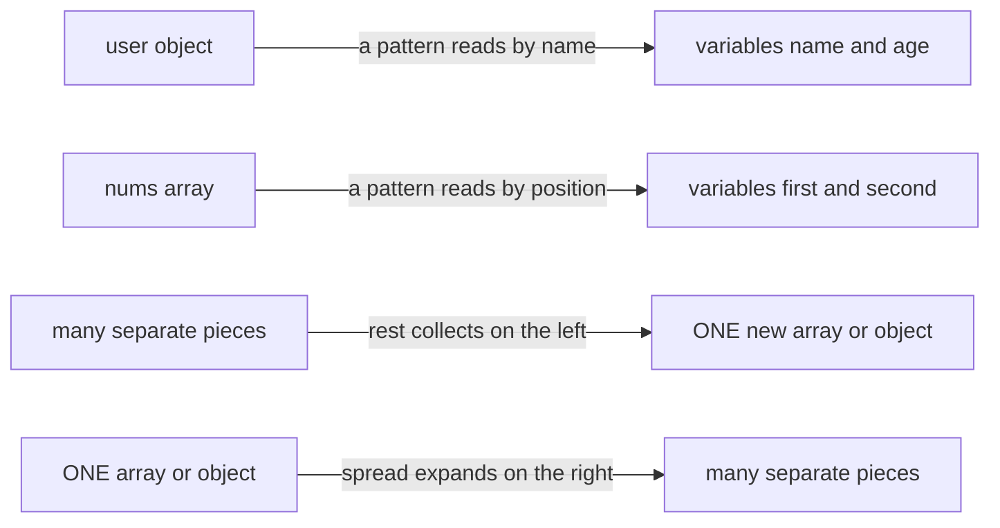
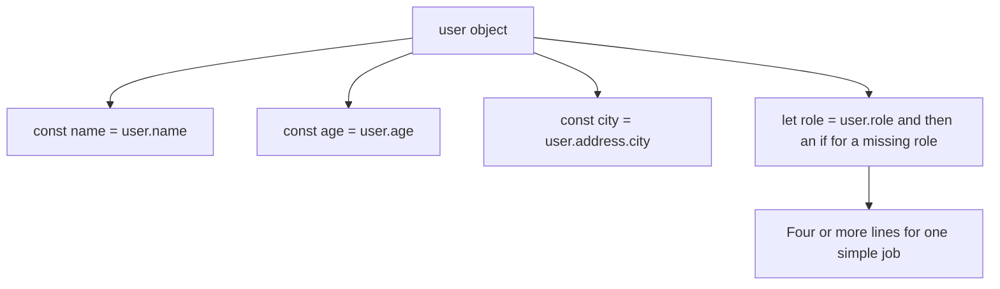
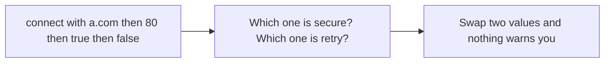
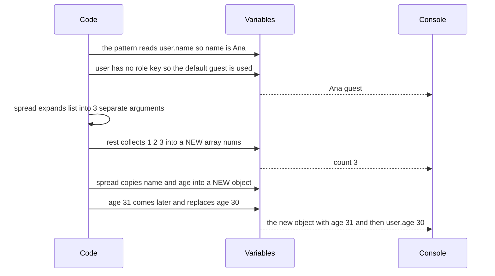
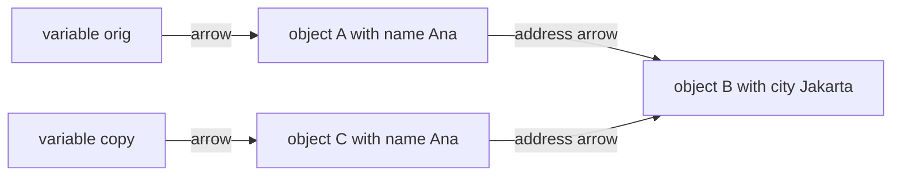
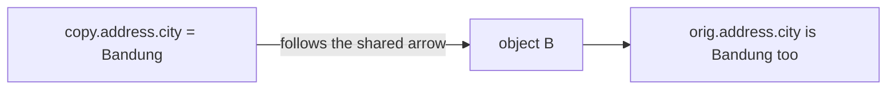
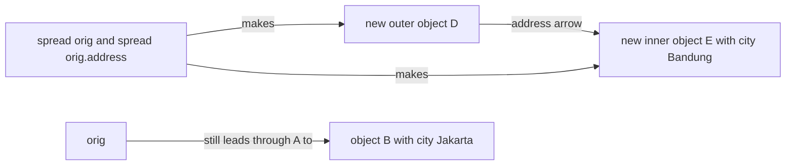
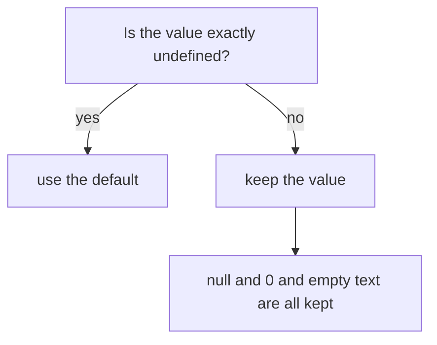
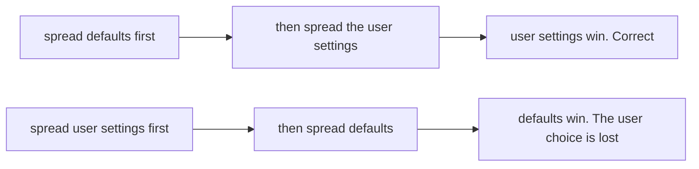

# 10. Destructuring, spread and rest

> **Subject:** JavaScript · **Lesson:** 10 · **Made:** 2026-10-15 · **Status:** ready
> **You will be able to:** unpack values from an array or object in one line, tell rest from spread by which side of the code the three dots are on, and say why changing a spread copy can still change the original.
> **Before this:** [Arrays and higher order functions](09-arrays-and-higher-order-functions.md) · **Next:** [The event loop](11-the-event-loop.md)

## 1. The idea in one sentence

You can take many values out of an array or object in one line. You can also build a new array or object from old ones with three dots `...`.

New words:

- **Pattern:** the `[ ]` or `{ }` on the **left** of `=`. It says which value goes into which variable. Unpacking with a pattern is called **destructuring**.
- **Default:** the value after `=` inside a pattern. JavaScript uses it only when the value is `undefined`.
- **Rest and spread:** two jobs for the same three dots `...`. See the rule below.
- **Shallow copy:** a copy of the top level only. Objects inside are shared, not copied.

The rule to remember: **same three dots, opposite directions.**

- On the **left side** (a pattern, or a function's parameter list), `...` is **rest**. It **collects** the leftovers into one new array or object, and it must be last.
- On the **right side** (inside a call, inside `[ ]` or inside `{ }`), `...` is **spread**. It **expands** one value into separate pieces.
- A default applies only to `undefined`.
- Spread copies only **one level**.

## 2. The pictures

### 2a. The big picture

Notice the two directions. A pattern takes values out. Rest goes from many to one. Spread goes from one to many.



### 2b. The problem, drawn

**Problem 1: unpacking by hand.** Notice how many times `user.` is written. Each line is a new chance for a typo.



**Problem 2: many values in a fixed order.** Notice that the caller must remember what each position means.



### 2c. How it works over time

The program from section 4. Notice that spread and rest meet in one call: spread expands, then rest collects.



### 2d. What is in memory right now

Right after `const copy = { ...orig };` in stepper program "Shallow copy trap". Notice two outer objects, but only **one** inner address object.



### 2e. Right against wrong

**Wrong:** change the inner object through the copy. Notice that the arrow leads to the shared object B.



**Right:** spread every level you change. Notice that the new copy gets its own inner object E. The original still points at B.



### 2f. When is a default used?

Ask one question. Notice that `null`, `0` and empty text all count as real values.



### 2g. Later keys win

When you spread two objects into one, a later key replaces an earlier one. Notice that the order decides who wins.



## 3. Real life analogy

Think of a shopping bag.

- **Destructuring:** "first item to the fridge, second item to the shelf".
- **Rest:** "put everything else in one new box".
- **Spread:** pour the bag out onto the table, item by item.
- **Shallow copy:** photocopy a page of home addresses. The page is new, but each address still leads to the same house. Paint the house, and both pages lead to a red house.

Where the analogy stops:

- A real bag becomes empty. JavaScript only **reads**. The original stays full and unchanged.
- Numbers and text are copied for real. Only objects and arrays inside are shared ([lesson 03](03-reference-vs-copy.md)).

## 4. The smallest code that shows it

```js
const user = { name: "Ana", age: 30 };
const { name, role = "guest" } = user;   // pattern and default
console.log(name, role);

function total(label, ...nums) {         // rest collects
  return label + " " + nums.length;
}
const list = [1, 2, 3];
console.log(total("count", ...list));    // spread expands

const older = { ...user, age: 31 };      // spread copies, later key wins
console.log(older, user.age);
```

**Output:**

```
Ana guest
count 3
{ name: 'Ana', age: 31 } 30
```

Look at the last line. `older` has age 31, but `user` still has age 30. Spread built a new object. It did not change `user`.

## 5. What really happens, step by step

| Step | Line | What JavaScript does | Variables after | Prints |
|---|---|---|---|---|
| 1 | setup | `total` is a function declaration, so it exists before line 1 runs. | total | |
| 2 | 1 | Makes an object. `user` holds an arrow to it. | user → { name "Ana", age 30 } | |
| 3 | 2 | Sees the pattern `{ name, role = "guest" }`. It looks like an object, so it matches **by name**. It reads `user.name`, which is "Ana". | name = "Ana" | |
| 4 | 2 | Reads `user.role`. There is no such key, so the value is `undefined`. The **default** "guest" is used. | role = "guest" | |
| 5 | 3 | Prints both. | | Ana guest |
| 6 | 8 | Makes the array. | list = [1, 2, 3] | |
| 7 | 9 | Sees `...list` inside a call. That is **spread**. It expands the one array into separate arguments, so the call is `total("count", 1, 2, 3)`. | | |
| 8 | 5 | Inside `total`, `label` takes the first argument, "count". | label = "count" | |
| 9 | 5 | Sees `...nums` in the parameter list. That is **rest**. It collects the arguments that are left into a **new** array. | nums = [1, 2, 3] | |
| 10 | 6 | Returns "count 3". The call ends, so `label` and `nums` are thrown away. | | count 3 |
| 11 | 11 | Starts a **new** object. Sees `...user` inside `{ }`. That is **spread**. It copies `name` and `age` (30) into the new object. | | |
| 12 | 11 | Then `age: 31` comes later, so it **replaces** 30. `older` holds an arrow to the new object. | older → { name "Ana", age 31 } | |
| 13 | 12 | Prints `older`, then `user.age`. `user` was only read, never changed. | | { name: 'Ana', age: 31 } 30 |

**Step through it yourself:** [open the destructuring, spread and rest stepper](visuals/10-destructuring-spread-and-rest.html). You watch the variables fill one by one, and the three dots collect or expand. It has eight programs:

1. "Array: by position" (empty slots, a default, rest at the end)
2. "Object: by name" (renaming with a colon, and one level down)
3. "Defaults: undefined only" (picture 2f)
4. "Options object and TypeError" (section 7)
5. "Rest: collect the leftover" (steps 8 to 9)
6. "Spread: expand into pieces" (step 7)
7. "Later keys win" (steps 11 to 12, and picture 2g)
8. "Shallow copy trap" (pictures 2d and 2e)

Type your guess first, then press Next.

## 6. Why it exists and what it costs

- **Problem without it:**
  - You write `user.` again and again (picture 2b).
  - Many values in a fixed order are easy to pass wrong.
  - Copying by hand needs a loop. Changing the original instead means other code sees the change, and React may not update the screen.
- **How it solves it:**
  - A **pattern** takes many values out in one line. A **default** fills a missing one.
  - An **options object** names every value: `connect({ host: "a.com", secure: true })`. Order does not matter.
  - **Rest** collects "everything else": `const { password, ...safeUser } = user` drops the password.
  - **Spread** builds a new array or object. The original stays as it was.
- **Cost:**
  - Spread copies **one level only** (pictures 2d and 2e).
  - A default does **not** catch `null` (picture 2f).
  - Unpacking `null` or `undefined` throws a TypeError.
  - Spread copies every item, every time. Spreading a big list inside a loop is slow.

<details><summary>Go deeper (optional)</summary>

- **What an array pattern accepts.** An array pattern and array spread work on anything you can loop over with `for...of`: arrays, strings, `Map` and `Set`. (Interview word: *iterable*.) So `const [a, b] = "hi"` gives `"h"` and `"i"`. A plain object is not loopable, so `[...{ a: 1 }]` throws a TypeError.
- **Object spread is softer.** `{ ...null }` and `{ ...undefined }` give `{}` with no error. `{ ...[7] }` gives `{ "0": 7 }`.
- **What object spread copies.** It copies the object's own keys. It does not copy the prototype. So `{ ...new SomeClass() }` gives a plain object without the class methods. See [Objects and prototypes](07-objects-and-prototypes.md).
- **Rest must be last.** `const [a, ...b, c] = list` is a SyntaxError. Node says "Rest element must be last element". A function can have only one rest parameter.
- **Rest and `.length`.** `function f(a, ...r) {}` has `f.length === 1`. The rest parameter does not count. The practice tests check this.
- **Rest against `arguments`.** The old `arguments` object holds all arguments, and it is not a real array. A rest parameter is a real array with `map`, `sort` and so on.
- **Swap two variables:** `[a, b] = [b, a]`.
- **A full deep copy:** `structuredClone(value)` copies every level. It throws a `DataCloneError` for functions, and it drops class prototypes.
- **Versions.** Array spread, rest and destructuring came in 2015 (ES6). Object spread and object rest came in 2018. The online tool Python Tutor only supports up to 2015, so it cannot run `{ ...obj }`.
- **Error words differ.** For `function f({ a }) {}; f()`, Node prints "Cannot destructure property 'a' of 'undefined' as it is undefined." Other engines use other words. The error name, TypeError, is the same everywhere.

Checked on 2026-10-15 with Node 24.15.0.

</details>

## 7. Common mistakes

**Wrong:** thinking spread copies everything.

```js
const orig = { name: "Ana", address: { city: "Jakarta" } };
const copy = { ...orig };
copy.address.city = "Bandung";
console.log(orig.address.city);   // Bandung. The original changed.
```

**Right:** spread every level on the path you change.

```js
const copy = { ...orig, address: { ...orig.address, city: "Bandung" } };
console.log(orig.address.city, copy.address.city);   // Jakarta Bandung
```

**Why:** spread copies the **arrow** to the address object, not the object. [Lesson 03](03-reference-vs-copy.md) explains arrows and copies in depth.

**Wrong:** expecting a default to catch `null`.

```js
function getLimit({ limit = 10 } = {}) { return limit; }
console.log(getLimit({ limit: null }));   // null, not 10
```

**Right:** use `??` when `null` should also get the fallback.

```js
function getLimit({ limit } = {}) { return limit ?? 10; }
console.log(getLimit({ limit: null }), getLimit({ limit: 0 }));   // 10 0
```

**Why:** a default is used only for `undefined`. `??` also covers `null`, and it keeps `0`. (`||` would turn `0` into 10.)

**Wrong:** spreading in the wrong order.

```js
const defaults = { theme: "light", size: 10 };
const mine = { size: 14 };
console.log({ ...mine, ...defaults });   // { size: 10, theme: 'light' }
```

**Right:** defaults first, your changes last.

```js
console.log({ ...defaults, ...mine });   // { theme: 'light', size: 14 }
```

**Why:** a later key replaces an earlier one (picture 2g).

**Wrong:** a pattern in the parameter, but no argument.

```js
function show({ name }) { return name; }
show();   // TypeError. You cannot unpack undefined.
```

**Right:** give the whole parameter a default of `{}`.

```js
function show({ name = "guest" } = {}) { return name; }
console.log(show());   // guest
```

**Why:** with no argument, the parameter is `undefined`, so `= {}` is used. `show(null)` still throws. Stepper program "Options object and TypeError" shows both.

## 8. Watch and play

Links checked on 2026-10-15. Each page opened. For each video, the title and channel matched. I did not watch the videos, so their lengths are not checked.

- **Video:** [Why Is Array/Object Destructuring So Useful And How To Use It](https://www.youtube.com/watch?v=NIq3qLaHCIs) by Web Dev Simplified. Watch it before the stepper.
- **Video:** [JavaScript SPREAD OPERATOR in 4 minutes!](https://www.youtube.com/watch?v=RuDdltsfaVc) by Bro Code. Watch it after stepper program 6.
- **Play with it:** [The destructuring, spread and rest stepper](visuals/10-destructuring-spread-and-rest.html). Guess first, then press Next.
- **Play with it:** [Python Tutor for JavaScript](https://pythontutor.com/javascript.html). It draws objects as boxes with arrows. It cannot run `{ ...orig }`, so paste the first "Wrong" code from section 7 with `Object.assign({}, orig)` instead. I did not run it there myself.
- **Read:** [Destructuring assignment](https://javascript.info/destructuring-assignment) on javascript.info. See "Smart function parameters".
- **Read:** [Updating Objects in State](https://react.dev/learn/updating-objects-in-state) on react.dev. See "Updating a nested object".
- **Read (pictures):** [Immutability in React and Redux](https://daveceddia.com/immutable-updates-react-redux/) by Dave Ceddia. Memory box pictures of arrows. From 2018, so the React code is old style.

<details><summary>More links (optional)</summary>

- **Video:** [JavaScript REST PARAMETERS in 8 minutes!](https://www.youtube.com/watch?v=ahwR1D_GAfc) by Bro Code. Rest in a parameter list.
- **Read:** [Rest parameters and spread syntax](https://javascript.info/rest-parameters-spread) on javascript.info. Its summary gives the same "where are the dots" rule.
- **Read:** [Destructuring on MDN](https://developer.mozilla.org/en-US/docs/Web/JavaScript/Reference/Operators/Destructuring). The "Default value" part shows that `{ c = 2 } = { c: null }` keeps `null`.
- **Read:** [Spread syntax on MDN](https://developer.mozilla.org/en-US/docs/Web/JavaScript/Reference/Operators/Spread_syntax). See "Overriding properties" for later keys winning.
- **Read:** [Rest parameters on MDN](https://developer.mozilla.org/en-US/docs/Web/JavaScript/Reference/Functions/rest_parameters). Rest must be last, and how it differs from `arguments`.
- **Read:** [Deep-copying in JavaScript using structuredClone](https://web.dev/articles/structured-clone) by Surma on web.dev. Why spread is shallow, and what `structuredClone` cannot copy.
- **Interview:** [How is spread different from rest syntax?](https://www.greatfrontend.com/questions/quiz/what-are-the-benefits-of-using-spread-syntax-and-how-is-it-different-from-rest-syntax) and [Shallow copy against deep copy](https://www.greatfrontend.com/questions/quiz/explain-the-difference-between-shallow-copy-and-deep-copy) on GreatFrontEnd. Two quiz questions in the form interviewers ask.
- **Draw:** [Excalidraw](https://excalidraw.com/). Draw picture 2d from memory for review question 4.

</details>

## 9. Practice

**A. Predict the output** (write your answer before opening)

```js
const [a = 1, b = 2] = [null];
const { x, ...rest } = { x: 1, y: 2, z: 3 };
const merged = { ...rest, y: 9 };
console.log(a, b, rest, merged);
```

<details><summary>Answer</summary>

`null 2 { y: 2, z: 3 } { y: 9, z: 3 }`

- `a` matches position 0, which holds `null`. `null` is not `undefined`, so the default 1 is not used.
- `b` matches position 1. There is nothing there, so it is `undefined`, and the default 2 is used.
- `rest` collects the keys that were not named: `y` and `z`.
- `merged` copies `rest`, then `y: 9` comes later and wins. `rest` itself is not changed.

</details>

**B. Fix the bug**

```js
function createClient(options) {
  return { ...options, timeout: 5000, retries: 3 };
}
console.log(createClient({ timeout: 100 }).timeout);   // 5000. It should be 100.
```

<details><summary>Answer</summary>

The defaults come **after** the spread, so they replace the caller's values. Put the defaults first:

```js
function createClient(options) {
  return { timeout: 5000, retries: 3, ...options };
}
console.log(createClient({ timeout: 100 }));   // { timeout: 100, retries: 3 }
console.log(createClient());                   // { timeout: 5000, retries: 3 }
```

`createClient()` also works, because `{ ...undefined }` adds nothing.

</details>

**C. Write it yourself**

Open `practice/10-destructuring-spread-and-rest.js`. There are seven tasks:

1. Fix `moveUser`. It changes the original user's address.
2. Fix `getPort`. Give 3000 for a missing **or** `null` port, and keep 0.
3. Write `addTodo` and `toggleTodo` without changing the input, like React state. Untouched todos stay the same objects.
4. Write `makeUrl` with an options object and defaults. `makeUrl()` must work too.
5. Write `mergeSettings(defaults, ...overrides)`. A later override wins.
6. Write `splitHead` with `const [head, ...tail]`. No `list[0]`, no `slice`.
7. Write down what six snippets print.

Run the tests from the folder that contains `learn/`:

```
node --test learn/javascript/practice/10-destructuring-spread-and-rest.test.js
```

At the start, 4 of the 24 tests pass. Two are for `moveUser`: it does return the new city. The bug only shows in the original user.

<details><summary>One possible answer</summary>

```js
function moveUser(user, city) {
  return { ...user, address: { ...user.address, city } };   // spread both levels
}

function getPort({ port } = {}) {
  return port ?? 3000;   // a default skips null, ?? does not
}

function addTodo(state, todo) {
  return { ...state, todos: [...state.todos, todo] };
}
function toggleTodo(state, id) {
  return {
    ...state,
    todos: state.todos.map(t => (t.id === id ? { ...t, done: !t.done } : t)),
  };
}

function makeUrl({ host = "localhost", port = 3000, secure = false, path = "/" } = {}) {
  const scheme = secure ? "https" : "http";
  return scheme + "://" + host + ":" + port + path;
}

function mergeSettings(defaults, ...overrides) {
  return overrides.reduce((result, o) => ({ ...result, ...o }), { ...defaults });
}

function splitHead(list) {
  const [head, ...tail] = list;
  return { head, tail };
}

const predictions = {
  s1: ["1 null 3"],
  s2: ["1 9 [4,5]"],
  s3: ['{"k":2,"m":4}'],
  s4: ["TypeError", "TypeError", '{"0":7}'],
  s5: ["2 true"],
  s6: ["1 [2,3]", "undefined []"],
};
```

Notes:

- `toggleTodo` uses `map` from [lesson 09](09-arrays-and-higher-order-functions.md). It makes a new object only for the todo it changes. The others are passed through as they are.
- `mergeSettings` starts with `{ ...defaults }`, so it returns a new object even when there are no overrides.
- In `s4`, unpacking `null` and spreading a plain object into `[ ]` both throw. Spreading `null` into `{ }` adds nothing. Spreading `[7]` into `{ }` gives the key `"0"`.

</details>

## 10. Interview question

**Q:** "What is the difference between rest and spread? Is `{ ...obj }` a deep copy? What does this print?"

```js
const a = { n: 1, deep: { v: 1 } };
const b = { ...a, n: 2 };
b.deep.v = 2;
console.log(a.n, a.deep.v);
```

<details><summary>A strong answer, in four parts</summary>

1. **Problem:** you often need a few values out of an object, a function that takes any number of values, or a new object based on an old one. Doing this by hand means repeated lines, loops, and changing the original by accident.
2. **How it works:** it is the same three dots in two directions.
   - On the left side, in a pattern or a parameter list, `...` is rest. It collects the leftovers into one new array or object. It must be last.
   - On the right side, in a call or inside `[ ]` or `{ }`, `...` is spread. It expands one value into pieces.
   - Spread makes a **shallow** copy. It copies the top level. For an object inside, it copies the arrow, so both copies share that object.
   - The code prints `1 2`. `n` is top level, so `b` has its own `n`. `deep` is shared, so changing `b.deep.v` also changes `a.deep.v`.
3. **Tradeoff:** spread is short and fast for flat data. For nested changes you must spread each level, or use `structuredClone` for a full deep copy. Spreading big lists in a loop is slow. A default in a pattern catches only `undefined`, not `null`.
4. **My example:** *This is an idea, not a fact. Replace it with your own real story from DBO, Unloan, ZWS or Skyworx.* In an Express or GraphQL resolver that loads a user with Prisma, `const { password, ...safeUser } = user` removes the password before sending the user back. In a React screen, `setCart([...cart, item])` makes a new array, so React sees the change.

</details>

## 11. Explain it back

Close this file. Press the **Record my explanation** button under this heading and explain destructuring, spread and rest out loud, like to a new junior, in 4 parts: problem, how it works, tradeoff, my example. Use the words "left side", "right side" and "one level". Then save the transcript file into `my-learning/recordings/`, or write your best version below. Run `/explain-check destructuring spread and rest` or ask the `explain-coach` agent to review it.

### My explanation

<write here>

### Coach feedback

<the explain-coach agent writes here>

## 12. Review questions (day 1, 3, 7, 21)

1. You see `...` in code. How do you know if it is rest or spread, and what does each one do?
2. `const { size = 10 } = { size: null }`. What is `size`, and why? How do you get 10 instead?
3. You copy an object with `{ ...orig }` and change `copy.address.city`. Why does `orig` change too, and how do you fix it?
4. Draw the picture from section 2d from memory: two variables, two outer objects, one inner object, and the arrows.

<details><summary>Answers</summary>

1. Look at the side. On the left side (a pattern or a parameter list) it is rest: it collects the leftovers into one new array or object, and it must be last. On the right side (a call, `[ ]` or `{ }`) it is spread: it expands one array or object into separate pieces.
2. `size` is `null`. A default is used only when the value is `undefined`, and `null` is a real value. Use `const { size } = obj;` and then `size ?? 10`.
3. Spread makes a shallow copy. It copies the arrow to the address object, not the object itself, so both point at the same address. Fix: `{ ...orig, address: { ...orig.address, city: "Bandung" } }`, or `structuredClone(orig)` for a full copy.
4. `orig` has an arrow to object A. `copy` has an arrow to object C. A and C each have an `address` arrow, and both arrows lead to the same object B, which holds the city.

</details>

## Connected lessons

- [Reference vs copy](03-reference-vs-copy.md): arrows, shallow copy and deep copy in depth.
- [Values, types and coercion](02-values-types-and-coercion.md): `undefined` against `null`, and why `||` treats `0` as missing.
- [Functions](04-functions.md): parameters, where rest and defaults live.
- [Objects and prototypes](07-objects-and-prototypes.md): spread copies own keys, not the prototype.
- [Arrays and higher order functions](09-arrays-and-higher-order-functions.md): the previous lesson. `map` with `{ ...item }` is the usual safe update.
- [The event loop](11-the-event-loop.md): the next lesson.
