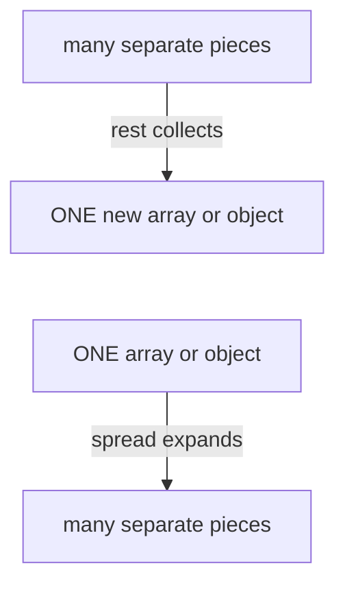
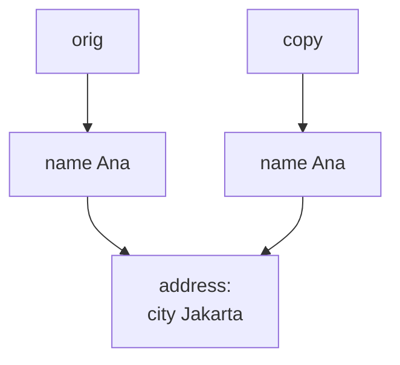

# 10. Destructuring, spread and rest

> **Subject:** JavaScript · **Lesson:** 10 · **Made:** 2026-10-15 · **Remade in short cards:** 2026-10-28 · **Status:** ready
>
> **You will be able to:** unpack values from an array or object in one line, tell rest from spread by which side of the code the three dots are on, and say why changing a spread copy can still change the original.
>
> **Before this:** [Arrays and higher order functions](09-arrays-and-higher-order-functions.md) · **Next:** [The event loop](11-the-event-loop.md)
>
> **How to read it:** one card is one idea. Look at the picture, guess, then press the orange bar to check. The blue bars (📖 More detail) hold the longer explanation. Skip them on the first read, and open them when you want more. About 25 minutes for the cards.

## 1. The idea: a shopping bag

Think of a shopping bag. **Destructuring:** "first item to the fridge, second item to the shelf". **Rest:** "put everything else in one new box". **Spread:** pour the bag out onto the table, item by item.



The rule: **same three dots, opposite directions.**

| Where the dots are | Name | What it does |
|---|---|---|
| **left side**: a pattern, or a function's parameter list | **rest** | collects the leftovers into one new array or object. It must be last. |
| **right side**: inside a call, `[ ]` or `{ }` | **spread** | expands one value into separate pieces. |

<details class="guess"><summary>🤔 Guess: `const { name, role = "guest" } = { name: "Ana", age: 30 };`. What are `name` and `role`? Press to check.</summary>

`name` is `"Ana"`. `role` is `"guest"`. The pattern on the left matches **by name**. There is no `role` key, so the value is `undefined`, and the **default** `"guest"` is used.

</details>

> **Remember:** same three dots, opposite directions. Left side collects (rest). Right side expands (spread).

<details class="more"><summary>📖 More detail: the four words, and where the bag picture stops</summary>

- **Pattern:** the `[ ]` or `{ }` on the **left** of `=`. It says which value goes into which variable. Unpacking with a pattern is called **destructuring**.
- **Default:** the value after `=` inside a pattern. JavaScript uses it only when the value is `undefined`.
- **Rest and spread:** two jobs for the same three dots `...`. See the table above.
- **Shallow copy:** a copy of the top level only. Objects inside are shared, not copied.

A shallow copy is like a photocopy of a page of home addresses. The page is new, but each address still leads to the same house. Paint the house, and both pages lead to a red house.

Where the picture stops: a real bag becomes empty. JavaScript only **reads**. The original stays full and unchanged. And numbers and text are copied for real. Only objects and arrays inside are shared ([lesson 03](03-reference-vs-copy.md)).

</details>

## 2. All three in one program

```js
const user = { name: "Ana", age: 30 };
const { name, role = "guest" } = user;
console.log(name, role);

function total(label, ...nums) {
  return label + " " + nums.length;
}
const list = [1, 2, 3];
console.log(total("count", ...list));

const older = { ...user, age: 31 };
console.log(older, user.age);
```

<details class="guess"><summary>🤔 Guess: what are the three lines of output? Press to check.</summary>

```
Ana guest
count 3
{ name: 'Ana', age: 31 } 30
```

`...list` in the call is **spread**: it expands the one array into 3 arguments. `...nums` in the parameter list is **rest**: it collects them back into a **new** array. `{ ...user, age: 31 }` copies the keys, and the later `age: 31` wins. `user.age` is still 30. Spread built a new object.

</details>

> **Remember:** spread builds a new array or object. The original stays as it was.

<details class="more"><summary>📖 More detail: the program, step by step</summary>

| Step | Line | What JavaScript does | Variables after | Prints |
|---|---|---|---|---|
| 1 | setup | `total` is a function declaration, so it exists before line 1 runs. | total | |
| 2 | 1 | Makes an object. `user` holds an arrow to it. | user → { name "Ana", age 30 } | |
| 3 | 2 | Sees the pattern `{ name, role = "guest" }`. It looks like an object, so it matches **by name**. It reads `user.name`, which is "Ana". | name = "Ana" | |
| 4 | 2 | Reads `user.role`. There is no such key, so the value is `undefined`. The **default** "guest" is used. | role = "guest" | |
| 5 | 3 | Prints both. | | Ana guest |
| 6 | 8 | Makes the array. | list = [1, 2, 3] | |
| 7 | 9 | Sees `...list` inside a call. That is **spread**. It expands the one array into separate arguments, so the call is `total("count", 1, 2, 3)`. | | |
| 8 | 5 | Inside `total`, `label` takes the first argument, "count". | label = "count" | |
| 9 | 5 | Sees `...nums` in the parameter list. That is **rest**. It collects the arguments that are left into a **new** array. | nums = [1, 2, 3] | |
| 10 | 6 | Returns "count 3". The call ends, so `label` and `nums` are thrown away. | | count 3 |
| 11 | 11 | Starts a **new** object. Sees `...user` inside `{ }`. That is **spread**. It copies `name` and `age` (30) into the new object. | | |
| 12 | 11 | Then `age: 31` comes later, so it **replaces** 30. `older` holds an arrow to the new object. | older → { name "Ana", age 31 } | |
| 13 | 12 | Prints `older`, then `user.age`. `user` was only read, never changed. | | { name: 'Ana', age: 31 } 30 |

Rest also drops fields. `const { password, ...safeUser } = user` takes out the password and keeps the rest in a new object.

Checked on 2026-10-28 with Node 26.12.1.

</details>

## 3. Mistake 1: spread copies only one level

```js
const orig = {
  name: "Ana",
  address: { city: "Jakarta" }
};
const copy = { ...orig };
copy.address.city = "Bandung";
console.log(orig.address.city);
```



<details class="guess"><summary>🤔 Guess: what does the last line print? Press to check.</summary>

`Bandung`. The original changed. Spread copies the **arrow** to the address object, not the object. Both outer objects share one inner object.

Fix: spread every level on the path you change.

```js
const copy = {
  ...orig,
  address: { ...orig.address, city: "Bandung" }
};
```

Now `orig.address.city` is `Jakarta` and `copy.address.city` is `Bandung`.

</details>

> **Remember:** spread is a shallow copy. Spread every level you change. [Lesson 03](03-reference-vs-copy.md) explains arrows and copies.

<details class="more"><summary>📖 More detail: a full deep copy</summary>

`structuredClone(value)` copies every level. It throws a `DataCloneError` for functions, and it drops class prototypes. Spread also copies every item every time, so spreading a big list inside a loop is slow.

</details>

## 4. Mistake 2: a default does not catch `null`

```js
function getLimit({ limit = 10 } = {}) {
  return limit;
}
console.log(getLimit({ limit: null }));
```

<details class="guess"><summary>🤔 Guess: does it print `10` or `null`? Press to check.</summary>

`null`. A default is used only for `undefined`. `null`, `0` and empty text all count as real values.

Fix: use `??` when `null` should also get the fallback.

```js
function getLimit({ limit } = {}) {
  return limit ?? 10;
}
```

Now `getLimit({ limit: null })` is `10`, and `getLimit({ limit: 0 })` is `0`. (`||` would turn `0` into 10.)

</details>

> **Remember:** a default fills in only for `undefined`. `??` also covers `null`, and it keeps `0`.

<details class="more"><summary>📖 More detail: the question to ask</summary>

Is the value exactly `undefined`? Yes: use the default. No: keep the value. `null`, `0` and empty text are all kept.

</details>

## 5. Mistake 3: spreading in the wrong order

When you spread two objects into one, a later key replaces an earlier one. The order decides who wins.

```js
const defaults = { theme: "light", size: 10 };
const mine = { size: 14 };
console.log({ ...mine, ...defaults });
```

<details class="guess"><summary>🤔 Guess: what size do you get? Press to check.</summary>

`{ size: 10, theme: 'light' }`. The defaults came last, so they replaced your `size: 14`. Your choice is lost.

Fix: defaults first, your changes last.

```js
console.log({ ...defaults, ...mine });
```

That gives `{ theme: 'light', size: 14 }`.

</details>

> **Remember:** later keys win. Spread defaults first, your changes last.

<details class="more"><summary>📖 More detail: the same bug in a function</summary>

`function createClient(options) { return { ...options, timeout: 5000 }; }` always gives `timeout: 5000`, even when the caller passes `timeout: 100`. The defaults come after the spread, so they win. Put the defaults first.

</details>

## 6. Mistake 4: a pattern in the parameter, but no argument

```js
function show({ name }) { return name; }
show();
```

<details class="guess"><summary>🤔 Guess: what happens? Press to check.</summary>

```
TypeError: Cannot destructure property 'name' of 'undefined' as it is undefined.
```

With no argument, the parameter is `undefined`, and you cannot unpack `undefined`.

Fix: give the whole parameter a default of `{}`.

```js
function show({ name = "guest" } = {}) {
  return name;
}
```

Now `show()` gives `guest`.

</details>

> **Remember:** with a pattern in the parameter, add `= {}`. (`show(null)` still throws.)

<details class="more"><summary>📖 More detail: error words differ</summary>

Other engines use other words for this error. The error name, `TypeError`, is the same everywhere. The stepper program "Options object and TypeError" shows both cases.

</details>

## 7. Watch it run, step by step

You watch the variables fill one by one, and the three dots collect or expand. It has eight programs: "Array: by position", "Object: by name", "Defaults: undefined only", "Options object and TypeError", "Rest: collect the leftover", "Spread: expand into pieces", "Later keys win" and "Shallow copy trap". Type your guess first, then press Next.

**Step through it yourself:** [open the destructuring, spread and rest stepper](visuals/10-destructuring-spread-and-rest.html).

## 8. Why it matters and what it costs

- **Without it,** you write `user.` again and again, many values in a fixed order are easy to pass wrong, and copying by hand needs a loop.
- **With it,** a **pattern** takes many values out in one line. A **default** fills a missing one. An **options object** names every value: `connect({ host: "a.com", secure: true })`, and order does not matter. **Rest** collects "everything else". **Spread** builds a new array or object.
- **The cost:**
  - Spread copies **one level only** (card 3).
  - A default does **not** catch `null` (card 4).
  - Unpacking `null` or `undefined` throws a TypeError.
  - Spread copies every item, every time.

## 9. Watch and play

Links checked on 2026-10-15. Each page opened. For each video, the title and channel matched. I did not watch the videos, so their lengths are not checked.

- **Video:** [Why Is Array/Object Destructuring So Useful And How To Use It](https://www.youtube.com/watch?v=NIq3qLaHCIs) by Web Dev Simplified. Watch it before the stepper.
- **Video:** [JavaScript SPREAD OPERATOR in 4 minutes!](https://www.youtube.com/watch?v=RuDdltsfaVc) by Bro Code. Watch it after stepper program 6.
- **Play with it:** [The destructuring, spread and rest stepper](visuals/10-destructuring-spread-and-rest.html). Guess first, then press Next.
- **Play with it:** [Python Tutor for JavaScript](https://pythontutor.com/javascript.html). It draws objects as boxes with arrows. It cannot run `{ ...orig }`, so paste the code from card 3 with `Object.assign({}, orig)` instead. I did not run it there myself.
- **Read:** [Destructuring assignment](https://javascript.info/destructuring-assignment) on javascript.info. See "Smart function parameters".
- **Read:** [Updating Objects in State](https://react.dev/learn/updating-objects-in-state) on react.dev. See "Updating a nested object".
- **Read (pictures):** [Immutability in React and Redux](https://daveceddia.com/immutable-updates-react-redux/) by Dave Ceddia. Memory box pictures of arrows. From 2018, so the React code is old style.

<details><summary>More links (optional)</summary>

- **Video:** [JavaScript REST PARAMETERS in 8 minutes!](https://www.youtube.com/watch?v=ahwR1D_GAfc) by Bro Code. Rest in a parameter list.
- **Read:** [Rest parameters and spread syntax](https://javascript.info/rest-parameters-spread) on javascript.info. Its summary gives the same "where are the dots" rule.
- **Read:** [Destructuring on MDN](https://developer.mozilla.org/en-US/docs/Web/JavaScript/Reference/Operators/Destructuring). The "Default value" part shows that `{ c = 2 } = { c: null }` keeps `null`.
- **Read:** [Spread syntax on MDN](https://developer.mozilla.org/en-US/docs/Web/JavaScript/Reference/Operators/Spread_syntax). See "Overriding properties" for later keys winning.
- **Read:** [Rest parameters on MDN](https://developer.mozilla.org/en-US/docs/Web/JavaScript/Reference/Functions/rest_parameters). Rest must be last, and how it differs from `arguments`.
- **Read:** [Deep-copying in JavaScript using structuredClone](https://web.dev/articles/structured-clone) by Surma on web.dev. Why spread is shallow, and what `structuredClone` cannot copy.
- **Interview:** [How is spread different from rest syntax?](https://www.greatfrontend.com/questions/quiz/what-are-the-benefits-of-using-spread-syntax-and-how-is-it-different-from-rest-syntax) and [Shallow copy against deep copy](https://www.greatfrontend.com/questions/quiz/explain-the-difference-between-shallow-copy-and-deep-copy) on GreatFrontEnd. Two quiz questions in the form interviewers ask.
- **Draw:** [Excalidraw](https://excalidraw.com/). Draw the picture from card 3 from memory for review question 4.

</details>

## 10. Practice

**A. Predict the output** (write your answer before opening)

```js
const [a = 1, b = 2] = [null];
const { x, ...rest } = { x: 1, y: 2, z: 3 };
const merged = { ...rest, y: 9 };
console.log(a, b, rest, merged);
```

<details><summary>Answer</summary>

`null 2 { y: 2, z: 3 } { y: 9, z: 3 }`

- `a` matches position 0, which holds `null`. `null` is not `undefined`, so the default 1 is not used.
- `b` matches position 1. There is nothing there, so it is `undefined`, and the default 2 is used.
- `rest` collects the keys that were not named: `y` and `z`.
- `merged` copies `rest`, then `y: 9` comes later and wins. `rest` itself is not changed.

</details>

**B. Fix the bug**

```js
function createClient(options) {
  return { ...options, timeout: 5000, retries: 3 };
}
console.log(createClient({ timeout: 100 }).timeout);   // 5000. It should be 100.
```

<details><summary>Answer</summary>

The defaults come **after** the spread, so they replace the caller's values. Put the defaults first:

```js
function createClient(options) {
  return { timeout: 5000, retries: 3, ...options };
}
console.log(createClient({ timeout: 100 }));   // { timeout: 100, retries: 3 }
console.log(createClient());                   // { timeout: 5000, retries: 3 }
```

`createClient()` also works, because `{ ...undefined }` adds nothing.

</details>

**C. Write it yourself**

Open `practice/10-destructuring-spread-and-rest.js`. There are seven tasks:

1. Fix `moveUser`. It changes the original user's address.
2. Fix `getPort`. Give 3000 for a missing **or** `null` port, and keep 0.
3. Write `addTodo` and `toggleTodo` without changing the input, like React state. Untouched todos stay the same objects.
4. Write `makeUrl` with an options object and defaults. `makeUrl()` must work too.
5. Write `mergeSettings(defaults, ...overrides)`. A later override wins.
6. Write `splitHead` with `const [head, ...tail]`. No `list[0]`, no `slice`.
7. Write down what six snippets print.

Run the tests from the folder that contains `learn/`:

```
node --test learn/javascript/practice/10-destructuring-spread-and-rest.test.js
```

At the start, 4 of the 24 tests pass. Two are for `moveUser`: it does return the new city. The bug only shows in the original user.

<details><summary>One possible answer</summary>

```js
function moveUser(user, city) {
  return { ...user, address: { ...user.address, city } };   // spread both levels
}

function getPort({ port } = {}) {
  return port ?? 3000;   // a default skips null, ?? does not
}

function addTodo(state, todo) {
  return { ...state, todos: [...state.todos, todo] };
}
function toggleTodo(state, id) {
  return {
    ...state,
    todos: state.todos.map(t => (t.id === id ? { ...t, done: !t.done } : t)),
  };
}

function makeUrl({ host = "localhost", port = 3000, secure = false, path = "/" } = {}) {
  const scheme = secure ? "https" : "http";
  return scheme + "://" + host + ":" + port + path;
}

function mergeSettings(defaults, ...overrides) {
  return overrides.reduce((result, o) => ({ ...result, ...o }), { ...defaults });
}

function splitHead(list) {
  const [head, ...tail] = list;
  return { head, tail };
}

const predictions = {
  s1: ["1 null 3"],
  s2: ["1 9 [4,5]"],
  s3: ['{"k":2,"m":4}'],
  s4: ["TypeError", "TypeError", '{"0":7}'],
  s5: ["2 true"],
  s6: ["1 [2,3]", "undefined []"],
};
```

Notes:

- `toggleTodo` uses `map` from [lesson 09](09-arrays-and-higher-order-functions.md). It makes a new object only for the todo it changes. The others are passed through as they are.
- `mergeSettings` starts with `{ ...defaults }`, so it returns a new object even when there are no overrides.
- In `s4`, unpacking `null` and spreading a plain object into `[ ]` both throw. Spreading `null` into `{ }` adds nothing. Spreading `[7]` into `{ }` gives the key `"0"`.

</details>

## 11. Interview question

**Q:** "What is the difference between rest and spread? Is `{ ...obj }` a deep copy? What does this print?"

```js
const a = { n: 1, deep: { v: 1 } };
const b = { ...a, n: 2 };
b.deep.v = 2;
console.log(a.n, a.deep.v);
```

<details><summary>A strong answer, in four parts</summary>

1. **Problem:** you often need a few values out of an object, a function that takes any number of values, or a new object based on an old one. Doing this by hand means repeated lines, loops, and changing the original by accident.
2. **How it works:** it is the same three dots in two directions.
   - On the left side, in a pattern or a parameter list, `...` is rest. It collects the leftovers into one new array or object. It must be last.
   - On the right side, in a call or inside `[ ]` or `{ }`, `...` is spread. It expands one value into pieces.
   - Spread makes a **shallow** copy. It copies the top level. For an object inside, it copies the arrow, so both copies share that object.
   - The code prints `1 2`. `n` is top level, so `b` has its own `n`. `deep` is shared, so changing `b.deep.v` also changes `a.deep.v`.
3. **Tradeoff:** spread is short and fast for flat data. For nested changes you must spread each level, or use `structuredClone` for a full deep copy. Spreading big lists in a loop is slow. A default in a pattern catches only `undefined`, not `null`.
4. **My example:** *This is an idea, not a fact. Replace it with your own real story from DBO, Unloan, ZWS or Skyworx.* In an Express or GraphQL resolver that loads a user with Prisma, `const { password, ...safeUser } = user` removes the password before sending the user back. In a React screen, `setCart([...cart, item])` makes a new array, so React sees the change.

</details>

## 12. Explain it back

Close this file. Press the **Record my explanation** button under this heading and explain destructuring, spread and rest out loud, like to a new junior, in 4 parts: problem, how it works, tradeoff, my example. Use the words "left side", "right side" and "one level". Then save the transcript file into `my-learning/recordings/`, or write your best version below. Run `/explain-check destructuring spread and rest` or ask the `explain-coach` agent to review it.

### My explanation

<write here>

### Coach feedback

<the explain-coach agent writes here>

## 13. Review questions (day 1, 3, 7, 21)

1. You see `...` in code. How do you know if it is rest or spread, and what does each one do?
2. `const { size = 10 } = { size: null }`. What is `size`, and why? How do you get 10 instead?
3. You copy an object with `{ ...orig }` and change `copy.address.city`. Why does `orig` change too, and how do you fix it?
4. Draw the picture from card 3 from memory: two variables, two outer objects, one inner object, and the arrows.

<details><summary>Answers</summary>

1. Look at the side. On the left side (a pattern or a parameter list) it is rest: it collects the leftovers into one new array or object, and it must be last. On the right side (a call, `[ ]` or `{ }`) it is spread: it expands one array or object into separate pieces.
2. `size` is `null`. A default is used only when the value is `undefined`, and `null` is a real value. Use `const { size } = obj;` and then `size ?? 10`.
3. Spread makes a shallow copy. It copies the arrow to the address object, not the object itself, so both point at the same address. Fix: `{ ...orig, address: { ...orig.address, city: "Bandung" } }`, or `structuredClone(orig)` for a full copy.
4. `orig` has an arrow to object A. `copy` has an arrow to object C. A and C each have an `address` arrow, and both arrows lead to the same object B, which holds the city.

</details>

## 14. Go deeper (optional)

Open these when you are ready. None of them is needed for the cards above.

<details><summary>More</summary>

- **What an array pattern accepts.** An array pattern and array spread work on anything you can loop over with `for...of`: arrays, strings, `Map` and `Set`. (Interview word: *iterable*.) So `const [a, b] = "hi"` gives `"h"` and `"i"`. A plain object is not loopable, so `[...{ a: 1 }]` throws a TypeError.
- **Object spread is softer.** `{ ...null }` and `{ ...undefined }` give `{}` with no error. `{ ...[7] }` gives `{ "0": 7 }`.
- **What object spread copies.** It copies the object's own keys. It does not copy the prototype. So `{ ...new SomeClass() }` gives a plain object without the class methods. See [Objects and prototypes](07-objects-and-prototypes.md).
- **Rest must be last.** `const [a, ...b, c] = list` is a SyntaxError. Node says "Rest element must be last element". A function can have only one rest parameter.
- **Rest and `.length`.** `function f(a, ...r) {}` has `f.length === 1`. The rest parameter does not count. The practice tests check this.
- **Rest against `arguments`.** The old `arguments` object holds all arguments, and it is not a real array. A rest parameter is a real array with `map`, `sort` and so on.
- **Swap two variables:** `[a, b] = [b, a]`.
- **A full deep copy:** `structuredClone(value)` copies every level. It throws a `DataCloneError` for functions, and it drops class prototypes.
- **Versions.** Array spread, rest and destructuring came in 2015 (ES6). Object spread and object rest came in 2018. The online tool Python Tutor only supports up to 2015, so it cannot run `{ ...obj }`.
- **Error words differ.** For `function f({ a }) {}; f()`, Node prints "Cannot destructure property 'a' of 'undefined' as it is undefined." Other engines use other words. The error name, TypeError, is the same everywhere.

Checked on 2026-10-15 with Node 24.15.0.

</details>

## Connected lessons

- [Reference vs copy](03-reference-vs-copy.md): arrows, shallow copy and deep copy in depth.
- [Values, types and coercion](02-values-types-and-coercion.md): `undefined` against `null`, and why `||` treats `0` as missing.
- [Functions](04-functions.md): parameters, where rest and defaults live.
- [Objects and prototypes](07-objects-and-prototypes.md): spread copies own keys, not the prototype.
- [Arrays and higher order functions](09-arrays-and-higher-order-functions.md): the previous lesson. `map` with `{ ...item }` is the usual safe update.
- [The event loop](11-the-event-loop.md): the next lesson.
