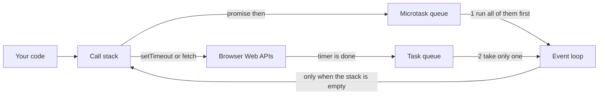
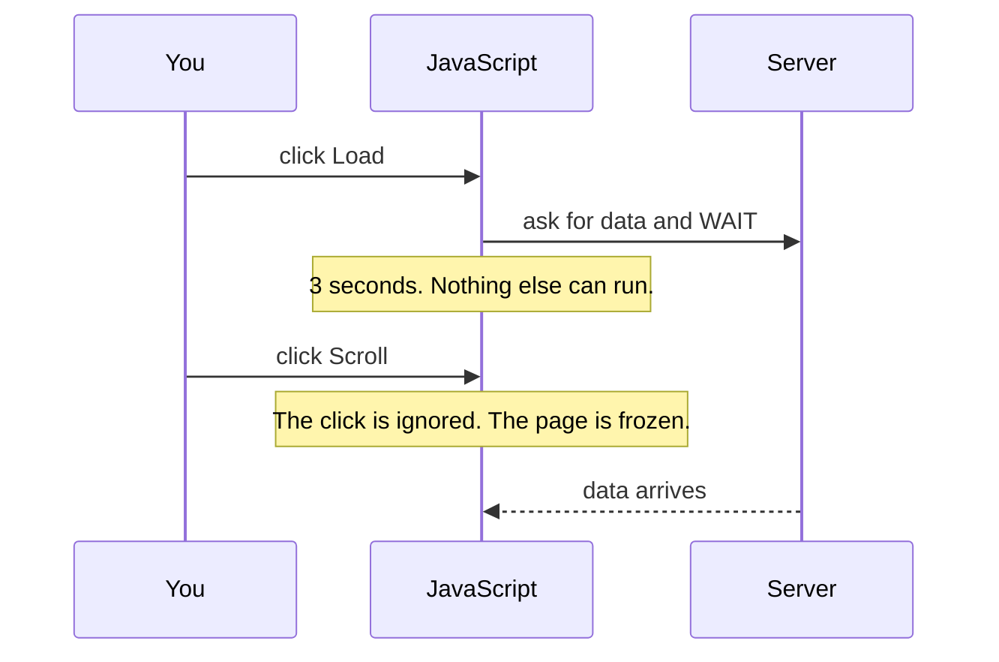
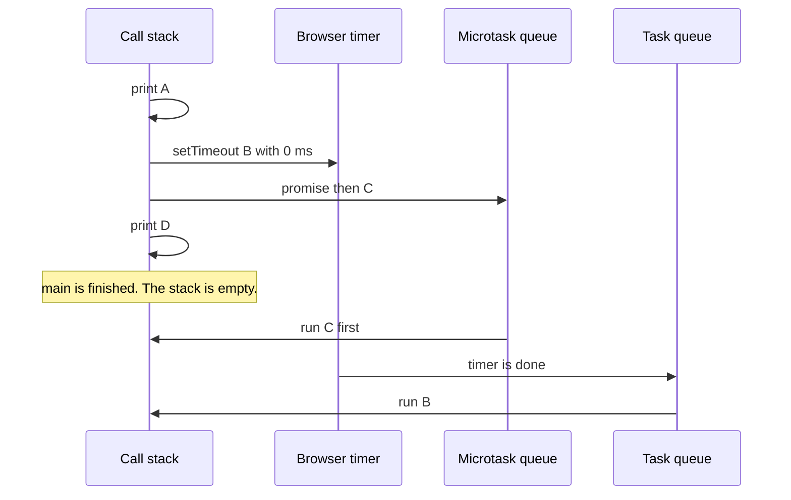
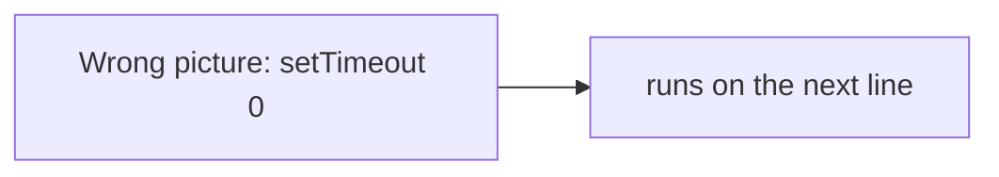
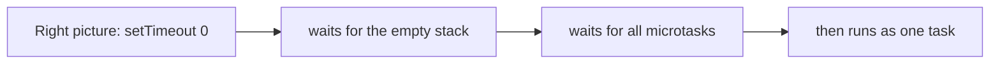
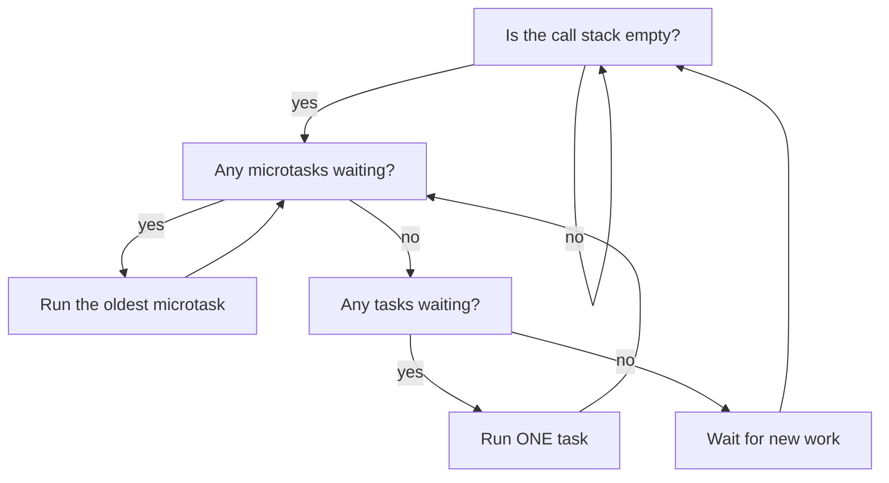

# 11. The event loop

> **Subject:** JavaScript · **Lesson:** 11 · **Made:** 2026-10-11 · **Rewritten in simpler words:** 2026-10-15 · **Status:** ready
> **You will be able to:** say in what order a script with `console.log`, `setTimeout` and a promise prints, and explain why in four parts.
> **Before this:** Destructuring, spread and rest (not written yet) · **Next:** Callbacks (not written yet)

## 1. The idea in one sentence

JavaScript can do **one thing at a time**. So when something slow starts (a timer or a request), the browser holds it on the side. The **event loop** brings its callback back only when the **call stack** is empty.

New words:

- **Call stack:** the place where your code runs, one function at a time. When a function calls another one, the new one goes on top.
- **Callback:** a function you give to someone else, to be called later.
- **Task queue:** a waiting line for finished timers and clicks. First in, first out. JavaScript takes **one** at a time.
- **Microtask queue:** a second, faster waiting line, for promise callbacks. JavaScript empties **all** of it before it takes the next task.

One more thing to know: the **browser** does the waiting for timers and requests, not JavaScript. The browser's helpers for this are called **Web APIs**.

## 2. The pictures

### 2a. The big picture

Notice the two waiting lines. The event loop always empties the microtask line first.



### 2b. The problem, drawn

If JavaScript just waited for data, the page would freeze. Notice that the second click is lost.



### 2c. How it works over time

This is the program from section 4. Notice that `C` runs before `B`, even though `B` was set first.



### 2d. What is in memory right now

A snapshot right after `console.log("D")`. Notice that `B` and `C` are both waiting, in **different** lines.

| Call stack | Browser timers | Microtask queue | Task queue | Console |
|---|---|---|---|---|
| `main()` | timer for B | callback C | empty | A D |

### 2e. Right against wrong

The most common wrong picture is that `setTimeout(fn, 0)` runs "right away". It does not. It runs after everything on the stack, and after every microtask.





### 2f. The rule as a flow

Every time the event loop turns, it asks these questions in this order. Notice that after one task it goes back to the microtasks.



## 3. Real life analogy

A restaurant kitchen with **one chef**. The chef is the call stack.

- An order that needs waiting, like a 10 minute oven timer, goes to the oven. The oven is the browser.
- When the oven rings, the dish joins a line of finished dishes. That is the task queue.
- Small notes that say "do this right after the current dish" (promises) go on a separate board. The chef reads **all** of those first.

Where the analogy stops: a real kitchen has many cooks. JavaScript has one chef. But the browser around it can wait for many timers and requests at the same time.

## 4. The smallest code that shows it

```js
console.log("A");
setTimeout(() => console.log("B"), 0);
Promise.resolve().then(() => console.log("C"));
console.log("D");
```

**Output:**

```
A
D
C
B
```

**Step through it yourself:** [open the event loop stepper](visuals/11-event-loop.html). It runs this exact program, plus two harder ones. Write your guess first, then press Next.

## 5. What really happens, step by step

| Step | Line | What happens | Call stack | Browser timers | Microtasks | Tasks | Console |
|---|---|---|---|---|---|---|---|
| 1 | start | The whole file goes on the call stack. | main | | | | |
| 2 | 1 | `console.log("A")` runs at once. | main | | | | A |
| 3 | 2 | The timer goes to the browser. JavaScript does not wait. | main | B | | | A |
| 4 | 3 | The promise is already done, so its callback waits in the microtask queue. | main | B | C | | A |
| 5 | 4 | `console.log("D")` runs. | main | B | C | | A D |
| 6 | end | `main` finishes. The stack is empty. | | B | C | | A D |
| 7 | loop | Rule 1: empty the microtasks first. `C` goes on the stack. | C | B | | | A D |
| 8 | 3 | `C` prints. | C | B | | | A D C |
| 9 | loop | The timer is done. Its callback moves to the task queue. | | | | B | A D C |
| 10 | loop | Rule 2: take **one** task. `B` goes on the stack. | B | | | | A D C |
| 11 | 2 | `B` prints. Everything is empty. | | | | | A D C B |

## 6. Why it exists and what it costs

- **Problem without it:** one thread plus waiting means a frozen page (picture 2b).
- **How it solves it:** slow work goes to the browser. Its callback comes back through a waiting line and runs when the stack is free.
- **Cost:**
  - The order can surprise you. That is exactly what interviewers test.
  - A long loop on the stack blocks **everything**, including timers and clicks. A timer of 0 ms means "at least 0 ms", not "now".
  - If microtasks keep adding more microtasks, tasks and screen updates never get a turn.

## 7. Common mistakes

**Wrong:** expecting the timer to print in the middle.

```js
console.log("start");
setTimeout(() => console.log("timer"), 0);
console.log("end");
// expected: start timer end
```

**Right:** the real output is `start end timer`. The timer always waits for the stack to empty.

**Why:** `setTimeout` does not pause the code. It only says "call this later".

**Wrong:** a heavy loop on the main thread.

```js
const t0 = Date.now();
setTimeout(() => console.log("timer"), 0);
while (Date.now() - t0 < 300) {}   // busy for 300 ms
console.log("loop finished");
```

**Right:** the output is `loop finished`, then `timer`. The timer was ready at 0 ms, but it had to wait 300 ms for the stack. For heavy work, split it into small pieces, or move it to a Web Worker.

**Why:** the event loop cannot run anything while the stack is busy.

## 8. Watch and play

Links checked on 2026-10-11. Each page opened.

- **Video:** [What the heck is the event loop anyway?](https://www.youtube.com/watch?v=8aGhZQkoFbQ) by Philip Roberts, JSConf EU. About 27 minutes. The classic talk, with moving pictures of the stack and the queues. YouTube would not open for me, so I checked the title, speaker and length on a mirror page. If the link fails, search for the title.
- **Play with it:** [The event loop stepper](visuals/11-event-loop.html) in this folder. Guess first, then press Next.
- **Play with it:** [Python Tutor for JavaScript](https://pythontutor.com/javascript.html). Paste the code from section 4 and click Visualize Execution. It shows memory well, but it does not show the queues, so use the stepper for those.
- **Read:** [Tasks, microtasks, queues and schedules](https://jakearchibald.com/2015/tasks-microtasks-queues-and-schedules/) by Jake Archibald. It has a click-through animation. Read it after you can explain section 5.
- **Read:** [Event loop: microtasks and macrotasks](https://javascript.info/event-loop) on javascript.info. Two diagrams and short examples.
- **Read:** [JavaScript execution model on MDN](https://developer.mozilla.org/en-US/docs/Web/JavaScript/Event_loop). It says "job queue" for what this lesson calls the microtask and task queues.

## 9. Practice

**A. Predict the output** (write your answer before opening)

```js
console.log("a");
setTimeout(() => console.log("b"), 0);
Promise.resolve().then(() => console.log("c")).then(() => console.log("d"));
setTimeout(() => console.log("e"), 0);
console.log("f");
```

<details><summary>Answer</summary>

`a f c d b e`

`a` and `f` run on the stack first. Then **both** `c` and `d` run as microtasks, because `d` is added while the microtasks are still being emptied. Only then do the two timers `b` and `e` run, one task each.

</details>

**B. Fix the bug**

```js
function loadUser() {
  let user;
  setTimeout(() => { user = { name: "Stephen" }; }, 0);
  return user;
}
console.log(loadUser());   // prints undefined. Why?
```

<details><summary>Answer</summary>

`return user` runs before the timer callback, so `user` is still `undefined`. Return a promise instead, so the caller can wait:

```js
function loadUser() {
  return new Promise(resolve => setTimeout(() => resolve({ name: "Stephen" }), 0));
}
loadUser().then(console.log);   // { name: 'Stephen' }
```

</details>

**C. Write it yourself**

Open `practice/11-event-loop.js`. There are two small functions to write. Run the tests from the folder that contains `learn/`:

```
node --test learn/javascript/practice/11-event-loop.test.js
```

<details><summary>One possible answer</summary>

```js
function logOrder(log) {
  return new Promise(resolve => {
    setTimeout(() => { log("task"); resolve(); }, 0);
    Promise.resolve().then(() => log("micro"));
    log("sync");
  });
}

function sleep(ms) {
  return new Promise(resolve => setTimeout(resolve, ms));
}
```

</details>

## 10. Interview question

**Q:** "Explain the JavaScript event loop. What is the difference between a microtask and a task, and what does this code print?"

<details><summary>A strong answer, in four parts</summary>

1. **Problem:** JavaScript has one thread. If it waited for a timer or a request, the whole page would freeze.
2. **How it works:** slow work goes to the browser. When it finishes, its callback waits in a queue. The event loop moves a callback onto the call stack only when the stack is empty. It empties the microtask queue (promises) completely first. Then it takes **one** task (timers). Then it checks the microtasks again.
3. **Tradeoff:** the order is not obvious. A long synchronous loop, or an endless chain of microtasks, blocks everything else, including clicks and screen updates.
4. **My example:** *This is an idea, not a fact. Replace it with your own real story.* In a React Native screen, a long loop inside a button handler would freeze the whole screen, because the touches are also waiting for the stack.

</details>

## 11. Explain it back

Close this file. Press the **Record my explanation** button under this heading and explain the event loop out loud, like to a new junior, in 4 parts: problem, how it works, tradeoff, my example. Then save the transcript file into `my-learning/recordings/`, or write your best version below. Run `/explain-check event loop` or ask the `explain-coach` agent to review it.

### My explanation

<write here>

### Coach feedback

<the explain-coach agent writes here>

## 12. Review questions (day 1, 3, 7, 21)

1. Which runs first, a promise callback or a `setTimeout(fn, 0)` callback, and why?
2. What does the event loop do after it finishes one task?
3. Why can a `while` loop that runs for 3 seconds delay a timer of 0 ms?
4. Draw the picture from section 2a from memory.

<details><summary>Answers</summary>

1. The promise callback. It is a microtask, and the event loop empties all microtasks before it takes the next task.
2. It checks the microtask queue again and empties it, before it takes the next task.
3. The timer callback can only run when the call stack is empty. The loop keeps the stack busy.
4. Your code, the call stack, the browser Web APIs, the task queue, the microtask queue, and the event loop that moves callbacks onto the stack when it is empty.

</details>

## Connected lessons

- [Closures](05-closures.md): a callback remembers its variables through a closure.
- Promises (not written yet): the microtask queue is where promise callbacks wait.
- Async and await (not written yet): the code after an `await` runs as a microtask. Program 3 of the stepper shows this.
