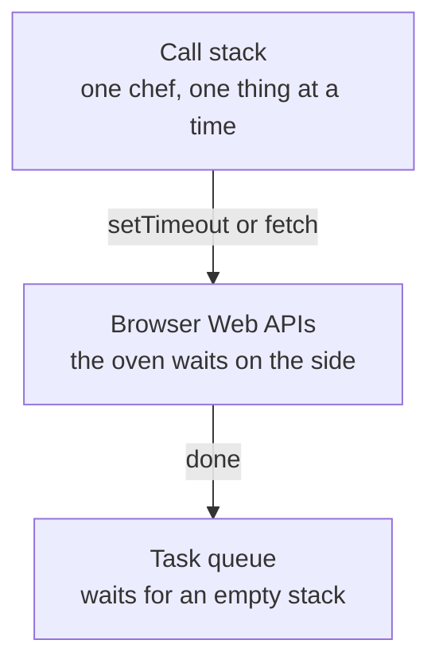
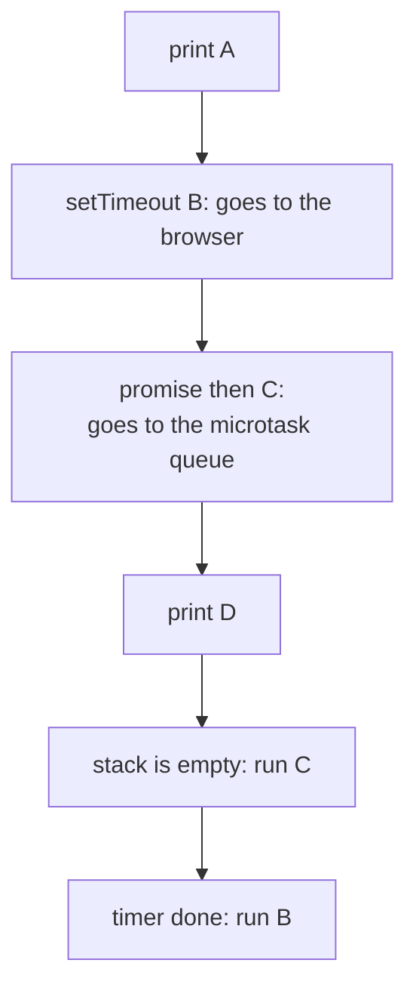
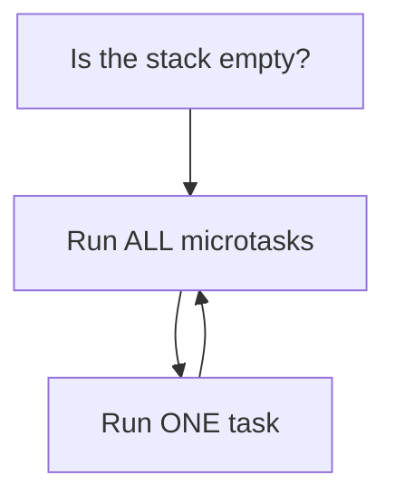
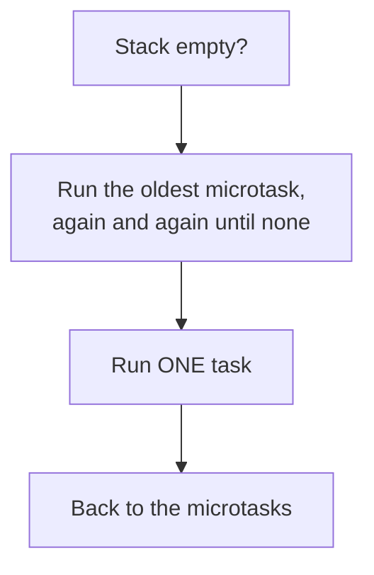

# 11. The event loop

> **Subject:** JavaScript · **Lesson:** 11 · **Made:** 2026-10-11 · **Rewritten in simpler words:** 2026-10-15 · **Remade in short cards:** 2026-10-28 · **Status:** ready
>
> **You will be able to:** say in what order a script with `console.log`, `setTimeout` and a promise prints, and explain why in four parts.
>
> **Before this:** [Destructuring, spread and rest](10-destructuring-spread-and-rest.md) · **Next:** Callbacks (not written yet)
>
> **How to read it:** one card is one idea. Look at the picture, guess, then press the orange bar to check. The blue bars (📖 More detail) hold the longer explanation. Skip them on the first read, and open them when you want more. About 15 minutes for the cards.

## 1. The idea: one chef in a kitchen

A restaurant kitchen has **one chef**. The chef is the call stack: one thing at a time. An order that needs waiting, like a 10 minute oven timer, goes to the oven. When the oven rings, the dish joins a line of finished dishes.



Notice: the **browser** does the waiting for timers and requests, not JavaScript. If JavaScript just waited, the page would freeze and the next click would be lost.

<details class="guess"><summary>🤔 Guess: `setTimeout(fn, 0)`. Does `fn` run on the very next line? Press to check.</summary>

No. `setTimeout` does not pause the code. It only says "call this later". `fn` runs after everything on the stack is done, and after every promise callback (card 3).

</details>

> **Remember:** JavaScript does one thing at a time. The event loop brings a callback back only when the call stack is empty.

<details class="more"><summary>📖 More detail: the four words, and where the kitchen picture stops</summary>

- **Call stack:** the place where your code runs, one function at a time. When a function calls another one, the new one goes on top.
- **Callback:** a function you give to someone else, to be called later.
- **Task queue:** a waiting line for finished timers and clicks. First in, first out. JavaScript takes **one** at a time.
- **Microtask queue:** a second, faster waiting line, for promise callbacks. JavaScript empties **all** of it before it takes the next task.

The browser's helpers for waiting are called **Web APIs**. In the kitchen: small notes that say "do this right after the current dish" (promises) go on a separate board. The chef reads **all** of those first.

Where the picture stops: a real kitchen has many cooks. JavaScript has one chef. But the browser around it can wait for many timers and requests at the same time.

</details>

## 2. The order of A, B, C, D

```js
console.log("A");
setTimeout(() => console.log("B"), 0);
Promise.resolve().then(
  () => console.log("C"));
console.log("D");
```



<details class="guess"><summary>🤔 Guess: in what order do the letters print? Press to check.</summary>

```
A
D
C
B
```

`C` runs before `B`, even though `B` was set first. After `D`, the stack is empty. The promise callback `C` waits in the **microtask** line, which is emptied first. The timer callback `B` waits in the **task** line.

</details>

> **Remember:** the sync code runs first. Then the microtasks (promises). Then one task (a timer).

<details class="more"><summary>📖 More detail: the program, step by step</summary>

A snapshot right after `console.log("D")`:

| Call stack | Browser timers | Microtask queue | Task queue | Console |
|---|---|---|---|---|
| `main()` | timer for B | callback C | empty | A D |

| Step | Line | What happens | Call stack | Browser timers | Microtasks | Tasks | Console |
|---|---|---|---|---|---|---|---|
| 1 | start | The whole file goes on the call stack. | main | | | | |
| 2 | 1 | `console.log("A")` runs at once. | main | | | | A |
| 3 | 2 | The timer goes to the browser. JavaScript does not wait. | main | B | | | A |
| 4 | 3 | The promise is already done, so its callback waits in the microtask queue. | main | B | C | | A |
| 5 | 4 | `console.log("D")` runs. | main | B | C | | A D |
| 6 | end | `main` finishes. The stack is empty. | | B | C | | A D |
| 7 | loop | Rule 1: empty the microtasks first. `C` goes on the stack. | C | B | | | A D |
| 8 | 3 | `C` prints. | C | B | | | A D C |
| 9 | loop | The timer is done. Its callback moves to the task queue. | | | | B | A D C |
| 10 | loop | Rule 2: take **one** task. `B` goes on the stack. | B | | | | A D C |
| 11 | 2 | `B` prints. Everything is empty. | | | | | A D C B |

Checked on 2026-10-28 with Node 26.12.1.

</details>

## 3. The rule: microtasks first, then ONE task

Every time the event loop turns, it asks these questions in this order.



<details class="guess"><summary>🤔 Guess: two promise callbacks and two timers are waiting. In what order do they run? Press to check.</summary>

Both promise callbacks first, then the timers one by one. For example `a` and `f` run on the stack. Then **both** `c` and `d` run as microtasks, because `d` is added while the microtasks are still being emptied. Only then do the two timers `b` and `e` run, one task each. That is `a f c d b e`, as in practice A.

</details>

> **Remember:** after one task, the loop goes back to the microtasks.

<details class="more"><summary>📖 More detail: the rule as a flow</summary>



If microtasks keep adding more microtasks, tasks and screen updates never get a turn.

</details>

## 4. Mistake 1: expecting the timer in the middle

```js
console.log("start");
setTimeout(() => console.log("timer"), 0);
console.log("end");
```

<details class="guess"><summary>🤔 Guess: do you get `start timer end`? Press to check.</summary>

No: `start end timer`. The timer always waits for the stack to empty. `setTimeout` does not pause the code.

</details>

> **Remember:** a timer of 0 ms means "at least 0 ms", not "now".

<details class="more"><summary>📖 More detail: the wrong picture</summary>

The most common wrong picture is that `setTimeout(fn, 0)` runs "right away". It does not. It runs after everything on the stack, and after every microtask.

</details>

## 5. Mistake 2: a heavy loop on the main thread

```js
const t0 = Date.now();
setTimeout(() => console.log("timer"), 0);
while (Date.now() - t0 < 300) {}
console.log("loop finished");
```

<details class="guess"><summary>🤔 Guess: which prints first, `timer` or `loop finished`? Press to check.</summary>

`loop finished`, then `timer`. The timer was ready at 0 ms, but it had to wait 300 ms for the stack. The event loop cannot run anything while the stack is busy.

For heavy work, split it into small pieces, or move it to a Web Worker.

</details>

> **Remember:** a long loop on the stack blocks **everything**, including timers and clicks.

<details class="more"><summary>📖 More detail: why the page freezes</summary>

In a React Native screen, a long loop inside a button handler would freeze the whole screen, because the touches are also waiting for the stack. *This is an idea, not a fact about your code.*

</details>

## 6. Watch it run, step by step

The stepper runs the A, B, C, D program, plus two harder ones. Write your guess first, then press Next.

**Step through it yourself:** [open the event loop stepper](visuals/11-event-loop.html).

## 7. Why it matters and what it costs

- **Without it,** one thread plus waiting means a frozen page.
- **With it,** slow work goes to the browser. Its callback comes back through a waiting line and runs when the stack is free.
- **The cost:**
  - The order can surprise you. That is exactly what interviewers test.
  - A long loop on the stack blocks **everything**, including timers and clicks.
  - If microtasks keep adding more microtasks, tasks and screen updates never get a turn.

## 8. Watch and play

Links checked on 2026-10-11. Each page opened.

- **Video:** [What the heck is the event loop anyway?](https://www.youtube.com/watch?v=8aGhZQkoFbQ) by Philip Roberts, JSConf EU. About 27 minutes. The classic talk, with moving pictures of the stack and the queues. YouTube would not open for me, so I checked the title, speaker and length on a mirror page. If the link fails, search for the title.
- **Play with it:** [The event loop stepper](visuals/11-event-loop.html) in this folder. Guess first, then press Next.
- **Play with it:** [Python Tutor for JavaScript](https://pythontutor.com/javascript.html). Paste the code from card 2 and click Visualize Execution. It shows memory well, but it does not show the queues, so use the stepper for those.
- **Read:** [Tasks, microtasks, queues and schedules](https://jakearchibald.com/2015/tasks-microtasks-queues-and-schedules/) by Jake Archibald. It has a click-through animation. Read it after you can explain the step table in card 2.
- **Read:** [Event loop: microtasks and macrotasks](https://javascript.info/event-loop) on javascript.info. Two diagrams and short examples.
- **Read:** [JavaScript execution model on MDN](https://developer.mozilla.org/en-US/docs/Web/JavaScript/Event_loop). It says "job queue" for what this lesson calls the microtask and task queues.

## 9. Practice

**A. Predict the output** (write your answer before opening)

```js
console.log("a");
setTimeout(() => console.log("b"), 0);
Promise.resolve().then(() => console.log("c")).then(() => console.log("d"));
setTimeout(() => console.log("e"), 0);
console.log("f");
```

<details><summary>Answer</summary>

`a f c d b e`

`a` and `f` run on the stack first. Then **both** `c` and `d` run as microtasks, because `d` is added while the microtasks are still being emptied. Only then do the two timers `b` and `e` run, one task each.

</details>

**B. Fix the bug**

```js
function loadUser() {
  let user;
  setTimeout(() => { user = { name: "Stephen" }; }, 0);
  return user;
}
console.log(loadUser());   // prints undefined. Why?
```

<details><summary>Answer</summary>

`return user` runs before the timer callback, so `user` is still `undefined`. Return a promise instead, so the caller can wait:

```js
function loadUser() {
  return new Promise(resolve => setTimeout(() => resolve({ name: "Stephen" }), 0));
}
loadUser().then(console.log);   // { name: 'Stephen' }
```

</details>

**C. Write it yourself**

Open `practice/11-event-loop.js`. There are two small functions to write. Run the tests from the folder that contains `learn/`:

```
node --test learn/javascript/practice/11-event-loop.test.js
```

<details><summary>One possible answer</summary>

```js
function logOrder(log) {
  return new Promise(resolve => {
    setTimeout(() => { log("task"); resolve(); }, 0);
    Promise.resolve().then(() => log("micro"));
    log("sync");
  });
}

function sleep(ms) {
  return new Promise(resolve => setTimeout(resolve, ms));
}
```

</details>

## 10. Interview question

**Q:** "Explain the JavaScript event loop. What is the difference between a microtask and a task, and what does this code print?"

<details><summary>A strong answer, in four parts</summary>

1. **Problem:** JavaScript has one thread. If it waited for a timer or a request, the whole page would freeze.
2. **How it works:** slow work goes to the browser. When it finishes, its callback waits in a queue. The event loop moves a callback onto the call stack only when the stack is empty. It empties the microtask queue (promises) completely first. Then it takes **one** task (timers). Then it checks the microtasks again.
3. **Tradeoff:** the order is not obvious. A long synchronous loop, or an endless chain of microtasks, blocks everything else, including clicks and screen updates.
4. **My example:** *This is an idea, not a fact. Replace it with your own real story.* In a React Native screen, a long loop inside a button handler would freeze the whole screen, because the touches are also waiting for the stack.

</details>

## 11. Explain it back

Close this file. Press the **Record my explanation** button under this heading and explain the event loop out loud, like to a new junior, in 4 parts: problem, how it works, tradeoff, my example. Then save the transcript file into `my-learning/recordings/`, or write your best version below. Run `/explain-check event loop` or ask the `explain-coach` agent to review it.

### My explanation

<write here>

### Coach feedback

<the explain-coach agent writes here>

## 12. Review questions (day 1, 3, 7, 21)

1. Which runs first, a promise callback or a `setTimeout(fn, 0)` callback, and why?
2. What does the event loop do after it finishes one task?
3. Why can a `while` loop that runs for 3 seconds delay a timer of 0 ms?
4. Draw the picture from card 1 from memory: the stack, the browser, and the queues.

<details><summary>Answers</summary>

1. The promise callback. It is a microtask, and the event loop empties all microtasks before it takes the next task.
2. It checks the microtask queue again and empties it, before it takes the next task.
3. The timer callback can only run when the call stack is empty. The loop keeps the stack busy.
4. Your code, the call stack, the browser Web APIs, the task queue, the microtask queue, and the event loop that moves callbacks onto the stack when it is empty.

</details>

## Connected lessons

- [Closures](05-closures.md): a callback remembers its variables through a closure.
- Promises (not written yet): the microtask queue is where promise callbacks wait.
- Async and await (not written yet): the code after an `await` runs as a microtask. Program 3 of the stepper shows this.
