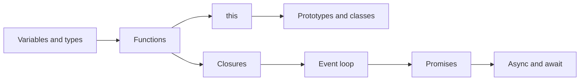

# JavaScript

How the language really works: values, scope, functions, objects, and the async machinery that runs your code.

**Why it matters in interviews:** Almost every frontend and Node interview starts here. Questions like "what is a closure", "what does this print" and "explain the event loop" test whether you understand the engine, not whether you can use a framework.

## The map

How the lessons connect. Learn left to right.

## Lessons, one concept per file

Each lesson is one small file made from [the lesson template](../../templates/lesson-template.md): picture first, a code trace, practice, links to watch and play, and an explain it back section.

Status: `planned` (not written yet), `ready` (written, not studied), `learning`, `can explain` (passed explain-check).

### Basics

| # | Lesson | You will understand | Status |
|---|---|---|---|
| 01 | Variables, scope and hoisting `01-variables-scope-and-hoisting.md` | var, let, const, block scope, hoisting and the temporal dead zone | planned |
| 02 | Values, types and coercion `02-values-types-and-coercion.md` | primitive vs object, typeof, == vs ===, truthy and falsy | planned |
| 03 | Reference vs copy `03-reference-vs-copy.md` | why changing a copied object changes the original, shallow vs deep copy | planned |
| 04 | Functions `04-functions.md` | declaration vs expression vs arrow, parameters, return, functions as values | planned |

### Core ideas

| # | Lesson | You will understand | Status |
|---|---|---|---|
| 05 | Closures `05-closures.md` | how a function remembers variables after its outer function finished | planned |
| 06 | this, call, apply and bind `06-this-call-apply-and-bind.md` | what decides the value of this, and how arrow functions differ | planned |
| 07 | Objects and prototypes `07-objects-and-prototypes.md` | the prototype chain, how property lookup walks up it | planned |
| 08 | Classes `08-classes.md` | class syntax on top of prototypes, extends, super, private fields | planned |
| 09 | Arrays and higher order functions `09-arrays-and-higher-order-functions.md` | map, filter, reduce, find, and when to use each | planned |
| 10 | Destructuring, spread and rest `10-destructuring-spread-and-rest.md` | unpacking values and copying with ... | planned |

### Async

| # | Lesson | You will understand | Status |
|---|---|---|---|
| 11 | [The event loop](11-the-event-loop.md) | call stack, Web APIs, task queue, microtask queue, and the order they run | ready |
| 12 | Callbacks `12-callbacks.md` | the first async style and why it led to callback hell | planned |
| 13 | Promises `13-promises.md` | states, then and catch chains, Promise.all, allSettled, race, any | planned |
| 14 | Async and await `14-async-and-await.md` | what await really pauses, error handling with try and catch, running in parallel | planned |

### Senior level

| # | Lesson | You will understand | Status |
|---|---|---|---|
| 15 | Error handling `15-error-handling.md` | throw, try catch finally, custom errors, errors in async code | planned |
| 16 | Modules `16-modules.md` | ES modules vs CommonJS, import and export, tree shaking | planned |
| 17 | Memory and garbage collection `17-memory-and-garbage-collection.md` | how memory is freed, and common leaks in apps | planned |
| 18 | Debounce and throttle `18-debounce-and-throttle.md` | limiting how often a function runs, written from scratch | planned |

**To make the next lesson:** in a chat with this folder open, say `/learn javascript 01` to learn it live with Claude, or ask "make lesson javascript 01" and the `research-material` agent writes the file. When a lesson file exists, its row becomes a link and the status changes to `ready`.

## Guides already here

Longer guides that cover many concepts at once. Good for revision after the lessons.

- [React and JS frontend guide (part 1 covers the event loop, closures and this)](../react/react-js-frontend-interview-guide.md)
- [How JavaScript runs (interactive)](https://claude.ai/artifact/YRvQjoaSrvTYpU9CzFYrJu) - your interactive page on one thread and the event loop, with live demos

## Watch and play

Trusted places to see the ideas, not only read them. Each lesson adds its own checked video and visualizer links.

- [javascript.info](https://javascript.info/) - the clearest free tutorial, one topic per page
- [MDN JavaScript Guide](https://developer.mozilla.org/en-US/docs/Web/JavaScript/Guide) - the reference for exact behavior
- [Python Tutor for JavaScript](https://pythontutor.com/javascript.html) - paste code and watch variables and memory change step by step
- [Loupe](http://latentflip.com/loupe/) - watch the call stack, Web APIs and queue move while code runs
- [What the heck is the event loop anyway? (Philip Roberts, JSConf EU)](https://www.youtube.com/watch?v=8aGhZQkoFbQ) - the classic visual talk on the event loop
- [roadmap.sh JavaScript](https://roadmap.sh/javascript) - a visual map of everything in the language
