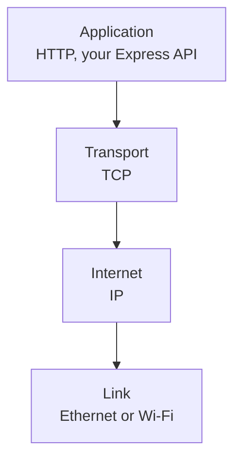
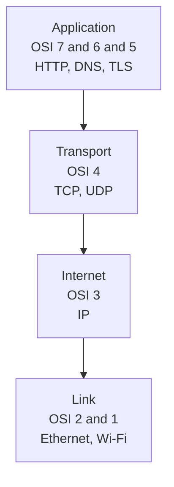
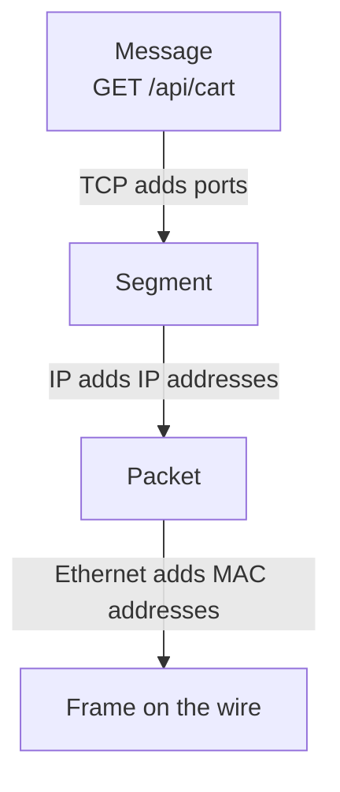
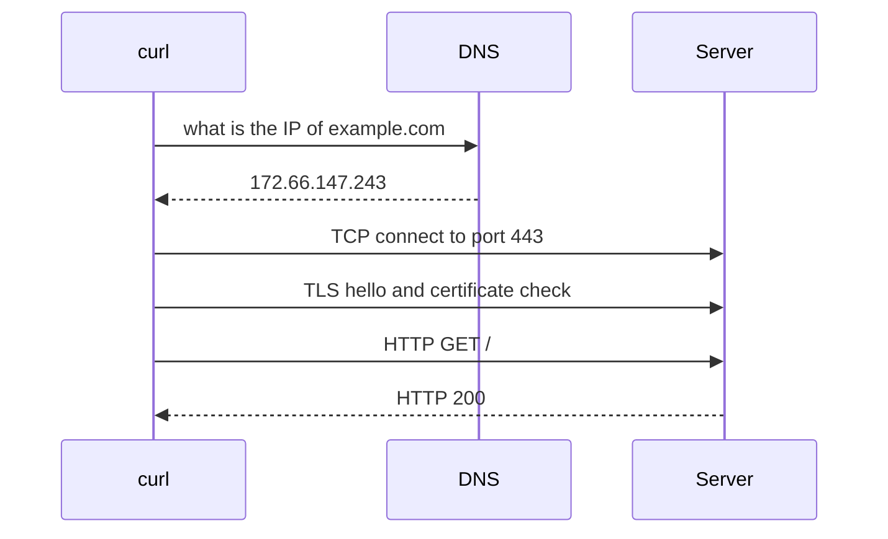
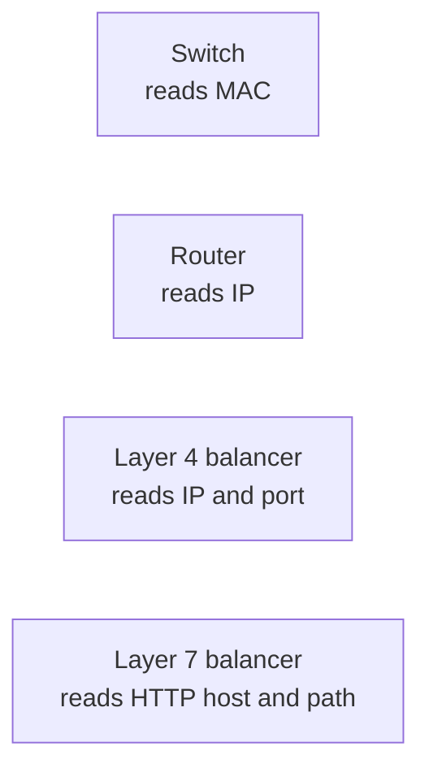
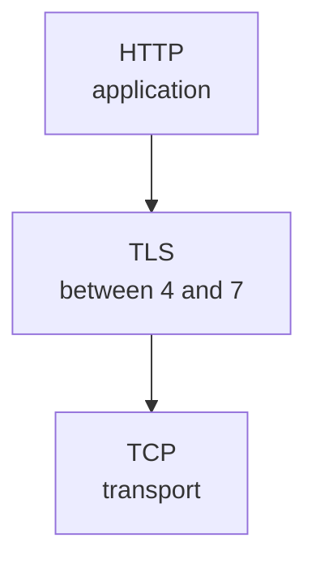
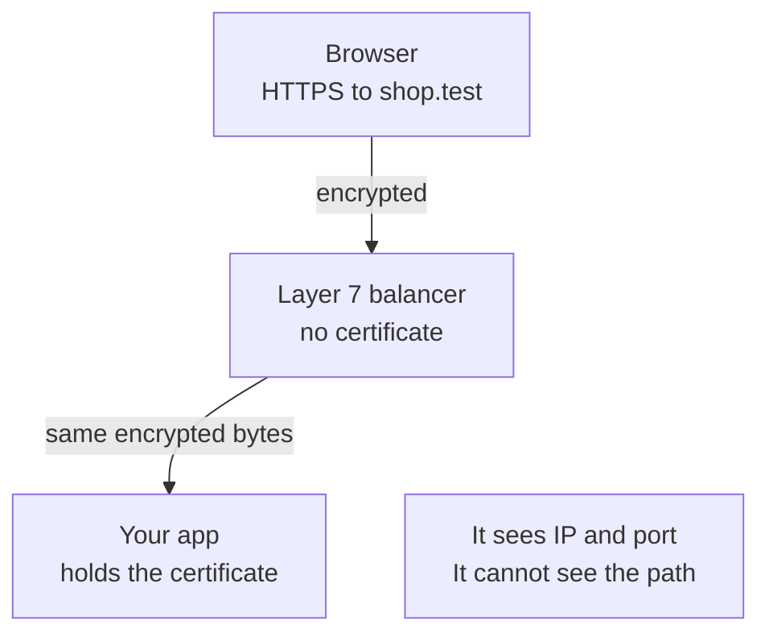

# 01. The layers: OSI and TCP/IP

> **Subject:** Networking · **Lesson:** 01 · **Made:** 2026-11-21 · **Status:** ready
>
> **You will be able to:** say why networking is split into layers, name the 4 layers of TCP/IP and the 7 of OSI and how they map, follow a request as each layer wraps it in a header, tell a MAC address from an IP address from a port, say which one changes at each router, say what a layer 4 and a layer 7 load balancer can read, and answer "which layer is TLS?" without getting caught.
>
> **Before this:** nothing, this is the first networking lesson. **Also read:** [What happens when you type a URL](networking-url-to-page-step-by-step.md) and [Load balancers](../system-design/03-load-balancers.md) · **Next:** DNS (planned, lesson 02) and TCP vs UDP (planned, lesson 03)
>
> **How to read it:** one card is one idea. Look at the picture, guess, then press the orange bar to check. The blue bars (📖 More detail) hold the longer explanation. Skip them on the first read. **What I ran for real:** `curl -v`, `nc`, `dig` and `traceroute` against live sites, a small Node program with two servers on one machine, and the practice code. **What I did not run:** `tcpdump` and Wireshark (they need admin rights here), and any load balancer. Those are marked "from the docs, not run here". Facts and links were checked on 2026-11-21. About 25 minutes for the cards.

<!-- quick-summary:start -->
## Quick summary

> Short on time? Read only this. These are the "Remember" lines from the cards below, so you can read the whole lesson in one minute.

- Each layer does one job and only talks to its neighbours. So you can change one layer without touching the others.
- TCP/IP has 4 layers (application, transport, internet, link). In OSI terms, layer 7 is the application, layer 4 is TCP or UDP, layer 3 is IP, and layer 2 is Ethernet or Wi-Fi.
- Going down, each layer wraps the data in its own header. Going up, each layer removes its own header. A layer only reads its own header.
- MAC is the next stop, IP is the machine, port is the program. MAC changes at every router. IP and port stay.
- A web request goes bottom up in time: IP lookup, TCP connect, TLS handshake, HTTP. `curl -v` shows each step, and each step needs the one below it.
- The layer number says how deep a device reads. Layer 4 reads IP and port (fast, any TCP or UDP). Layer 7 reads HTTP (smarter, and it needs the certificate for HTTPS).
<!-- quick-summary:end -->

## 1. The problem: one job per layer

Think about sending a parcel. You write a letter. You put it in an envelope with the flat number. A post office puts the envelope in a bag with the city. A van carries the bag to the next depot. Nobody does all the jobs. Each one does a single job and trusts the next one.

Networks work the same way. If one program had to deal with radio waves, routes, lost data, encryption and web pages, changing any one of them would break all the others. So the work is split into **layers**.



Notice: each box only talks to the box above and the box below.

Where the parcel analogy stops: real headers are bits, not paper, and a router never opens your letter.

<details class="guess"><summary>🤔 Guess: you move your laptop from Wi-Fi to a cable. Does your Express app need a change? Press to check.</summary>

**No.** Only the bottom layer (link) changed. IP, TCP, HTTP and your app do not care how the bits travel.

</details>

> **Remember:** each layer does one job and only talks to its neighbours. So you can change one layer without touching the others.

<details class="more"><summary>📖 More detail: four new words, and what each layer does for your app</summary>

**Four new words in this lesson:** **header** (a small label that a layer adds in front of the data, card 3), **encapsulation** (wrapping data in headers, card 3), **port** (a number that names a program on a machine, card 4), **MAC address** (the name of one network card, card 4). The layer numbers (layer 4, layer 7) are explained in card 2.

**What each layer does for your app:**

| Layer | Its one job | Real example |
|---|---|---|
| Application | the words two programs say to each other | `GET /api/cart HTTP/1.1` |
| Transport | get the data to the right program, and (for TCP) in order and without gaps | TCP, port 443 |
| Internet | get the data to the right machine, across many networks | IP address `198.51.100.10` |
| Link | get the data to the next machine on the same local network | Ethernet, Wi-Fi |

**Why it was designed this way.** The rules are old and they work. RFC 1122 (the host requirements, 1989) already names these four layers: the "Application Layer", "Transport Layer", "Internet Layer" and "Link Layer". New link types (Wi-Fi, 5G) and new application protocols (HTTP/2, gRPC) arrived on top of the same middle layers.

**Where it fits.** The [URL to page guide](networking-url-to-page-step-by-step.md) walks DNS, TCP, TLS and HTTP in order. This lesson draws the map that those steps sit on.

</details>

## 2. Two maps: 4 layers and 7 layers

There are two pictures of the layers. **TCP/IP** has 4 layers and describes what the internet really runs. **OSI** has 7 layers and is a teaching model. In interviews people say "layer 4" and "layer 7", and those are OSI numbers. The trick: OSI layers 5, 6 and 7 are all just "the application" in TCP/IP.



Notice: when someone says "layer 4", look at the Transport box. "Layer 7" is the top box.

<details class="guess"><summary>🤔 Guess: which model does the internet really run on, TCP/IP or OSI? Press to check.</summary>

**TCP/IP.** OSI came as a reference model. The internet protocols were built first, and the 7 layers are a way to talk about them.

</details>

> **Remember:** TCP/IP has 4 layers (application, transport, internet, link). In OSI terms, layer 7 is the application, layer 4 is TCP or UDP, layer 3 is IP, and layer 2 is Ethernet or Wi-Fi.

<details class="more"><summary>📖 More detail: all seven OSI layers, and where your stack sits</summary>

| OSI # | OSI name | TCP/IP layer | What you would meet |
|---|---|---|---|
| 7 | Application | Application | HTTP, DNS, SSH, SMTP, GraphQL over HTTP |
| 6 | Presentation | Application | encoding, TLS (debated, card 7) |
| 5 | Session | Application | keeping a conversation open (hardly used as a separate layer) |
| 4 | Transport | Transport | TCP, UDP, QUIC |
| 3 | Network | Internet | IP, ICMP (the `ping` messages) |
| 2 | Data link | Link | Ethernet, Wi-Fi, a MAC address |
| 1 | Physical | Link | cable, radio, voltage |

**Your own stack, from top to bottom:** React calls `fetch`, which sends HTTP (application). The HTTPS padlock is TLS, sitting just under HTTP. TCP gives a reliable stream. IP carries it between machines. Ethernet or Wi-Fi carries it to the next hop.

**Where the 4 layer model comes from.** [RFC 1122](https://datatracker.ietf.org/doc/html/rfc1122), section 1.1.3, names four layers. Some textbooks split the bottom into "network access" and "physical" and show 5 layers. Both are fine, so say which one you mean.

**Cloudflare agrees with the numbers.** Its [network layers page](https://developers.cloudflare.com/fundamentals/reference/network-layers/) lists HTTP and DNS at layer 7, TCP and UDP at layer 4, IP at layer 3. It puts its load balancing and its web application firewall at layer 7.

</details>

## 3. Wrapping: each layer adds a header

You send `GET /api/cart`. TCP adds a **header** with two port numbers. IP adds a header with two IP addresses. Ethernet adds a header with two MAC addresses. Each layer wraps the thing from above. This wrapping is **encapsulation**. The receiver does the same in reverse: each layer removes its own header and passes the rest up.



Notice: the last wrapper added is the outermost one. The Ethernet header comes first on the wire.

<details class="guess"><summary>🤔 Guess: which header is outermost on the wire, the TCP header or the Ethernet header? Press to check.</summary>

**Ethernet.** It was added last, so it sits on the outside. The receiver peels it first.

</details>

> **Remember:** going down, each layer wraps the data in its own header. Going up, each layer removes its own header. A layer only reads its own header.

<details class="more"><summary>📖 More detail: the step by step trace, the sizes, and a stepper to press</summary>

**The trace.** This is what the practice code `encapsulate` builds, one row per layer (press Next in [the stepper, tab 1](visuals/01-the-layers-osi-and-tcp-ip.html)):

| Step | Layer | What it does | The thing now holds |
|---|---|---|---|
| 1 | Application | browser writes the request | `GET /api/cart` |
| 2 | Transport | TCP adds the source port `51145` and the destination port `443` | ports + message (a **segment**) |
| 3 | Internet | IP adds the source IP, the destination IP and `ttl 64` | IP + ports + message (a **packet**) |
| 4 | Link | Ethernet adds the MAC of your laptop and the MAC of your router | MAC + IP + ports + message (a **frame**) |
| 5 | Wire | the frame goes out | the receiver removes link, then internet, then transport |

**The three names.** Segment, packet and frame are the names for the data at each layer. Many people say "packet" for all of them, and in an interview that is fine.

**The cost.** The three headers are at least 14 bytes (Ethernet), 20 bytes (IPv4) and 20 bytes (TCP), so 54 bytes in all. One segment carries at most 1460 bytes of message on a normal Ethernet link. The practice function `wireBytes` is this rule: a 4000 byte answer is cut into 3 segments, and 4000 + 3 x 54 = 4162 bytes go out. The real Ethernet frame also has a 4 byte check value at the end, which this model leaves out.

**Where TLS fits.** HTTPS adds one more wrapper between HTTP and TCP: the HTTP bytes are encrypted before TCP carries them. TCP, IP and Ethernet cannot read them.

</details>

## 4. Three addresses: MAC, IP, port

Three different numbers name three different things. A **MAC address** names one network card, and only works on the local link. An **IP address** names a machine, anywhere on the internet. A **port** names one program on that machine. To reach your Express app you need all three, one at each layer.

| Address | Names | Layer | Example | Changes at each router? |
|---|---|---|---|---|
| MAC | the next stop on this link | link | `aa:bb:cc:dd:ee:01` | yes |
| IP | the machine | internet | `198.51.100.10` | no |
| port | the program | transport | `443` | no |

Notice: only the MAC address changes at each hop. The IP address and the port travel all the way.

<details class="guess"><summary>🤔 Guess: your laptop sends a request to a server across the world. What is the destination MAC in the frame that leaves your laptop? Press to check.</summary>

**Your router's MAC.** A MAC address only works on one local link. The server is far away, so the next stop is your router. The destination IP is the one that names the server.

</details>

> **Remember:** MAC is the next stop, IP is the machine, port is the program. MAC changes at every router. IP and port stay.

<details class="more"><summary>📖 More detail: real output with two ports, source ports, and where NAT changes the story</summary>

**Two servers, one machine** (a small Node program I ran on 2026-11-21: a "web" server on port 4101 and an "api" server on port 4102, both at `127.0.0.1`, and a client that connects three times):

```
to 127.0.0.1:4101 from 127.0.0.1:51145 got "web"
to 127.0.0.1:4102 from 127.0.0.1:51146 got "api"
to 127.0.0.1:4101 from 127.0.0.1:51147 got "web"
```

Same IP address, two different programs. The port chose which one answered. Look at the second address in each line: your side also has a port. The operating system picks a free one for each new connection (51145, 51146, 51147). It is called an ephemeral port, which means "short lived". A connection is named by four values: source IP, source port, destination IP, destination port.

**The same thing on the real internet.** I ran `curl` twice against `https://example.com` and asked it to print the ports it used. Both times the destination was port 443. The source ports were different:

```
172.66.147.243 443 local_port=51766
172.66.147.243 443 local_port=51767
```

**Common ports to know:** 80 HTTP, 443 HTTPS, 22 SSH, 53 DNS, 5432 PostgreSQL. A port can be 0 to 65535 (16 bits).

**Where the story is simpler than the real thing.** Your home router does NAT (network address translation). Your laptop has a private IP like `192.168.1.20`. The router replaces it with its public IP, and it also rewrites the source port. So the source IP does change once, at the edge of your home network. This lesson's model leaves NAT out. The destination IP and port still stay the same.

**MAC and Wi-Fi.** On your own network, a device finds the MAC of the next stop with ARP (a question to the local network: "who has this IP?"). ARP is not part of this lesson.

</details>

## 5. See the layers yourself

You do not have to take this on trust. A single `curl -v` prints the layers as they happen. First DNS turns the name into an IP. Then TCP connects to a port. Then TLS starts. Only then does HTTP go out. Each step starts after the one below it is ready.



Notice: HTTP, the top layer, is the last thing to happen.

<details class="guess"><summary>🤔 Guess: curl -v prints "Connected to example.com port 443" and only after that the TLS lines. Which layer has just finished? Press to check.</summary>

**Transport.** "Connected" means the TCP handshake is done. TLS has not started yet, and HTTP is still later.

</details>

> **Remember:** a web request goes bottom up in time: IP lookup, TCP connect, TLS handshake, HTTP. `curl -v` shows each step, and each step needs the one below it.

<details class="more"><summary>📖 More detail: my real curl, nc, dig and traceroute output</summary>

**`curl -v https://example.com/`** (2026-11-21, curl 8.7.1, trimmed by hand):

```
* IPv4: 172.66.147.243, 104.20.23.154
*   Trying 172.66.147.243:443...
* Connected to example.com (172.66.147.243) port 443
* ALPN: curl offers h2,http/1.1
* (304) (OUT), TLS handshake, Client hello (1):
* (304) (IN), TLS handshake, Server hello (2):
* (304) (IN), TLS handshake, Certificate (11):
* SSL connection using TLSv1.3 / AEAD-CHACHA20-POLY1305-SHA256
* ALPN: server accepted h2
* SSL certificate verify ok.
* using HTTP/2
> GET / HTTP/2
> Host: example.com
< HTTP/2 200
```

Line by line: the name became two IP addresses (internet layer, found by DNS). `Trying ...:443` and `Connected` are TCP. The `TLS handshake` lines are TLS. `GET / HTTP/2` is HTTP. The bottom layers (IP, Ethernet) are not printed, because curl does not see them.

**`nc`: speak HTTP by hand over a raw TCP connection** (`nc` only knows TCP, so you type the HTTP yourself):

```
printf 'GET / HTTP/1.1\r\nHost: example.com\r\nConnection: close\r\n\r\n' | nc example.com 80
HTTP/1.1 200 OK
Content-Type: text/html; charset=utf-8
Server: cloudflare
```

This is the point of layers: HTTP is just text on top of a TCP connection. `nc` made the transport layer, and I wrote the application layer myself.

**`dig example.com`** printed `;; SERVER: 192.168.1.1#53(192.168.1.1)`. The name lookup went to my home router on port 53, the DNS port.

**`traceroute -m 6 example.com`** (trimmed, names removed):

```
 1  192.168.1.1   111.6 ms   my home router
 2  100.66.0.3      8.1 ms
 3  114.5.140.185   8.2 ms   my internet provider
 ...
```

Each line is one router on the path. It works because each router lowers the ttl by 1 and drops a packet that reaches 0 (stepper, tab 2, step 4). traceroute sends packets with ttl 1, 2, 3 and so on, so each router in turn tells it "your packet died here".

**Not run here:** `tcpdump -i en0` and Wireshark. Both need admin rights, which I did not use. Try them yourself on your own laptop: they show the Ethernet, IP and TCP headers from card 3 with every field.

</details>

## 6. Who reads which layer

Every box on the way reads only as deep as its job needs. A **switch** moves frames inside one local network, so it reads the MAC address only. A **router** moves packets between networks, so it reads the IP address. A **layer 4 load balancer** reads IP addresses and ports. A **layer 7 load balancer** also reads the HTTP request, so it can send `/api` and `/images` to different servers. The deeper it reads, the more it can do, and the more work it has.



Notice: the further down the list, the deeper into the message the device reads.

<details class="guess"><summary>🤔 Guess: you want /api to go to the api servers and /images to the file servers. Layer 4 or layer 7 balancer? Press to check.</summary>

**Layer 7.** The path is inside the HTTP message. A layer 4 balancer never opens it, so it cannot tell the two apart.

</details>

> **Remember:** the layer number says how deep a device reads. Layer 4 reads IP and port (fast, any TCP or UDP). Layer 7 reads HTTP (smarter, and it needs the certificate for HTTPS).

<details class="more"><summary>📖 More detail: the table, AWS and nginx examples, and the stepper trace</summary>

| Device | Reads up to | Can route by | Example |
|---|---|---|---|
| Switch | link | MAC address | the box in an office |
| Router | internet | IP address | your home router |
| Layer 4 load balancer | transport | IP and port | AWS Network Load Balancer |
| Layer 7 load balancer | application | host, path, headers, cookies | AWS Application Load Balancer, nginx |

**From the AWS docs** (checked 2026-11-21, not run here): "A Network Load Balancer functions at the fourth layer of the Open Systems Interconnection (OSI) model." For TCP traffic it picks a target with a flow hash over the protocol, source IP, source port, destination IP, destination port and the TCP sequence number, and "each individual TCP connection is routed to a single target for the life of the connection". "An Application Load Balancer functions at the application layer, the seventh layer", and it can route by URL path, by the host field of the HTTP header, by HTTP headers and by query string.

**Your own tools.** nginx in front of your apps is a layer 7 balancer (see [Reverse proxy and Nginx](../devops-cloud/08-reverse-proxy-and-nginx.md)). CapRover runs nginx for each app, so a request to `shop.example.com` reaches the right container by the host name. That is layer 7 work. The deeper comparison is in [Load balancers](../system-design/03-load-balancers.md), card 4.

**The trace** (stepper, tab 4, the model code `routeKey` and `canSeePath`):

| Step | Device | What it sees | What it can do |
|---|---|---|---|
| 1 | Layer 4 | `203.0.113.7:51145->198.51.100.10:443` | pick a server by address and port |
| 2 | Layer 4 | two paths on one connection give the same key | both go to the same server |
| 3 | Layer 7, holds the certificate | `shop.test/api/cart` | send `/api` and `/images` to different groups |
| 4 | Layer 7, no certificate | encrypted bytes | only address and port, like layer 4 |

**Tradeoff.** Layer 4 is fast, handles any protocol on TCP or UDP, and does not need your certificate. Layer 7 gives routing, redirects, a firewall for web attacks (a WAF) and better logs, but it must open every request. It costs more CPU and it needs the certificate.

</details>

## 7. Mistake: "which layer is TLS?"

**The problem.** An interviewer asks "which OSI layer is HTTPS or TLS?" A quick answer is "layer 7" or "layer 6". Then comes the follow-up, and the answer falls apart. The honest answer is that TLS has no clean layer. It runs on top of TCP and carries HTTP, so it sits between transport and application.



Notice: TLS is an extra wrapper between HTTP and TCP. Neither model gives it its own box.

<details class="guess"><summary>🤔 Guess: what should you say when asked "which layer is TLS?" Press to check.</summary>

**Say that it depends on the model.** "In OSI people usually say layer 6 (presentation). In TCP/IP it is part of the application group, because it is a protocol that runs on top of TCP. In practice it sits between TCP and HTTP." That shows you understand the idea, not only the numbers.

</details>

> **Fix:** do not memorize one number for TLS. Say where it sits (above TCP, under HTTP) and why the models disagree.

<details class="more"><summary>📖 More detail: why no model fits, and two more traps</summary>

**Why it does not fit.** OSI was drawn before TLS existed in its present form. TLS needs a working TCP connection first, and it hides the HTTP inside. That is like a transport job (secure delivery) and an application job (it has its own handshake messages). The practice code uses `tls: application, 6`, which is the common textbook choice. The tests say so, to keep the lesson consistent, not because it is the only answer.

**QUIC and HTTP/3.** HTTP/3 does not use TCP. It uses QUIC, which runs on UDP and has TLS built in. So TCP and TLS are no longer two separate wrappers there. The practice code puts `quic` in the transport layer.

**Trap: "OSI is the model that the internet uses."** The internet runs on TCP/IP (card 2).

**Trap: "layers are strict."** Real protocols mix jobs. ARP is a common example, and people disagree about whether it is layer 2 or layer 3. In an interview, it is better to say "that one sits between two layers" than to pick a side with false confidence.

**Where this comes back.** [TLS and HTTPS](../devops-cloud/19-https-and-certificates-in-practice.md) (DevOps lesson 19) covers certificates and where the HTTPS ends. The networking lesson on TLS is planned (lesson 04).

</details>

## 8. Mistake: "a layer 7 balancer can always read the path"

**The problem.** You put a "layer 7" balancer in front of your API and plan to route `/api` and `/images` apart. It does not work: every request goes to one group. The balancer is in TLS passthrough mode. It sends the encrypted bytes on without opening them, so for it the path is unreadable.



Notice: the balancer is in the middle but cannot read the bytes, so it acts like a layer 4 balancer.

<details class="guess"><summary>🤔 Guess: a layer 7 balancer passes the encrypted bytes on without the certificate. Can it route by path? Press to check.</summary>

**No.** The path is inside the encrypted data. To read it, the balancer must end the HTTPS (hold the certificate). This is TLS termination from the DevOps HTTPS lesson.

</details>

> **Fix:** to route by path, the layer 7 balancer must hold the certificate and end the HTTPS. Then the leg behind it is plain unless you encrypt it again.

<details class="more"><summary>📖 More detail: the fix, the tradeoff, and the practice function</summary>

**The practice function `canSeePath(device, { tlsEndsHere })`** is this rule: only a layer 7 balancer can read the path, and only when `tlsEndsHere` is `true`. A layer 4 balancer, a router and a switch always get `false`.

**Terminate or pass through.** Ending the HTTPS at the balancer gives you path routing, a WAF and one place for certificates. Passing the bytes through keeps the traffic encrypted all the way and keeps the key off the balancer, but then you only get layer 4 routing. The full table of terminate, re-encrypt and passthrough is in [HTTPS and certificates in practice](../devops-cloud/19-https-and-certificates-in-practice.md), card 3.

**From the AWS docs** (not run here): a Network Load Balancer target group supports the TCP, UDP, TCP_UDP, TLS, QUIC and TCP_QUIC protocols. An Application Load Balancer uses listener rules with conditions on the path, the host and headers, which only works because it ends the HTTPS (its docs say an HTTPS listener uses certificates "to terminate connections and decrypt requests from clients").

**Why this shows up in interviews.** "Why does my balancer send everything to one server?" and "can the load balancer see my headers?" both come down to: which layer does it read, and who holds the certificate?

</details>

## 9. Watch and play

Links were checked on 2026-11-21: I opened each page, and for the videos I read the title and channel from YouTube oEmbed data. I did not watch the videos. I could not click the interactive tool myself, so its description comes from the page text. If a link is broken, tell me and I will replace it.

- **Play with it:** [the stepper in this folder](visuals/01-the-layers-osi-and-tcp-ip.html) - guess first, then press Next. Four tabs: wrap a request, a router hop, a wrong address, and two load balancers.
- **Video:** [The OSI Model and TCP/IP: Explained](https://www.youtube.com/watch?v=3up1FsVRUfE) - CBT Nuggets. Title and channel checked only. Compare it with cards 1 and 2.
- **Video:** [OSI Model: A Practical Perspective, Networking Fundamentals Lesson 2a](https://www.youtube.com/watch?v=LkolbURrtTs) - Practical Networking. Title and channel checked only. It explains what each layer is for, not only its name.
- **Play with it:** [TCP/IP model tool](https://zap-hosting.com/en/tools/network/tcp-ip-model) - click a layer, type a term like `443` to see its layer in both models, and follow an HTTPS request down and up. Loads for me. I could not test the buttons myself.
- **Pictures:** [Cloudflare, network layers](https://developers.cloudflare.com/fundamentals/reference/network-layers/) - a table that puts HTTP, TCP and IP at layers 7, 4 and 3 with real products.
- **Try it yourself:** in a terminal run `curl -v https://example.com/ -o /dev/null` and find the DNS result, `Connected`, the TLS lines and `GET /`. Then try `traceroute example.com`.
- **Read:** [AWS Network Load Balancer](https://docs.aws.amazon.com/elasticloadbalancing/latest/network/introduction.html) and [Application Load Balancer](https://docs.aws.amazon.com/elasticloadbalancing/latest/application/introduction.html) - the first sentence of each overview says the layer.

<details><summary>Go deeper (optional)</summary>

**More pages I opened.** [RFC 1122, Requirements for Internet Hosts](https://datatracker.ietf.org/doc/html/rfc1122) (section 1.1.3 names the four layers). [The Illustrated TLS 1.3 Connection](https://tls13.xargs.org/) - every byte of a handshake. [Wireshark user guide, introduction](https://www.wireshark.org/docs/wsug_html_chunked/ChapterIntroduction.html) - the tool for looking at the real headers.

**Checked on 2026-11-21** with Node v26.5.0, curl 8.7.1, and the macOS `nc`, `dig` and `traceroute`. The practice code has 53 tests. On the empty stub all 53 fail. I also made 57 wrong versions of the answer (for example a TLS value of 7, a router that keeps the old MAC address, a ttl that is not lowered, a header size of 40 bytes, a layer 4 key that includes the path, a layer 7 balancer that always sees the path), and the tests caught every one. The stepper uses the same functions, and I ran every step of every tab through a script that looks for missing values and clicked through each tab with a fake page.

**What I did not test.** `tcpdump`, Wireshark, a real load balancer, and ARP. The AWS statements come from their documentation pages on the date above. I did not watch the videos.

**Where the model is simpler than the real thing.** It has no NAT, no IPv6, no ARP, no VLANs, no fragmentation, no TCP handshake or window, no ttl-exceeded message back to the sender, and no checksum. The Ethernet check value at the end of a frame is left out. One segment is capped at 1460 bytes, which holds for a normal 1500 byte Ethernet link and IPv4 with no options. Real headers vary: TCP can be up to 60 bytes with options, and IPv6 has a 40 byte header.

**Not covered here.** DNS (lesson 02), how TCP connects and why UDP exists (lesson 03), what is inside TLS (lesson 04), HTTP versions (lesson 05), subnets and CIDR, routing protocols such as BGP, and IPv6.

</details>

## 10. Practice

**A. Predict the output** (write your answer before opening)

```js
const a = { srcMac: "m1", dstMac: "m2", srcIp: "1.1.1.1",
  dstIp: "2.2.2.2", srcPort: 5000, dstPort: 80 };
const frame = encapsulate("GET /", a);
console.log(frame.payload.header);
const hop = routerForward(frame, "r1", "m3");
console.log(hop.frame.header, hop.frame.payload.header.ttl);
console.log(decapsulate(hop.frame, { mac: "m3", ip: "2.2.2.2", port: 8080 }));
console.log(wireBytes(3000));
```

Then answer: which layer drops the message on the third line, and why?

<details><summary>Answer</summary>

```
{ src: '1.1.1.1', dst: '2.2.2.2', ttl: 64 }
{ src: 'r1', dst: 'm3' } 63
{
  ok: false,
  droppedAt: 'transport',
  reason: 'nothing listens on that port'
}
{ segments: 3, totalBytes: 3162 }
```

The IP header holds the IP addresses and a ttl of 64. The router wrote a new link header (`r1` to `m3`) and lowered the ttl to 63. The MAC `m3` and the IP `2.2.2.2` match, so the link and internet layers accept it. The packet is for port 80 but the receiver says its port is 8080, so the **transport** layer drops it. 3000 bytes need 3 segments (1460 + 1460 + 80), and 3000 + 3 x 54 is 3162. (Run on 2026-11-21 with Node v26.5.0.)

</details>

**B. Fix the bug**

This router should pass the frame on to `m2`, but the server drops it. Find the bug.

```js
function forward(frame, routerMac, nextMac) {
  frame.header.src = routerMac;
  frame.payload.header.dst = nextMac;
  return frame;
}
// decapsulate(forward(frame, "r1", "m2"),
//   { mac: "m2", ip: "2.2.2.2", port: 80 })
```

<details><summary>Answer</summary>

The router changed the **IP** destination to a MAC address, and it left the link destination as it was. A router must write a new **link** header (the MAC addresses) and keep the IP addresses. I ran it: the result was `{ ok: false, droppedAt: 'link', reason: 'not my MAC address' }`, because the frame still said `r1`. **Fix:** set `frame.header.dst = nextMac`, never touch the IP destination, and lower the ttl by 1. Better still, build a new frame and do not change the old one (`routerForward`).

</details>

**C. Write it yourself**

Open `learn/networking/practice/01-the-layers-osi-and-tcp-ip.js`. It has eight empty pieces: `layerOf`, `tcpipLayerFor`, `encapsulate`, `decapsulate`, `routerForward`, `wireBytes`, `routeKey` and `canSeePath`. The comments at the top say exactly what each must do. Write them, then run this from the repo root and make all the tests pass:

```
node --test learn/networking/practice/01-the-layers-osi-and-tcp-ip.test.js
```

`decapsulate` is the one to think about. Check in this order: the MAC, the IP, the port. Stop at the first one that is not yours.

<details><summary>One possible answer</summary>

```js
const PROTOCOLS = {
  http: { tcpip: "application", osi: 7 },
  dns: { tcpip: "application", osi: 7 },
  ssh: { tcpip: "application", osi: 7 },
  smtp: { tcpip: "application", osi: 7 },
  tls: { tcpip: "application", osi: 6 },
  tcp: { tcpip: "transport", osi: 4 },
  udp: { tcpip: "transport", osi: 4 },
  quic: { tcpip: "transport", osi: 4 },
  ip: { tcpip: "internet", osi: 3 },
  icmp: { tcpip: "internet", osi: 3 },
  ethernet: { tcpip: "link", osi: 2 },
  wifi: { tcpip: "link", osi: 2 },
};

function layerOf(protocol) {
  const key = String(protocol).toLowerCase();
  if (!Object.prototype.hasOwnProperty.call(PROTOCOLS, key)) throw new Error("unknown protocol: " + protocol);
  return { ...PROTOCOLS[key] };
}

function tcpipLayerFor(osiNumber) {
  if (!Number.isInteger(osiNumber) || osiNumber < 1 || osiNumber > 7) throw new Error("OSI layer must be a whole number from 1 to 7");
  if (osiNumber >= 5) return "application";
  if (osiNumber === 4) return "transport";
  if (osiNumber === 3) return "internet";
  return "link";
}

function encapsulate(message, a) {
  return {
    layer: "link",
    header: { src: a.srcMac, dst: a.dstMac },
    payload: {
      layer: "internet",
      header: { src: a.srcIp, dst: a.dstIp, ttl: 64 },
      payload: {
        layer: "transport",
        header: { src: a.srcPort, dst: a.dstPort },
        payload: message,
      },
    },
  };
}

function decapsulate(frame, me) {
  if (frame.header.dst !== me.mac) return { ok: false, droppedAt: "link", reason: "not my MAC address" };
  const packet = frame.payload;
  if (packet.header.dst !== me.ip) return { ok: false, droppedAt: "internet", reason: "not my IP address" };
  const segment = packet.payload;
  if (segment.header.dst !== me.port) return { ok: false, droppedAt: "transport", reason: "nothing listens on that port" };
  return { ok: true, message: segment.payload };
}

function routerForward(frame, routerMac, nextMac) {
  const packet = frame.payload;
  if (packet.header.ttl <= 1) return { ok: false, reason: "ttl expired" };
  return {
    ok: true,
    frame: {
      layer: "link",
      header: { src: routerMac, dst: nextMac },
      payload: { ...packet, header: { ...packet.header, ttl: packet.header.ttl - 1 } },
    },
  };
}

const HEADER_BYTES = 14 + 20 + 20;
const MSS = 1460;

function wireBytes(payloadBytes) {
  if (!Number.isInteger(payloadBytes) || payloadBytes < 0) throw new Error("payloadBytes must be a whole number of 0 or more");
  const segments = Math.max(1, Math.ceil(payloadBytes / MSS));
  return { segments, totalBytes: payloadBytes + segments * HEADER_BYTES };
}

function routeKey(device, request) {
  if (device === "l4-load-balancer") {
    return request.srcIp + ":" + request.srcPort + "->" + request.dstIp + ":" + request.dstPort;
  }
  if (device === "l7-load-balancer") return request.host + request.path;
  throw new Error("device must be l4-load-balancer or l7-load-balancer");
}

function canSeePath(device, options) {
  if (device === "l7-load-balancer") return options.tlsEndsHere === true;
  return false;
}

module.exports = { layerOf, tcpipLayerFor, encapsulate, decapsulate, routerForward, wireBytes, routeKey, canSeePath };
```

Checked with Node v26.5.0: all 53 tests fail on the empty stub and all 53 pass with this answer. The stepper page uses these same functions.

</details>

## 11. Interview question

**Q:** "Explain the OSI model. What happens at each layer when a browser loads a page?"

Common follow-ups: "Which layer is a load balancer?", "Which layer is TLS?", "What is the difference between a MAC address, an IP address and a port?"

<details><summary>A strong answer, in four parts</summary>

1. **Problem:** Sending data across the world involves many different jobs: radio and cable, finding the next machine, finding the route, getting the data to the right program, resending lost data, encryption and the web request. One program doing all of it could not be changed or tested, so the work is split into layers. Each layer does one job and only talks to its neighbours.
2. **How it works:** The internet runs on TCP/IP, with 4 layers: application (HTTP, DNS), transport (TCP, UDP), internet (IP) and link (Ethernet, Wi-Fi). OSI has 7 and people use its numbers: layer 7 is the application, 4 is transport, 3 is IP, 2 is the link. When a browser loads a page, DNS finds the IP, TCP connects to port 443, TLS starts, and HTTP goes out. Going down, each layer wraps the data in a header: TCP adds ports, IP adds IP addresses, Ethernet adds MAC addresses. At each router the MAC header is replaced and the ttl goes down by 1, but the IP addresses and ports stay. The server peels the headers off in reverse.
3. **Tradeoff:** More layers mean each one is simple and replaceable, but each wrapper costs bytes (at least 54 per segment) and time. For load balancers: layer 4 is fast and works for any TCP or UDP traffic but cannot see the URL. Layer 7 can route by path and host and attach a firewall, but it must end the HTTPS, so it holds the certificate and costs more CPU. For TLS, there is no clean layer, it sits between TCP and HTTP, and I say so.
4. **My example:**
   - **Fact:** my profile lists Docker, CapRover and a little AWS. The CapRover docs say it runs nginx in front of each app, which reads the host name. That is layer 7 work.
   - **Fact (from this lesson):** I ran `curl -v`, `nc`, `dig` and `traceroute` here, and I saw the order: DNS, TCP connect, TLS, then HTTP.
   - **Idea, not a fact:** I do not know whether my past projects (DBO, Unloan, ZWS, Skyworx) used a layer 4 or a layer 7 balancer, so I should not claim it. A good next step is to look at the load balancer or proxy in front of one of my apps and say which layer it reads and who holds the certificate.

</details>

## 12. Explain it back

Close this file. Explain the layers out loud like to a new junior, in 4 parts (problem, how, tradeoff, my example). Use the story of the request `GET /api/cart` going from a laptop to a server through one router. Say what each layer adds, which address changes at the router, and which layer says no for a wrong port. Then say what a layer 4 and a layer 7 load balancer can read, and why a "layer 7" balancer without the certificate cannot read the path. Write your best version below and run `/explain-check the layers` or ask the `explain-coach` agent to review it.

### My explanation

<write here>

### Coach feedback

<the explain-coach agent writes here>

## 13. Review questions (day 1, 3, 7, 21)

1. Why is networking split into layers? Name the 4 TCP/IP layers and one protocol for each.
2. What do people mean by "layer 4" and "layer 7"? Which model do those numbers come from?
3. Draw a request being wrapped. Which header is added first, which is the outermost, and what does each one hold?
4. A packet crosses three routers. Which of MAC, IP, port and ttl change at each hop?
5. A layer 4 and a layer 7 load balancer: what can each read, and what can each route by?
6. Your layer 7 balancer is in TLS passthrough mode. Can it route by path? What is the fix, and what do you give up?

<details><summary>Answers</summary>

1. Each layer does one job and only talks to its neighbours, so you can change one without breaking the others. Application (HTTP, DNS), transport (TCP, UDP), internet (IP), link (Ethernet, Wi-Fi).
2. They are OSI layer numbers. Layer 4 is transport (TCP and UDP). Layer 7 is application (HTTP). The internet itself runs on the 4 layer TCP/IP model.
3. The message goes down. TCP adds the ports first. Then IP adds the IP addresses and the ttl. Then Ethernet adds the MAC addresses. The Ethernet header is outermost. The receiver peels it first.
4. The source MAC, the destination MAC and the ttl (down by 1) change. The IP addresses and the ports stay. (NAT at your home router changes the source IP once. The model leaves that out.)
5. Layer 4 reads IP addresses and ports and routes by those, so one TCP connection goes to one server. Layer 7 reads the HTTP request and routes by host, path, headers and cookies.
6. No. The path is encrypted, so it acts like a layer 4 balancer. The fix is to give it the certificate so it ends the HTTPS. Then the leg behind it is plain unless you encrypt it again, and the balancer now holds the key and does more work.

</details>

## Connected lessons

- [What happens when you type a URL](networking-url-to-page-step-by-step.md) - DNS, TCP, TLS and HTTP in order, on top of this map.
- [Networking for system design](networking-for-system-design.md) - latency, proxies and cloud networks, which use these layers.
- [Load balancers](../system-design/03-load-balancers.md) - layer 4 against layer 7 in depth (card 4).
- [HTTPS and certificates in practice](../devops-cloud/19-https-and-certificates-in-practice.md) - TLS termination, the place where a layer 7 balancer gets its power.
- [Reverse proxy and Nginx](../devops-cloud/08-reverse-proxy-and-nginx.md) - a layer 7 proxy you may already use.
- DNS (planned, lesson 02) - next: how a name becomes an IP.
- TCP vs UDP (planned, lesson 03) - the transport layer in detail.
